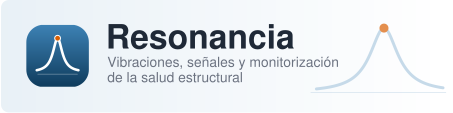

<p align="center">
  
</p>

# Resonancia

**Vibraciones, señales y monitorización de la salud estructural.**

Resonancia es el material docente de la asignatura *Monitorización de la Salud Estructural* (655023)
del Máster Universitario en Ingeniería Industrial de la Universidad de Córdoba. Reúne teoría,
problemas, experimentación con datos reales, programación científica y simuladores interactivos para
analizar vibraciones y señales de estructuras y evaluar su estado. Puede seguirse también de forma
autónoma.

Web: <https://me1catrr.github.io/resonancia/>

## Estructura

El concepto se explica en M y su aplicación, con Julia y con Claude Code, se practica en L. Los
contenidos no se duplican: se enlazan.

| Vía | Carpeta | Contenido |
|---|---|---|
| **M** | `mse/` | Monitorización de la Salud Estructural: una unidad por sesión (M0–M12) |
| **L** | `labs/` | Laboratorios: L1–L8 son las prácticas P1–P8; PG es el proyecto globalizador |
| **R** | `recursos/` | R1–R4: Palma del Río, Torroja, SMART-BRIDGES y viaducto Guadiato; catálogo de datos y referencia de Resonancia.jl |

## Proyectos complementarios

Resonancia es autocontenida. Quien quiera ampliar las herramientas dispone, de forma opcional, de
dos proyectos independientes del mismo autor:

- [JuliaDo](https://me1catrr.github.io/juliado/) ([repositorio](https://github.com/me1catrr/juliado)): programación y computación científica con Julia.
- [ClaudeDo](https://me1catrr.github.io/claudedo/) ([repositorio](https://github.com/me1catrr/claudedo)): IA aplicada al trabajo profesional, la programación y la investigación.

Ficheros clave:

- `temario.yml`: fuente de verdad de identificadores, títulos, carpetas, prerrequisitos y temas.
- `scripts/generar_estructura.jl`: genera la estructura de la web a partir del temario.
- `_navegacion.yml`: barra superior y barras laterales (generado, no se edita a mano).
- `Resonancia.jl/` y `datos/`: el paquete local de Julia y los conjuntos de datos, cuando existan.

## Compilar en local

Requisitos: [Julia](https://julialang.org/) 1.12 (se recomienda instalarlo con `juliaup`) y
[Quarto](https://quarto.org/) 1.10.

```sh
# Entorno de Julia (un único entorno en la raíz)
julia --project=. -e 'using Pkg; Pkg.instantiate()'

# Vista previa con recarga automática
quarto preview

# Compilar el sitio completo (se genera en _site/)
quarto render
```

Las páginas que ejecutan Julia guardan sus resultados en `_freeze/` (`freeze: auto`), de modo que la
publicación no necesita Julia. Si cambias una página con código, compílala en local y confirma también
los cambios de `_freeze/`.

El código Python de las pestañas no se ejecuta en la web. Su versión probada vivirá en la carpeta
`python/` de cada unidad, con un entorno gestionado con [`uv`](https://docs.astral.sh/uv/) que se
creará cuando haya código Python que probar.

## Regenerar la estructura

```sh
julia --project=. scripts/generar_estructura.jl             # genera lo que falte
julia --project=. scripts/generar_estructura.jl --dry-run   # simula y muestra el resumen
julia --project=. scripts/generar_estructura.jl --comprobar # compara cabeceras con temario.yml
```

El script crea carpetas, `index.qmd` y `slides.qmd` de cada unidad, las páginas de vía y de nivel, y
`_navegacion.yml`. Nunca sobrescribe un `index.qmd` o `slides.qmd` existente; solo `_navegacion.yml`
se regenera siempre. El modo `--comprobar` no escribe nada: lista las diferencias entre la cabecera de
cada `index.qmd` y el temario (`title`, `requiere`, `sesion`, `practica`) y termina con
código 1 si las hay. Si algo cambia en las unidades, se propone primero el cambio en `temario.yml`.

## Licencias

- **Código y Resonancia.jl:** MIT, véase [`LICENSE`](LICENSE).
- **Textos, diapositivas y figuras:** CC BY-SA 4.0, véase [`LICENSE-CONTENIDO`](LICENSE-CONTENIDO).
- **Datos:** cada conjunto de datos lleva la licencia indicada en su ficha `.meta.toml`.

## Cómo citar

Los metadatos de cita están en [`CITATION.cff`](CITATION.cff); GitHub ofrece la opción «Cite this
repository» a partir de él. El DOI de Zenodo se añadirá con la primera versión publicada.

## Errores, preguntas y sugerencias

Usa los [issues del repositorio](https://github.com/me1catrr/resonancia/issues): hay un formulario
para comunicar una errata y otro para preguntas o sugerencias.

## Aviso

Resonancia es un proyecto docente independiente, sin afiliación con Anthropic.
