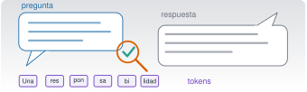

{.portada fig-alt="Ilustración de una burbuja de pregunta, una burbuja de respuesta con una lupa y una marca de verificación, y una fila de tokens"}

```{ojs}
//| echo: false
import {lineaTemporal} from "../../recursos/js/componentes/linea-temporal.js"
import {hitos} from "./hitos.js"
```

## Objetivos y prerrequisitos

**Objetivos.** Al terminar la unidad sabrás:

- situar los grandes hitos de la inteligencia artificial, de la IA simbólica al aprendizaje automático;
- explicar qué es una red neuronal, qué aportó el aprendizaje profundo y por qué el *transformer* está detrás de los modelos actuales;
- explicar, sin matemáticas avanzadas, cómo genera texto un modelo de lenguaje y qué son los *tokens* y el contexto;
- distinguir un modelo de lenguaje, un asistente y un agente;
- reconocer los tres errores típicos de una IA en ingeniería: alucinaciones, paquetes inexistentes y referencias inventadas;
- aplicar las cuatro competencias del marco de fluidez: delegar, describir, discernir y actuar con diligencia;
- decidir qué datos puedes compartir con un asistente y cuáles no;
- declarar el uso de IA en un trabajo académico o técnico;
- organizar el uso de IA en una empresa o un proyecto de ingeniería con supervisión humana;
- saber qué no puede hacer la IA por ti.

**Prerrequisitos.** Ninguno. Esta unidad es conceptual: no necesitas programar ni instalar nada.

**Nivel y ejecución.** Básico · [Simulación]{.ejec .ejec-sim} Todo ocurre en el navegador: las simulaciones y los ejercicios no envían nada a ningún servidor.

**Temas de la unidad**

- **C0.1** Breve historia de la IA: de la IA simbólica al aprendizaje automático
- **C0.2** Redes neuronales, aprendizaje profundo y *transformers*
- **C0.3** Cómo funciona un modelo de lenguaje: tokens, contexto y predicción
- **C0.4** De los asistentes conversacionales a los agentes: LLM, asistente y agente
- **C0.5** Capacidades y límites: alucinaciones, paquetes inexistentes y referencias inventadas
- **C0.6** Marco de fluidez: delegar, describir, discernir y actuar con diligencia
- **C0.7** Privacidad y confidencialidad: RGPD, datos de empresa y de investigación
- **C0.8** Integridad académica y declaración del uso de IA
- **C0.9** Uso responsable en la empresa e ingeniería con supervisión humana
- **C0.10** Lo que la IA no puede hacer por ti

::: {.callout-note title="Una advertencia sobre el tiempo"}
Los modelos cambian cada pocos meses: lo que hoy falla, mañana puede acertar, y al revés. Por eso
esta unidad se centra en **hábitos de comprobación** que no caducan, y no en listas de lo que «la
IA sabe» o «no sabe». La historia, en cambio, no caduca: ayuda a entender por qué los modelos
actuales aciertan y fallan como lo hacen.
:::

## Teoría breve

### C0.1 Breve historia de la IA: de la IA simbólica al aprendizaje automático {#c0-1}

En 1950, Alan Turing propuso cambiar la pregunta «¿pueden pensar las máquinas?», difícil de
definir, por otra que se puede poner a prueba: si por escrito no distinguimos a una máquina de una
persona, ¿qué nos falta para decir que piensa? [@turing1950]. Cinco años después, cuatro
investigadores pidieron fondos para un encuentro de verano con un título que dio nombre al campo:
*inteligencia artificial* [@mccarthy1955].

Desde entonces conviven dos grandes maneras de hacer IA:

| | IA simbólica | Aprendizaje automático |
|---|---|---|
| **Idea** | El conocimiento se escribe como reglas, lógica y búsqueda. | El comportamiento se ajusta a partir de ejemplos. |
| **Ejemplo** | Un sistema experto: «si la vibración supera tal umbral y la temperatura sube, avisa». | Un modelo que aprende de registros etiquetados qué patrones preceden a una avería. |
| **Fortaleza** | Se puede leer y explicar cada decisión. | Capta patrones que nadie sabría escribir como reglas. |
| **Debilidad** | Es frágil fuera de los casos previstos y costoso de mantener. | Depende de los datos y es difícil saber por qué decide algo. |

La historia no ha sido lineal. Ha habido etapas de grandes promesas seguidas de recortes de
financiación y de expectativas, que la literatura llama «inviernos de la IA». El enfoque que hoy
domina, el aprendizaje automático, no es nuevo: lo nuevo es la cantidad de datos y de cómputo
disponibles.

Para un ingeniero, la idea de «aprender de datos» es familiar. Ajustar los parámetros modales de un
modelo a una FRF medida ([M7](../../mse/m07-identificacion/index.qmd)) es una buena analogía: en
ambos casos se eligen los parámetros que minimizan una medida de error entre el modelo y los datos.
Pero conviene no pasar por alto las diferencias. Un modelo modal tiene pocos parámetros con
significado físico (frecuencia, amortiguamiento, forma modal) y se ajusta para *explicar* un
sistema concreto. Una red neuronal tiene millones o miles de millones de parámetros sin significado
individual, se ajusta para *generalizar* a datos que no ha visto (por eso se reserva una parte de los
datos para validarla) y su error se mide sobre texto, no sobre aceleraciones. Y, como en identificación
modal, un buen ajuste a los datos de entrenamiento no garantiza un buen comportamiento fuera de ellos.

::: {.callout-note .historia icon=false title="Un poco de historia: ELIZA y la ilusión de comprensión"}
En 1966, Joseph Weizenbaum presentó ELIZA, un programa que mantenía diálogos sustituyendo
palabras clave por frases preparadas, sin ninguna comprensión del contenido [@weizenbaum1966]. El
propio autor advirtió de lo fácil que era atribuirle entendimiento. Seis décadas después, la
advertencia sigue vigente: una conversación fluida no demuestra que haya comprensión detrás.

<span class="fuentes-caja">Enlace: [Weizenbaum (1966), *Communications of the ACM*](https://doi.org/10.1145/365153.365168). Consultado el 23-10-2026.</span>
:::

**Línea temporal de la IA.** Pulsa un tema para filtrar los hitos. Cada uno enlaza su fuente; las
marcadas como «fuente secundaria» no se pudieron cotejar con el original.

```{ojs}
//| echo: false
lineaTemporal(hitos, {titulo: "Línea temporal de la IA"})
```

**Pon a prueba lo anterior.**

::: {.ejercicio tipo="opcion" id="c0-1-simbolica" respuesta="b"}
Un programa decide si una pieza es defectuosa aplicando reglas escritas por un experto («si la grieta mide más de 2 mm, rechazar»). Es un ejemplo de…

::: {.opciones}
- aprendizaje automático.
- IA simbólica.
- aprendizaje profundo.
- un modelo de lenguaje.
:::

::: {.solucion}
**IA simbólica**: el conocimiento está escrito como reglas explícitas. Si las reglas se hubieran ajustado a partir de ejemplos de piezas buenas y malas, sería aprendizaje automático.
:::
:::

::: {.ejercicio tipo="vf" id="c0-1-dartmouth" respuesta="verdadero"}
La propuesta de 1955 para el encuentro de Dartmouth ya usaba en su título la expresión «inteligencia artificial».

::: {.solucion}
**Verdadero.** El título de la propuesta de McCarthy, Minsky, Rochester y Shannon habla de un proyecto de investigación sobre *artificial intelligence* [@mccarthy1955].
:::
:::

### C0.2 Redes neuronales, aprendizaje profundo y *transformers* {#c0-2}

Una **neurona artificial** hace dos cosas: suma sus entradas, cada una multiplicada por un **peso**, y
aplica a esa suma una **función de activación** que decide cuánto «se activa»:

$$
y = \varphi\Big(\sum_i w_i x_i + b\Big),
$$

donde $w_i$ son los pesos, $b$ el sesgo y $\varphi$ la activación (escalón, sigmoide, ReLU…). El
perceptrón de 1958 ya era esto, con la novedad de que los pesos se corregían a partir de ejemplos
[@rosenblatt1958].

Una **red neuronal** encadena muchas neuronas en capas. **Entrenarla** es ajustar todos los pesos
para que la salida se parezca a la deseada en los ejemplos. La pieza clave es la **retropropagación
del error** (*backpropagation*): con la regla de la cadena se calcula cuánto contribuye cada peso al
error, y se corrige un poco en la dirección que lo reduce (descenso por gradiente)
[@rumelhart1986].

El **aprendizaje profundo** (*deep learning*) es el uso de redes con muchas capas. Necesitaba tres
ingredientes que tardaron décadas en juntarse: muchos datos, mucho cómputo y técnicas para entrenar
redes grandes. Hacia 2012, una red convolucional profunda aplicada a la clasificación de imágenes
de ImageNet marcó el inicio del auge actual [@krizhevsky2012].

Para el texto, el problema es que importa el orden y el contexto. Las redes recurrentes, como la LSTM
[@hochreiter1997], leían palabra a palabra arrastrando una memoria. En 2017 apareció el
**transformer** [@vaswani2017], basado en un mecanismo de **atención**: para cada fragmento de
texto, el modelo calcula cuánto debe «fijarse» en otros fragmentos. Como no tiene que leer en
orden, se entrena en paralelo y escala a tamaños enormes. Hay dos variantes de la atención: la
**bidireccional**, en la que cada fragmento puede mirar a los anteriores y a los posteriores (útil
para comprender o clasificar un texto ya escrito), y la **causal**, en la que solo mira a los
anteriores (necesaria para generar texto token a token, porque el siguiente aún no existe). Los
modelos que generan texto usan atención causal. Los modelos de lenguaje de uso general actuales se
basan en esta familia de arquitecturas; los detalles internos de cada modelo comercial, Claude
incluido, no siempre se publican.

**Simulación 1. Una neurona artificial.** Cambia el peso, el sesgo y la activación, y observa cómo
responde la neurona a una entrada $x$.

```{ojs}
//| echo: false
viewof N_w = Inputs.range([-3, 3], {value: 1.5, step: 0.1, label: "peso w"})
```
```{ojs}
//| echo: false
viewof N_b = Inputs.range([-3, 3], {value: 0, step: 0.1, label: "sesgo b"})
```
```{ojs}
//| echo: false
viewof N_f = Inputs.radio(["escalón", "sigmoide", "ReLU"], {value: "sigmoide", label: "activación"})
```
```{ojs}
//| echo: false
N_act = ({"escalón": z => (z >= 0 ? 1 : 0), "sigmoide": z => 1 / (1 + Math.exp(-z)), "ReLU": z => Math.max(z, 0)})[N_f]
N_datos = Array.from({length: 241}, (_, i) => { const x = -3 + i * 0.025; return {x, y: N_act(N_w * x + N_b)}; })
Plot.plot({
  width: 640, height: 260, grid: true,
  x: {label: "entrada x"}, y: {label: "salida y", domain: N_f === "ReLU" ? undefined : [-0.05, 1.05]},
  marks: [
    Plot.ruleY([0]), Plot.ruleX([0]),
    Plot.line(N_datos, {x: "x", y: "y", stroke: "#1b6ca8", strokeWidth: 2.5}),
    Plot.text([`y = ${N_f}(${N_w.toFixed(1)}·x ${N_b < 0 ? "−" : "+"} ${Math.abs(N_b).toFixed(1)})`], {frameAnchor: "top-left", dx: 6, dy: 6, fontSize: 13})
  ]
})
```

Fíjate en que el sesgo desplaza el punto en que la neurona «se enciende» y el peso decide lo brusco
del cambio. Una red ajusta millones o miles de millones de estos parámetros a la vez.

**Pon a prueba lo anterior.**

::: {.ejercicio tipo="numerico" id="c0-2-neurona" respuesta="0.1" tol="1%"}
Una neurona con activación ReLU, $\varphi(z)=\max(z,0)$, recibe $x=(1,\,2)$ con pesos $w=(0{,}5,\,-0{,}25)$ y sesgo $b=0{,}1$. ¿Cuál es su salida?

::: {.solucion}
$z = 0{,}5\cdot1 + (-0{,}25)\cdot2 + 0{,}1 = 0{,}1$ y $\max(0{,}1,\,0) = 0{,}1$.
:::
:::

::: {.ejercicio tipo="opcion" id="c0-2-atencion" respuesta="c"}
¿Qué aportó el *transformer* frente a las redes recurrentes?

::: {.opciones}
- Eliminó la necesidad de datos de entrenamiento.
- Garantizó que las respuestas fueran verdaderas.
- Un mecanismo de atención que relaciona unos fragmentos con otros y permite entrenar en paralelo.
- Sustituyó las neuronas por reglas lógicas.
:::

::: {.solucion}
La **atención** permite que cada fragmento «mire» a otros (a todos, o solo a los anteriores en la variante causal) sin leer en orden, lo que facilita entrenar en paralelo y escalar. No garantiza la verdad (C0.5) ni prescinde de datos.
:::
:::

### C0.3 Cómo funciona un modelo de lenguaje: tokens, contexto y predicción {#c0-3}

Un **modelo de lenguaje de gran tamaño** (*large language model*, LLM) es un programa entrenado con
enormes cantidades de texto para una tarea aparentemente simple: dado un fragmento de texto,
predecir cómo continúa. Lo demás (responder preguntas, escribir código, resumir) se construye sobre
esa capacidad, y después se ajusta el modelo para que siga instrucciones de forma útil.

Tres ideas bastan para razonar con él:

- **Tokens.** El modelo no ve letras ni palabras, sino *tokens*: trozos de texto, a veces una
  palabra entera y a veces solo un fragmento. Una palabra rara, un nombre propio o un número largo
  se parten en varios tokens. En español suelen hacer falta más tokens por palabra que en inglés.
- **Contexto.** El modelo solo «ve» lo que cabe en su **ventana de contexto** (*context window*): tu
  mensaje, la conversación anterior y lo que él mismo va escribiendo. Lo que quede fuera no existe
  para él. Y entre una conversación y otra no recuerda nada, salvo que la herramienta que uses
  incluya una memoria explícita.
- **Predicción con azar.** Para cada token, el modelo calcula probabilidades y elige uno. Por eso la
  misma pregunta puede dar respuestas distintas, y por eso un texto **fluido** no es por ello un
  texto **verdadero**: el modelo optimiza lo plausible.

Conviene separar dos cosas. El **objetivo de entrenamiento** es predecir bien el texto: se ajustan
los parámetros para que el texto real resulte probable. Ese objetivo no incluye comprobar que lo
dicho sea cierto. Las fases posteriores de ajuste (con ejemplos de buenas respuestas o con valoraciones
humanas) hacen al modelo más útil y más prudente, pero tampoco lo convierten en un verificador de
hechos: la **verificación factual** exige contrastar con fuentes externas, y esa tarea es tuya (C0.5).

Consecuencia práctica: cuanto mejor le des el contexto relevante (datos, restricciones, formato), mejor
será la respuesta. Y cuanto más pequeño y específico sea el dato que pides (un nombre, una cifra, una
referencia), más probable es que lo invente.

**Simulación 2. Elegir el siguiente token.** Un modelo ficticio debe continuar «La frecuencia natural
se expresa en…». Asigna una puntuación a cada candidato y la convierte en probabilidades con la
función *softmax*, $p_i = e^{s_i/T} / \sum_j e^{s_j/T}$. La **temperatura** $T$ controla cuánto se
reparte la probabilidad. Las puntuaciones son inventadas para la práctica.

```{ojs}
//| echo: false
viewof S_T = Inputs.range([0.1, 3], {value: 1, step: 0.05, label: "temperatura T"})
```
```{ojs}
//| echo: false
S_cand = [{t: "hercios", s: 4.0}, {t: "Hz", s: 3.5}, {t: "rad/s", s: 2.5}, {t: "segundos", s: 0.5}, {t: "metros", s: -1.0}]
S_prob = { const e = S_cand.map(c => Math.exp(c.s / S_T)); const z = e.reduce((a, b) => a + b, 0); return S_cand.map((c, i) => ({...c, p: e[i] / z})); }
Plot.plot({
  width: 640, height: 240, marginLeft: 80,
  x: {label: "probabilidad", domain: [0, 1], percent: false}, y: {label: null, domain: S_cand.map(c => c.t)},
  marks: [
    Plot.barX(S_prob, {x: "p", y: "t", fill: "#2a9d8f"}),
    Plot.text(S_prob, {x: "p", y: "t", text: d => (100 * d.p).toFixed(1) + " %", dx: 22}),
    Plot.ruleX([0])
  ]
})
```

Cuidado al interpretar las barras: *softmax* convierte puntuaciones en una distribución que suma 1,
pero esa «probabilidad» es la que el modelo asigna a cada continuación, no una medida de certeza de
que sea correcta ni de que sea verdadera; un modelo puede asignar mucha probabilidad a algo falso.
Con $T$ baja casi siempre sale «hercios»; con $T$ alta aparecen opciones raras, alguna absurda
(«metros»). Ningún valor de $T$ hace que el modelo *sepa* la respuesta: solo cambia cómo reparte la
probabilidad entre lo que le parece plausible. Y una temperatura baja o nula no garantiza que la
misma pregunta dé siempre la misma respuesta: según el servicio y la configuración, puede haber
otras fuentes de variación. (Además, en algunas versiones recientes de la API de Claude ya no se puede ajustar la temperatura: véase C9.2.)

**Pon a prueba lo anterior.**

::: {.ejercicio tipo="opcion" id="c0-3-token" respuesta="c"}
Un modelo de lenguaje procesa el texto en forma de…

::: {.opciones}
- letras sueltas.
- palabras completas, siempre.
- *tokens*, trozos de texto de longitud variable.
- frases enteras.
:::

::: {.solucion}
*Tokens*: a veces una palabra entera y a veces un fragmento. Una palabra rara, un nombre propio o un número largo se parten en varios.
:::
:::

::: {.ejercicio tipo="numerico" id="c0-3-softmax" respuesta="0.8808" tol="1%"}
Con solo dos candidatos, de puntuaciones $s_1=2$ y $s_2=0$, y temperatura $T=1$, ¿qué probabilidad recibe el primero?

::: {.solucion}
$p_1 = e^{2}/(e^{2}+e^{0}) = 7{,}389/8{,}389 \approx 0{,}8808$. Con $T=0{,}5$ subiría a $0{,}982$: bajar la temperatura concentra la probabilidad.
:::
:::

::: {.ejercicio tipo="vf" id="c0-3-fluido" respuesta="falso"}
Si una respuesta del modelo está muy bien escrita y es segura de sí misma, es probable que sea verdadera.

::: {.solucion}
**Falso.** El modelo optimiza lo **plausible**, no lo verdadero: un texto fluido no es por ello un texto veraz.
:::
:::

### C0.4 De los asistentes conversacionales a los agentes: LLM, asistente y agente {#c0-4}

A finales de 2022, los asistentes conversacionales llegaron al gran público, y desde entonces la
palabra «IA» se usa para cosas muy distintas. Conviene separar tres niveles:

| | Modelo de lenguaje (LLM) | Asistente | Agente |
|---|---|---|---|
| **Qué es** | El modelo: recibe texto y devuelve texto. | Un modelo ajustado para seguir instrucciones, con una interfaz de conversación. | Un sistema en el que el modelo decide y encadena acciones con herramientas hasta cumplir un objetivo. |
| **Qué hace** | Predice la continuación. | Responde, redacta, explica. | Lee ficheros, ejecuta órdenes, prueba, corrige, vuelve a probar. |
| **Quién actúa** | Nadie: solo produce texto. | Tú, con lo que te responde. | El agente, dentro de los permisos que le des. |
| **Ejemplo** | Un modelo de la familia Claude a través de la API. | Claude en el navegador. | Claude Code en tu terminal. |

Un agente trabaja en **bucle**. La documentación de Claude Code lo describe en tres fases que se
repiten: reunir contexto, actuar y verificar el resultado, con la persona pudiendo interrumpir en
cualquier momento ([*How Claude Code works*](https://code.claude.com/docs/en/how-claude-code-works),
consultado el 23-10-2026). Para actuar usa **herramientas** (leer y editar ficheros, ejecutar
órdenes, buscar en la web) y puede conectarse a otras mediante estándares como el protocolo MCP,
publicado por Anthropic en noviembre de 2024
([anuncio](https://www.anthropic.com/news/model-context-protocol)). Lo verás en detalle en C4 y C7.

::: {.callout-tip .idea-clave title="Idea clave"}
Cuanta más **autonomía** tiene un sistema, más importa **verificar** lo que hace. Un asistente se
equivoca en una respuesta que tú lees; un agente puede equivocarse en una acción que ya se ha
ejecutado. Por eso los agentes vienen con permisos, puntos de control y registros, y por eso la
supervisión humana (C0.9) no es opcional.
:::

**Pon a prueba lo anterior.**

::: {.ejercicio tipo="opcion" id="c0-4-nivel" respuesta="c"}
Recibe el objetivo «haz que pasen las pruebas», lee el código, ejecuta las pruebas, corrige un fichero y las vuelve a ejecutar hasta que pasan. Es…

::: {.opciones}
- un modelo de lenguaje sin más.
- un asistente conversacional.
- un agente.
- un sistema experto.
:::

::: {.solucion}
Un **agente**: decide y encadena acciones con herramientas (leer, ejecutar, editar) en un bucle hasta cumplir el objetivo.
:::
:::

::: {.ejercicio tipo="vf" id="c0-4-supervision" respuesta="falso"}
Un agente que comprueba sus propios resultados no necesita supervisión humana.

::: {.solucion}
**Falso.** Que ejecute pruebas no garantiza que las pruebas sean las adecuadas ni que la acción fuera la que querías. Tú decides los permisos y revisas lo que hace (C0.6, C0.9).
:::
:::

### C0.5 Capacidades y límites: alucinaciones, paquetes inexistentes y referencias inventadas {#c0-5}

Llamamos **alucinación** (*hallucination*) a una respuesta fluida y segura de sí misma que es falsa
o carece de fundamento [@ji2023]. No es un fallo ocasional: es una consecuencia de cómo funcionan
estos modelos (C0.3). En ingeniería aparece sobre todo de tres formas:

| Error | Ejemplo típico | Cómo detectarlo |
|---|---|---|
| **Dato o fórmula incorrectos** | Una resolución en frecuencia mal calculada. | Recalcular a mano con un caso sencillo. |
| **Paquete o función inexistente** | Un paquete de Julia o Python con un nombre verosímil que no existe. | Buscarlo en el registro oficial y leer su documentación. |
| **Referencia inventada** | Autores, año y revista que suenan bien, pero el artículo no existe. | Localizarla por título o DOI en una fuente fiable. |

Los paquetes inexistentes merecen una advertencia más: se ha documentado que los modelos de código
sugieren a veces nombres de paquetes que no existen [@spracklen2025], y que esos nombres pueden
repetirse. Si alguien registra ese nombre con código malicioso, quien instale ciegamente lo que le
dijo la IA se lo descargará. Regla de oro: **nunca instales un paquete sin comprobar que existe, quién
lo mantiene y que hace lo que dices que hace.**

Lo mismo con las referencias. Una IA puede escribir una cita con autores reales y un título
plausible que **no corresponde a ningún artículo**. Una referencia solo vale cuando la has
localizado tú.

::: {.callout-note .noticia icon=false title="En las noticias: cuando la IA inventa y alguien lo firma"}
En 2023, dos abogados de Nueva York presentaron ante un tribunal un escrito con **seis sentencias que no existían**, generadas por ChatGPT. El juez les impuso una multa de 5 000 dólares y les obligó a notificarlo a su cliente y a los jueces a quienes se atribuían las falsas sentencias. Nadie discutió que usar IA fuera ilegal: lo grave fue **no comprobar** lo que firmaban (competencia de *diligencia*, C0.6). En ingeniería, los paquetes inexistentes tienen un riesgo añadido: alguien puede registrar ese nombre con código malicioso.

<span class="fuentes-caja">Enlaces: [CNBC, «ChatGPT cited bogus cases for a New York federal court filing»](https://www.cnbc.com/2023/05/30/chatgpt-cited-bogus-cases-for-a-new-york-federal-court-filing.html) · [LawNext: sanciones](https://www.lawnext.com/2023/06/court-imposes-sanctions-on-lawyers-who-filed-bogus-cases-after-relying-on-chatgpt-for-legal-research.html) · [Infosecurity Magazine, «slopsquatting»](https://www.infosecurity-magazine.com/news/ai-hallucinations-slopsquatting/). Consultado el 21-10-2026.</span>
:::

**Pon a prueba lo anterior.**

::: {.ejercicio tipo="opcion" id="c0-5-ref" respuesta="b"}
Una IA te da una referencia con autores, año y revista plausibles. ¿Qué haces antes de citarla?

::: {.opciones}
- La cito: tiene buena pinta.
- La busco por título o DOI en una fuente fiable.
- Le pregunto a la propia IA si es verdad.
- La cito si suena a un autor conocido.
:::

::: {.solucion}
La **b**. Preguntarle a la misma IA (c) no sirve: puede reafirmar lo inventado. Una referencia solo vale cuando **tú** la has localizado.
:::
:::

::: {.ejercicio tipo="numerico" id="c0-5-fft" respuesta="0.05" tol="1%" unidad="Hz"}
Una IA te dice que un registro de $20$ s a $200$ Hz tiene una resolución en frecuencia de $0{,}1$ Hz. Compruébalo: calcula la resolución $\Delta f$.

::: {.solucion}
$\Delta f=1/T=1/20=0{,}05$ Hz (con $N=4000$ muestras, $\Delta f=f_s/N=200/4000$). La IA se equivocó por un factor 2.
:::
:::

::: {.ejercicio tipo="programacion" id="c0-5-reg" respuesta="0" tol="abs:0.001"}
Antes de instalar un paquete, comprueba que existe. En Julia, cuenta cuántas entradas del registro general tienen un nombre dado y aplica la función a `EstructuraFFT` (un paquete inventado). Escribe el resultado.

```julia
using Pkg
function entradas(nombre)
    n = 0
    # recorre Pkg.Registry.reachable_registries() y sus reg.pkgs
    return n
end
```

::: {.solucion}
```julia
function entradas(nombre)
    n = 0
    for reg in Pkg.Registry.reachable_registries()
        for (_, pkg) in reg.pkgs
            pkg.name == nombre && (n += 1)
        end
    end
    return n
end
entradas("FFTW")           # 1
entradas("EstructuraFFT")  # 0
```
Existir en el registro no basta: también hay que ver quién mantiene el paquete y qué hace.
:::
:::

### C0.6 Marco de fluidez: delegar, describir, discernir y actuar con diligencia {#c0-6}

Dakan y Feller, con Anthropic, proponen un marco de **fluidez en IA** con cuatro competencias
conectadas, llamadas las «4D» [@dakan2025]. Describen cómo usar la IA de forma eficaz, eficiente,
ética y segura. Con palabras propias y un ejemplo de este curso (preparar el informe de una campaña
de medición):

| Competencia | En una frase | Pregunta que debes hacerte | Ejemplo |
|---|---|---|---|
| **Delegar** (*Delegation*) | Decidir si, cuándo y cómo entra la IA en la tarea. | ¿Qué parte me ahorra tiempo y cuál debo hacer yo? | Delego el borrador de la estructura del informe; no delego las conclusiones sobre el estado de la estructura. |
| **Describir** (*Description*) | Explicar el objetivo, el contexto y el formato para que la respuesta sea útil. | ¿Entendería esto una persona sin contexto? | Indico la estructura, las unidades, la frecuencia de muestreo y el formato de tabla que quiero. |
| **Discernir** (*Discernment*) | Evaluar si lo producido es correcto, relevante y seguro. | ¿Cómo sé que esto es verdad? | Recalculo dos valores a mano y localizo las referencias citadas. |
| **Diligencia** (*Diligence*) | Responsabilizarse de lo que se hace con la IA y de cómo se hace. | ¿Puedo defender este resultado y declarar su origen? | Reviso el informe entero, protejo los datos y declaro el uso de IA. |

El marco distingue además tres modos de interacción: la **automatización** (la IA ejecuta una tarea
concreta que le encargas), el **aumento** (piensas junto a la IA, como compañera de trabajo) y la
**agencia** (la configuras para que actúe por tu cuenta más adelante). Claude Code, que usarás desde C4, se
mueve sobre todo entre los dos últimos, y por eso importa tanto la diligencia.

::: {.callout-note .noticia icon=false title="En las noticias: el chatbot que prometió lo que la empresa no cumplía"}
En febrero de 2024, un tribunal de Columbia Británica (Canadá) dio la razón a un pasajero al que el chatbot de Air Canada había dicho que podía pedir con carácter retroactivo una tarifa por duelo, algo que la aerolínea negó después. La empresa alegó que el chatbot era «una entidad separada, responsable de sus actos»; el tribunal rechazó el argumento: el chatbot forma parte de su web y la compañía **responde de lo que ofrece**. Si delegas en una IA, la responsabilidad sigue siendo tuya.

<span class="fuentes-caja">Enlace: [American Bar Association, «BC Tribunal Confirms Companies Remain Liable for Information Provided by AI Chatbot»](https://www.americanbar.org/groups/business_law/resources/business-law-today/2024-february/bc-tribunal-confirms-companies-remain-liable-information-provided-ai-chatbot/). Consultado el 21-10-2026.</span>
:::

**Pon a prueba lo anterior.**

::: {.ejercicio tipo="opcion" id="c0-6-4d" respuesta="a"}
Decidir si una tarea conviene encargársela a la IA, y cómo, corresponde a la competencia de…

::: {.opciones}
- Delegar.
- Describir.
- Discernir.
- Actuar con diligencia.
:::

::: {.solucion}
**Delegar**: decidir si, cuándo y cómo entra la IA en la tarea. Describir es explicarle lo que necesita; discernir, evaluar lo que devuelve; diligencia, responsabilizarse del resultado.
:::
:::

### C0.7 Privacidad y confidencialidad: RGPD, datos de empresa y de investigación {#c0-7}

Lo que escribes en un asistente, o le dejas leer, sale de tu ordenador. Antes de pegar nada
pregúntate qué clase de dato es:

| Clase | Ejemplos | ¿Puedo compartirlo con un asistente de IA? |
|---|---|---|
| **Público** | Datos sintéticos del repositorio, normas, artículos de acceso abierto. | Sí. |
| **Interno** | Borradores, apuntes, código en desarrollo. | Normalmente sí, revisando las condiciones del servicio. |
| **Confidencial** | Registros de una planta bajo acuerdo de confidencialidad, precios y contratos de clientes, resultados de investigación sin publicar. | **No**, salvo permiso expreso y servicio adecuado. |
| **Datos personales** | Nombres, listas de alumnado y calificaciones, nóminas y turnos de la plantilla, correos, fotografías con personas identificables. | **No**, salvo base legal y servicio adecuado. |
| **Secretos** | Claves de API, contraseñas, tokens, claves SSH. | **Nunca.** |

{#fig-datos fig-alt="Cinco filas apiladas: público (sí), interno (con cautela), confidencial (no, salvo permiso), datos personales (no, salvo base legal) y secretos (nunca), cada una con su símbolo" width="100%"}

Apuntes sobre el marco legal, a nivel de principios:

- El **Reglamento general de protección de datos** [@rgpd2016] y la **Ley Orgánica 3/2018** [@lopdgdd2018]
  regulan el tratamiento de datos personales. Pegar datos personales en un servicio externo es
  tratarlos y requiere una base legal. Ante la duda, no lo hagas y consulta con el delegado de
  protección de datos de tu institución o empresa.
- **Anonimizar no es lo mismo que seudonimizar.** Sustituir los nombres por códigos («E0073») es
  *seudonimizar*: quien tenga la tabla de correspondencia, u otros datos con los que cruzarlos, puede
  volver a identificar a las personas, así que **siguen siendo datos personales** y el reglamento se
  les aplica. Solo si la identificación deja de ser razonablemente posible, por ningún medio y por
  nadie, los datos están *anonimizados* y quedan fuera de su ámbito. Anonimizar de verdad es difícil
  (la combinación de edad, puesto y fechas puede bastar para identificar a alguien), de modo que
  no des por hecho que un fichero «sin nombres» es anónimo.
- El **Reglamento (UE) 2024/1689** [@aiact2024], sobre inteligencia artificial, fija obligaciones de
  transparencia, de supervisión humana y de gestión del riesgo según el uso (lo verás en C0.9).
- Las condiciones de **retención de datos y de entrenamiento** dependen del servicio y del plan
  contratado. Léelas antes de subir nada que no sea público: aquí no las damos por supuestas.
- Los **datos de planta y de empresa** suelen estar protegidos por acuerdos de confidencialidad. Ese
  permiso lo concede quien los cedió, no tú.

En Resonancia hay una regla concreta: la carpeta de datos privados no se sube al repositorio y
Claude Code tiene bloqueado su acceso por configuración (verás cómo en C4 y C7). Los datos
publicables se documentan con una ficha de origen, licencia y permiso. Todos los casos de empresa
del curso usan **datos sintéticos**, generados con semilla fija.

**Pon a prueba lo anterior.**

::: {.ejercicio tipo="opcion" id="c0-7-datos" respuesta="c"}
Una hoja con los nombres del alumnado y sus calificaciones es…

::: {.opciones}
- un dato público.
- un dato interno sin más.
- un conjunto de datos personales.
- un secreto técnico.
:::

::: {.solucion}
Datos personales: pegarlos en un servicio externo es tratarlos y exige una base legal. Ante la duda, no lo hagas.
:::
:::

::: {.ejercicio tipo="vf" id="c0-7-pago" respuesta="falso"}
Si el servicio de IA es de pago, puedo subir datos de planta confidenciales sin pedir permiso.

::: {.solucion}
**Falso.** El permiso para ceder datos de planta lo da **quien los cedió**, no tú, y depende de las condiciones de retención y de entrenamiento del servicio, que debes leer antes.
:::
:::

### C0.8 Integridad académica y declaración del uso de IA {#c0-8}

Usar IA no es en sí mismo deshonesto, pero hay cuatro principios que debes seguir siempre:

1. **Autoría.** Lo que entregas es tuyo: debes entenderlo y poder explicarlo y defenderlo.
2. **Transparencia.** Declara qué herramienta usaste, para qué y cómo comprobaste el resultado.
3. **Verificación.** No entregues nada que no hayas contrastado, incluidas las referencias.
4. **Respeto a las normas.** Cada asignatura, trabajo o proyecto puede permitir, limitar o prohibir
   usos concretos. Consulta la guía docente y a quien coordine la asignatura; en caso de duda, pregunta
   antes y no después de entregar.

Un modelo de **declaración de uso de IA** que puedes copiar al final de un trabajo:

::: {.callout-note title="Declaración de uso de IA (modelo)"}
**Herramienta y versión:** (nombre, modelo y fecha de uso).

**Para qué la usé:** (p. ej., generar un borrador de código para calcular la PSD; revisar la
redacción de la introducción).

**Qué instrucciones principales le di:** (resumen o enlace a la conversación).

**Qué cambié y qué es de elaboración propia:** (partes que escribí, corregí o descarté).

**Cómo verifiqué el resultado:** (recalculé tal valor, comprobé que el paquete existe, localicé
las referencias…).
:::

Esta plantilla es un modelo orientativo. Si tu asignatura o institución exige otro formato,
prevalece el suyo. En Claude Code, `/export` guarda la conversación como texto: es una forma
sencilla de documentar las instrucciones que diste (revisa antes que no contenga datos personales).

**Pon a prueba lo anterior.**

::: {.ejercicio tipo="abierta" id="c0-8-declaracion"}
Redacta la **declaración de uso de IA** de un trabajo en el que has usado un asistente para generar un borrador de código y revisar la redacción.

::: {.rubrica}
- Indico herramienta, versión y fecha.
- Digo para qué la usé.
- Resumo las instrucciones principales que le di.
- Aclaro qué cambié y qué es de elaboración propia.
- Explico cómo verifiqué el resultado.
:::

::: {.solucion}
Debe ser **verdadera y completa**: herramienta y fecha, uso (borrador de código, revisión de redacción), instrucciones, partes propias frente a partes asistidas, y comprobaciones realizadas (p. ej., recalcular dos valores y localizar las referencias).
:::
:::

### C0.9 Uso responsable en la empresa e ingeniería con supervisión humana {#c0-9}

En una empresa o en un proyecto de ingeniería, el uso de IA no es una decisión individual: afecta
a clientes, a datos de terceros y a la responsabilidad profesional. Cinco reglas organizan casi
todo:

1. **Una política escrita.** Qué herramientas están aprobadas, con qué datos se pueden usar (C0.7) y
   quién responde de cada resultado. Breve, conocida por todos y revisada cuando cambian las
   herramientas.
2. **Supervisión proporcional al riesgo.** Cuanto más grave e irreversible sea la consecuencia de
   un error, más revisión humana antes de actuar. Un borrador de correo no necesita lo mismo que un
   cálculo que acaba en un informe firmado.
3. **Mínimo privilegio.** Un agente solo debe poder hacer lo que la tarea necesita: leer una
   carpeta, no todo el disco; proponer un cambio, no publicarlo. En C4 y C7 verás cómo se fija con
   permisos, y este mismo proyecto es un ejemplo.
4. **Trazabilidad.** Qué herramienta, qué versión, qué instrucciones y qué comprobaciones. Sin
   registro no hay auditoría posible ni aprendizaje de los errores.
5. **Una persona firma.** La IA no asume responsabilidad profesional: la asume quien entrega el
   resultado (C0.10).

La normativa recoge estas ideas. El Reglamento europeo de IA [@aiact2024] exige que los sistemas
de **alto riesgo** estén diseñados para que las personas puedan supervisarlos de verdad: entender sus
capacidades y límites, ser conscientes de la tendencia a fiarse en exceso de lo que proponen
(**sesgo de automatización**), interpretar bien sus resultados, decidir no usarlos o corregirlos y,
si hace falta, detenerlos (artículo 14). Además, el artículo 4 se refiere a la **alfabetización en IA** de quienes proporcionan
o usan sistemas de IA, que es, en el fondo, lo que hace esta unidad. Ojo con la vigencia: no todo
se aplica a todos ni a la vez. El artículo 4 se aplica desde febrero de 2025 y, según las fuentes
secundarias consultadas (el texto oficial no ha podido consultarse), el Reglamento (UE) 2026/1744, el llamado
«ómnibus digital» de IA [@omnibus2026], lo ha reformulado: deja de exigir garantizar un nivel suficiente y pide adoptar
medidas para promover la alfabetización. Ese mismo reglamento aplaza a diciembre de 2027 las
obligaciones de los sistemas de alto riesgo del anexo III y a agosto de 2028 las de los integrados en
productos regulados. Si tu caso real depende de una fecha o de una obligación concreta, lee el texto consolidado en
EUR-Lex y consulta a quien asesore jurídicamente a tu organización. Fuera de Europa existen marcos de uso
voluntario, como el del NIST estadounidense para gestionar los riesgos de la IA [@nist2023].

::: {.callout-warning title="Errores frecuentes"}
- **Sesgo de automatización:** aceptar la propuesta de la IA porque «suele acertar», sin revisarla.
- **Permisos amplios «para ir más rápido»:** el tiempo que se ahorra no compensa una acción
  irreversible que nadie revisó.
- **Delegar la firma:** «lo calculó la IA» no es una justificación técnica.
- **No registrar versiones:** sin saber qué modelo y qué instrucciones se usaron, no se puede
  reproducir ni corregir el resultado.
:::

**Pon a prueba lo anterior.**

::: {.ejercicio tipo="opcion" id="c0-9-sesgo" respuesta="d"}
Un técnico acepta sin revisar la clasificación de averías que propone un sistema de IA porque «casi siempre acierta». Ese comportamiento se llama…

::: {.opciones}
- mínimo privilegio.
- alfabetización en IA.
- trazabilidad.
- sesgo de automatización.
:::

::: {.solucion}
**Sesgo de automatización**: fiarse en exceso de lo que propone un sistema automático. La supervisión humana exige ser consciente de él y revisar.
:::
:::

::: {.ejercicio tipo="abierta" id="c0-9-politica"}
Redacta una **política de uso de IA** de cinco puntos para una pequeña ingeniería que hace informes de inspección de estructuras.

::: {.rubrica}
- Digo qué herramientas están permitidas y quién las aprueba.
- Clasifico qué datos se pueden usar y cuáles no.
- Fijo qué revisión humana necesita cada tipo de tarea según su riesgo.
- Exijo registrar herramienta, versión e instrucciones.
- Dejo claro quién firma y responde de cada informe.
:::

::: {.solucion}
Una buena política es breve y concreta. Por ejemplo: (1) solo herramientas aprobadas por la dirección técnica; (2) nunca datos de clientes ni personales fuera de ellas; (3) todo cálculo incluido en un informe lo revisa un segundo técnico; (4) cada informe anexa la declaración de uso de IA (C0.8); (5) firma el ingeniero responsable, que responde del contenido.
:::
:::

### C0.10 Lo que la IA no puede hacer por ti {#c0-10}

Una IA puede redactar, programar o explicar, pero hay cosas que siguen siendo tuyas:

- **Responder de una decisión de seguridad.** Un diagnóstico sobre el estado de una estructura lo
  firma una persona con la competencia y la responsabilidad profesional, no un modelo.
- **Medir.** No hay IA que sustituya a un sensor bien instalado, una calibración o una inspección
  in situ. Si los datos son malos, el análisis será malo por elegante que sea.
- **Conocer tu caso.** No sabe cómo es *tu* planta, *tu* estructura ni *tus* condiciones, salvo lo
  que le cuentes, y lo que le cuentes puede estar incompleto.
- **Saber cuándo se equivoca.** No distingue de forma fiable lo que sabe de lo que inventa. Esa
  distinción es el trabajo del discernimiento.
- **Aprender por ti.** Si delegas justo lo que querías aprender, te quedas sin la habilidad. Delega
  lo que ya dominas y puedes revisar; trabaja a mano lo que estás aprendiendo.

**Pon a prueba lo anterior.**

::: {.ejercicio tipo="investigacion" id="c0-10-caso"}
**Otro caso real.** Busca un caso, distinto de los de la unidad, en el que un error de una IA haya tenido consecuencias en ingeniería, ciencia o administración, y analízalo con las cuatro competencias.

::: {.criterios}
- Localizo al menos **dos fuentes fiables** y anoto autor, fecha y enlace.
- Distingo los **hechos comprobados** de las opiniones.
- Identifico qué competencia falló (delegar, describir, discernir o diligencia).
- Explico qué comprobación lo habría evitado.
:::

::: {.solucion}
No hay una única respuesta. Una buena ficha cita la fuente de cada hecho, reconoce lo que no se pudo comprobar y propone una **verificación concreta**, no solo «tener cuidado».
:::
:::

::: {.ejercicio tipo="encuesta" id="c0-10-delegar" texto="true"}
**Reflexión (no evaluada).** ¿Qué parte de tu trabajo en la asignatura delegarías en una IA y qué parte no? Anótalo y por qué.

::: {.opciones}
- Redactar borradores y estructura.
- Escribir código que luego reviso.
- Interpretar resultados.
- Tomar decisiones sobre el estado de una estructura.
:::
:::

## Práctica guiada

**Caza de errores.** Abajo tienes la respuesta de una IA **ficticia**, escrita para esta práctica, a
la pregunta *«¿Cómo calculo en Julia el espectro de un registro de aceleraciones de 10 s a 100 Hz y
qué resolución tengo?»*. Contiene tanto aciertos como errores. Tu trabajo: marcar cada afirmación
como **correcta**, **incorrecta** o **no comprobable**, y decir cómo lo has comprobado.

> 1. Basta con muestrear a 100 Hz para ver señales de hasta 100 Hz, según el teorema de Nyquist.
> 2. Con `using FFTW` y `fft(x)` obtienes la transformada de Fourier discreta.
> 3. Con 10 s de registro, la resolución en frecuencia es de 0,01 Hz.
> 4. Para facilitarte la vida, instala el paquete `EstructuraFFT.jl` con `] add EstructuraFFT` y
>    llama a `espectro_auto(x, fs)`.
> 5. `welch_pgram` del paquete `DSP` estima la densidad espectral de potencia promediando
>    segmentos, y admite la frecuencia de muestreo con la opción `fs`.
> 6. Esto se explica en Pérez, A. B. y Smith, J. (2018), *Spectral Methods for Structural
>    Monitoring*, Journal of Sound Structures, 12(3), 45–67.

**Lista de comprobaciones** que puedes aplicar a cualquier respuesta:

1. ¿**Existe** lo que nombra (paquete, función, norma, artículo)? Búscalo en el registro o la web oficial.
2. ¿**Coincide** con la documentación oficial? Léela; no te fíes de que «suena bien».
3. ¿Los **números** salen al recalcularlos a mano o con un caso sencillo?
4. ¿La **fuente** se puede localizar (DOI, editorial, repositorio)?
5. ¿Funciona sobre un **caso conocido** cuyo resultado ya sabes?

::: {.callout-note collapse="true" title="Solución"}
1. **Incorrecta.** Con una frecuencia de muestreo $f_s$ solo se representan frecuencias hasta
   $f_s/2$: aquí, 50 Hz. Comprobación: Nyquist–Shannon (se estudia en M3).
2. **Correcta.** `fft` está en FFTW.jl. Comprobación: documentación del paquete.
3. **Incorrecta.** La resolución es $\Delta f = 1/T = 1/10\,\text{s} = 0{,}1$ Hz. Comprobación:
   $N = 1000$ muestras y $\Delta f = f_s/N = 100/1000$.
4. **Paquete inexistente.** `EstructuraFFT.jl` es un nombre inventado para esta práctica; no está
   en el registro general de Julia. Comprobación: buscarlo en el registro y en el repositorio de
   los paquetes.
5. **Correcta.** `welch_pgram` existe en DSP.jl y admite `fs` como opción de palabra clave.
   Comprobación: documentación de DSP.jl.
6. **Referencia inventada.** Autores, revista y título son ficticios. Comprobación: no aparece por
   título ni por DOI en ninguna fuente fiable.

Si has marcado alguna como correcta sin comprobarla, no pasa nada: esa es la lección. Un error
detectado es mejor que un acierto por suerte.
:::

## «Pídeselo a Claude»

::: {.callout-tip title="Prompt"}
Soy estudiante de ingeniería y quiero entender la resolución en frecuencia de una FFT. Explícame
con un ejemplo numérico qué resolución tengo para un registro de 10 s muestreado a 100 Hz y hasta
qué frecuencia puedo ver. Luego dime qué afirmaciones de tu respuesta te parecen menos seguras y
qué debería comprobar yo en cada una. No cites bibliografía ni nombres de paquetes salvo que estés
seguro de que existen, y dime cuando no lo estés.

**Verifica.**

- Los números son $\Delta f = 0{,}1$ Hz y una frecuencia máxima de 50 Hz. Si no coinciden, ¿se
  corrige cuando se lo señalas? Comprueba también si distingue la **separación entre bins**
  ($\Delta f = f_s/N$) de la **resolución efectiva** (véase el recuadro siguiente).
- Cada paquete que mencione existe: búscalo en el registro oficial y lee su documentación.
- Cada referencia que cite se puede localizar por título o DOI. Si no la encuentras, descártala.
- Fíjate en su lista de «afirmaciones menos seguras»: ¿señala de verdad las dudosas, o reparte
  precauciones de forma genérica?
:::

::: {.callout-note .avanzado collapse="true" title="Avanzado: separación de bins frente a resolución efectiva"}
En una FFT de $N$ puntos muestreados a $f_s$, los *bins* (puntos del eje de frecuencias) están
separados $\Delta f = f_s/N = 1/T$, con $T$ la duración del registro. Con $T=10$ s, $\Delta f = 0{,}1$ Hz.
Esa separación es solo el paso del eje: la **resolución efectiva**, es decir, la capacidad de
distinguir dos picos próximos, depende también de la ventana aplicada. Con ventana rectangular el
lóbulo principal tiene una anchura (entre ceros) de $2/T$, y las ventanas que reducen la fuga
espectral (Hann, por ejemplo) lo ensanchan a cambio de reducir los lóbulos laterales. Rellenar con
ceros (*zero padding*) interpola el espectro y reduce el paso del eje, pero **no** añade
información ni separa picos que el registro no distingue. Además, 50 Hz es la frecuencia de Nyquist
($f_s/2$); en la práctica el filtro antialiasing deja utilizable algo menos. El valor $\Delta f=0{,}1$ Hz es
por tanto una cota inferior de lo que puedes resolver, no una garantía.
:::

## Ejercicios

1. **Historia con fuentes.** Elige dos hitos de la línea temporal y localiza tú la fuente original
   de cada uno (DOI o anuncio). ¿Coincide la fecha? ¿Dice la fuente lo que resume la línea temporal?

2. **Las cuatro D.** Para la tarea «preparar un informe de una campaña de medición en una pasarela»,
   escribe una decisión concreta de cada competencia: qué delegas, cómo lo describes, cómo discernirás
   el resultado y de qué te harás responsable.

3. **Clasificación de datos.** Clasifica cada dato y di si lo compartirías con un asistente de IA:
   a) un acelerograma sintético del repositorio de Resonancia; b) registros de una planta cedidos
   bajo acuerdo de confidencialidad; c) una lista de alumnado con calificaciones; d) una clave de
   API; e) un artículo de acceso abierto.

   ::: {.callout-note collapse="true" title="Solución"}
   a) Público: sí. b) Confidencial: no, salvo permiso expreso de quien los cedió y servicio
   adecuado. c) Datos personales: no. d) Secreto: nunca. e) Público: sí, citándolo.
   :::

4. **¿Asistente o agente?** Para cada caso, di si es un modelo, un asistente o un agente, y qué
   supervisión pondrías: a) un chat que resume un artículo que le pegas; b) un programa que revisa
   cada noche los registros de una planta y abre incidencias; c) una llamada a la API que clasifica
   un texto.

   ::: {.callout-note collapse="true" title="Solución"}
   a) Asistente: revisas tú el resumen frente al artículo. b) Agente: actúa sin que nadie mire en
   el momento; necesita permisos mínimos (abrir incidencias, no cerrarlas), registro de lo que hace
   y una revisión periódica de sus decisiones. c) Modelo usado a través de la API: valida su salida
   con un conjunto de casos conocidos antes de confiar en ella.
   :::

5. **Describir mejor.** Reescribe la petición «hazme el análisis de la señal» siguiendo la
   competencia de descripción: objetivo, contexto, restricciones, formato de salida y forma de
   comprobarlo.

   ::: {.callout-note collapse="true" title="Pista"}
   Incluye la frecuencia de muestreo, las unidades, la duración, qué quieres obtener (por ejemplo,
   una PSD con su resolución), el formato de la respuesta y un caso de prueba cuyo resultado conoces.
   :::

6. **Delegar o no.** Escribe dos tareas de esta asignatura que delegarías en una IA y dos que no, y
   justifica cada una.

## La doy por superada si…

- Sitúo los grandes hitos de la IA y distingo IA simbólica de aprendizaje automático.
- Explico qué hace una neurona artificial, qué es entrenar una red y qué aportó el *transformer*.
- Explico con mis palabras qué son los tokens y el contexto, y por qué un texto fluido puede ser falso.
- Distingo un modelo de lenguaje, un asistente y un agente, y sé por qué un agente exige más supervisión.
- Reconozco las tres formas típicas de error (dato, paquete, referencia) y sé comprobar cada una.
- Nunca instalo un paquete ni cito una referencia sin haber comprobado que existen.
- Aplico las cuatro competencias del marco a una tarea real y las separo entre sí.
- Clasifico un dato como público, interno, confidencial, personal o secreto y decido si lo comparto.
- Sé escribir una declaración de uso de IA completa y verdadera.
- Propongo una política de uso de IA con supervisión proporcional al riesgo.
- Puedo nombrar lo que no puedo delegar y por qué.
