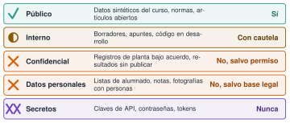

## Objetivos

- Situar la historia de la IA: de las reglas a los datos
- Entender redes neuronales y *transformers* sin matemáticas avanzadas
- Distinguir modelo, asistente y agente
- Reconocer los errores típicos y aplicar el marco de las 4D
- Proteger los datos, declarar el uso y supervisar

## Una advertencia

Los modelos cambian cada pocos meses.

Lo que hoy falla, mañana puede acertar.

**Lo que no caduca son los hábitos de comprobación.**

## Breve historia {#c0-1}

| Año | Hito |
|---|---|
| 1950 | Turing: ¿pueden pensar las máquinas? [@turing1950] |
| 1955 | Propuesta de Dartmouth: «inteligencia artificial» [@mccarthy1955] |
| 1958 | Perceptrón [@rosenblatt1958] |
| 1966 | ELIZA: conversar sin entender [@weizenbaum1966] |

## Dos maneras de hacer IA

| | Simbólica | Aprendizaje automático |
|---|---|---|
| Idea | Reglas escritas | Ajuste a ejemplos |
| Fortaleza | Explicable | Capta patrones |
| Debilidad | Frágil | Depende de los datos |

Ajustar parámetros modales a una FRF (M7) **también** es aprender de datos.

## Redes neuronales {#c0-2}

$$y=\varphi\Big(\sum_i w_i x_i+b\Big)$$

- Entrenar = ajustar pesos para reducir el error
- Retropropagación: regla de la cadena + gradiente [@rumelhart1986]
- Aprendizaje profundo: muchas capas, datos y cómputo (2012) [@krizhevsky2012]

## El *transformer*

- 2017: atención en lugar de recurrencia [@vaswani2017]
- Cada fragmento «mira» a todos los demás
- Se entrena en paralelo y escala
- Claude es un *transformer*

## Qué es un LLM {#c0-3}

Un programa entrenado con mucho texto para **predecir cómo continúa un texto**.

- **Tokens**: trozos de texto
- **Contexto**: solo ve lo que cabe en su ventana
- **Predicción con azar**: elige entre probabilidades

Un texto **fluido** no es un texto **verdadero**.

## La temperatura

$$p_i=\frac{e^{s_i/T}}{\sum_j e^{s_j/T}}$$

- $T$ baja: casi siempre lo más probable
- $T$ alta: aparecen opciones raras
- Ninguna $T$ hace que el modelo *sepa* la respuesta

## Modelo, asistente, agente {#c0-4}

| | Qué hace | Quién actúa |
|---|---|---|
| **LLM** | Texto → texto | Nadie |
| **Asistente** | Responde, redacta | Tú |
| **Agente** | Reúne contexto, actúa, verifica | El agente, con permisos |

**Más autonomía ⇒ más verificación.**

## Tres errores típicos {#c0-5}

| Error | Cómo detectarlo |
|---|---|
| Dato o fórmula incorrectos | Recalcular con un caso sencillo |
| Paquete o función inexistente | Buscarlo en el registro oficial |
| Referencia inventada | Localizarla por título o DOI |

No instales nada sin comprobar que existe y qué hace [@spracklen2025].

## El marco de las 4D {#c0-6}

Dakan y Feller con Anthropic [@dakan2025]

| | |
|---|---|
| **Delegar** | ¿Qué entra en la tarea y qué no? |
| **Describir** | ¿Lo entendería alguien sin contexto? |
| **Discernir** | ¿Cómo sé que es verdad? |
| **Diligencia** | ¿Puedo defender el resultado? |

## Qué dato es este {#c0-7}

{width="90%" fig-alt="Cinco clases de datos con su decisión: público sí, interno con cautela, confidencial y personales no salvo permiso o base legal, secretos nunca"}

## Integridad y declaración {#c0-8}

1. **Autoría**: lo entiendo y lo defiendo
2. **Transparencia**: herramienta, uso y comprobación
3. **Verificación**: también las referencias
4. **Normas**: cada asignatura decide

## Supervisión humana {#c0-9}

- Política escrita · supervisión según el riesgo
- Mínimo privilegio · trazabilidad · una persona firma
- Reglamento europeo de IA: supervisión humana (art. 14) y alfabetización (art. 4) [@aiact2024]
- Cuidado con el **sesgo de automatización**

## Lo que la IA no puede hacer por ti {#c0-10}

- Responder de una decisión de seguridad
- Medir
- Conocer tu caso
- Saber cuándo se equivoca
- Aprender por ti

## En las noticias

- **2023:** seis sentencias **inexistentes** en un escrito judicial: multa de 5 000 dólares
- **2024:** Air Canada responde de lo que dijo su chatbot
- Lección: delegar no te quita la **responsabilidad**

::: {.notes}
Enlaces: CNBC, LawNext, American Bar Association e Infosecurity Magazine. Consultado el 21-10-2026.
:::

## Práctica: caza de errores

Seis afirmaciones de una IA **ficticia** sobre una FFT de 10 s a 100 Hz.

¿Correcta, incorrecta o no comprobable? ¿Cómo lo compruebas?

## Para llevarte

- Fluido no es verdadero
- Más autonomía, más verificación
- Comprueba paquetes, números y referencias
- Cuida los datos, declara el uso y firma tú

## Referencias
