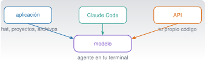

{.portada fig-alt="Esquema con tres cuadros, aplicación, Claude Code y API, de los que parten flechas hacia un mismo cuadro central que representa el modelo"}

## Objetivos y prerrequisitos

**Objetivos.** Al terminar la unidad sabrás:

- distinguir la **aplicación Claude**, **Claude Code** y la **API**, y elegir la que conviene a cada tarea;
- elegir un modelo y un plan con criterios (capacidad, velocidad, coste, límites) sin memorizar nombres que cambian cada pocos meses;
- decidir qué datos puedes compartir según el tipo de cuenta;
- escribir instrucciones claras, aportar contexto y refinar una respuesta de forma iterativa;
- trabajar con documentos y tablas, y **comprobar** lo que Claude te devuelve con una herramienta independiente.

**Prerrequisitos.** [C0 · Fluidez en IA, fundamentos e historia](../c0-fluidez/index.qmd). No hace falta saber programar.

**Tiempo orientativo.** 4–5 horas. **Nivel:** básico. **Herramientas:** una cuenta de Claude (la gratuita basta para casi todo); Julia, solo para las comprobaciones opcionales.

::: {.callout-note title="Lo que cambia y lo que no"}
Esta unidad mezcla **conceptos estables** (qué es una ventana de contexto, por qué se verifica) con **datos que cambian** (nombres de modelos, planes, límites, precios). Los segundos llevan fecha de consulta (23-10-2026) y un enlace a la fuente oficial: antes de decidir nada que dependa de ellos, vuelve a mirarlos.
:::

**Temas de la unidad**

- **C1.1** Anthropic y la evolución de Claude: familias y versiones de modelos, con fecha
- **C1.2** Interfaces: Claude en web, escritorio y móvil, Claude Code y API
- **C1.3** Conversar con una IA frente a trabajar con un agente de programación
- **C1.4** Elegir modelo; planes, autenticación y facturación
- **C1.5** Protección de datos: uso personal frente a uso empresarial
- **C1.6** Introducción al prompting: contexto, ejemplos, formato e iteración
- **C1.7** Proyectos, artefactos y análisis de ficheros
- **C1.8** Tareas tipo: informes, procedimientos, tablas, documentación técnica y planes de trabajo
- **C1.9** Anthropic Academy y otras fuentes oficiales para seguir aprendiendo

## Teoría breve

### C1.1 Anthropic y la evolución de Claude: familias y versiones de modelos, con fecha {#c1-1}

**Claude** es una familia de modelos de lenguaje desarrollada por la empresa **Anthropic**. Lo que
de cada modelo interesa a quien lo usa es poco: qué sabe hacer, cuánto texto admite, cuánto tarda y
cuánto cuesta. Anthropic publica una nueva generación de modelos con frecuencia, de modo que
cualquier lista concreta envejece pronto.

::: {.callout-note .historia icon=false title="Un poco de historia: de Claude 1 a Claude Code"}
Anthropic anunció **Claude** el 14 de marzo de 2023, con una versión ligera, *Claude Instant*, y
acceso por chat y por API ([«Introducing Claude»](https://www.anthropic.com/news/introducing-claude)).
El 25 de noviembre de 2024 publicó el **Model Context Protocol** (MCP), un estándar abierto para
conectar asistentes con datos y herramientas ([anuncio](https://www.anthropic.com/news/model-context-protocol)).
En febrero de 2025 presentó **Claude Code** junto con Claude 3.7 Sonnet
([anuncio](https://www.anthropic.com/news/claude-3-7-sonnet)). Fechas tomadas de los anuncios
oficiales, consultados el 23-10-2026.
:::

A fecha de consulta, la documentación oficial [@anthropic-modelos] describe cuatro líneas de modelos
con propósitos distintos. La tabla resume lo que la fuente dice; los precios son por millón de
*tokens* (MTok) en la API.

| Línea | Para qué la presenta la documentación | Velocidad relativa | Entrada / salida por MTok |
|---|---|---|---|
| **Fable** 5.1 | Razonamiento exigente y trabajo agéntico de largo recorrido | La más lenta | 10 $ / 50 $ |
| **Opus** 5.5 | Programación agéntica larga y trabajo del conocimiento | Moderada | 4 $ / 20 $ |
| **Sonnet** 5.5 | La mejor combinación de velocidad e inteligencia | Rápida | 2 $ / 10 $ |
| **Haiku** 5.5 | Tareas masivas y de baja latencia: clasificar, extraer, enrutar | La más rápida | desde 0,10 $ / 0,50 $ |

Los cuatro admiten texto e imágenes de entrada, tienen una ventana de contexto de 1 millón de
tokens y un máximo de salida de 128 000 tokens, según esa misma página. Cada modelo tiene un
**identificador** (`claude-sonnet-5-5`, por ejemplo) que es el que se escribe en el código, y
Anthropic fija una fecha mínima de retirada de cada uno: los modelos no son eternos.

::: {.callout-warning title="Errores frecuentes"}
- **Dar por buena una tabla antigua.** Nombres, precios y límites cambian; la página oficial manda.
- **Confundir «más reciente» con «mejor para mi tarea».** Un modelo más pequeño puede bastar y ser
  más rápido y barato.
- **Preguntarle al propio modelo qué modelo es o cuándo se publicó.** Puede equivocarse; mira la
  documentación.
:::

**Pon a prueba lo anterior.**

::: {.ejercicio tipo="vf" id="c1-1-tabla" respuesta="falso"}
Una tabla de modelos y precios copiada de un curso del año pasado sigue siendo una referencia fiable para decidir.

::: {.solucion}
**Falso.** Modelos, precios y límites cambian; hay que contrastarlos con la documentación oficial en el momento de decidir.
:::
:::

::: {.ejercicio tipo="opcion" id="c1-1-linea" respuesta="d"}
Necesitas clasificar miles de correos por categoría, con respuestas muy rápidas y coste bajo. Según la descripción oficial, ¿qué línea encaja mejor en principio?

::: {.opciones}
- Fable.
- Opus.
- Sonnet.
- Haiku.
:::

::: {.solucion}
**Haiku**: la documentación la presenta para tareas de gran volumen y baja latencia como clasificar o extraer. Antes de elegir, pruébala con tus propios ejemplos.
:::
:::

### C1.2 Interfaces: Claude en web, escritorio y móvil, Claude Code y API {#c1-2}

El mismo modelo se ofrece por tres vías, pensadas para usos distintos:

| Vía | Qué es | Quién la usa | Qué hace por ti | Cómo se paga |
|---|---|---|---|---|
| **Aplicación Claude** (web, escritorio, móvil) | Un chat con proyectos, archivos y artefactos | Cualquier persona | Conversa, analiza documentos, crea textos y tablas | Gratuita o plan de suscripción |
| **Claude Code** | Un agente que trabaja en tu terminal, en tu editor o en la web sobre tus ficheros | Quien programa o analiza datos en un proyecto | Lee el proyecto, edita ficheros, ejecuta comandos y pruebas (con tu permiso) | Con la cuenta de un plan compatible o con facturación de la API |
| **API** | Un servicio al que se llama desde tu propio programa | Quien construye aplicaciones | Solo lo que programes: tú gestionas conversación, herramientas y errores | Por *tokens* consumidos |

La regla práctica: **la aplicación para conversar y trabajar con documentos; Claude Code para
trabajar dentro de un proyecto con ficheros y comandos; la API para integrar el modelo en tu propio
software**. Las tres se tratan en el curso: la aplicación aquí (C1), Claude Code desde
[C4](../c4-claude-code/index.qmd) y la API en [C9](../c9-api/index.qmd).

Las funciones disponibles (herramientas, conectores, memoria, modelos accesibles) dependen del
producto y del plan; consulta siempre la página de cada producto antes de contar con una de ellas.

**Pon a prueba lo anterior.**

::: {.ejercicio tipo="opcion" id="c1-2-via" respuesta="b"}
Quieres que un asistente lea los ficheros de tu proyecto, ejecute las pruebas y proponga cambios en el código, pidiéndote permiso. ¿Qué vía encaja?

::: {.opciones}
- La aplicación de chat, pegando el código.
- Claude Code.
- Solo la API, sin escribir nada de código.
- Ninguna: un modelo no puede ejecutar pruebas.
:::

::: {.solucion}
**Claude Code**: está diseñado para trabajar sobre tus ficheros y comandos con tu permiso. En el chat tendrías que copiar y pegar a mano, y la API exige que programes tú el bucle de trabajo.
:::
:::

### C1.3 Conversar con una IA frente a trabajar con un agente de programación {#c1-3}

En una **conversación**, tú aportas el contexto (pegas texto, adjuntas archivos) y el modelo responde;
la persona hace de intermediaria con el mundo. En un **agente de programación**, el modelo puede
usar herramientas por su cuenta: leer ficheros, buscar, editar, ejecutar comandos, y repetir hasta
terminar [@anthropic-claudecode-funciona]. Eso lo hace más potente y también más delicado: un error ya no es solo un
texto equivocado, puede ser un fichero modificado o un comando ejecutado.

| | Conversación | Agente |
|---|---|---|
| Contexto | Lo que pegas o adjuntas | Lo que explora en tu proyecto |
| Acciones | Ninguna fuera del chat (salvo funciones concretas) | Edita ficheros, ejecuta comandos |
| Riesgo de un error | Sobre todo una respuesta equivocada | Un cambio o una ejecución no deseados |
| Control | Lees y decides | Permisos, revisión de cambios, control de versiones ([C3](../c3-git/index.qmd)) |

Cuanto más autonomía, más supervisión: es el principio de C0.9 y la razón por la que Claude Code
pregunta antes de actuar y por la que se trabaja con Git.

**Pon a prueba lo anterior.**

::: {.ejercicio tipo="abierta" id="c1-3-riesgo"}
Describe una tarea que harías en conversación y otra que preferirías delegar a un agente, y qué control añadirías en la segunda.

::: {.rubrica}
- La tarea de conversación no requiere que el modelo toque mis ficheros.
- La tarea del agente implica leer o modificar ficheros o ejecutar algo.
- Nombro un control concreto (revisar el diff, trabajar en una rama, permisos limitados).
:::
:::

### C1.4 Elegir modelo; planes, autenticación y facturación {#c1-4}

**Elegir modelo.** No hay un modelo «mejor» en abstracto. Un criterio razonable, sin pretender que
sea una regla universal: empieza por uno de tamaño medio, comprueba si cumple tus criterios de
aceptación con ejemplos tuyos, sube de línea si falla por razonamiento o largo recorrido y baja a la
más ligera si sobra capacidad y necesitas velocidad o abaratar. Mide con tus propios casos, no con
la reputación.

**Planes.** La aplicación se ofrece con un plan gratuito y otros de suscripción individuales y de
equipo y empresa; la página de precios [@anthropic-precios] indica, a fecha de consulta, qué incluye
cada uno: modelos accesibles, límites de uso por ventana de tiempo, y si se puede usar Claude Code
(el plan gratuito no lo incluye en esa página). Los límites y los precios cambian y los consulta
cada persona en su cuenta. **La API se factura aparte, por tokens**, y una suscripción de la
aplicación no es un crédito de API.

**Autenticación.** En la aplicación inicias sesión con tu cuenta. En Claude Code puedes iniciar
sesión con la cuenta de un plan compatible o usar una clave de API (C4). En la API la autenticación
es siempre una **clave secreta**: se trata como una contraseña (nunca en el código ni en el
repositorio, C9).

**Un cálculo de coste.** En la API, el coste de una petición es
$$
\text{coste} = \frac{n_{\text{entrada}}\,p_{\text{entrada}} + n_{\text{salida}}\,p_{\text{salida}}}{10^{6}},
$$
con los precios por millón de tokens. Con los de Sonnet 5.5 de la tabla anterior, una petición de
20 000 tokens de entrada y 2 000 de salida cuesta $(20\,000\cdot 2 + 2\,000\cdot 10)/10^6 = 0{,}06$ dólares.

**Pon a prueba lo anterior.**

::: {.ejercicio tipo="numerico" id="c1-4-coste" respuesta="0.06" tol="1%" unidad="$"}
Con los precios de la tabla (Sonnet 5.5: 2 $ por MTok de entrada y 10 $ por MTok de salida), ¿cuántos dólares cuesta una petición de 20 000 tokens de entrada y 2 000 de salida?

::: {.solucion}
$(20\,000\cdot 2 + 2\,000\cdot 10)/10^6 = 0{,}04 + 0{,}02 = 0{,}06$ $.
:::
:::

::: {.ejercicio tipo="vf" id="c1-4-suscripcion" respuesta="falso"}
Pagar una suscripción individual de la aplicación te da saldo para usar la API en tus programas.

::: {.solucion}
**Falso.** La API se factura aparte, por tokens consumidos. La suscripción cubre el uso de la aplicación (y, en los planes compatibles, de Claude Code).
:::
:::

### C1.5 Protección de datos: uso personal frente a uso empresarial {#c1-5}

C0.7 clasificó los datos. Aquí se aplica a la cuenta que usas. Lo relevante es **bajo qué
condiciones** se procesa lo que escribes:

- En las cuentas **gratuitas, Pro y Max**, Anthropic anunció el 28-08-2025 que los chats y las
  sesiones de código pueden usarse para entrenar modelos nuevos **si la persona lo permite**; la
  decisión se cambia en los ajustes de privacidad, y la retención es mayor si se acepta (cinco años
  frente a 30 días) [@anthropic-terminos2025].
- Los servicios bajo **condiciones comerciales** (Team, Enterprise, API, Education, Gov) quedan
  fuera de ese cambio, según el mismo anuncio. Eso no significa que cualquier dato pueda subirse:
  sigue haciendo falta permiso de quien cedió los datos y base legal para los personales.

Son condiciones de una fecha concreta y pueden haber cambiado. **Lee las condiciones vigentes de tu
cuenta antes de subir nada que no sea público**, y deja en manos de tu institución o empresa la
decisión sobre qué cuenta usar para trabajo con datos de terceros. Quita siempre claves,
credenciales y datos personales innecesarios antes de pegar.

**Pon a prueba lo anterior.**

::: {.ejercicio tipo="opcion" id="c1-5-cuenta" respuesta="c"}
Tienes registros de una planta cedidos bajo acuerdo de confidencialidad. ¿Qué haces antes de usarlos con Claude?

::: {.opciones}
- Los subo a mi cuenta gratuita, porque nadie los va a ver.
- Los subo si cambio el nombre de la planta por «Planta A».
- Pido permiso a quien los cedió y uso solo el servicio y la cuenta que ese permiso y las condiciones permitan.
- Los copio en trozos pequeños para que no se note.
:::

::: {.solucion}
El permiso lo da quien cedió los datos y depende de las condiciones del servicio (C0.7). Cambiar un nombre no basta, y trocear no cambia lo que estás compartiendo.
:::
:::

### C1.6 Introducción al prompting: contexto, ejemplos, formato e iteración {#c1-6}

Un **prompt** es la instrucción que das al modelo. La guía oficial [@anthropic-prompting] reúne técnicas
útiles, y conviene recordar que son **orientaciones empíricas**, no leyes: lo que mejora un
resultado con un modelo o una tarea puede no hacerlo con otros. Por eso se prueba y se mide.

1. **Sé claro y directo.** Di qué quieres, para quién y con qué criterio de éxito. Un buen test:
   si se lo dieras a un compañero competente que no conoce tu proyecto, ¿entendería la tarea?
2. **Aporta contexto y motivo.** Explicar *para qué* sirve el resultado ayuda a decidir los detalles
   que no dijiste.
3. **Da ejemplos** del formato o del tono que quieres. Pocos ejemplos bien elegidos orientan mejor
   que una descripción larga.
4. **Estructura lo que mezcla** instrucciones, datos y ejemplos (por ejemplo, con etiquetas XML o
   encabezados) para que no se confundan.
5. **Con documentos largos**, pon los datos primero y la pregunta al final, según la guía.
6. **Pide el formato de salida** (tabla, lista, JSON, longitud).
7. **Itera.** La primera respuesta es un borrador: corrige, pide alternativas, señala qué falla.

**De peor a mejor, con un ejemplo** (ilustrativo; las respuestas reales varían):

| Intento | Prompt | Problema |
|---|---|---|
| 1 | «Resume esto.» | No dice para quién, cuánto ni con qué fin. |
| 2 | «Resume este informe de inspección en cinco líneas para un gerente.» | Mejor, pero no dice qué decisión debe tomar. |
| 3 | «Eres técnico de mantenimiento. Resume en cinco líneas, para un gerente que debe decidir si para la línea 2 el lunes, el estado de las bombas. Separa hechos medidos de interpretaciones y señala lo que no se puede concluir con los datos del informe.» | Rol, destinatario, decisión, formato y honestidad sobre los límites. |

Lo que **no** hace un buen prompt: garantizar la verdad. Sigue valiendo todo C0.5: un texto
perfectamente instruido puede contener errores, así que se verifica.

::: {.callout-tip .idea-clave title="Idea clave"}
Un prompt claro reduce los malentendidos; la verificación detecta los errores. Hacen falta las dos cosas.
:::

**Pon a prueba lo anterior.**

::: {.ejercicio tipo="opcion" id="c1-6-mejor" respuesta="b,c" multiple="true"}
¿Qué mejoran el prompt «Resume este informe»? (elige todas las correctas)

::: {.opciones}
- Añadir «por favor» varias veces.
- Indicar para quién es el resumen y qué decisión debe apoyar.
- Pedir un formato concreto y una longitud.
- Escribirlo en mayúsculas.
:::

::: {.solucion}
Destinatario, decisión, formato y longitud. La cortesía o las mayúsculas no aportan información que el modelo pueda usar.
:::
:::

::: {.ejercicio tipo="abierta" id="c1-6-reescribe"}
Reescribe el prompt «Hazme una tabla con los datos» para una hoja de ventas de tres regiones durante 36 meses.

::: {.rubrica}
- Indico qué columnas y qué agregación quiero (por ejemplo, total anual por región).
- Digo el formato de salida y cómo tratar los valores ausentes.
- Pido que señale cualquier dato que no haya podido interpretar.
:::
:::

### C1.7 Proyectos, artefactos y análisis de ficheros {#c1-7}

**Archivos.** La aplicación acepta documentos (PDF, Word, CSV, texto, hojas de cálculo…) e imágenes,
con límites de tamaño y de número por conversación que la página de ayuda detalla y que cambian
[@anthropic-archivos]. Dos precauciones: en los documentos que no son PDF se extrae solo el texto
(las imágenes incrustadas no se interpretan), y los PDF muy largos pueden procesarse solo como texto.
No des por hecho que «lo vio todo»: **pídele que indique qué partes ha leído**.

**Proyectos.** Un proyecto es un espacio de trabajo con sus conversaciones, unos documentos de
conocimiento y unas instrucciones propias (rol, tono, convenciones), útil para tareas que se repiten
[@anthropic-proyectos]. Lo que subes como conocimiento forma parte del contexto, así que aplica
C1.5 a esos documentos.

**Artefactos.** Son resultados autocontenidos (un documento, una presentación, una página, un
programa pequeño) que se abren junto al chat, se editan y se comparten, en los planes que los
incluyen [@anthropic-artefactos]. Un artefacto generado es **código o contenido de Claude**: revísalo
antes de usarlo, sobre todo si ejecuta algo o contiene cifras.

**Análisis de datos.** Cuando Claude analiza un fichero puede hacerlo escribiendo y ejecutando
código (según la configuración de tu cuenta) o simplemente «leyendo» el contenido. Son cosas
distintas: lo primero es reproducible y lo segundo no. Pide siempre el código o el procedimiento y
**recalcula tú algún valor con otra herramienta** (Excel, Julia, Python).

**Pon a prueba lo anterior.**

::: {.ejercicio tipo="vf" id="c1-7-leyo" respuesta="falso"}
Si subo un Word con gráficos y tablas de imagen, Claude interpretará también las imágenes incrustadas.

::: {.solucion}
**Falso** (según la página de ayuda consultada): en los documentos que no son PDF se extrae solo el texto. Si el contenido está en una imagen, adjúntala aparte o descríbela.
:::
:::

### C1.8 Tareas tipo: informes, procedimientos, tablas, documentación técnica y planes de trabajo {#c1-8}

Cinco patrones de uso que se repiten en ingeniería y en la empresa, con su riesgo principal:

| Tarea | Cómo plantearla | Riesgo | Cómo comprobarlo |
|---|---|---|---|
| **Informe** a partir de datos | Aporta los datos y pide separar hechos de interpretación | Conclusiones que los datos no apoyan | Recalcula cifras clave; marca cada afirmación con su dato |
| **Procedimiento** (por ejemplo, un protocolo de inspección) | Pide pasos numerados, criterios de aceptación y precauciones | Omitir un paso de seguridad | Revisión por una persona competente; contraste con la norma aplicable |
| **Tabla** | Define columnas, unidades y tratamiento de ausentes | Mezclar unidades, filas inventadas | Cuenta filas, suma totales, compara con el original |
| **Documentación técnica** | Da el código o la especificación y el lector objetivo | Describir lo que el código *debería* hacer en vez de lo que hace | Ejecuta los ejemplos que aparezcan |
| **Plan de trabajo** | Indica plazos, recursos y dependencias reales | Estimaciones optimistas sin base | Contrasta con tu experiencia previa |

En todas: **un humano firma** (C0.9) y los datos de terceros siguen las reglas de C1.5.

### C1.9 Anthropic Academy y otras fuentes oficiales para seguir aprendiendo {#c1-9}

Anthropic ofrece una academia con cursos gratuitos [@anthropic-academy]. A fecha de consulta lista,
entre otros, **«AI Fluency: Framework and foundations»** (el marco de las cuatro D que viste en
C0.6), **«AI capabilities and limitations»** y **«Building effective human-agent teams»** (en beta).
Este curso **no copia** esos materiales: los resume con palabras propias y te enlaza a ellos. Para
la documentación técnica, las fuentes de referencia son la de la
[API y los modelos](https://platform.claude.com/docs/en/models/overview), la de
[Claude Code](https://code.claude.com/docs/en/overview) y el centro de ayuda de la aplicación
([support.claude.com](https://support.claude.com/)). Recuerda: la fuente oficial es la vigente; los
cursos, también este, se desactualizan.

## Práctica guiada

[Requiere cuenta]{.ejec .ejec-cuenta} · [Local gratuita]{.ejec .ejec-local} (la comprobación) · *Los ejemplos con Claude son ilustrativos: sus respuestas varían.*

**Ficha.** *Objetivo:* analizar una hoja de ventas con Claude y comprobar los resultados por otra
vía. *Archivos:* `datos/sinteticos/curso-claude/a_ventas.csv` (datos **sintéticos**, 109 filas;
ficha `a_ventas.meta.toml`). *Versiones:* aplicación de Claude (cualquier plan) y, opcional, Julia
1.12. *Instalación:* ninguna para la parte de Claude. *Resultado esperado:* tus cifras y las de
Claude coinciden, o has localizado la diferencia. *Problemas frecuentes:* subir el fichero y no
indicar qué hacer con los valores ausentes.

1. Abre una conversación nueva y adjunta `a_ventas.csv`. Es sintético: puedes subirlo sin
   restricción (C0.7).
2. Envía este prompt:

   > Este CSV tiene ventas mensuales por región (Norte, Centro, Sur) de 2023 a 2025. Antes de
   > analizar, dime cuántas filas tiene, si hay valores ausentes o filas repetidas y cuáles. Luego
   > calcula el total de `ventas_eur` por región y en conjunto, **ignorando las filas repetidas y
   > los valores ausentes**. Muestra el código o el procedimiento que usaste.

3. Anota sus cifras y **comprueba cada una con una herramienta independiente**. Con Julia (solo
   biblioteca estándar), desde la carpeta del repositorio:

```julia
using Printf
filas = split.(readlines("datos/sinteticos/curso-claude/a_ventas.csv")[2:end], ",")
únicas = unique(filas)
ventas = [parse(Float64, f[3]) for f in únicas if f[3] != ""]
println(length(filas), " filas, ", length(únicas), " únicas")
@printf("%d ausentes; total = %.2f\n", count(f -> f[3] == "", únicas), sum(ventas))
```

**Resultado esperado** (comprobado con Julia 1.12.3 el 23-10-2026): `109 filas, 108 únicas` y
`5 ausentes; total = 6069845.38`. Por región: Norte 1 911 061,69 € (34 meses con dato), Centro
2 539 781,72 € (35) y Sur 1 619 001,97 € (34). La fila repetida es `2024-05-01,Norte,61915.88,1529`; si
no se descarta, el total sube a 6 131 761,26 €.

4. Si Claude no detectó la fila repetida o los cinco ausentes, o sus totales no coinciden, repite
   la petición señalando la discrepancia. ¿Lo corrige? ¿Con qué argumentos? Si no puedes ejecutar
   Julia, abre el CSV en una hoja de cálculo y comprueba al menos el recuento de filas y de ausentes.

**Qué has aprendido:** un análisis «razonable» no es un análisis correcto hasta que lo contrastas.

## «Pídeselo a Claude»

::: {.callout-tip title="Prompt"}
Voy a pegarte un informe técnico de seis páginas para que prepares un resumen de cinco líneas para
un gerente. Antes de resumir, hazme tres preguntas que necesites contestar para hacerlo bien (a
quién va dirigido, qué decisión debe apoyar y qué datos son críticos). Después resume, separa hechos
de interpretaciones y lista las afirmaciones del resumen que no pueda respaldar con una cita literal
del informe.

**Verifica.**

- ¿Las tres preguntas eran útiles o genéricas? Si fueran genéricas, vuelve a pedirlas con más contexto.
- Elige tres afirmaciones del resumen y localiza su apoyo en el informe. ¿Existe?
- ¿La lista de «afirmaciones sin respaldo» contiene algo real, o es un trámite? Compara con tu lectura.
:::

## Ejercicios

1. **Tres vías.** Para cada tarea, indica si usarías la aplicación, Claude Code o la API y justifica:
   a) redactar un correo; b) corregir un error en un proyecto Julia con pruebas; c) clasificar
   automáticamente 50 000 comentarios de clientes cada noche.

   ::: {.callout-note collapse="true" title="Solución"}
   a) Aplicación. b) Claude Code, con revisión del diff. c) API, programada, con control de coste y
   de errores (C9).
   :::

2. **Coste.** Una petición envía 50 000 tokens y recibe 1 000. Calcula su coste con Haiku 5.5 usando
   los precios mínimos de la tabla (0,10 $ y 0,50 $ por MTok) y con Opus 5.5 (4 $ y 20 $).

   ::: {.callout-note collapse="true" title="Solución"}
   Haiku: $(50\,000\cdot 0{,}10 + 1\,000\cdot 0{,}50)/10^6 = 0{,}0055$ $. Opus:
   $(50\,000\cdot 4 + 1\,000\cdot 20)/10^6 = 0{,}22$ $. La diferencia es de 40 veces: elegir línea
   importa a escala, no en una petición suelta. Atención: la tabla indica «desde» para Haiku, así
   que el precio real puede ser mayor en prompts largos; consulta la página de precios.
   :::

3. **Prompt en tres intentos.** Escribe el peor y el mejor prompt que se te ocurran para «preparar
   un procedimiento de inspección visual de un puente». Compara las respuestas y anota qué
   información del prompt mejor marcó la diferencia.

4. **Auditoría de cuenta.** Localiza en los ajustes de tu cuenta de Claude dónde se decide el uso
   de tus conversaciones para entrenar y anota qué tienes activado. No cambies nada si no estás
   seguro de las consecuencias.

## La doy por superada si…

- Explico en una frase para qué uso la aplicación, Claude Code y la API.
- Sé dónde consultar los modelos, planes y límites vigentes y no confío en una lista antigua.
- Calculo el coste aproximado de una petición de API a partir de los precios.
- Sé qué cuentas tienen condiciones comerciales y qué datos no subo nunca.
- Escribo un prompt con destinatario, decisión, formato y criterio de éxito, y lo itero.
- Compruebo siempre con una herramienta independiente los resultados numéricos que me da Claude.
