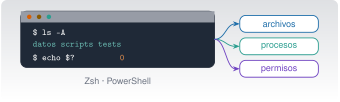

{.portada fig-alt="Esquema de una terminal con un indicador de órdenes, una orden y su salida, y debajo tres cuadros: archivos, procesos y permisos"}

## Objetivos y prerrequisitos

**Objetivos.** Al terminar la unidad sabrás:

- explicar qué son terminal, *shell*, sistema operativo y proceso, y moverte por el sistema de archivos con **Zsh** (macOS) o **PowerShell** (Windows);
- buscar y filtrar texto, encadenar órdenes con tuberías y redirigir su salida;
- instalar herramientas con **Homebrew** o **winget**, y entender PATH, variables de entorno y dónde guardar credenciales;
- leer y ajustar permisos, y reconocer un proceso, su PID y cómo detenerlo de forma controlada;
- escribir un *script* corto con parámetros, condiciones, bucles y códigos de salida;
- comprobar copias con **hashes**, diagnosticar una red básica y programar una tarea repetitiva;
- **auditar** un comando propuesto por una IA antes de ejecutarlo.

**Prerrequisitos.** [C0](../c0-fluidez/index.qmd) (en especial C0.7 y C0.9). No hace falta saber programar.

**Tiempo orientativo.** 8–10 horas con las tres prácticas. **Nivel:** básico. **Herramientas:** Terminal y Zsh en macOS, o PowerShell (y Windows Terminal) en Windows; Python 3 y Quarto para las prácticas. En macOS, Zsh viene instalado; en Windows, PowerShell 7 es una instalación aparte de la que trae el sistema (Windows PowerShell 5.1).

::: {.callout-note title="Cómo se han comprobado las órdenes"}
Las órdenes de esta unidad se han escrito para **macOS y Windows** (nada de Linux; WSL solo se nombra cuando una herramienta lo exige) y están etiquetadas:

- **✔ macOS**: probadas con Zsh 5.9 en macOS 27.0.1 (23-10-2026).
- **✔ PS7**: probadas con **PowerShell 7.6.8 sobre macOS**. La sintaxis es la misma en Windows, pero esa prueba **no demuestra** que funcionen en Windows.
- **† Solo Windows**: órdenes que no existen en PowerShell para macOS (`Get-Acl`, `icacls`, Programador de tareas, `winget`…). **No se han ejecutado**: se han contrastado con la documentación de Microsoft Learn. Si algo no responde como se describe, tu versión de Windows manda.

Todo lo demás son órdenes de lectura salvo que se avise. Ejecuta primero en una carpeta de pruebas.
:::

**Temas de la unidad**

- **C2.1** Terminal, shell y sistema operativo: Zsh y PowerShell, ayuda e historial
- **C2.2** Rutas absolutas y relativas, estructura de carpetas y ficheros ocultos
- **C2.3** Navegación y manejo de ficheros: rutas con espacios, comodines, copias y compresión
- **C2.4** Texto: búsqueda, filtrado, expresiones regulares, tuberías y redirección
- **C2.5** Variables de entorno y PATH
- **C2.6** Gestores de paquetes e instalación de herramientas: Homebrew y winget
- **C2.7** Entornos de Python (uv) y proyectos de Julia
- **C2.8** Editor de código, VS Code y alternativas
- **C2.9** Quarto, Git, Claude Code y Docker: instalación y comprobación de versiones
- **C2.10** Permisos, procesos y scripts: POSIX frente a ACL, señales, parámetros, bucles y códigos de salida
- **C2.11** Copias y hashes, redes, tareas programadas, logs y diagnóstico; lista de preparación

## Teoría breve

### C2.1 Terminal, shell y sistema operativo: Zsh y PowerShell, ayuda e historial {#c2-1}

Cuatro palabras que se confunden:

| Concepto | Qué es | Ejemplo |
|---|---|---|
| **Sistema operativo** | El software que gestiona el hardware y ofrece servicios a los programas (archivos, procesos, red) | macOS, Windows |
| **Terminal** | La ventana donde escribes y lees texto. No interpreta órdenes: solo muestra y recoge | Terminal.app, Windows Terminal |
| **Shell** (intérprete de comandos) | El programa que lee tus órdenes, las interpreta y las ejecuta | Zsh, PowerShell |
| **Proceso** | Un programa en ejecución, con su identificador (**PID**), su memoria y sus permisos | Cada orden que lanzas crea uno |

Se puede cambiar de shell sin cambiar de terminal, y la misma shell funciona en distintas terminales.
La diferencia práctica más importante entre las dos shells de este curso es **qué circula por las
tuberías**: Zsh pasa **texto**; PowerShell pasa **objetos** con propiedades (nombre, tamaño, fecha…).
Por eso muchas órdenes de PowerShell no necesitan trocear texto con `cut` o `awk`.

| | Zsh (macOS) | PowerShell |
|---|---|---|
| Órdenes | Programas y funciones, nombres cortos (`ls`, `cp`) | *Cmdlets* con forma Verbo-Nombre (`Get-ChildItem`) y alias (`ls`, `cp` existen como alias, pero **no equivalen** a los de Unix) |
| Salida | Texto | Objetos |
| Variables | `nombre=valor`, `$nombre` | `$nombre = valor` |
| Ayuda | `man ls`, `ls --help` (según programa) | `Get-Help Get-ChildItem` |
| Historial | Flecha ↑, `history`, Ctrl+R | Flecha ↑, `Get-History`, Ctrl+R |
| Autocompletado | Tab | Tab (completa también parámetros) |

**Sintaxis de una orden.** `orden [opciones] [argumentos]`: en Zsh las opciones suelen ir con guion (`ls -l`);
en PowerShell los parámetros llevan nombre (`Get-ChildItem -Force`). Separa con espacios; lo que tenga
espacios dentro va **entre comillas**. Una orden que se queda esperando se interrumpe con **Ctrl+C**.

::: {.panel-tabset}
## macOS (Zsh) ✔

```zsh
echo "Hola"            # imprime texto
man ls                 # manual de una orden (q para salir)
history | tail -3      # últimas órdenes
echo $SHELL            # shell de inicio de sesión
```

## Windows (PowerShell) ✔ PS7

```powershell
Write-Output "Hola"                 # imprime texto
Get-Help Get-ChildItem              # ayuda de un cmdlet
Get-History | Select-Object -Last 3 # últimas órdenes de esta sesión
$PSVersionTable.PSVersion           # versión de PowerShell
```
:::

**Pon a prueba lo anterior.**

::: {.ejercicio tipo="opcion" id="c2-1-shell" respuesta="c"}
¿Qué programa lee la orden que escribes, la interpreta y la ejecuta?

::: {.opciones}
- La terminal.
- El sistema operativo, directamente.
- La shell (Zsh o PowerShell).
- El editor de código.
:::

::: {.solucion}
La **shell**. La terminal es solo la ventana donde escribes y lees; el sistema operativo ejecuta el proceso que la shell le pide crear.
:::
:::

::: {.ejercicio tipo="vf" id="c2-1-objetos" respuesta="verdadero"}
En PowerShell, las tuberías transportan objetos con propiedades y no solo texto.

::: {.solucion}
**Verdadero.** Por eso se puede ordenar o filtrar por una propiedad (`Length`, `LastWriteTime`) sin trocear texto.
:::
:::

### C2.2 Rutas absolutas y relativas, estructura de carpetas y ficheros ocultos {#c2-2}

Una **ruta** dice dónde está un fichero. La **absoluta** parte de la raíz; la **relativa** parte de la
carpeta de trabajo actual.

| | macOS | Windows |
|---|---|---|
| Raíz | `/` | Una unidad: `C:\` |
| Separador | `/` | `\` (PowerShell también acepta `/`) |
| Carpeta personal | `~` o `/Users/ana` | `$HOME` o `C:\Users\ana` |
| Actual / padre | `.` / `..` | `.` / `..` |
| Mayúsculas | La mayoría de volúmenes no distinguen, pero **no cuentes con ello** | No distingue |

Una carpeta de trabajo bien organizada separa lo que **escribes tú** (código, texto) de lo que **se
genera** (resultados, informes compilados) y de lo que **no debe versionarse** (claves, entornos). El
proyecto de ejemplo de esta unidad lo hace así: `datos/`, `scripts/`, `tests/`, un `README.md` y un
`.gitignore`.

Los **ficheros ocultos** empiezan por punto en macOS (`.gitignore`, `.env`) y se muestran con
`ls -A`; en PowerShell se piden con `-Force`. En Windows, además, existe un atributo «oculto» del
propio sistema de archivos.

::: {.panel-tabset}
## macOS (Zsh) ✔

```zsh
pwd                 # carpeta actual (ruta absoluta)
ls                  # contenido visible
ls -A               # incluye los ficheros ocultos (.gitignore, .env.ejemplo)
cd datos            # ruta relativa
cd ..               # sube un nivel
cd ~                # va a tu carpeta personal
```

## Windows (PowerShell) ✔ PS7

```powershell
Get-Location                    # carpeta actual (alias: pwd)
Get-ChildItem                   # contenido (alias: ls, dir)
Get-ChildItem -Force            # incluye ocultos
Set-Location datos              # alias: cd
Set-Location ..
Set-Location ~
```
:::

**Pon a prueba lo anterior.**

::: {.ejercicio tipo="opcion" id="c2-2-ruta" respuesta="b"}
Estás en `/Users/ana/proyecto-viga/datos`. ¿Qué ruta **relativa** lleva a `/Users/ana/proyecto-viga/scripts/analiza.py`?

::: {.opciones}
- `scripts/analiza.py`
- `../scripts/analiza.py`
- `/scripts/analiza.py`
- `~/scripts/analiza.py`
:::

::: {.solucion}
`..` sube a `proyecto-viga` y desde allí se entra en `scripts`. Sin el `..` buscarías `datos/scripts/analiza.py`; las otras dos son absolutas y apuntan a otro sitio.
:::
:::

### C2.3 Navegación y manejo de ficheros: rutas con espacios, comodines, copias y compresión {#c2-3}

Crear, copiar, mover y borrar son las operaciones de todos los días. Tres cosas las vuelven peligrosas:
el **borrado no pasa por la papelera**, un **comodín** puede abarcar más de lo que piensas y un
**espacio** sin comillas parte un nombre en dos argumentos.

::: {.panel-tabset}
## macOS (Zsh) ✔

```zsh
mkdir -p copia/datos                       # crea carpetas (-p: también las intermedias)
cp datos/aceleracion.csv copia/datos/      # copia un fichero
cp -R scripts copia/                       # copia una carpeta entera
mv "notas de campo.txt" notas.txt          # renombra: las comillas protegen el espacio
ls datos/*.csv                             # comodín: los .csv de datos
rm copia/datos/aceleracion.csv             # borra un fichero (sin papelera)
```

## Windows (PowerShell) ✔ PS7

```powershell
New-Item -ItemType Directory -Force copia/datos | Out-Null
Copy-Item datos/aceleracion.csv copia/datos/
Copy-Item -Recurse scripts copia/
Move-Item -LiteralPath "notas de campo.txt" notas.txt
Get-ChildItem datos/*.csv
Remove-Item copia/datos/aceleracion.csv
```
:::

**Rutas con espacios y caracteres especiales.** Pon **siempre** comillas a una ruta que pueda contener
espacios. En Zsh funcionan comillas dobles o simples (las dobles expanden `$variables`, las simples no).
En PowerShell, `-Path` interpreta comodines y corchetes: usa **`-LiteralPath`** cuando el nombre contenga
`[` o `]`. Sin comillas, `mv notas de campo.txt archivo` intenta mover **tres** ficheros a un destino
llamado `archivo`.

**Comodines (*globbing*).** `*` casa cualquier cadena y `?` un carácter. En Zsh los expande la **shell** antes
de llamar a la orden; en PowerShell, el propio *cmdlet*. Antes de usar un comodín en una orden que
borra o mueve, **ejecútalo con `ls`** para ver a qué ficheros afecta.

::: {.callout-warning title="Errores frecuentes"}
- **`rm -rf` con una variable vacía o un comodín** (`rm -rf $carpeta/*`): si `$carpeta` está vacía, el destino pasa a ser `/*`. Comprueba antes con `ls` y evita `-f` si no lo necesitas.
- **`Remove-Item -Recurse -Force *`** en la carpeta equivocada: confirma con `Get-Location` antes.
- **Mover sobre un fichero existente**: `mv` y `Move-Item` pueden sobrescribirlo sin avisar (`mv -i` pregunta antes).
:::

**Compresión.** **ZIP** funciona en ambos sistemas y es el formato de intercambio; **TAR** (con gzip,
`.tar.gz`) conserva permisos y es habitual en macOS.

::: {.panel-tabset}
## macOS (Zsh) ✔

```zsh
zip -r copia.zip datos scripts          # crea el ZIP
unzip -l copia.zip                      # lista su contenido sin extraer
tar -czf copia.tar.gz datos scripts     # TAR + gzip
tar -tzf copia.tar.gz                   # lista el contenido
```

## Windows (PowerShell) ✔ PS7

```powershell
Compress-Archive -Path datos,scripts -DestinationPath copia.zip -Force
Expand-Archive copia.zip -DestinationPath extraido -Force
```
:::

**Pon a prueba lo anterior.**

::: {.ejercicio tipo="opcion" id="c2-3-espacios" respuesta="b"}
En Zsh, ¿qué hace `mv notas de campo.txt archivo` si no existe ningún directorio `archivo`?

::: {.opciones}
- Renombra «notas de campo.txt» como «archivo».
- Da error: intenta mover tres ficheros («notas», «de», «campo.txt») a un destino que no es una carpeta.
- Mueve solo «notas».
- Crea la carpeta «archivo» y mueve todo.
:::

::: {.solucion}
Sin comillas, la shell ve **cuatro** argumentos: tres orígenes y un destino. Con varios orígenes, el destino debe ser una carpeta; si no existe, `mv` falla. Con comillas, el nombre es un solo argumento.
:::
:::

::: {.ejercicio tipo="vf" id="c2-3-papelera" respuesta="falso"}
Un fichero borrado con `rm` (Zsh) o `Remove-Item` (PowerShell) se puede recuperar siempre de la papelera.

::: {.solucion}
**Falso.** Ambos borran directamente, sin pasar por la papelera. La defensa es **Git** (C3) y las copias de seguridad (C2.11).
:::
:::

### C2.4 Texto: búsqueda, filtrado, expresiones regulares, tuberías y redirección {#c2-4}

Casi todo lo que hace un programa que te interesa deja **texto**: ficheros de datos, registros, listados.
Aprender a buscar y filtrar ese texto es la habilidad más rentable de la terminal.

**Tuberías (`|`).** La salida de una orden se convierte en la entrada de la siguiente. **Redirecciones:**
`>` escribe en un fichero (**sobrescribe**), `>>` añade al final, `2>` redirige los errores, y `2>&1`
los junta con la salida normal.

::: {.panel-tabset}
## macOS (Zsh) ✔

```zsh
grep -rn "TODO" --include="*.md" --include="*.qmd" --include="*.txt" .
find . \( -name "*.qmd" -o -name "*.py" \) | sort
wc -l datos/aceleracion.csv                      # número de líneas: 2049
cut -d, -f2 datos/aceleracion.csv | sort -n | tail -1   # mayor valor de la columna 2
ls nada 2> errores.txt                           # el mensaje de error va al fichero
```

## Windows (PowerShell) ✔ PS7

```powershell
Get-ChildItem -Recurse -File -Include *.md,*.qmd,*.txt | Select-String -Pattern "TODO"
Get-ChildItem -Recurse -Include *.qmd,*.py -File
(Get-Content datos/aceleracion.csv | Measure-Object -Line).Lines     # 2049
Import-Csv datos/aceleracion.csv | Sort-Object { [double]$_.aceleracion_m_s2 } -Descending | Select-Object -First 1
Get-Item nada -ErrorAction SilentlyContinue 2> errores.txt
```
:::

En el proyecto de ejemplo, el `grep` devuelve tres líneas con `TODO` (en `notas de campo.txt`,
`index.qmd` y `README.md`). Fíjate en que PowerShell lista los resultados en otro orden: el orden
de recorrido lo decide cada herramienta.

**Expresiones regulares.** Un patrón describe un conjunto de cadenas: `^TODO` (líneas que empiezan por
TODO), `[0-9]+` (uno o más dígitos), `\.csv$` (terminan en `.csv`). Zsh/`grep` y PowerShell (`Select-String`,
`-match`) usan sintaxis casi iguales, con diferencias entre dialectos: prueba tu patrón con un ejemplo
pequeño antes de aplicarlo a un fichero grande.

```zsh
grep -E "^[0-9]+\.[0-9]{4}," datos/aceleracion.csv | head -2     # ✔ macOS: filas cuyo tiempo empieza por dígitos y punto
```

```powershell
Select-String -Path datos/aceleracion.csv -Pattern '^[0-9]+\.[0-9]{4},' | Select-Object -First 2   # ✔ PS7
```

::: {.callout-warning title="Errores frecuentes"}
- **`>` en lugar de `>>`**: `echo x > registro.log` borra lo que hubiera. Para añadir, `>>`.
- **Olvidar `2>&1`** al guardar el registro de una orden: los errores salen por otro canal y no llegan al fichero.
- **Comillas dentro de patrones**: en Zsh, el patrón sin comillas lo toca la shell (comodines); ponlo entre comillas.
:::

**Pon a prueba lo anterior.**

::: {.ejercicio tipo="numerico" id="c2-4-lineas" respuesta="2049" tol="abs:0.5"}
`datos/aceleracion.csv` tiene una cabecera y 2048 muestras. ¿Qué número imprime `wc -l datos/aceleracion.csv`?

::: {.solucion}
`wc -l` cuenta saltos de línea: 1 de cabecera + 2048 filas = **2049**. (Se ha comprobado en Zsh y con `Measure-Object -Line` en PowerShell.)
:::
:::

::: {.ejercicio tipo="opcion" id="c2-4-redir" respuesta="a"}
Ya existe `registro.log` con información importante. ¿Qué orden **añade** una línea sin borrar lo anterior?

::: {.opciones}
- `echo "fin" >> registro.log`
- `echo "fin" > registro.log`
- `echo "fin" | registro.log`
- `echo "fin" 2> registro.log`
:::

::: {.solucion}
`>>` añade al final; `>` sobrescribe. `|` encadena órdenes, no escribe ficheros, y `2>` redirige solo los errores (y también sobrescribe).
:::
:::

### C2.5 Variables de entorno y PATH {#c2-5}

Una **variable de entorno** es un par nombre-valor que heredan los procesos que lanzas. Sirven para
configurar programas sin tocar su código, y por eso también es donde suelen vivir las **credenciales**.

**PATH** es la lista de carpetas donde la shell busca los programas cuando escribes su nombre. Si
instalas una herramienta y «no se encuentra el comando», casi siempre es que su carpeta no está en
PATH (o que la terminal se abrió antes de instalarla).

| | macOS (Zsh) ✔ | Windows (PowerShell) ✔ PS7 |
|---|---|---|
| Ver PATH | `echo $PATH \| tr ":" "\n"` | `$env:PATH -split [IO.Path]::PathSeparator` |
| Separador | `:` | `;` en Windows, `:` en macOS (por eso conviene `[IO.Path]::PathSeparator`) |
| Variable **temporal** (solo esta sesión y sus procesos hijo) | `export MI_VAR=hola` | `$env:MI_VAR = "hola"` |
| Dónde se hace **persistente** | En `~/.zshrc` (o `~/.zprofile`) | † `[Environment]::SetEnvironmentVariable("MI_VAR","hola","User")` o *Configuración del sistema* |
| ¿Cuál es el ejecutable que se usa? | `which -a python3` | `Get-Command python3` |

Una variable definida con `export` solo la ven los **procesos hijo**: comprobado con
`export MI_VAR=hola; zsh -c 'echo $MI_VAR'`, que imprime `hola`. Una modificación persistente solo
afecta a las terminales que se abran **después**.

::: {.callout-warning title="Credenciales: qué sí y qué no"}
- **Nunca** pongas una clave en un comando que se quede en el historial, en un script versionado ni en un fichero que Git vaya a subir.
- Un fichero `.env` con claves va en `.gitignore` y **no se versiona**; lo que se versiona es una plantilla (`.env.ejemplo`) con valores **falsos**, como la del proyecto de ejemplo.
- Cuando puedas, usa el almacén de claves del sistema (Llavero en macOS, Administrador de credenciales en Windows) o el gestor de secretos de tu organización.
- Una clave que se ha publicado por error **se considera comprometida**: se revoca y se crea otra. Borrar el commit no basta.
:::

**Pon a prueba lo anterior.**

::: {.ejercicio tipo="vf" id="c2-5-hijo" respuesta="falso"}
Si en una terminal haces `export MI_VAR=hola`, otra terminal abierta al mismo tiempo también verá `MI_VAR`.

::: {.solucion}
**Falso.** La variable existe solo en esa shell y en sus procesos hijo. Para que sea permanente hay que escribirla en el fichero de configuración, y solo la verán las terminales nuevas.
:::
:::

::: {.ejercicio tipo="opcion" id="c2-5-clave" respuesta="d"}
¿Dónde guardas la clave de una API que tu script necesita?

::: {.opciones}
- Escrita en el propio script, para no perderla.
- En un fichero `config.py` versionado en el repositorio.
- En el comando, `curl -H "Authorization: …"`, para que quede en el historial.
- En una variable de entorno o un `.env` ignorado por Git, con una plantilla de valores falsos en el repositorio.
:::

::: {.solucion}
La última: separa el secreto del código y evita que llegue a Git. Las otras tres lo dejan en el repositorio o en el historial.
:::
:::

### C2.6 Gestores de paquetes e instalación de herramientas: Homebrew y winget {#c2-6}

Un **gestor de paquetes** instala, actualiza y desinstala software con órdenes, resolviendo
**dependencias** (los paquetes que otro necesita) y recordando qué **versión** hay instalada. Frente
a descargar instaladores sueltos, es reproducible y auditable.

| Acción | Homebrew (macOS) | winget (Windows) † |
|---|---|---|
| Buscar | `brew search quarto` | `winget search quarto` |
| Instalar | `brew install uv` (programas de línea de órdenes, *formulae*) · `brew install --cask quarto` (aplicaciones, *casks*) | `winget install --id Posit.Quarto -e` |
| Listar | `brew list --versions` | `winget list` |
| Actualizar | `brew update` (catálogo) y `brew upgrade` | `winget upgrade` |
| Desinstalar | `brew uninstall uv` | `winget uninstall --id Posit.Quarto` |
| Diagnóstico | `brew doctor` | `winget --info` |

Según la documentación de winget, `--id` junto con `-e` (*exact*) evita ambigüedades; sin ellos, la
búsqueda es por subcadena. Los identificadores exactos los muestra `winget search`. Las órdenes de
Homebrew y winget **modifican el sistema**: instala solo lo que necesites y de fuentes oficiales.

Para **versiones**, casi toda herramienta tiene `--version`:

```zsh
julia --version; quarto --version; uv --version; git --version      # ✔ macOS
```

```powershell
julia --version; quarto --version; uv --version; git --version      # ✔ PS7 (si están instaladas)
```

**Resolución de problemas de instalación** (por orden de frecuencia): 1) cerrar y reabrir la terminal
(PATH); 2) comprobar con `which -a` / `Get-Command` qué ejecutable se usa; 3) leer el mensaje
completo (no solo la última línea); 4) `brew doctor`; 5) buscar el mensaje exacto en la documentación
de la herramienta. Y una regla: **nunca** uses `sudo` para «arreglar» un permiso sin entender qué
estás cambiando.

::: {.callout-warning title="Instalar con una línea desde internet"}
Muchas herramientas ofrecen instalar con `curl … | sh` (macOS) o `irm … | iex` (PowerShell): descargan
y **ejecutan** código sin que lo leas. Si decides usarlo, descarga primero el script a un fichero,
léelo, y ejecútalo después; y hazlo solo con la fuente oficial.
:::

**Pon a prueba lo anterior.**

::: {.ejercicio tipo="opcion" id="c2-6-cask" respuesta="b"}
En Homebrew, ¿para qué sirve la opción `--cask`?

::: {.opciones}
- Para instalar sin pedir confirmación.
- Para instalar aplicaciones ya compiladas (por ejemplo, una app de escritorio) en lugar de paquetes de línea de órdenes.
- Para instalar una versión antigua.
- Para desinstalar todo.
:::

::: {.solucion}
Un *cask* instala aplicaciones precompiladas y firmadas por el proyecto original; una *formula* compila o instala herramientas de línea de órdenes (documentación de Homebrew, consultada el 23-10-2026).
:::
:::

### C2.7 Entornos de Python (uv) y proyectos de Julia {#c2-7}

Un **entorno** aísla las versiones de las bibliotecas de un proyecto del resto del sistema. Sin él,
actualizar un paquete para un proyecto puede romper otro.

- **Python con `uv`.** `uv` gestiona entornos y dependencias a partir de `pyproject.toml`. Orden de
  trabajo: `uv run pytest` (ejecuta con el entorno del proyecto, creándolo si falta) y, para añadir
  una dependencia, `uv add paquete`, que **modifica** `pyproject.toml` y `uv.lock` (se versionan los
  dos). Este curso usa `uv`, no conda.
- **Julia.** El proyecto de Julia es una carpeta con `Project.toml` y `Manifest.toml`. Se activa con
  `julia --project=.` y se instala lo que falta con `Pkg.instantiate()`. Un único entorno por
  repositorio es lo más sencillo.

```zsh
uv run python -c "import numpy; print(numpy.__version__)"     # ✔ macOS
julia --project=. -e 'using Pkg; Pkg.status()'                 # ✔ macOS: lista las dependencias del proyecto
```

El mismo patrón sirve en PowerShell (los dos comandos son idénticos, ✔ PS7). La regla de oro:
**instala siempre dentro del entorno del proyecto**, no en el Python del sistema.

**Pon a prueba lo anterior.**

::: {.ejercicio tipo="vf" id="c2-7-sistema" respuesta="falso"}
Es una buena práctica instalar las bibliotecas de cada proyecto en el Python del sistema operativo.

::: {.solucion}
**Falso.** Se instalan en el entorno del proyecto para que las versiones de un proyecto no rompan las de otro y para poder reproducir el entorno en otro ordenador.
:::
:::

### C2.8 Editor de código, VS Code y alternativas {#c2-8}

Un **editor de código** resalta la sintaxis, completa, navega por el proyecto y se integra con Git y
con la terminal. **Visual Studio Code** es la opción habitual: gratuito, con terminal integrada (en la
que corren Zsh o PowerShell) y extensiones para Julia, Python y Quarto. Hay alternativas (editores
ligeros como Zed o Sublime Text; los IDE de JetBrains) y **Claude Code funciona también dentro de
VS Code** (se verá en C4). Elige uno, aprende sus atajos básicos y mantén la terminal integrada abierta
en la carpeta del proyecto. No dependas de funciones de pago para seguir el curso.

### C2.9 Quarto, Git, Claude Code y Docker: instalación y comprobación de versiones {#c2-9}

Para trabajar con este curso necesitas cuatro herramientas más. Instálalas con el gestor de tu sistema
y comprueba cada una con su `--version`. Las versiones con las que se ha comprobado el curso son un
punto de partida, no una exigencia.

| Herramienta | Para qué | Comprobación | Versión de referencia (23-10-2026) |
|---|---|---|---|
| **Quarto** | Documentos, informes y esta web | `quarto --version` | 1.10.19 |
| **Git** | Control de versiones (C3) | `git --version` | 2.55.0 |
| **Claude Code** | Agente en la terminal (C4) | `claude --version` | 2.1.306 (documentada: 2.1.309) |
| **Docker** | Entornos aislados (opcional, C8) | `docker --version` | no instalado en el entorno de redacción |

La instalación de Claude Code, la autenticación y los permisos se explican en C4; no instales nada de
esa unidad sin leerla. `claude doctor` (en la terminal) hace un diagnóstico de solo lectura de tu
instalación. **Docker** es opcional y solo hace falta en C8: no lo instales todavía si no lo vas a usar.

**Pon a prueba lo anterior.**

::: {.ejercicio tipo="abierta" id="c2-9-versiones"}
Ejecuta `--version` de las cuatro herramientas y anota los resultados en una tabla. ¿Cuál falta o está desactualizada respecto a la de referencia?

::: {.rubrica}
- Tengo las versiones anotadas, no solo «instalado».
- Sé decir qué falta y con qué gestor (brew o winget) la instalaría.
- No he ejecutado ninguna instalación que no entienda.
:::
:::

### C2.10 Permisos, procesos y scripts: POSIX frente a ACL, señales, parámetros, bucles y códigos de salida {#c2-10}

#### Usuarios, permisos y mínimo privilegio

Cada fichero tiene un **propietario** y unos permisos. El **principio de mínimo privilegio** dice que
un usuario, un programa o un agente debe tener solo los permisos que su tarea necesita: leer una
carpeta, no todo el disco.

**macOS (POSIX).** Cada fichero tiene permisos de **lectura (r)**, **escritura (w)** y **ejecución (x)** para
**usuario (u)**, **grupo (g)** y **otros (o)**. `ls -l` los muestra: `-rwxr-xr--` significa que el
propietario puede leer, escribir y ejecutar; el grupo, leer y ejecutar; los demás, solo leer. En
octal, `r=4, w=2, x=1`: `rwxr-xr--` es **754**.

```zsh
ls -l scripts/ejecutar.zsh          # ✔ -rwxr-xr-x   (755)
chmod u+x scripts/ejecutar.zsh      # ✔ añade ejecución al propietario
chmod 644 datos/aceleracion.csv     # ✔ rw-r--r--
stat -f "%Sp %Su" scripts/ejecutar.zsh   # ✔ muestra el modo y el propietario
```

macOS añade a POSIX unas **listas de control de acceso (ACL)** más finas (`ls -le`, `chmod +a`) y
protecciones propias del sistema (SIP, permisos de privacidad por aplicación) que no se controlan con
`chmod`.

**Windows (ACL).** Windows no usa el trío usuario/grupo/otros: cada objeto tiene una **lista de control
de acceso** con entradas para cada usuario o grupo (leer, modificar, control total, heredado de la
carpeta padre…). Se consulta y cambia con:

```powershell
Get-Acl .\datos | Format-List       # † lista las entradas de acceso
icacls .\datos                      # † herramienta clásica de línea de órdenes
```

**Comparación.**

| | POSIX (macOS) | ACL (Windows) |
|---|---|---|
| Modelo | Tres clases (u, g, o) y tres permisos | Lista de entradas por usuario o grupo, con permisos finos y herencia |
| Ver | `ls -l` | `Get-Acl`, `icacls` † |
| Cambiar | `chmod`, `chown` | `icacls`, `Set-Acl` † |
| Privilegios de administración | `sudo` (pide tu contraseña, una orden cada vez) | «Ejecutar como administrador» (UAC) |

**Riesgos de ejecutar lo que propone una IA.** Un asistente puede sugerir `sudo` o «ejecutar como
administrador» para «arreglar» un permiso. Eso da a **esa orden** control sobre todo el sistema. Antes
de aceptar, pregunta: ¿qué cambia?, ¿dónde?, ¿se puede deshacer?, ¿necesita privilegios?, ¿ejecuta
código que no he leído? La práctica 3 convierte estas preguntas en un procedimiento.

#### Procesos, señales y cómo cerrarlos

Todo programa en marcha es un **proceso** con un **PID**. Puede ir en **primer plano** (la terminal
espera) o en **segundo plano** (`&` en Zsh; `Start-Process` o `Start-Job` en PowerShell). Para pararlo se
le envía una **señal**: **`SIGTERM`** (15) pide terminar con orden y es la que envía `kill` por defecto; **`SIGINT`** es
Ctrl+C; **`SIGKILL`** (9) lo mata sin dejarle limpiar y es el último recurso (puede dejar ficheros a
medias).

::: {.panel-tabset}
## macOS (Zsh)

```zsh
sleep 300 &                  # ✔ segundo plano; la shell imprime el PID
ps -p $! -o pid,comm         # sintaxis estándar BSD (no ejecutada en el entorno de redacción)
kill -TERM $!                # ✔ terminación controlada; el código de salida del proceso es 143 (128+15)
top -o cpu                   # consumo de recursos (interactivo; q para salir)
```

## Windows (PowerShell) ✔ PS7

```powershell
$p = Start-Process sleep -ArgumentList 300 -PassThru    # en Windows, pon aquí tu programa (p. ej. notepad)
$p.Id                                                   # el PID
Get-Process -Id $p.Id                                   # consumo de CPU y memoria
Stop-Process -Id $p.Id                                  # pide terminar el proceso
```
:::

El código **143** (128 + 15) que se obtiene en Zsh es la convención de «terminado por la señal 15».

#### Scripts: parámetros, condiciones, bucles, funciones y códigos de salida

Un *script* es una secuencia de órdenes guardada en un fichero. Tres ideas lo vuelven fiable:

1. **Códigos de salida.** Todo programa termina con un número: **0 = correcto**, otro = fallo. Zsh lo guarda en `$?`; PowerShell, en `$LASTEXITCODE` para programas externos y `$?` (booleano) para *cmdlets*. Tu script debe usar códigos distintos para fallos distintos y **terminar con ellos**.
2. **Parámetros.** `$1`, `$2`… en Zsh (o `${1:-valor}` con valor por defecto); `param([string]$Entrada)` en PowerShell.
3. **Control de errores.** Comprueba lo que puede fallar (¿existe el fichero?, ¿terminó bien la orden?) y deja un **registro** (log).

```zsh
# ✔ macOS: condiciones, bucle, función y código de salida
mide() { wc -l < "$1" | tr -d ' '; }              # función: líneas de un fichero
for f in datos/*.csv; do
  if [[ -f $f ]]; then print "$f $(mide "$f")"; fi
done
false; print "false devuelve $?"                  # 1
```

```powershell
# ✔ PS7: el mismo patrón
function Mide($Ruta) { (Get-Content $Ruta | Measure-Object -Line).Lines }
foreach ($f in Get-ChildItem datos/*.csv) { if (Test-Path -LiteralPath $f -PathType Leaf) { "{0} {1}" -f $f.Name, (Mide $f) } }
```

En el proyecto de ejemplo (en el repositorio, carpeta `claude/c2-terminal/_ejemplo/proyecto-viga/`),
`scripts/ejecutar.zsh` y `scripts/ejecutar.ps1` aplican todo esto: comprueban la
entrada (código 2), la presencia de Python (4), propagan el fallo del análisis (3) y escriben un
registro. **Windows:** en un Windows con la política de ejecución por defecto de un cliente
(*Restricted*), no se pueden ejecutar scripts `.ps1`; según Microsoft Learn la política no es una
frontera de seguridad y se cambia, para tu usuario, con
`Set-ExecutionPolicy -ExecutionPolicy RemoteSigned -Scope CurrentUser` †. Hazlo solo si lo entiendes.

::: {.callout-warning title="Errores frecuentes"}
- **No comprobar el código de salida**: un script que sigue después de un fallo produce resultados falsos con aspecto de correctos.
- **Variables sin comillas** en Zsh (`rm $f` con espacios en el nombre).
- **Matar con `kill -9` primero**: pide antes la terminación controlada.
:::

**Pon a prueba lo anterior.**

::: {.ejercicio tipo="opcion" id="c2-10-octal" respuesta="c"}
¿Qué modo octal corresponde a `rwxr-x---`?

::: {.opciones}
- 755
- 740
- 750
- 705
:::

::: {.solucion}
Propietario `rwx` = 4+2+1 = 7; grupo `r-x` = 4+0+1 = 5; otros `---` = 0. Resultado: **750**.
:::
:::

::: {.ejercicio tipo="opcion" id="c2-10-senal" respuesta="a"}
Un proceso no responde. ¿Cuál es el orden razonable de actuación?

::: {.opciones}
- Primero la terminación controlada (SIGTERM / `Stop-Process`) y, solo si no funciona, la forzada (SIGKILL / `-Force`).
- Directamente SIGKILL, para ahorrar tiempo.
- Reiniciar el ordenador siempre.
- Borrar el programa.
:::

::: {.solucion}
SIGTERM deja al programa cerrar ficheros y limpiar; SIGKILL no. Empieza por lo menos agresivo.
:::
:::

::: {.ejercicio tipo="vf" id="c2-10-exit" respuesta="verdadero"}
Un código de salida 0 significa que el programa terminó correctamente y cualquier otro valor indica algún tipo de fallo.

::: {.solucion}
**Verdadero**, por convención. Por eso un script debe comprobarlo tras cada orden crítica y terminar con un código distinto de 0 si algo falla.
:::
:::

### C2.11 Copias y hashes, redes, tareas programadas, logs y diagnóstico; lista de preparación {#c2-11}

#### Copias de seguridad e integridad

Una copia que no has comprobado es una esperanza. La **integridad** se verifica con un **hash**: una
huella de longitud fija que cambia por completo si cambia un solo bit del fichero. **SHA-256** es la
elección habitual; **MD5 y SHA-1 no deben usarse para seguridad** (tienen colisiones conocidas).

::: {.panel-tabset}
## macOS (Zsh) ✔

```zsh
shasum -a 256 datos/aceleracion.csv           # huella del original
cp datos/aceleracion.csv copia.csv
shasum -a 256 copia.csv                       # debe ser idéntica
```

## Windows (PowerShell) ✔ PS7

```powershell
Get-FileHash -Algorithm SHA256 datos/aceleracion.csv
Copy-Item datos/aceleracion.csv copia.csv
Get-FileHash -Algorithm SHA256 copia.csv
```
:::

Los dos sistemas dan el mismo resultado: el SHA-256 de `datos/aceleracion.csv` empieza por
`772d72dbeea2f2dc` (comprobado en ambas shells el 23-10-2026). Una **copia de seguridad** razonable
cumple la regla **3-2-1**: tres copias, en dos soportes distintos, una fuera de tu sitio; y se prueba
restaurándola. **Git no sustituye una copia de seguridad** y una copia no sustituye a Git.

#### Redes: DNS, HTTP, SSH y puertos

- **DNS** traduce un nombre (`github.com`) a una dirección IP. **HTTP/HTTPS** es el protocolo de la web; **HTTPS** cifra y autentica al servidor. **SSH** da acceso remoto cifrado y transfiere ficheros; un **puerto** identifica el servicio de la máquina (443 HTTPS, 22 SSH).
- Usa estas herramientas **solo con tus propios sistemas o con permiso**: escanear o probar máquinas ajenas puede ser ilegal.

| Tarea | macOS (Zsh) | Windows (PowerShell) † |
|---|---|---|
| Resolver un nombre | `dig +short github.com` (o `nslookup`) | `Resolve-DnsName github.com` |
| Comprobar una web | `curl -I https://github.com` (solo cabeceras) | `Invoke-WebRequest -Method Head https://github.com` |
| Probar un puerto | `nc -zv github.com 443` | `Test-NetConnection github.com -Port 443` |
| Puertos en escucha (tuyos) | `lsof -iTCP -sTCP:LISTEN -n -P` | `Get-NetTCPConnection -State Listen` |
| Copia remota con SSH | `scp fichero usuario@servidor:/ruta/` | `scp fichero usuario@servidor:/ruta/` (el cliente OpenSSH viene con Windows) |

Estas órdenes se han comprobado solo como presentes en macOS (`dig`, `curl`, `ssh`, `scp`, `nc`, `lsof` están
en el sistema); **el entorno de redacción no tenía red** y no se han ejecutado contra servidores.
Diagnóstico por capas: ¿hay red? → ¿resuelve el nombre? → ¿responde el puerto? → ¿responde la
aplicación? Un mensaje de error de certificado (HTTPS) **no se ignora con opciones tipo `-k`**: indica
un problema real que hay que entender.

#### Tareas programadas: launchd y el Programador de tareas

Una **tarea programada** ejecuta algo a una hora o con una periodicidad. Es automatización
**sin supervisión inmediata**: por eso lleva registro, código de salida y un plan para los fallos.

- **macOS: launchd.** Cada tarea es un fichero `.plist` en `~/Library/LaunchAgents/` (agentes de usuario: se ejecutan mientras tu sesión está abierta). Campos clave: `Label`, `ProgramArguments`, `StartCalendarInterval` o `StartInterval`, `StandardOutPath`, `StandardErrorPath` (documentación de Apple en el archivo, de 2016; consulta `man launchd.plist`). Ejemplo para ejecutar el análisis cada día a las 07:30 (el plist se ha validado con `plutil -lint`, **no se ha cargado** porque crea una tarea persistente):

```xml
<?xml version="1.0" encoding="UTF-8"?>
<!DOCTYPE plist PUBLIC "-//Apple//DTD PLIST 1.0//EN" "http://www.apple.com/DTDs/PropertyList-1.0.dtd">
<plist version="1.0">
<dict>
  <key>Label</key><string>es.resonancia.analisis-viga</string>
  <key>ProgramArguments</key><array><string>/bin/zsh</string><string>/Users/ana/proyecto-viga/scripts/ejecutar.zsh</string></array>
  <key>StartCalendarInterval</key><dict><key>Hour</key><integer>7</integer><key>Minute</key><integer>30</integer></dict>
  <key>StandardOutPath</key><string>/Users/ana/proyecto-viga/resultados/launchd.log</string>
  <key>StandardErrorPath</key><string>/Users/ana/proyecto-viga/resultados/launchd.err</string>
</dict>
</plist>
```

```zsh
plutil -lint es.resonancia.analisis-viga.plist                                       # ✔ comprueba la sintaxis
launchctl bootstrap gui/$(id -u) ~/Library/LaunchAgents/es.resonancia.analisis-viga.plist   # carga la tarea
launchctl kickstart gui/$(id -u)/es.resonancia.analisis-viga                          # la ejecuta ya (prueba)
launchctl bootout gui/$(id -u)/es.resonancia.analisis-viga                            # la descarga
```

  Las tres órdenes de `launchctl` están descritas en `man launchctl`; no se han ejecutado.

- **Windows: Programador de tareas †.**

```powershell
$accion  = New-ScheduledTaskAction -Execute "pwsh.exe" -Argument "-NoProfile -File C:\proyecto-viga\scripts\ejecutar.ps1"
$cuando  = New-ScheduledTaskTrigger -Daily -At 7:30am
Register-ScheduledTask -TaskName "AnalisisViga" -Action $accion -Trigger $cuando -Description "Análisis diario de la viga"
Start-ScheduledTask -TaskName "AnalisisViga"     # prueba manual
Unregister-ScheduledTask -TaskName "AnalisisViga" -Confirm:$false
```

  Según Microsoft Learn, `Register-ScheduledTask` registra la tarea (por defecto, con tu usuario);
  `-RunLevel Highest` pide privilegios elevados, que **no debes pedir salvo necesidad**.

**Buenas prácticas de una tarea programada:** ruta **absoluta** a todo (el entorno no es el de tu
terminal), registro con fecha, código de salida significativo, una ejecución de prueba antes de
confiarla, y una **alarma** si falla (que alguien se entere). Más sobre esto en [C8](../c8-automatizar/index.qmd).

#### Logs y diagnóstico de errores

Un **log** es un registro con fecha de lo que ha pasado. Ante un error: 1) **lee el mensaje completo**,
no solo la última línea; 2) busca el **código de salida**; 3) mira el log (`tail -n 20 resultados/registro.log`
en Zsh, `Get-Content resultados/registro.log -Tail 20` en PowerShell, ✔ en ambos); 4) reproduce con el
caso más pequeño; 5) cambia **una cosa cada vez**.

#### Lista de preparación

- [ ] Sé abrir la terminal (Zsh o PowerShell) y dónde estoy (`pwd` / `Get-Location`).
- [ ] `quarto --version`, `git --version`, `uv --version` y `julia --version` responden.
- [ ] Puedo ejecutar el proyecto de ejemplo y obtener `f_dominante_Hz` = 12,5.
- [ ] No tengo claves en ficheros versionados.
- [ ] Sé qué hace un comando antes de ejecutarlo, y no ejecuto `sudo` ni «como administrador» sin entenderlo.

**Pon a prueba lo anterior.**

::: {.ejercicio tipo="vf" id="c2-11-md5" respuesta="falso"}
MD5 es una buena elección para comprobar que un fichero descargado no ha sido manipulado.

::: {.solucion}
**Falso** para seguridad: MD5 (y SHA-1) tienen colisiones conocidas. Para integridad frente a manipulación se usa SHA-256 o superior, y la huella debe venir de una fuente de confianza independiente del fichero.
:::
:::

::: {.ejercicio tipo="opcion" id="c2-11-tarea" respuesta="b"}
Tu tarea programada funciona en tu terminal pero falla cuando la lanza el programador. ¿Qué causa es la **más** probable?

::: {.opciones}
- El programador no sabe ejecutar scripts.
- El entorno de la tarea no es el de tu terminal (PATH, carpeta de trabajo): usaste rutas relativas o programas que solo encuentra tu PATH.
- Hay que reiniciar el ordenador.
- El script está mal escrito siempre.
:::

::: {.solucion}
Las tareas se ejecutan con otro entorno y otra carpeta de trabajo. Se arregla con rutas absolutas y comprobando con el registro qué pasó.
:::
:::

## Práctica guiada

[Local gratuita]{.ejec .ejec-local} · Datos **sintéticos**. Todo ocurre en la carpeta
`claude/c2-terminal/_ejemplo/proyecto-viga/` del repositorio: **cópiala a otra carpeta** y trabaja
sobre la copia, no sobre el original.

### Práctica 1 · Inspeccionar un proyecto Quarto con archivos científicos

**Ficha.** *Objetivo:* reconocer la estructura de un proyecto sin abrirlo en un editor, localizar tareas
pendientes y comprobar tamaños. *Archivos:* el proyecto de ejemplo (README, `_quarto.yml`, `index.qmd`,
datos, scripts, pruebas, `notas de campo.txt` con espacios en el nombre, `.gitignore`, `.env.ejemplo`).
*Versiones:* Zsh 5.9 o PowerShell 7. *Resultado esperado:* una lista de ficheros, las tres líneas con TODO
y el recuento de filas. *Problemas frecuentes:* olvidar las comillas del nombre con espacios.

1. Sitúate en la copia del proyecto y lista **todo**, incluido lo oculto.
2. Localiza todos los `.qmd` y `.py` (esperado: `index.qmd`, `scripts/analiza.py`, `tests/test_analiza.py`).
3. Busca todas las líneas con `TODO` en los `.md`, `.qmd` y `.txt` (esperado: **3**).
4. Cuenta las líneas de `datos/aceleracion.csv` (esperado: **2049**).
5. Muestra la primera línea de «notas de campo.txt» (con comillas, o `-LiteralPath`).
6. Responde: ¿qué ficheros crees que **no** deberían versionarse y por qué? (mira `.gitignore` y `.env.ejemplo`).

::: {.callout-note collapse="true" title="Solución"}
```zsh
ls -A
find . \( -name "*.qmd" -o -name "*.py" \) | sort
grep -rn "TODO" --include="*.md" --include="*.qmd" --include="*.txt" .
wc -l datos/aceleracion.csv
head -1 "notas de campo.txt"
```

```powershell
Get-ChildItem -Force
Get-ChildItem -Recurse -Include *.qmd,*.py -File
Get-ChildItem -Recurse -File -Include *.md,*.qmd,*.txt | Select-String -Pattern "TODO"
(Get-Content datos/aceleracion.csv | Measure-Object -Line).Lines
Get-Content -LiteralPath "notas de campo.txt" -TotalCount 1
```

No deben versionarse `resultados/`, `_salida/`, `.venv/`, `__pycache__/` y `.env` (salidas generadas,
entorno y secretos). `.env.ejemplo` sí: es una plantilla con valores falsos.
:::

### Práctica 2 · Automatizar un análisis Python y generar un informe

**Ficha.** *Objetivo:* ejecutar un análisis con un script que comprueba errores, deja un registro y
genera un informe. *Archivos:* `scripts/analiza.py`, `scripts/ejecutar.zsh` o `scripts/ejecutar.ps1`,
`tests/test_analiza.py`. *Versiones:* Python 3 con `numpy`; Quarto (opcional, para el HTML). *Instalación:*
en macOS, `python3` y `numpy` deben estar disponibles (con `uv`, `uv run`); en Windows, el script
busca `python3` y luego `python`. *Resultado esperado:* `resultados/resumen.csv`, `resultados/informe.md`
y `resultados/registro.log`. *Problemas frecuentes:* `python3` sin `numpy` (el script usa el Python del sistema; si falla, instala `numpy` en un entorno de `uv` o ejecuta `uv run --with numpy python scripts/analiza.py datos/aceleracion.csv resultados`); en Windows, la política de
ejecución (véase C2.10).

1. Ejecuta las pruebas desde la raíz del repositorio: `uv run pytest claude/c2-terminal/_ejemplo/proyecto-viga/tests`. Esperado: **6 passed**.
2. Ejecuta el script (macOS: `./scripts/ejecutar.zsh`; Windows: `./scripts/ejecutar.ps1`).
3. Abre `resultados/resumen.csv`. **Resultado esperado** (comprobado el 23-10-2026):

   | muestras | fs_Hz | media_m_s2 | desv_m_s2 | rms_m_s2 | f_dominante_Hz |
   |---|---|---|---|---|---|
   | 2048 | 200.0 | -0.00017 | 0.20153 | 0.20148 | 12.5 |

4. Lee `resultados/registro.log`: debe contener `INICIO`, el informe HTML (si Quarto está instalado) y `FIN correcto` con el SHA-256 de `resumen.csv`.
5. **Provoca fallos controlados** y comprueba el código de salida: `./scripts/ejecutar.zsh no_existe.csv; echo $?` → **2**; un CSV con las columnas equivocadas → **3**. En PowerShell, `$LASTEXITCODE`.
6. Si Quarto está instalado, el informe HTML se escribe en `_salida/` (el proyecto define ese directorio de salida).
7. *Para pensar:* los valores de `f_dominante_Hz` y de `fs_Hz` ¿son coherentes con lo que sabes de la FFT (C0, resolución)? Con 2048 muestras a 200 Hz, la separación entre bins es $\Delta f = 200/2048 \approx 0{,}0977$ Hz.

**Qué has aprendido:** un script fiable comprueba entradas, usa códigos de salida, registra lo que hace y se puede probar.

### Práctica 3 · Auditoría de seguridad de comandos propuestos por una IA

**Ficha.** *Objetivo:* clasificar, **sin ejecutarlos**, ocho comandos que un asistente propuso para
«preparar el proyecto». *Archivos necesarios:* ninguno. *Resultado esperado:* una tabla con el riesgo de cada uno y qué harías.
*Importante:* **no ejecutes ninguno de estos comandos**: están aquí para analizarlos.

Para cada uno responde: **¿qué hace?, ¿sobre qué?, ¿se puede deshacer?, ¿necesita privilegios?, ¿ejecuta código que no he leído?**
Clasifica como **A** (lectura), **B** (cambia algo, reversible), **C** (cambia algo difícil de revertir o toca fuera del proyecto) o **D** (no lo ejecutes).

| # | Comando propuesto |
|---|---|
| 1 | `ls -la datos/` |
| 2 | `rm -rf resultados` |
| 3 | `curl -s https://ejemplo.invalid/instala.sh \| sh` |
| 4 | `sudo chmod -R 777 /` |
| 5 | `git push --force origin main` |
| 6 | `echo 'export CLAVE_API=EJEMPLO-NO-ES-UNA-CLAVE' >> ~/.zshrc` |
| 7 | `uv run pytest` |
| 8 | `mv notas de campo.txt archivo` |

Y en PowerShell: `Remove-Item -Recurse -Force *` (9) · `iwr https://ejemplo.invalid/a.ps1 \| iex` (10) · `Set-ExecutionPolicy Bypass -Scope LocalMachine` (11).

::: {.callout-note collapse="true" title="Solución razonada"}
1. **A.** Solo lee.
2. **B** (en la carpeta correcta; **C** si no comprobaste dónde estás). Borra lo generado, que se puede regenerar, pero sin papelera: confirma la ruta con `pwd` y `ls resultados`.
3. **D.** Descarga y ejecuta código sin leerlo. Descarga el script, léelo y decide después; si no conoces el origen, no.
4. **D.** Da permisos totales a **todo el sistema** con privilegios de administrador. Puede dejar el sistema inutilizable.
5. **C.** Reescribe la historia del repositorio remoto y puede borrar trabajo de otras personas. Requiere aprobación expresa; casi nunca es lo adecuado (C3).
6. **C.** Guarda un secreto en texto plano en un fichero de configuración de la shell. Usa el llavero o un `.env` ignorado por Git.
7. **B.** Ejecuta las pruebas con el entorno del proyecto; puede crear `.venv`, que se regenera.
8. **B/C.** Sin comillas, fallará o moverá ficheros que no quieres. Añade comillas y revisa el destino.
9. **C/D.** Borra todo lo que haya en la carpeta actual sin pedir confirmación: depende de dónde estés; no lo ejecutes sin `Get-Location`.
10. **D.** Equivale al 3 en PowerShell.
11. **D** a menos que lo entiendas: desactiva la comprobación de scripts para **todos los usuarios** del equipo (y exige administrador); si hace falta, `RemoteSigned` para tu usuario (`-Scope CurrentUser`).
:::

## «Pídeselo a Claude»

::: {.callout-tip title="Prompt"}
Estoy en la carpeta de un proyecto con `datos/`, `scripts/` y `tests/`. Quiero un comando de
{macOS con Zsh | Windows con PowerShell 7} que me liste los ficheros `.csv` con su tamaño, ordenados
del mayor al menor. Explícame cada parte del comando, di si **modifica algo** y qué haría yo si el
nombre de algún fichero tiene espacios. Dame la versión para mi sistema y dime si la otra tendría
diferencias de comportamiento (no solo de sintaxis).

**Verifica.**

- Ejecútalo primero en la carpeta de ejemplo: ¿lista lo esperado? Compáralo con `ls -lS datos/*.csv` o `Get-ChildItem datos -Filter *.csv | Sort-Object Length -Descending`.
- ¿El comando que te dio **solo lee**, como dijo? Revisa que no lleve `rm`, `mv`, `>` ni `sudo`.
- ¿Ha dado a PowerShell una sintaxis de Bash o a Zsh una de PowerShell? Si ves `grep` en PowerShell o `Get-ChildItem` en Zsh, desconfía.
- Si el nombre tuviera espacios, ¿su versión los protege con comillas o `-LiteralPath`?
:::

## Ejercicios

1. **Rutas.** Desde `/Users/ana/proyecto-viga/tests`, escribe la ruta relativa a `datos/aceleracion.csv` y la absoluta.

   ::: {.callout-note collapse="true" title="Solución"}
   Relativa: `../datos/aceleracion.csv`. Absoluta: `/Users/ana/proyecto-viga/datos/aceleracion.csv`.
   :::

2. **Permisos.** Un script tiene modo 644. Necesitas poder ejecutarlo tú, y nadie más. ¿Qué orden usas y qué modo octal queda?

   ::: {.callout-note collapse="true" title="Solución"}
   `chmod u+x script` → `rwxr--r--` = **744** (el grupo y los demás siguen pudiendo leerlo). Si quieres que
   solo tú lo leas, `chmod 700`.
   :::

3. **Hash.** Descarga o copia un fichero y comprueba su SHA-256 antes y después. ¿Qué ocurre con la huella si cambias una sola coma del fichero?

   ::: {.callout-note collapse="true" title="Solución"}
   Cambia por completo (efecto avalancha). Por eso una huella igual indica un fichero idéntico.
   :::

4. **Script.** Escribe un script (Zsh o PowerShell) que reciba un `.csv`, compruebe que existe, imprima su número de líneas y termine con código 2 si no existe. Pruébalo con un fichero que exista y otro que no.

5. **Resolución de picos.** Con el proyecto de ejemplo, ¿cuánto vale la separación entre bins $\Delta f=f_s/N$? ¿Distinguirías con estos datos dos modos separados 0,05 Hz? Razona.

   ::: {.callout-note collapse="true" title="Solución"}
   $\Delta f=200/2048\approx 0{,}0977$ Hz. Dos modos a 0,05 Hz de distancia son menos que el paso del eje y, además, la
   resolución efectiva es peor que $\Delta f$ por la ventana: **no** se distinguirían (C0, recuadro avanzado).
   :::

## La doy por superada si…

- Explico en una frase la diferencia entre terminal, shell, sistema operativo y proceso.
- Me muevo por un proyecto, creo, copio y muevo ficheros con rutas con espacios, **sin** borrar nada por error.
- Busco texto en un proyecto y cuento líneas con una tubería, en mi sistema.
- Instalo una herramienta con Homebrew o winget y compruebo su versión.
- Sé qué es PATH y dónde guardo una credencial (y dónde no).
- Leo `ls -l` o una ACL y ajusto un permiso con el mínimo privilegio.
- Termino un proceso de forma controlada y sé qué significa el código de salida 143.
- Escribo y pruebo un script con códigos de salida y registro, y sé programarlo como tarea.
- Antes de ejecutar un comando propuesto por una IA, lo clasifico con cinco preguntas y rechazo los de la clase D.

## Referencias de esta unidad

Documentación consultada el 23-10-2026: [Homebrew, manual de `brew`](https://docs.brew.sh/Manpage),
[Microsoft Learn: `winget install`](https://learn.microsoft.com/en-us/windows/package-manager/winget/install),
[about_Execution_Policies](https://learn.microsoft.com/en-us/powershell/module/microsoft.powershell.core/about/about_execution_policies),
[Register-ScheduledTask](https://learn.microsoft.com/en-us/powershell/module/scheduledtasks/register-scheduledtask)
y la [guía archivada de Apple sobre launchd](https://developer.apple.com/library/archive/documentation/MacOSX/Conceptual/BPSystemStartup/Chapters/CreatingLaunchdJobs.html)
(2016; contrastada con `man launchctl` en macOS 27.0.1). El libro *Linux Basics for Hackers* (OccupyTheWeb)
solo se ha usado como referencia temática para elegir qué conceptos incluir; todo el texto, los
ejemplos y los datos de esta unidad son originales.
