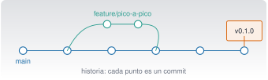

{.portada fig-alt="Diagrama de commits como puntos unidos por una línea principal, con una rama que sale hacia arriba y vuelve a unirse, y una etiqueta de versión sobre el último commit"}

## Objetivos y prerrequisitos

**Objetivos.** Al terminar la unidad sabrás:

- explicar qué es un repositorio, un commit, una rama y el área de preparación, y por qué el control de versiones es **la red de seguridad** de quien trabaja con un asistente de programación;
- seguir el ciclo `status → diff → add → commit` y **revisar un cambio antes de confirmarlo**;
- crear ramas, integrarlas con *merge* o *rebase* y resolver un conflicto sencillo;
- recuperar trabajo con `restore`, `revert` y `reflog`, distinguiendo lo seguro de lo destructivo;
- usar GitHub: remotos, *pull requests*, etiquetas y una acción de comprobación automática;
- trabajar en paralelo con **worktrees**, también con Claude Code;
- completar el ejercicio central: **rama → cambio hecho con Claude Code → pruebas → revisión del diff → integración**.

**Prerrequisitos.** [C2 · Preparación del entorno y terminal](../c2-terminal/index.qmd): Zsh o PowerShell, rutas y códigos de salida.

**Tiempo orientativo.** 6–8 horas. **Nivel:** intermedio. **Herramientas:** Git (2.55.0 en la redacción) y, para GitHub, una cuenta y el cliente `gh` (opcional). Los ejemplos funcionan igual en macOS y Windows; la sintaxis de Git **no cambia** entre sistemas, solo la de la shell.

::: {.callout-note title="Cómo se han comprobado las órdenes"}
Todas las órdenes de Git de esta unidad se ejecutaron en un repositorio temporal con Git 2.55.0 en macOS (23-10-2026), salvo las de **GitHub** (`remote`, `push`, `pull`, `gh`, *pull requests*, Actions), que necesitan una cuenta y red: se han contrastado con la documentación de GitHub y **no se han ejecutado**. Los mensajes literales de Git pueden variar de una versión a otra.
:::

**Temas de la unidad**

- **C3.1** Historia y fundamentos del control de versiones
- **C3.2** Repositorio, directorio de trabajo, área de preparación y commits
- **C3.3** Flujo básico: status, add, commit, diff, log y restore
- **C3.4** Ramas: switch, branch, merge y rebase; resolución de conflictos
- **C3.5** GitHub: remotos, fetch, pull, push, pull requests y revisión de código
- **C3.6** Etiquetas y versiones, .gitignore y ficheros grandes
- **C3.7** GitHub Actions y GitHub Pages
- **C3.8** Estrategias de ramas, trabajo en equipo y recuperación de errores
- **C3.9** Worktrees: concepto, creación, trabajo en paralelo y limpieza
- **C3.10** Worktrees y Claude Code

## Teoría breve

### C3.1 Historia y fundamentos del control de versiones {#c3-1}

Un **sistema de control de versiones** registra los cambios de un conjunto de ficheros a lo largo del
tiempo para poder volver atrás, comparar versiones y trabajar varias personas sin pisarse. Sin él, la
«versión» se resuelve con nombres de fichero (`informe_v2_final_DEFINITIVO.docx`), que no escala.

::: {.callout-note .historia icon=false title="Un poco de historia: de BitKeeper a Git"}
Según la propia documentación de Git, el kernel de Linux se mantuvo de 1991 a 2002 pasándose parches y
ficheros comprimidos; en 2002 empezó a usar BitKeeper, un sistema distribuido propietario. En 2005 se
rompió la relación con la empresa que lo desarrollaba y se revocó su uso gratuito, y la comunidad, con
Linus Torvalds a la cabeza, creó **Git** con unos objetivos: velocidad, diseño sencillo, buen soporte
del desarrollo no lineal (miles de ramas en paralelo), carácter totalmente distribuido y capacidad de
manejar proyectos enormes ([Pro Git, «A Short History of Git»](https://git-scm.com/book/en/v2/Getting-Started-A-Short-History-of-Git),
consultado el 23-10-2026).
:::

Git es **distribuido**: cada copia del repositorio contiene toda la historia, así que casi todo se hace
sin red. **GitHub** es un servicio que aloja repositorios Git y añade colaboración (*pull requests*,
revisión, automatización); **no es lo mismo que Git**.

**¿Por qué importa con Claude Code?** Un agente de programación edita ficheros y ejecuta comandos. Eso
significa que puede equivocarse **en tu disco**. Git convierte cada error en algo **visible**
(`git diff`) y **reversible** (`restore`, `revert`). Por eso la regla de este curso es: *Claude Code
trabaja dentro de un repositorio, en una rama, con el árbol limpio al empezar y con el `diff` revisado
antes de cada commit.* Claude Code tiene además sus propios **puntos de control** (`/rewind`), pero la
documentación avisa de que no sustituyen a Git y no siguen los cambios hechos por comandos de la shell
ni los remotos [@anthropic-puntoscontrol].

**Pon a prueba lo anterior.**

::: {.ejercicio tipo="vf" id="c3-1-github" respuesta="falso"}
Git y GitHub son lo mismo: GitHub es el programa que instalas para controlar versiones.

::: {.solucion}
**Falso.** Git es el sistema de control de versiones, que funciona en local. GitHub es un servicio que aloja repositorios Git y añade colaboración y automatización.
:::
:::

### C3.2 Repositorio, directorio de trabajo, área de preparación y commits {#c3-2}

Un **repositorio** es una carpeta con su historia, guardada en el subdirectorio oculto `.git`
(**no lo toques a mano**). Los cambios pasan por tres zonas:

| Zona | Qué contiene | Cómo se llega |
|---|---|---|
| **Directorio de trabajo** | Los ficheros tal como los ves y editas | Editas |
| **Área de preparación** (*staging*, *index*) | Lo que irá en el próximo commit | `git add` |
| **Repositorio** | La historia: commits | `git commit` |

Un **commit** es una instantánea del proyecto con autor, fecha, mensaje y un identificador (un *hash*:
`66098c9` es su forma abreviada). Cada commit apunta a su anterior, formando una cadena. Una **rama**
es solo un nombre que apunta a un commit; `HEAD` indica dónde estás.

El área de preparación existe para que **elijas qué entra** en cada commit: un commit por idea, con un
mensaje que diga qué y por qué. En este curso los mensajes son **breves, en español y en imperativo**:
«Añade pico_a_pico», «Corrige el cálculo del RMS».

**Pon a prueba lo anterior.**

::: {.ejercicio tipo="opcion" id="c3-2-staging" respuesta="b"}
¿Para qué sirve el área de preparación?

::: {.opciones}
- Para guardar copias de seguridad en la nube.
- Para elegir qué cambios entrarán en el próximo commit.
- Para sincronizar con GitHub.
- Para borrar ficheros del disco.
:::

::: {.solucion}
Permite construir commits coherentes: modificas varios ficheros, pero solo preparas (`git add`) los que forman parte de una misma idea.
:::
:::

### C3.3 Flujo básico: status, add, commit, diff, log y restore {#c3-3}

```zsh
git init                         # crea un repositorio en la carpeta actual
git status                       # ¿qué ha cambiado? (úsalo todo el tiempo)
git diff                         # cambios aún NO preparados
git diff --staged                # cambios preparados (lo que irá en el commit)
git add scripts/analiza.py       # prepara un fichero (mejor que «git add .» a ciegas)
git commit -m "Añade pico_a_pico"
git log --oneline                # historia resumida
git restore scripts/analiza.py   # DESCARTA los cambios no preparados de ese fichero
```

Todas estas órdenes son idénticas en PowerShell. Esto es lo que se ve en el proyecto de ejemplo
(salida real de Git 2.55.0, abreviada):

```text
$ git status --short
 M scripts/analiza.py
$ git diff --stat
 scripts/analiza.py | 6 ++++++
$ git log --oneline
66098c9 Añade pico_a_pico
7804459 Primer commit: proyecto de la viga
```

**Leer un `diff`.** Las líneas con `+` se añaden y las con `-` se quitan; las cabeceras `@@` indican
dónde. Un diff se lee **como una revisión de código**: ¿hace lo que se pidió? ¿toca algo más? ¿añade
dependencias, claves, ficheros generados? ¿borra pruebas?

::: {.callout-warning title="Antes de usar `restore`"}
`git restore fichero` **descarta sin avisar** los cambios no confirmados del fichero y **no se puede
deshacer** (Git no los tenía guardados). Haz `git diff fichero` antes, y si dudas, `git stash`
(los guarda aparte) o copia el fichero. Con la opción `--staged` solo se quita del área de
preparación y los cambios siguen en tu directorio de trabajo.
:::

**Cuándo no hacer `git add .`:** si el árbol contiene ficheros que no quieres versionar (claves,
resultados, entornos). Revisa `git status` y mira C3.6 sobre `.gitignore`.

**Pon a prueba lo anterior.**

::: {.ejercicio tipo="opcion" id="c3-3-diff" respuesta="c"}
Has preparado un cambio con `git add`. ¿Qué orden muestra **exactamente lo que irá** en el commit?

::: {.opciones}
- `git diff`
- `git log`
- `git diff --staged`
- `git status --short`
:::

::: {.solucion}
`git diff` muestra solo los cambios **no** preparados; `git diff --staged` muestra los preparados, es decir, el contenido del próximo commit.
:::
:::

::: {.ejercicio tipo="vf" id="c3-3-restore" respuesta="falso"}
`git restore fichero` se puede deshacer con `git reflog`.

::: {.solucion}
**Falso** para cambios que nunca se confirmaron ni se guardaron con `stash`: Git no tiene copia de ellos. `reflog` recupera *commits* perdidos, no ediciones sin confirmar.
:::
:::

### C3.4 Ramas: switch, branch, merge y rebase; resolución de conflictos {#c3-4}

Una **rama** permite trabajar en algo sin tocar la línea principal (`main`). Es barata: solo un nombre
que apunta a un commit.

```zsh
git switch -c feature/pico-a-pico   # crea la rama y se cambia a ella
git branch                          # lista ramas (* marca la actual)
git switch main                     # vuelve a main
git merge --ff-only feature/pico-a-pico   # integra solo si basta con avanzar el puntero
git branch -d feature/pico-a-pico   # borra la rama YA integrada (-d se niega si no lo está)
```

**Merge o rebase.** Dos maneras de integrar el trabajo de una rama:

| | `merge` | `rebase` |
|---|---|---|
| Qué hace | Une dos historias con un commit de fusión (o avanza el puntero si es posible) | **Reescribe** tus commits para colocarlos sobre la punta de otra rama |
| Historia | Conserva lo ocurrido, con bifurcaciones | Lineal y limpia |
| Riesgo | Bajo | **Reescribe la historia**: no lo hagas sobre commits ya compartidos |

Prueba con el proyecto de ejemplo: tras `git switch -c rama-c`, un commit en ella, otro en `main`, y
`git rebase main` desde `rama-c`, la salida es `Successfully rebased and updated refs/heads/rama-c.`;
un `git merge --no-ff rama-c` desde `main` crea un commit de fusión y el grafo
(`git log --oneline --graph`) muestra la bifurcación.

**Conflictos.** Si dos ramas cambian la misma línea de un fichero, Git no sabe cuál elegir y lo marca:

```text
$ git merge rama-a
CONFLICT (content): Merge conflict in scripts/analiza.py
Automatic merge failed; fix conflicts and then commit the result.
$ git status --short
UU scripts/analiza.py
```

El fichero contiene marcas `<<<<<<< HEAD`, `=======` y `>>>>>>> rama-a` con **las dos versiones**.
Resolver es **decidir** qué queda (una, la otra o una mezcla), borrar las marcas, ejecutar las
pruebas, `git add` del fichero y `git commit`. Si te pierdes, `git merge --abort` deja todo como
antes (comprobado). Un asistente puede ayudar a proponer la resolución, pero **la decisión sobre qué
comportamiento es el correcto es tuya**.

::: {.callout-warning title="Errores frecuentes"}
- **Resolver un conflicto «aceptando todo lo mío»** sin leer lo del otro: se pierde su trabajo.
- **Commitear con marcas de conflicto** (`<<<<<<<`) dentro del fichero: busca con `grep -n "<<<<<<<" -r .` antes de confirmar.
- **`rebase` de una rama que ya publicaste**: obliga a otros a rehacer su historia.
:::

**Pon a prueba lo anterior.**

::: {.ejercicio tipo="opcion" id="c3-4-merge" respuesta="d"}
Has hecho `git merge rama-a` y aparece `CONFLICT`. Estás nervioso y no sabes qué hacer. ¿Cuál es la salida **segura**?

::: {.opciones}
- `git reset --hard origin/main`, que lo deja todo limpio.
- Borrar la carpeta y clonar de nuevo.
- `git add .` y `git commit`, para que desaparezca el aviso.
- `git merge --abort`, que devuelve el repositorio al estado anterior al merge.
:::

::: {.solucion}
`git merge --abort` deshace el intento de fusión sin perder lo que tenías antes. `reset --hard` descarta cambios sin confirmar; confirmar a ciegas guardaría las marcas de conflicto en el fichero.
:::
:::

### C3.5 GitHub: remotos, fetch, pull, push, pull requests y revisión de código {#c3-5}

Un **remoto** es una copia del repositorio en otro sitio (normalmente GitHub), llamada por defecto
`origin`. Cuatro órdenes lo gobiernan:

| Orden | Qué hace | ¿Modifica mi trabajo local? |
|---|---|---|
| `git clone URL` | Copia un repositorio completo | Crea una carpeta nueva |
| `git fetch` | **Descarga** novedades sin integrarlas | No |
| `git pull` | `fetch` + integración en tu rama | **Sí** |
| `git push` | **Envía** tus commits al remoto | Modifica el remoto |

`fetch` es el que se puede ejecutar con tranquilidad para *ver* qué hay antes de decidir.
`git push` publica; **en este curso Claude Code no hace `push` ni abre PR sin que lo pidas
expresamente**, y la configuración del proyecto lo exige (se verá en C4 y C7). Sin remoto configurado, Git responde
`fatal: No configured push destination` (comprobado).

Un **pull request** (PR) es una propuesta de integrar los cambios de una rama en otra: permite
discutirlos y revisarlos antes de fusionar [@github-pr]. Un PR en **borrador** (*draft*) no puede
fusionarse hasta marcarlo como listo. Un flujo sano en equipo: rama → commits pequeños → PR con
descripción (qué, por qué, cómo se probó) → revisión → pruebas automáticas en verde → fusión.

**Revisión de código.** Mira el diff de arriba abajo, busca lo que **no** se pidió, comprueba que hay
pruebas y que pasan. Esto vale igual para el código de una persona que para el de un asistente
(C0.9 y C5).

El cliente `gh` de GitHub permite hacer parte de esto desde la terminal (`gh pr create`, `gh pr view`);
sus órdenes **que modifican GitHub** (crear PR, comentar, fusionar) requieren tu confirmación
en este proyecto. No se han ejecutado en la redacción de esta unidad.

**Pon a prueba lo anterior.**

::: {.ejercicio tipo="opcion" id="c3-5-fetch" respuesta="a"}
Quieres ver qué ha cambiado en `origin` **sin tocar** tus ficheros locales. ¿Qué haces?

::: {.opciones}
- `git fetch`
- `git pull`
- `git push`
- `git merge --abort`
:::

::: {.solucion}
`git fetch` descarga la información pero no la integra. `git pull` integra (fusiona o reubica) y puede cambiar tus ficheros.
:::
:::

### C3.6 Etiquetas y versiones, .gitignore y ficheros grandes {#c3-6}

**Etiquetas (*tags*).** Marcan un commit concreto, normalmente una versión. Las **anotadas** guardan
autor, fecha y mensaje:

```zsh
git tag -a v0.1.0 -m "Primera versión"     # crea la etiqueta
git tag                                    # lista las etiquetas
git show v0.1.0 --stat                     # muestra la etiqueta y su commit
```

Una **versión** (*release*) en GitHub se crea sobre una etiqueta y puede adjuntar ficheros. Se suele
seguir el **versionado semántico** `MAYOR.MENOR.PARCHE` (1.4.2): sube el MAYOR si rompes compatibilidad,
el MENOR si añades algo compatible y el PARCHE si corriges un error.

**`.gitignore`.** Lista de patrones de ficheros que Git ignora. Debe incluir lo **generado** (resultados,
informes compilados, entornos), lo **local** (ajustes personales) y los **secretos** (`.env`). Se
comprueba con `git check-ignore -v fichero`: en el proyecto de ejemplo, `.env` y `resultados/x.csv`
aparecen como ignorados (`.gitignore:5:.env` y `.gitignore:2:resultados/`) y no figuran en `git status`.

::: {.callout-warning title="Un secreto subido no se «borra» borrando el commit"}
Si un fichero con una clave llega a un repositorio compartido, **considéralo comprometido**: revoca
la clave y crea otra. Reescribir la historia ayuda a limpiar, pero otras copias, *forks* o cachés
pueden haberla guardado ya.
:::

**Ficheros grandes.** Git guarda cada versión de cada fichero: un fichero binario grande que cambia a
menudo hincha el repositorio. Para datos grandes, usa almacenamiento externo o **Git LFS**; para
resultados reproducibles, versiona el **código que los genera**, no los resultados. (Ojo: la
documentación de worktrees de Claude Code advierte de que, si usas `git lfs install --local`, los
worktrees que crea contienen punteros LFS en lugar de los ficheros reales hasta que ejecutes
`git lfs pull` [@anthropic-worktrees].)

**Pon a prueba lo anterior.**

::: {.ejercicio tipo="opcion" id="c3-6-semver" respuesta="b"}
Corriges un error sin cambiar la interfaz. Tu versión actual es 1.4.2. ¿Cuál es la siguiente según el versionado semántico?

::: {.opciones}
- 2.0.0
- 1.4.3
- 1.5.0
- 1.4.2-bis
:::

::: {.solucion}
Un arreglo compatible sube el **PARCHE**: 1.4.3. El MENOR (1.5.0) es para añadir funciones compatibles y el MAYOR (2.0.0) para cambios que rompen compatibilidad.
:::
:::

### C3.7 GitHub Actions y GitHub Pages {#c3-7}

**GitHub Actions** ejecuta automáticamente tareas (pruebas, publicación) cuando ocurre algo en el
repositorio. Cada **flujo de trabajo** (*workflow*) es un fichero YAML en `.github/workflows/`, con:
un **disparador** (`on:`), uno o más **trabajos** (`jobs:`), cada uno en un **ejecutor** (`runs-on:`) y
con una lista de **pasos** (`steps:`) que ejecutan órdenes (`run:`) o usan acciones ya hechas
(`uses:`) [@github-actions].

Un flujo mínimo que ejecuta las pruebas del proyecto de ejemplo en cada *push* (**no se ha ejecutado
en GitHub**; la sintaxis se ha contrastado con la documentación y el YAML se ha validado en local):

```yaml
name: Pruebas
on: [push, pull_request]
jobs:
  pytest:
    runs-on: ubuntu-latest
    steps:
      - uses: actions/checkout@v6
      - name: Instalar dependencias
        run: python3 -m pip install numpy pytest
      - name: Ejecutar pruebas
        run: python3 -m pytest tests
```

Dos puntos de seguridad: **lo que escribe el flujo corre en máquinas de GitHub con los secretos que le
des**, así que no pongas claves en el YAML (usa los *secrets* del repositorio) y **revisa las acciones
de terceros** que uses (una versión etiquetada puede cambiar; las más estrictas fijan el commit).

**GitHub Pages** sirve páginas estáticas desde un repositorio. Esta web se publica así: el flujo
[`publish.yml`](https://github.com/me1catrr/resonancia/blob/main/.github/workflows/publish.yml) se
dispara con cada *push* a `main`, instala Quarto (versión fija) y publica la rama `gh-pages`. Como no
tiene Julia, lee los resultados de `_freeze/`: por eso se commitean (véase `CLAUDE.md`).

**Pon a prueba lo anterior.**

::: {.ejercicio tipo="opcion" id="c3-7-actions" respuesta="c"}
¿Dónde se guardan los ficheros de flujo de trabajo de GitHub Actions?

::: {.opciones}
- En la raíz, con el nombre `actions.yml`.
- En `.git/workflows/`.
- En `.github/workflows/`, con extensión `.yml` o `.yaml`.
- En la web de GitHub, no en el repositorio.
:::

::: {.solucion}
Según la documentación de GitHub, en el directorio `.github/workflows` del repositorio, con extensión `.yml` o `.yaml`.
:::
:::

### C3.8 Estrategias de ramas, trabajo en equipo y recuperación de errores {#c3-8}

**Estrategias de ramas.** Para un equipo pequeño basta con **ramas de tema** cortas: `main` siempre
funciona, cada cambio vive en una rama (`feature/…`, `fix/…`), se integra por PR y se borra. Cuanto
más viva una rama, más se aleja de `main` y más dolorosa será la integración.

**Buenas prácticas de colaboración.** Commits pequeños y con sentido; mensajes que expliquen el
porqué; `fetch` antes de empezar; pruebas antes de integrar; no reescribir historia publicada;
revisar el código de los demás con el mismo rigor que el propio.

**Recuperación: qué deshace qué.**

| Situación | Orden | ¿Seguro? |
|---|---|---|
| Descartar cambios **sin confirmar** de un fichero | `git restore fichero` | ⚠ Irreversible |
| Quitar un fichero del área de preparación | `git restore --staged fichero` | ✔ |
| Guardar cambios aparte y limpiar el árbol | `git stash` · `git stash pop` | ✔ (probado) |
| Deshacer un commit **ya hecho** creando otro inverso | `git revert COMMIT` | ✔ No reescribe historia (probado) |
| Ver dónde ha estado `HEAD` (commits «perdidos») | `git reflog` | ✔ Solo lectura |
| Mover la rama hacia atrás **y descartar** cambios | `git reset --hard COMMIT` | ❌ Destructivo |
| Reescribir el remoto | `git push --force` | ❌ Puede borrar trabajo ajeno |

::: {.callout-warning title="Órdenes destructivas: léelas dos veces"}
`git reset --hard`, `git clean -fd`, `git checkout -- .` y `git push --force` **descartan o sobrescriben
trabajo sin posibilidad de recuperarlo desde Git**. En este proyecto la configuración de Claude Code
pide confirmación para todas (C4). Antes de ejecutar una de ellas pregunta: ¿qué se pierde?, ¿existe
otra copia?, ¿puedo usar `revert` o `stash` en su lugar?
:::

**Pon a prueba lo anterior.**

::: {.ejercicio tipo="opcion" id="c3-8-revert" respuesta="a"}
Un commit ya compartido introdujo un error. ¿Cómo lo deshaces **sin reescribir la historia**?

::: {.opciones}
- `git revert COMMIT`, que añade un commit que invierte el cambio.
- `git reset --hard COMMIT~1` y `git push --force`.
- Borrar el repositorio y clonar de nuevo.
- Editar el commit antiguo a mano en `.git`.
:::

::: {.solucion}
`revert` crea un commit nuevo con el cambio inverso (comprobado: produce `Revert "Añade pico_a_pico"`). `reset --hard` + `push --force` reescribe la historia compartida.
:::
:::

### C3.9 Worktrees: concepto, creación, trabajo en paralelo y limpieza {#c3-9}

Un **worktree** es un directorio de trabajo adicional del **mismo repositorio**, con su propia rama y
sus propios ficheros, que comparte la historia y el remoto. Permite tener abierta la rama de una
funcionalidad y la de un arreglo urgente **a la vez**, sin `stash` ni cambios de rama.

```zsh
git worktree add ../viga-otro -b feature/otro   # crea la carpeta ../viga-otro con una rama nueva
git worktree list                               # lista el principal y los vinculados
git worktree remove ../viga-otro                # lo elimina (se niega si hay cambios sin confirmar)
```

Probado en el proyecto de ejemplo: `git worktree add` imprime `HEAD is now at 66098c9 Añade pico_a_pico` y
`git worktree list` muestra los dos directorios con sus ramas. Reglas: **una misma rama no puede estar
extraída en dos worktrees a la vez**; los ficheros ignorados (`.env`, el entorno de Python) **no se
copian**, así que cada worktree necesita su propia preparación; y elimina los worktrees con
`git worktree remove`, no borrando la carpeta a mano.

### C3.10 Worktrees y Claude Code {#c3-10}

Claude Code integra los worktrees para ejecutar **sesiones en paralelo aisladas**
[@anthropic-worktrees]. Según su documentación (versión 2.1.309, consultada el 23-10-2026):

- `claude --worktree nombre` (o `-w`) crea un worktree en `.claude/worktrees/<nombre>/`, en una rama nueva `worktree-<nombre>`, y arranca Claude allí. Conviene añadir `.claude/worktrees/` al `.gitignore`.
- Para llevar a cada worktree ficheros ignorados como `.env`, se lista en un fichero **`.worktreeinclude`** (con sintaxis de `.gitignore`); solo se copian los que además están ignorados.
- Al salir, si el worktree está limpio y la sesión no tiene nombre, se elimina; si tiene trabajo, **te pregunta** si conservarlo o borrarlo (borrarlo elimina también la rama con su trabajo).
- Las sesiones aisladas bloquean ediciones y comandos de Git que apunten al directorio principal; los comandos de shell como `cp` o una redirección **no** se controlan así y siguen sujetos a tus permisos.
- Los **subagentes** pueden ejecutarse cada uno en su worktree (`isolation: worktree`); esto se ve en C7 y C8.
- `claude --worktree "#1234"` crea el worktree a partir de una *pull request*.

Los worktrees aíslan **ficheros**: no son lo mismo que los subagentes (que reparten trabajo dentro de
una sesión) ni que los equipos de agentes (experimentales). Tampoco sustituyen a los permisos:
cada sesión sigue pidiendo confirmación según su configuración.

**Pon a prueba lo anterior.**

::: {.ejercicio tipo="vf" id="c3-10-copia" respuesta="falso"}
Un worktree nuevo contiene automáticamente tu fichero `.env` y tu entorno virtual de Python.

::: {.solucion}
**Falso.** Un worktree es una copia limpia de lo versionado. Los ficheros ignorados no se copian salvo que los listes en `.worktreeinclude` (en worktrees creados por Claude Code), y el entorno hay que preparar cada vez.
:::
:::

## Práctica guiada

[Local gratuita]{.ejec .ejec-local} (los pasos 1–6 no necesitan red ni cuenta) · [Requiere cuenta]{.ejec .ejec-cuenta} (el paso 7 con Claude Code, y el opcional de GitHub).

### Práctica · rama → cambio con Claude Code → pruebas → revisión del diff → integración

**Ficha.** *Objetivo:* añadir una función al proyecto de ejemplo con ayuda de Claude Code **sin perder
nunca el control**: rama aislada, pruebas, diff revisado e integración consciente. *Archivos:* una
copia del proyecto de C2 (`claude/c2-terminal/_ejemplo/proyecto-viga/`). *Versiones:* Git, Python con
`numpy` y `pytest`; Claude Code (C4) para el paso 5. *Resultado esperado:* una rama integrada en `main`
con una función `pico_a_pico`, su prueba y el valor **2,56584 m/s²** para los datos de ejemplo.
*Problemas frecuentes:* trabajar con el árbol sucio; aceptar cambios en ficheros que no se pidieron.

**1. Prepara el repositorio** (copia el proyecto a una carpeta nueva y conviértela en repositorio):

```zsh
cd ~/viga && git init -b main && git add . && git commit -m "Primer commit: proyecto de la viga"
git status --short        # debe quedar vacío: árbol limpio
```

*PowerShell:* los mismos comandos de Git (cambia `~/viga` por tu ruta). Si Git no conoce tu nombre,
configúralo **para este repositorio** con `git config user.name "…"` y `git config user.email "…"`.

**2. Crea la rama:** `git switch -c feature/pico-a-pico`.

**3. Define criterios de aceptación** *antes* de pedir nada:

- Existe `pico_a_pico(a)` en `scripts/analiza.py`: devuelve `max - min` en m/s².
- `resumen.csv` incluye una columna nueva `pico_a_pico_m_s2`.
- Hay una prueba nueva que cubre la función y otra que comprueba la columna.
- No se toca ningún otro fichero ni se añade ninguna dependencia.

**4. Comprueba que las pruebas actuales pasan** (línea base): `uv run --with numpy --with pytest pytest tests` (instala lo necesario solo para esa ejecución; el Python del sistema no suele traer `pytest`). Esperado: **6 passed**.

**5. Pide el cambio a Claude Code** (en C4 verás cómo se arranca y cómo funcionan los permisos; **lee cada
propuesta antes de aprobarla**). Un prompt posible, **ilustrativo** (las respuestas reales varían):

> Estoy en la rama `feature/pico-a-pico` del proyecto de la viga. Añade a `scripts/analiza.py` una
> función `pico_a_pico(a)` que devuelva `max - min`, inclúyela como columna `pico_a_pico_m_s2` en
> `resumen.csv` (tras `rms_m_s2`) y añade pruebas en `tests/test_analiza.py`. No modifiques ningún otro
> fichero, no añadas dependencias y no hagas commits. Ejecuta las pruebas y dime el resultado.

**6. Revisa antes de confirmar.** Con Claude Code parado:

```zsh
git status --short        # ¿solo scripts/analiza.py y tests/test_analiza.py?
git diff                  # lee TODO el diff
uv run --with numpy --with pytest pytest tests   # ¿pasan?; ¿cuántas hay ahora?
```

Preguntas de revisión: ¿hay **ficheros no pedidos**?, ¿se han **borrado o debilitado** pruebas (para que «pasen» a toda costa)?, ¿se
han hecho cambios en `resumen.csv` o en el orden de columnas que rompen algo?, ¿añadió una
dependencia? Si algo no está claro, pregúntaselo o descártalo con `git restore` (tras leer el diff).

**7. Confirma e integra:**

```zsh
git add scripts/analiza.py tests/test_analiza.py
git diff --staged            # último vistazo a lo que se confirma
git commit -m "Añade pico_a_pico"
git switch main
git merge --ff-only feature/pico-a-pico
git branch -d feature/pico-a-pico
```

**Resultado esperado.** Con la solución de referencia pasan **8** pruebas (las 6 de partida más 2 nuevas). Con los datos de ejemplo, `pico_a_pico` vale **2,56584 m/s²** (máximo 1,31393,
mínimo −1,25191; calculado con la función de referencia el 23-10-2026). Si tu valor difiere, revisa la
función antes de integrar.

*Material del profesorado:* la solución de referencia está en `claude/c3-git/_ejemplo/solucion-pico-a-pico.patch` (se comprueba con `git apply --check`).

**Variante con conflicto** (opcional): en una segunda rama cambia la misma línea del *docstring*,
fusiona y resuelve el conflicto a mano, sin aceptar «todo lo mío».

**Qué has aprendido:** Claude Code propone; **tú** revisas el diff, ejecutas las pruebas y decides qué
se integra. Git hace que cualquier error sea visible y reversible.

## «Pídeselo a Claude»

::: {.callout-tip title="Prompt"}
Acabo de terminar un cambio en mi rama y quiero revisarlo antes de integrarlo. Te pego la salida de
`git status --short` y de `git diff`. Dime, **solo leyendo el diff**: 1) qué hace el cambio en dos
frases; 2) qué ficheros toca y si alguno no parece relacionado; 3) qué riesgos ves (secretos,
dependencias nuevas, pruebas borradas, comportamiento que cambia); 4) qué pruebas faltarían. No
propongas ninguna orden destructiva y marca lo que no puedas saber solo con el diff.

**Verifica.**

- ¿Coincide su resumen con tu lectura del diff? Si dice algo que no está en el diff, descártalo.
- ¿Encontró algo que tú no viste? Compruébalo tú en el diff, no te fíes.
- ¿Ha marcado lo que **no** puede saber (por ejemplo, el comportamiento en tiempo de ejecución)?
- ¿Sugirió alguna orden destructiva a pesar de pedirle que no? Si es así, anótalo: es un ejemplo para C4.
:::

## Ejercicios

1. **Ciclo básico.** En un repositorio nuevo, haz tres commits que cuenten una historia (crear fichero, modificarlo, añadir otro). Comprueba con `git log --oneline` y `git log -p -1`.

2. **Conflicto.** Provoca un conflicto en una línea entre dos ramas, léelo, resuélvelo con una versión **combinada** y deja las pruebas en verde. Después prueba `git merge --abort` en un segundo intento y verifica con `git status` que no queda nada pendiente.

3. **Rebase seguro.** Con una rama de tema y un `main` que ha avanzado, haz `git rebase main` desde la rama y compara `git log --oneline --graph` antes y después. ¿Cuándo **no** lo harías?

   ::: {.callout-note collapse="true" title="Solución"}
   Antes, el grafo mostraba una bifurcación; después, la rama queda **encima** de `main` sin bifurcación. No lo haría con commits que ya haya compartido otra persona, porque rehacer su historia obliga a los demás a reconciliar.
   :::

4. **Recuperación.** Borra el último commit con `git reset --hard HEAD~1` **en un repositorio de pruebas** (jamás en uno con trabajo real) y recupéralo con `git reflog` y `git reset --hard HASH`. Explica por qué funciona y cuándo no.

   ::: {.callout-note collapse="true" title="Solución"}
   `reflog` guarda dónde ha estado `HEAD`, así que el commit «perdido» sigue existiendo un tiempo (Git lo limpia eventualmente). No habría recuperación para cambios **sin confirmar**, que nunca estuvieron en un commit.
   :::

5. **Worktrees.** Crea un worktree con `git worktree add`, haz un commit en él, vuelve al principal e intégralo con `merge`. Elimínalo con `git worktree remove` y confirma con `git worktree list`.

6. **Etiqueta.** Etiqueta con `v0.1.0` la versión integrada y explica a qué número pasaría el proyecto si corriges un error y después añades una función compatible.

   ::: {.callout-note collapse="true" title="Solución"}
   Corregir un error: v0.1.1. Añadir una función compatible: v0.2.0 (sube el MENOR y el PARCHE vuelve a 0).
   :::

## La doy por superada si…

- Explico por qué Claude Code debe trabajar dentro de un repositorio, en una rama y con el árbol limpio.
- Hago un ciclo `status → diff → add → commit` y leo un diff como una revisión de código.
- Creo y fusiono ramas, y resuelvo un conflicto sin perder el trabajo de nadie.
- Distingo `restore`, `revert`, `stash`, `reset --hard` y `push --force` y sé cuáles son destructivos.
- Sé qué hace `fetch`, `pull` y `push` y que `push` es una acción que **publica**.
- Escribo un `.gitignore` y sé qué hacer si un secreto llega a un repositorio.
- Leo un flujo de GitHub Actions sencillo y sé dónde viven.
- Creo y limpio un worktree y sé qué aísla y qué no.
- Completo el ejercicio rama → Claude Code → pruebas → diff → integración, con `pico_a_pico` = 2,56584 m/s².

## Referencias de esta unidad

Documentación consultada el 23-10-2026: [Pro Git (historia)](https://git-scm.com/book/en/v2/Getting-Started-A-Short-History-of-Git),
[Git: `git-worktree`](https://git-scm.com/docs/git-worktree), GitHub Docs sobre
[*pull requests*](https://docs.github.com/en/pull-requests/collaborating-with-pull-requests/proposing-changes-to-your-work-with-pull-requests/about-pull-requests)
y [GitHub Actions](https://docs.github.com/en/actions/get-started/quickstart), y la documentación de
Claude Code sobre [worktrees](https://code.claude.com/docs/en/worktrees) y
[puntos de control](https://code.claude.com/docs/en/checkpointing).
