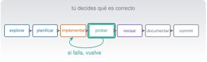

{.portada fig-alt="Ciclo de desarrollo en siete pasos conectados: explorar, planificar, implementar, probar, revisar, documentar y confirmar, con las pruebas destacadas"}

## Objetivos y prerrequisitos

**Objetivos.** Al terminar la unidad sabrás:

- recorrer el ciclo **explorar → planificar → implementar → probar → revisar → documentar → confirmar** con Claude Code sin delegar el criterio;
- escribir una **especificación** con restricciones y **criterios de aceptación** que se puedan comprobar;
- usar las **pruebas como contrato** (desarrollo dirigido por pruebas) en Python y en Julia;
- depurar, refactorizar y **revisar código generado por IA**, y reconocer sus fallos típicos;
- estructurar código modular con errores controlados, registros, tipos y dependencias declaradas;
- migrar código heredado (MATLAB) a Julia comprobando que el resultado no cambia;
- decidir **cuándo usar Python, Julia o un script de shell** y cuándo verificar a mano.

**Prerrequisitos.** [C4](../c4-claude-code/index.qmd) (Claude Code, permisos, `CLAUDE.md`) y [C3](../c3-git/index.qmd) (ramas y diff). Familiaridad básica con Python o Julia.

**Tiempo orientativo.** 8–10 horas. **Nivel:** intermedio. **Herramientas:** Python 3.11+ con `numpy` y `pytest` (con `uv`), Julia 1.12, Git y Claude Code.

::: {.callout-note title="Cómo se han comprobado los ejemplos"}
El código de esta unidad vive en `claude/c5-programar/_ejemplo/` (carpetas `python/` y `julia/`), con sus pruebas, y **se ejecutó en la redacción**: 10 pruebas con `pytest` (Python 3.14 con `uv`) y 10 aserciones con `Test` (Julia 1.12.3), el 23-10-2026. Las salidas numéricas citadas proceden de esas ejecuciones. **No** se ejecutó MATLAB (no está instalado): la traducción MATLAB → Julia se verificó comparando con la implementación de referencia, no contra MATLAB. Los diálogos con Claude son **ilustrativos**.

:::

**Temas de la unidad**

- **C5.1** El ciclo explorar, planificar, implementar, probar, revisar, documentar y commit
- **C5.2** Prompts técnicos: especificación, restricciones y criterios de aceptación
- **C5.3** Tests como contrato: desarrollo dirigido por pruebas
- **C5.4** Depuración, refactorización y revisión de código
- **C5.5** Arquitectura modular, dependencias, errores, registros y tipos
- **C5.6** Documentación, rendimiento y seguridad del código
- **C5.7** Código heredado: migrar de MATLAB a Julia
- **C5.8** Particularidades de Julia y de Python al trabajar con Claude Code
- **C5.9** Cuándo confiar y cuándo verificar a mano; Claude como tutor

## Teoría breve

### C5.1 El ciclo explorar, planificar, implementar, probar, revisar, documentar y commit {#c5-1}

Desarrollar software con un asistente no cambia **qué** hay que hacer, sino **quién hace cada parte y cómo se
comprueba**. El ciclo completo tiene diez pasos; los cuatro primeros y los cuatro últimos son tuyos aunque
Claude te ayude:

| # | Paso | Qué haces tú | Dónde te ayuda Claude |
|---|---|---|---|
| 1 | **Requisitos** | Decides qué problema resuelves y para quién | Te hace preguntas que no se te habían ocurrido |
| 2 | **Diseño** | Eliges la estructura y los límites | Propone alternativas y sus costes |
| 3 | **Planificación** | Fijas pasos y criterios de aceptación | Redacta el plan para que lo corrijas |
| 4 | **Implementación** | Revisas cada cambio | Escribe el código |
| 5 | **Pruebas** | Defines qué demuestra que está bien | Escribe y ejecuta pruebas |
| 6 | **Depuración** | Formulas hipótesis | Lee trazas y propone causas |
| 7 | **Revisión** | Lees el diff entero | Segunda opinión en un contexto limpio |
| 8 | **Documentación** | Compruebas que es cierta | Redacta docstrings y README |
| 9 | **Control de versiones** | Decides qué se confirma | Redacta el mensaje del commit |
| 10 | **Entrega reproducible** | Compruebas desde cero | Ayuda con entornos y scripts |

La guía de buenas prácticas de Claude Code propone un flujo equivalente (explorar, planificar, implementar, confirmar)
y una idea de fondo que adoptamos como regla: **dale a Claude una forma de comprobar su propio trabajo**
(pruebas, una orden con salida esperada) o tendrás que ser tú el único bucle de verificación
[@anthropic-practicas]. También avisa de cuándo **no** planificar: si puedes describir el cambio en una frase (un
nombre de variable, una línea de registro), pídelo directamente.

::: {.callout-tip .idea-clave title="Idea clave"}
El código que no entiendes ni has verificado **no es tuyo todavía**. Un asistente acelera la escritura; la responsabilidad
(y el criterio de qué es correcto) sigue siendo de quien entrega.

:::

**Pon a prueba lo anterior.**

::: {.ejercicio tipo="opcion" id="c5-1-paso" respuesta="b"}
¿Qué paso del ciclo **no** conviene delegar en la IA?

::: {.opciones}
- Escribir el borrador de un docstring.
- Decidir qué comportamiento es el correcto (el criterio de aceptación).
- Proponer nombres de variables.
- Dar formato al código.
:::

::: {.solucion}
Qué es «correcto» depende del problema, de la física y de tus requisitos. La IA no lo conoce salvo que se lo des, y aun así puede equivocarse: ese criterio es tuyo.

:::
:::

### C5.2 Prompts técnicos: especificación, restricciones y criterios de aceptación {#c5-2}

Un prompt técnico eficaz es una **especificación breve**. La guía oficial resume el principio: cuanto más precisas las
instrucciones, menos correcciones [@anthropic-practicas]. Una plantilla con seis partes:

1. **Contexto y objetivo**: qué es el proyecto y qué se quiere, con el *para qué*.
2. **Alcance**: qué ficheros o funciones se pueden tocar y cuáles no.
3. **Comportamiento esperado**: entradas, salidas, **unidades** y casos límite.
4. **Restricciones**: sin dependencias nuevas, compatibilidad, estilo.
5. **Criterios de aceptación**: pruebas que deben pasar y ejemplos con resultado.
6. **Cómo comprobarlo**: la orden que debe ejecutar y mostrar.

**Ejemplo malo y ejemplo bueno** (ilustrativos):

| Versión | Prompt |
|---|---|
| Vaga | «Haz una función para suavizar la señal.» |
| Específica | «En `senales.py`, añade `media_movil(x, n)`: media de cada ventana de `n` muestras consecutivas, sin rellenar los bordes, longitud `len(x)-n+1`. `ValueError` si `n<1` o `n>len(x)`. Ejemplos: `media_movil([1,2,3,4,5],2) == [1.5,2.5,3.5,4.5]`. Sin dependencias nuevas. Escribe primero las pruebas y ejecútalas; muéstrame la salida. No toques otros ficheros.» |

Con la segunda, **la prueba es la especificación**: cualquier implementación que las pase cumple, y puedes
comprobarlo tú. Dos recursos adicionales de la guía oficial: **dejar que Claude te entreviste** («hazme preguntas
sobre casos límite y escribe una especificación en `SPEC.md`») y **empezar una sesión nueva** para implementar
con la especificación como única referencia.

**Pon a prueba lo anterior.**

::: {.ejercicio tipo="abierta" id="c5-2-spec"}
Escribe una especificación (seis partes) para una función `rms(x)` que calcule el valor eficaz de una señal de aceleración.

::: {.rubrica}
- Indico entradas, salida y **unidades** (m/s²).
- Digo si se resta la media y por qué.
- Incluyo al menos un ejemplo con resultado conocido (p. ej., un seno de amplitud A tiene RMS A/√2).
- Digo qué hacer con una lista vacía.
- Pido que ejecute y muestre las pruebas.
:::
:::

### C5.3 Tests como contrato: desarrollo dirigido por pruebas {#c5-3}

En el **desarrollo dirigido por pruebas** (*test-driven development*, TDD) se escribe primero una prueba que falla,
después el código mínimo que la hace pasar y por último se limpia (rojo → verde → refactorizar). Con un asistente, las pruebas
tienen una segunda función: son el **contrato verificable** entre tú y el código generado.

::: {.panel-tabset}
## Python (pytest)

```python
# test_senales.py (extracto)
import pytest
from senales import media_movil

def test_media_movil_caso_pequeno():
    assert media_movil([1, 2, 3, 4, 5], 2).tolist() == [1.5, 2.5, 3.5, 4.5]

@pytest.mark.parametrize("n", [0, -1, 6])
def test_media_movil_rechaza_ventanas_invalidas(n):
    with pytest.raises(ValueError):
        media_movil([1, 2, 3, 4, 5], n)
```

`pytest` encuentra los ficheros `test_*.py` y las funciones `test_*`, y muestra los valores intermedios cuando un
`assert` falla [@pytest-inicio].

## Julia (Test)

```julia
using Test
include("senales.jl")

@testset "media_movil" begin
    @test media_movil([1, 2, 3, 4, 5], 2) == [1.5, 2.5, 3.5, 4.5]
    for n in (0, -1, 6)
        @test_throws ArgumentError media_movil([1, 2, 3, 4, 5], n)
    end
end
```

Se ejecuta con `julia --project=. runtests.jl`; `@testset` agrupa y resume los resultados.

:::

**Qué hace buena a una prueba:** cubre casos **normales**, **límite** (ventana igual a la serie) y de **error** (entradas
inválidas); comprueba un resultado **conocido por otra vía** (un seno de amplitud 3 tiene pico a pico 6); y **no copia
la lógica de la función**. Una prueba que repite el cálculo del código no detecta nada.

**Cuidado con la IA y las pruebas.** Cuando un asistente no consigue que pase una prueba puede **modificar la prueba**, relajar una
tolerancia o escribir código que reconoce el caso del test (*hardcoding*). La guía de Claude Code lo recoge como patrón de
fallo: pide *causas raíz, no síntomas*. **Revisa siempre el diff de los ficheros de prueba** y comprueba que no se han debilitado.

**Pon a prueba lo anterior.**

::: {.ejercicio tipo="numerico" id="c5-3-ventana" respuesta="4" tol="abs:0.01"}
`media_movil([1, 2, 3, 4, 5, 6], 3)` devuelve la media de cada ventana de 3 muestras. ¿Cuál es su **tercer** elemento?

::: {.solucion}
Las ventanas son (1,2,3), (2,3,4), (3,4,5) y (4,5,6), con medias 2, 3, **4** y 5. Longitud: $6-3+1=4$.

:::
:::

::: {.ejercicio tipo="vf" id="c5-3-test" respuesta="falso"}
Si la IA hace pasar todas las pruebas, el código es correcto.

::: {.solucion}
**Falso.** Pasar las pruebas demuestra que cumple lo que **esas pruebas** comprueban. Pueden ser incompletas, estar debilitadas o reflejar un criterio equivocado. Lee el diff de las pruebas y añade los casos que falten.

:::
:::

### C5.4 Depuración, refactorización y revisión de código {#c5-4}

**Depuración.** Método: 1) **reproducir** el fallo con el caso más pequeño; 2) **formular una hipótesis**; 3) comprobarla (un
`print`, un depurador, una prueba nueva); 4) corregir la **causa**, no el síntoma; 5) dejar una prueba que habría fallado
antes. A Claude se le da el síntoma, el lugar probable y lo que significa «arreglado»: «`media_movil_mala([1,2,3,4,5],2)` devuelve
3 valores y esperamos 4; localiza la causa, escribe una prueba que falle y corrígela».

**Ejemplo real** (`_ejemplo/julia/depuracion_mala.jl`): el bucle recorre `1:length(x)-n` en lugar de `1:length(x)-n+1`.
Resultado comprobado: devuelve `[1.5, 2.5, 3.5]` en vez de `[1.5, 2.5, 3.5, 4.5]`, y el `@test` lo muestra:
`Evaluated: [1.5, 2.5, 3.5] == [1.5, 2.5, 3.5, 4.5]`. Es un **error por uno** (*off-by-one*): el clásico de
índices y de rangos, y un caso donde una IA acierta o falla según el momento. La prueba de **ventana igual a la serie** lo
detecta.

**Refactorización.** Es cambiar la estructura **sin cambiar el comportamiento**. Por eso solo se hace con
pruebas en verde antes y después, en un commit aparte, y pidiendo a Claude cambios **pequeños** (extraer una función,
renombrar), no «mejora todo el módulo».

**Revisión de código generado por IA.** Checklist de este curso:

- ¿Hace **lo pedido** y nada más? ¿Toca ficheros que no debía?
- ¿Las pruebas son **mejores o peores** que antes? ¿Alguna se ha borrado o relajado?
- ¿Hay **dependencias nuevas**? ¿Existen de verdad? (C0.5: paquetes inventados)
- ¿Maneja **entradas límite** y errores, o supone el caso feliz?
- ¿Hay **secretos**, rutas absolutas de tu máquina o `eval`/`exec` sobre datos externos?
- ¿Lo entiendo **línea a línea**? Si no, lo pregunto o no lo acepto.
- ¿Las **unidades** y convenciones (índices desde 0 o 1) son las del proyecto?

Para una segunda opinión, la documentación recomienda un **revisor en un contexto limpio** (una sesión nueva o un subagente)
y la *skill* `/code-review`, pidiéndole que señale solo lo que afecta a la corrección o a los requisitos, no preferencias de estilo
[@anthropic-practicas].

**Pon a prueba lo anterior.**

::: {.ejercicio tipo="opcion" id="c5-4-bug" respuesta="c"}
El bucle `for i in 1:length(x)-n` de una media móvil devuelve una ventana de menos. ¿Qué prueba lo habría detectado mejor?

::: {.opciones}
- Una con una señal aleatoria muy larga.
- Una que solo compruebe que no lanza error.
- Una con la ventana igual a la longitud de la serie, o con longitud de salida esperada.
- Ninguna: es imposible detectarlo.
:::

::: {.solucion}
Los casos **límite** (ventana igual a la serie, longitud de salida `len(x)-n+1`) fallan en un error por uno; una señal aleatoria larga o un «no lanza error» no lo revelan.

:::
:::

### C5.5 Arquitectura modular, dependencias, errores, registros y tipos {#c5-5}

- **Funciones pequeñas y con un solo propósito**, con docstring: `leer_csv`, `rms`, `frecuencia_dominante` (el proyecto de C2) se pueden probar por separado; un script de 200 líneas, no.
- **Separa** cálculo (puro, probable) de entrada/salida (leer ficheros, imprimir): lo primero se prueba con datos de juguete.
- **Dependencias declaradas** y fijadas: `pyproject.toml` + `uv.lock` en Python, `Project.toml` + `Manifest.toml` en Julia (C2.7). Añadir una dependencia es una decisión, no un efecto colateral.
- **Errores controlados**: valida entradas y falla pronto con un mensaje claro (`ValueError` en Python, `ArgumentError` en Julia); no captures `Exception` sin razón; usa **códigos de salida** en los scripts (C2.10).
- **Registros** (*logs*): informan de qué ha pasado y cuándo, sin datos sensibles. En Python, el módulo `logging`; en scripts de shell, un fichero con fecha (como `registro.log` de C2).
- **Tipos**: en Python, las anotaciones (`x: np.ndarray`) documentan y las comprueban herramientas externas; **no se hacen cumplir en ejecución**. En Julia, anotar el tipo de un argumento sirve sobre todo para el *despacho múltiple* y la documentación: la guía de rendimiento indica que el compilador generalmente ya conoce los tipos y que las anotaciones no son la palanca principal de velocidad [@julia-rendimiento].

**Pon a prueba lo anterior.**

::: {.ejercicio tipo="vf" id="c5-5-tipos" respuesta="falso"}
En Python, una anotación de tipo como `x: np.ndarray` hace que el intérprete rechace otros tipos en tiempo de ejecución.

::: {.solucion}
**Falso.** Las anotaciones son informativas: las usan editores y comprobadores externos, pero Python no las hace cumplir al ejecutar. Si necesitas rechazar entradas inválidas, valídalas explícitamente.

:::
:::

### C5.6 Documentación, rendimiento y seguridad del código {#c5-6}

**Documentación.** Un **docstring** dice *qué* hace la función, sus **entradas con unidades**, la salida y los errores. Un `README`
dice cómo instalar, ejecutar y probar. Pide a Claude el borrador, pero **compruébalo ejecutando los ejemplos**: la documentación
generada suele describir lo que el código *debería* hacer. En Julia, el docstring va antes de la función (se consulta con `?media_movil`).

**Rendimiento.** Regla: **primero correcto, luego medido, después rápido**. Mide antes de optimizar (en Julia, `@time`, y
`BenchmarkTools` para medidas serias, sabiendo que la primera llamada incluye la compilación; en Python, `timeit`). Dos ideas de la guía de
Julia: el código crítico va **dentro de funciones** (no en el ámbito global) y conviene **no cambiar el tipo** de una variable ni de
una salida [@julia-rendimiento]. En Python, **vectorizar** con `numpy` suele superar al bucle escrito en Python. Una
refactorización «para ir más rápido» **sin medir** es una conjetura.

**Seguridad.** Un asistente puede producir código inseguro sin avisar. Revisa: entradas externas sin validar, `eval`/`exec`/`os.system`
sobre texto externo, construcción de rutas o de comandos con datos del usuario, secretos en el código, dependencias nuevas sin
comprobar (C0.5), y la **privacidad** de lo que registras. Para las dependencias, comprueba que existen en el registro oficial antes de instalarlas.

**Pon a prueba lo anterior.**

::: {.ejercicio tipo="opcion" id="c5-6-rapido" respuesta="b"}
Claude te propone reescribir una función «para que sea más rápida». ¿Qué haces primero?

::: {.opciones}
- Acepto: la IA sabe optimizar.
- Mido el tiempo actual y con el cambio, con una medida repetible, y compruebo que el resultado no cambia.
- Pido que también cambie el estilo.
- La borro y empiezo de cero.
:::

::: {.solucion}
Sin medida no sabes si hay mejora, y sin pruebas no sabes si cambió el resultado. Primero correcto, luego medido, después rápido.

:::
:::

### C5.7 Código heredado: migrar de MATLAB a Julia {#c5-7}

Mucho código de ingeniería está en MATLAB. Un asistente es útil para **traducirlo**, pero la traducción es una
**tarea de equivalencia**: el criterio de éxito es que los resultados coincidan. Método:

1. **Fija el comportamiento**: ejecuta el original con entradas conocidas (si tienes MATLAB) y guarda los resultados como **valores de referencia**.
2. **Traduce función a función**, no el proyecto entero.
3. **Escribe pruebas** con esos valores de referencia (tolerancia explícita con `isapprox`, no `==` en coma flotante).
4. **Revisa las diferencias del lenguaje** (tabla).

| Concepto | MATLAB | Julia |
|---|---|---|
| Índices | Desde 1, `x(i)` | Desde 1, `x[i]` (los de Python empiezan en 0) |
| Rango | `x(i:i+n-1)` | `x[i:i+n-1]` |
| Fin del rango | `end` | `end` (también cierra bloques) |
| Vector columna / fila | Matriz por defecto | `Vector` y `Matrix` son tipos distintos |
| Operaciones por elementos | `.*`, `.^` | `.*`, `.^`, y `f.(x)` para cualquier función |
| Copia al asignar | Por valor (semántica de copia) | **Por referencia** para los arreglos: `b = a` **no copia**; usa `copy(a)` |
| Funciones | Un fichero por función | Varias funciones por fichero, módulos |

**Ejemplo** (`_ejemplo/julia/migracion.jl`). El original en MATLAB:

```matlab
function y = mediamovil(x, n)
  N = length(x);
  y = zeros(1, N-n+1);
  for i = 1:N-n+1
    y(i) = mean(x(i:i+n-1));
  end
end
```

La traducción a Julia, casi línea a línea:

```julia
using Statistics

function mediamovil(x, n)
    N = length(x)
    y = zeros(N - n + 1)
    for i in 1:N-n+1
        y[i] = mean(x[i:i+n-1])
    end
    return y
end
```

**Resultado comprobado:** `mediamovil([1,2,3,4,5], 2)` da `[1.5, 2.5, 3.5, 4.5]`, igual que `media_movil` (la
implementación de referencia con sumas acumuladas): `true`. **No** se ha ejecutado el original en MATLAB. La trampa más frecuente al migrar es la **copia
de arreglos por referencia**; otra es traducir `y = zeros(1, N)` a un `Matrix` de una fila en lugar de a un `Vector`.

**Pon a prueba lo anterior.**

::: {.ejercicio tipo="opcion" id="c5-7-copia" respuesta="c"}
En Julia, `b = a` con `a` un vector. Después haces `b[1] = 99`. ¿Qué le pasa a `a[1]`?

::: {.opciones}
- Nada: `b` es una copia.
- Da un error.
- También vale 99: `a` y `b` son el mismo objeto; para copiar hay que usar `copy(a)`.
- Vale 0.
:::

::: {.solucion}
En Julia la asignación de un arreglo **enlaza el mismo objeto** (no lo copia). Es una de las diferencias más peligrosas al migrar desde MATLAB, donde la asignación se comporta como una copia.

:::
:::

### C5.8 Particularidades de Julia y de Python al trabajar con Claude Code {#c5-8}

| | Python | Julia |
|---|---|---|
| Índices | Desde **0** | Desde **1** |
| Rango | `x[a:b]` excluye `b` | `x[a:b]` incluye `b` |
| Entorno | `uv` (`pyproject.toml`) | `Project.toml` / `Manifest.toml` |
| Pruebas | `pytest` | `Test` (`@test`, `@testset`) |
| Primera ejecución | Rápida | La primera llamada **compila** (más lenta) |
| Errores típicos de una IA | Mezclar versiones de bibliotecas | Mezclar la sintaxis de Python/MATLAB; olvidar `.` en operaciones vectoriales |
| Paquetes inexistentes | Posible | Posible: comprueba el registro (C0.5) |

**Ejemplo comprobado de la diferencia de índices.** Sobre los datos del caso E (`e_vibracion.csv`, 4096 muestras), los 23 máximos
locales superiores a 0,8 m/s² están, en Python, en los índices `[1080, 1660, 1675, …]` y, en Julia, en `[1081, 1661, 1676, …]`: los
mismos picos, con un desplazamiento de 1. Si una IA «traduce» entre lenguajes sin cambiar la convención, el resultado
es silenciosamente erróneo. **Pide siempre que indique la convención de índices** y pruébala.

**Cuándo usar cada herramienta:**

| Tarea | Mejor opción | Por qué |
|---|---|---|
| Cálculo numérico propio, simulación, rendimiento | **Julia** | Rápido, sintaxis matemática, paquete del curso |
| Ecosistema de datos, pruebas, integración con servicios | **Python** | Bibliotecas, uso extendido |
| Mover ficheros, encadenar programas, automatizar tareas | **Script de shell** (Zsh o PowerShell) | Nativo y breve (C2) |
| Algo que se repite y debe ser auditable | Script con registro y códigos de salida | Reproducible |

El curso usa Julia primero y deja pestañas Python donde ayudan; no es una guerra de lenguajes: elige por el problema y por lo que
puedas **verificar**.

**Pon a prueba lo anterior.**

::: {.ejercicio tipo="opcion" id="c5-8-indice" respuesta="d"}
Un pico está en el índice 1080 (Python). ¿Cuál es su índice en Julia, sobre la misma señal?

::: {.opciones}
- 1080
- 1079
- 1082
- 1081
:::

::: {.solucion}
Python cuenta desde 0 y Julia desde 1: el mismo elemento tiene un índice una unidad mayor en Julia (comprobado con la señal del caso E).

:::
:::

### C5.9 Cuándo confiar y cuándo verificar a mano; Claude como tutor {#c5-9}

**Verifica más cuanto más grave, irreversible o difícil de comprobar sea la consecuencia.** Una guía práctica:

| Situación | Qué haces |
|---|---|
| Tarea trivial, reversible, con prueba (renombrar, formatear) | Revisas el diff por encima |
| Lógica nueva con pruebas que **has leído** | Ejecutas tú las pruebas y lees el diff |
| Cálculo que acaba en un informe firmado | Recalculas con **otra vía independiente** (otra herramienta o a mano) |
| Seguridad, datos personales, permisos | Revisión humana completa; nunca solo la IA |
| Algo que no entiendes | **No lo aceptas** hasta entenderlo |

La guía oficial lo resume como un patrón de fallo: «confiar y luego verificar» deja un hueco; si no puedes verificarlo, no lo entregues
[@anthropic-practicas].

**Claude como tutor.** También puedes usarlo para **aprender** en vez de delegar: «explícame esta función línea a línea, sin cambiar
nada», «¿qué casos límite no cubren mis pruebas?», «dame un ejercicio parecido sin resolverlo». Aprende más quien intenta primero y pide
la corrección después. Si solo aceptas código, no aprendes lo que necesitarás cuando falle.

::: {.callout-warning title="Errores frecuentes"}
- **Aceptar código que no entiendes** «porque pasa las pruebas».
- **Pedir cambios enormes** en un solo paso: el diff es imposible de revisar. Trabaja en pasos pequeños.
- **Mezclar refactorización y funcionalidad nueva** en un commit.
- **No fijar la convención de índices o de unidades** al cruzar lenguajes.
- **Confiar en la documentación generada** sin ejecutar los ejemplos.
- **Sesiones eternas**: tras varias correcciones fallidas, `/clear` y un prompt mejor (C4.5).
:::

**Pon a prueba lo anterior.**

::: {.ejercicio tipo="abierta" id="c5-9-tutor"}
Escribe un prompt para usar a Claude como **tutor** (no como autor) de una función que has escrito tú.

::: {.rubrica}
- Pido una explicación o revisión, no que reescriba el código.
- Pido casos límite que mis pruebas no cubren.
- Pido que marque lo que no puede saber sin ejecutarlo.
- Me reservo la decisión de qué cambios aplico.
:::
:::

## Práctica guiada

[Requiere cuenta]{.ejec .ejec-cuenta} (los pasos con Claude Code) · [Local gratuita]{.ejec .ejec-local} (el resto) · *Diálogos ilustrativos; el código y los resultados de abajo se ejecutaron.*

**Ficha.** *Objetivo:* desarrollar `detectar_picos` con TDD y Claude Code en **Python y Julia**, depurar una versión con un
error y comprobar que ambos lenguajes dan el mismo resultado. *Archivos:* `claude/c5-programar/_ejemplo/` (`python/senales.py`,
`python/test_senales.py`, `julia/senales.jl`, `julia/runtests.jl`, `julia/depuracion_mala.jl`, `julia/migracion.jl`) y
`datos/sinteticos/curso-claude/e_vibracion.csv`. *Versiones:* Python 3.11+, Julia 1.12, `numpy`, `pytest`. *Resultado esperado:* ver abajo.
*Problemas frecuentes:* olvidar el desplazamiento de índices; no ejecutar las pruebas tú.

1. **Copia** la carpeta `_ejemplo` a tu espacio de trabajo y crea una rama (`git switch -c practica/c5`).
2. **Línea base:** `uv run --with numpy --with pytest pytest python` → **10 passed**; `julia --project=. julia/runtests.jl` → todas las pruebas en verde (`media_movil` 6/6 y `detectar_picos` 4/4).
3. **TDD con Claude:** borra (en tu copia) la función `detectar_picos` de Python y pide: «Implementa `detectar_picos(x, umbral)` según estas pruebas, sin cambiar los ficheros de prueba. Máximo local estricto, mayor que el anterior y el siguiente y que `umbral`; los extremos no cuentan; índices desde 0. Ejecuta las pruebas y muéstramelas.» Revisa el diff **y que `test_senales.py` no ha cambiado** (`git diff --stat`).
4. **Depura:** carga `julia/depuracion_mala.jl` y comprueba que `media_movil_mala([1,2,3,4,5], 2)` da 3 valores. Antes de pedir ayuda, localiza tú la causa; después pide a Claude que **escriba la prueba que falla** y la corrección.
5. **Cruza lenguajes** con los datos del caso E: ejecuta `detectar_picos` con umbral 0,8 en Python y en Julia. **Resultado esperado** (comprobado el 23-10-2026): **23 picos**; primeros índices `[1080, 1660, 1675]` en Python y `[1081, 1661, 1676]` en Julia; la media móvil con `n = 5` empieza por `[-0.04464, -0.05024, -0.05986]` en ambos.
6. **Migra** `mediamovil` (MATLAB) con Claude y comprueba que coincide con `media_movil` en el ejemplo `[1,2,3,4,5]`, `n=2`.
7. **Revisa y confirma** con la lista de C5.4. Haz commits separados (la prueba, la función, la corrección).

**Qué has aprendido:** las pruebas son el contrato, los casos límite cazan los errores por uno, y cruzar lenguajes exige fijar la convención de índices.

## «Pídeselo a Claude»

::: {.callout-tip title="Prompt"}
Te pego una función de Python que he escrito para calcular el valor eficaz de una señal y sus pruebas.
Actúa como revisor, **sin reescribir nada**: 1) di qué casos límite no cubren las pruebas; 2) señala entradas
que podrían romper la función (lista vacía, NaN, tipos); 3) indica qué afirmaciones de tu revisión no puedes
comprobar sin ejecutar el código; 4) propón, sin implementarlas, tres pruebas nuevas con su resultado esperado calculado a mano.

**Verifica.**

- Ejecuta tú las tres pruebas propuestas: ¿el resultado esperado que dio Claude es correcto? Calcúlalo por otra vía.
- ¿Detectó de verdad un caso límite que tú no habías visto, o repite generalidades?
- ¿Señaló lo que no puede saber sin ejecutar, o lo presenta todo como cierto?
- ¿Respetó «sin reescribir nada»? Comprueba con `git status`.
:::

## Ejercicios

1. **Especificación.** Convierte «haz algo con los picos» en una especificación de seis partes para `detectar_picos` (usa la de C5.2 como modelo).

2. **Pruebas primero.** Escribe (sin implementar) cinco pruebas para una función `rango_dinamico(x)` = máximo menos mínimo, incluyendo vacío y un solo elemento. Decide el comportamiento en esos casos y justifícalo.

   ::: {.callout-note collapse="true" title="Solución"}
   Vacío: elevar un error claro (no hay máximo). Un elemento: rango 0. Otros: constante (0), creciente (último − primero), con negativos, con NaN (decide: error o propagar). Lo importante es **decidir** y dejarlo escrito.

   :::

3. **Revisión.** Claude te entrega una función y «las pruebas pasan». El diff incluye un cambio en `test_*.py` que sube la tolerancia de `1e-9` a `1e-2`. ¿Qué haces?

   ::: {.callout-note collapse="true" title="Solución"}
   No lo aceptas sin entenderlo: una tolerancia 10⁷ veces mayor puede ocultar un error. Pide la causa del fallo original, restaura la tolerancia y exige que se corrija el código o se justifique numéricamente.

   :::

4. **Migración.** Traduce a Julia una función MATLAB de tu elección (o `y = cumsum(x)/(1:length(x))'`), escribe pruebas con valores de referencia y explica una diferencia de lenguaje que te haya afectado.

5. **Dos lenguajes.** Ejecuta `detectar_picos` en Python y en Julia sobre `e_vibracion.csv` con umbral 0,5 y compara los recuentos y los índices. ¿Qué desplazamiento observas y por qué?

   ::: {.callout-note collapse="true" title="Solución"}
   Mismos picos; los índices de Julia son los de Python más 1, porque Python cuenta desde 0 y Julia desde 1. Los recuentos coinciden. (Comprueba que no hay otro desfase por redondeos.)

   :::

## La doy por superada si…

- Recorro el ciclo completo y sé qué pasos son míos aunque use un asistente.
- Escribo una especificación con restricciones, ejemplos y criterios de aceptación comprobables.
- Escribo pruebas (normales, límite, de error) en Python y en Julia, y detecto cuando una IA las debilita.
- Depuro con método y dejo una prueba que habría fallado.
- Refactorizo sin cambiar el comportamiento y en un commit separado.
- Reviso código generado con una lista y no acepto lo que no entiendo.
- Migro una función de MATLAB a Julia verificando la equivalencia.
- Distingo la convención de índices y la semántica de copia entre lenguajes.
- Elijo con criterio entre Python, Julia y un script de shell, y sé cuándo verificar a mano.

## Referencias de esta unidad

Documentación consultada el 23-10-2026: [buenas prácticas de Claude Code](https://code.claude.com/docs/en/best-practices),
[consejos de rendimiento de Julia](https://docs.julialang.org/en/v1/manual/performance-tips/) y
[primeros pasos con pytest](https://docs.pytest.org/en/stable/getting-started.html).
