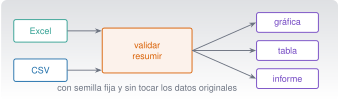
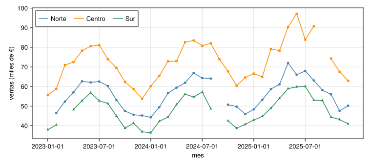
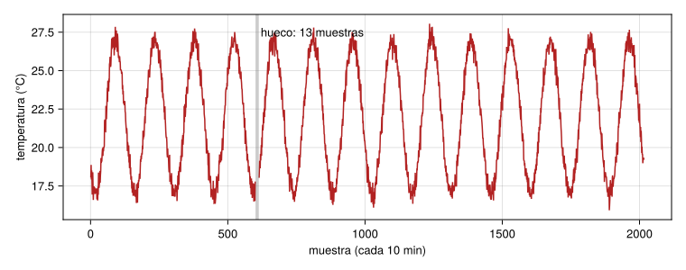
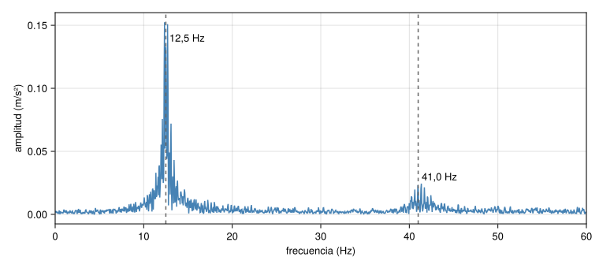

{.portada fig-alt="Flujo de trabajo de datos: una hoja de cálculo y un CSV entran en un análisis con validación, del que salen una gráfica, una tabla y un informe"}

## Objetivos y prerrequisitos

**Objetivos.** Al terminar la unidad sabrás:

- leer y escribir **CSV y Excel** con Julia (`CSV`, `DataFrames`, `XLSX`) y con Python (`pandas`, `openpyxl`), cuidando tipos, fechas y celdas ausentes;
- **validar** unos datos (ausentes, duplicados, formatos, huecos de un sensor) y **dejar constancia** de las incidencias;
- resumir con agrupaciones y estadística descriptiva, y comparar periodos con una gráfica honesta;
- generar un **informe reproducible** con Quarto (HTML y PDF) con código, ecuaciones, figuras, tablas, referencias cruzadas y bibliografía;
- procesar **lotes** de ficheros y programar tareas repetitivas;
- usar Claude Code para todo esto **sin perder el control** de los datos ni de los resultados.

**Prerrequisitos.** [C5](../c5-programar/index.qmd) (pruebas, revisión de código) y [C2](../c2-terminal/index.qmd) (scripts, tareas programadas).

**Tiempo orientativo.** 8–10 horas. **Nivel:** intermedio. **Herramientas:** Julia 1.12 con `CSV`, `DataFrames`, `XLSX` y `CairoMakie`; Python con `pandas`, `openpyxl` y `numpy`; Quarto 1.10; para PDF, una distribución de LaTeX.

::: {.callout-note title="Cómo se han comprobado los ejemplos"}
Todo el código vive en `claude/c6-informes/_ejemplo/` (Julia y Python) con sus pruebas y **se ejecutó** el 23-10-2026:
23 aserciones de Julia 1.12.3 y 8 pruebas de Python (pandas y openpyxl), y las cifras de esta página salen de esas
ejecuciones; Julia y Python **coinciden** en todos los casos. El informe de ejemplo (`_ejemplo/informe/informe.qmd`) se renderizó a
HTML y a PDF con Quarto 1.10.19 y `engine: julia`. **No** se ha probado con Excel de Microsoft (no instalado): los libros se
leyeron con XLSX.jl y openpyxl. Los datos son **sintéticos** (carpeta `datos/sinteticos/curso-claude/`).

:::

**Los datos de esta unidad.** Cinco casos sintéticos con defectos deliberados, cada uno con su ficha `.meta.toml`:

| Caso | Fichero | Tema | Defecto deliberado |
|---|---|---|---|
| A | `a_ventas.csv` | Ventas mensuales por región (36 meses × 3) | 5 ventas ausentes y 1 fila duplicada |
| B | `b_absentismo.csv` | Ausencias de personal (RR. HH.) | 21 fechas en formato `dd/mm/aaaa` entre las ISO |
| C | `c_mantenimiento.csv` | Órdenes de mantenimiento de 5 equipos | 3 costes ausentes |
| D | `d_ambiental.csv` | Temperatura y humedad (sensor, cada 10 min) | Hueco de 13 muestras consecutivas |
| E | `e_vibracion.csv` | Aceleración de una viga a 200 Hz | Ninguno (ruido de σ = 0,05 m/s²) |

**Temas de la unidad**

- **C6.1** De Excel a DataFrames y pandas: hojas, rangos y tipos
- **C6.2** Validación: ausentes, duplicados, formatos y registro de incidencias
- **C6.3** Transformar y resumir: filtros, agrupaciones, indicadores y estadística descriptiva
- **C6.4** Visualización y comparación entre periodos
- **C6.5** Escribir resultados en Excel y CSV
- **C6.6** Informes reproducibles con Quarto: HTML y PDF
- **C6.7** Paneles de consulta, procesamiento por lotes y tareas recurrentes
- **C6.8** Laboratorios: ventas, mantenimiento, turnos y vibración

## Teoría breve

### C6.1 De Excel a DataFrames y pandas: hojas, rangos y tipos {#c6-1}

Una hoja de cálculo mezcla datos, cálculos, formato y comentarios. Un **análisis reproducible** separa esas cosas: los
datos de entrada **no se modifican nunca**; el código los lee, los transforma y escribe los resultados aparte.

Un **DataFrame** (en Julia, `DataFrames.jl`; en Python, `pandas`) es una tabla con columnas tipadas. Casi todos los problemas de
datos son problemas de **tipos**:

| Problema | Ejemplo | Consecuencia |
|---|---|---|
| Número leído como texto | `"1.234,56"` (coma decimal) | No se puede sumar |
| Fecha ambigua | `05/03/2025`: ¿5 de marzo o 3 de mayo? | Análisis por mes erróneo |
| Celda vacía frente a cero | Ausente (`missing`/`NaN`) ≠ 0 | Una media falsa |
| Códigos con ceros a la izquierda | `007` leído como `7` | Se pierde información |

::: {.panel-tabset}
## Julia

```julia
using CSV, DataFrames, XLSX

a = CSV.read("datos/sinteticos/curso-claude/a_ventas.csv", DataFrame; dateformat = "yyyy-mm-dd")
first(a, 3)                                   # primeras filas
describe(a)                                   # tipos, ausentes, resumen por columna
x = DataFrame(XLSX.readtable("libro.xlsx", "hoja1"))   # una hoja de un Excel
```

## Python

```python
import pandas as pd

a = pd.read_csv("datos/sinteticos/curso-claude/a_ventas.csv", parse_dates=["fecha"])
a.head(3)
a.info()                                       # tipos y ausentes
x = pd.read_excel("libro.xlsx", sheet_name="hoja1", engine="openpyxl")
```
:::

En el caso A, `describe(a)` / `a.info()` muestran 109 filas y que `ventas_eur` tiene 5 valores ausentes: **es lo
primero que hay que mirar**. Con Excel, ten en cuenta: el formato decimal y de fecha depende de la configuración regional; las **fórmulas** pueden leerse como
sus valores guardados o como texto según la herramienta (**compruébalo** con tu fichero); las celdas combinadas y las filas de título rompen la
estructura de tabla; y una hoja de Excel tiene un límite de 1 048 576 filas.

**Regla de este curso:** nunca sobrescribas el fichero original y **no subas datos reales a una IA** sin permiso (C0.7, C1.5): usa datos
sintéticos o una muestra anonimizada de verdad.

**Pon a prueba lo anterior.**

::: {.ejercicio tipo="opcion" id="c6-1-fecha" respuesta="b"}
Recibes un CSV con la fecha `05/03/2025`. ¿Qué haces antes de analizar por mes?

::: {.opciones}
- Supongo mm/dd/aaaa, que es lo habitual.
- Pregunto o determino el formato (por ejemplo, buscando fechas con día mayor que 12) y lo declaro al leer el fichero.
- Lo dejo como texto.
- Pido a la IA que adivine.
:::

::: {.solucion}
Una fecha ambigua puede ser 5 de marzo o 3 de mayo. Hay que **determinar el formato** (una fecha como `25/03/2025` lo delata) y declararlo explícitamente al leer.

:::
:::

### C6.2 Validación: ausentes, duplicados, formatos y registro de incidencias {#c6-2}

Antes de calcular, **valida**. Una validación mínima responde: ¿cuántas filas y columnas?, ¿qué ausentes hay y dónde?, ¿hay filas
duplicadas?, ¿los formatos son los esperados?, ¿los valores caen en rangos plausibles? Y se **registra** lo que se ha hecho con cada
incidencia (se descarta, se corrige, se imputa), con su motivo.

**Caso A.** Código en `_ejemplo/julia/analisis.jl` (`validar_ventas`) y `python/analisis.py`; resultado idéntico en ambos:

```text
(filas = 109, duplicadas = 1, ausentes = 5)
```

**Caso B** (fechas mixtas). Con la función `parsear_fecha` (prueba primero `aaaa-mm-dd` y luego `dd/mm/aaaa`; `missing` si no
reconoce el formato), de las 240 filas, **21** vienen en formato `dd/mm/aaaa`, **0** quedan sin reconocer y la suma de días de ausencia es **814**.
Cuidado: una fecha `05/03/2025` solo es inequívoca porque **sabemos** que este fichero usa `dd/mm/aaaa`; el código no lo adivina.

**Caso D** (sensor con hueco). La función `huecos` devuelve los intervalos consecutivos de valores ausentes: `[(601, 613)]`, es decir, 13 muestras seguidas
(130 minutos) sin dato. **Un hueco no es un cero**: si lo rellenas con 0 estropeas la media; si lo ignoras, di que lo has ignorado.

**Ausentes: tres opciones, todas con consecuencias.**

| Opción | Cuándo | Riesgo |
|---|---|---|
| **Excluir** la fila o el dato | Pocos y sin patrón | Sesgo si faltan por una causa común |
| **Imputar** (media, interpolación) | Series con huecos cortos y análisis que lo toleran | Inventas un dato; hay que declararlo |
| **Marcar** y analizar aparte | Siempre que puedas | Más trabajo |

**Registro de incidencias.** Un fichero de texto o una hoja con: dato, qué pasó, qué se hizo, quién y cuándo. Es lo que permite a otra persona
repetir y auditar el análisis.

::: {.callout-warning title="Errores frecuentes"}
- **Sumar sin quitar duplicados**: en el caso A, el total con el duplicado es 6 131 761,26 € frente a 6 069 845,38 € sin él.
- **Tratar un ausente como 0** o excluirlo sin avisar.
- **Fechas mal interpretadas** que cambian el mes de un dato.
- **Limpiar a mano en Excel** y no dejar rastro: no se puede reproducir.
:::

**Pon a prueba lo anterior.**

::: {.ejercicio tipo="numerico" id="c6-2-ausentes" respuesta="5" tol="abs:0.01"}
¿Cuántos valores de `ventas_eur` están ausentes en `a_ventas.csv`?

::: {.solucion}
**5** (de 109 filas; ya incluye la fila duplicada, que no tiene ausente). Comprobado en Julia (`count(ismissing, df.ventas_eur)`) y en Python (`isna().sum()`).

:::
:::

### C6.3 Transformar y resumir: filtros, agrupaciones, indicadores y estadística descriptiva {#c6-3}

El patrón básico es **dividir, aplicar y combinar**: separar por una clave (región, equipo, mes), calcular un resumen en cada grupo y juntar
los resultados.

::: {.panel-tabset}
## Julia

```julia
limpio = dropmissing(unique(a), :ventas_eur)             # sin duplicados ni ausentes
combine(groupby(limpio, :region), :ventas_eur => sum => :total_eur, nrow => :meses)
```

## Python

```python
limpio = a.drop_duplicates().dropna(subset=["ventas_eur"])
limpio.groupby("region", sort=False)["ventas_eur"].agg(total_eur="sum", meses="count")
```
:::

**Resultado del caso A** (idéntico en Julia y Python, comprobado):

| Región | Total (€) | Meses con dato |
|---|---|---|
| Norte | 1 911 061,69 | 34 |
| Centro | 2 539 781,72 | 35 |
| Sur | 1 619 001,97 | 34 |
| **Total** | **6 069 845,38** | 103 |

Observa que cada región tiene 36 meses posibles y faltan datos: **comparar totales entre regiones con distinto número de meses
es engañoso**. Mejor comparar la **media mensual** o indicar el número de meses.

**Caso C** (mantenimiento), resumen por tipo de orden:

| Tipo | Órdenes | Horas de parada | Horas medias | Coste total (€) |
|---|---|---|---|---|
| correctivo | 50 | 474,4 | 9,49 | 148 032,71 |
| preventivo | 130 | 158,2 | 1,22 | 18 513,95 |

Con 3 costes ausentes (que se han **ignorado** en la suma: el coste real es algo mayor). Las órdenes correctivas, el 28 % del total, concentran el 75 % de las horas de parada: ejemplo de un **indicador** que
orienta una decisión (más mantenimiento preventivo), pero que **no demuestra causalidad** por sí solo.

**Estadística descriptiva.** Media, mediana, desviación típica, mínimo y máximo, cuartiles. **La media se distorsiona con valores
atípicos; la mediana, no.** Un resumen numérico sin gráfica puede ocultar la forma de los datos.

**Pon a prueba lo anterior.**

::: {.ejercicio tipo="numerico" id="c6-3-correctivas" respuesta="474.4" tol="1%" unidad="h"}
En el caso C, ¿cuántas horas de parada suman las órdenes **correctivas**?

::: {.solucion}
**474,4 h** (50 órdenes; 9,49 h de media). Las preventivas suman 158,2 h en 130 órdenes. Resultado comprobado en Julia y en Python.

:::
:::

::: {.ejercicio tipo="vf" id="c6-3-total" respuesta="falso"}
Como el Centro tiene el mayor total de ventas, es seguro que es la región con mejores ventas mensuales.

::: {.solucion}
**Falso.** Cada región tiene un número distinto de meses con dato; el total mezcla nivel y cobertura. Compara la media mensual y declara los meses que faltan.

:::
:::

### C6.4 Visualización y comparación entre periodos {#c6-4}

Una gráfica es un **argumento**: debe tener título o pie, ejes con **unidades**, y no engañar (eje en cero cuando se compara magnitud, misma escala al comparar, no más de lo necesario). Las que verás aquí
se generan con **CairoMakie** (Julia) desde `_ejemplo/julia/figuras.jl`; con Python, `matplotlib` cumple la misma función.

{#fig-ventas fig-alt="Tres curvas, una por región (Norte, Centro y Sur), de ventas mensuales en miles de euros entre enero de 2023 y diciembre de 2025, con una oscilación anual y una ligera tendencia al alza; la región Centro es la más alta y la Sur la más baja; hay pequeñas interrupciones donde faltan datos" width="100%"}

La @fig-ventas muestra una **estacionalidad anual** (máximos a mitad de año) y una tendencia al alza. Al **comparar periodos** (año contra año) usa
el mismo mes de cada año, no el total de un año con huecos contra otro completo.

{#fig-ambiental fig-alt="Curva de temperatura entre unos 17 y 28 grados con catorce oscilaciones diarias; una franja gris vertical marca un hueco de trece muestras sin dato" width="100%"}

**Caso D en cifras:** 2016 muestras (14 días a una cada 10 min), media de temperatura 22,02 °C con el hueco **excluido**. Una gráfica que oculta el hueco (o que lo une con una línea) engaña; la @fig-ambiental lo marca.

**Pon a prueba lo anterior.**

::: {.ejercicio tipo="opcion" id="c6-4-grafica" respuesta="c"}
Tu serie tiene un hueco de varios días y la gráfica une los puntos con una línea recta. ¿Qué problema tiene?

::: {.opciones}
- Ninguno: así se ve mejor.
- Que la línea es demasiado fina.
- Que sugiere datos inexistentes en el hueco; hay que dejar el hueco visible o marcarlo.
- Que el color es poco vistoso.
:::

::: {.solucion}
Unir los puntos «inventa» valores donde no hay medida. El hueco se deja visible (o se marca) y se explica en el pie.

:::
:::

### C6.5 Escribir resultados en Excel y CSV {#c6-5}

Se escribe en un **fichero nuevo**, no sobre el original, y con una hoja de **validación** junto a los resultados para que quede constancia de lo que se descartó.

::: {.panel-tabset}
## Julia

```julia
using XLSX, DataFrames
XLSX.writetable("ventas_resumen.xlsx",
    "resumen" => ventas_por_region(a),
    "validacion" => DataFrame([validar_ventas(a)]);
    overwrite = true)
```

## Python

```python
with pd.ExcelWriter("ventas_resumen.xlsx", engine="openpyxl") as w:
    resumen.to_excel(w, sheet_name="resumen", index=False)
    validacion.to_excel(w, sheet_name="validacion", index=False)
```
:::

**Comprobado:** el libro escrito por Julia tiene dos hojas, `resumen` y `validacion`, y **pandas lo lee** con los mismos totales. El valor de Excel
está en que otros lo abran; el del CSV, en que es texto plano y reproducible. Para CSV: codificación UTF-8, separador y decimal **explícitos** (en entornos en español Excel suele esperar `;` y coma decimal).

### C6.6 Informes reproducibles con Quarto: HTML y PDF {#c6-6}

Un **informe reproducible** une texto, código, resultados, figuras y referencias en un solo documento que se **regenera** desde los datos. Si cambia el dato, cambia el informe.

La carpeta `_ejemplo/informe/` contiene `informe.qmd`: un informe del **caso E** (vibración de una viga) con:

- **Código ejecutable** con `engine: julia` y **valores en el texto** (`` `{julia} n` ``), que evitan copiar números a mano;
- **ecuaciones** con referencia cruzada (`{#eq-delta}` → «Ecuación 1»), **figura** (`{#fig-espectro}`) y **tabla** (`{#tbl-picos}`) con pie;
- **bibliografía** con `[@harris1978]` y `bibliography: ../../../../recursos/bibliografia.bib` (una referencia verificada con Crossref);
- salida **HTML** (`embed-resources: true`, un solo fichero) y **PDF**, con `quarto render informe.qmd`.

```yaml
---
title: "Informe de vibración de la viga"
lang: es
engine: julia
execute:
  echo: false          # el informe muestra resultados, no código
bibliography: ../../../../recursos/bibliografia.bib
format:
  html: {toc: true, embed-resources: true, number-sections: true}
  pdf:  {documentclass: article, number-sections: true, toc: true}
---
```

**Resultado real del informe** (comprobado): pico principal estimado en **12,35 Hz** (impuesto: 12,5 Hz) y segundo en **41,36 Hz**
(impuesto: 41,0 Hz); amplitudes 0,1524 y 0,0244 m/s². Las estimaciones difieren **décimas de hercio** de lo impuesto: no es un error del método, sino la
anchura del pico (con ζ = 0,015, la anchura a media potencia es ≈ 2ζf = 0,38 Hz, varias veces la separación entre bins Δf = 200/4096 ≈ 0,049 Hz) y el ruido.

{#fig-espectro-c6 fig-alt="Espectro de amplitud en metros por segundo al cuadrado frente a frecuencia en hercios hasta sesenta; un pico alto y ancho cerca de doce coma cinco hercios y otro mucho más pequeño cerca de cuarenta y uno hercios, con dos líneas verticales discontinuas en esas frecuencias" width="100%"}

**Notas de uso comprobadas.**

- **Primera ejecución más lenta:** Julia compila y precompila; en el PDF de la primera vez pueden colarse los mensajes de «Precompiling». Vuelve a renderizar o añade `#| output: false`.
- **PDF:** requiere una distribución de **LaTeX** (TeX Live o TinyTeX); el renderizado de prueba usó la TeX Live instalada. Con `lang: es` y el modo matemático, un `\%` pegado a un espacio fino (`\,\%`) rompió la compilación: escribe `0{,}015` en lugar de `1{,}5\,\%`.
- **Caracteres Unicode en listados de código** (por ejemplo `π`) pueden perderse en el PDF; si muestras código, comprueba el resultado.
- **Decimales:** Julia imprime `20.48` (punto); para que el informe diga `20,48` formatea el número al insertarlo.
- Para que Quarto encuentre `CairoMakie` y el resto, el `.qmd` debe estar **dentro de un árbol con `Project.toml`** (o configurar `--project` en `julia: exeflags`); fuera, falló con *Package CairoMakie not found*.

::: {.callout-tip .idea-clave title="Idea clave"}
Cada cifra de un informe debe poder **regenerarse** con una orden. Si hay un número escrito a mano, no es reproducible.

:::

**Pon a prueba lo anterior.**

::: {.ejercicio tipo="opcion" id="c6-6-cifra" respuesta="a"}
En un informe Quarto quieres citar el número de muestras del registro. ¿Cómo lo haces?

::: {.opciones}
- Con código en línea (`` `{julia} n` ``) calculado desde los datos.
- Escribiendo el número a mano al terminar.
- Pidiendo a la IA que lo escriba en el texto.
- Con una captura de pantalla.
:::

::: {.solucion}
Con código en línea: si cambian los datos, el número se actualiza solo y queda trazado a su origen.

:::
:::

### C6.7 Paneles de consulta, procesamiento por lotes y tareas recurrentes {#c6-7}

**Procesar un lote.** Cuando tienes muchos ficheros, escribe una función para **uno** y aplícala a todos. Ejemplo (`_ejemplo/julia/lote.jl`): un resumen de calidad por CSV.
Resultado real sobre los cinco casos:

| Fichero | Filas | Columnas | Ausentes | Duplicadas |
|---|---|---|---|---|
| `a_ventas.csv` | 109 | 4 | 5 | 1 |
| `b_absentismo.csv` | 240 | 5 | 0 | 0 |
| `c_mantenimiento.csv` | 180 | 6 | 3 | 0 |
| `d_ambiental.csv` | 2016 | 3 | 13 | 0 |
| `e_vibracion.csv` | 4096 | 2 | 0 | 0 |

**Paneles de consulta.** Un informe HTML puede incluir **tablas y gráficas interactivas** (este sitio las hace con *Observable JS*, C0). Para quien solo
consulta resultados, un informe regenerado cada semana puede ser mejor que un panel complicado.

**Tareas recurrentes.** Un informe periódico se programa con el **launchd** de macOS o el **Programador de tareas** de Windows (C2.11), con **ruta absoluta**, **registro** y
aviso si falla. Recuerda: automatizar sin supervisión exige **más** comprobaciones, no menos (C8): si faltan los datos de entrada, el informe debe **fallar de forma visible**, no publicar cifras viejas.

### C6.8 Laboratorios: ventas, mantenimiento, turnos y vibración {#c6-8}

Cada laboratorio sigue el mismo guion: **validar → resumir → visualizar → informar → revisar**. Con Claude Code, cada paso se pide por separado, con criterios de aceptación y comprobando lo calculado con otra vía.

| Lab | Caso | Pregunta | Entregable |
|---|---|---|---|
| **C6.01** | A · ventas | ¿Qué región vende más al mes? ¿Hay estacionalidad? | Tabla y @fig-ventas |
| **C6.02** | C · mantenimiento | ¿Dónde se concentran las paradas? | Tabla por equipo y tipo |
| **C6.03** | B · turnos | ¿En qué mes se concentran las ausencias? | Serie mensual y nota sobre fechas |
| **C6.04** | E · vibración | ¿Qué modos tiene la viga y con qué incertidumbre? | Informe Quarto (HTML y PDF) |

## Práctica guiada

[Local gratuita]{.ejec .ejec-local} (todo el código) · [Requiere cuenta]{.ejec .ejec-cuenta} (los pasos con Claude Code) · *Datos sintéticos; diálogos con Claude ilustrativos.*

**Ficha.** *Objetivo:* analizar el caso A de principio a fin y comprobar el resultado en dos lenguajes. *Archivos:*
`datos/sinteticos/curso-claude/a_ventas.csv`, `_ejemplo/julia/`, `_ejemplo/python/`. *Versiones:* Julia 1.12, Python 3.11+. *Resultado esperado:* 6 069 845,38 € de
total y los tres totales regionales de C6.3. *Problemas frecuentes:* no quitar el duplicado; contar mal los meses.

1. **Valida con Claude:** «Lee `a_ventas.csv` y dime filas, ausentes y duplicadas. No modifiques el fichero.» Compara con **109 / 5 / 1**.
2. **Resume:** «Totales de `ventas_eur` por región, ignorando duplicados y ausentes; muestra el código.» Compara con la tabla de C6.3.
3. **Comprueba por otra vía** (obligatorio): ejecuta `julia --project=. claude/c6-informes/_ejemplo/julia/runtests.jl` (**23 aserciones en verde**) o `uv run --with numpy --with pandas --with openpyxl --with pytest pytest` en `_ejemplo/python` (**8 pruebas**).
4. **Excel:** escribe `ventas_resumen.xlsx` con las hojas `resumen` y `validacion` y ábrelo en tu hoja de cálculo.
5. **Gráfica:** reproduce la @fig-ventas y comprueba que los meses sin dato aparecen como huecos.
6. **Informe:** renderiza `_ejemplo/informe/informe.qmd` a HTML y PDF y encuentra en la salida el pico principal (**12,35 Hz**).
7. **Revisa** con la lista de C5.4: ¿alguna cifra escrita a mano? ¿se ha tocado un fichero de datos? ¿está declarado lo que se excluyó?

**Qué has aprendido:** validar antes de calcular, comprobar con otra vía y que un informe reproducible regenera sus cifras.

## «Pídeselo a Claude»

::: {.callout-tip title="Prompt"}
Tengo un CSV de órdenes de mantenimiento (columnas: orden, equipo, tipo, fecha_apertura, horas_parada, coste_eur)
con datos sintéticos. Antes de calcular nada, valida: filas, ausentes por columna, duplicados y rangos
plausibles. Después calcula por tipo de orden el número de órdenes, las horas de parada totales y el coste total,
**indicando qué has excluido y por qué**. Muestra el código (Julia o Python) y no modifiques el fichero original.
Al final, lista qué afirmaciones tuyas no he podido comprobar con los datos.

**Verifica.**

- ¿El número de filas y de ausentes coincide con lo que ves tú (`describe`/`info`)?
- Recalcula **un** total con otra herramienta (una hoja de cálculo o el otro lenguaje) y compáralo.
- ¿Declara lo que excluyó, o ha ignorado ausentes sin avisar?
- ¿Ha modificado el fichero de entrada? Comprueba con `git status`.
- ¿Sugiere conclusiones de causalidad («el mantenimiento preventivo reduce las averías») que los datos no demuestran?
:::

## Ejercicios

1. **Validación.** Escribe un script (Julia o Python) que reciba un CSV y devuelva filas, ausentes por columna y duplicadas, y salga con código distinto de 0 si hay duplicados. Pruébalo con los casos A y B.

   ::: {.callout-note collapse="true" title="Solución"}
   A: 109 filas, 5 ausentes (todos en `ventas_eur`), 1 duplicada → código ≠ 0. B: 240 filas, 0 ausentes, 0 duplicadas → 0.

   :::

2. **Mes con más ausencias.** Con el caso B, convierte las fechas (dos formatos), agrupa por mes y suma `dias_ausencia`. ¿Qué mes tiene más? Comprueba tu resultado con la otra herramienta.

   ::: {.callout-note collapse="true" title="Solución"}
   **Agosto (mes 8)**, con **104** días de ausencia (comprobado en Julia y en Python). El total anual es **814** días.

   :::

3. **Hueco del sensor.** Calcula la media de temperatura del caso D (a) excluyendo el hueco y (b) rellenándolo con 0. ¿Cuánto cambia? ¿Por qué (b) es incorrecto?

   ::: {.callout-note collapse="true" title="Solución"}
   (a) 22,02 °C. (b) Con 13 ceros entre 2016 muestras la media baja unos 0,14 °C y además distorsiona la desviación; un cero no es una temperatura medida.

   :::

4. **Informe.** Modifica `informe.qmd` para que la tabla incluya la anchura a media potencia estimada de cada pico (por ejemplo, contando los bins por encima de A/√2), y explica en una frase qué indica sobre el amortiguamiento.

5. **Auditoría de IA.** Pide a Claude el total de ventas del caso A **sin** indicarle que hay un duplicado y 5 ausentes. ¿Cuál es el total que da? ¿Lo detecta? Compáralo con 6 069 845,38 €.

   ::: {.callout-note collapse="true" title="Solución"}
   Depende del modelo y del día: puede sumar con el duplicado (6 131 761,26 €), ignorar los ausentes sin decirlo o detectarlo todo. Lo que importa es que **tú** compruebes con otra vía y exijas que declare lo que excluye.

   :::

## La doy por superada si…

- Leo CSV y Excel con tipos correctos y declaro formatos de fecha y decimal.
- Valido los datos y registro qué hice con cada incidencia; no trato un ausente como cero sin decirlo.
- Resumo con agrupaciones y sé por qué no comparar totales con distinto número de datos.
- Hago una gráfica con unidades, pie y huecos visibles.
- Escribo un Excel nuevo con resultados y hoja de validación, sin tocar el original.
- Genero un informe Quarto (HTML y PDF) con código, ecuación, figura, tabla, referencias cruzadas y bibliografía, sin cifras escritas a mano.
- Proceso un lote y programo un informe periódico con registro y fallo visible.
- Compruebo siempre con otra vía lo que calcula Claude.

## Referencias de esta unidad

[Harris (1978)](https://doi.org/10.1109/PROC.1978.10837) para las ventanas de análisis espectral [@harris1978]. Documentación de
[Quarto](https://quarto.org/docs/reference/), de [DataFrames.jl](https://dataframes.juliadata.org/stable/), de [XLSX.jl](https://felipenoris.github.io/XLSX.jl/stable/) y de
[pandas](https://pandas.pydata.org/docs/) (no se han citado páginas concretas; consúltalas para tu versión).
