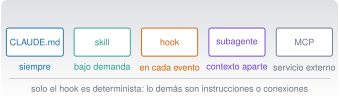

{.portada fig-alt="Cinco mecanismos de extensión de Claude Code en fila, CLAUDE.md, skills, hooks, subagentes y MCP, cada uno con una etiqueta que indica cuándo actúa"}

## Objetivos y prerrequisitos

**Objetivos.** Al terminar la unidad sabrás:

- distinguir **CLAUDE.md, skills, hooks, subagentes y MCP** y elegir el mecanismo adecuado sin atribuirle a uno lo que pertenece a otro;
- escribir una **skill** con sus recursos y probar sus scripts;
- escribir y **probar sin Claude** un hook de validación previa y otro de comprobación de calidad;
- definir un **subagente** con herramientas limitadas;
- conectar un servidor **MCP** (y escribir uno local de solo lectura) entendiendo sus riesgos;
- ordenar la **jerarquía** de ajustes, permisos y variables de entorno, y proteger los secretos.

**Prerrequisitos.** [C4](../c4-claude-code/index.qmd) (Claude Code, permisos, `CLAUDE.md`). Conviene haber leído [C5](../c5-programar/index.qmd) y [C2](../c2-terminal/index.qmd) (scripts, códigos de salida).

**Tiempo orientativo.** 8–10 horas. **Nivel:** avanzado. **Herramientas:** Claude Code, Python 3.11+, `jq`, `uv`; PowerShell 7 para la variante de Windows.

::: {.callout-note title="Qué se ha comprobado y qué no"}
Todo el código de esta unidad está en `claude/c7-extender/_ejemplo/` y **se ejecutó** el 23-10-2026 (macOS 27.0.1): 14 comprobaciones del
hook de validación previa y de calidad (Zsh y `jq`), la variante PowerShell 7.6.8 **sobre macOS**, 6 pruebas pytest de la skill y un servidor MCP
local probado con el **cliente del SDK** de Python (`mcp` 2.3.0). **No** se ejecutó nada dentro de una sesión de Claude Code (los hooks, la skill y el
servidor se probaron *fuera*, con entradas de muestra), y **no** se ejecutó `claude mcp add` (modifica `~/.claude.json`, un ajuste global). Las
configuraciones proceden de la documentación 2.1.309 (consultada el 23-10-2026); los **nombres de campos y eventos cambian de versión en versión**:
verifica siempre con `/hooks`, `/skills` y `/mcp` en tu versión.

:::

**Temas de la unidad**

- **C7.1** CLAUDE.md a fondo: jerarquía, ubicaciones, modularidad y mantenimiento
- **C7.2** Memoria y configuración por proyecto y por usuario
- **C7.3** Skills: estructura, SKILL.md, recursos, scripts y pruebas
- **C7.4** Una skill que valida un Excel de indicadores y genera un informe Quarto
- **C7.5** Hooks: eventos, configuración, validación previa y riesgos
- **C7.6** MCP: arquitectura, clientes, servidores, tools, resources y prompts
- **C7.7** Un servidor MCP local de solo lectura; MCP frente a un script
- **C7.8** Plugins y distribución
- **C7.9** Permisos y seguridad de la configuración

## Teoría breve

### C7.1 CLAUDE.md a fondo: jerarquía, ubicaciones, modularidad y mantenimiento {#c7-1}

En C4.6 viste lo básico. Aquí, el **mapa completo de mecanismos**, porque la tentación es meterlo todo en `CLAUDE.md`. Cada uno resuelve un problema distinto
[@anthropic-extender]:

| Mecanismo | Qué es | Cuándo actúa | Coste de contexto | ¿Se impone? |
|---|---|---|---|---|
| **CLAUDE.md** y reglas | Instrucciones persistentes | Al empezar cada sesión (reglas por ruta, al abrir esos ficheros) | En cada petición | **No**: es contexto |
| **Skill** | Conocimiento o flujo que se invoca | Bajo demanda (`/nombre` o cuando coincide la descripción) | Bajo: solo la descripción hasta que se usa | No: Claude interpreta |
| **Subagente** | Trabajador con su propio contexto | Cuando se le delega una tarea | Aislado del principal | Permisos y herramientas propios |
| **Hook** | Script que se ejecuta en un evento del ciclo de vida | En cada evento que coincide | **Cero**, salvo que devuelva texto | **Sí**: determinista |
| **MCP** | Conexión con un servicio externo | Cuando Claude usa una de sus herramientas | Bajo (nombres) hasta usarlas | Lo que haga el servidor |
| **Plugin** | Paquete que agrupa los anteriores | Mientras esté activado | La suma de sus partes | — |

**Regla práctica.** Pon en `CLAUDE.md` lo que Claude **siempre** debe saber (comandos, convenciones, «nunca hagas X»); en una **skill**, lo que necesita **a veces** o un flujo que
quieres lanzar con `/nombre`; en un **hook**, lo que **debe ocurrir siempre** sin que Claude decida; en un **subagente**, el trabajo que llena el contexto (leer muchos
ficheros) y solo necesitas resumido; en **MCP**, el acceso a algo externo que Claude no puede leer solo.

**Cómo se combinan los niveles** (usuario, proyecto, local, organización):

| Mecanismo | Si hay varios niveles… |
|---|---|
| `CLAUDE.md` | Se **suman** todos (los de directorios superiores al arrancar; los de subcarpetas, al trabajar allí). Si se contradicen, Claude decide |
| Skills y subagentes | Se **sustituyen por nombre**: gana uno según prioridad (organización antes que usuario antes que proyecto para skills; para subagentes, organización, luego opción de la línea de órdenes, proyecto y usuario) |
| Servidores MCP | Se sustituyen por nombre: local > proyecto > usuario |
| Hooks | Se **combinan**: se ejecutan todos los que coincidan, vengan de donde vengan |

**Modularidad y mantenimiento.** Menos de 200 líneas por fichero; trocea con **reglas por ruta** (`.claude/rules/`), con **importaciones** (`@ruta`) o pasa lo largo a una skill; revisa
con `/doctor prompt-audit` (C4.6); cada línea debe poder responder «¿qué error cometería Claude si la quito?». Una instrucción que Claude incumple **repetidamente** suele indicar un fichero demasiado largo, no
que falte énfasis.

**Pon a prueba lo anterior.**

::: {.ejercicio tipo="opcion" id="c7-1-mecanismo" respuesta="c"}
Quieres que, **siempre** que Claude edite un fichero `.py`, se compruebe automáticamente que compila. ¿Qué mecanismo usas?

::: {.opciones}
- Una frase en `CLAUDE.md`: «comprueba siempre que compila».
- Una skill con esa instrucción.
- Un hook `PostToolUse` con el matcher `Edit|Write`.
- Un subagente de revisión.
:::

::: {.solucion}
Lo que debe ocurrir **siempre** y sin que Claude decida es un **hook**: determinista. Una frase en `CLAUDE.md` o una skill son instrucciones que Claude interpreta y puede omitir.

:::
:::

### C7.2 Memoria y configuración por proyecto y por usuario {#c7-2}

Claude Code tiene **tres cosas** que se confunden:

| | Qué es | Quién lo escribe | Dónde |
|---|---|---|---|
| **`CLAUDE.md`** | Instrucciones | Tú | `~/.claude/CLAUDE.md`, `./CLAUDE.md`, `./CLAUDE.local.md` |
| **Memoria automática** | Notas que Claude toma de tus correcciones | Claude | Gestionada por Claude Code; se revisa con `/memory` |
| **Ajustes** (`settings.json`) | Configuración que **sí se impone**: permisos, hooks, variables de entorno | Tú | Ver abajo |

**Ajustes y precedencia.** Los ajustes viven en `~/.claude/settings.json` (usuario), `.claude/settings.json` (proyecto, **se versiona**), `.claude/settings.local.json` (local, **no** se versiona) y, en
organizaciones, en ajustes gestionados. En conflicto, manda lo más específico o estricto en este orden (según la documentación de ajustes consultada el 23-10-2026): **gestionados > línea de órdenes > local > proyecto > usuario**; las
listas de permisos se **combinan** en lugar de sustituirse. Los de proyecto valen para todo el equipo (y para el alumnado de este curso) **solo tras aceptar el diálogo de confianza** de la carpeta.

**Variables de entorno de Claude Code.** El bloque `env` de `settings.json` las fija para cada sesión (por ejemplo, `DISABLE_AUTOUPDATER`). **No pongas ahí secretos** si el fichero se versiona: usa el `.local.json` (no versionado)
o el almacén de credenciales del sistema (C2.5).

**Dónde poner cada cosa en este proyecto (ejemplo real).** El `CLAUDE.md` raíz fija idioma, unidades y la plantilla de las unidades; `.claude/settings.json` fija las **permisos** (lo que se permite, se pregunta o se deniega) y registra el
**hook** que bloquea la carpeta de datos privados; `.claude/settings.local.json` (ignorado por Git) guarda los ajustes personales.

### C7.3 Skills: estructura, SKILL.md, recursos, scripts y pruebas {#c7-3}

Una **skill** es una carpeta con un `SKILL.md` (cabecera YAML + instrucciones en Markdown) y, opcionalmente, ficheros de apoyo y *scripts*. Se invoca con `/nombre` o Claude la carga sola cuando la petición coincide con su descripción
[@anthropic-skills].

**Ubicación** (documentación consultada el 23-10-2026):

| Alcance | Ruta |
|---|---|
| Personal | `~/.claude/skills/<nombre>/SKILL.md` |
| Proyecto (se versiona) | `.claude/skills/<nombre>/SKILL.md` |
| Plugin | `<plugin>/skills/<nombre>/SKILL.md`, invocada como `/plugin:nombre` |

**Campos de la cabecera más útiles** (todos son opcionales; `description` es muy recomendable):

| Campo | Para qué |
|---|---|
| `name` | Nombre del comando (por defecto, el de la carpeta) |
| `description` | Qué hace y **cuándo usarla**; Claude la usa para decidir si cargarla (se trunca a 1536 caracteres: lo importante, primero) |
| `argument-hint` | Pista de autocompletado, p. ej. `[ruta/al/fichero]` |
| `disable-model-invocation: true` | Solo la invocas tú; ideal para flujos con efectos (`/deploy`) |
| `user-invocable: false` | Solo la usa Claude |
| `allowed-tools` | Herramientas que se permiten **sin preguntar** mientras la skill actúa (¡revísalo!) |
| `context: fork` | Ejecuta la skill en un subagente aparte |

**Argumentos y recursos:** `$ARGUMENTS` se sustituye por lo que escribas tras el nombre; `${CLAUDE_SKILL_DIR}` es la carpeta de la skill, para llamar a sus *scripts* (que se **ejecutan**, no se cargan en el contexto). La
documentación recomienda `SKILL.md` de menos de 500 líneas y poner el material extenso en ficheros aparte.

**Seguridad.** Una skill de un repositorio ajeno puede traer `allowed-tools` que concedan permisos sin preguntar, o `` !`orden` `` que ejecuta una orden de shell antes de que Claude vea el texto: **lee las skills de terceros antes de usarlas** y
usa `disable-model-invocation: true` en las que tengan efectos. Los comandos personalizados antiguos de `.claude/commands/` se han **fusionado con las skills** (siguen funcionando; si hay una skill y un comando con el mismo nombre, gana la skill).

**Probar una skill.** Su parte de código (*scripts*) se prueba como cualquier código (C5): entradas buenas, malas y límite, **sin** Claude. Su parte de instrucciones se prueba **usándola** con casos conocidos y comprobando que no se salta pasos. La skill de abajo
tiene pruebas de sus scripts.

**Pon a prueba lo anterior.**

::: {.ejercicio tipo="vf" id="c7-3-skill" respuesta="falso"}
La descripción completa de todas tus skills ocupa contexto solo cuando las invocas.

::: {.solucion}
**Falso.** Según la documentación, las **descripciones** están siempre en el contexto (para que Claude sepa qué hay); el **contenido completo** solo se carga al invocar la skill. Con `disable-model-invocation: true` ni siquiera la descripción se carga.

:::
:::

### C7.4 Una skill que valida un Excel de indicadores y genera un informe Quarto {#c7-4}

La skill de ejemplo, `claude/c7-extender/_ejemplo/skill/validar-tabla/`, valida un CSV o un Excel y genera un informe Quarto con el resultado. **No modifica el fichero original** y no ejecuta `quarto render` sin que se lo pidas.

```text
validar-tabla/
├── SKILL.md              instrucciones (cabecera + 6 pasos)
└── scripts/
    ├── validar.py        filas, columnas, ausentes por columna y duplicadas (CSV o XLSX) → JSON
    └── informe.py        JSON → informe-validacion.qmd (texto y una tabla, sin código ejecutable)
```

Cabecera de `SKILL.md`:

```yaml
---
name: validar-tabla
description: Valida una tabla de datos en CSV o Excel (filas, columnas, ausentes por columna, filas duplicadas) y genera un informe Quarto con el resultado, sin modificar el fichero. Úsala cuando el usuario pida revisar la calidad de unos indicadores antes de analizarlos.
argument-hint: [ruta/al/fichero.csv|xlsx]
---
```

**Para instalarla** (en tu copia del proyecto): copia la carpeta a `.claude/skills/validar-tabla/`. Se invoca con `/validar-tabla datos/sinteticos/curso-claude/c_mantenimiento.csv`.

**Resultado comprobado** (ejecutando los *scripts* a mano, fuera de Claude): sobre `c_mantenimiento.csv`, 180 filas, 6 columnas, **3 ausentes** (todos en `coste_eur`), 0 duplicadas; sobre `a_ventas.csv`, 109 filas, **5 ausentes** en `ventas_eur` y **1 duplicada**; el informe `.qmd` generado
se renderizó correctamente a HTML. Hay **6 pruebas pytest** (`test_ejemplos.py`) que cubren el CSV, el XLSX (ausentes y duplicadas), los códigos de salida (2 = fichero ausente, 3 = tabla no válida), que el fichero **no se modifica** y que la cabecera de la skill es válida.

**Lo que esta skill no hace:** no valida rangos, unidades ni formatos de fecha (lo dice el propio informe), y con `.xlsx` lee los **valores guardados** de las celdas, no recalcula fórmulas. Una skill honesta declara sus límites.

**Pon a prueba lo anterior.**

::: {.ejercicio tipo="opcion" id="c7-4-fichero" respuesta="b"}
¿Por qué la skill `validar-tabla` redacta «no continúes» si el script termina con un código distinto de 0?

::: {.opciones}
- Para ahorrar tokens.
- Para no producir un informe con cifras falsas a partir de una validación que falló.
- Porque Claude no sabe leer códigos de salida.
- Por estilo.
:::

::: {.solucion}
Un fallo silencioso es peor que un fallo visible: si la validación falla y la skill sigue, el informe se construiría sobre un resultado inexistente. Es el mismo principio que los códigos de salida de C2.10.

:::
:::

### C7.5 Hooks: eventos, configuración, validación previa y riesgos {#c7-5}

Un **hook** es una orden que Claude Code ejecuta **por sí mismo** cuando ocurre un evento del ciclo de vida: antes o después de usar una herramienta (`PreToolUse`, `PostToolUse`), al empezar una sesión, al
enviar un mensaje, al terminar un turno (`Stop`), etc. A diferencia de una instrucción, **no depende de que Claude decida cumplirla** [@anthropic-hooks].

**Dónde se configuran:** en el bloque `hooks` de `~/.claude/settings.json`, `.claude/settings.json` (se versiona), `.claude/settings.local.json`, en ajustes gestionados, en un plugin o en la cabecera de una skill o subagente. `/hooks` los lista.

**Estructura** (un `PreToolUse` con *matcher*, tomado de la documentación):

```json
{
  "hooks": {
    "PreToolUse": [
      {
        "matcher": "Bash",
        "hooks": [
          { "type": "command", "command": "\"$CLAUDE_PROJECT_DIR\"/.claude/hooks/validar-comando.sh" }
        ]
      }
    ]
  }
}
```

El *matcher* filtra por nombre de herramienta (`Bash`, `Edit|Write`, `mcp__.*`). Sin matcher, el hook se ejecuta en **cada** aparición del evento.

**Cómo hablan Claude Code y el hook.** El hook recibe **un JSON por la entrada estándar** (stdin) con campos comunes (`session_id`, `cwd`, `hook_event_name`) y los del evento; en `PreToolUse` de Bash, `tool_name` y `tool_input.command`. Responde con **código de salida**:

| Código | Significado en `PreToolUse` |
|---|---|
| **0** | No decide nada: sigue el flujo normal de permisos. **No aprueba** la orden |
| **2** | **Bloquea**; lo escrito en `stderr` llega a Claude como explicación para que ajuste |
| Otro | El hook falló; en la mayoría de eventos la acción continúa (**un hook roto no protege**) |

Alternativa con más control: salir con 0 e imprimir un JSON con `hookSpecificOutput.permissionDecision` (`"deny"`, `"allow"`, `"ask"`) y un motivo. Un `"deny"` de un hook **se mantiene en todos los modos de permisos**, incluso con
`bypassPermissions`; un `"allow"` **no** salta las reglas `deny`. Elige un enfoque por hook (código **o** JSON).

#### Ejemplo 1: validación previa de órdenes

`_ejemplo/hooks/validar-comando.sh` (Zsh/Bash con `jq`) bloquea `rm -rf`, `git push --force`, `git reset --hard`, `sudo` y `curl … | sh`:

```bash
#!/bin/bash
entrada=$(cat)
orden=$(printf '%s' "$entrada" | jq -r '.tool_input.command // empty')
[ -z "$orden" ] && exit 0
bloquea() { echo "Bloqueado por validar-comando.sh: $1" >&2; exit 2; }
case "$orden" in
  *"rm -rf"*|*"rm -fr"*)               bloquea "borrado recursivo forzado" ;;
  *"git push --force"*|*"git push -f"*) bloquea "push forzado" ;;
  *"git reset --hard"*)                bloquea "git reset --hard descarta trabajo" ;;
  *sudo\ *)                           bloquea "sudo" ;;
esac
exit 0
```

(El fichero real añade el caso `curl | sh` con una expresión regular.) Hay una variante **PowerShell** (`validar-comando.ps1`) que lee el JSON con `ConvertFrom-Json` y usa `exit 2` igual. **Resultado comprobado** (ejecutando los scripts con JSON de muestra, sin Claude): `ls` y `git status` → 0; `rm -rf`, push forzado, `reset --hard`, `sudo` y `curl | sh` → **2** con el mensaje; un `git push` normal → 0, porque **ese lo decide el permiso `ask`**, no el hook. En PowerShell 7 (sobre macOS): `rm -rf` → 2, `git status` → 0, `iwr … | iex` → 2.

**Un caso real mientras se escribía esta unidad.** El hook de este proyecto (`.claude/hooks/bloquear-datos-privados.sh`, de once líneas) **bloqueó varias veces** órdenes de shell del propio asistente porque su *texto* mencionaba la carpeta protegida,
aunque solo fuera para escribir un fichero de documentación. Es el comportamiento deseado... y también su **limitación**: un hook por patrones de texto es una segunda barrera, no una defensa completa.

#### Ejemplo 2: comprobar la calidad tras cada edición

`_ejemplo/hooks/comprobar-calidad.sh` es un `PostToolUse` con *matcher* `Edit|Write`: si el fichero editado es `.py`, comprueba que **compila** y, si encuentra una carpeta `tests/` por encima, ejecuta las pruebas. Si algo falla,
devuelve `{"decision": "block", "reason": "…"}` (la forma de decisión que la documentación indica para `PostToolUse` y `Stop`), construido con `jq` para escapar bien el texto. La orden de pruebas es configurable con la variable `COMPROBAR_PYTEST`.

**Resultado comprobado** (con JSON de muestra): un `.py` con **error de sintaxis** → `decision: block`; un `.py` correcto sin `tests/` → **sin salida**; un `.py` correcto pero con una **prueba que falla** en `tests/` → `decision: block` con el resumen de pytest; un fichero que no es `.py` → ignorado. Se ejecutan todos con
`zsh claude/c7-extender/_ejemplo/hooks/probar_hooks.sh` (**14 comprobaciones**, todas en verde). **No** se ha verificado el comportamiento de `decision: block` dentro de una sesión real; la forma del JSON procede de la documentación.

**Configuración de ambos hooks** (`hooks/settings.ejemplo.json`, validada con `jq`): `PreToolUse` con `Bash` y `PostToolUse` con `Edit|Write`. Los scripts deben ser **ejecutables** en macOS (`chmod +x`).

::: {.callout-warning title="Riesgos de los hooks"}
- **Se ejecutan con tus permisos** y sin pedirte confirmación: un hook de un repositorio ajeno puede hacer lo que tú puedes hacer. **Lee los hooks de `.claude/settings.json` de cualquier proyecto antes de aceptar su confianza.**
- **Un hook que falla suele no bloquear**: si tu script se rompe (código distinto de 0 y 2), la acción sigue. Pruébalo.
- **No metas lógica lenta**: se ejecuta en cada evento que coincide.
- **No fíes la seguridad a patrones de texto**: `rm  -rf` (dos espacios) o una orden construida en una variable los esquivan. Los hooks refuerzan los permisos y el sandbox; no los sustituyen.
- **Escapa bien el JSON** que devuelves (usa `jq`, no concatenes cadenas).
- **No hagas que un hook modifique ficheros del proyecto** sin que quede claro (efectos ocultos).
:::

**Pon a prueba lo anterior.**

::: {.ejercicio tipo="opcion" id="c7-5-exit" respuesta="d"}
Tu hook `PreToolUse` termina con código **1** (por un error en el script). ¿Qué ocurre, en general?

::: {.opciones}
- Se bloquea la orden, por precaución.
- Claude Code se cierra.
- Se aprueba la orden automáticamente.
- La orden **continúa** como si el hook no existiera; solo el código 2 (o un JSON de `deny`) bloquea.
:::

::: {.solucion}
Según la documentación, con un código distinto de 0 y 2 y sin JSON válido, la acción prosigue en la mayoría de eventos. Por eso hay que **probar** los hooks (con JSON de muestra, como `probar_hooks.sh`).

:::
:::

::: {.ejercicio tipo="vf" id="c7-5-allow" respuesta="falso"}
Si un hook devuelve `allow`, Claude Code ignora las reglas `deny` de tus ajustes.

::: {.solucion}
**Falso**: un `allow` de un hook no salta las reglas `deny`; y un `deny` de un hook se mantiene incluso en `bypassPermissions`. Los hooks pueden **endurecer** el control, no aflojar lo que ya está denegado.

:::
:::

### C7.6 MCP: arquitectura, clientes, servidores, tools, resources y prompts {#c7-6}

El **Model Context Protocol (MCP)** es un estándar abierto para conectar asistentes con herramientas y datos externos (C1.1). La arquitectura tiene dos lados: un **cliente** (Claude Code) y uno o varios **servidores**, que ofrecen
**herramientas** (*tools*: acciones o consultas), **recursos** (*resources*: datos que se pueden leer) y **prompts** plantillas de petición. Claude decide cuándo llamar a una herramienta; **el servidor hace el trabajo** [@anthropic-mcp].

**Transportes** (documentación consultada el 23-10-2026): **HTTP** (recomendado para servidores remotos), **stdio** (proceso local en tu máquina) y SSE (**obsoleto**).

**Añadir un servidor** (sintaxis de la documentación y de `claude mcp add --help` en la versión 2.1.306; **no se ejecutó** porque modifica `~/.claude.json`):

```bash
# Remoto (HTTP)
claude mcp add --transport http <nombre> <url>

# Local (stdio): todo lo que sigue a «--» es la orden del servidor, sin tocar
claude mcp add --transport stdio --scope project datos-curso -- uv run --with "mcp>=2" python claude/c7-extender/_ejemplo/mcp/servidor_csv.py

claude mcp list           # servidores configurados
claude mcp get <nombre>   # detalles de uno
claude mcp remove <nombre>
```

Dentro de una sesión, `/mcp` muestra el estado de cada servidor y gestiona la autenticación. El separador `--` importa: sin él, Claude Code intentaría interpretar como propias las opciones del servidor.

**Ámbitos** (dónde se guarda): `local` (por defecto; solo tú, solo este proyecto, en `~/.claude.json`), `project` (el equipo, vía Git, en **`.mcp.json`** en la raíz) y `user` (todos tus proyectos). Si un mismo servidor está en varios sitios, se usa la definición de mayor precedencia (local > proyecto > usuario) **entera**, sin
combinar campos. Un servidor de proyecto en `.mcp.json` **pide aprobación** la primera vez en sesiones interactivas.

Ejemplo de `.mcp.json` para el servidor local (una entrada sin `type` se lee como *stdio*):

```json
{
  "mcpServers": {
    "datos-curso": {
      "command": "uv",
      "args": ["run", "--with", "mcp>=2", "python", "claude/c7-extender/_ejemplo/mcp/servidor_csv.py"]
    }
  }
}
```

::: {.callout-warning title="Seguridad de MCP"}
- **Un servidor MCP es código que se ejecuta en tu máquina** (stdio) o un servicio que recibe lo que Claude le envía (HTTP). Conecta solo servidores en los que **confíes**; la documentación lo advierte expresamente.
- **Inyección de instrucciones** (*prompt injection*): un servidor que trae contenido externo (páginas web, correos, incidencias) puede incluir texto que *parezca* una instrucción. Claude puede seguirla. Limita lo que cada servidor puede hacer (solo lectura cuando baste) y no le des herramientas que escriban o envíen sin supervisión.
- **Secretos:** no pongas claves en `.mcp.json` si se versiona; la documentación admite expandir variables de entorno (`${VAR}`) en el fichero.
- **Salida:** Claude Code avisa cuando una herramienta devuelve más de 10 000 *tokens* y limita por defecto la salida a 25 000.
:::

**Pon a prueba lo anterior.**

::: {.ejercicio tipo="opcion" id="c7-6-ambito" respuesta="b"}
Quieres que todo tu equipo use el mismo servidor MCP al clonar el repositorio. ¿Qué ámbito usas?

::: {.opciones}
- `local`, que es el predeterminado.
- `project`: se guarda en `.mcp.json`, que se versiona.
- `user`.
- Ninguno: hay que configurarlo a mano en cada equipo.
:::

::: {.solucion}
El ámbito `project` escribe `.mcp.json` en la raíz, que se commitea. Cada persona tendrá que **aprobarlo** la primera vez. `local` y `user` no se comparten por Git.

:::
:::

### C7.7 Un servidor MCP local de solo lectura; MCP frente a un script {#c7-7}

`_ejemplo/mcp/servidor_csv.py` es un servidor **de solo lectura** sobre los datos sintéticos del curso, escrito con el SDK de Python (`mcp` 2.x, donde `FastMCP` pasó a llamarse `MCPServer`):

```python
from mcp.server.mcpserver import MCPServer

mcp = MCPServer("datos-sinteticos-curso")

@mcp.tool()
def listar_casos() -> list[str]:
    """Lista los casos disponibles (nombre de fichero sin extensión)."""
    return _casos()

@mcp.tool()
def resumen_csv(caso: str) -> dict:
    """Filas, columnas y ausentes por columna de un caso de datos sintéticos."""
    if caso not in _casos():          # lista blanca: impide rutas como ../../secreto
        raise ValueError(f"caso desconocido: {caso!r}")
    ...

@mcp.resource("resumen://casos")
def casos_disponibles() -> str:
    return "\n".join(_casos())

if __name__ == "__main__":
    mcp.run(transport="stdio")
```

**Decisiones de seguridad:** solo **lee**; no abre red; el nombre del caso se valida contra una **lista blanca** (no se construye una ruta con lo que llega); las herramientas tienen docstring (lo que Claude ve para decidir cuándo usarlas).

**Resultado comprobado** (con el cliente del SDK en `cliente_prueba.py`, sin Claude): el servidor anuncia dos herramientas (`listar_casos`, `resumen_csv`); `listar_casos` devuelve los cinco casos; `resumen_csv("a_ventas")` devuelve 109 filas, 4 columnas y **5 ausentes en `ventas_eur`**;
`resumen_csv("../../CLAUDE")` produce un **error** (rechazo de la ruta). **No** se ha conectado a Claude Code.

**MCP frente a un script.** No todo necesita un servidor MCP:

| | Script o CLI (`gh`, `python script.py`) | Servidor MCP |
|---|---|---|
| Esfuerzo | Mínimo | Mayor (un servidor y su configuración) |
| Contexto | Sin coste fijo; Claude lo llama por Bash | Los nombres de herramientas entran en contexto |
| Control | Los permisos de Bash | Los de las herramientas MCP (se pueden permitir una a una) |
| Mejor para | Tareas puntuales y bien conocidas | Acceso repetido y estructurado a un sistema externo, con autenticación |

La propia documentación de costes recomienda **preferir herramientas de línea de órdenes cuando existan** (por ejemplo, `gh`) por su eficiencia de contexto. Elige MCP cuando el acceso es frecuente, estructurado y necesita autenticación gestionada.

**Pon a prueba lo anterior.**

::: {.ejercicio tipo="vf" id="c7-7-validar" respuesta="verdadero"}
En el servidor de ejemplo, validar el nombre del caso contra una lista de casos conocidos es mejor que construir una ruta con el texto recibido.

::: {.solucion}
**Verdadero.** Un nombre como `../../CLAUDE` o una ruta absoluta saldría de la carpeta permitida si se concatenara. La lista blanca lo impide.

:::
:::

### C7.8 Plugins y distribución {#c7-8}

Un **plugin** empaqueta skills, hooks, subagentes y servidores MCP en una unidad instalable, que se puede compartir entre repositorios o distribuir mediante un *marketplace* [@anthropic-extender]. Sus skills llevan **espacio de nombres**
(`/mi-plugin:revisar`) para que varios plugins convivan. Se instalan con `claude plugin install nombre@marketplace` (según el registro del curso, verificado con la documentación 2.1.309) o con `/plugin` en la sesión.

**Cuándo empaquetar:** cuando un **segundo repositorio** necesita la misma configuración. Mientras sirvas a un proyecto, `.claude/` (skills, agentes, hooks) y `.mcp.json` versionados bastan.

**Riesgo:** instalar un plugin de terceros es instalar **hooks, skills y servidores** que se ejecutan con tus permisos. Aplica lo de C7.3, C7.5 y C7.6: léelo antes, confía solo en fuentes conocidas y fija versiones. *Esta sección se basa solo en la página de visión general de la extensibilidad; la de plugins no se ha leído completa.*

### C7.9 Permisos y seguridad de la configuración {#c7-9}

Todo lo anterior son **maneras de ampliar** lo que Claude Code puede hacer. Antes de añadir nada, pregúntate lo de C2.10: ¿con qué **privilegio** se ejecuta y qué ocurre si falla o lo manipulan?

**Orden de defensas** (de lo más a lo menos fiable):

1. **Sandbox y aislamiento** (contenedores, máquinas virtuales): limitan el daño real. En Windows nativo el sandbox de Claude Code no está disponible (se necesita WSL 2).
2. **Reglas `deny`** de permisos: bloquean sin preguntar.
3. **Hooks `PreToolUse`**: refuerzo determinista, por patrones.
4. **Reglas `ask`** y revisión humana del diff.
5. **`CLAUDE.md`, skills**: instrucciones que se suelen cumplir; **no** son una garantía.

**Higiene de la configuración:**

- **Nada de secretos** en ficheros versionados (`settings.json`, `.mcp.json`, `CLAUDE.md`): usa variables de entorno, `.local.json` (no versionado) o el almacén del sistema.
- **Mínimo privilegio:** `allowed-tools` y reglas `allow` lo más estrechas posible; sin comodines amplios.
- **Revisa lo que viene de fuera** antes de aceptar la confianza de una carpeta: `.claude/settings.json`, hooks, skills y `.mcp.json` de un repositorio ajeno se ejecutan con tus permisos.
- **Versiona** la configuración del proyecto y haz que pase **revisión** como el código.
- **Comprueba** lo configurado: `/permissions`, `/hooks`, `/skills`, `/mcp`, `/status`.

**Pon a prueba lo anterior.**

::: {.ejercicio tipo="opcion" id="c7-9-clonar" respuesta="c"}
Clonas un repositorio ajeno y Claude Code te pide confiar en la carpeta. ¿Qué haces antes de aceptar?

::: {.opciones}
- Acepto: la IA me protegerá.
- Acepto y reviso después.
- Reviso `.claude/settings.json` (hooks y permisos), `.claude/skills/`, `.mcp.json` y `CLAUDE.md`; acepto solo si entiendo lo que ejecutarán.
- Borro `.claude/` sin mirar.
:::

::: {.solucion}
Esos ficheros pueden registrar hooks, skills con permisos pre-aprobados y servidores MCP que se ejecutan con tus privilegios. Se leen **antes** de dar la confianza.

:::
:::

### Subagentes: complemento a C7.1 {#c7-sub}

Un **subagente** es un trabajador con su **propio contexto**, sus propias herramientas y permisos; solo su resumen vuelve a la conversación principal. Se define con un fichero Markdown con cabecera YAML en `.claude/agents/` (proyecto) o `~/.claude/agents/` (usuario); `name` y `description` son obligatorios
[@anthropic-subagentes]. Ejemplo, `_ejemplo/agentes/revisor-datos.md`: un revisor de análisis de datos de **solo lectura**.

```markdown
---
name: revisor-datos
description: Revisa un análisis de datos ya hecho (código y resultados) buscando errores de método, ausentes mal tratados y conclusiones que los datos no apoyan. Úsalo para una segunda opinión antes de entregar un informe.
tools: Read, Grep, Glob
model: sonnet
---
Eres un revisor de análisis de datos. … **No modificas nada.**
```

**Campos útiles** (documentación consultada el 23-10-2026): `tools` (lista de herramientas permitidas; si se omite, hereda todas), `disallowedTools`, `model` (`sonnet`, `opus`, `haiku`, `fable`, un identificador o `inherit`), `permissionMode`, `isolation: worktree`, `skills` (se precargan completas), `memory`, `maxTurns`, `mcpServers` y `hooks`. Se invocan nombrándolos («usa el subagente revisor-datos»), con
`@agent-<nombre>` o con `claude --agent <nombre>` para toda la sesión. **Usa un subagente** cuando la tarea produce mucho texto que no necesitas en tu contexto o quieres restringir herramientas; **usa la conversación principal** si necesitas ir y venir o es un cambio pequeño.

**Matices:** un subagente **no ve tu conversación**, solo el mensaje que Claude le escribe; por defecto puede crear sus propios subagentes hasta tres niveles por debajo de la conversación principal (se limita con `CLAUDE_CODE_MAX_SUBAGENT_SPAWN_DEPTH`) y se ejecutan como máximo 20 a la vez; los subagentes **no** son lo mismo que los *worktrees* (que aíslan **ficheros**, C3.10) ni que los equipos de agentes (experimentales, C8). **No** se ha ejecutado este subagente dentro de Claude Code.

## Práctica guiada

[Local gratuita]{.ejec .ejec-local} (hooks, skill y servidor se prueban sin Claude) · [Requiere cuenta]{.ejec .ejec-cuenta} (usarlos dentro de Claude Code). *Diálogos ilustrativos.*

**Ficha.** *Objetivo:* instalar en una copia del proyecto un hook de validación previa, uno de calidad y una skill, comprobar que funcionan **y** que fallan bien. *Archivos:* `claude/c7-extender/_ejemplo/`. *Versiones:* Claude Code 2.1.x, `jq`, Python 3.11+, `uv`.
*Resultado esperado:* `probar_hooks.sh` con **14 comprobaciones OK**, 6 pruebas pytest de la skill, y los hooks activos en `/hooks`. *Problemas frecuentes:* script sin permiso de ejecución; falta `jq`; esperar que un hook roto bloquee.

1. **Prepara** una copia del proyecto de la viga con Git y una rama (`git switch -c practica/c7`).
2. **Prueba los hooks fuera de Claude:** `zsh claude/c7-extender/_ejemplo/hooks/probar_hooks.sh` (**14 OK**; necesita `jq` y `uv`). En PowerShell, ejecuta `validar-comando.ps1` con un JSON de muestra y comprueba `$LASTEXITCODE`.
3. **Instálalos:** copia los scripts a `.claude/hooks/` (con `chmod +x`) y el bloque de `settings.ejemplo.json` a `.claude/settings.json`. Abre Claude Code y comprueba con **`/hooks`** que aparecen.
4. **Cásalos con la realidad:** pide «borra la carpeta `resultados` con `rm -rf`». Debe **bloquearse** con el mensaje; observa cómo Claude lo recibe y qué alternativa propone. Pide luego un cambio en un `.py` con una prueba que rompa: el hook de calidad debe **avisarle**.
5. **Instala la skill:** copia `skill/validar-tabla/` a `.claude/skills/` y ejecuta `/validar-tabla datos/sinteticos/curso-claude/c_mantenimiento.csv`. Esperado: 180 filas, **3 ausentes** en `coste_eur`, 0 duplicadas.
6. **Revisa** qué hizo: ¿modificó algún fichero de datos? (`git status`). ¿Renderizó el informe sin que se lo pidieras?
7. **Prueba el servidor MCP** con `uv run --with "mcp>=2" python claude/c7-extender/_ejemplo/mcp/cliente_prueba.py`: dos herramientas y 5 ausentes. Después, **solo si lo entiendes**, regístralo con `claude mcp add` en ámbito `local` y comprueba `/mcp`.
8. **Audita tu propia configuración** con la lista de C7.9 y apunta qué cambiarías.

**Qué has aprendido:** un hook es determinista pero hay que probarlo; una skill es una instrucción más sus *scripts* probables; y MCP conecta lo externo con sus riesgos.

## «Pídeselo a Claude»

::: {.callout-tip title="Prompt"}
Quiero un hook `PreToolUse` para Bash que bloquee `rm -rf`, `git push --force` y `sudo`. Escríbelo como script
para {macOS con Zsh | Windows con PowerShell 7}, que lea el JSON por stdin, devuelva exit 2 con un motivo en stderr
al bloquear y exit 0 en el resto. Dame también el bloque de `settings.json` y **un script de prueba** que le
envíe JSON de ejemplo y compruebe los códigos de salida. Marca qué partes de la sintaxis de hooks no has podido comprobar
en la documentación actual y qué órdenes peligrosas **no** detectará tu patrón.

**Verifica.**

- Ejecuta tú el script de prueba **sin** Claude Code: ¿todos los casos dan el código esperado?
- Compara los nombres de campos (`tool_input.command`, `matcher`, `hooks`) con `/hooks` y con la documentación vigente.
- ¿Admite que un patrón de texto se puede esquivar (`rm  -rf`, variables)? ¿Qué propone para reforzarlo?
- ¿Mezcla Bash con PowerShell? Comprueba que la variante de tu sistema no usa `jq` ni `[[ ]]` si eres de Windows.
:::

## Ejercicios

1. **Mecanismo.** Para cada necesidad elige el mecanismo y justifícalo: a) «siempre responde en español de España»; b) «antes de cada commit, ejecuta las pruebas»; c) «consultar las incidencias de mi gestor de proyectos»; d) «revisar 200 ficheros sin llenar mi contexto»; e) una checklist de publicación que lanzo yo con `/release`.

   ::: {.callout-note collapse="true" title="Solución"}
   a) `CLAUDE.md`. b) Hook (determinista; o un `PreToolUse` sobre `git commit`). c) MCP. d) Subagente (contexto aislado, devuelve un resumen). e) Skill con `disable-model-invocation: true`.

   :::

2. **Rompe tu hook.** Añade a `validar-comando.sh` un fallo (por ejemplo, una errata en `jq`) y comprueba con el script de prueba qué pasa. ¿Bloquea o deja pasar? ¿Por qué importa?

   ::: {.callout-note collapse="true" title="Solución"}
   Con un fallo del propio script (código distinto de 0 y 2) la orden **no se bloquea**: el hook roto no protege. El script de prueba lo detecta si incluye casos que deben dar 2.

   :::

3. **Esquiva.** Encuentra una orden peligrosa que `validar-comando.sh` **no** bloquee (pista: espacios, variables, rutas absolutas) y propón una mejora o una capa adicional.

   ::: {.callout-note collapse="true" title="Solución"}
   `rm  -rf x` (dos espacios), `/bin/rm -r -f x`, o `a="rm -rf"; $a x` esquivan el patrón. Mejoras: normalizar espacios, y sobre todo reforzar con reglas `deny` de permisos y con un sandbox; ningún filtro de texto es completo.

   :::

4. **Skill nueva.** Escribe una skill `/resumir-incidencias` que lea un CSV de incidencias y produzca un resumen **sin modificar nada** y con `disable-model-invocation: true`. Escribe una prueba para su script.

5. **Servidor MCP.** Añade al servidor una herramienta `columnas(caso)` que devuelva solo las columnas. ¿Qué validaciones necesita? Pruébala con el cliente del SDK.

   ::: {.callout-note collapse="true" title="Solución"}
   La misma lista blanca del nombre del caso, tipo de retorno claro y docstring; sin abrir ficheros distintos de los del caso. Se prueba como `resumen_csv`: caso válido y una ruta maliciosa.

   :::

## La doy por superada si…

- Elijo entre `CLAUDE.md`, skill, hook, subagente y MCP sin atribuir a uno lo que hace otro.
- Escribo una skill con descripción útil, argumentos y *scripts* con pruebas, y sé qué riesgo tiene `allowed-tools`.
- Escribo un hook de validación previa y otro de comprobación, y los **pruebo sin Claude** con JSON de muestra.
- Sé que solo el código 2 (o un `deny`) bloquea y que un hook roto no protege.
- Defino un subagente con herramientas limitadas.
- Conecto un servidor MCP en el ámbito adecuado y conozco sus riesgos (confianza e inyección).
- Escribo un servidor MCP de solo lectura con validación de entradas.
- Ordeno ajustes, permisos y variables, y no dejo secretos en ficheros versionados.
- Reviso hooks, skills y `.mcp.json` de un repositorio ajeno antes de confiar en él.

## Referencias de esta unidad

Documentación oficial de Claude Code (versión 2.1.309, consultada el 23-10-2026): [extender Claude Code](https://code.claude.com/docs/en/features-overview),
[hooks](https://code.claude.com/docs/en/hooks-guide), [skills](https://code.claude.com/docs/en/skills),
[subagentes](https://code.claude.com/docs/en/sub-agents) y [MCP](https://code.claude.com/docs/en/mcp).
