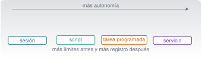

{.portada fig-alt="Escala de cuatro peldaños de autonomía creciente: sesión interactiva, script, tarea programada y servicio, con una nota que indica que la supervisión humana aumenta con la autonomía"}

## Objetivos y prerrequisitos

**Objetivos.** Al terminar la unidad sabrás:

- distinguir una **sesión interactiva**, un **script**, una **tarea programada** y un **servicio**, y qué supervisión exige cada uno;
- ejecutar Claude Code en **modo no interactivo** con límites de turnos, de coste y de permisos, con registro, reintentos y fallo visible;
- coordinar trabajo en paralelo con **subagentes**, **worktrees** y (con cautela) **equipos de agentes** sin confundirlos;
- integrar Claude Code en **GitHub Actions** con permisos mínimos y secretos bien guardados;
- aislar la ejecución (**sandbox**, contenedores) y gestionar credenciales;
- evaluar una metodología de terceros frente a los flujos nativos.

**Prerrequisitos.** [C7](../c7-extender/index.qmd) (hooks, permisos, MCP) y [C2](../c2-terminal/index.qmd) (scripts, códigos de salida, tareas programadas). Es la unidad en la que la autonomía crece: **la supervisión también debe crecer**.

**Tiempo orientativo.** 8–10 horas. **Nivel:** avanzado. **Herramientas:** Claude Code (cuenta o clave de API para las llamadas reales), `jq`, Zsh o PowerShell 7, Git y, opcionalmente, Docker.

::: {.callout-note title="Qué se ha comprobado y qué no"}
El ejecutor de tareas (`_ejemplo/ejecutar_tarea.sh` y `.ps1`) se **probó con un `claude` falso** (`claude-falso.sh`) que simula éxito, fallo, fallo transitorio, respuesta sin resultado y un proceso que se cuelga: **15 comprobaciones en Zsh** y la variante de **PowerShell 7.6.8 sobre macOS** (éxito, fallo, límite de tiempo, respuesta sin resultado y uso incorrecto).
El flujo de GitHub Actions se validó **solo como YAML** y el `.plist` con `plutil -lint`. **No** se ejecutó ninguna llamada real a Claude Code en modo no interactivo (requiere cuenta o clave de API y puede costar dinero), ni Actions en GitHub, ni Docker (no está instalado), ni `launchctl`. Los nombres de opciones y de campos proceden de la documentación 2.1.309 (consultada el 23-10-2026) y se contrastaron con `claude --help` 2.1.306 donde existen.
Todo lo que consume dinero es **opcional** y se acompaña de la alternativa local.

:::

**Temas de la unidad**

- **C8.1** Modo no interactivo y automatización repetible
- **C8.2** Subagentes: delegación y orquestación
- **C8.3** Equipos de agentes y coordinación de tareas
- **C8.4** Trabajo en paralelo con worktrees: prevención de conflictos
- **C8.5** Supervisión, registros, uso, coste e higiene del contexto
- **C8.6** Docker y entornos de desarrollo reproducibles
- **C8.7** Integración continua: Claude Code en GitHub Actions
- **C8.8** Seguridad: aislamiento, secretos, credenciales y permisos
- **C8.9** Metodologías de terceros: Get Shit Done (GSD) frente a los flujos nativos
- **C8.10** Un proyecto de análisis de datos con varios agentes

## Teoría breve

### C8.1 Modo no interactivo y automatización repetible {#c8-1}

Hay cuatro maneras de que algo se ejecute, y cada una cambia **quién vigila**:

| | Sesión interactiva de Claude Code | Script convencional | Tarea programada | Servicio |
|---|---|---|---|---|
| Quién lo lanza | Tú, en directo | Tú, con una orden | El planificador (launchd, Programador de tareas, cron, Actions) | El sistema, siempre en marcha |
| Quién decide cada paso | Claude, **con tu aprobación** | El código, de forma determinista | Claude o el script, **sin nadie delante** | Quien lo programó |
| Supervisión | Continua | Al ejecutarlo | **Posterior** (registros, alertas) | Monitorización permanente |
| Riesgo típico | Aprobar sin leer | Un error de código | Fallo silencioso; gasto descontrolado | Disponibilidad y seguridad |
| Ejemplo | «Refactoriza esto» | `scripts/ejecutar.zsh` (C2) | Informe diario a las 07:40 | Servidor MCP remoto |

La regla de este curso: **cuanta más autonomía, más límites previos y más registro posterior.** Autonomía no es ausencia de supervisión; es supervisión *diferida*, y por eso necesita instrumentos que la hagan posible.

**El modo no interactivo (`-p`).** `claude -p "prompt"` ejecuta una tarea, imprime el resultado y termina; sale con código 0 si va bien y distinto de 0 si falla, de modo que un script puede ramificar según el resultado [@anthropic-programatico]. Opciones que usaremos (todas existen en `claude --help` 2.1.306):

| Opción | Para qué |
|---|---|
| `--output-format text\|json\|stream-json` | Formato de salida; con `json` el resultado va en el campo `result` y el coste estimado en `total_cost_usd` |
| `--allowedTools "Read,Grep"` | Herramientas que se aprueban **sin preguntar** |
| `--permission-mode dontAsk` | **Deniega** todo lo que pediría confirmación (ideal para ejecuciones cerradas) |
| `--max-turns N` · `--max-budget-usd X` | Tope de turnos y de gasto de la ejecución |
| `--bare` | No carga hooks, skills, subagentes, plugins, servidores MCP, memoria ni `CLAUDE.md` del equipo: el **mismo resultado en cualquier máquina**. Con `--bare` la autenticación es por `ANTHROPIC_API_KEY` |
| `--json-schema` | Fuerza una salida con una estructura dada (campo `structured_output`) |
| `-c` / `--resume id` | Continúa una conversación (por ejemplo, guardando `session_id`) |

Dos avisos de la documentación que importan a una tarea desatendida: **sin `--bare`, `claude -p` ejecuta los hooks de `.claude/settings.json` y conecta los servidores de `.mcp.json` de la carpeta, aunque no hayas confiado en ella** (no muestra el diálogo de confianza), y a SIGTERM responde con el **código 143** sin dejar un resultado del turno en curso.
Además, según esa página, `--bare` pasará a ser el modo por defecto de `-p` en una versión futura.

**Un ejecutor con límites.** `_ejemplo/ejecutar_tarea.sh` envuelve la llamada con **cinco** protecciones:

1. **Permisos cerrados:** `--permission-mode dontAsk` y solo las herramientas de lectura (`Read,Grep,Glob`).
2. **Topes:** turnos (8) y gasto (0,50 USD) por defecto, configurables.
3. **Registro** con fecha de cada intento, éxito y fallo (y el coste que informa el JSON).
4. **Reintentos con espera creciente** (2 intentos, pausa de 5 s que se duplica) y **tiempo máximo** por intento (300 s, terminando el proceso con SIGTERM).
5. **Cerrojo:** si ya hay una ejecución en curso para esa carpeta, la segunda se **omite** (código 3) en lugar de solaparse.

Códigos de salida: **0** correcto · **1** uso incorrecto · **3** otra ejecución en curso · **4** agotados los intentos · **5** sin campo `result` en la respuesta. Hay variante PowerShell (`ejecutar_tarea.ps1`), con los mismos códigos.

```zsh
# Fragmento esencial (el fichero completo está en _ejemplo/)
( cd "$carpeta" && "$CLAUDE_BIN" --bare -p "$prompt" \
      --permission-mode dontAsk --allowedTools "$HERRAMIENTAS" \
      --max-turns "$MAX_TURNOS" --max-budget-usd "$MAX_COSTE_USD" \
      --output-format json > "$salida" ) &
```

**Resultado comprobado** (`zsh claude/c8-automatizar/_ejemplo/probar_tarea.sh`, con `claude-falso.sh`, **sin llamar a ningún servicio**): 15 comprobaciones OK; los argumentos enviados a `claude` incluyen `--bare`, `--permission-mode dontAsk`, `--allowedTools Read,Grep,Glob`, `--max-turns 8`, `--max-budget-usd 0.50` y `--output-format json`; un fallo persistente da código 4 tras los 3 intentos configurados y queda registrado; un fallo transitorio se recupera al reintentar; un proceso que se cuelga se termina a los 2 s del límite configurado; y una segunda ejecución simultánea se omite. En PowerShell: éxito (código 0), fallo persistente (4), límite de tiempo (4) y respuesta sin `result` (5).

**Un error que aparecía al probar** (y que ilustra por qué se prueba): la primera versión del vigilante de tiempo dejaba un `sleep` en segundo plano que **mantenía abierta la salida** y la sustitución de comandos no terminaba hasta 300 s después. Un script desatendido que se cuelga sin avisar es justo el fallo que se quiere evitar.

**Pon a prueba lo anterior.**

::: {.ejercicio tipo="opcion" id="c8-1-dontask" respuesta="b"}
En una tarea programada sin nadie delante, ¿qué hace `--permission-mode dontAsk`?

::: {.opciones}
- Aprueba automáticamente todo lo que Claude pida.
- Deniega todo lo que normalmente pediría confirmación, de modo que la tarea nunca se queda esperando una respuesta.
- Desactiva los permisos.
- Solo funciona en sesiones interactivas.
:::

::: {.solucion}
Según la documentación, `dontAsk` deniega lo que pediría confirmación (salvo lo ya permitido por reglas o por `--allowedTools`). Es lo contrario de `bypassPermissions`, que lo aprueba todo y solo se admite en entornos aislados.

:::
:::

::: {.ejercicio tipo="vf" id="c8-1-bare" respuesta="falso"}
Sin `--bare`, una ejecución `claude -p` en una carpeta que no has abierto antes **no** ejecuta los hooks de su `.claude/settings.json`, porque no has aceptado la confianza.

::: {.solucion}
**Falso.** La documentación avisa de que `-p` no muestra el diálogo de confianza ni la aprobación por servidor: sin `--bare` ejecuta los hooks del proyecto y conecta sus servidores MCP. Por eso, en tareas desatendidas, se usa `--bare` y se pasa explícitamente lo que se necesita.

:::
:::

### C8.2 Subagentes: delegación y orquestación {#c8-2}

Los **subagentes** (C7) son trabajadores con su propio contexto que devuelven un resumen. En automatización sirven para tres cosas: **aislar** tareas voluminosas, **limitar herramientas** por función (un revisor de solo lectura) y **comprobar** el trabajo con un contexto limpio.

**Patrón escritor/revisor** (de la guía de buenas prácticas [@anthropic-practicas]): una sesión implementa; otra, **con contexto limpio**, revisa solo el diff y los criterios; los fallos vuelven al implementador. Un revisor sin el razonamiento del autor evalúa el resultado «con otros ojos». Y una advertencia de la misma guía: **un revisor al que se le pide encontrar fallos casi siempre los encuentra**, incluso si el trabajo está bien; pídele que marque solo lo que afecta a la corrección o a los requisitos.

**Orquestación sana:**

- **Una tarea, un criterio de aceptación** comprobable por código (pruebas) y no solo por opinión.
- **Pocos agentes y pequeños:** cada subagente tiene su coste (C8.5).
- **Resúmenes con evidencia**, no afirmaciones («pasan 8 pruebas» + la salida).
- **El humano decide** qué se integra.

La orquestación (el que decide qué agente hace qué) puede ser **Claude turno a turno** (subagentes), **un guion que tú escribes** (varias llamadas `claude -p` con un bucle) o un *workflow* dinámico, en el que Claude escribe el guion; en los tres casos, el control de permisos y el registro siguen siendo tuyos.

### C8.3 Equipos de agentes y coordinación de tareas {#c8-3}

Los **equipos de agentes** (*agent teams*) coordinan varias sesiones de Claude Code con tareas compartidas, mensajería y un líder. Según la documentación consultada (23-10-2026) son **experimentales y están desactivados por defecto**; se activan con `CLAUDE_CODE_EXPERIMENTAL_AGENT_TEAMS=1` y solo funcionan en sesiones interactivas [@anthropic-costes]. Su coste es mucho mayor: la documentación de costes cifra en **unas 7 veces más tokens** que una sesión normal cuando los miembros trabajan en modo plan.

**No son lo mismo que otros mecanismos** (error frecuente):

| Mecanismo | Qué aísla o reparte | Quién coordina |
|---|---|---|
| **Subagente** | Contexto de una tarea dentro de **una** sesión | Claude, turno a turno |
| **Worktree** | **Ficheros** (una copia de trabajo y una rama por sesión) | Tú |
| **Sesiones en paralelo** | Conversaciones independientes | Tú (o mensajería entre sesiones) |
| **Equipo de agentes** (experimental) | Varias sesiones con tareas compartidas y mensajes | Un líder y los miembros |

Pautas: empieza por **un** agente bien instrumentado; añade subagentes cuando el contexto se llene; usa worktrees cuando dos tareas toquen los mismos ficheros; y deja los equipos para tareas grandes, **pequeñas en número de miembros** y con presupuesto controlado. **No** se ha ejecutado ninguna función de equipos en la redacción.

### C8.4 Trabajo en paralelo con worktrees: prevención de conflictos {#c8-4}

En C3.10 viste `claude --worktree nombre` (rama `worktree-nombre`, carpeta `.claude/worktrees/nombre/`). Para el trabajo en paralelo:

- **Reparte por ficheros:** dos agentes que editan el mismo fichero en worktrees distintos producirán un **conflicto de integración** después. Divide la tarea por módulos.
- **Integra tú:** cada worktree termina en una rama que revisas (diff, pruebas) y fusionas con `merge` o PR, una cada vez (C3.4).
- **Prepara cada worktree:** es un *checkout* limpio; no trae `.env` ni el entorno virtual salvo lo que listes en `.worktreeinclude`.
- **Limpia:** al salir, si hay trabajo, Claude Code te pregunta si conservar o borrar; **borrar elimina también la rama** con su trabajo. Los worktrees de subagentes se barren automáticamente solo si están limpios.
- **Aislamiento no es seguridad completa:** las ediciones y los comandos de Git quedan restringidos al worktree, pero un `cp` o una redirección de shell **no** se controlan así y siguen sujetos a tus permisos [@anthropic-worktrees].

### C8.5 Supervisión, registros, uso, coste e higiene del contexto {#c8-5}

Una ejecución desatendida se supervisa **después**, con tres instrumentos:

1. **Registro** de cada ejecución (inicio, fin, código, coste): el `registro-tarea.log` del ejecutor.
2. **Alerta ante fallo:** que alguien se entere de un código distinto de 0 (correo, mensaje, *issue*). Un fallo que nadie ve es un fallo silencioso.
3. **Revisión periódica** de lo que hace: leer una muestra de resultados, no solo comprobar que «terminó».

**Coste.** Con `--output-format json`, el resultado trae `total_cost_usd` (una **estimación del cliente**, que puede diferir de tu factura) [@anthropic-programatico]. Palancas: modelo más pequeño y menor esfuerzo, `--max-turns`, `--max-budget-usd`, peticiones específicas, `/clear` entre tareas, `--bare` para no cargar contexto innecesario y subagentes/hooks que filtren salidas largas [@anthropic-costes]. En equipos: tope de gasto por espacio de trabajo o por miembro, y OpenTelemetry para métricas por usuario.

**Un cálculo orientativo** (con precios de C1.4, que **cambian**): si un informe diario consume 30 000 tokens de entrada y 3 000 de salida con Sonnet 5.5 (2 $ y 10 $ por millón), cada ejecución cuesta $(30\,000\cdot2+3\,000\cdot10)/10^6 = 0{,}09$ $, es decir, unos **2,7 $ al mes**. Multiplicado por 20 informes distintos son 54 $: lo que parece barato **escala**.

**Higiene del contexto en tareas largas:** una tarea, una sesión (`--no-session-persistence` si no necesitas reanudarla); guarda el estado que debe sobrevivir en **ficheros** (un `NOTAS.md`, el `git log`), no en la conversación.

**Pon a prueba lo anterior.**

::: {.ejercicio tipo="numerico" id="c8-5-coste" respuesta="2.7" tol="1%" unidad="$"}
Un informe diario consume 30 000 tokens de entrada y 3 000 de salida con un modelo a 2 $/MTok de entrada y 10 $/MTok de salida. ¿Cuántos dólares cuesta **al mes** (30 días)?

::: {.solucion}
Por ejecución: $(30\,000\cdot 2 + 3\,000\cdot 10)/10^6 = 0{,}09$ $. Al mes: $0{,}09\cdot 30 = 2{,}7$ $.

:::
:::

### C8.6 Docker y entornos de desarrollo reproducibles {#c8-6}

Un **contenedor** empaqueta un programa con sus dependencias y se ejecuta aislado del sistema. Para Claude Code sirve para dos cosas: **reproducibilidad** (el mismo entorno en tu equipo, el de un compañero y la integración continua) y **aislamiento** (un lugar donde el daño de un error o de una orden maliciosa queda acotado). La documentación de permisos lo reserva para el modo `bypassPermissions`: **solo en contenedores o máquinas virtuales aislados** y, si es posible, sin acceso a internet.

Un ejemplo mínimo para ejecutar las pruebas de un proyecto de Python en un entorno limpio (**no se ha ejecutado**: Docker no está instalado en el entorno de redacción; es un esquema, no una receta verificada):

```dockerfile
FROM python:3.12-slim
WORKDIR /proyecto
COPY pyproject.toml uv.lock ./
RUN pip install --no-cache-dir uv && uv sync --frozen
COPY . .
CMD ["uv", "run", "pytest"]
```

Principios: **versiones fijadas** (el `uv.lock`), **sin secretos en la imagen** (se pasan por variables de entorno al ejecutar, no se copian), imagen mínima y **usuario sin privilegios** cuando el caso lo permita. Claude Code también documenta contenedores de desarrollo (*dev containers*); no se han leído a fondo para esta unidad. **Docker es opcional**: lo esencial (el entorno declarado con `uv`/`Project.toml`) ya está en C2.7.

### C8.7 Integración continua: Claude Code en GitHub Actions {#c8-7}

La **acción oficial de GitHub** (`anthropics/claude-code-action`) ejecuta Claude Code dentro de un flujo de trabajo: en modo **interactivo** responde cuando alguien menciona `@claude` en un comentario; en modo **automatización**, cuando hay un `prompt` en el flujo, se ejecuta ante cualquier evento (un PR abierto, un horario…) [@anthropic-actions]. Para configurarla: `/install-github-app` (solo repositorios de github.com) o a mano (instalar la app, guardar un *secret* `ANTHROPIC_API_KEY` o `CLAUDE_CODE_OAUTH_TOKEN`, copiar el flujo).

Un flujo de **revisión con permisos mínimos** (`_ejemplo/pruebas.yml`; **validado como YAML, no ejecutado en GitHub**):

```yaml
name: Revisión con Claude Code
on:
  pull_request:
    types: [opened, synchronize, ready_for_review]
permissions:
  contents: read
  pull-requests: write
  id-token: write
jobs:
  revisar:
    if: github.event.pull_request.draft == false
    runs-on: ubuntu-latest
    timeout-minutes: 10
    concurrency:
      group: revision-${{ github.event.pull_request.number }}
      cancel-in-progress: true
    steps:
      - uses: actions/checkout@v6
        with:
          fetch-depth: 1
      - uses: anthropics/claude-code-action@v1
        with:
          anthropic_api_key: ${{ secrets.ANTHROPIC_API_KEY }}
          prompt: "Revisa este pull request: solo errores de corrección y pruebas que falten. No propongas cambios de estilo."
          claude_args: --max-turns 6 --allowedTools "Read,Grep,Glob"
```

**Qué la hace prudente:** permisos del `GITHUB_TOKEN` reducidos al mínimo (`contents: read`), `timeout-minutes` y `concurrency` para evitar ejecuciones descontroladas o solapadas, `--max-turns` y herramientas de solo lectura, y **el secreto en `secrets`**, nunca en el repositorio. Notas de la documentación: solo se ejecuta si quien lo dispara tiene **acceso de escritura**, rechaza actores que sean bots salvo que se listen, y en repositorios públicos GitHub no da los secretos a PR de *forks*. El gasto tiene dos partes: **minutos de GitHub Actions** y **tokens de la API**; límitalos con `--max-turns`, tiempos máximos y concurrencia.

**Pon a prueba lo anterior.**

::: {.ejercicio tipo="opcion" id="c8-7-secreto" respuesta="d"}
¿Dónde guardas la clave de la API que necesita el flujo de GitHub Actions?

::: {.opciones}
- En el YAML, para que no se pierda.
- En `CLAUDE.md`.
- En un fichero `.env` versionado.
- En los *secrets* del repositorio u organización, referenciada como `${{ secrets.ANTHROPIC_API_KEY }}`.
:::

::: {.solucion}
Los *secrets* de GitHub se guardan cifrados y no aparecen en el código. La documentación insiste: nunca confirmar claves ni *tokens* en el repositorio.

:::
:::

### C8.8 Seguridad: aislamiento, secretos, credenciales y permisos {#c8-8}

La automatización multiplica el efecto de un error: se ejecuta sin nadie delante. Capas, de más a menos fiables:

1. **Aislamiento del sistema.** El **sandbox** de Claude Code aplica el aislamiento del sistema operativo a las órdenes de shell: en macOS usa Seatbelt, en Linux y WSL2 `bubblewrap`; **no está disponible en Windows nativo** (hay que usar WSL 2). Por defecto está **desactivado** (`/sandbox` o `sandbox.enabled: true`). Limita las escrituras al directorio de trabajo y fuerza el tráfico de red por un proxy con **lista de dominios permitidos** que empieza vacía; las lecturas, en cambio, abarcan casi toda la máquina (incluidos `~/.ssh`), por lo que se **combina con reglas `deny` de lectura** [@anthropic-sandbox]. Limitaciones documentadas: no es una frontera de aislamiento completa (dominios amplios como `github.com` permiten exfiltración), y solo cubre las **órdenes de shell**, no las herramientas de ficheros, los servidores MCP ni los hooks.
2. **Contenedor o máquina virtual** para lo que necesite más libertad (C8.6).
3. **Permisos mínimos** (`dontAsk` + `--allowedTools` estrechas) y reglas `deny` (C4.3).
4. **Hooks** de validación previa (C7.5) como refuerzo.
5. **Credenciales de vida corta y alcance mínimo.** Para Actions, la documentación describe también la autenticación por **federación de identidad (OIDC)** para no guardar un secreto de larga duración. Claves distintas por entorno; rotación y revocación si se filtran.

**Lo que nunca debe llegar a una tarea desatendida:** datos privados o personales sin permiso (C0.7, C1.5), credenciales de administración, permisos de publicación (`git push`, `quarto publish`) y acceso a producción. **El humano aprueba lo irreversible.**

::: {.callout-warning title="Errores frecuentes"}
- **`--dangerously-skip-permissions` en una tarea programada** «para que no se pare»: elimina precisamente el control.
- **Tarea sin tope de coste ni de tiempo**: un bucle o un error de configuración se paga.
- **Registro que guarda secretos o datos personales** en claro.
- **Confiar en que «no hay nadie para atacar»**: el contenido que lee la tarea (páginas, correos, incidencias) puede traer instrucciones maliciosas (*prompt injection*, C7.6).
- **Programar sin probar una ejecución manual** y sin alerta de fallo.
:::

### C8.9 Metodologías de terceros: Get Shit Done (GSD) frente a los flujos nativos {#c8-9}

Existen *frameworks* de terceros que organizan el trabajo con Claude Code. Uno muy comentado es **Get Shit Done (GSD)**, descrito por las fuentes consultadas como un sistema de **ingeniería de contexto y desarrollo guiado por especificaciones** de código abierto (repositorio `gsd-build/get-shit-done`; se instala con `npx get-shit-done-cc@latest`)
([ejemplo de descripción](https://www.augmentcode.com/learn/gsd-stars-spec-driven-dev-claude-code), consultada el 23-10-2026). **Estado de la verificación en este curso: no se ha leído su repositorio oficial, no se ha instalado y no se enseñan sus comandos**, porque cambian y no se han comprobado. Lo que sí se puede decir con rigor es cómo **evaluar** cualquier herramienta así:

| Pregunta | Por qué importa |
|---|---|
| ¿Qué ejecuta en mi máquina al instalarla? (`npx …@latest` descarga y **ejecuta código de terceros** con tus permisos) | C7.9: confianza y revisión previa |
| ¿Qué modifica? (¿crea hooks, skills, ajustes en `~/.claude`?) | Puede cambiar tu configuración global |
| ¿Pide saltarse permisos (`--dangerously-skip-permissions`)? | Descártalo en tu equipo (C4.3) |
| ¿Qué resuelve que **no** resuelvan ya los mecanismos nativos? | `CLAUDE.md`, plan mode, skills, subagentes y worktrees cubren mucho |
| ¿Quién lo mantiene y con qué frecuencia? ¿Fija versiones? | Dependencia de un proyecto comunitario |
| ¿Se puede **probar en una copia** con Git, y desinstalar? | Reversibilidad |

**Criterio del curso:** primero domina los flujos nativos (explorar → planificar → implementar → verificar → commit, con `CLAUDE.md` y pruebas); adopta una herramienta de terceros solo si resuelve un problema concreto que ya tienes, tras leer su código y probarla en una rama aislada.

### C8.10 Un proyecto de análisis de datos con varios agentes {#c8-10}

Un **proyecto pequeño** que reúne la unidad: analizar el caso A (ventas) y producir un informe, con varios «agentes» y los controles de C8. El diseño (los diálogos con Claude son **ilustrativos**; las piezas deterministas sí se ejecutaron en C6 y C7):

| Etapa | Quién | Herramientas y límites | Comprobación |
|---|---|---|---|
| 1. Validar | Skill `validar-tabla` (C7.4) | Solo lectura | 109 filas, 5 ausentes, 1 duplicada |
| 2. Analizar | Implementador (sesión o worktree) | `acceptEdits`; rama `analisis/ventas` | Pruebas de C6: total 6 069 845,38 € |
| 3. Informar | Quarto (C6.6) | `quarto render` permitido | Cifras desde código, no a mano |
| 4. Revisar | Subagente `revisor-datos` (C7) | `Read, Grep, Glob`; contexto limpio | Hallazgos con fichero y línea |
| 5. Integrar | **Tú** | Revisión del diff y `merge` manual | Pruebas en verde y diff leído |
| 6. Repetir | Tarea programada con `ejecutar_tarea.sh` | `dontAsk`, solo lectura, topes, registro | Alerta si el código ≠ 0 |

Lo que **no** se automatiza: el criterio de qué es un resultado aceptable, la fusión a `main`, la publicación del informe y cualquier dato fuera de los sintéticos. **El proyecto integrador completo está en C9**, donde se añade la API y un informe Quarto generado desde datos sintéticos.

## Práctica guiada

[Local gratuita]{.ejec .ejec-local} (el ejecutor y sus pruebas con el `claude` falso) · [Puede generar coste]{.ejec .ejec-coste} (cualquier llamada real a Claude Code o a la API; acota con `--max-budget-usd` y usa antes el modo falso). *Diálogos ilustrativos.*

**Ficha.** *Objetivo:* montar, probar y programar una tarea desatendida con límites, registro, reintentos y fallo visible. *Archivos:* `claude/c8-automatizar/_ejemplo/` (`ejecutar_tarea.sh`/`.ps1`, `claude-falso.sh`, `probar_tarea.sh`, `pruebas.yml`, el `.plist`). *Versiones:* Zsh o PowerShell 7, `jq`.
*Resultado esperado:* **15 comprobaciones OK** en Zsh. *Problemas frecuentes:* olvidar el límite de tiempo; no probar la ruta de error; PATH distinto en el planificador.

1. **Ejecuta las pruebas con el `claude` falso:** `zsh claude/c8-automatizar/_ejemplo/probar_tarea.sh` → **15 OK** (tarda unos 20 s por los reintentos y el límite de tiempo).
2. **Lee el registro** de una ejecución que falla (`FALSO_MODO=falla`): intentos, esperas y el `ABANDONO` final. ¿Qué información le falta para diagnosticar un fallo real? Añádela.
3. **Rompe algo a propósito:** quita el `--max-turns` del script y vuelve a ejecutar las pruebas. ¿Cuál falla? ¿Por qué es peligroso quitar un tope?
4. **Prueba el cerrojo:** lanza dos ejecuciones simultáneas con `FALSO_MODO=cuelga` y comprueba que la segunda se omite (código 3).
5. **(Opcional, puede costar)** Con **tu** cuenta o clave, ejecuta **una** vez la tarea real contra una carpeta de prueba con datos sintéticos, con `MAX_COSTE_USD=0.10`: `./ejecutar_tarea.sh "Resume en cinco líneas qué hace este proyecto" ~/viga`. Revisa el registro y el coste que informa.
6. **Programa la tarea** (solo cuando el paso 5 sea fiable): en macOS adapta `es.resonancia.tarea-claude.plist` (rutas absolutas, `PATH` completo) y cárgalo como en C2.11; en Windows, el Programador de tareas con `pwsh -NoProfile -File ...\ejecutar_tarea.ps1`. Haz **una ejecución de prueba inmediata** antes de fiarte del horario.
7. **Alerta y revisión:** decide cómo te enteras de un código distinto de 0 y quién revisa el registro cada semana.
8. **Audita** con la lista de C8.8: permisos, topes, secretos, datos, privilegios.

**Qué has aprendido:** la autonomía exige límites antes y registro después; y una tarea que no has probado fallando no está lista.

## «Pídeselo a Claude»

::: {.callout-tip title="Prompt"}
Quiero ejecutar cada mañana una tarea de Claude Code en modo no interactivo que resuma los cambios de ayer
en un repositorio, en {macOS con Zsh | Windows con PowerShell 7}. Escribe el script con: permisos de solo lectura,
`--max-turns` y `--max-budget-usd`, registro con fecha, reintentos con espera creciente, un límite de
tiempo, un cerrojo para que no se solape y códigos de salida distintos para cada fallo. Añade un script de prueba que
use un `claude` falso. **No ejecutes nada.** Indica qué opciones o campos no has podido comprobar en la documentación
vigente de la versión instalada y qué fallos silenciosos seguirían siendo posibles.

**Verifica.**

- Comprueba cada opción con `claude --help` en tu versión antes de ejecutarlo de verdad.
- Ejecuta tú el script de prueba: ¿todos los casos dan el código esperado, incluido el de límite de tiempo?
- ¿Usa `--bare`? Si no, ¿qué hooks y servidores MCP del proyecto se ejecutarían sin supervisión?
- ¿Pone un tope de **coste** y otro de **tiempo**? ¿Cómo te enteras si falla?
- ¿Mezcla sintaxis de Zsh y de PowerShell?
:::

## Ejercicios

1. **Clasifica.** Para cada caso, indica si es una sesión interactiva, un script, una tarea programada o un servicio y qué supervisión pondrías: a) «refactoriza este módulo»; b) un informe semanal enviado por correo; c) un servidor MCP al que se conecta todo el equipo; d) `scripts/ejecutar.zsh` lanzado a mano.

   ::: {.callout-note collapse="true" title="Solución"}
   a) Sesión interactiva: revisas cada acción. b) Tarea programada: topes, registro y alerta de fallo. c) Servicio: monitorización, autenticación y control de acceso. d) Script: la supervisión es tuya al ejecutarlo; códigos de salida y registro.

   :::

2. **Fallo silencioso.** Enumera tres maneras en que la tarea programada de la práctica podría fallar **sin que te enteres** y cómo lo evitarías.

   ::: {.callout-note collapse="true" title="Solución"}
   Por ejemplo: PATH distinto que impide encontrar `claude` (alerta si el registro no tiene una entrada de «FIN» del día); credencial caducada (el código ≠ 0 debe llegar a una alerta); el planificador no se ejecuta porque el equipo estaba apagado (comprobar que hay una ejecución por día).

   :::

3. **Presupuesto.** Una tarea de 40 000 tokens de entrada y 4 000 de salida se ejecuta 3 veces al día con precios de 2 $ y 10 $ por MTok. ¿Cuánto cuesta al mes (30 días)?

   ::: {.callout-note collapse="true" title="Solución"}
   Por ejecución: $(40\,000\cdot2+4\,000\cdot10)/10^6=0{,}12$ $; al mes: $0{,}12\cdot3\cdot30=10{,}80$ $.

   :::

4. **Revisa un flujo.** Un compañero te propone un flujo de Actions con `permissions: write-all`, la clave en el YAML y sin `timeout-minutes`. Corrígelo.

   ::: {.callout-note collapse="true" title="Solución"}
   Permisos mínimos por trabajo (`contents: read`, `pull-requests: write`), clave en `secrets`, `timeout-minutes`, `concurrency` y `--max-turns`/herramientas de solo lectura.

   :::

5. **Evalúa una herramienta de terceros.** Elige un *framework* para Claude Code y aplícale la tabla de C8.9. ¿Qué harías antes de instalarlo?

## La doy por superada si…

- Distingo sesión interactiva, script, tarea programada y servicio, y sé qué supervisión exige cada uno.
- Ejecuto Claude Code en modo no interactivo con permisos cerrados, topes de turnos y de coste, registro y reintentos, y pruebo la ruta de error.
- Sé por qué `--bare` importa en tareas desatendidas y qué hace `dontAsk`.
- Distingo subagentes, worktrees, sesiones en paralelo y equipos de agentes (experimentales).
- Integro Claude Code en un flujo de Actions con permisos mínimos y secretos en `secrets`.
- Conozco las capas de aislamiento (sandbox, contenedor, permisos, hooks) y sus límites.
- Evalúo una metodología de terceros antes de instalarla.
- No presento la autonomía de un agente como ausencia de supervisión.

## Referencias de esta unidad

Documentación oficial de Claude Code (versión 2.1.309, consultada el 23-10-2026): [modo no interactivo](https://code.claude.com/docs/en/headless),
[GitHub Actions](https://code.claude.com/docs/en/github-actions), [sandbox](https://code.claude.com/docs/en/sandboxing),
[costes](https://code.claude.com/docs/en/costs), [worktrees](https://code.claude.com/docs/en/worktrees) y
[tareas programadas](https://code.claude.com/docs/en/scheduled-tasks). La descripción de GSD procede de fuentes secundarias y **no se ha verificado** en su repositorio.
