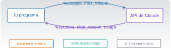

{.portada fig-alt="Esquema de una petición a la API: un programa envía mensajes y recibe una respuesta con el uso de tokens; debajo, tres cuadros para clave, coste y errores"}

## Objetivos y prerrequisitos

**Objetivos.** Al terminar la unidad sabrás:

- explicar qué es la **API de Claude**, en qué se diferencia de la aplicación y de Claude Code, y cuándo conviene cada una;
- autenticarte sin exponer la clave, hacer una petición con **límites**, leer `usage` y calcular el **coste**;
- tratar **errores y límites de uso** distinguiendo lo reintentable de lo que no lo es;
- pedir y **validar salidas estructuradas**, y procesar documentos y lotes;
- **probar sin red ni coste** un programa que usa la API, y llamarla desde Python y desde Julia;
- evaluar resultados con un **conjunto de oro y una línea base local** y registrar lo necesario para reproducir;
- montar un **proyecto integrador**: informe Quarto reproducible con un paso de IA opcional y revisable.

**Prerrequisitos.** [C5](../c5-programar/index.qmd) (pruebas, revisión de código); recomendable [C6](../c6-informes/index.qmd) (datos e informes Quarto) y [C2](../c2-terminal/index.qmd) (variables de entorno y secretos).

**Tiempo orientativo.** 8–10 horas. **Nivel:** avanzado. **Herramientas:** Python 3.11+ con `uv`, Julia 1.12 y Quarto. **Todo lo que llama a la API real cuesta dinero y es opcional**: los ejemplos funcionan con un **transporte simulado**, sin clave y sin gasto.

::: {.callout-note title="Qué se ha comprobado y qué no"}
Se probó el código de `claude/c9-api/_ejemplo/` con el **SDK oficial de Python** (`anthropic` 2.2.0) sobre un **transporte HTTP simulado** (sin red ni clave): **26 pruebas pytest** (petición enviada, coste, reintentos, errores 400/401/403/404/429/5xx, truncado, rechazo, salida estructurada y su reparación, registro sin datos sensibles, proyecto integrador con renderizado Quarto) y **4 aserciones de Julia** (puente a Python). El 23-10-2026.
**No** se ha hecho **ninguna llamada real** a la API (requiere clave y cuesta), así que **no** se ha verificado el comportamiento real de ningún modelo ni de la salida estructurada con esquema, y los ejemplos de respuesta son ilustrativos. Los precios y los modelos proceden de la documentación (23-10-2026) y **cambian**; las reglas de la API (parámetros, cabeceras, límites) cambian por versión: contrasta con la documentación de tu fecha.

:::

**Temas de la unidad**

- **C9.1** La API de Claude: conceptos, autenticación y SDK
- **C9.2** Peticiones, parámetros, tokens y coste
- **C9.3** Salidas estructuradas y procesamiento de documentos
- **C9.4** Errores, límites de uso, seguridad y reproducibilidad
- **C9.5** Llamadas desde Python y desde Julia
- **C9.6** Evaluación y registro de resultados en investigación
- **C9.7** Procesamiento por lotes y automatización de informes científicos
- **C9.8** Proyecto integrador: caso empresarial completo

## Teoría breve

### C9.1 La API de Claude: conceptos, autenticación y SDK {#c9-1}

La **API de Claude** (la *Messages API*) es un servicio web: tu programa envía una petición con una lista de **mensajes** y recibe la **respuesta** del modelo, con el recuento de *tokens* consumidos. No guarda la conversación: **es sin estado**, y en cada petición envías el historial que quieras que el modelo vea. Es la tercera vía de C1.2 y se diferencia de las otras dos así [@anthropic-modelos]:

| | **Aplicación Claude** | **Claude Code** | **API** |
|---|---|---|---|
| Qué es | Chat con proyectos, archivos, artefactos | Agente que trabaja en tu proyecto, con permisos | Servicio al que llama **tu código** |
| Quién escribe el bucle de trabajo | Anthropic | Anthropic | **Tú** (o una biblioteca) |
| Estado de la conversación | Lo guarda la app | Lo guarda la sesión | **No hay**: lo envías tú |
| Herramientas (editar ficheros, shell…) | Las de la app | Las de Claude Code, con permisos | Las que **tú definas** o las alojadas por Anthropic |
| Se paga | Suscripción o gratis | Suscripción o API | **Por *tokens***, aparte de cualquier suscripción |
| Para | Conversar y trabajar con documentos | Programar y analizar en un proyecto | Integrar el modelo en tu software o en un proceso |

**SDK.** Los *kits de desarrollo* oficiales (Python, TypeScript, Java, Go, Ruby, C#, PHP) envuelven la API: construyen la petición, gestionan reintentos y convierten los errores en excepciones tipadas. **No hay SDK oficial de Julia**: se llama por HTTP o a través de Python (C9.5). Usa siempre el SDK oficial en lugar de reimplementar la lógica a mano.

**Autenticación.** La petición lleva una **clave** (o un *token*). Reglas:

1. **La clave es un secreto** (C2.5): nunca en el código, en `CLAUDE.md`, en un repositorio ni en un registro.
2. Se lee de la **variable de entorno** `ANTHROPIC_API_KEY`; los SDK la toman solos: `anthropic.Anthropic()` sin argumentos. También admiten un *token* de inicio de sesión (`ant auth login`) o la federación de identidad en entornos en la nube.
3. **Una clave por entorno y por persona**, con el mínimo alcance; **se revoca y se rota** si se filtra: borrarla del repositorio **no basta**.
4. La clave se **crea en la consola** de Anthropic y la facturación está ligada a esa organización (puedes fijar límites de gasto por espacio de trabajo).
5. Para pruebas, **una clave de pruebas con un tope bajo**, o mejor, el transporte simulado de abajo.

**Modelos** (documentación consultada el 23-10-2026; **cambian**): Fable 5.1, Opus 5.5, Sonnet 5.5 y Haiku 5.5, con identificadores como `claude-sonnet-5-5` y ventana de contexto de 1 millón de *tokens* y hasta 128 000 de salida [@anthropic-modelos]. Los identificadores se escriben **exactos, sin sufijos de fecha**, y cada uno tiene una fecha mínima de retirada: tu código debe poder cambiar de modelo con una constante o un ajuste.

**Pon a prueba lo anterior.**

::: {.ejercicio tipo="vf" id="c9-1-estado" respuesta="falso"}
La API de Claude recuerda la conversación anterior, por lo que basta con enviar el último mensaje.

::: {.solucion}
**Falso.** La API no tiene estado: cada petición debe incluir el historial que quieres que el modelo vea. Es lo que hace la aplicación por ti.

:::
:::

::: {.ejercicio tipo="opcion" id="c9-1-clave" respuesta="c"}
¿Dónde guardas la clave de la API para un script que la necesita?

::: {.opciones}
- Escrita en el script, para no perderla.
- En un fichero `config.py` versionado.
- En una variable de entorno (`ANTHROPIC_API_KEY`) que el SDK lee, y fuera de cualquier fichero versionado.
- En el `CLAUDE.md` del proyecto.
:::

::: {.solucion}
Variable de entorno (o el almacén de credenciales de tu sistema). Los ficheros versionados y `CLAUDE.md` llegan al historial de Git y, `CLAUDE.md`, al modelo.

:::
:::

### C9.2 Peticiones, parámetros, tokens y coste {#c9-2}

Una petición mínima con el SDK de Python (código **probado con el transporte simulado**, no contra el servicio real):

```python
import anthropic

cliente = anthropic.Anthropic()        # clave de ANTHROPIC_API_KEY
r = cliente.messages.create(
    model="claude-sonnet-5-5",
    max_tokens=1024,                   # tope de la respuesta: obligatorio
    system="Eres un asistente de ingeniería. Sé breve.",
    messages=[{"role": "user", "content": "¿Qué es la frecuencia de Nyquist?"}],
)
print(r.content[0].text)
print(r.usage.input_tokens, r.usage.output_tokens, r.stop_reason)
```

**Parámetros que importan.** `model` (el identificador), `max_tokens` (tope **obligatorio** de la respuesta; **no lo escatimes**: una respuesta cortada a mitad es un error que cuesta una repetición), `messages` (el historial) y `system` (instrucciones permanentes). Para razonamiento, los modelos actuales usan **pensamiento adaptativo** y un parámetro de **esfuerzo** (`output_config.effort`); no se usa ya un presupuesto fijo de pensamiento. Según la documentación de referencia de la API consultada, **`temperature`, `top_p` y `top_k` dejan de aceptarse** (error 400) con la versión de API de 21-10-2026: no los incluyas en código nuevo y comprueba tu versión (esto afecta a lo que viste en C0.3: la temperatura sigue siendo el concepto, pero ya no siempre un mando que puedas ajustar).

**La respuesta.** `r.content` es una **lista de bloques** (texto, uso de herramientas, pensamiento…): se comprueba el tipo antes de leer `.text`. `r.stop_reason` dice por qué paró: `end_turn` (terminó), **`max_tokens`** (cortada), `tool_use` (quiere llamar a una herramienta), `refusal` (rechazó la petición por seguridad). **Siempre se comprueba antes de usar el texto.** `r.usage` da los *tokens* de entrada y salida (y de caché).

**Coste.** Con los precios por millón de *tokens*:

$$
\text{coste} = \frac{n_{\text{ent}}\,p_{\text{ent}} + n_{\text{sal}}\,p_{\text{sal}}}{10^{6}}.
$$

| Modelo | Entrada (€/$ por MTok) | Salida |
|---|---|---|
| Haiku 5.5 | 0,10 $ (hasta 100K de prompt) | 0,50 $ |
| Sonnet 5.5 | 2 $ | 10 $ |
| Opus 5.5 | 4 $ | 20 $ |
| Fable 5.1 | 10 $ | 50 $ |

(Precios de la documentación de modelos, 23-10-2026; **cambian**.) Comprobado con el código del ejemplo: 20 000 *tokens* de entrada y 2 000 de salida cuestan **0,06 $** con Sonnet 5.5; 50 000 y 1 000 cuestan **0,0055 $** con Haiku 5.5 y **0,22 $** con Opus 5.5. **Palancas de coste**, de las que no pierden calidad a las que sí: reducir lo que envías (no pegues lo que no hace falta), **caché de prompts** (los *tokens* leídos de la caché cuestan una fracción de los normales: el prefijo debe ser idéntico), **lotes asíncronos con un descuento del 50 %**, y solo después elegir un modelo más pequeño o menos esfuerzo, **midiendo** antes con tus casos. `client.messages.count_tokens(...)` cuenta *tokens* antes de gastar.

**Pon a prueba lo anterior.**

::: {.ejercicio tipo="numerico" id="c9-2-coste" respuesta="0.0055" tol="1%" unidad="$"}
Una petición envía 50 000 *tokens* y recibe 1 000 con Haiku 5.5 (0,10 $ y 0,50 $ por millón). ¿Cuántos dólares cuesta?

::: {.solucion}
$(50\,000\cdot 0{,}10 + 1\,000\cdot 0{,}50)/10^6 = 0{,}0055$ $. Con Opus 5.5 serían 0,22 $: 40 veces más. Comprobado con el código del ejemplo.

:::
:::

::: {.ejercicio tipo="opcion" id="c9-2-stop" respuesta="b"}
`stop_reason` vale `max_tokens`. ¿Qué significa y qué haces?

::: {.opciones}
- Que la respuesta es correcta y completa.
- Que se cortó por el tope; subes `max_tokens` o pides menos, y **no** usas el texto como si estuviera completo.
- Que la clave caducó.
- Que el modelo rechazó la petición.
:::

::: {.solucion}
`max_tokens` indica una respuesta truncada. El código del ejemplo lanza un error en ese caso para no tratar un texto a medias como terminado.

:::
:::

### C9.3 Salidas estructuradas y procesamiento de documentos {#c9-3}

Cuando el resultado lo va a leer **un programa** (una tabla, un número, una categoría), no basta con texto libre: hace falta una **estructura** que se pueda validar. Dos vías:

1. **Salida estructurada con esquema** (función de la API: `output_config.format`, y `client.messages.parse()` en el SDK, que valida la respuesta contra tu esquema). Es la opción recomendada por la documentación de la API, y **no se ha probado en este curso** (necesita llamadas reales).
2. **Validación propia** (la del ejemplo, `extraer_json`): se pide JSON, se **parsea** y se **comprueba** (¿están las claves?, ¿tienen el tipo esperado?); si falla, **un** intento de reparación con el error concreto, y si vuelve a fallar, se **detiene** con un error claro. Sirve con cualquier modelo.

Lo esencial es lo mismo: **nunca confíes en que la salida es válida; compruébalo**. Y no dejes un modelo **«rellenar» lo que no sabe**: permite el valor `null` o una categoría «no determinado».

**Resultado comprobado** (transporte simulado): un JSON correcto a la primera pasa; una respuesta en prosa («Claro: Norte, 1911061.69») provoca **una** reparación y la segunda respuesta válida se acepta; un JSON con tipos incorrectos tras la reparación lanza `ValueError`.

**Documentos.** La API acepta **PDF** (en base64) e imágenes dentro del mensaje, y una **API de ficheros** para subir un documento una vez y referenciarlo en varias peticiones; con las **citas** activadas, la respuesta señala qué fragmento del documento respalda cada afirmación (útil para verificar). Límites que cambian (tamaño, páginas): consúltalos. Dos reglas del curso: **no subas documentos con datos que no puedas compartir** (C0.7, C1.5; la API tiene condiciones propias de datos) y **comprueba las citas** contra el original.

**Pon a prueba lo anterior.**

::: {.ejercicio tipo="opcion" id="c9-3-valida" respuesta="d"}
Pides al modelo un JSON con `region` e `importe` y recibes `{"region": "Norte", "importe": "mucho"}`. ¿Qué haces?

::: {.opciones}
- Lo uso: tiene las dos claves.
- Lo corrijo a mano en el código.
- Pido que lo repita hasta que salga bien, sin límite.
- Detecto el tipo incorrecto con la validación, intento una reparación acotada y, si falla, detengo el proceso con un error claro.
:::

::: {.solucion}
Se valida la estructura **y** los tipos; un reintento con el error concreto es razonable, pero acotado (si no, un fallo sistemático gasta dinero sin fin). Después, un error visible.

:::
:::

### C9.4 Errores, límites de uso, seguridad y reproducibilidad {#c9-4}

**Errores.** El SDK convierte los códigos HTTP en **excepciones tipadas**. Se capturan **de la más específica a la más general** y se decide si se puede reintentar:

| Código | Excepción (Python) | Significado | ¿Reintentar? |
|---|---|---|---|
| 400 | `BadRequestError` | Petición mal formada o parámetro no admitido | **No**: corrige la petición |
| 401 | `AuthenticationError` | Clave inválida | **No** |
| 403 | `PermissionDeniedError` | La clave no tiene permiso | **No** |
| 404 | `NotFoundError` | Modelo o recurso inexistente | **No** |
| 429 | `RateLimitError` | Límite de uso | **Sí**, con espera (cabecera `retry-after`) |
| ≥500 | `InternalServerError` | Fallo del servicio | **Sí**, con espera creciente |
| — | `APIConnectionError` | Red | **Sí** |

Los SDK **reintentan solos** los 408, 409, 429 y ≥500 y los errores de conexión (por defecto, dos veces) con espera exponencial, y tienen un *timeout* por defecto de 10 minutos. Si escribes tu propio bucle de reintentos, **desactiva** los del SDK (`max_retries=0`) o tendrás reintentos dentro de reintentos.

**Resultado comprobado** (`test_cliente.py`, transporte simulado): un 429 con `retry-after: 7` se reintenta respetando esa espera (7 s) y se recupera al tercer intento; un 429 persistente agota los intentos y relanza `RateLimitError` tras exactamente dos peticiones con `reintentos=2`; los 400, 401, 403 y 404 **no se reintentan** (una sola petición); un 500 se reintenta y se recupera; una respuesta `max_tokens` o `refusal` aborta con error.

**Límites de uso.** La API limita **peticiones y *tokens* por minuto** según tu nivel (y el modelo), y el gasto por organización o espacio de trabajo. Ante un 429: espera, reduce la concurrencia, **agrupa** peticiones con lotes y, si procede, pide más cupo. Las respuestas traen una **cabecera de identificador de petición** (`request-id`) que conviene registrar para cualquier reclamación.

**Seguridad.**

- **Clave:** variable de entorno, rotación, nunca en registros; un gestor de secretos en entornos compartidos.
- **Datos:** envía **lo mínimo** (el ejemplo envía solo cifras agregadas, no filas); nada de datos personales o confidenciales sin base y permiso (C0.7, C1.5); las condiciones de retención de la API son distintas de las de la aplicación: léelas.
- **Entradas no confiables:** un documento o una página que le pasas puede contener **instrucciones maliciosas** (*prompt injection*, C7.6). No des al modelo herramientas con efectos irreversibles sobre lo que lea de fuera sin supervisión.
- **Salidas:** trata el texto del modelo como **entrada no fiable**: no lo ejecutes (`eval`, `exec`, shell) ni lo insertes sin escapar en HTML o SQL.
- **Registro:** guarda **metadatos** (modelo, *tokens*, coste, identificador de petición, **hash** del prompt), no el contenido ni la clave. El ejemplo lo hace y se prueba que el texto del prompt no aparece en el registro.

**Reproducibilidad.** Una respuesta de un modelo **no es reproducible** del mismo modo que un cálculo: puede variar entre llamadas, y los modelos se retiran. Registra **qué modelo, qué versión de prompt, qué fecha y qué parámetros**; fija los identificadores de modelo; guarda las **respuestas** que alimentan un resultado publicado; y separa lo **calculado** (reproducible) de lo **generado** (revisable).

::: {.callout-warning title="Errores frecuentes"}
- **Reintentar un 400 o un 401**: no se arregla esperando; gastas tiempo y, a veces, dinero.
- **Bucle de reintentos sin tope** ni límite de gasto.
- **No comprobar `stop_reason`** y usar un texto cortado o un rechazo como respuesta válida.
- **Meter la clave en el código** o en el registro.
- **Confiar en un identificador de modelo «de memoria»** y escribirlo con un sufijo de fecha que no existe: usa el de la documentación.
:::

**Pon a prueba lo anterior.**

::: {.ejercicio tipo="opcion" id="c9-4-retry" respuesta="a"}
Tu programa recibe un 429 con `retry-after: 30`. ¿Qué haces?

::: {.opciones}
- Espero (al menos) 30 segundos y reintento, con un máximo de intentos.
- Reintento de inmediato, en bucle, hasta que funcione.
- Cambio la clave.
- Lo trato como un error definitivo y detengo todo sin más.
:::

::: {.solucion}
Un 429 es un límite transitorio: se espera lo que indica `retry-after` y se reintenta con un tope de intentos (y se reduce la concurrencia). Un bucle inmediato empeora el problema.

:::
:::

### C9.5 Llamadas desde Python y desde Julia {#c9-5}

**Python.** Es la vía directa (SDK oficial). El ejemplo `cliente_claude.py` envuelve una petición con reintentos, comprobación de `stop_reason`, coste y registro. La clave está en que el **cliente se inyecta**: la función `llamar(cliente, ...)` recibe un cliente, de modo que en las pruebas se le pasa uno **real del SDK con un transporte HTTP falso**, que ejecuta todo el código del SDK **sin red**:

```python
import cliente_claude as cc
cli, vistas = cc.crear_cliente_simulado([{"estado": 429, "retry_after": "7"}, {"texto": "ok"}])
r = cc.llamar(cli, modelo="claude-sonnet-5-5", mensajes=[{"role": "user", "content": "x"}])
```

Así se prueban **los fallos** (429, 401, respuesta truncada…) que con el servicio real son difíciles de provocar, sin gastar. **Comprobado:** la petición que envía el SDK es un `POST` a `/v1/messages` con `model`, `max_tokens`, `messages` y `system`; la clave **no** aparece en el cuerpo (viaja en una cabecera de autenticación que gestiona el SDK) y el SDK añade la cabecera de versión de la API.

**Julia.** No hay SDK oficial. Tres opciones, de más a menos recomendable aquí:

1. **A través del cliente de Python** como subproceso: se aprovecha el cliente probado y los errores se propagan por el código de salida. **Comprobado** (`puente.jl`, solo biblioteca estándar): `resumir_con_python("…")` devuelve el texto, los *tokens* (25 y 12) y el coste (0,00017 $) en modo simulado, y lanza `ProcessFailedException` si el programa falla (por ejemplo, sin argumentos).

```julia
function resumir_con_python(texto; simulado = true, modelo = "claude-sonnet-5-5")
    orden = `uv run --with anthropic --with httpx2 python cliente_claude.py $texto --modelo $modelo`
    simulado && (orden = `$orden --simulado`)
    salida = read(orden, String)        # ProcessFailedException si el código de salida ≠ 0
    # … extraer los campos del JSON impreso …
end
```

2. **HTTP directo** con un paquete como `HTTP.jl` y un analizador JSON: tendrías que construir tú la petición (`POST https://api.anthropic.com/v1/messages`, cabeceras de autenticación y de versión, cuerpo JSON), gestionar errores y reintentos. **No se ha probado aquí** (no están instalados esos paquetes en el entorno del curso). Si lo haces, aplica las mismas reglas de C9.4.
3. **PythonCall.jl** (llamar a Python desde Julia): no se ha probado.

**Alternativa local gratuita** para todo lo que no necesite un modelo: reglas, expresiones regulares, un modelo local (Ollama u otros: **no se tratan aquí**) o el cálculo. En C9.6 la línea base es una expresión regular.

### C9.6 Evaluación y registro de resultados en investigación {#c9-6}

«Parece que funciona» no es una evaluación. Una evaluación mínima tiene:

1. **Un conjunto de casos con la respuesta esperada** («conjunto de oro»), **escrito por una persona**, con casos normales, límite y de «no hay dato».
2. **Una métrica clara y simple** (coincidencia exacta por campo, tasa de aciertos), que se calcula siempre igual.
3. **Una línea base local y gratuita** (una expresión regular, una regla) con la que **comparar**: si el modelo no mejora lo que haces gratis, no lo necesitas.
4. **Un registro** con modelo, versión del prompt, fecha y resultado, para poder repetir y comparar.

`_ejemplo/evaluar.py` implementa eso con cuatro casos sintéticos (texto de ventas → región e importe, incluido uno sin importe). **Resultado comprobado:** la línea base con expresión regular acierta **4/4**; un «modelo» simulado que se equivoca por un factor 100 en un importe (680 en lugar de 68 000) obtiene **3/4 = 0,75** y la evaluación **señala el fallo concreto**; un predictor que falla con una excepción cuenta como error sin romper la evaluación.

**Limitaciones que debes declarar.** Cuatro casos son un ejemplo, no una evaluación: con pocos casos, **una diferencia no es significativa**. Las respuestas de un modelo **varían**: repite y registra la variación. Evita **la contaminación** (no evalúes con los ejemplos que pusiste en el prompt) y **la métrica engañosa** (la coincidencia exacta penaliza respuestas equivalentes, p. ej. `68000` frente a `68.000,0`). Si el modelo hace de **juez** de otro modelo, también hay que validarlo contra personas.

**En investigación:** documenta modelo, fecha, versión del prompt, parámetros, número de casos y variación; publica los datos sintéticos o los permitidos y **separa** lo calculado de lo generado; no atribuyas a la IA un resultado sin la evaluación que lo respalda; y no uses datos con restricciones sin permiso.

**Pon a prueba lo anterior.**

::: {.ejercicio tipo="opcion" id="c9-6-base" respuesta="b"}
¿Para qué sirve una línea base local gratuita (por ejemplo, una expresión regular) en una evaluación?

::: {.opciones}
- Para sustituir siempre al modelo.
- Para tener con qué comparar: si el modelo no la mejora, quizá no hace falta pagarlo.
- Para evitar escribir casos de prueba.
- Para calcular el coste.
:::

::: {.solucion}
Da un punto de referencia barato y reproducible. Si el modelo no mejora la línea base en tus casos, el coste y la variabilidad no se justifican.

:::
:::

### C9.7 Procesamiento por lotes y automatización de informes científicos {#c9-7}

Cuando hay **muchas peticiones y no hace falta la respuesta al instante**, la API ofrece **lotes** (*Message Batches*): se envía una lista de peticiones, se consulta hasta que terminan y se leen los resultados, con un **descuento del 50 %**. Reglas: cada petición lleva un identificador propio (`custom_id`) porque **los resultados llegan en cualquier orden**; cada una puede salir bien, con error, cancelada o caducada, y hay que **tratar cada caso**. **No se ha ejecutado ningún lote** (requiere servicio real).

**Automatizar un informe científico.** Un informe periódico con un paso de IA debe cumplir lo de C8 y lo de este capítulo:

- las **cifras las calcula el código** (reproducibles) y la IA solo redacta o interpreta, **etiquetada** y **revisable**;
- a la IA se le envían **datos agregados**, no los datos brutos;
- el paso de IA es **opcional y degradable**: si falla, el informe sale igualmente, diciendo que falta;
- **tope de coste** y registro de cada llamada; ejecución desatendida con `dontAsk` y alerta de fallo (C8);
- **revisión humana** antes de publicar.

### C9.8 Proyecto integrador: caso empresarial completo {#c9-8}

`_ejemplo/proyecto/generar_informe.py` une las unidades del curso en un **informe Quarto reproducible** de ventas (caso A, datos sintéticos): validar (C6) → resumir (C6) → **borrador de interpretación con Claude, opcional** (C9) → `informe.qmd` → `quarto render` (C6), con registro y pruebas (C5), listo para programar (C8).

```text
python generar_informe.py                 # por defecto: solo cálculo, sin IA, sin coste
python generar_informe.py --simulado      # paso de IA con transporte falso: sin clave, sin red, sin coste
python generar_informe.py --ia            # llamada REAL (de pago): requiere ANTHROPIC_API_KEY
quarto render informe.qmd                 # HTML autocontenido
```

**Decisiones de diseño** (y por qué importan):

| Decisión | Motivo |
|---|---|
| Las cifras las calcula el código | Reproducibles y verificables (6 069 845,38 € de total, 109/1/5 de calidad) |
| La IA recibe **solo agregados** (comprobado: el prompt no contiene filas ni fechas) | Minimización de datos (C0.7) |
| El texto de la IA va en una sección **«borrador generado por IA, sin revisar»** con un aviso de revisión pendiente | Responsabilidad humana (C0.9) |
| El registro guarda modelo, *tokens*, coste y un **hash** (comprobado: no contiene el prompt) | Auditoría sin filtrar datos |
| Si la llamada falla, **el informe se genera igualmente** y se avisa | Degradación controlada |
| Modelo pequeño por defecto (Haiku 5.5) | Coste: 210 *tokens* de entrada y 48 de salida cuestan 0,000045 $ |
| El modo por defecto **no** usa la IA | Sin clave ni coste por defecto |

**Resultado comprobado** (7 pruebas del proyecto, incluido el renderizado con Quarto): validación 109/1/5; totales idénticos a los de C6 (Norte 1 911 061,69 €; Centro 2 539 781,72 €; Sur 1 619 001,97 €); formato español de los números; el modo por defecto produce un informe **sin** sección de IA; el modo simulado la añade **etiquetada** y registra la llamada; `--ia` sin clave termina con **código 2**; el HTML se renderiza y contiene la sección de interpretación. Una llamada real **no** se ha hecho.

**Otros proyectos integradores** (propuestas que recorren varias unidades): **a)** pipeline de calidad de datos (C6) con skill (C7) y tarea programada (C8) que avisa si cambia el recuento de ausentes; **b)** informe de vibración (caso E, C6) con revisión por un subagente (C7) y un resumen de IA etiquetado (C9); **c)** extractor de importes desde textos (C9.6) con evaluación y línea base, y documentación de límites.

## Práctica guiada

[Local gratuita]{.ejec .ejec-local} (todo el código en modo simulado) · [Puede generar coste]{.ejec .ejec-coste} (el modo real; opcional, con tope y clave de pruebas). *Respuestas del modelo ilustrativas.*

**Ficha.** *Objetivo:* construir y probar un cliente de la API con control de errores y coste, y un informe con un paso de IA opcional. *Archivos:* `claude/c9-api/_ejemplo/` (`cliente_claude.py`, `evaluar.py`, `puente.jl`, `proyecto/generar_informe.py` y sus pruebas). *Versiones:* Python 3.11+, `anthropic` 2.x, Julia 1.12, Quarto. *Resultado esperado:* **26 pruebas pytest** y **4 aserciones de Julia** en verde. *Problemas frecuentes:* la clave en el código; reintentar un 400; no comprobar `stop_reason`.

1. **Ejecuta las pruebas** sin red: `cd claude/c9-api/_ejemplo && uv run --with anthropic --with httpx2 --with pytest pytest -q` → **26 passed**; y `julia --project=. claude/c9-api/_ejemplo/puente.jl` → 4 aserciones.
2. **Lee `llamar()`:** ¿qué errores se reintentan y cuáles no? ¿Dónde se comprueba `stop_reason`? ¿Qué se guarda en el registro y qué no?
3. **Provoca fallos** modificando el cliente simulado: un 401, un 500 seguido de éxito, una respuesta `max_tokens`. Predice el resultado **antes** de ejecutar.
4. **Calcula el coste** de 1 000 informes con el modelo por defecto (210 y 48 *tokens*) y con Opus 5.5.
5. **Genera el informe** en los tres modos: por defecto, `--simulado` y (solo si lo decides) `--ia` con una clave de pruebas y un tope de gasto. Compáralos y comprueba que las **cifras son idénticas**.
6. **Revisa el prompt** de la IA con la lista de C0.7: ¿qué datos sale de tu máquina? ¿Podrías enviar menos?
7. **Evalúa:** ejecuta `evaluar.py`; añade **tres casos** difíciles al conjunto de oro y comprueba si la línea base de expresión regular los resuelve.
8. **Documenta** qué reproducirías y qué no, si publicaras el informe con el paso de IA.

**Qué has aprendido:** una integración fiable se prueba **fallando**; las cifras las calcula el código; la IA se etiqueta y se revisa; y el coste y los datos se acotan antes de gastar.

## «Pídeselo a Claude»

::: {.callout-tip title="Prompt"}
Escribe una función de Python que llame a la API de Claude con el SDK oficial para resumir un texto, con: la clave
tomada de la variable de entorno, `max_tokens` explícito, comprobación de `stop_reason`, reintentos solo para
errores transitorios (429, conexión, 5xx) respetando `retry-after`, cálculo de coste desde `usage` y un registro
que **no** guarde el texto ni la clave. Escribe también pruebas que usen un transporte HTTP simulado (sin red) para
los casos 429, 401 y respuesta truncada. **No ejecutes nada** y no llames a la API. Indica qué nombres de la API
o del SDK no has podido comprobar en la documentación vigente y qué precios has supuesto.

**Verifica.**

- ¿Comprueba los nombres (`messages.create`, excepciones, `usage`) con la documentación de tu versión del SDK?
- Ejecuta tú las pruebas **sin red**: ¿cubren 429 con espera, 401 sin reintento y truncado?
- ¿Usa `temperature`, `top_p` o `top_k`? Con las versiones recientes de la API pueden dar error: ¿lo avisa?
- ¿El registro contiene el prompt o la clave? Compruébalo con `grep`.
- ¿Los precios que usa coinciden con la página de modelos de hoy?
:::

## Ejercicios

1. **Coste.** Un trabajo envía 3 000 peticiones de 2 500 *tokens* de entrada y 300 de salida a Sonnet 5.5 (2 $ y 10 $ por MTok). ¿Cuánto cuesta? ¿Y con lotes (50 % menos)?

   ::: {.callout-note collapse="true" title="Solución"}
   Por petición: $(2\,500\cdot2+300\cdot10)/10^6=0{,}008$ $; ×3 000 = **24 $**. Con lotes, **12 $**. (Precios de 23-10-2026.)

   :::

2. **Errores.** Clasifica como reintentable o no: a) 429; b) 400 por un parámetro no admitido; c) fallo de conexión; d) 401; e) 500; f) `stop_reason: max_tokens`.

   ::: {.callout-note collapse="true" title="Solución"}
   Reintentables: a, c, e (con espera y tope). No: b y d (corrige la petición o la clave). f no es un error HTTP: es una **respuesta truncada**; se sube `max_tokens` o se pide menos, no se «reintenta igual».

   :::

3. **Salida estructurada.** Escribe un esquema (claves y tipos) para extraer de una incidencia: equipo, fecha, gravedad (baja/media/alta/desconocida) y descripción. ¿Qué valor permites cuando el texto no dice la gravedad y por qué?

   ::: {.callout-note collapse="true" title="Solución"}
   Permitir «desconocida» (o `null`) evita que el modelo **invente** un valor. Se valida con las claves y los tipos, con un solo intento de reparación y un error visible si sigue fallando.

   :::

4. **Prueba sin red.** Añade a `test_cliente.py` un caso para un 529 (servicio sobrecargado) que se recupera al segundo intento, y otro para un 401 que **no** se reintenta. Predice el número de peticiones en cada uno.

5. **Evaluación.** Añade al conjunto de oro un caso con un importe con **millones** (`1.250.000,00 euros`) y otro con una **abreviatura** («52,3 mil euros»). ¿Los resuelve la línea base? ¿Qué cambia?

   ::: {.callout-note collapse="true" title="Solución"}
   El patrón acepta el primero (`1.250.000,00`) pero no el segundo (necesita otra regla o un modelo). Es lo que se busca: la evaluación **revela** dónde la línea base no llega y justifica el modelo… o la regla extra.

   :::

6. **Reproducibilidad.** Enumera qué registrarías para que otra persona pueda repetir (o al menos auditar) un informe que incluye texto generado por Claude.

   ::: {.callout-note collapse="true" title="Solución"}
   Modelo (identificador exacto) y fecha, versión del prompt, parámetros, el texto generado **tal cual** que entró en el informe, los datos agregados enviados (no los brutos), el coste y la persona que lo revisó.

   :::

## La doy por superada si…

- Explico la diferencia entre la aplicación, Claude Code y la API, y cuándo uso cada una.
- Me autentico con una variable de entorno y no dejo la clave en código ni en registros.
- Hago una petición con `max_tokens`, compruebo `stop_reason` y calculo el coste desde `usage`.
- Distingo errores reintentables de los que no lo son y respeto `retry-after`.
- Valido una salida estructurada y limito la reparación.
- Pruebo mi código **sin red ni coste** con un transporte simulado.
- Llamo a la API desde Python y sé qué opciones tengo en Julia.
- Evalúo con un conjunto de oro y una línea base local, y registro lo necesario para reproducir.
- Construyo un informe Quarto reproducible con un paso de IA opcional, etiquetado y revisable.
- No presento un texto generado como un resultado calculado.

## Referencias de esta unidad

Documentación de modelos y precios de la plataforma Claude [@anthropic-modelos] (consultada el 23-10-2026). Las reglas de la API, de los SDK y sus cambios
(parámetros retirados, códigos de error, lotes, caché) proceden de la documentación de referencia de la API incluida en la *skill* `claude-api` de Claude Code 2.1.309 [@anthropic-skillapi],
que se contrastó con el comportamiento del SDK `anthropic` 2.2.0 sobre un transporte simulado. Consulta siempre la documentación vigente:
[platform.claude.com/docs](https://platform.claude.com/docs/en/models/overview).
