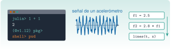
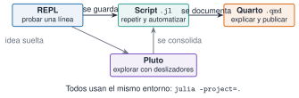

{.portada fig-alt="Una ventana de terminal con el prompt de Julia, la señal de un acelerómetro con dos frecuencias y tres celdas de un cuaderno reactivo"}

Todo lo que viene después en el curso (señales, modos, identificación) se programa en Julia. Esta unidad deja listo el puesto de trabajo: Julia instalado y actualizable, un REPL que sepas manejar, un editor cómodo y la idea clara de **dónde se ejecuta qué**. Al final habrás generado y dibujado tu primera señal de vibración.

::: {.callout-note}
## Cómo se lee esta unidad
**Tiempo orientativo: 60 minutos.** Objetivos y prerrequisitos (3), teoría en cinco píldoras (12), práctica guiada (25), «Pídeselo a Claude» (8), ejercicios (10) y cierre (2). Las pestañas *Python* de la práctica no se ejecutan en la web: su versión probada está en la carpeta `python/` de la unidad.
:::

```{julia}
#| include: false
using Random, Statistics
include("../../../recursos/r1-datos/_tema.jl")
```

## Objetivos y prerrequisitos

**Objetivos.** Al terminar esta unidad sabrás:

- instalar Julia con `juliaup`, comprobar la versión y cambiar de versión;
- moverte por los cuatro modos del REPL (evaluar, ayuda, shell y paquetes);
- ejecutar un script con `julia --project=.` y explicar por qué se usa siempre esa opción;
- decidir si una tarea va al REPL, a un script, a un cuaderno Pluto o a una página de Quarto;
- generar y dibujar una señal sintética con semilla fija.

**Prerrequisitos.** Ninguno. Conviene haber usado una terminal alguna vez; si no, [C2](../../../claude/index.qmd) la explica desde cero.

**Reparto con otras unidades.** Aquí se instala y se explora. El gestor de paquetes y los ficheros `Project.toml` y `Manifest.toml` se explican en [J1.2](../j1-2-paquetes/index.qmd); el lenguaje en sí empieza en [J1.3](../j1-3-tipos/index.qmd).

## Teoría breve

### J1.1.1 Instalar Julia con `juliaup` {#j1-1-1}

`juliaup` es el instalador y gestor de versiones oficial. Instala Julia, lo mantiene actualizado y permite tener varias versiones a la vez, que es lo que necesitamos para comprobar que el código funciona en la versión estable y en la de soporte largo (LTS).

::: {.callout-tip}
## Chuleta: `juliaup`
```bash
juliaup status          # versiones instaladas y canal por defecto
juliaup add 1.10        # instala además la versión LTS
juliaup default 1.12    # versión que arranca con «julia»
julia +1.10             # arranca una versión concreta, sin cambiar la de por defecto
juliaup update          # actualiza todo
```
:::

Dentro de Julia, `VERSION` devuelve la versión en uso:

```{julia}
VERSION
```

::: {.callout-warning}
## Errores frecuentes
Instalar Julia desde un gestor de paquetes del sistema suele dar una versión antigua y sin forma sencilla de cambiarla. Usa `juliaup` (en Windows, desde la tienda de Microsoft o con `winget`; en macOS y Linux, con el script de instalación de la página oficial de Julia).
:::

::: {.ejercicio tipo="vf" id="j1-1-1-juliaup" respuesta="verdadero"}
Con `juliaup` se pueden tener instaladas a la vez Julia 1.10 y Julia 1.12 y elegir cuál arrancar.

::: {.solucion}
Verdadero. `juliaup add 1.10` instala la versión LTS junto a la de por defecto y `julia +1.10` la arranca sin cambiar el valor por defecto.
:::
:::

### J1.1.2 Los cuatro modos del REPL {#j1-1-2}

El **REPL** (*read–eval–print loop*) es la consola de Julia: escribes una expresión, Julia la evalúa y muestra el resultado. Se cambia de modo con la primera tecla de una línea vacía, y se vuelve al modo normal con la tecla de retroceso:

| Se escribe | Modo | Prompt | Para qué sirve |
|---|---|---|---|
| (nada) | Julia | `julia>` | evaluar código |
| `?` | Ayuda | `help?>` | documentación de una función: `?rms` |
| `;` | Shell | `shell>` | comandos del sistema sin salir: `pwd`, `ls` |
| `]` | Paquetes | `(@v1.12) pkg>` | instalar y activar entornos (se verá en J1.2) |

Tres trucos que ahorran mucho tiempo: la **flecha arriba** recupera la historia, el **tabulador** completa nombres y `ans` guarda el último resultado. Además, el tabulador convierte secuencias de LaTeX en símbolos: `\omega` + tabulador da `ω` y `\zeta` + tabulador da `ζ`, que son los nombres que usa el curso para la frecuencia angular y el amortiguamiento.

```{julia}
ω = 2π * 2.5          # rad/s, la frecuencia de 2,5 Hz
ζ = 0.02              # amortiguamiento, adimensional
round(ω, digits=3)
```

::: {.ejercicio tipo="numerico" id="j1-1-2-omega" respuesta="15.708" tol="0.1%" unidad="rad/s"}
¿Qué valor da `2π * 2.5` en rad/s?

::: {.solucion}
$2\pi\cdot2{,}5\approx15{,}708$ rad/s (se comprueba en el REPL).
:::
:::

### J1.1.3 Scripts y `--project=.` {#j1-1-3}

Un **script** es un fichero `.jl` que se ejecuta de principio a fin y da siempre el mismo resultado, que es lo que queremos para un cálculo que se repite. Se lanza desde la terminal, en la raíz del repositorio:

```bash
julia --project=. scripts/mi_calculo.jl
```

La opción `--project=.` le dice a Julia que use el **entorno del proyecto** (la lista de paquetes y versiones del curso, ficheros `Project.toml` y `Manifest.toml`) y no el entorno personal de quien lo ejecuta. Sin ella, el mismo script puede funcionar en un ordenador y fallar en otro por una versión distinta de un paquete. Dentro de un script, `@__DIR__` da la carpeta del propio fichero, y con `joinpath` se construyen rutas que no dependen de desde dónde se lance.

::: {.ejercicio tipo="vf" id="j1-1-3-project" respuesta="falso"}
`julia script.jl` y `julia --project=. script.jl` usan siempre los mismos paquetes y las mismas versiones.

::: {.solucion}
Falso. Sin `--project=.` se usa el entorno por defecto de cada usuario; con la opción, el del proyecto. Por eso en el curso se escribe siempre `--project=.`.
:::
:::

### J1.1.4 VS Code con la extensión de Julia {#j1-1-4}

VS Code, con la extensión oficial de Julia, es el editor recomendado. Aporta coloreado, ayuda al pasar el ratón, navegación a la definición y un REPL integrado. El flujo de trabajo es: abrir la **carpeta del repositorio** (no un fichero suelto, para que encuentre el entorno), arrancar el REPL con la orden *Julia: Start REPL* y ejecutar la línea o la selección con `Mayús + Intro`. Sirve cualquier otro editor, pero la extensión de VS Code es la que ofrece más ayuda.

### J1.1.5 Pluto: un cuaderno reactivo para explorar {#j1-1-5}

**Pluto.jl** es un cuaderno en el que cada celda es una expresión y, cuando cambias una variable, se recalculan automáticamente todas las celdas que dependen de ella. Es muy cómodo para probar un deslizador o ver qué pasa al variar un parámetro. En este curso se usa solo para **explorar**; lo que se publica y se verifica son las páginas de Quarto, que ejecutan Julia al compilar.

```julia
# Una vez, en el entorno personal de Julia (no en el del curso):
] add Pluto
# Cada vez que se quiera usar:
using Pluto; Pluto.run()
```

{#fig-flujo fig-alt="Cuatro cajas: REPL, Script, Pluto y Quarto. Una flecha va del REPL al script (se guarda) y del script a Quarto (se documenta). Otra va del REPL a Pluto y de Pluto al script. Debajo, una nota: todos usan el mismo entorno, julia --project=."}

::: {.callout-note .idea-clave}
## Idea clave
Se prueba en el REPL, se guarda en un script y se explica en Quarto. Los tres usan el mismo entorno (`--project=.`), y por eso el resultado es el mismo en cualquier ordenador.
:::

::: {.ejercicio tipo="abierta" id="j1-1-5-donde"}
Para cada tarea, di si usarías el REPL, un script, Pluto o Quarto: (a) comprobar qué devuelve `sqrt(-1)`; (b) procesar cada noche los registros del día; (c) ver cómo cambia un espectro al mover el amortiguamiento; (d) entregar un informe con código y figuras.

::: {.solucion}
(a) REPL. (b) Script, porque debe repetirse sin intervención. (c) Pluto, por los deslizadores. (d) Quarto, porque junta texto, código y figuras y se compila de forma reproducible.
:::
:::

## Práctica guiada

Vamos a generar la señal que un acelerómetro mediría en un edificio con dos modos: uno de 2,5 Hz y otro, más débil, de 7 Hz, con algo de ruido. Es el mismo tipo de señal que se analizará en [M3](../../../mse/m03-senales-i/index.qmd). Se fija la semilla para que cualquiera obtenga exactamente los mismos números.

::: {.panel-tabset}
## Julia

**Paso 1. Crear la señal.** 1000 muestras a 100 Hz son 10 s. Todas las magnitudes en unidades del SI (tiempo en s, aceleración en m/s²).

```{julia}
Random.seed!(1)
fs = 100.0                                   # frecuencia de muestreo, Hz
T = 10.0                                     # duración, s
t = (0:Int(fs * T) - 1) ./ fs                # vector de tiempos, s
limpia = sin.(2π * 2.5 .* t) .+ 0.4 .* sin.(2π * 7.0 .* t)
x = limpia .+ 0.2 .* randn(length(t))        # con ruido
(muestras = length(x), rms_limpia = round(sqrt(mean(abs2, limpia)), digits=4),
 rms_con_ruido = round(sqrt(mean(abs2, x)), digits=4))
```

El valor eficaz (RMS) de la señal limpia es $\sqrt{(1^2+0{,}4^2)/2}\approx0{,}7616$ m/s², y el ruido lo sube ligeramente. El punto delante de un operador (`.*`, `.+`) y detrás de una función (`sin.`) significa «elemento a elemento»; se explica en [J1.5](../j1-5-arrays/index.qmd).

**Paso 2. Dibujarla.** Las figuras de la web se hacen con CairoMakie y el tema del curso.

```{julia}
#| label: fig-senal
#| fig-cap: "Señal sintética de un acelerómetro: dos modos (2,5 Hz y 7 Hz) más ruido, a 100 Hz durante 10 s. Se muestran los dos primeros segundos."
#| fig-alt: "Curva de aceleración frente al tiempo entre 0 y 2 segundos, con una oscilación lenta de 2,5 hertz y una más rápida y débil encima, y un ruido fino; la señal limpia aparece superpuesta en naranja."
fig = Figure(size=(720, 300))
ax = Axis(fig[1, 1], xlabel="tiempo (s)", ylabel="aceleración (m/s²)")
n = Int(2fs)
lines!(ax, t[1:n], x[1:n], color=AZUL, label="medida")
lines!(ax, t[1:n], limpia[1:n], color=NARANJA, label="sin ruido")
axislegend(ax, position=:rt)
fig
```

**Paso 3. Guardarlo como script.** Cuando la prueba funciona en el REPL, se copia a un fichero. Si lo guardas como `scripts/primera_senal.jl`, lo lanzas con `julia --project=. scripts/primera_senal.jl`.

## Python

La versión equivalente, probada con `pytest`, está en `python/senal.py`. El entorno se gestiona con `uv` (no se usa conda):

```bash
uv run python
```

```python
from senal import senal_dos_modos, rms

t, x = senal_dos_modos(fs=100.0, T=10.0, f1=2.5, f2=7.0, a1=1.0, a2=0.4)
print(len(x), round(rms(x), 4))     # 1000 0.7616
```

La parte determinista coincide con la de Julia al detalle (la prueba lo comprueba). El ruido no se compara: los generadores aleatorios de Julia y de NumPy son distintos aunque se fije la semilla.
:::

::: {.callout-note}
## Qué se ha conseguido
Una señal con semilla fija, su valor RMS comprobado a mano y una figura con unidades en los ejes. Es la receta de todo el curso: **datos con semilla, valor numérico comprobado, figura con unidades y pie**.
:::

## «Pídeselo a Claude» {#pideselo}

::: {.callout-tip}
## Prompt
«Estoy en la raíz del repositorio `resonancia`. Con Julia y `--project=.`: (1) dime qué versión de Julia hay y si coincide con la de `juliaup status`; (2) crea `scripts/primera_senal.jl` que genere una señal de 10 s a 100 Hz con dos senoides de 2,5 Hz y 7 Hz (amplitudes 1 y 0,4) y ruido gaussiano de desviación 0,2 con semilla 1, e imprima su RMS; (3) ejecútalo y dime el resultado. No instales ni actualices ningún paquete. Si algo falla, dímelo en vez de inventar el resultado.»

**Verifica.** (a) Que el comando usa `--project=.`. (b) Que el RMS de la señal sin ruido sale $0{,}7616$, que es lo que se calcula a mano con $\sqrt{(1+0{,}16)/2}$. (c) Que la semilla está fijada antes de `randn`. (d) Que no ha modificado `Project.toml` ni `Manifest.toml` (míralo con `git diff`). (e) Que el tiempo está en segundos y que el eje de la figura, si la hace, lleva unidades.
:::

## Ejercicios

::: {.ejercicio tipo="numerico" id="j1-1-muestras" respuesta="1000" tol="0%" unidad="muestras"}
Una señal de 10 s muestreada a 100 Hz, ¿cuántas muestras tiene?

::: {.solucion}
$N=f_s\,T=100\cdot10=1000$ muestras (en Julia, `Int(fs * T)`).
:::
:::

::: {.ejercicio tipo="programacion" id="j1-1-rms" respuesta="3.5355" tol="0.1%"}
Escribe una expresión de Julia que dé el valor RMS del vector `[3, 4]`. Indica el resultado.

::: {.pista}
El RMS es la raíz cuadrada de la media de los cuadrados: `mean(abs2, x)` calcula esa media (hace falta `using Statistics`).
:::

::: {.solucion}
`sqrt(mean(abs2, [3, 4]))` da $\sqrt{12{,}5}\approx3{,}5355$.
:::
:::

::: {.ejercicio tipo="abierta" id="j1-1-semilla"}
Explica con tus palabras por qué se fija la semilla del generador aleatorio en todos los ejemplos del curso.

::: {.criterios}
- Menciona que sin semilla cada ejecución da números distintos.
- Relaciona la semilla con la reproducibilidad y con poder comparar resultados.
:::
:::

## La doy por superada si… {#superada}

- Sé decir con qué comando compruebo la versión de Julia y cómo arranco otra distinta.
- Me muevo por los cuatro modos del REPL y vuelvo al modo normal sin ayuda.
- Ejecuto un script con `julia --project=. fichero.jl` y sé explicar para qué sirve `--project=.`.
- Elijo entre REPL, script, Pluto y Quarto según la tarea.
- He generado la señal de la práctica con semilla fija y he comprobado su RMS.

**Cierre.** Responde por escrito en tres líneas: qué he entendido, qué todavía no domino y cuál es mi siguiente paso pequeño. Si has usado a Claude, revisa con `git diff` lo que ha cambiado antes de aceptarlo.

**Siguiente:** [J1.2 · Paquetes y reproducibilidad](../j1-2-paquetes/index.qmd).
