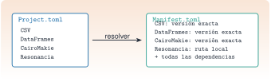

{.portada fig-alt="A la izquierda, un fichero Project.toml con una lista de nombres de paquetes; una flecha etiquetada resolver lleva a la derecha, a un fichero Manifest.toml con la versión exacta de cada paquete"}

Un análisis de vibraciones que da un resultado hoy y otro distinto dentro de seis meses, o en el ordenador de un compañero, no sirve para vigilar una estructura. La causa más frecuente no es el algoritmo sino el **entorno**: una versión distinta de un paquete. Esta unidad explica cómo Julia fija el entorno, cómo se usa el entorno único del curso y cómo se trabaja con `Resonancia.jl`, el paquete local con las funciones reutilizables.

::: {.callout-note}
## Cómo se lee esta unidad
**Tiempo orientativo: 60 minutos.** Objetivos (3), teoría en cinco píldoras (12), práctica guiada (25), «Pídeselo a Claude» (8), ejercicios (10) y cierre (2). En esta unidad **no se instala ni se actualiza ningún paquete**: lo que se ejecuta aquí solo lee el entorno. Las órdenes que modifican el entorno se muestran en bloques sin ejecutar.
:::

```{julia}
#| include: false
using Random, Statistics, TOML, Resonancia
include("../../../recursos/r1-datos/_tema.jl")
```

## Objetivos y prerrequisitos

**Objetivos.** Al terminar esta unidad sabrás:

- usar el modo paquetes (`]`) para ver, añadir y quitar paquetes;
- explicar la diferencia entre `Project.toml` y `Manifest.toml` y por qué se commitean los dos;
- reconstruir en otro ordenador el entorno del curso con `instantiate`;
- cargar `Resonancia.jl` y consultar la documentación de sus funciones;
- explicar para qué sirve `Revise.jl` al desarrollar un paquete.

**Prerrequisitos.** [J1.1](../j1-1-entorno/index.qmd): REPL y `julia --project=.`.

**Reparto con otras unidades.** Aquí se aprende a *usar* el entorno. Crear un paquete propio, con módulos, tests y documentación, es el tema de [J3.2](../../j3-computacion/j3-2-paquetes/index.qmd). El control de versiones con Git está en [C3](../../../claude/index.qmd).

## Teoría breve

### J1.2.1 El modo paquetes {#j1-2-1}

Los paquetes se gestionan desde el REPL, con `]`, o desde código con `using Pkg`. Las órdenes que más se usan:

::: {.callout-tip}
## Chuleta: `Pkg`
```julia
] status                 # paquetes del entorno activo
] add Distributions      # añade un paquete (modifica Project.toml y Manifest.toml)
] rm Distributions       # lo quita
] update                 # actualiza a las últimas versiones compatibles
] instantiate            # instala lo que dicen los ficheros del entorno
] activate .             # activa el entorno de la carpeta actual
```
:::

::: {.callout-warning}
## Errores frecuentes
`add`, `rm` y `update` **cambian el entorno** y, por tanto, los resultados de todas las páginas. En este curso no se ejecutan sin decidirlo antes, y en Claude Code piden confirmación. Si un paquete que has añadido por probar no es del curso, quítalo y comprueba con `git diff` que `Project.toml` y `Manifest.toml` han vuelto a su estado.
:::

::: {.ejercicio tipo="vf" id="j1-2-1-update" respuesta="falso"}
`] update` es una orden de solo lectura: muestra qué paquetes tienen versión nueva pero no cambia nada.

::: {.solucion}
Falso. `update` instala las versiones nuevas y reescribe `Manifest.toml`. La orden de solo lectura es `] status` (con `] status -o` se ven los paquetes desactualizados).
:::
:::

### J1.2.2 `Project.toml` y `Manifest.toml` {#j1-2-2}

Un entorno de Julia son **dos ficheros** en la raíz del proyecto:

| Fichero | Contiene | Se edita |
|---|---|---|
| `Project.toml` | los paquetes **que pides** (nombre y UUID) y, si procede, los intervalos de versión admitidos (`[compat]`) | con `] add` y `] rm` |
| `Manifest.toml` | la versión **exacta** de cada paquete, de sus dependencias y de las dependencias de estas | solo lo escribe `Pkg` |

La analogía con Python es directa: `pyproject.toml` hace de `Project.toml` y `uv.lock` hace de `Manifest.toml`. Los dos ficheros se **commitean**. El `Project.toml` dice qué se necesita; el `Manifest.toml` garantiza que quien lo reconstruya obtiene *las mismas versiones* que tú.

{#fig-entorno fig-alt="Cuatro cajas. Project.toml envía una flecha a Manifest.toml etiquetada Pkg resuelve. El registro general envía otra flecha a Manifest.toml etiquetada versiones. Resonancia.jl envía una flecha a Project.toml etiquetada develop y otra discontinua a Manifest.toml etiquetada path."}

::: {.ejercicio tipo="opcion" id="j1-2-2-fichero" respuesta="b"}
Quieres saber con qué versión exacta de `DataFrames` se produjo una figura. ¿Qué fichero miras?

::: {.opciones}
- `Project.toml`
- `Manifest.toml`
- `README.md`
:::

::: {.solucion}
`Manifest.toml`: el `Project.toml` solo contiene el nombre y el UUID del paquete.
:::
:::

### J1.2.3 El entorno único del curso {#j1-2-3}

El curso usa **un único entorno**, el de la raíz del repositorio. Todas las páginas y scripts se ejecutan con `julia --project=.`, así que todas comparten las mismas versiones. En un ordenador nuevo, tras clonar el repositorio, basta con:

```bash
julia --project=. -e 'using Pkg; Pkg.instantiate()'
```

`instantiate` lee el `Manifest.toml` y descarga exactamente esas versiones. Es el equivalente de `uv sync` en Python.

### J1.2.4 `Resonancia.jl`, el paquete local {#j1-2-4}

Toda función que se reutiliza en varias páginas vive en el paquete `Resonancia.jl`, con su docstring y su test, y no se copia de una página a otra. El paquete está en la carpeta `Resonancia.jl/` del repositorio y se incorporó al entorno en **modo desarrollo** (`] develop ./Resonancia.jl`): Julia no lo copia, lo lee directamente de la carpeta, y en `Manifest.toml` queda su ruta (`path = "Resonancia.jl"`). Desde cualquier página:

```julia
using Resonancia
?psd_welch          # documentación de una función del paquete
```

### J1.2.5 `Revise.jl` {#j1-2-5}

Cuando se edita un paquete en desarrollo, Julia no se entera hasta que se reinicia el REPL, y reiniciar significa volver a compilar. **`Revise.jl`** vigila los ficheros y aplica los cambios al vuelo, de modo que se edita una función y se prueba de inmediato. Se instala una sola vez en el entorno personal (no en el del curso) y se carga **antes** del paquete:

```julia
using Revise
using Resonancia
```

::: {.callout-note .idea-clave}
## Idea clave
`Project.toml` es la lista de la compra; `Manifest.toml`, el ticket con las marcas y lotes exactos. Para repetir un resultado hace falta el ticket.
:::

::: {.ejercicio tipo="abierta" id="j1-2-5-revise"}
Explica en dos frases qué problema resuelve `Revise.jl` y por qué se carga antes de `using Resonancia`.

::: {.criterios}
- Dice que permite probar cambios en el código sin reiniciar Julia.
- Dice que debe estar cargado antes del paquete para poder seguirlo desde el principio.
:::
:::

## Práctica guiada

Vamos a **leer** el entorno del curso y a usar `Resonancia.jl` sobre la señal de J1.1, sin modificar nada.

::: {.panel-tabset}
## Julia

**Paso 1. ¿Qué paquetes pide el curso?** El fichero es TOML, y Julia lo lee con la biblioteca estándar `TOML`.

```{julia}
proyecto = TOML.parsefile("../../../Project.toml")
sort(collect(keys(proyecto["deps"])))
```

**Paso 2. ¿Qué versión de `Resonancia.jl` se está usando?**

```{julia}
(paquete = "Resonancia", version = string(pkgversion(Resonancia)))
```

**Paso 3. Usar una función del paquete.** Se regenera la señal de J1.1 (semilla 1) y se calculan dos cosas con funciones de `Resonancia.jl`: el valor eficaz cada 2 s y los picos del espectro de Welch.

```{julia}
Random.seed!(1)
fs = 100.0
t = (0:999) ./ fs
x = sin.(2π * 2.5 .* t) .+ 0.4 .* sin.(2π * 7.0 .* t) .+ 0.2 .* randn(length(t))

tr, r = rms_por_ventana(x, fs, 2.0)
f, P = psd_welch(x, fs; nseg=512)
picos = buscar_picos(f, P; n=2)
(rms_cada_2s = round.(r, digits=3), picos_Hz = round.(f[picos], digits=2))
```

Los dos picos caen en 2,54 Hz y 7,03 Hz: las frecuencias reales (2,5 y 7 Hz) con la resolución del espectro, que aquí es $f_s/n_{seg}=100/512\approx0{,}195$ Hz. El método de Welch se explica en M3.6; ahora solo interesa ver que una función del paquete se usa con `using Resonancia`, sin copiar código.

```{julia}
#| label: fig-psd
#| fig-cap: "Densidad espectral de potencia de la señal de J1.1 calculada con `psd_welch` de `Resonancia.jl`. Los dos picos corresponden a los dos modos, de 2,5 y 7 Hz."
#| fig-alt: "Gráfica de densidad espectral de potencia frente a la frecuencia entre 0 y 15 hertz, con dos picos claros cerca de 2,5 y 7 hertz y un nivel de ruido bajo en el resto."
fig = Figure(size=(720, 300))
ax = Axis(fig[1, 1], xlabel="frecuencia (Hz)", ylabel="PSD ((m/s²)²/Hz)", yscale=log10)
m = f .<= 15
lines!(ax, f[m], P[m], color=AZUL)
scatter!(ax, f[picos], P[picos], color=NARANJA, markersize=10)
fig
```

**Paso 4. Mirar la ayuda desde código.** `@doc` devuelve el docstring de una función, el mismo que muestra `?`.

```julia
@doc psd_welch
```

## Python

En Python el reparto es el mismo, con `uv`: `pyproject.toml` pide, `uv.lock` fija y `uv sync` reconstruye el entorno. La versión probada con `pytest` está en `python/entorno.py`.

```bash
uv sync                 # equivale a ] instantiate
uv run python           # equivale a julia --project=.
uv tree                 # árbol de dependencias
```

```python
from entorno import dependencias, versiones_fijadas

print(dependencias("pyproject.toml"))          # lo que se pide
print(versiones_fijadas("uv.lock")["scipy"])   # la versión exacta de scipy
```

Añadir o quitar paquetes (`uv add`, `uv remove`) cambia el entorno y, igual que `] add` en Julia, se hace solo de forma deliberada.
:::

::: {.callout-note}
## Qué se ha conseguido
Se ha leído el entorno sin tocarlo, se ha comprobado qué versión de `Resonancia.jl` se usa y se han aplicado tres funciones del paquete. Lo importante es la rutina: **primero se mira el entorno, después se usa el paquete, y el entorno solo se cambia a propósito.**
:::

## «Pídeselo a Claude» {#pideselo}

::: {.callout-tip}
## Prompt
«En la raíz del repositorio `resonancia`: (1) lista los paquetes que declara `Project.toml` y la versión exacta de cada uno que fija `Manifest.toml`; (2) dime qué versión de `Resonancia.jl` se carga con `using Resonancia` y de dónde (ruta); (3) explica la diferencia entre `Project.toml` y `Manifest.toml`. No ejecutes ninguna orden que modifique el entorno (`add`, `rm`, `update`) ni edites esos ficheros. Si no puedes comprobar algo, dilo.»

**Verifica.** (a) Que las versiones que da coinciden con las que ves tú en `Manifest.toml` (`grep -A3 'deps.CSV' Manifest.toml`). (b) Que no ha ejecutado `Pkg.add` ni `Pkg.update`: `git status` debe mostrar `Project.toml` y `Manifest.toml` sin cambios. (c) Que la ruta de `Resonancia` apunta a la carpeta `Resonancia.jl/` del repositorio y no a una copia. (d) Que no inventa versiones de paquetes que no están en el `Manifest.toml`.
:::

## Ejercicios

::: {.ejercicio tipo="numerico" id="j1-2-deps" respuesta="6" tol="0%" unidad="paquetes"}
¿Cuántos paquetes pide directamente el `Project.toml` del curso? (Se obtiene con `length(proyecto["deps"])`.)

::: {.solucion}
Seis: CSV, CairoMakie, DataFrames, Resonancia, XLSX y YAML. Las dependencias de estos, que son muchas más, solo aparecen en `Manifest.toml`.
:::
:::

::: {.ejercicio tipo="programacion" id="j1-2-picos" respuesta="2"}
Con la señal de la práctica, ¿cuántos picos devuelve `buscar_picos(f, P; n=2)`? Después cambia a `n=1` y di qué frecuencia queda.

::: {.pista}
`length(picos)` da el número de picos y `f[picos]` sus frecuencias.
:::

::: {.solucion}
Con `n=2` devuelve 2 picos. Con `n=1` queda el más alto, el de 2,54 Hz, porque el modo de 2,5 Hz tiene amplitud 1 y el de 7 Hz solo 0,4.
:::
:::

::: {.ejercicio tipo="abierta" id="j1-2-reproducir"}
Un compañero clona el repositorio en otro ordenador y obtiene resultados distintos a los tuyos. Enumera tres comprobaciones sobre el entorno, en orden.

::: {.criterios}
- Que ejecuta con `--project=.` y no con el entorno por defecto.
- Que ha hecho `instantiate` a partir del mismo `Manifest.toml` (y que el fichero está commiteado).
- Que la versión de Julia coincide (`VERSION`).
:::
:::

## La doy por superada si… {#superada}

- Sé listar los paquetes de un entorno y distinguir lo que se pide de lo que se instala.
- Explico por qué se commitean `Project.toml` y `Manifest.toml`.
- Sé reconstruir el entorno en otro ordenador con `instantiate`.
- Cargo `Resonancia.jl`, uso una de sus funciones y leo su documentación.
- Sé para qué sirve `Revise.jl` y por qué `add`, `rm` y `update` se ejecutan solo a propósito.

**Cierre.** Escribe tres líneas: qué he entendido, qué todavía no domino y cuál es mi siguiente paso pequeño. Si Claude ha tocado algo, revisa `git diff` antes de aceptarlo.

**Siguiente:** [J1.3 · Tipos, variables y control de flujo](../j1-3-tipos/index.qmd).
