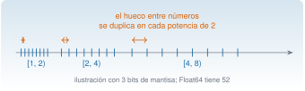

## Objetivos

- Reconocer los tipos numéricos y consultarlos con `typeof`.
- Entender la precisión de máquina.
- Comparar reales con `≈`.
- Escribir condicionales y bucles.
- Prever el ámbito de una variable.

## Tipos básicos

| Tipo | Ejemplo |
|---|---|
| `Int64` | `1000` |
| `Float64` | `0.01` |
| `Float32` | `0.01f0` |
| `Complex` | `1 + 2im` |

`4 / 2 == 2.0`; la división entera es `4 ÷ 2`.

## Precisión de máquina

{fig-alt="Marcas en la recta cuya separación se duplica en cada potencia de dos"}

`eps() = 2,2·10⁻¹⁶`; `0.1 + 0.2 != 0.3`, pero `0.1 + 0.2 ≈ 0.3`.

## Condicionales y bucles

```julia
if abs(x) > 1.2 ... elseif ... else ... end
for i in eachindex(x) ... end
while i <= n && abs(x[i]) <= u ... end
```

`&&` y `||` evalúan en cortocircuito.

## Ámbito

- Bucle y función crean ámbito local.
- En un **script**, asignar a una global dentro de un bucle falla; en el REPL funciona.
- Solución: meter el cálculo en una **función**.

## Sumar 1000 veces 0,01

`9.999999999999831`, no `10`.

Eje de tiempos: `(0:N-1) ./ fs`, no acumulando `dt`.

## Práctica

- Eje por acumulación frente a eje por índice.
- 112 muestras con |x| > 1,2 m/s²; la primera, la 28 (0,27 s).
- `Float32` frente a `Float64`: diferencia de 10⁻⁷.

## La doy por superada si…

- Explico por qué `0.1 + 0.2 != 0.3`.
- Uso `for` y `while` sin ayuda.
- Resuelvo el problema del ámbito con una función.
