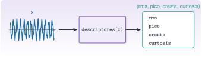
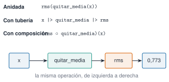

{.portada fig-alt="Una señal con dos frecuencias entra por la izquierda en una caja etiquetada descriptores(x) y de ella sale a la derecha una lista con cuatro valores: rms, pico, cresta y curtosis"}

Una función es la unidad mínima de trabajo reutilizable: recibe datos, hace un cálculo y devuelve un resultado. En el curso, todo análisis de una señal acaba siendo una cadena de funciones: quitar la media, calcular un espectro, buscar picos. Aquí se aprende a escribirlas bien (con argumentos con nombre, varios valores de retorno y documentación) y a combinarlas. Como ejemplo se construyen los **descriptores temporales** que se usarán en [M3.2](../../../mse/m03-senales-i/index.qmd): RMS, pico, factor de cresta y curtosis.

::: {.callout-note}
## Cómo se lee esta unidad
**Tiempo orientativo: 60 minutos.** Objetivos (3), teoría en cinco píldoras (12), práctica guiada (25), «Pídeselo a Claude» (8), ejercicios (10) y cierre (2).
:::

```{julia}
#| include: false
using Random, Statistics, Resonancia
include("../../../recursos/r1-datos/_tema.jl")
```

## Objetivos y prerrequisitos

**Objetivos.** Al terminar esta unidad sabrás:

- definir funciones con la forma larga, la corta y la anónima;
- usar argumentos posicionales, opcionales y con nombre, y devolver varios valores;
- documentar una función con un docstring que `?` sea capaz de mostrar;
- aplicar `map`, `filter`, `reduce` y comprensiones;
- encadenar funciones con `|>` y con `∘`.

**Prerrequisitos.** [J1.3](../j1-3-tipos/index.qmd): tipos, bucles y ámbito.

**Reparto con otras unidades.** Aquí se trata la sintaxis de las funciones; el despacho múltiple (varios métodos con el mismo nombre) está en [J1.8](../j1-8-tipos-propios/index.qmd), y el significado físico de los descriptores, en M3.2.

## Teoría breve

### J1.4.1 Definir una función {#j1-4-1}

Hay tres formas, equivalentes:

```julia
function rms(x)               # forma larga: para varias líneas
    return sqrt(mean(abs2, x))
end

rms(x) = sqrt(mean(abs2, x))  # forma corta: una expresión

x -> sqrt(mean(abs2, x))      # anónima: sin nombre, para pasarla a otra función
```

La función devuelve el valor de su **última expresión**, así que `return` solo es necesario para salir antes. Una convención de Julia: si una función **modifica** su argumento, su nombre termina en `!` (`sort!(x)` ordena `x` en su sitio; `sort(x)` devuelve una copia ordenada).

::: {.ejercicio tipo="vf" id="j1-4-1-return" respuesta="verdadero"}
En Julia, una función sin `return` devuelve el valor de la última expresión que evalúa.

::: {.solucion}
Verdadero. `f(x) = x + 1` y `function f(x); x + 1; end` hacen lo mismo.
:::
:::

### J1.4.2 Argumentos y valores de retorno {#j1-4-2}

Los argumentos antes del punto y coma son **posicionales**; los que van después son **con nombre** y se pasan siempre por nombre, lo que evita confusiones en funciones con muchas opciones. Un valor por defecto hace opcional un argumento. Para devolver varios resultados se devuelve una **tupla con nombre** (`NamedTuple`), cuyos campos se leen con un punto:

```{julia}
"""
    descriptores(x; quitar_media=true) -> NamedTuple

Descriptores temporales de la señal `x`: valor eficaz (`rms`), pico (máximo del valor
absoluto), factor de cresta (`pico / rms`) y curtosis (vale 3 para una distribución
normal). Con `quitar_media=true` se resta antes la media. Las unidades de `rms` y `pico`
son las de `x`; `cresta` y `curtosis` son adimensionales.
"""
function descriptores(x; quitar_media=true)
    y = quitar_media ? x .- mean(x) : x
    r = sqrt(mean(abs2, y))
    p = maximum(abs, y)
    m = mean(y)
    curt = mean((y .- m) .^ 4) / mean(abs2, y .- m)^2
    return (rms=r, pico=p, cresta=p / r, curtosis=curt)
end

d = descriptores([1.0, -1.0, 2.0, -2.0])
(d.rms, d.pico)
```

También se pueden **desestructurar** al asignar: `(r, p) = (d.rms, d.pico)`, o `(; rms, pico) = d`.

::: {.ejercicio tipo="numerico" id="j1-4-2-rms" respuesta="1.5811" tol="0.1%" unidad="u."}
¿Cuánto vale `d.rms` para el vector `[1.0, -1.0, 2.0, -2.0]` de arriba?

::: {.solucion}
$\sqrt{(1+1+4+4)/4}=\sqrt{2{,}5}\approx1{,}5811$ (la media del vector es cero, así que quitarla no cambia nada).
:::
:::

### J1.4.3 Docstrings {#j1-4-3}

Un **docstring** es una cadena de texto justo antes de la función. Es lo que muestra `?descriptores` en el REPL y lo que usa la documentación del paquete. En el curso se sigue la convención de `Resonancia.jl`: primera línea con la firma, una frase que explica qué hace, los argumentos con sus **unidades** y, si ayuda, un ejemplo.

````julia
"""
    rms(x) -> Float64

Valor eficaz de `x`, en las unidades de `x`.

# Ejemplo
```jldoctest
julia> rms([3.0, 4.0])
3.5355339059327378
```
"""
rms(x) = sqrt(mean(abs2, x))
````

La función `descriptores` de arriba ya lleva un docstring con esa estructura: pruébalo con `?descriptores`.

::: {.callout-warning}
## Errores frecuentes
Una función sin documentar es una función que dentro de un mes nadie, tampoco quien la escribió, sabrá si usar. Y una función que sirve en varias páginas no se copia: se mueve a `Resonancia.jl` con su docstring y su test (regla del curso).
:::

### J1.4.4 `map`, `filter`, `reduce` y comprensiones {#j1-4-4}

Estas funciones reciben **otra función** como argumento. `map` la aplica a cada elemento, `filter` se queda con los que cumplen un predicado y `reduce` combina todos los elementos con una operación:

```{julia}
v = [1, -2, 3, -4]
(map(abs2, v), filter(>(0), v), reduce(+, map(abs2, filter(>(0), v))))
```

Una **comprensión** hace lo mismo con una sintaxis parecida a la matemática y es muy cómoda para construir vectores:

```{julia}
[k^2 for k in 1:5 if isodd(k)]
```

Cuando la función es larga se usa un bloque `do`, que equivale a pasar una función anónima:

```julia
map(1:3) do k
    k^2 + 1
end
```

Hay una última forma, la más usada en cálculo numérico, el *broadcasting* con un punto (`abs2.(v)`), que se explica en [J1.5](../j1-5-arrays/index.qmd).

::: {.ejercicio tipo="numerico" id="j1-4-4-compr" respuesta="35" tol="0%"}
¿Cuánto suma `sum([k^2 for k in 1:5 if isodd(k)])`?

::: {.solucion}
Los impares de 1 a 5 son 1, 3 y 5, con cuadrados 1, 9 y 25: suman 35.
:::
:::

### J1.4.5 Composición: `|>` y `∘` {#j1-4-5}

Para encadenar operaciones hay tres formas equivalentes (@fig-pipeline). La **tubería** `|>` pasa el resultado de la izquierda a la función de la derecha; la **composición** `∘` (`\circ` + tabulador) construye una función nueva a partir de otras dos.

{#fig-pipeline fig-alt="Tres líneas de código equivalentes, rms(quitar_media(x)), x |> quitar_media |> rms y (rms ∘ quitar_media)(x), y debajo una cadena de cajas con x, quitar_media, rms y el valor 0,773 unidas por flechas de izquierda a derecha."}

```{julia}
quitar_media(x) = x .- mean(x)
Random.seed!(1)
t = (0:999) ./ 100.0
x = sin.(2π * 2.5 .* t) .+ 0.4 .* sin.(2π * 7.0 .* t) .+ 0.2 .* randn(1000)
rms(x) = sqrt(mean(abs2, x))
(tuberia = x |> quitar_media |> rms, composicion = (rms ∘ quitar_media)(x))
```

::: {.callout-note .idea-clave}
## Idea clave
Se escriben funciones **pequeñas y con un solo cometido** (`quitar_media`, `rms`), y se combinan. Es más fácil de probar, de documentar y de reutilizar que una función larga que lo hace todo.
:::

::: {.ejercicio tipo="abierta" id="j1-4-5-compone"}
Escribe, con `∘`, una función `rms_sin_media` que quite la media y calcule el RMS. ¿Cómo la usarías sobre un vector `x`?

::: {.solucion}
`rms_sin_media = rms ∘ quitar_media` y después `rms_sin_media(x)`. Se aplican de derecha a izquierda: primero `quitar_media`, luego `rms`.
:::
:::

## Práctica guiada

Vamos a construir los descriptores de la señal de J1.1 y a aplicarlos por ventanas de 2 s.

::: {.panel-tabset}
## Julia

**Paso 1. Los descriptores de la señal completa.** Con y sin quitar la media (una señal de aceleración debería tener media nula, y por eso apenas cambia).

```{julia}
(con_media_quitada = descriptores(x), sin_quitar = descriptores(x; quitar_media=false))
```

La curtosis de una distribución normal vale 3; una senoide pura, 1,5. Esta señal, suma de dos senoides con algo de ruido, queda en 2,03: cerca de lo sinusoidal. Más adelante, una curtosis alta delatará impactos o defectos.

**Paso 2. Por ventanas.** Una comprensión recorre la señal en trozos de 200 muestras (2 s) y aplica la función a cada uno. Se comprueba contra `rms_por_ventana` de `Resonancia.jl`.

```{julia}
m = 200                       # muestras por ventana
nv = length(x) ÷ m
por_ventana = [descriptores(@view x[(i-1)*m+1:i*m]; quitar_media=false) for i in 1:nv]
r_ventanas = [d.rms for d in por_ventana]
_, r_paquete = rms_por_ventana(x, 100.0, 2.0)
(rms_por_ventana = round.(r_ventanas, digits=3), coincide_con_el_paquete = r_ventanas ≈ r_paquete)
```

```{julia}
#| label: fig-ventanas
#| fig-cap: "RMS y pico del valor absoluto de la señal de J1.1 en ventanas consecutivas de 2 s. El RMS casi no cambia entre ventanas; el pico varía algo más (entre 1,5 y 1,8 m/s²), porque depende de un solo valor extremo."
#| fig-alt: "Gráfica de barras con cinco ventanas de dos segundos. Para cada una, una barra azul con el valor RMS, cercano a 0,77, y un punto naranja con el pico, entre 1,5 y 1,8 según la ventana."
fig = Figure(size=(720, 300))
ax = Axis(fig[1, 1], xlabel="ventana (2 s cada una)", ylabel="aceleración (m/s²)", xticks=1:nv)
barplot!(ax, 1:nv, r_ventanas, color=AZUL, label="RMS")
scatter!(ax, 1:nv, [d.pico for d in por_ventana], color=NARANJA, markersize=12, label="pico")
axislegend(ax, position=:rt)
fig
```

**Paso 3. Pasar una función como argumento.** `map` con una función anónima da el factor de cresta de cada ventana en una sola línea.

```{julia}
map(d -> round(d.cresta, digits=2), por_ventana)
```

## Python

La versión probada con `pytest`, y contrastada con SciPy en la curtosis, está en `python/descriptores.py`. En Python, una función que devuelve varios valores devuelve una tupla o un diccionario; aquí, un diccionario, que hace de `NamedTuple`.

```python
from descriptores import descriptores
import numpy as np

t = np.arange(1000) / 100.0
x = np.sin(2*np.pi*2.5*t) + 0.4*np.sin(2*np.pi*7.0*t)
d = descriptores(x)
print(round(d["rms"], 4), round(d["curtosis"], 3))     # 0.7616 1.857
```

Las comprensiones existen con la misma idea (`[k**2 for k in range(1, 6) if k % 2]`), y `map`, `filter` y `functools.reduce` también. La composición con `∘` no tiene equivalente directo en la biblioteca estándar.
:::

::: {.callout-note}
## Qué se ha conseguido
Una función con argumento con nombre, que devuelve cuatro valores, documentada, contrastada con la del paquete y aplicada por ventanas con una comprensión. Es el esqueleto de cualquier análisis por tramos que se verá en M3 y M7.
:::

## «Pídeselo a Claude» {#pideselo}

::: {.callout-tip}
## Prompt
«Con Julia y `--project=.`, escribe una función `descriptores(x; quitar_media=true)` que devuelva una `NamedTuple` con `rms`, `pico`, `cresta` y `curtosis` (la curtosis como `E[(x-m)^4]/var^2`, no en exceso). Con docstring en español que indique las unidades. Pruébala con 10 s a 100 Hz, semilla 1, de `sin(2π·2,5·t) + 0,4·sin(2π·7·t)` más ruido gaussiano de 0,2, y con el vector `[1.0, -1.0, 2.0, -2.0]`. Dime los resultados. No inventes valores: si no puedes ejecutarlo, dilo.»

**Verifica.** (a) Que para `[1.0, -1.0, 2.0, -2.0]` el RMS sale $\sqrt{2{,}5}\approx1{,}5811$ (se calcula a mano). (b) Que para la señal limpia (sin ruido) el RMS es $0{,}7616$ y la curtosis $1{,}857$, y para una senoide pura la curtosis sale $1{,}5$. (c) Que el docstring tiene la firma, las unidades y está justo encima de la función. (d) Que el factor de cresta es `pico/rms`, y no `rms/pico`. (e) Que no usa un bucle donde bastan `mean` y `maximum`.
:::

## Ejercicios

::: {.ejercicio tipo="numerico" id="j1-4-cresta" respuesta="1.4142" tol="0.1%"}
El factor de cresta de una senoide pura es $\sqrt2$. Comprueba con `descriptores(sin.(2π .* (0:999) ./ 100 .* 2.5)).cresta` (periodos enteros) y escribe el valor.

::: {.pista}
`sin.(...)` aplica el seno a cada elemento; el pico es 1 y el RMS $1/\sqrt2$.
:::

::: {.solucion}
$1/(1/\sqrt2)=\sqrt2\approx1{,}4142$. Con un número entero de periodos, el valor numérico coincide con el teórico hasta las primeras cifras.
:::
:::

::: {.ejercicio tipo="programacion" id="j1-4-filtra" respuesta="5"}
Con `v = [3, -1, 4, -1, 5, -9, 2, 6]`, ¿cuántos elementos devuelve `filter(>(0), v)`?

::: {.solucion}
Cinco: `[3, 4, 5, 2, 6]`.
:::
:::

::: {.ejercicio tipo="vf" id="j1-4-nombre" respuesta="verdadero"}
Con la firma `descriptores(x; quitar_media=true)`, la llamada `descriptores(x, false)` da un error.

::: {.solucion}
Verdadero. `quitar_media` va después del punto y coma: es un argumento **con nombre** y hay que escribir `descriptores(x; quitar_media=false)`.
:::
:::

## La doy por superada si… {#superada}

- Escribo una función en las formas larga, corta y anónima.
- Distingo argumentos posicionales y con nombre, y devuelvo una `NamedTuple`.
- Escribo un docstring con firma y unidades que `?` muestra.
- Uso `map`, `filter`, `reduce` y una comprensión para una tarea sencilla.
- Encadeno dos funciones con `|>` y con `∘`.

**Cierre.** Escribe tres líneas: qué he entendido, qué todavía no domino y cuál es mi siguiente paso pequeño. Revisa con `git diff` lo que haya escrito Claude antes de aceptarlo.

**Siguiente:** [J1.5 · Arrays y álgebra lineal](../j1-5-arrays/index.qmd).
