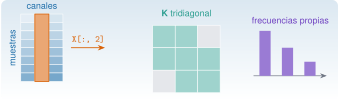

{.portada fig-alt="Una matriz de registro con muestras en vertical y tres canales en horizontal, con una columna resaltada y la etiqueta X[:, 2]; una matriz de rigidez 3 por 3 con la banda tridiagonal en color; y tres barras de altura decreciente que representan las frecuencias propias"}

Casi todo lo que se hace con datos de vibraciones es álgebra de matrices. Un registro de varios sensores es una matriz; las propiedades de una estructura (masa, rigidez) son matrices; y sus frecuencias naturales salen de un problema de valores propios. Esta unidad enseña a manejar arrays en Julia (crear, indexar, operar elemento a elemento) y las operaciones de `LinearAlgebra` que se usarán en todo el curso, y termina calculando las frecuencias de un edificio de tres plantas.

::: {.callout-note}
## Cómo se lee esta unidad
**Tiempo orientativo: 120 minutos.** Objetivos (5), teoría en cinco píldoras (25), práctica guiada (55), «Pídeselo a Claude» (15), ejercicios (15) y cierre (5). El concepto matemático de los modos y los valores propios se explica en [M2](../../../mse/m02-matematicas/index.qmd) y [M5](../../../mse/m05-vibraciones-i/index.qmd); aquí interesa **cómo se programa**.
:::

```{julia}
#| include: false
using Random, Statistics, LinearAlgebra, Resonancia
include("../../../recursos/r1-datos/_tema.jl")
```

## Objetivos y prerrequisitos

**Objetivos.** Al terminar esta unidad sabrás:

- crear vectores y matrices, consultar su tamaño y elegir una orientación para un registro multicanal;
- indexar, trocear y crear **vistas** sin copiar datos, y evitar los errores de aliasing;
- operar elemento a elemento con *broadcasting* (`.`, `@.`) y centrar un registro canal a canal;
- resolver sistemas y calcular normas, condicionamiento y valores propios con `LinearAlgebra`;
- construir las matrices **M** y **K** de un sistema de 3 grados de libertad y obtener sus frecuencias naturales.

**Prerrequisitos.** [J1.4](../j1-4-funciones/index.qmd): funciones y comprensiones.

**Reparto con otras unidades.** Las matrices con estructura (Toeplitz, Hankel, dispersas) y la SVD se tratan en [M2.1](../../../mse/m02-matematicas/matrices/index.qmd) y [J3.3](../../j3-computacion/j3-3-algebra-numerica/index.qmd). Leer y trocear tablas con `DataFrames` es el tema de [J1.6](../j1-6-datos/index.qmd).

## Teoría breve

### J1.5.1 Vectores y matrices {#j1-5-1}

Un `Vector` es un array de una dimensión y una `Matrix`, de dos. Se crean con corchetes (el espacio separa columnas y el punto y coma, filas) o con funciones:

```{julia}
A = [1.0 2.0; 3.0 4.0]            # matriz 2×2
v = [1.0, 2.0, 3.0]                # vector columna
Z = zeros(3, 2)                    # ceros, 3 filas × 2 columnas
t = range(0, 1, length=5)          # rango de 5 puntos entre 0 y 1
(size(A), length(v), size(Z), collect(t))
```

**Convención del curso para un registro multicanal:** una **matriz `N × c`**, con las muestras en filas y los canales en columnas. Así `X[:, j]` es el registro completo del canal `j` y es contiguo en memoria, porque Julia almacena las matrices **por columnas** (*column-major*, igual que MATLAB y Fortran, y al revés que NumPy). Es lo que devuelven las funciones de lectura de `Resonancia.jl` (`leer_torroja` da una matriz `N × 3`).

::: {.ejercicio tipo="numerico" id="j1-5-1-tam" respuesta="24000" tol="0%" unidad="bytes"}
Un registro de 3 canales y 1000 muestras en `Float64` (8 bytes por número), ¿cuántos bytes ocupa?

::: {.solucion}
$1000\cdot3\cdot8=24\,000$ bytes (`sizeof(X)` en Julia).
:::
:::

### J1.5.2 Indexación, trozos y vistas {#j1-5-2}

Los índices empiezan en **1** y se escribe `A[fila, columna]`. Los dos puntos `:` seleccionan toda una dimensión, `end` es el último índice y los rangos seleccionan trozos:

```{julia}
X = reshape(1.0:12.0, 4, 3)            # 4 muestras × 3 canales
(X[2, 3], X[:, 2], X[end, :], X[1:2, 2:3])
```

Un trozo como `X[:, 2]` **copia** los datos. Para trabajar sobre una parte sin copiar se usa una **vista** (`view`, o la macro `@views` para toda una expresión): se comporta como un array pero comparte memoria con el original, y por eso modificarla modifica el original.

```{julia}
Y = copy(X)
vista = @view Y[:, 2]
Y[1, 2] = 100.0
(vista[1], X[1, 2])        # la vista ve el cambio de Y; X, copia aparte, no
```

::: {.callout-warning}
## Errores frecuentes
`B = A` **no copia**: `B` y `A` son dos nombres del mismo array, y `B[1, 1] = 99` cambia también `A`. Para una copia independiente hay que escribir `B = copy(A)`. Es el error de aliasing más común, y ocurre igual en NumPy.
:::

::: {.ejercicio tipo="vf" id="j1-5-2-alias" respuesta="verdadero"}
Tras `A = [1 2; 3 4]; B = A; B[1, 1] = 99`, el valor de `A[1, 1]` es 99.

::: {.solucion}
Verdadero. `B = A` solo crea un segundo nombre para el mismo array. Con `B = copy(A)` no ocurriría.
:::
:::

### J1.5.3 *Broadcasting* {#j1-5-3}

Un punto delante de un operador o detrás de una función la aplica **elemento a elemento**: `x .+ 1`, `x .* y`, `sin.(x)`. Cuando las dimensiones no coinciden, Julia **expande** la más pequeña, y eso permite restar a cada columna su media sin bucles. La macro `@.` pone el punto en toda la expresión.

```{julia}
Random.seed!(1)
tt = (0:999) ./ 100.0
senal = sin.(2π * 2.5 .* tt)
Xr = hcat(2.0 .+ senal, -1.0 .+ 0.8 .* senal, 0.5 .+ 0.1 .* randn(1000))   # 1000×3, con medias distintas
medias = mean(Xr, dims=1)          # 1×3
Xc = Xr .- medias                  # cada columna menos su media
round.(vec(mean(Xc, dims=1)), digits=12)
```

::: {.callout-note .idea-clave}
## Idea clave
Para **centrar un registro canal a canal** se resta una fila de medias a toda la matriz: `X .- mean(X, dims=1)`. Sin bucles, sin copiar canal a canal, y vale para 3 canales o para 300.
:::

::: {.ejercicio tipo="numerico" id="j1-5-3-bcast" respuesta="74" tol="0%"}
Con `a = [1, 2, 3]` y `b = [10, 20, 30]`, ¿cuánto vale `sum(a .* b)` menos `sum(a .+ b)`?

::: {.pista}
`.*` multiplica elemento a elemento: 10, 40, 90. `.+` suma elemento a elemento: 11, 22, 33.
:::

::: {.solucion}
$\sum a_ib_i=10+40+90=140$ y $\sum(a_i+b_i)=11+22+33=66$, así que la diferencia es $140-66=74$.
:::
:::

### J1.5.4 `LinearAlgebra` {#j1-5-4}

La biblioteca estándar `LinearAlgebra` aporta lo esencial: el producto `A * B` (que no es elemento a elemento), la traspuesta `A'`, la solución de sistemas con **`A \ b`**, normas, determinante, condicionamiento y valores propios.

::: {.callout-tip}
## Chuleta: `LinearAlgebra`
```julia
using LinearAlgebra
A * B           # producto matricial  (A .* B es elemento a elemento)
A'              # traspuesta (conjugada si es compleja)
A \ b           # resuelve A x = b  (¡no uses inv(A) * b!)
norm(v)         # norma 2 de un vector;  opnorm(A) la de una matriz
cond(A)         # número de condición
eigen(A)        # valores y vectores propios
eigen(K, M)     # problema generalizado  K φ = λ M φ
Diagonal(d)     # matriz diagonal a partir de un vector
I               # identidad (tamaño según el contexto)
Symmetric(A)    # marca la matriz como simétrica (algoritmos más rápidos)
```
:::

```{julia}
Asist = [4.0 1.0; 1.0 3.0]
b = [1.0, 2.0]
x = Asist \ b
(solucion = round.(x, digits=4), residuo = norm(Asist * x - b) < 1e-14,
 cond = round(cond(Asist), digits=3), valores_propios = round.(eigvals(Asist), digits=4))
```

La regla de oro: **resolver con `A \ b`**, que usa una factorización estable, y no calcular `inv(A)`, que es más lento y menos preciso. El condicionamiento mide cuánto se amplifica un error en los datos; si `cond(A)` es 10ⁿ, se pierden unas *n* cifras decimales (se justifica en M2.1).

::: {.ejercicio tipo="vf" id="j1-5-4-inv" respuesta="falso"}
Para resolver $\mathbf A\mathbf x=\mathbf b$ es mejor calcular primero `inv(A)` y multiplicar por `b`.

::: {.solucion}
Falso. `A \ b` es más rápido y numéricamente más estable, porque factoriza `A` en lugar de invertirla.
:::
:::

### J1.5.5 Valores propios y modos {#j1-5-5}

Un sistema lineal de $n$ grados de libertad sin amortiguamiento vibra libremente según $\mathbf M\ddot{\mathbf u}+\mathbf K\mathbf u=\mathbf 0$. Buscando soluciones armónicas $\mathbf u=\boldsymbol\varphi\,e^{i\omega t}$ se llega al problema de valores propios **generalizado**

$$
\mathbf K\boldsymbol\varphi=\omega^2\,\mathbf M\boldsymbol\varphi ,
$$ {#eq-modal}

cuyas soluciones son las **frecuencias naturales** $f_i=\omega_i/2\pi$ (en Hz) y las **formas modales** $\boldsymbol\varphi_i$. En Julia: `eigen(Symmetric(K), Symmetric(M))` devuelve los $\omega_i^2$ y los vectores. El modelo del que se parte es el de la @fig-edificio.

{#fig-edificio fig-alt="Tres masas iguales alineadas, unidas entre sí y a una pared por muelles de rigideces k1, k2 y k3, cada una con una flecha de desplazamiento u1, u2 y u3. Debajo, la matriz de masa como m por la identidad, la matriz de rigidez tridiagonal de tres por tres y la ecuación K phi igual a omega al cuadrado M phi."}

::: {.ejercicio tipo="abierta" id="j1-5-5-unid"}
Con $m$ en kg y $k$ en N/m, ¿en qué unidades salen $\omega^2$ y $f$ del problema @eq-modal?

::: {.solucion}
$\omega^2=k/m$ sale en s⁻², así que $\omega$ está en rad/s y $f=\omega/2\pi$ en Hz.
:::
:::

## Práctica guiada

Vamos a construir las matrices del edificio de la @fig-edificio, calcular sus frecuencias naturales y formas modales y comprobarlas con `Resonancia.jl`. Los datos son los del caso transversal de M2: $m=2\cdot10^5$ kg por planta y $k_1=k_2=5\cdot10^7$ N/m, $k_3=4\cdot10^7$ N/m.

::: {.panel-tabset}
## Julia

**Paso 1. Construir M y K.** `Diagonal` para la masa; la rigidez se escribe como matriz tridiagonal con los valores de la figura.

```{julia}
m = 2.0e5                       # kg
k1, k2, k3 = 5.0e7, 5.0e7, 4.0e7  # N/m
M = Diagonal([m, m, m])
K = [k1 + k2  -k2      0.0;
     -k2      k2 + k3  -k3;
     0.0      -k3      k3]
(simetrica = issymmetric(K), cond_K = round(cond(K), digits=2), norma_K = opnorm(K))
```

**Paso 2. Frecuencias y modos.**

```{julia}
E = eigen(Symmetric(K), Symmetric(Matrix(M)))
f = sqrt.(E.values) ./ (2π)           # Hz
(frecuencias_Hz = round.(f, digits=3), periodos_s = round.(1 ./ f, digits=3))
```

Las tres frecuencias son 1,105 Hz, 2,939 Hz y 4,390 Hz. Es lo habitual en un edificio: el primer modo, con todas las plantas moviéndose en el mismo sentido, es el de menor frecuencia, y cada modo superior añade un cambio de signo en la forma.

**Paso 3. Comprobar con el paquete.** `Resonancia.jl` tiene el mismo modelo y la misma función. Se verifica que los resultados coinciden y que los modos son ortogonales respecto de M.

```{julia}
Mp, _, Kp = edificio_tres_plantas()
fp, Phi = modos_propios(Kp, Mp)
(coinciden_f = fp ≈ f, mismas_matrices = Kp ≈ K,
 ortogonales_en_M = round.(Phi' * Matrix(M) * Phi, digits=8) == Matrix(I, 3, 3))
```

```{julia}
#| label: fig-modos
#| fig-cap: "Formas modales del edificio de tres plantas. En cada panel se dibuja el desplazamiento de las tres plantas (eje vertical, con el suelo en cero) normalizado a un máximo de 1 en valor absoluto. El primer modo no tiene nodos; el segundo, uno; el tercero, dos."
#| fig-alt: "Tres paneles, uno por modo, con una línea quebrada que va del suelo a la tercera planta. En el primero, 1,10 hercios, la línea se desplaza siempre hacia el mismo lado. En el segundo, 2,94 hercios, cambia de lado una vez. En el tercero, 4,39 hercios, cambia de lado dos veces."
fig = Figure(size=(720, 320))
for j in 1:3
    ax = Axis(fig[1, j], title="modo $j: $(round(f[j], digits=2)) Hz",
        xlabel="desplazamiento (norm.)", ylabel=j == 1 ? "planta" : "", yticks=0:3,
        limits=((-1.3, 1.3), (-0.1, 3.2)))
    φ = Phi[:, j] ./ maximum(abs, Phi[:, j])
    vlines!(ax, 0, color=GRIS, linestyle=:dash)
    lines!(ax, [0; φ], 0:3, color=AZUL)
    scatter!(ax, [0; φ], 0:3, color=NARANJA, markersize=9)
end
fig
```

**Paso 4. Un registro de tres canales.** Para practicar el centrado, se simulan tres sensores con desfases de continua distintos y se comprueba que tras restar las medias quedan en cero, y se calcula la covarianza entre canales.

```{julia}
Random.seed!(1)
S = sin.(2π * 2.5 .* tt)
S7 = sin.(2π * 7.0 .* tt)
Xs = hcat(2.0 .+ S, -1.0 .+ 0.8 .* S .+ 0.3 .* S7, 0.5 .+ 0.3 .* S7) .+ 0.1 .* randn(1000, 3)
Xs0 = Xs .- mean(Xs, dims=1)
(tamano = size(Xs), medias_antes = round.(vec(mean(Xs, dims=1)), digits=3),
 medias_despues = round.(vec(mean(Xs0, dims=1)), digits=10),
 desv_tipica = round.(vec(std(Xs0, dims=1)), digits=3))
```

```{julia}
C = cov(Xs0)
(covarianza = round.(C, digits=3), correlacion = round.(cor(Xs0), digits=3))
```

Los canales 1 y 2 están muy correlacionados (0,91) porque comparten el modo de 2,5 Hz; los canales 2 y 3 (0,31), solo parcialmente, por el de 7 Hz; y los canales 1 y 3 casi nada. La matriz de covarianza es simétrica y sus valores propios (0,010, 0,082 y 0,849) dicen cuánta varianza hay en cada dirección: es el punto de partida de la descomposición en valores singulares que se estudia en [M2](../../../mse/m02-matematicas/index.qmd).

## Python

La versión probada con `pytest`, con las frecuencias contrastadas con las de Julia, está en `python/arrays.py`. Con NumPy y SciPy:

```python
import numpy as np
from arrays import matrices_3gdl, frecuencias_propias, centrar_por_canal

M, K = matrices_3gdl()
print(frecuencias_propias(M, K))     # [1.1048 2.9387 4.3902] Hz

X = np.random.default_rng(1).normal(size=(1000, 3))
Xc = centrar_por_canal(X)            # X - X.mean(axis=0, keepdims=True)
```

Diferencias respecto de Julia: los índices empiezan en 0; NumPy guarda por filas (*row-major*), así que lo natural es una matriz `canales × muestras`, y un trozo como `X[:, 1]` es una **vista** por defecto (en Julia es copia); el producto matricial es `A @ B` y `A * B` es elemento a elemento, al revés que en Julia.
:::

::: {.callout-note}
## Qué se ha conseguido
Se han construido M y K de un sistema real, se han obtenido sus tres frecuencias naturales (1,105, 2,939 y 4,390 Hz) y se han contrastado con el paquete del curso, se han dibujado los modos y se ha centrado un registro multicanal sin bucles. Con estas piezas empieza M5.
:::

## «Pídeselo a Claude» {#pideselo}

::: {.callout-tip}
## Prompt
«Con Julia y `--project=.`: (1) construye las matrices de masa y rigidez de un edificio de cortante de tres plantas con masas de 2·10⁵ kg y rigideces de entrepiso de 5·10⁷, 5·10⁷ y 4·10⁷ N/m; (2) calcula sus frecuencias naturales en Hz y las formas modales con `eigen(Symmetric(K), Symmetric(M))`; (3) compara con `edificio_tres_plantas` y `modos_propios` de `Resonancia.jl`; (4) comprueba que `Phi' * M * Phi` es la identidad. Resuelve con `\` y no uses `inv`. Dime los valores. No inventes resultados: si algo no coincide, dilo.»

**Verifica.** (a) Que las frecuencias son 1,105, 2,939 y 4,390 Hz, y que el orden de magnitud es razonable: una sola planta de las mismas $m$ y $k$ daría $\sqrt{k/m}/2\pi\approx2{,}5$ Hz. (b) Que `K` es simétrica y que la fila 1 suma $k_1$ y las filas 2 y 3 suman cero (una estructura sin apoyos no tendría rigidez para el movimiento de sólido rígido). (c) Que usa `Symmetric` y que no calcula `inv(K)`. (d) Que las unidades son kg, N/m y Hz, y que divide por $2\pi$ al pasar de rad/s a Hz. (e) Que no sobrescribe `M` o `K` con operaciones que modifican en sitio sin avisarlo.
:::

## Ejercicios

::: {.ejercicio tipo="numerico" id="j1-5-f1" respuesta="1.1048" tol="0.1%" unidad="Hz"}
¿Cuánto vale la primera frecuencia natural del edificio de la práctica?

::: {.solucion}
$f_1\approx1{,}1048$ Hz (`f[1]` en el paso 2).
:::
:::

::: {.ejercicio tipo="numerico" id="j1-5-f1-rigido" respuesta="2.5" tol="2%" unidad="Hz"}
Un sistema de **una sola planta**, de masa $m=2\cdot10^5$ kg y rigidez $k=5\cdot10^7$ N/m, tiene $f=\tfrac{1}{2\pi}\sqrt{k/m}$. ¿Cuánto vale?

::: {.solucion}
$\sqrt{5\cdot10^7/2\cdot10^5}=\sqrt{250}=15{,}81$ rad/s, y $f=15{,}81/2\pi\approx2{,}5$ Hz. Con tres plantas la primera frecuencia baja a 1,1 Hz porque la masa que se mueve es mayor.
:::
:::

::: {.ejercicio tipo="programacion" id="j1-5-centrar" respuesta="0" tol="0%"}
Con `X = [1.0 10.0; 2.0 20.0; 3.0 30.0]`, ¿cuánto vale `sum(X .- mean(X, dims=1))`?

::: {.pista}
Cada columna queda con media cero, así que la suma total también.
:::

::: {.solucion}
Cero (salvo un error de redondeo del orden de 10⁻¹⁵). Es la propiedad que define el centrado por canal.
:::
:::

::: {.ejercicio tipo="abierta" id="j1-5-solve"}
Explica por qué se escribe `K \ F` en lugar de `inv(K) * F` para hallar los desplazamientos estáticos $\mathbf u$ de $\mathbf K\mathbf u=\mathbf F$.

::: {.criterios}
- Dice que `\` factoriza la matriz y no necesita calcular la inversa.
- Menciona que es más rápido o más preciso (menos error de redondeo).
:::
:::

## La doy por superada si… {#superada}

- Creo vectores y matrices y consulto su tamaño; sé que el registro del curso es `N × c`.
- Distingo copia, vista y alias, y sé cuándo `B = A` es peligroso.
- Centro un registro canal a canal con `X .- mean(X, dims=1)`.
- Resuelvo `A \ b` y calculo `cond`, `norm` y `eigen`.
- Construyo M y K de un sistema de 3 GDL, obtengo sus frecuencias y las contrasto con `Resonancia.jl`.

**Cierre.** Escribe tres líneas: qué he entendido, qué todavía no domino y cuál es mi siguiente paso pequeño. Revisa con `git diff` lo que haya escrito Claude antes de aceptarlo.

**Siguiente:** [J1.6 · Datos tabulares](../j1-6-datos/index.qmd).
