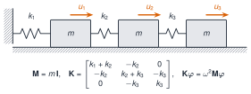

## Objetivos

- Vectores y matrices; registro `N × c`.
- Indexar, trocear y usar vistas.
- *Broadcasting* y centrado por canal.
- `LinearAlgebra`: `\`, `norm`, `cond`, `eigen`.
- Frecuencias de un edificio de 3 GDL.

## Registro multicanal

Matriz `N × c`: muestras en filas, canales en columnas.

`X[:, j]` es el canal `j`, contiguo en memoria (Julia guarda por **columnas**).

## Copia, vista y alias

```julia
B = A            # mismo array: B[1,1] = 99 cambia A
B = copy(A)      # copia independiente
v = @view A[:, 2]  # vista: comparte memoria
```

## Broadcasting

```julia
x .+ 1;  sin.(x);  @. a * x + b
Xc = X .- mean(X, dims=1)   # centrar por canal
```

## `LinearAlgebra`

```julia
A * B     A'     A \ b     norm(v)
cond(A)   eigen(A)   eigen(K, M)
```

`A \ b`, **no** `inv(A) * b`.

## Edificio de 3 GDL

{fig-alt="Tres masas unidas por muelles y a una pared, con las matrices M y K y la ecuación de valores propios"}

## Resultado

$f$ = 1,105 · 2,939 · 4,390 Hz

Coincide con `modos_propios` de `Resonancia.jl`; $\boldsymbol\Phi^{\mathsf T}\mathbf M\boldsymbol\Phi=\mathbf I$.

## La doy por superada si…

- Distingo copia, vista y alias.
- Centro un registro sin bucles.
- Calculo frecuencias de un sistema de 3 GDL y las contrasto.
