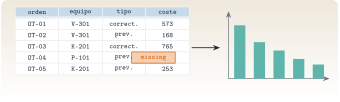

{.portada fig-alt="Una tabla con columnas orden, equipo, tipo y coste en la que una celda aparece resaltada con la palabra missing; una flecha lleva a un diagrama de barras a la derecha"}

Los datos no llegan como matrices limpias: llegan como **ficheros**, en CSV o en Excel, con cabeceras, separadores raros, fechas, texto y huecos. Esta unidad enseña a leerlos con `CSV.jl` y `XLSX.jl`, a manejarlos como tabla con `DataFrames.jl`, a tratar los valores ausentes (`missing`) y a pasar de la tabla a una matriz o a una figura. Los ejemplos son dos: el registro de tres acelerómetros de un edificio, y la hoja de órdenes de mantenimiento de una planta.

::: {.callout-note}
## Cómo se lee esta unidad
**Tiempo orientativo: 90 minutos.** Objetivos (4), teoría en cuatro píldoras (18), práctica guiada (40), «Pídeselo a Claude» (12), ejercicios (14) y cierre (2). Se usan **datos sintéticos del repositorio** (`datos/sinteticos/`), así que nadie necesita datos propios.
:::

```{julia}
#| include: false
using CSV, DataFrames, XLSX, Statistics, TOML, Dates
include("../../../recursos/r1-datos/_tema.jl")
RAIZ = "../../../"
```

## Objetivos y prerrequisitos

**Objetivos.** Al terminar esta unidad sabrás:

- leer un CSV con separador y decimales propios y comprobar sus tipos con `describe`;
- seleccionar, filtrar, ordenar y crear columnas en un `DataFrame`;
- detectar y tratar valores ausentes sin que se propaguen por los cálculos;
- leer y escribir una hoja de Excel con `XLSX.jl`;
- pasar de una tabla a una matriz `N × c` y a una figura.

**Prerrequisitos.** [J1.5](../j1-5-arrays/index.qmd): matrices y vistas.

**Reparto con otras unidades.** Aquí se ve lo básico. Las uniones, las agrupaciones a fondo y las fechas están en [J2.2](../../j2-datos/j2-2-dataframes/index.qmd); la limpieza de huecos, saltos y anómalos en [J2.3](../../j2-datos/j2-3-limpieza/index.qmd). Cada conjunto de datos del curso lleva una ficha `.meta.toml` con su origen, sensor, frecuencia de muestreo y unidades, y hay que leerla antes de usar los datos.

## Teoría breve

### J1.6.1 Leer un CSV {#j1-6-1}

Un CSV es un fichero de texto con una fila de cabecera y una fila por registro. `CSV.read(ruta, DataFrame)` lo carga y deduce los tipos de cada columna. Cuando el fichero no sigue el formato por defecto hay que decirlo: el separador (`delim`), el separador decimal (`decimal`) o qué texto significa «sin dato» (`missingstring`). **Siempre se lee primero la ficha del conjunto de datos**, que indica la frecuencia de muestreo y las unidades:

```{julia}
ficha = TOML.parsefile(RAIZ * "datos/sinteticos/edificio-3-plantas/edificio.meta.toml")
(fs = ficha["fs"], unidades = ficha["unidades"], duracion = ficha["duracion"])
```

```{julia}
a = CSV.read(RAIZ * "datos/sinteticos/edificio-3-plantas/escenario_A.csv", DataFrame; delim=';')
(forma = size(a), columnas = names(a))
```

::: {.callout-warning}
## Errores frecuentes
Un CSV europeo (separador `;` y coma decimal) leído sin `delim=';'` y `decimal=','` produce una sola columna de texto o números mal interpretados. Si la tabla tiene una sola columna enorme, el separador es el problema. Comprueba siempre `size`, `names` y `describe` justo después de leer.
:::

::: {.ejercicio tipo="vf" id="j1-6-1-ficha" respuesta="verdadero"}
Antes de analizar un conjunto de datos hay que leer su ficha `.meta.toml` para saber la frecuencia de muestreo y las unidades.

::: {.solucion}
Verdadero. Sin esa información no se sabe si el eje de tiempos o los valores están en las unidades que se supone.
:::
:::

### J1.6.2 El `DataFrame` {#j1-6-2}

Un `DataFrame` es una tabla cuyas **columnas son vectores con su propio tipo**. Se accede a una columna con un punto (`a.a1_ms2`) y se resume con `describe`:

```{julia}
describe(a, :mean, :std, :min, :max)
```

Las operaciones de uso diario, con una fila de ejemplo cada una:

::: {.callout-tip}
## Chuleta: `DataFrames`
```julia
first(df, 5)                          # primeras filas
df.col  /  df[!, :col]                # una columna (sin copiar con !)
select(df, :tiempo_s, :a1_ms2)        # elegir columnas
rename(df, :a1_ms2 => :planta1)       # renombrar
filter(r -> r.a1_ms2 > 0.5, df)       # filtrar filas
sort(df, :a1_ms2, rev=true)           # ordenar
transform(df, :a1_ms2 => (x -> x .* 100) => :a1_cm_s2)  # columna nueva
Matrix(df[:, 2:4])                    # a matriz  N × c
nrow(df)   ncol(df)                   # tamaño
```
:::

::: {.ejercicio tipo="numerico" id="j1-6-2-filas" respuesta="60000" tol="0%" unidad="filas"}
El registro del edificio dura 600 s a 100 Hz. ¿Cuántas filas tiene `a`?

::: {.solucion}
$600\cdot100=60\,000$ muestras (`nrow(a)`).
:::
:::

### J1.6.3 Valores ausentes {#j1-6-3}

En Julia un dato que falta es el valor especial **`missing`**, y una columna que puede contenerlo tiene tipo `Union{Missing, Float64}`. Lo importante es que **`missing` se propaga**: cualquier cálculo que lo incluya da `missing`, lo que evita que un hueco pase inadvertido.

```{julia}
v = [1.0, missing, 3.0]
(suma = sum(v), media_sin_huecos = mean(skipmissing(v)), cuantos = count(ismissing, v),
 relleno = coalesce.(v, 0.0))
```

Se tratan con `ismissing` (¿falta?), `skipmissing` (ignorarlos al calcular), `dropmissing` (quitar las filas con huecos) y `coalesce` (sustituirlos por un valor). **Qué se hace con un hueco es una decisión de análisis, no un detalle técnico**: ignorarlo, rellenarlo con cero o con la media dan resultados distintos, y en un informe hay que decir cuál se ha elegido y cuántos huecos había.

::: {.ejercicio tipo="vf" id="j1-6-3-prop" respuesta="falso"}
`mean([1.0, missing, 3.0])` devuelve `2.0`, porque Julia ignora los valores ausentes.

::: {.solucion}
Falso. Devuelve `missing`: el hueco se propaga. Para obtener `2.0` hay que escribir `mean(skipmissing(v))`.
:::
:::

### J1.6.4 Excel y escritura de resultados {#j1-6-4}

Los datos de planta suelen estar en Excel. `XLSX.jl` lee una hoja completa como tabla con `XLSX.readtable` y escribe con `XLSX.writetable`; el resultado de un análisis se guarda en CSV con `CSV.write`. El recorrido completo, desde los ficheros hasta una figura y de vuelta a un fichero, es el de la @fig-flujo.

{#fig-flujo fig-alt="A la izquierda, dos cajas CSV y Excel con flechas hacia una caja central DataFrame. De ella salen flechas a una caja Matriz N por c, a una caja Figura y, hacia abajo, a una caja CSV o Excel de salida."}

::: {.callout-note .idea-clave}
## Idea clave
Los datos entran por ficheros y salen por ficheros, y la tabla es lo que hay en medio. Lo que se lee, se revisa (tamaño, tipos, ausentes) antes de calcular; lo que se escribe, se vuelve a leer para comprobar que está bien.
:::

::: {.ejercicio tipo="abierta" id="j1-6-4-excel"}
Un compañero te pasa un Excel de planta con una hoja por mes. Enumera tres comprobaciones que harías tras leerlo.

::: {.criterios}
- Que el tamaño (filas y columnas) y los nombres de columna son los esperados.
- Que los tipos son los correctos (fechas como fechas, números como números).
- Que se han contado y decidido qué hacer con los ausentes.
:::
:::

::: {.callout-warning}
## Errores frecuentes: lectura de datos
(1) Fechas leídas como texto: `fecha_apertura` debe salir de tipo `Date`; si sale `String`, la ordenación y las diferencias de tiempo serán incorrectas. (2) Números con coma decimal leídos como texto, por no pasar `decimal=','`. (3) Una columna que parecía numérica y contiene una palabra («n/d») se lee entera como texto: se resuelve con `missingstring="n/d"`. (4) Guardar el resultado sobre el fichero original: escribe siempre en otra ruta.
:::

### Para saber más {#j1-6-mas}

- Kamiński, *Julia for Data Analysis*, caps. 2 a 4 [@kaminski2023].
- Documentación de [CSV.jl](https://csv.juliadata.org) y [DataFrames.jl](https://dataframes.juliadata.org).

## Práctica guiada

Dos casos: el registro de tres acelerómetros del edificio (datos de vibración) y la hoja de órdenes de mantenimiento de una planta (datos con huecos y fechas).

::: {.panel-tabset}
## Julia

**Caso 1. Registro de acelerómetros.** Se comprueba que el paso de tiempo coincide con la ficha (100 Hz) y se calcula el RMS de cada planta. Como los tres sensores miden el mismo edificio con las mismas fuerzas, los RMS son parecidos pero no iguales.

```{julia}
dt = a.tiempo_s[2] - a.tiempo_s[1]
X = Matrix(a[:, 2:4])                       # N × 3: muestras × plantas
(fs_Hz = round(1 / dt), N = size(X, 1), duracion_s = round(a.tiempo_s[end] + dt),
 rms_por_planta = round.(sqrt.(vec(mean(abs2, X, dims=1))), digits=4))
```

```{julia}
#| label: fig-registro
#| fig-cap: "Aceleración de las tres plantas del edificio durante 5 s (escenario A, referencia). Cada panel tiene su propia escala vertical."
#| fig-alt: "Tres paneles apilados con la aceleración en metros por segundo cuadrado de las plantas 1, 2 y 3 entre 0 y 5 segundos. Las tres señales son oscilaciones irregulares de amplitud parecida, entre unos menos 0,8 y 0,7 metros por segundo cuadrado."
fig = Figure(size=(720, 440))
n5 = 500
for (j, nombre) in enumerate(["planta 1", "planta 2", "planta 3"])
    ax = Axis(fig[j, 1], ylabel="a (m/s²)", title=nombre,
        xlabel=j == 3 ? "tiempo (s)" : "", xticklabelsvisible=j == 3)
    lines!(ax, a.tiempo_s[1:n5], X[1:n5, j], color=[AZUL, NARANJA, VERDE][j])
end
fig
```

**Caso 2. Órdenes de mantenimiento.** El CSV se lee con las cadenas como `String` (`stringtype=String`). Antes de calcular nada: tamaño, tipos y ausentes.

```{julia}
ot = CSV.read(RAIZ * "datos/sinteticos/curso-claude/c_mantenimiento.csv", DataFrame; stringtype=String)
describe(ot, :nmissing, :eltype)
```

Faltan 3 costes de 180 órdenes. Se muestran, y se calcula el coste medio **ignorando** esos huecos y, por contraste, **rellenándolos con cero**:

```{julia}
huecos = ot[ismissing.(ot.coste_eur), [:orden, :equipo, :tipo, :fecha_apertura]]
(huecos = huecos,
 media_ignorando = round(mean(skipmissing(ot.coste_eur)), digits=2),
 media_rellenando_con_cero = round(mean(coalesce.(ot.coste_eur, 0.0)), digits=2))
```

Rellenar con cero **baja** la media de 940,94 € a 925,26 € (un 1,7 %), porque se está afirmando que esas órdenes no costaron nada. Ignorarlos es la opción razonable aquí, pero hay que dejarlo escrito.

```{julia}
sub = filter(r -> r.tipo == "correctivo" && !ismissing(r.coste_eur), ot)
resumen = combine(groupby(ot, :equipo), nrow => :ordenes, :horas_parada => mean => :horas_medias)
sort!(resumen, :horas_medias, rev=true)
(correctivas = nrow(sub), coste_medio_correctivo = round(mean(sub.coste_eur), digits=2), resumen = resumen)
```

```{julia}
#| label: fig-equipos
#| fig-cap: "Horas de parada medias por orden de trabajo en cada equipo, de mayor a menor. El compresor K-201 es el que más para por cada avería."
#| fig-alt: "Gráfico de barras horizontales con cinco equipos ordenados de mayor a menor horas de parada media: compresor K-201 con 4,4, bomba P-101 con 3,8, cinta T-401 con 3,8, ventilador V-301 con 2,6 y bomba P-102 con 2,5."
fig = Figure(size=(720, 300))
ax = Axis(fig[1, 1], xlabel="horas de parada por orden (h)", yticks=(1:5, reverse(resumen.equipo)))
barplot!(ax, 1:5, reverse(resumen.horas_medias), direction=:x, color=AZUL)
fig
```

**Escribir y volver a leer.** Un Excel temporal con las cinco primeras órdenes comprueba que lo escrito es lo leído.

```{julia}
ruta = joinpath(mktempdir(), "ordenes.xlsx")
XLSX.writetable(ruta, collect(eachcol(ot[1:5, :])), names(ot))
d2 = DataFrame(XLSX.readtable(ruta, 1))
(filas = nrow(d2), columnas = names(d2) == names(ot), mismos_costes = d2.coste_eur == ot.coste_eur[1:5])
```

## Python

En Python, `pandas` hace de `DataFrames`: `read_csv`, `describe`, `isna`, `dropna`, `fillna`. Los ausentes se representan con `NaN` y **se ignoran por defecto** en las medias (al revés que en Julia, donde se propagan). La versión probada con `pytest`, con los valores contrastados con los de Julia, está en `python/tablas.py`.

```python
from tablas import leer_acelerometro, rms_por_canal, resumen_mantenimiento

df = leer_acelerometro("datos/sinteticos/edificio-3-plantas/escenario_A.csv")
print(rms_por_canal(df, ["a1_ms2", "a2_ms2", "a3_ms2"]))   # 0.2336, 0.2244, 0.1981

r = resumen_mantenimiento("datos/sinteticos/curso-claude/c_mantenimiento.csv")
print(r["ausentes"], round(r["coste_medio"], 2))            # 3 940.94
```

Dos diferencias a recordar: la media de pandas ignora `NaN` salvo que se pida lo contrario (`skipna=False`), lo que puede esconder huecos; y `pandas` guarda las columnas por separado, igual que `DataFrames.jl`, pero con una conversión a matriz distinta (`df.to_numpy()`).
:::

::: {.callout-note}
## Qué se ha conseguido
Dos conjuntos de datos leídos, revisados, resumidos y dibujados, un hueco tratado con una decisión explícita (y su efecto medido), y un Excel escrito y vuelto a leer. La rutina es la de siempre: **leer la ficha, leer el fichero, revisar tamaño, tipos y ausentes, y solo después calcular.**
:::

## «Pídeselo a Claude» {#pideselo}

::: {.callout-tip}
## Prompt
«Con Julia y `--project=.`, lee `datos/sinteticos/curso-claude/c_mantenimiento.csv` con `CSV.jl` y `DataFrames.jl` (cadenas como `String`). (1) Dime cuántas filas y columnas tiene, el tipo de cada columna y cuántos valores faltan en cada una; (2) calcula el coste medio de las órdenes correctivas ignorando los huecos; (3) agrupa por equipo y dame el número de órdenes y las horas de parada medias, de mayor a menor; (4) guarda ese resumen en un CSV en `$TMPDIR` y vuelve a leerlo para comprobar que coincide. No modifiques el CSV original ni leas nada de `datos/privados/`. No inventes cifras: si algo no sale, dilo.»

**Verifica.** (a) Que son 180 filas y 6 columnas y que solo `coste_eur` tiene huecos, 3. (b) Que el coste medio de las correctivas es 2960,65 € con 50 órdenes (compruébalo con `filter` y `mean(skipmissing(...))`). (c) Que usa `skipmissing` y no rellena con ceros sin avisar. (d) Que el equipo con más horas medias es el compresor K-201 con 4,385 h. (e) Que ha escrito el resumen **fuera** de `datos/` y que el CSV original no cambia (`git status`).
:::

## Ejercicios

::: {.ejercicio tipo="numerico" id="j1-6-huecos" respuesta="3" tol="0%" unidad="costes"}
¿Cuántos valores faltan en la columna `coste_eur` de las órdenes de mantenimiento?

::: {.solucion}
Tres (`count(ismissing, ot.coste_eur)`), de 180 filas; las tres son órdenes preventivas.
:::
:::

::: {.ejercicio tipo="numerico" id="j1-6-correctivas" respuesta="2960.65" tol="0.1%" unidad="€"}
¿Cuál es el coste medio de las órdenes correctivas, ignorando los huecos?

::: {.pista}
`filter(r -> r.tipo == "correctivo" && !ismissing(r.coste_eur), ot)` y luego `mean`.
:::

::: {.solucion}
2960,65 € sobre 50 órdenes. El coste medio de todas las órdenes (940,94 €) es mucho menor porque las preventivas cuestan bastante menos.
:::
:::

::: {.ejercicio tipo="vf" id="j1-6-matriz" respuesta="verdadero"}
`Matrix(a[:, 2:4])` da una matriz de 60 000 × 3 en la que cada columna es el registro de una planta.

::: {.solucion}
Verdadero. Es la matriz `N × c` (muestras × canales) que se usa en el curso, y la que esperan las funciones de `Resonancia.jl`.
:::
:::

::: {.ejercicio tipo="abierta" id="j1-6-decision"}
Explica por qué rellenar con ceros los costes que faltan puede ser una mala decisión aunque «el código funcione».

::: {.criterios}
- Dice que equivale a afirmar que esas órdenes costaron cero.
- Menciona que sesga la media (la baja) y que debe documentarse la decisión y el número de huecos.
:::
:::

## La doy por superada si… {#superada}

- Leo un CSV con su separador y decimal, y reviso tamaño, tipos y ausentes antes de calcular.
- Selecciono, filtro, ordeno y agrupo con un `DataFrame`.
- Sé que `missing` se propaga y elijo `skipmissing`, `dropmissing` o `coalesce` con criterio.
- Leo y escribo un Excel, y paso de la tabla a una matriz `N × c` y a una figura.
- Consulto la ficha `.meta.toml` antes de usar un conjunto de datos.

**Cierre.** Escribe tres líneas: qué he entendido, qué todavía no domino y cuál es mi siguiente paso pequeño. Revisa con `git diff` lo que haya escrito Claude y confirma que no ha tocado `datos/`.

**Siguiente:** [J1.7 · Visualización](../j1-7-visualizacion/index.qmd).
