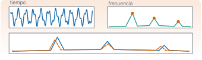

{.portada fig-alt="Tres paneles: una serie temporal oscilante, un espectro con tres picos marcados con puntos naranjas, y debajo una comparación de dos espectros superpuestos con picos ligeramente desplazados"}

Una figura bien hecha es un resultado; una mal hecha es una fuente de errores. En análisis de vibraciones se dibujan, una y otra vez, dos cosas: **series temporales** (qué hace la señal en el tiempo) y **espectros** (qué frecuencias contiene). Esta unidad enseña a hacerlas en Julia con `CairoMakie`, la biblioteca de las figuras del curso, a combinarlas en paneles y a exportarlas. Como ejemplo se comparan los espectros del edificio de tres plantas en dos estados: el de referencia y uno con daño.

::: {.callout-note}
## Cómo se lee esta unidad
**Tiempo orientativo: 90 minutos.** Objetivos (4), teoría en cinco píldoras (18), práctica guiada (40), «Pídeselo a Claude» (12), ejercicios (14) y cierre (2). La física de la comparación (por qué baja la frecuencia cuando baja la rigidez) está en [M5](../../../mse/m05-vibraciones-i/index.qmd) y el espectro de Welch, en M3.6.
:::

```{julia}
#| include: false
using CSV, DataFrames, Statistics, Resonancia
include("../../../recursos/r1-datos/_tema.jl")
RAIZ = "../../../"
```

## Objetivos y prerrequisitos

**Objetivos.** Al terminar esta unidad sabrás:

- elegir entre `Plots.jl` (explorar) y `Makie` (figuras finales) y por qué el curso usa `CairoMakie`;
- construir una figura con `Figure`, `Axis`, `lines!` y `scatter!`, y disponer varios paneles en una rejilla;
- dibujar una serie temporal y un espectro (con escala logarítmica y picos marcados) con unidades en los ejes;
- distinguir curvas sin depender solo del color;
- exportar una figura y comprobar que se ha escrito.

**Prerrequisitos.** [J1.6](../j1-6-datos/index.qmd): leer datos y pasar a matriz.

**Reparto con otras unidades.** Aquí se aprende lo básico, suficiente para todas las unidades de J1 y de M. Las figuras de publicación, las interactivas y los temas están en [J2.4](../../j2-datos/j2-4-makie/index.qmd). Las figuras de mecánica y los esquemas se dibujan con TikZ, no con Makie.

## Teoría breve

### J1.7.1 Dos bibliotecas, un criterio {#j1-7-1}

En Julia conviven dos familias de gráficos. **`Plots.jl`** es la más sencilla: una llamada dibuja la curva, ideal para explorar en el REPL. **`Makie`** (con su motor `CairoMakie` para figuras vectoriales) pide más pasos, pero da control total sobre cada elemento y es la que se usa para **todo lo que se publica**. En el curso, las figuras de las páginas se hacen con `CairoMakie`; `Plots.jl` queda para probar rápido en tu REPL personal (no forma parte del entorno del curso).

```julia
# Exploración rápida con Plots.jl (en tu entorno personal):
using Plots
plot(t, x, xlabel="tiempo (s)", ylabel="a (m/s²)")

# La misma figura con Makie (la forma del curso):
using CairoMakie
fig = Figure()
ax = Axis(fig[1, 1], xlabel="tiempo (s)", ylabel="a (m/s²)")
lines!(ax, t, x)
fig
```

::: {.ejercicio tipo="vf" id="j1-7-1-motor" respuesta="verdadero"}
En el curso, las figuras que se publican en las páginas se hacen con `CairoMakie`.

::: {.solucion}
Verdadero. `CairoMakie` produce gráficos vectoriales (SVG o PDF) que se ven bien a cualquier tamaño, y la publicación no necesita nada más.
:::
:::

### J1.7.2 Anatomía de una figura {#j1-7-2}

Una figura de Makie tiene tres niveles (@fig-anatomia): la **`Figure`**, que es el lienzo; los **`Axis`**, que son los paneles con sus ejes, y los **gráficos** (`lines!`, `scatter!`, `barplot!`, `heatmap!`…) que se dibujan dentro de un eje. El signo de exclamación indica que la función **modifica** el eje que se le pasa. Los paneles se colocan con índices de rejilla: `fig[fila, columna]`, y un panel puede ocupar varias columnas (`fig[2, 1:2]`).

![Estructura de una figura de Makie. La figura contiene ejes colocados en una rejilla (`fig[1, 1]`, `fig[1, 2]`, `fig[2, 1:2]`), y los gráficos se añaden a un eje con funciones que terminan en `!`. La figura completa se guarda con `save`.](fig/anatomia.svg){#fig-anatomia fig-alt="Un rectángulo grande, Figure, con tres rectángulos interiores que son ejes: dos arriba, Axis fig[1,1] con una línea y Axis fig[1,2] con puntos, y uno debajo que ocupa todo el ancho, Axis fig[2,1:2], con una curva con tres picos. Debajo, la orden save para exportar la figura."}

::: {.callout-tip}
## Chuleta: Makie
```julia
fig = Figure(size=(720, 400))                      # lienzo en píxeles
ax = Axis(fig[1, 1], xlabel="t (s)", ylabel="a (m/s²)", title="...")
lines!(ax, x, y, color=:steelblue, label="serie")  # línea
scatter!(ax, x, y, markersize=9)                   # puntos
barplot!(ax, x, y)                                 # barras
axislegend(ax, position=:rt)                       # leyenda
save("figura.svg", fig)                            # exporta (svg, pdf o png)
```
:::

### J1.7.3 Series temporales {#j1-7-3}

Una serie temporal se dibuja con el **tiempo en el eje horizontal y en segundos**, y la magnitud con sus unidades en el vertical. Dos errores muy frecuentes: dibujar frente al **índice de la muestra** (que no dice nada sobre la duración) y dibujar un registro entero de 600 s, donde solo se ve una mancha. Se recorta la ventana de interés (`t[1:n]`) o se limitan los ejes (`xlims!`), y cuando se superponen varias series, cada una lleva su etiqueta en la leyenda.

::: {.ejercicio tipo="numerico" id="j1-7-3-n" respuesta="1000" tol="0%" unidad="muestras"}
Para dibujar los primeros 10 s de un registro a 100 Hz, ¿cuántas muestras hay que tomar?

::: {.solucion}
$10\cdot100=1000$ muestras (`x[1:1000]`).
:::
:::

### J1.7.4 Espectros {#j1-7-4}

El espectro, o más exactamente la **densidad espectral de potencia** (PSD), dice qué cantidad de energía hay a cada frecuencia y se calcula con `psd_welch` de `Resonancia.jl` (el método se explica en M3.6). Se dibuja frente a la frecuencia en Hz, con el eje vertical en **escala logarítmica** (`yscale=log10`) porque los picos y el ruido de fondo difieren en órdenes de magnitud, y con los picos marcados. `buscar_picos` devuelve los índices de los máximos locales más altos de un intervalo.

::: {.callout-warning}
## Errores frecuentes
Un espectro sin escala logarítmica oculta todo salvo el pico más alto. Un espectro sin unidades (`(m/s²)²/Hz`) no se puede comparar con el de otro sensor. Y un eje de frecuencias que llega hasta Nyquist cuando lo interesante está por debajo de 10 Hz desperdicia el 80 % de la figura: se limita con `xlims!(ax, 0, 10)`.
:::

### J1.7.5 Paneles, comparación y exportación {#j1-7-5}

Cuando se comparan dos curvas en el mismo panel, **no basta el color**: un lector daltónico, o una impresión en blanco y negro, las confunde. Se añade un segundo canal: distinto trazo (`linestyle=:dash`) o distinto marcador. Para exportar, `save("nombre.svg", fig)` escribe la figura completa (también PDF o PNG con `px_per_unit` para la resolución). En las páginas del curso la figura se pone en el documento y no se guarda a mano.

::: {.callout-note .idea-clave}
## Idea clave
Toda figura del curso lleva: **ejes con magnitud y unidades**, **pie** que dice qué se ve y qué conclusión se saca, **texto alternativo** para quien no la ve, y no depende **solo del color**.
:::

::: {.ejercicio tipo="abierta" id="j1-7-5-color"}
Tienes dos espectros en un mismo panel, uno azul y otro naranja. Di dos cambios para que sigan distinguiéndose en una impresión en blanco y negro.

::: {.criterios}
- Propone cambiar el estilo de línea (continua y discontinua) en una de ellas.
- Propone marcadores distintos, grosores distintos o etiquetas directas sobre las curvas.
:::
:::

::: {.callout-warning}
## Errores frecuentes: figuras que engañan
(1) Eje horizontal en muestras en lugar de segundos, o en segundos cuando los datos están en muestras: se comprueba siempre con la duración total. (2) Dos curvas con escalas verticales distintas dibujadas como si fueran comparables. (3) Espectro en escala lineal: solo se ve el pico más alto. (4) En un script, olvidar mostrar o guardar la figura: la última expresión de una celda de Quarto se muestra sola, pero en un `.jl` hay que llamar a `save`. (5) Cortar el eje vertical para que una diferencia pequeña parezca grande.
:::

### Para saber más {#j1-7-mas}

- [Documentación de Makie](https://docs.makie.org): referencia completa de `Figure`, `Axis` y los gráficos.
- Para esquemas de mecánica y diagramas, el curso usa TikZ (véase `recursos/tikz/`).

## Práctica guiada

Vamos a dibujar el registro de la planta 3 del edificio y su espectro, y a compararlo con el de un edificio con daño: el entrepiso 2 pierde un 10 % de rigidez (escenario C). Las dos series proceden de `datos/sinteticos/edificio-3-plantas/`.

::: {.panel-tabset}
## Julia

**Paso 1. Leer y calcular los espectros.** La planta 3 es la que más se mueve en todos los modos. La resolución del espectro es $f_s/n_{seg}=100/4096\approx0{,}024$ Hz.

```{julia}
leer(esc) = CSV.read(RAIZ * "datos/sinteticos/edificio-3-plantas/escenario_$esc.csv", DataFrame; delim=';')
A = leer("A"); C = leer("C")
fs = 100.0
fA, PA = psd_welch(A.a3_ms2, fs; nseg=4096)
fC, PC = psd_welch(C.a3_ms2, fs; nseg=4096)
iA = buscar_picos(fA, PA; fmin=0.5, fmax=6.0, n=3)
iC = buscar_picos(fC, PC; fmin=0.5, fmax=6.0, n=3)
(resolucion_Hz = round(fA[2] - fA[1], digits=4),
 picos_A_Hz = round.(fA[iA], digits=3), picos_C_Hz = round.(fC[iC], digits=3),
 variacion_pct = round.(100 .* (fC[iC] .- fA[iA]) ./ fA[iA], digits=1))
```

Los picos primero y tercero del estado dañado bajan (un 2,2 % y un 3,3 %), más que la resolución del espectro (0,6 % a 4,4 Hz): al perder rigidez, bajan las frecuencias. El segundo apenas cambia: el modelo predice una variación de solo −0,25 %, menos que un intervalo de frecuencia, y en un espectro estimado el máximo puede caer en el intervalo vecino (aquí sube un intervalo, +0,8 %). **Un cambio menor que la resolución no se puede interpretar**: es una lección que se desarrolla en M7.

**Paso 2. La figura de cuatro elementos.**

```{julia}
#| label: fig-comparacion
#| fig-cap: "Registro y espectro de la planta 3 del edificio. Arriba, los 10 primeros segundos de aceleración del estado de referencia (izquierda) y su espectro con los tres picos marcados (derecha). Abajo, comparación de los espectros de referencia (línea continua azul) y con daño (línea discontinua naranja) entre 0 y 6 Hz."
#| fig-alt: "Cuatro elementos. Arriba a la izquierda, una señal de aceleración irregular entre cero y diez segundos. Arriba a la derecha, un espectro en escala logarítmica entre cero y diez hercios con tres picos marcados con puntos naranjas cerca de 1,1, 2,9 y 4,4 hercios. Abajo, dos espectros superpuestos entre cero y seis hercios, uno continuo y otro discontinuo, con tres picos cada uno; el primero y el tercero del discontinuo están algo desplazados hacia la izquierda."
fig = Figure(size=(760, 560))
n = Int(10 * fs)
ax1 = Axis(fig[1, 1], xlabel="tiempo (s)", ylabel="a (m/s²)", title="Planta 3, referencia")
lines!(ax1, A.tiempo_s[1:n], A.a3_ms2[1:n], color=AZUL, linewidth=1)
ax2 = Axis(fig[1, 2], xlabel="frecuencia (Hz)", ylabel="PSD ((m/s²)²/Hz)", yscale=log10,
    title="Espectro de referencia", limits=((0, 10), (1e-6, 1)))
lines!(ax2, fA, PA, color=AZUL)
scatter!(ax2, fA[iA], PA[iA], color=NARANJA, markersize=10)
ax3 = Axis(fig[2, 1:2], xlabel="frecuencia (Hz)", ylabel="PSD ((m/s²)²/Hz)", yscale=log10,
    title="Comparación: referencia y daño", limits=((0, 6), (1e-4, 1)))
lines!(ax3, fA, PA, color=AZUL, label="referencia")
lines!(ax3, fC, PC, color=NARANJA, linestyle=:dash, label="daño en el entrepiso 2")
axislegend(ax3, position=:rt)
fig
```

**Paso 3. Exportar y comprobar.** Se guarda la figura en una carpeta temporal (en las páginas no hace falta, porque Quarto la incluye sola) y se comprueba que el fichero existe y no está vacío.

```{julia}
destino = joinpath(mktempdir(), "comparacion.svg")
save(destino, fig)
(existe = isfile(destino), kilobytes = round(filesize(destino) / 1024, digits=0))
```

## Python

La versión equivalente con `matplotlib` y `scipy.signal.welch`, probada con `pytest`, está en `python/graficos.py`. Los picos de la prueba coinciden con los de Julia hasta el último decimal (misma ventana de Hann, mismo solape y misma escala).

```python
import pandas as pd
from graficos import espectro, picos, figura_dos_paneles

a = pd.read_csv("datos/sinteticos/edificio-3-plantas/escenario_A.csv", sep=";")
f, P = espectro(a["a3_ms2"].to_numpy(), fs=100.0, nseg=4096)
print(picos(f, P))                        # [1.0986 2.9297 4.3945] Hz
fig = figura_dos_paneles(a["tiempo_s"][:1000], a["a3_ms2"][:1000], f, P, picos(f, P))
fig.savefig("figura.svg")
```

Diferencias de enfoque: `matplotlib` trabaja con el objeto de eje (`ax.plot`, `ax.semilogy`) y no con funciones con `!`; el equivalente de `fig[2, 1:2]` es `plt.subplot_mosaic` o `gridspec`.
:::

::: {.callout-note}
## Qué se ha conseguido
Una figura de cuatro elementos con series, espectros en escala logarítmica, picos marcados, curvas distinguibles sin color, unidades en los ejes y exportación comprobada. Y un primer resultado físico: **el daño se ve como un descenso de algunas frecuencias propias, siempre que sea mayor que la resolución del espectro**, que es el hilo de toda la vía M.
:::

## «Pídeselo a Claude» {#pideselo}

::: {.callout-tip}
## Prompt
«Con Julia, `--project=.` y `CairoMakie`: lee `datos/sinteticos/edificio-3-plantas/escenario_A.csv` y `escenario_C.csv` (separador `;`, 100 Hz). Calcula con `psd_welch` de `Resonancia.jl` (`nseg=4096`) el espectro de `a3_ms2` en los dos escenarios y dibuja en una sola figura: arriba los 10 primeros segundos del escenario A, y abajo los dos espectros superpuestos entre 0 y 6 Hz, en escala logarítmica, con un estilo de línea distinto en cada uno y los ejes con unidades. Dime las frecuencias de los tres picos de cada escenario con `buscar_picos`. Guarda la figura en una carpeta temporal, no en `datos/`. No inventes valores: si algo no sale, dilo.»

**Verifica.** (a) Que los picos del escenario A son 1,099, 2,930 y 4,395 Hz y los del C, 1,074, 2,954 y 4,248 Hz. (b) Que el eje horizontal del registro está en segundos (0 a 10 s, no en índices). (c) Que los ejes llevan unidades y que el espectro está en escala logarítmica. (d) Que las dos curvas se distinguen también en blanco y negro (`linestyle`). (e) Que no ha escrito la figura en el repositorio ni modificado los CSV.
:::

## Ejercicios

::: {.ejercicio tipo="numerico" id="j1-7-pico3" respuesta="4.395" tol="0.1%" unidad="Hz"}
¿En qué frecuencia está el tercer pico del espectro de la planta 3 en el estado de referencia?

::: {.solucion}
En 4,395 Hz (4,39453 Hz con la resolución de 0,0244 Hz), muy cerca de los 4,390 Hz del modelo.
:::
:::

::: {.ejercicio tipo="numerico" id="j1-7-resol" respuesta="0.0244" tol="1%" unidad="Hz"}
¿Cuál es la resolución en frecuencia de un espectro de Welch con segmentos de 4096 muestras a 100 Hz?

::: {.solucion}
$f_s/n_{seg}=100/4096\approx0{,}0244$ Hz.
:::
:::

::: {.ejercicio tipo="vf" id="j1-7-log" respuesta="verdadero"}
Un espectro suele dibujarse con el eje vertical en escala logarítmica porque los picos y el ruido de fondo pueden diferir en varios órdenes de magnitud.

::: {.solucion}
Verdadero. En escala lineal solo se vería el pico más alto; en logarítmica se ven todos los picos y el nivel de ruido.
:::
:::

::: {.ejercicio tipo="abierta" id="j1-7-pie"}
Escribe el pie de figura de la comparación de espectros de la práctica en dos frases: qué se ve y qué conclusión se saca.

::: {.criterios}
- Dice qué se representa (espectros de la planta 3, referencia frente a daño) con sus unidades.
- Concluye que las frecuencias de los modos 1 y 3 bajan con la pérdida de rigidez, sin exagerar (el modo 2 no cambia de forma apreciable).
:::
:::

## La doy por superada si… {#superada}

- Sé por qué el curso usa `CairoMakie` y para qué uso `Plots.jl`.
- Construyo una figura con `Figure`, `Axis`, `lines!` y `scatter!` y varios paneles en rejilla.
- Dibujo una serie temporal en segundos y un espectro en escala logarítmica con picos y unidades.
- Distingo dos curvas sin depender solo del color.
- Exporto una figura y compruebo que existe.

**Cierre.** Escribe tres líneas: qué he entendido, qué todavía no domino y cuál es mi siguiente paso pequeño. Revisa con `git diff` lo que haya escrito Claude.

**Siguiente:** [J1.8 · Tipos propios y despacho múltiple](../j1-8-tipos-propios/index.qmd).
