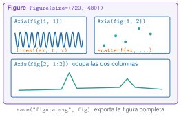

## Objetivos

- `Plots.jl` para explorar, `CairoMakie` para publicar.
- `Figure`, `Axis`, `lines!`, `scatter!`, rejilla.
- Series temporales y espectros con unidades.
- Distinguir curvas sin depender del color.
- Exportar y comprobar.

## Anatomía de una figura

{fig-alt="Figure con tres ejes en rejilla y la orden save"}

## Cheat-sheet

```julia
fig = Figure(size=(720, 400))
ax = Axis(fig[1, 1], xlabel="t (s)", ylabel="a (m/s²)")
lines!(ax, t, x)
axislegend(ax)
save("fig.svg", fig)
```

## Espectro

- `psd_welch(x, fs; nseg=4096)` → `(f, P)`.
- Eje vertical **logarítmico**; frecuencias en Hz.
- `buscar_picos` para marcar los máximos.

## Referencia frente a daño

| Pico | A (Hz) | C (Hz) | Variación |
|---|---|---|---|
| 1 | 1,099 | 1,074 | −2,2 % |
| 2 | 2,930 | 2,954 | +0,8 % |
| 3 | 4,395 | 4,248 | −3,3 % |

Resolución: 0,0244 Hz. Un cambio menor que la resolución **no se interpreta**.

## Toda figura lleva

- Ejes con magnitud y unidades.
- Pie con qué se ve y qué se concluye.
- Texto alternativo.
- Nada que dependa solo del color.

## La doy por superada si…

- Construyo una figura de varios paneles.
- Dibujo un espectro en escala logarítmica con picos.
- Exporto y compruebo el fichero.
