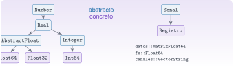
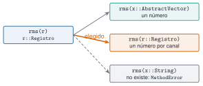

## Objetivos

- `struct` con campos tipados.
- Constructores que **validan**.
- Tipos abstractos y jerarquía.
- Despacho múltiple.
- Extender `getindex` y `show`.

## Un tipo para el registro

```julia
abstract type Senal end

struct Registro <: Senal
    datos::Matrix{Float64}   # N × c
    fs::Float64              # Hz
    canales::Vector{String}
    unidad::String
    function Registro(datos, fs, canales, unidad="m/s²")
        fs > 0 || throw(ArgumentError("fs debe ser positiva"))
        ...
        new(...)
    end
end
```

## Jerarquía de tipos

{fig-alt="Árbol de tipos numéricos de Julia y tipo propio Registro bajo Senal"}

## Despacho múltiple

{fig-alt="La llamada rms(r) elige el método para Registro entre tres métodos"}

```julia
rms(x::AbstractVector) = ...
rms(r::Registro) = [rms(c) for c in eachcol(r.datos)]
```

## Extender la biblioteca estándar

```julia
Base.getindex(r::Registro, c::AbstractString) = ...
Base.getindex(r::Registro, j::Integer) = ...
Base.show(io::IO, r::Registro) = ...
```

## Resultado

`Registro(60000 muestras × 3 canales, fs = 100.0 Hz, 600.0 s, en m/s²)`

RMS: 0,2336 · 0,2244 · 0,1981 m/s².

## La doy por superada si…

- Escribo un constructor que valida.
- Veo qué método se aplica con `@which`.
- Añado un tipo nuevo añadiendo un método.
