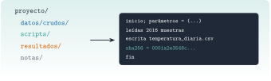

{.portada fig-alt="Una lista de carpetas de un proyecto (datos/crudos, scripts, resultados, notas) con una flecha hacia un registro de ejecución en una ventana oscura que muestra las líneas de inicio, lectura de muestras, escritura de una tabla con su huella sha256 y fin"}

Un análisis que solo funciona en tu ordenador, el día que lo hiciste y con los ficheros que tenías abiertos, no es un resultado: es una anécdota. En vigilancia de estructuras se repiten los mismos análisis cada día, cada mes o cada vez que una autoridad pregunta «¿cómo llegaste a este número?». Esta unidad enseña a organizar un proyecto para que **cualquiera (tú dentro de seis meses, incluido) pueda regenerar los resultados con un solo comando y comprobar que salen igual**.

::: {.callout-note}
## Cómo se lee esta unidad
**Tiempo orientativo: 60 minutos.** Objetivos (3), teoría en cuatro píldoras (12), práctica guiada (25), «Pídeselo a Claude» (8), ejercicios (10) y cierre (2). El proyecto de la práctica se crea en una carpeta temporal con un conjunto de datos del repositorio.
:::

```{julia}
#| include: false
using SHA, Dates, Statistics
include("../../../recursos/r1-datos/_tema.jl")
RAIZ = "../../../"
```

## Objetivos y prerrequisitos

**Objetivos.** Al terminar esta unidad sabrás:

- organizar un proyecto en carpetas con una regla clara: lo crudo no se toca, lo derivado se regenera;
- decidir cuándo usar un script y cuándo un cuaderno (Quarto o Pluto);
- escribir un `run_all` con parámetros explícitos, rutas relativas, semilla, registro de ejecución y parada temprana;
- comprobar la reproducibilidad con la huella (SHA-256) de los resultados.

**Prerrequisitos.** El curso no los impone en el temario; conviene J1.1 y J1.2 (entorno, `--project=.`) y J1.6 (datos tabulares).

**Reparto con otras unidades.** Aquí se organiza y se verifica la reproducibilidad. Las herramientas de datos (fechas, uniones, limpieza) vienen en [J2.2](../j2-2-dataframes/index.qmd) y [J2.3](../j2-3-limpieza/index.qmd); el control de versiones con Git, en [C3](../../../claude/index.qmd).

## Teoría breve

::: {.callout-note .historia icon=false title="Un poco de historia: la reproducibilidad como estándar mínimo"}
En 2011, el estadístico Roger Peng planteó en *Science* que, en ciencia computacional, replicar un estudio de forma independiente suele ser inviable por coste o por falta de datos, y que en ese caso la **reproducibilidad** (que otros puedan obtener los mismos resultados con los mismos datos y el mismo código) puede ser el estándar mínimo con el que juzgar una afirmación [@peng2011]. Es la idea que hay detrás de todo este repositorio: los resultados que se publican se regeneran con código, entorno y semilla conocidos.

<span class="fuentes-caja">Fuente: Peng (2011), *Science* 334(6060) [@peng2011]. Se ha comprobado el DOI y la tesis central en el resumen y en fuentes secundarias; el texto completo no se pudo leer (acceso denegado). Consultado el 26-10-2026.</span>
:::

### J2.1.1 Carpetas con una regla {#j2-1-1}

La estructura de un proyecto de análisis es sencilla y cada carpeta tiene una regla (@fig-estructura):

| Carpeta | Qué contiene | Regla |
|---|---|---|
| `datos/crudos/` | los datos tal como llegaron | **no se edita jamás** |
| `scripts/` | el código que lee, procesa y escribe (`run_all.jl`) | se versiona con Git |
| `resultados/tablas`, `resultados/figuras` | lo que sale del código | **regenerable**: se puede borrar y recrear |
| `resultados/logs/` | el registro de cada ejecución | qué se hizo, con qué parámetros y cuándo |
| `notas/` | decisiones, dudas, interpretación | texto para personas |

Dos reglas valen más que todas las demás: **los datos crudos son de solo lectura** (un dato corregido a mano en el Excel original es un dato que nadie sabrá que se corrigió) y **los resultados nunca se editan a mano** (si hay que cambiarlos, se cambia el código y se regeneran).

{#fig-estructura fig-alt="Una caja de datos crudos con la nota no se edita nunca envía una flecha a una caja de scripts con run_all.jl; de esta salen flechas a una caja de resultados regenerables, a una de registros de ejecución y, discontinua, a una de notas; debajo, la nota de que el entorno y la semilla completan la receta."}

::: {.ejercicio tipo="vf" id="j2-1-1-crudos" respuesta="falso"}
Si un dato crudo tiene un error evidente, lo más sensato es corregirlo directamente en el fichero original.

::: {.solucion}
Falso. Se corrige en el código (con una regla explícita y registrada), nunca en el fichero original: así queda constancia de qué se cambió y por qué.
:::
:::

### J2.1.2 Script o cuaderno {#j2-1-2}

Cada herramienta tiene su momento. Un **script** (`.jl`) se ejecuta de principio a fin, sin intervención, y da siempre lo mismo: es el sitio de lo que se **repite** (procesar el mes, regenerar las figuras). Un **cuaderno** (una página de Quarto, o un cuaderno de Pluto) mezcla texto, código y resultados: es el sitio de **explorar** y **explicar**. El patrón sano es explorar en el cuaderno, consolidar en el script y explicar en Quarto. Los tres usan el mismo entorno (`--project=.`, J1.2), y las funciones que se reutilizan acaban en un paquete (J3.2).

::: {.callout-warning}
## Errores frecuentes
(1) Mantener solo un cuaderno en el que las celdas se ejecutan «en el orden que hiciste»: al reiniciar, el resultado cambia. (2) Un script que depende de ficheros abiertos o de variables que existen en tu sesión. (3) Rutas absolutas (`/Users/alguien/…`): en otra máquina no existen; se usa `joinpath(@__DIR__, "..", ...)`.
:::

### J2.1.3 Un `run_all` bien hecho {#j2-1-3}

El script principal tiene cinco rasgos: **parámetros explícitos** en un único sitio (no números mágicos repartidos), **rutas relativas** a la carpeta del proyecto, **semilla** fija si hay azar, **registro** de lo que hace (con la hora y los parámetros) y **parada temprana** con un error claro si una entrada falta o un supuesto no se cumple, en lugar de seguir con datos malos. Y se divide en **funciones** pequeñas (leer, resumir, escribir) para poder probarlas por separado.

### J2.1.4 Trazabilidad: la huella {#j2-1-4}

¿Cómo se comprueba que un proceso es reproducible? Se ejecuta dos veces y se compara la **huella** (SHA-256) de los resultados: una función matemática que da una cadena corta distinta para cualquier cambio de un solo byte. Se comparan las **tablas y datos derivados**, no los registros (que llevan la hora y por tanto cambian). Y se anota la huella en el registro, para poder comprobar más adelante que un resultado archivado sigue siendo el mismo.

::: {.ejercicio tipo="abierta" id="j2-1-4-huella"}
Ejecutas un análisis dos veces y las huellas de la tabla de resultados son distintas. Di tres causas posibles.

::: {.criterios}
- Un elemento aleatorio sin semilla fija.
- Una dependencia de la hora, del orden de lectura de ficheros o de variables de entorno.
- Un cambio de versión de un paquete o de Julia entre ejecuciones (de ahí el `Manifest.toml`).
:::
:::

::: {.callout-note .idea-clave}
## Idea clave
**Un comando regenera todo, y se puede demostrar que sale igual.** Si para repetir un análisis hace falta recordar pasos manuales, el análisis no es reproducible.
:::

### Para saber más {#j2-1-mas}

- Peng, *Reproducible Research in Computational Science* [@peng2011].
- En este repositorio: `CLAUDE.md` («Datos» y «Código y entornos») fija las reglas que se aplican aquí.
- Los datos privados (`datos/privados/`) **nunca** se leen, listan ni copian, ni siquiera en un proyecto de ejemplo.

## Práctica guiada

Vamos a montar un proyecto de verdad con el registro de temperatura de una nave (14 días, una muestra cada 10 minutos, con 13 muestras ausentes por un fallo del sensor), a ejecutarlo dos veces y a comprobar que da lo mismo.

::: {.panel-tabset}
## Julia

**Paso 1. Crear el proyecto** (en una carpeta temporal) y copiar el dato crudo.

```{julia}
dir = mktempdir()
proj = joinpath(dir, "proyecto")
for d in ("datos/crudos", "resultados/tablas", "resultados/logs", "scripts", "notas")
    mkpath(joinpath(proj, d))
end
cp(RAIZ * "datos/sinteticos/curso-claude/d_ambiental.csv", joinpath(proj, "datos/crudos/d_ambiental.csv"))
sort(relpath.([joinpath(r, f) for (r, _, fs) in walkdir(proj) for f in fs], proj))
```

**Paso 2. El `run_all.jl`.** Parámetros en un solo sitio, rutas desde `@__DIR__`, registro con hora, parada temprana si faltan demasiados datos, y huella de la tabla escrita. Solo usa la biblioteca estándar.

```{julia}
write(joinpath(proj, "scripts", "run_all.jl"), raw"""
# run_all.jl: regenera todos los resultados. Uso: julia scripts/run_all.jl
using Dates, Statistics, DelimitedFiles, SHA, Printf

const RAIZ = normpath(joinpath(@__DIR__, ".."))
const PARAMS = (columna_temperatura = 2, umbral_ausentes = 0.05)

function registrar(mensaje)
    open(joinpath(RAIZ, "resultados", "logs", "run_all.log"), "a") do io
        println(io, Dates.format(now(), "yyyy-mm-dd HH:MM:SS"), "  ", mensaje)
    end
end

function leer(ruta)
    isfile(ruta) || error("no existe el fichero de entrada: $ruta")
    M = readdlm(ruta, ',', Any; skipstart=1)
    instantes = DateTime.(String.(M[:, 1]))
    temperatura = [x isa Number ? Float64(x) : missing for x in M[:, PARAMS.columna_temperatura]]
    return instantes, temperatura
end

function resumen_diario(instantes, temperatura)
    dias = sort(unique(Date.(instantes)))
    return map(dias) do d
        t = collect(skipmissing(temperatura[Date.(instantes) .== d]))
        (d, length(t), isempty(t) ? NaN : mean(t), isempty(t) ? NaN : maximum(t))
    end
end

function main()
    registrar("inicio; parámetros = $(PARAMS)")
    instantes, temperatura = leer(joinpath(RAIZ, "datos", "crudos", "d_ambiental.csv"))
    n_aus = count(ismissing, temperatura)
    frac = n_aus / length(temperatura)
    registrar("leídas $(length(temperatura)) muestras; ausentes: $n_aus ($(round(100frac, digits=2)) %)")
    frac > PARAMS.umbral_ausentes && error("demasiados ausentes: $frac")
    filas = resumen_diario(instantes, temperatura)
    salida = joinpath(RAIZ, "resultados", "tablas", "temperatura_diaria.csv")
    open(salida, "w") do io
        println(io, "fecha,n_validas,media_C,max_C")
        for (d, n, m, mx) in filas
            @printf(io, "%s,%d,%.4f,%.2f\n", d, n, m, mx)
        end
    end
    huella = bytes2hex(open(sha256, salida))
    registrar("escrita $(relpath(salida, RAIZ)) ($(length(filas)) días); sha256 = $(huella[1:16])…")
    registrar("fin")
end
main()
""")
nothing
```

**Paso 3. Ejecutar dos veces y comparar.**

```{julia}
script = joinpath(proj, "scripts", "run_all.jl")
tabla = joinpath(proj, "resultados", "tablas", "temperatura_diaria.csv")
ejecutar() = run(`$(Base.julia_cmd()) --startup-file=no $script`)
ejecutar(); h1 = bytes2hex(open(sha256, tabla))
ejecutar(); h2 = bytes2hex(open(sha256, tabla))
(misma_huella_en_las_dos_ejecuciones = h1 == h2, huella = h1[1:16] * "…")
```

La tabla es idéntica byte a byte. El registro **no** se compara: lleva la hora, y por tanto cambia. Se ve lo que contiene, quitando las horas:

```{julia}
registro = readlines(joinpath(proj, "resultados", "logs", "run_all.log"))
(lineas_del_registro = length(registro), primera_ejecucion = [replace(l, r"^\S+ \S+  " => "") for l in registro[1:4]])
```

**Paso 4. La tabla resultante y la parada temprana.**

```{julia}
tab = readlines(tabla)
(cabecera = tab[1], dias = length(tab) - 1, dia_con_huecos = tab[6], total_validas = sum(parse(Int, split(l, ',')[2]) for l in tab[2:end]))
```

El día 6 de junio tiene 131 muestras válidas en lugar de 144: son las 13 consecutivas ausentes. Si falta el dato de entrada, el script debe **parar con un mensaje claro**, no continuar:

```{julia}
entrada = joinpath(proj, "datos", "crudos", "d_ambiental.csv")
mv(entrada, entrada * ".bak")
io = IOBuffer()
run(pipeline(ignorestatus(`$(Base.julia_cmd()) --startup-file=no --color=no $script`), stdout=io, stderr=io))
mv(entrada * ".bak", entrada)
(error_mostrado = replace(first(filter(l -> occursin("no existe", l), split(String(take!(io)), '\n'))), proj => "<carpeta temporal>/proyecto"),)
```

## Python

El mismo flujo en Python: `pandas` para el resumen y `hashlib` para la huella. La versión probada con `pytest`, con los valores contrastados con los de Julia, está en `python/proyecto.py`.

```python
from proyecto import resumen_diario, huella

r = resumen_diario("datos/sinteticos/curso-claude/d_ambiental.csv")
print(r.head(6))                      # 14 días; el 5.º con 131 muestras válidas
print(huella("datos/sinteticos/curso-claude/d_ambiental.csv"))
```

La estructura de carpetas, el `run_all.py` con registro y parada temprana, y la comprobación por huella son las mismas; lo que cambia es el entorno: `uv` con `pyproject.toml` y `uv.lock` hace de `Project.toml` y `Manifest.toml` (J1.2).
:::

::: {.callout-note}
## Qué se ha conseguido
Un proyecto organizado en carpetas con regla, un script que se ejecuta con un solo comando, un registro de lo que hizo, una tabla cuya huella demuestra que es reproducible y una parada limpia ante un fallo. Lo mismo que se esperaría de un análisis que va a un informe técnico.
:::

## «Pídeselo a Claude» {#pideselo}

::: {.callout-tip}
## Prompt
«En una carpeta temporal (no en el repositorio), crea un proyecto con `datos/crudos`, `scripts`, `resultados/tablas`, `resultados/logs` y `notas`. Copia `datos/sinteticos/curso-claude/d_ambiental.csv` a `datos/crudos` y escribe `scripts/run_all.jl` (solo biblioteca estándar) que: defina los parámetros en una constante, calcule por día el número de muestras válidas, la media y el máximo de la temperatura ignorando los ausentes, pare con un error claro si más del 5 % faltan, escriba `resultados/tablas/temperatura_diaria.csv` y anote en un registro con hora lo que hace y la huella SHA-256 de la tabla. Ejecútalo dos veces y comprueba que las huellas coinciden. No toques `datos/privados` ni modifiques el CSV original. No inventes valores: si algo no sale, dilo.»

**Verifica.** (a) Que el proyecto está **fuera** del repositorio y que el CSV original no cambia (`git status`). (b) Que salen 14 días y que el 5.º tiene 131 muestras válidas (13 ausentes en total, el 0,64 %). (c) Que las dos huellas coinciden y que el registro no se ha incluido en la comparación. (d) Que las rutas se construyen con `@__DIR__` y `joinpath`, y no son absolutas. (e) Que el script se detiene con un mensaje claro si falta el fichero de entrada.
:::

## Ejercicios

::: {.ejercicio tipo="numerico" id="j2-1-dias" respuesta="14" tol="0%" unidad="días"}
¿Cuántos días de datos tiene el registro ambiental?

::: {.solucion}
14: $2016$ muestras a 6 por hora son $2016/144=14$ días.
:::
:::

::: {.ejercicio tipo="numerico" id="j2-1-validas" respuesta="131" tol="0%" unidad="muestras"}
¿Cuántas muestras válidas tiene el quinto día (6 de junio de 2025)?

::: {.solucion}
131: de las 144 muestras del día faltan 13, las del fallo del sensor.
:::
:::

::: {.ejercicio tipo="vf" id="j2-1-log" respuesta="falso"}
Para comprobar la reproducibilidad hay que comparar también la huella del registro (`run_all.log`).

::: {.solucion}
Falso. El registro lleva la hora de cada ejecución y cambia siempre. Se comparan los **resultados** (tablas, datos derivados), no el registro.
:::
:::

::: {.ejercicio tipo="abierta" id="j2-1-estructura"}
Un compañero te manda un cuaderno con 40 celdas, sin carpetas ni registro, y te dice que «hay que ejecutarlo en orden, menos la 17». ¿Qué le propones?

::: {.criterios}
- Pasar la lógica a un script `run_all` con funciones y parámetros explícitos.
- Separar datos crudos (de solo lectura) y resultados regenerables, y añadir un registro y una comprobación por huella.
:::
:::

## La doy por superada si… {#superada}

- Organizo un proyecto con carpetas y distingo lo crudo de lo regenerable.
- Elijo entre script y cuaderno según la tarea.
- Escribo un `run_all` con parámetros, rutas relativas, registro y parada temprana.
- Compruebo la reproducibilidad comparando huellas de los resultados.
- No edito datos crudos ni resultados a mano.

**Cierre.** Escribe tres líneas: qué he entendido, qué todavía no domino y cuál es mi siguiente paso pequeño. Si Claude ha creado ficheros, revisa con `git status` que no ha escrito dentro de `datos/` ni tocado nada privado.

**Siguiente:** [J2.2 · DataFrames a fondo con fechas](../j2-2-dataframes/index.qmd).
