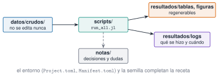

## Objetivos

- Carpetas con una regla.
- Script o cuaderno.
- `run_all` con registro y parada temprana.
- Reproducibilidad por huella.

## Estructura

{fig-alt="Datos crudos, scripts, resultados regenerables, registros y notas"}

**Crudo no se toca; resultados no se editan a mano.**

## `run_all`

- Parámetros en un solo sitio.
- Rutas con `@__DIR__` y `joinpath`.
- Semilla fija.
- Registro con hora.
- Error claro si falta algo.

## Huella (SHA-256)

```julia
huella = bytes2hex(open(sha256, tabla))
```

Dos ejecuciones → **misma huella** en la tabla. El registro lleva la hora: no se compara.

## Resultado

- 2016 muestras, 14 días, 13 ausentes (0,64 %).
- El 5.º día (6 de junio): 131 muestras válidas.
- Falta la entrada → `no existe el fichero de entrada`.

## La doy por superada si…

- Separo lo crudo de lo regenerable.
- Demuestro la reproducibilidad con una huella.
