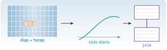

{.portada fig-alt="Una cuadrícula de celdas azules de días por horas con tres celdas naranjas consecutivas que marcan un hueco; una flecha lleva a la curva suave de un ciclo diario; otra flecha lleva a dos tablas conectadas por una línea que representan una unión"}

Los datos reales de planta son tablas con **fechas**: una lectura cada diez minutos, un pedido cada mes, una incidencia cada vez que ocurre. Casi toda pregunta útil sobre ellos es de uno de estos tipos: *¿cuánto en total por región y por año?* (agrupar), *¿qué hay de cada región en la otra tabla?* (unir) y *¿cómo es un día típico?* (remuestrear). Esta unidad lleva `DataFrames.jl` de lo básico de J1.6 a estas tres operaciones, con el tratamiento correcto de fechas, ausentes y duplicados.

::: {.callout-note}
## Cómo se lee esta unidad
**Tiempo orientativo: 120 minutos.** Objetivos (5), teoría en cinco píldoras (25), práctica guiada (55), «Pídeselo a Claude» (15), ejercicios (15) y cierre (5). Se usan tres conjuntos sintéticos del repositorio: ventas mensuales por región (con ausentes y un duplicado), registro de temperatura de una nave cada 10 minutos (con un hueco de 13 muestras) y ausencias de personal (con fechas en dos formatos).
:::

```{julia}
#| include: false
using CSV, DataFrames, Dates, Statistics
include("../../../recursos/r1-datos/_tema.jl")
RAIZ = "../../../"
```

## Objetivos y prerrequisitos

**Objetivos.** Al terminar esta unidad sabrás:

- interpretar fechas en distintos formatos y operar con ellas (`Date`, `DateTime`, periodos);
- agrupar y resumir con `groupby`, `combine`, `select` y `transform`;
- unir tablas con `innerjoin`, `leftjoin`, `outerjoin` y `antijoin`, y evitar la multiplicación de filas;
- remuestrear una serie temporal (de 10 minutos a horas o al ciclo diario) y localizar huecos;
- detectar y tratar duplicados y valores ausentes dejando constancia de la decisión.

**Prerrequisitos.** El curso no los impone en el temario; conviene J1.6 (CSV, `DataFrame`, `missing`) y J2.1 (organización del proyecto).

**Reparto con otras unidades.** Aquí se aprenden las operaciones. La limpieza sistemática (huecos, saltos, anómalos) está en [J2.3](../j2-3-limpieza/index.qmd) y las figuras, en [J2.4](../j2-4-makie/index.qmd).

## Teoría breve

::: {.callout-note .historia icon=false title="Un poco de historia: dividir, aplicar, combinar"}
Casi todo el análisis de tablas por grupos sigue una receta que Hadley Wickham bautizó en 2011 como *split-apply-combine*: **dividir** el problema en trozos, **aplicar** a cada uno la misma operación y **combinar** los resultados [@wickham2011]. El manual de `DataFrames.jl` la adopta de forma explícita y la cita como referencia conceptual: `groupby` divide, y `combine`, `select` y `transform` aplican y combinan [@dataframes-sac]. Reconocer la receta ayuda a leer cualquier código de agrupación, en Julia o en otro lenguaje.

<span class="fuentes-caja">Fuente: Wickham (2011) [@wickham2011] y el manual de DataFrames.jl [@dataframes-sac]. Consultadas el 26-10-2026; del artículo se han comprobado los datos bibliográficos en fuentes secundarias.</span>
:::

### J2.2.1 Fechas y horas {#j2-2-1}

Julia distingue `Date` (un día) y `DateTime` (un instante, con hora). Se crean con `Date(2025, 6, 6)`, se leen de un texto con un **formato** (`dateformat"dd/mm/yyyy"`) y admiten aritmética con periodos (`Day(3)`, `Hour(1)`, `Month(1)`). Se consulta con `year`, `month`, `dayofweek`, `hour` y se **redondea hacia abajo** con `floor`, que es la base del remuestreo:

```{julia}
d1 = Date(2025, 6, 6)
d2 = Date("15/03/2025", dateformat"dd/mm/yyyy")
t = DateTime(2025, 6, 6, 4, 37, 12)
(dia_semana = dayname(d1), diferencia = d1 - d2, dentro_de_un_mes = d1 + Month(1),
 hora_redondeada = floor(t, Hour(1)), dia_redondeado = floor(t, Day(1)), mes = monthname(d1))
```

(Los nombres de días y meses salen en inglés.)

```{julia}
#| echo: false
nothing
```

Los ficheros reales mezclan formatos. En las ausencias de personal, un 9 % de las fechas está como `dd/mm/aaaa` y el resto como `aaaa-mm-dd`. Se interpreta cada texto con el formato que le corresponde y se **comprueba** que no queda ninguno sin interpretar:

```{julia}
aus = CSV.read(RAIZ * "datos/sinteticos/curso-claude/b_absentismo.csv", DataFrame; stringtype=String)
function fecha(s)
    occursin('/', s) ? Date(s, dateformat"dd/mm/yyyy") : Date(s)
end
aus.dia = fecha.(aus.fecha)
(filas = nrow(aus), en_formato_barras = count(contains("/"), aus.fecha), rango = extrema(aus.dia),
 todas_en_2025 = all(year.(aus.dia) .== 2025))
```

::: {.callout-warning}
## Errores frecuentes
Leer `03/04/2025` sin saber si es el 3 de abril o el 4 de marzo: **el formato se pregunta, no se supone**. Y comparar fechas como texto (`"2025-06-06" < "2025-12-01"` funciona por casualidad con el formato ISO, pero `"6/6/2025" < "12/1/2025"` no).
:::

::: {.ejercicio tipo="numerico" id="j2-2-1-dias" respuesta="83" tol="0%" unidad="días"}
¿Cuántos días hay entre el 15 de marzo y el 6 de junio de 2025?

::: {.pista}
`Date(2025, 6, 6) - Date(2025, 3, 15)` devuelve un periodo de días.
:::

::: {.solucion}
83 días (16 de marzo a 31 de marzo son 16, abril 30, mayo 31 y 6 de junio: $16+30+31+6=83$).
:::
:::

### J2.2.2 Agrupar: `groupby`, `combine` y `transform` {#j2-2-2}

`groupby(df, :col)` divide la tabla en grupos; `combine` los **resume** (una fila por grupo), `transform` añade columnas **sin cambiar el número de filas** y `select` conserva solo las columnas pedidas. La sintaxis `origen => función => destino` da nombre explícito al resultado [@dataframes-sac]:

```{julia}
v = unique(CSV.read(RAIZ * "datos/sinteticos/curso-claude/a_ventas.csv", DataFrame; stringtype=String))
suma_sin_aus(x) = sum(skipmissing(x))
v.anio = year.(v.fecha)
tot = combine(groupby(v, [:anio, :region]), :ventas_eur => suma_sin_aus => :total_eur, nrow => :meses)
sort!(tot, [:region, :anio])
tot
```

Un `transform` por grupo sirve para **normalizar dentro de cada grupo**, por ejemplo expresar el total de cada año como fracción del total del periodo 2023–2025 de su región:

```{julia}
transform!(groupby(tot, :region), :total_eur => (x -> x ./ sum(x)) => :fraccion_del_periodo)
(Norte_por_anio_pct = round.(100 .* tot.fraccion_del_periodo[tot.region .== "Norte"], digits=1),)
```

::: {.ejercicio tipo="vf" id="j2-2-2-combine" respuesta="falso"}
`combine(groupby(df, :region), ...)` devuelve una fila por cada fila original de `df`.

::: {.solucion}
Falso. `combine` devuelve **una fila por grupo** (o las que calcule la función). Para conservar las filas originales se usa `transform`.
:::
:::

### J2.2.3 Unir tablas {#j2-2-3}

Una **unión** (*join*) combina dos tablas por una **clave**. Se elige según qué filas se quieran conservar (@fig-uniones): `innerjoin` solo las claves comunes, `leftjoin` todas las de la tabla izquierda, `outerjoin` todas las de ambas y `antijoin` las de la izquierda que **no** tienen pareja (muy útil para encontrar claves huérfanas).

{#fig-uniones fig-alt="Cuatro diagramas de dos círculos que se solapan, uno azul (A) y otro verde (B). En innerjoin está coloreada solo la intersección; en leftjoin, todo el círculo A; en outerjoin, los dos círculos; en antijoin, la parte de A que no pertenece a B."}

Se comprueba con una tabla auxiliar de regiones que tiene una región más (`Este`, sin ventas) y todas las que aparecen en las ventas:

```{julia}
regiones = DataFrame(region=["Norte", "Centro", "Sur", "Este"], delegado=["D1", "D2", "D3", "D4"])
(inner = nrow(innerjoin(v, regiones, on=:region)),
 left_ventas = nrow(leftjoin(v, regiones, on=:region)),
 left_regiones = nrow(leftjoin(regiones, v, on=:region)),
 outer = nrow(outerjoin(v, regiones, on=:region)),
 regiones_sin_ventas = antijoin(regiones, v, on=:region).region)
```

Y el peligro clásico, la **multiplicación de filas**: si la tabla auxiliar tiene la clave repetida, cada fila de ventas se copia tantas veces como repeticiones. `validate` lo atrapa:

```{julia}
regiones_mal = vcat(regiones, DataFrame(region="Norte", delegado="D5"))      # Norte repetida
multiplicadas = nrow(leftjoin(v, regiones_mal, on=:region))
captura = try
    leftjoin(v, regiones_mal, on=:region, validate=(false, true))
catch e
    first(split(sprint(showerror, e), '\n'))
end
(filas_ventas = nrow(v), tras_el_join_con_clave_repetida = multiplicadas, validate_lo_detecta = captura)
```

::: {.callout-warning}
## Errores frecuentes
Unir sin comprobar que el número de filas es el esperado. La regla: **antes y después de cada unión se cuentan las filas**, y se usa `validate` para declarar la cardinalidad (`(false, true)` = «cada clave aparece como mucho una vez en la derecha»). Otro: unir por columnas de texto con mayúsculas, espacios o tildes distintos (`"Norte "` frente a `"Norte"`).
:::

::: {.ejercicio tipo="numerico" id="j2-2-3-left" respuesta="108" tol="0%" unidad="filas"}
¿Cuántas filas tiene `leftjoin(v, regiones, on=:region)`, con `v` las ventas sin duplicados?

::: {.solucion}
108: todas las filas de ventas (36 meses por 3 regiones); la región `Este` no aparece porque no está en la tabla izquierda.
:::
:::

### J2.2.4 Remuestrear una serie temporal {#j2-2-4}

**Remuestrear** es pasar de una resolución temporal a otra más gruesa: de 10 minutos a horas, de horas a días. Se redondea cada instante hacia abajo con `floor`, se agrupa por el resultado y se resume. Con el registro de temperatura (una muestra cada 10 minutos durante 14 días) se obtienen horas, y de estas, el **ciclo diario medio**:

```{julia}
amb = CSV.read(RAIZ * "datos/sinteticos/curso-claude/d_ambiental.csv", DataFrame; types=Dict(:instante => DateTime))
amb.hora_natural = floor.(amb.instante, Hour(1))
por_hora = combine(groupby(amb, :hora_natural), :temperatura_C => (x -> count(!ismissing, x)) => :n_validas,
    :temperatura_C => (x -> isempty(collect(skipmissing(x))) ? missing : mean(skipmissing(x))) => :media_C)
(horas = nrow(por_hora), horas_sin_ninguna_muestra = count(==(0), por_hora.n_validas),
 horas_incompletas = count(<(6), por_hora.n_validas))
```

Hay 14 × 24 = 336 horas; dos sin ninguna muestra (las 04:00 y las 05:00 del 6 de junio) y una con 5 (las 06:00, de la que falta la muestra de las 06:00). Es el hueco de 13 muestras del sensor. Un resumen por hora **debe llevar su número de muestras válidas**: una media de 1 muestra no vale lo que una de 6.

::: {.ejercicio tipo="vf" id="j2-2-4-n" respuesta="verdadero"}
Al remuestrear, conviene guardar también cuántas muestras válidas ha tenido cada intervalo, porque una media con pocas muestras es menos fiable.

::: {.solucion}
Verdadero. El recuento permite filtrar o ponderar los intervalos incompletos y delata los huecos, que de otro modo quedan escondidos en la media.
:::
:::

### J2.2.5 Duplicados y ausentes {#j2-2-5}

Dos comprobaciones obligatorias en cualquier tabla nueva. Los **duplicados**: `nonunique(df)` marca las filas repetidas (a partir de la segunda aparición) y `unique(df)` las elimina; con una clave (`unique(df, [:fecha, :region])`) se buscan repetidos por clave aunque el resto de columnas difiera. Los **ausentes**: `count(ismissing, col)`, y luego una decisión explícita (ignorar, rellenar o quitar la fila) y registrada. En las ventas hay un duplicado exacto (mayo de 2024 en la región Norte) y cinco importes ausentes:

```{julia}
crudo = CSV.read(RAIZ * "datos/sinteticos/curso-claude/a_ventas.csv", DataFrame; stringtype=String)
(filas_crudas = nrow(crudo), duplicadas = count(nonunique(crudo)), filas_tras_unique = nrow(unique(crudo)),
 ventas_ausentes = count(ismissing, v.ventas_eur), claves_repetidas_tras_unique = count(nonunique(v, [:fecha, :region])))
```

::: {.callout-note .idea-clave}
## Idea clave
Tras cada operación sobre una tabla se **cuentan las filas**: después de leer, de quitar duplicados, de cada unión y de cada filtro. Un número de filas inesperado es el síntoma de casi todos los errores silenciosos.
:::

### Para saber más {#j2-2-mas}

- Manual de `DataFrames.jl`, *Split-apply-combine* [@dataframes-sac] y apartado de uniones: <https://dataframes.juliadata.org>.
- Wickham, *The Split-Apply-Combine Strategy for Data Analysis* [@wickham2011].
- Documentación del módulo `Dates` de Julia: <https://docs.julialang.org/en/v1/stdlib/Dates/>.

## Práctica guiada

Dos análisis con los datos anteriores: la **estacionalidad de las ventas** (agrupar y unir) y el **ciclo diario de la temperatura** (remuestrear).

::: {.panel-tabset}
## Julia

**Análisis 1. Estacionalidad de las ventas.** Se parte de las ventas sin duplicados, se unen con la tabla de delegados y se calcula la venta media de cada mes del año ignorando los ausentes.

```{julia}
vd = innerjoin(v, regiones, on=:region)
vd.mes = month.(vd.fecha)
estacional = combine(groupby(vd, :mes), :ventas_eur => (x -> mean(skipmissing(x))) => :media_eur)
(filas_tras_join = nrow(vd), mes_maximo = (estacional.mes[argmax(estacional.media_eur)], round(maximum(estacional.media_eur))),
 mes_minimo = (estacional.mes[argmin(estacional.media_eur)], round(minimum(estacional.media_eur))),
 cociente = round(maximum(estacional.media_eur) / minimum(estacional.media_eur), digits=2))
```

```{julia}
#| label: fig-ventas
#| fig-cap: "Ventas mensuales por región entre 2023 y 2025 (arriba) y venta media de cada mes del año (abajo). Los meses sin dato aparecen como huecos en la línea, no como ceros. Hay una estacionalidad clara: el máximo está en verano (junio–julio) y el mínimo en invierno."
#| fig-alt: "Dos gráficas. Arriba, tres líneas, una por región, con 36 meses de ventas entre 2023 y 2025, con picos cada verano y algunos huecos donde falta el dato. Abajo, un diagrama de barras con la venta media de cada mes de enero a diciembre, que sube hasta junio y julio y baja hasta diciembre."
let
    fig = Figure(size=(760, 520))
    ax1 = Axis(fig[1, 1], ylabel="ventas (€)", xlabel="fecha", xticks=([Dates.value(Date(a, 1, 1) - Date(2023, 1, 1)) for a in 2023:2026], string.(2023:2026)))
    for (reg, color) in zip(["Norte", "Centro", "Sur"], [AZUL, NARANJA, VERDE])
        s = sort(v[v.region .== reg, :], :fecha)
        x = Dates.value.(s.fecha .- Date(2023, 1, 1))
        y = [ismissing(u) ? NaN : u for u in s.ventas_eur]
        lines!(ax1, x, y, color=color, label=reg)
    end
    axislegend(ax1, position=:lt)
    ax2 = Axis(fig[2, 1], xlabel="mes del año", ylabel="venta media (€)", xticks=1:12)
    barplot!(ax2, estacional.mes, estacional.media_eur, color=AZUL)
    fig
end
```

**Análisis 2. Ciclo diario de la temperatura.** La media de cada hora del día sobre los 14 días, con su desviación típica:

```{julia}
amb.hora_del_dia = hour.(amb.instante)
ciclo = combine(groupby(amb, :hora_del_dia), :temperatura_C => (x -> mean(skipmissing(x))) => :media_C,
    :temperatura_C => (x -> std(skipmissing(x))) => :desv_C)
(hora_mas_calida = (ciclo.hora_del_dia[argmax(ciclo.media_C)], round(maximum(ciclo.media_C), digits=2)),
 hora_mas_fria = (ciclo.hora_del_dia[argmin(ciclo.media_C)], round(minimum(ciclo.media_C), digits=2)),
 amplitud_C = round(maximum(ciclo.media_C) - minimum(ciclo.media_C), digits=2))
```

```{julia}
#| label: fig-ciclo
#| fig-cap: "Temperatura media por hora del día en la nave, sobre 14 días (línea) con una banda de ±1 desviación típica entre días. El máximo está a las 15 h (26,96 °C) y el mínimo a las 3 h (17,02 °C): una amplitud de 9,9 °C."
#| fig-alt: "Curva suave de temperatura frente a la hora del día, de 0 a 23, que baja hasta un mínimo de unos 17 grados a las 3 de la madrugada y sube hasta un máximo de casi 27 grados a las 15 horas, con una banda sombreada alrededor."
let
    fig = Figure(size=(720, 320))
    ax = Axis(fig[1, 1], xlabel="hora del día (h)", ylabel="temperatura (°C)", xticks=0:3:24)
    band!(ax, ciclo.hora_del_dia, ciclo.media_C .- ciclo.desv_C, ciclo.media_C .+ ciclo.desv_C, color=(AZUL, 0.2))
    lines!(ax, ciclo.hora_del_dia, ciclo.media_C, color=AZUL)
    scatter!(ax, [15, 3], ciclo.media_C[[16, 4]], color=NARANJA, markersize=11)
    fig
end
```

**Huecos explícitos.** Quitar las filas ausentes borra las horas del fallo; unir con un calendario completo las devuelve como `missing`, que es lo que se quiere para que el hueco no desaparezca en silencio:

```{julia}
sin_filas_ausentes = combine(groupby(dropmissing(amb, :temperatura_C), :hora_natural), :temperatura_C => mean => :media_C)
calendario = DataFrame(hora_natural=minimum(amb.hora_natural):Hour(1):maximum(amb.hora_natural))
completa = leftjoin(calendario, sin_filas_ausentes, on=:hora_natural)
(horas_sin_filas_ausentes = nrow(sin_filas_ausentes), horas_del_calendario = nrow(calendario),
 huecos = count(ismissing, completa.media_C), horas_con_hueco = completa.hora_natural[ismissing.(completa.media_C)])
```

## Python

`pandas` ofrece las mismas operaciones con otra sintaxis: `groupby(...).agg`, `merge` (con `how="left"`, `"inner"`, `"outer"`; el equivalente de `antijoin` es `indicator=True`), `drop_duplicates` y `resample`. La versión probada con `pytest`, con los resultados contrastados con los de Julia, está en `python/ventas.py`.

```python
from ventas import ventas_limpias, total_por_region, ciclo_diario, muestras_por_hora

v = ventas_limpias("datos/sinteticos/curso-claude/a_ventas.csv")   # 109 → 108 filas
print(total_por_region(v))                 # Norte 1 911 061,69 · Centro 2 539 781,72 · Sur 1 619 001,97
c = ciclo_diario("datos/sinteticos/curso-claude/d_ambiental.csv")
print(c.idxmax(), round(c.max(), 2))       # 15 26.96
print(muestras_por_hora("datos/sinteticos/curso-claude/d_ambiental.csv").eq(0).sum())   # 2 horas sin datos
```

Dos diferencias importantes: `pandas` ignora los `NaN` al sumar y promediar (`skipna=True`), mientras que Julia **propaga** `missing` y obliga a escribir `skipmissing`; y `resample("h")` hace en una llamada lo que en Julia es `floor` + `groupby`, incluyendo las horas vacías (con `count` = 0).
:::

::: {.callout-note}
## Qué se ha conseguido
Fechas en dos formatos unificadas y comprobadas, ventas agrupadas y unidas con la cardinalidad vigilada, una estacionalidad con un cociente claro entre el mes más alto y el más bajo, un ciclo diario con su amplitud y un hueco de sensor localizado y conservado como hueco. Cada paso con un recuento de filas que lo respalda.
:::

## «Pídeselo a Claude» {#pideselo}

::: {.callout-tip}
## Prompt
«Con Julia, `--project=.`, `CSV.jl`, `DataFrames.jl` y `Dates`: (1) lee `datos/sinteticos/curso-claude/a_ventas.csv` (cadenas como `String`), cuenta filas, duplicados y ausentes, y elimina el duplicado; (2) calcula las ventas totales por región ignorando los ausentes; (3) une con una tabla `regiones` que tenga también la región `Este` y cuenta las filas antes y después, usando `validate`; (4) lee `d_ambiental.csv` con `types=Dict(:instante=>DateTime)`, agrúpalo por hora natural con `floor` y dime cuántas horas hay, cuántas no tienen ninguna muestra y la hora del día con la temperatura media más alta. No inventes cifras: si algo no sale, dilo.»

**Verifica.** (a) Que son 109 filas crudas, 1 duplicado, 108 tras eliminarlo y 5 importes ausentes. (b) Que los totales son 1 911 061,69 (Norte), 2 539 781,72 (Centro) y 1 619 001,97 € (Sur). (c) Que la unión conserva 108 filas y que con una clave repetida `validate` lanza un error en lugar de multiplicar filas. (d) Que hay 336 horas, 2 sin muestras, y que la hora más cálida es la 15 (26,96 °C). (e) Que el ausente no se ha convertido en cero.
:::

## Ejercicios

::: {.ejercicio tipo="numerico" id="j2-2-dup" respuesta="108" tol="0%" unidad="filas"}
¿Cuántas filas tiene la tabla de ventas tras eliminar el duplicado?

::: {.solucion}
108: 109 filas crudas menos 1 duplicada exacta (mayo de 2024, región Norte). Son 36 meses × 3 regiones.
:::
:::

::: {.ejercicio tipo="numerico" id="j2-2-horas" respuesta="336" tol="0%" unidad="horas"}
¿Cuántas horas naturales abarca el registro de temperatura?

::: {.solucion}
$14\cdot24=336$ horas (`nrow(por_hora)`).
:::
:::

::: {.ejercicio tipo="numerico" id="j2-2-amplitud" respuesta="9.94" tol="1%" unidad="°C"}
¿Cuál es la amplitud (máximo menos mínimo) del ciclo diario medio de temperatura?

::: {.solucion}
9,94 °C: 26,96 °C a las 15 h y 17,02 °C a las 3 h.
:::
:::

::: {.ejercicio tipo="abierta" id="j2-2-join"}
Haces un `leftjoin` entre 4 200 pedidos y una tabla de clientes, y el resultado tiene 4 311 filas. ¿Qué ha pasado y cómo lo detectarías antes?

::: {.criterios}
- Alguna clave de la tabla de clientes está repetida: cada pedido de ese cliente se ha copiado.
- Contar filas antes y después, y declarar la cardinalidad con `validate=(false, true)`.
:::
:::

## La doy por superada si… {#superada}

- Interpreto fechas en dos formatos y compruebo que no queda ninguna sin interpretar.
- Agrupo con `groupby` y `combine` y sé cuándo usar `transform`.
- Elijo el tipo de unión y compruebo el número de filas antes y después, con `validate`.
- Remuestreo una serie, conservo el recuento de muestras válidas y localizo los huecos.
- Detecto duplicados y ausentes y dejo escrita la decisión.

**Cierre.** Escribe tres líneas: qué he entendido, qué todavía no domino y cuál es mi siguiente paso pequeño. Después de cada unión, revisa el recuento de filas; es la comprobación más barata y la que más errores evita.

**Siguiente:** [J2.3 · Limpieza de datos](../j2-3-limpieza/index.qmd).
