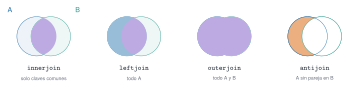

## Objetivos

- Fechas: `Date`, `DateTime`, periodos, `floor`.
- `groupby`, `combine`, `transform`.
- Uniones y cardinalidad.
- Remuestreo y huecos.
- Duplicados y ausentes.

## Dividir, aplicar, combinar

```julia
combine(groupby(v, [:anio, :region]),
        :ventas_eur => suma_sin_aus => :total_eur,
        nrow => :meses)
```

`origen => función => destino`.

## Uniones

{fig-alt="inner, left, outer y anti join"}

Se **cuentan las filas** antes y después; `validate=(false, true)`.

## Clave repetida

108 ventas + `Norte` repetida en la tabla auxiliar → **144 filas** (cada fila de Norte se duplica).

`validate` lo detecta con un error.

## Remuestreo

```julia
amb.hora_natural = floor.(amb.instante, Hour(1))
combine(groupby(amb, :hora_natural), ...)
```

336 horas, **2 sin ninguna muestra**, 1 con 5 de 6. Siempre se guarda el recuento.

## Resultados

- Ventas: 109 → 108 filas; 5 ausentes.
- Estacionalidad: máximo en junio (69 734 €), mínimo en diciembre (49 037 €): cociente 1,42.
- Ciclo diario: máx. 26,96 °C a las 15 h, mín. 17,02 °C a las 3 h.

## La doy por superada si…

- Cuento filas tras cada operación.
- Elijo el join y declaro su cardinalidad.
- Conservo los huecos como huecos.
