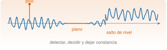
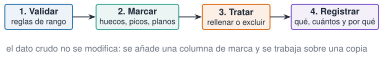

{.portada fig-alt="Una señal oscilante con tres defectos señalados en naranja: un pico aislado que sale muy por encima del resto, un tramo plano en el que la señal se queda constante y un salto de nivel tras el cual toda la señal queda desplazada hacia arriba"}

Los datos reales traen defectos: el sensor se cae un rato, un cable da un pico, un convertidor se queda enganchado en un valor, el sistema se reinicia y la señal cambia de nivel. Un análisis serio no los ignora ni los borra en silencio: los **detecta, decide qué hacer con ellos y lo deja escrito**. Esta unidad enseña cuatro familias de defectos (huecos, picos, tramos planos y saltos), cómo detectarlos y, sobre todo, cómo **comprobar que el remedio no es peor que la enfermedad**: se inyectan defectos conocidos en una señal buena para poder medir cuánto acierta cada método.

::: {.callout-note}
## Cómo se lee esta unidad
**Tiempo orientativo: 90 minutos.** Objetivos (4), teoría en cuatro píldoras (18), práctica guiada (40), «Pídeselo a Claude» (12), ejercicios (14) y cierre (2). Los defectos de la práctica se **añaden a propósito** a una señal sintética limpia, con posiciones fijas, para conocer la respuesta correcta.
:::

```{julia}
#| include: false
using CSV, DataFrames, Dates, Statistics, Random, Resonancia
include("../../../recursos/r1-datos/_tema.jl")
RAIZ = "../../../"
```

## Objetivos y prerrequisitos

**Objetivos.** Al terminar esta unidad sabrás:

- escribir reglas de validación (rango, tipo, unicidad) y contar sus violaciones;
- localizar huecos y rellenarlos con un método elegido y **evaluado**;
- detectar picos aislados, tramos planos y saltos de nivel en una señal;
- distinguir un valor **erróneo** de uno **atípico pero cierto**, y justificar la decisión;
- registrar qué se ha detectado, cuántos puntos afecta y qué se ha hecho.

**Prerrequisitos.** El curso no los impone en el temario; conviene J1.6 (ausentes), J2.1 (registro de decisiones) y J2.2 (huecos en series temporales).

**Reparto con otras unidades.** Aquí se detecta y se trata. El efecto de los defectos en el espectro y el diseño de filtros están en [J3.8](../../j3-computacion/j3-8-senales/index.qmd) y M3–M4.

## Teoría breve

::: {.callout-note .historia icon=false title="Un poco de historia: la mediana contra los valores extremos"}
La media se deja arrastrar por un solo dato extremo; la **mediana** no. Con esa idea, Frank Hampel destacó en 1974 la **desviación absoluta mediana** (MAD, la mediana de las distancias de cada dato a la mediana) como medida de dispersión muy robusta: tolera que hasta casi la mitad de los datos estén contaminados antes de dejar de ser fiable [@hampel1974]. La constante 1,4826 que aparece en los detectores de atípicos solo reescala la MAD para que, si los datos fueran normales, se pareciera a la desviación típica (1/0,6745 ≈ 1,4826).

<span class="fuentes-caja">Fuente: Hampel (1974), *J. Amer. Statist. Assoc.* 69 [@hampel1974]. Datos bibliográficos y definición comprobados en resultados de búsqueda y en una fuente secundaria, no en el original; el valor de la constante es la inversa del cuantil 0,75 de la normal. Consultado el 26-10-2026.</span>
:::

### J2.3.1 Validar antes de limpiar {#j2-3-1}

Antes de tocar nada se escriben las **reglas** que los datos deben cumplir y se cuentan las violaciones: un rango físico (`0 < horas_parada ≤ 72`), un conjunto de valores admitidos (`tipo` ∈ {correctivo, preventivo}), un intervalo de fechas, una clave única. Es el «contrato» de la tabla (J1.6), ahora ejecutable:

```{julia}
ot = CSV.read(RAIZ * "datos/sinteticos/curso-claude/c_mantenimiento.csv", DataFrame; stringtype=String)
reglas = [
    "horas_parada entre 0 y 72 h" => r -> 0 < r.horas_parada <= 72,
    "tipo admitido" => r -> r.tipo in ("correctivo", "preventivo"),
    "fecha en 2025" => r -> year(r.fecha_apertura) == 2025,
    "coste no negativo (si existe)" => r -> ismissing(r.coste_eur) || r.coste_eur >= 0,
]
informe = DataFrame(regla=first.(reglas), violaciones=[count(!last(rg), eachrow(ot)) for rg in reglas])
(informe = informe, ordenes_duplicadas = count(nonunique(ot, :orden)), costes_ausentes = count(ismissing, ot.coste_eur))
```

Todas las reglas se cumplen (0 violaciones) y solo hay 3 costes ausentes, que se conocen desde J1.6. Una tabla que pasa la validación **no está por ello libre de problemas**, pero una que no la pasa tiene un problema seguro.

::: {.ejercicio tipo="abierta" id="j2-3-1-reglas"}
Propón tres reglas de validación para una columna `temperatura_C` de un termohigrómetro de nave.

::: {.criterios}
- Una regla de rango físico razonable (por ejemplo, entre −20 y 60 °C).
- Una regla de coherencia temporal (por ejemplo, que no cambie más de 5 °C en 10 minutos).
- Una regla de completitud (porcentaje máximo de ausentes) o de unicidad de instantes.
:::
:::

### J2.3.2 Huecos {#j2-3-2}

Un **hueco** es una secuencia de muestras que faltan. Se localizan agrupando los `missing` consecutivos, y se decide: dejarlos como hueco (lo más honesto), **rellenarlos** o **excluir** ese tramo. Rellenar es una hipótesis sobre lo que habría pasado, y como toda hipótesis **se evalúa**: se abre un hueco artificial en un sitio donde se conoce el valor y se compara el relleno con la verdad.

Dos métodos sencillos: la **interpolación lineal** entre los extremos del hueco, y el **perfil del ciclo diario** (la media de esa hora del día en los otros días). Se prueban en el registro de temperatura con dos huecos artificiales, uno de 13 muestras (2 h, como el hueco real del sensor) y otro de 60 (10 h, de noche):

```{julia}
amb = CSV.read(RAIZ * "datos/sinteticos/curso-claude/d_ambiental.csv", DataFrame; types=Dict(:instante => DateTime))
T = amb.temperatura_C
hueco_real = findall(ismissing, T)
franja(k) = hour(amb.instante[k]) * 6 + minute(amb.instante[k]) ÷ 10          # 0:00 → 0, 0:10 → 1, …
function rellenos(ini, largo)
    m = ini:ini+largo-1
    excluir = Set(vcat(collect(m), hueco_real))
    i0, i1 = ini - 1, ini + largo
    lineal = [T[i0] + (T[i1] - T[i0]) * (k - i0) / (i1 - i0) for k in m]
    perfil = Dict(s => mean(T[k] for k in eachindex(T) if franja(k) == s && !(k in excluir) && !ismissing(T[k])) for s in 0:143)
    ciclo = [perfil[franja(k)] for k in m]
    verdad = Float64.(T[m])
    (m = m, verdad = verdad, lineal = lineal, ciclo = ciclo,
     rmse_lineal = sqrt(mean((lineal .- verdad) .^ 2)), rmse_ciclo = sqrt(mean((ciclo .- verdad) .^ 2)))
end
corto = rellenos(1177, 13)       # 04:00–06:00, como el hueco real
largo = rellenos(1130, 60)       # 20:00–06:00
(hueco_real_del_sensor = (primer_indice = first(hueco_real), muestras = length(hueco_real)),
 RMSE_13_muestras = (lineal = round(corto.rmse_lineal, digits=2), ciclo = round(corto.rmse_ciclo, digits=2)),
 RMSE_60_muestras = (lineal = round(largo.rmse_lineal, digits=2), ciclo = round(largo.rmse_ciclo, digits=2)))
```

```{julia}
#| label: fig-huecos
#| fig-cap: "Relleno de un hueco artificial de 60 muestras (10 h de noche) en la temperatura de la nave. La interpolación lineal (discontinua gris) no sabe que por la noche la temperatura baja y sube: no recupera el mínimo (error de 2,4 °C). El perfil del ciclo diario (naranja) lo reproduce bien (0,4 °C)."
#| fig-alt: "Gráfica de la temperatura en grados frente al tiempo durante unas 14 horas alrededor de una noche. La curva verdadera (azul) baja hasta un mínimo y vuelve a subir. Una línea recta gris discontinua une los extremos del hueco y pasa muy por encima del mínimo. Una curva naranja sigue de cerca a la azul."
let
    ctx = (largo.m[1]-24):(largo.m[end]+24)
    t = (ctx .- largo.m[1]) ./ 6
    fig = Figure(size=(720, 330))
    ax = Axis(fig[1, 1], xlabel="tiempo desde el inicio del hueco (h)", ylabel="temperatura (°C)")
    vspan!(ax, 0, 10, color=(GRIS, 0.12))
    lines!(ax, t, Float64.(T[ctx]), color=AZUL, label="verdad")
    lines!(ax, (largo.m .- largo.m[1]) ./ 6, largo.lineal, color=GRIS, linestyle=:dash, label="relleno lineal")
    lines!(ax, (largo.m .- largo.m[1]) ./ 6, largo.ciclo, color=NARANJA, label="perfil del ciclo diario")
    axislegend(ax, position=:rt)
    fig
end
```

Con un hueco corto, cualquiera de los dos métodos sirve (error de medio grado sobre una amplitud diaria de 10 °C); con uno largo, la interpolación lineal **ignora la física** y el perfil del ciclo gana por mucho. **El método de relleno depende de la longitud del hueco**, y se elige midiendo, no por costumbre.

::: {.callout-warning}
## Errores frecuentes
Rellenar un hueco largo con interpolación lineal y después calcular el espectro o la media diaria: se «inventa» una recta donde había un ciclo, y el resultado parece limpio y es falso. Otro: rellenar sin dejar una columna que **marque** qué valores son originales y cuáles rellenos.
:::

### J2.3.3 Tramos planos y saltos de nivel {#j2-3-3}

Dos defectos típicos de adquisición. Un **tramo plano** (el sensor o el convertidor se queda «enganchado» en un valor) se detecta como una secuencia de muestras **exactamente iguales**: en una señal real con ruido, es imposible que más de unas pocas muestras seguidas lo sean. Un **salto de nivel** (un reinicio, un cambio de offset) se detecta comparando la **mediana** de ventanas consecutivas: la mediana ignora los picos y revela el desplazamiento. Se prueba en la señal de vibración de una viga (200 Hz, 20,48 s), a la que se **inyectan** defectos en posiciones conocidas:

```{julia}
e = CSV.read(RAIZ * "datos/sinteticos/curso-claude/e_vibracion.csv", DataFrame)
x0 = e.aceleracion_m_s2                    # señal limpia: la verdad
fs = 200.0
N = length(x0)
pos_picos = [1105, 2340, 2700, 3409, 3508, 3872]
signos = [1, 1, 1, 1, -1, -1]
x = copy(x0)
x[pos_picos] .+= 5.0 .* signos             # 6 picos de ±5 m/s²
x[1500:1539] .= 0.0                        # tramo plano de 40 muestras (0,2 s)
x[3000:end] .+= 0.3                        # salto de +0,3 m/s² desde la muestra 3000
(muestras = N, duracion_s = N / fs, rango_de_la_señal_limpia = extrema(x0), rango_con_defectos = extrema(x))
```

```{julia}
function planos(v, minimo=10)
    tramos = Tuple{Int,Int}[]
    i = 1
    while i <= length(v)
        j = i
        while j < length(v) && v[j+1] == v[i]; j += 1; end
        j - i + 1 >= minimo && push!(tramos, (i, j))
        i = j + 1
    end
    return tramos
end
function saltos(v, ventana=200)
    med = [median(v[i:i+ventana-1]) for i in 1:ventana:length(v)-ventana+1]
    d = diff(med)
    k = argmax(abs.(d))
    return (ventana_tras_el_salto = k + 1, desde_la_muestra = k * ventana + 1, tamano = round(d[k], digits=3),
            segundo_mayor = round(sort(abs.(d), rev=true)[2], digits=3))
end
(planos_en_la_señal_limpia = planos(x0), planos_con_defectos = planos(x), salto = saltos(x), salto_en_la_limpia = saltos(x0))
```

El detector de planos encuentra exactamente las muestras 1500–1539 (y ninguno en la señal limpia). El de saltos señala la ventana que empieza en la muestra 3001, donde la mediana sube 0,35 m/s², unas ocho veces más que la segunda variación mayor (0,04): la diferencia es nítida y la posición, exacta (3000, la inyectada). En la señal limpia, en cambio, la mayor variación (0,046) apenas supera a la segunda (0,039): **no hay salto**, y por eso conviene comparar la mayor variación con la segunda y no mirar solo su tamaño.

::: {.ejercicio tipo="numerico" id="j2-3-3-plano" respuesta="0.2" tol="0%" unidad="s"}
El tramo plano tiene 40 muestras a 200 Hz. ¿Cuánto dura?

::: {.solucion}
$40/200=0{,}2$ s. Es corto en el tiempo, pero a 12,5 Hz (el primer modo de la viga) es más de dos oscilaciones perdidas.
:::
:::

### J2.3.4 Valores anómalos: erróneo no es lo mismo que atípico {#j2-3-4}

Detectar picos parece fácil («todo lo que se sale»), y es la parte más peligrosa de la limpieza. Tres criterios, con la misma señal (6 picos inyectados, 0 en la original):

1. **Rango físico**: el sensor mide como mucho ±3 m/s², luego `|x| > 3` es imposible.
2. **Z-score robusto**: $z=0{,}6745\,(x-\mathrm{mediana})/\mathrm{MAD}$, con un umbral (8).
3. **Filtro de Hampel**: compara cada muestra con la mediana de su entorno (ventana de 11 muestras) y marca las que se alejan más de 4 MAD locales.

```{julia}
med, mad = median(x), median(abs.(x .- median(x)))
z = 0.6745 .* (x .- med) ./ mad
function hampel(v, k=5, n=4)
    marcas = Int[]
    for i in eachindex(v)
        w = v[max(1, i - k):min(end, i + k)]
        m = median(w); s = 1.4826 * median(abs.(w .- m))
        s > 0 && abs(v[i] - m) > n * s && push!(marcas, i)
    end
    return marcas
end
criterios = [("rango físico |x| > 3", findall(abs.(x) .> 3)),
             ("z-score robusto > 8", findall(abs.(z) .> 8)),
             ("filtro de Hampel", hampel(x))]
DataFrame(criterio=first.(criterios), marcadas=length.(last.(criterios)),
          de_los_6_picos=[count(in(c), pos_picos) for c in last.(criterios)],
          falsos_positivos=[length(setdiff(c, pos_picos)) for c in last.(criterios)])
```

Los tres encuentran los seis picos, pero el rango físico **no marca nada más**, y los otros dos marcan decenas de puntos que **no son errores**: son las crestas legítimas de la propia vibración (la viga recibe impulsos y responde con oscilaciones amplias). Un criterio estadístico supone que «lo raro es lo erróneo», y en una señal de vibración **lo raro suele ser lo interesante**. La regla de oro: **donde exista un límite físico, se usa; los criterios estadísticos se reservan para marcar candidatos que luego se revisan**.

Otro ejemplo de lo mismo, con las órdenes de mantenimiento. La regla del rango intercuartílico (`Q3 + 1,5·IQR`) marca como «atípicas» 32 de las 180 órdenes por sus horas de parada si se aplica a todas; pero mezcla dos poblaciones distintas:

```{julia}
function cerca(h)
    q1, q3 = quantile(h, [0.25, 0.75])
    q3 + 1.5 * (q3 - q1)
end
porgrupo = combine(groupby(ot, :tipo), nrow => :ordenes, :horas_parada => median => :mediana_h,
    :horas_parada => maximum => :maximo_h, :horas_parada => (h -> count(>(cerca(h)), h)) => :atipicas_en_el_grupo)
(valla_global_h = round(cerca(ot.horas_parada), digits=2), atipicas_con_la_valla_global = count(>(cerca(ot.horas_parada)), ot.horas_parada),
 por_grupo = porgrupo)
```

Dentro de cada tipo de intervención **no hay ninguna atípica**: las 32 «anómalas» son averías correctivas (mediana de 5,6 h) comparadas con revisiones preventivas (1,2 h). La más larga, 28 h (OT-0073, bomba P-101, 9 424,25 €), es plausible para una avería grave. **Un valor atípico respecto de la población equivocada no es un error**.

::: {.callout-note .idea-clave}
## Idea clave
Limpiar es **decidir**, no «arreglar». Para cada defecto hay cuatro preguntas: ¿es un error o un dato cierto?, ¿cómo lo detecto sin marcar lo legítimo?, ¿qué hago (rellenar, excluir, corregir, dejarlo)? y ¿lo he dejado registrado? Y el dato crudo no se modifica: se marca y se trabaja sobre una copia.
:::

::: {.callout-warning}
## Errores frecuentes
(1) Eliminar los «atípicos» y comprobar después que el resultado mejora: se limpia hasta que el análisis sale como se esperaba. (2) Aplicar un umbral estadístico a una señal no estacionaria o resonante. (3) Rellenar todos los huecos con el mismo método. (4) Limpiar sin registrar cuántos puntos se han tocado: el lector no sabrá si fue el 0,1 % o el 20 %.
:::

{#fig-flujo fig-alt="Cuatro cajas en fila: validar con reglas de rango, marcar huecos, picos y planos, tratar rellenando o excluyendo, y registrar qué cuántos y por qué, con flechas entre ellas y una nota debajo que dice que el dato crudo no se modifica."}

### Para saber más {#j2-3-mas}

- Hampel, sobre la mediana y la MAD como medidas robustas [@hampel1974].
- Peng, sobre la reproducibilidad: toda limpieza debe quedar escrita y repetible [@peng2011].
- En este curso, cada conjunto de datos lleva en su ficha los `defectos_deliberados` que contiene (véase `datos/sinteticos/*/…meta.toml`).

## Práctica guiada

Vamos a **limpiar la señal de vibración con defectos** y a medir cuánto se parece el resultado a la señal original, que sabemos cuál es.

::: {.panel-tabset}
## Julia

**Paso 1. Marcar** (sin tocar los datos): una columna de estado por muestra.

```{julia}
estado = fill("ok", N)
estado[findall(abs.(x) .> 3)] .= "pico"
for (i, j) in planos(x); estado[i:j] .= "plano"; end
indice_salto = saltos(x).desde_la_muestra
(marcas = Dict(k => count(==(k), estado) for k in unique(estado)), salto_desde = indice_salto)
```

**Paso 2. Tratar.** Los picos (muestras sueltas) se sustituyen por la interpolación lineal de sus vecinas; el tramo plano **no se rellena** (0,2 s es demasiado en una señal que oscila a 12,5 y 41 Hz) y queda excluido; el salto se corrige restando la diferencia entre las medianas de 400 muestras antes y después.

```{julia}
y = copy(x)
for i in findall(estado .== "pico")
    y[i] = (y[i-1] + y[i+1]) / 2
end
desplazamiento = median(y[indice_salto:indice_salto+399]) - median(y[indice_salto-400:indice_salto-1])
y[indice_salto:end] .-= desplazamiento
fuera_del_plano = estado .!= "plano"
rmse(a, b) = sqrt(mean((a[fuera_del_plano] .- b[fuera_del_plano]) .^ 2))
(desplazamiento_estimado = round(desplazamiento, digits=3), desplazamiento_inyectado = 0.3,
 error_RMS_antes = round(rmse(x, x0), digits=4), error_RMS_despues = round(rmse(y, x0), digits=4),
 std_de_la_señal = round(std(x0), digits=3))
```

El error respecto de la señal original baja de 0,246 a 0,007 m/s² (frente a una desviación típica de la señal de 0,279): se ha recuperado casi todo. Queda un error residual porque sustituir un pico por la media de las vecinas no recupera exactamente una señal que oscila rápido, y porque el desplazamiento estimado (0,306) no es exactamente el inyectado (0,3). Se ve en detalle:

```{julia}
#| label: fig-limpieza
#| fig-cap: "Tres defectos y su tratamiento sobre la señal de vibración. Izquierda: un pico de +5 m/s² (naranja) sustituido por la media de sus vecinas (azul); la original, en gris. Centro: el tramo plano de 0,2 s (en naranja), que no se rellena y se excluye. Derecha: el salto de nivel de +0,3 m/s² en la muestra 3000 y la señal corregida."
#| fig-alt: "Tres paneles. En el primero, una oscilación con un pico muy alto aislado en naranja y la señal corregida en azul superpuesta a la original en gris. En el segundo, la señal oscilante se convierte en una línea horizontal naranja durante 0,2 segundos y vuelve a oscilar. En el tercero, la señal en naranja queda desplazada hacia arriba desde una muestra y la señal corregida en azul coincide con la original en gris."
let
    fig = Figure(size=(780, 300))
    t = (0:N-1) ./ fs
    r1 = 1085:1125; ax1 = Axis(fig[1, 1], title="pico (muestra 1105)", xlabel="t (s)", ylabel="a (m/s²)")
    lines!(ax1, t[r1], x0[r1], color=GRIS, label="original"); lines!(ax1, t[r1], x[r1], color=NARANJA, label="con pico"); lines!(ax1, t[r1], y[r1], color=AZUL, label="corregida")
    r2 = 1470:1570; ax2 = Axis(fig[1, 2], title="tramo plano (1500–1539)", xlabel="t (s)")
    lines!(ax2, t[r2], x0[r2], color=GRIS); lines!(ax2, t[r2], x[r2], color=NARANJA)
    r3 = 2900:3100; ax3 = Axis(fig[1, 3], title="salto de nivel (3000)", xlabel="t (s)")
    lines!(ax3, t[r3], x0[r3], color=GRIS); lines!(ax3, t[r3], x[r3], color=NARANJA); lines!(ax3, t[r3], y[r3], color=AZUL)
    Legend(fig[2, 1:3], ax1, orientation=:horizontal, framevisible=false)
    fig
end
```

**Paso 3. ¿Se ha conservado la información?** Se compara el espectro de Welch de la señal limpia, la que tiene defectos y la corregida: los picos de 12,5 y 41 Hz deben seguir en su sitio, y el suelo de ruido de alta frecuencia no debe haber subido por los picos.

```{julia}
function espectro(v)
    f, P = psd_welch(v, fs; nseg=1024)
    i = buscar_picos(f, P; fmin=5.0, fmax=60.0, n=2, separacion=5.0)
    (picos_Hz = round.(f[i], digits=2), suelo_70_100Hz = median(P[70 .<= f .<= 100]))
end
e0, ex, ey = espectro(x0), espectro(x), espectro(y)
(picos_original = e0.picos_Hz, picos_con_defectos = ex.picos_Hz, picos_corregida = ey.picos_Hz,
 suelo_con_defectos_sobre_original = round(ex.suelo_70_100Hz / e0.suelo_70_100Hz, digits=2),
 suelo_corregida_sobre_original = round(ey.suelo_70_100Hz / e0.suelo_70_100Hz, digits=2))
```

Los picos modales no se mueven en ningún caso (12,3 y 41,0 Hz con la resolución de 0,195 Hz del espectro; las frecuencias nominales de la viga son 12,5 y 41 Hz), que es lo que más importa para identificar. Pero los defectos **multiplican por unas 11 el suelo de ruido** de alta frecuencia (seis picos son seis impulsos: energía en todas las frecuencias), y la limpieza lo devuelve al de la señal original (cociente 0,99). Los picos de las frecuencias propias sobreviven, pero el **amortiguamiento** que se estimase con un suelo contaminado saldría distinto: de ahí la importancia de limpiar.

**Paso 4. El registro de decisiones.** Lo que hay que dejar escrito, y que la página ya ha calculado:

```{julia}
registro = DataFrame(
    defecto = ["picos", "tramo plano", "salto de nivel"],
    deteccion = ["|x| > 3 m/s² (rango físico)", "≥ 10 muestras idénticas", "mediana de ventanas de 200 muestras"],
    afectadas = [count(estado .== "pico"), count(estado .== "plano"), N - indice_salto + 1],
    accion = ["interpolar entre vecinas", "excluir (no rellenar)", "restar el desplazamiento estimado (0,306 m/s²)"],
    porcentaje = round.(100 .* [count(estado .== "pico"), count(estado .== "plano"), N - indice_salto + 1] ./ N, digits=2))
registro
```

## Python

La versión probada con `pytest`, con los resultados contrastados con los de Julia (mismas posiciones de defectos), está en `python/limpieza.py`: `inyectar_defectos`, `fuera_de_rango`, `z_mad`, `hampel`, `tramos_planos` y `salto_por_medianas`.

```python
import pandas as pd
from limpieza import inyectar_defectos, fuera_de_rango, z_mad, hampel, tramos_planos, salto_por_medianas

x0 = pd.read_csv("datos/sinteticos/curso-claude/e_vibracion.csv")["aceleracion_m_s2"].to_numpy()
x = inyectar_defectos(x0)
print(len(fuera_de_rango(x, 3.0)))          # 6 picos, 0 falsos positivos
print((abs(z_mad(x)) > 8).sum())            # 13 marcas (6 picos + 7 crestas legítimas)
print(len(hampel(x)))                       # 27 marcas (6 + 21 falsos positivos)
print(tramos_planos(x))                     # [(1499, 1538)]  (índices desde 0)
print(salto_por_medianas(x))                # (15, 0.346): la ventana 16 (desde 1)
```

`pandas` ofrece `rolling(...).median()` y `interpolate()` para el relleno, y `scipy.signal.medfilt` para filtros de mediana; lo importante, como en Julia, es **medir** el método sobre defectos conocidos antes de aplicarlo a datos reales.
:::

::: {.callout-note}
## Qué se ha conseguido
Reglas de validación ejecutables, un método de relleno elegido por medida (y no por costumbre), tres detectores de defectos con su tasa de acierto y de falsos positivos, una corrección que reduce el error de 0,246 a 0,007 m/s², un espectro que conserva los modos, y una tabla de decisiones que recoge qué se ha hecho y a qué porcentaje de los datos afecta.
:::

## «Pídeselo a Claude» {#pideselo}

::: {.callout-tip}
## Prompt
«Con Julia, `--project=.`, `CSV.jl` y `DataFrames.jl`: lee `datos/sinteticos/curso-claude/e_vibracion.csv` (200 Hz). Copia la señal, suma 5 m/s² (con los signos +,+,+,+,−,−) en las muestras 1105, 2340, 2700, 3409, 3508 y 3872, pon a 0 las muestras 1500 a 1539 y suma 0,3 desde la 3000. Escribe detectores para (1) picos por rango físico `|x| > 3`, (2) tramos planos de al menos 10 muestras iguales y (3) saltos de nivel por mediana de ventanas de 200 muestras. Aplica cada uno, dime cuántos defectos detecta y cuántos falsos positivos tiene respecto de lo inyectado, y corrige los picos interpolando y el salto restando el desplazamiento. No modifiques la señal original ni el CSV; trabaja sobre una copia. No inventes cifras: si algo no sale, dilo.»

**Verifica.** (a) Que el rango físico marca exactamente 6 muestras y ninguna más. (b) Que el tramo plano detectado es 1500–1539. (c) Que el salto se ubica en la muestra 3001 con una variación de mediana de 0,35 m/s². (d) Que el error RMS respecto de la original baja de unos 0,25 a unos 0,007 m/s² (fuera del tramo plano). (e) Que ha dejado una tabla o registro de qué ha detectado, cuántos puntos afecta y qué ha hecho. (f) Que no ha eliminado sin más los picos estadísticos (z-score) y que no ha rellenado el tramo plano.
:::

## Ejercicios

::: {.ejercicio tipo="numerico" id="j2-3-picos" respuesta="6" tol="0%" unidad="muestras"}
¿Cuántas muestras de la señal con defectos superan 3 m/s² en valor absoluto (y ninguna de la señal limpia)?

::: {.solucion}
6, justo los picos inyectados: el límite físico es el criterio más limpio.
:::
:::

::: {.ejercicio tipo="numerico" id="j2-3-falsos" respuesta="21" tol="0%" unidad="falsos positivos"}
¿Cuántos falsos positivos tiene el filtro de Hampel (ventana de 11, umbral 4) sobre la señal con defectos?

::: {.solucion}
21: marca 27 muestras, de las que solo 6 son picos inyectados. El resto son crestas legítimas de la vibración.
:::
:::

::: {.ejercicio tipo="vf" id="j2-3-atipico" respuesta="falso"}
Un valor que supera la valla `Q3 + 1,5·IQR` de una columna es siempre un error y conviene eliminarlo.

::: {.solucion}
Falso. Es solo un candidato: puede ser un dato cierto (una avería larga) o proceder de otra población. Se decide con el contexto físico o de negocio y se registra.
:::
:::

::: {.ejercicio tipo="abierta" id="j2-3-hueco"}
Tienes que rellenar un hueco de 8 horas en un registro de temperatura exterior. Explica qué harías antes de elegir el método y cómo comprobarías que es razonable.

::: {.criterios}
- Dice que el método depende de la longitud del hueco y de si la variable tiene ciclo (diario, estacional).
- Propone abrir huecos artificiales en zonas conocidas y medir el error de cada método (como en la práctica).
- Menciona dejar una marca de «valor rellenado» y registrar la decisión.
:::
:::

## La doy por superada si… {#superada}

- Escribo reglas de validación ejecutables y cuento sus violaciones.
- Localizo huecos y elijo el método de relleno midiendo su error.
- Detecto planos y saltos, y comparo criterios de picos por aciertos y falsos positivos.
- Distingo un valor erróneo de uno atípico y justifico lo que hago.
- Dejo un registro de qué se detectó, a cuántos puntos afecta y qué se hizo.

**Cierre.** Escribe tres líneas: qué he entendido, qué todavía no domino y cuál es mi siguiente paso pequeño. Antes de aceptar una limpieza hecha por Claude, pídele la tabla de qué ha marcado y cuántos puntos ha tocado, y comprueba por tu cuenta un caso.

**Siguiente:** [J2.4 · Makie avanzado](../j2-4-makie/index.qmd).
