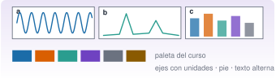

{.portada fig-alt="Una figura de tres paneles rotulados a, b y c: una serie temporal, un espectro con picos marcados y un diagrama de barras; debajo, seis cuadrados de la paleta de colores del curso y la leyenda ejes con unidades, pie y texto alternativo"}

Una figura de un informe o de un artículo se lee en pocos segundos y se juzga por ella. En J1.7 se aprendió a dibujar series y espectros. Esta unidad da el salto a la **figura de publicación**: varios paneles con rotulado, una paleta que se distingue también en blanco y negro y para personas daltónicas, un tamaño pensado para una columna de revista, varios formatos de exportación y, cuando la web lo permite, un control **interactivo** para explorar un parámetro. El ejemplo conduce a una pregunta de la vía M: *¿han cambiado las frecuencias del edificio, o es solo variabilidad entre estimaciones?*

::: {.callout-note}
## Cómo se lee esta unidad
**Tiempo orientativo: 90 minutos.** Objetivos (4), teoría en cinco píldoras (18), práctica guiada (40), «Pídeselo a Claude» (12), ejercicios (14) y cierre (2). Las figuras se hacen con `CairoMakie`; la simulación interactiva, con JavaScript (OJS) y deslizadores, que se ejecuta en el navegador y no necesita Julia.
:::

```{julia}
#| include: false
using CSV, DataFrames, Statistics, Random, Resonancia
include("../../../recursos/r1-datos/_tema.jl")
RAIZ = "../../../"
```

## Objetivos y prerrequisitos

**Objetivos.** Al terminar esta unidad sabrás:

- componer una figura de varios paneles con rejilla, rotulado, ejes enlazados y leyenda compartida;
- usar una paleta accesible y comprobar su contraste con la relación de contraste de WCAG;
- elegir el gráfico adecuado para comparar grupos (cajas con los puntos individuales) y dibujar una referencia teórica;
- dimensionar y exportar una figura (SVG, PDF y PNG) y comprobar el resultado;
- leer una simulación interactiva y explicar sus hipótesis.

**Prerrequisitos.** El curso no los impone en el temario; conviene J1.7 (primeras figuras con `CairoMakie`).

**Reparto con otras unidades.** Las figuras de mecánica y los esquemas se dibujan con TikZ, no con Makie (regla del curso). El análisis estadístico de las diferencias entre grupos está en [J2.6](../j2-6-inferencia/index.qmd).

## Teoría breve

::: {.callout-note .historia icon=false title="Un poco de historia: Makie"}
Makie nació como un proyecto de visualización de Simon Danisch y se describe como una biblioteca flexible y de alto rendimiento para Julia en el artículo que Danisch y Julius Krumbiegel publicaron en el *Journal of Open Source Software* en septiembre de 2021 [@danisch2021]. Su diseño separa **qué** se dibuja (la figura, los ejes, los gráficos) de **con qué motor** se dibuja: GLMakie (OpenGL, para figuras interactivas), CairoMakie (gráficos estáticos vectoriales), WGLMakie (en el navegador) y RPRMakie (experimental, con trazado de rayos) [@makie-docs]. Por eso el mismo código de una figura sirve para explorar en pantalla y para exportar un PDF.

<span class="fuentes-caja">Fuente: Danisch y Krumbiegel (2021) [@danisch2021] y la documentación de Makie [@makie-docs]. Consultadas el 26-10-2026; del artículo se han comprobado los datos bibliográficos en resultados de búsqueda, no el texto.</span>
:::

### J2.4.1 Rejillas, paneles y rotulado {#j2-4-1}

Una figura es una **rejilla** (`fig[fila, columna]`) de paneles. Un panel puede ocupar varias celdas (`fig[2, 1:2]`), dos ejes pueden **enlazarse** (`linkxaxes!`) para que muevan sus límites a la vez, y una única `Legend` o `Colorbar` puede servir para toda una fila. En una figura de publicación, cada panel lleva una letra, (a), (b), (c), para poder referirse a él en el texto:

```{julia}
#| label: fig-rejilla
#| fig-cap: "Rejilla de 2 × 2 con un panel que ocupa dos columnas, ejes enlazados y rotulado de paneles. Es la estructura de las figuras de publicación de este curso."
#| fig-alt: "Una figura con tres paneles: arriba, dos gráficos pequeños lado a lado, rotulados a y b, que comparten el eje horizontal y muestran un seno y un coseno; abajo, un tercer gráfico, rotulado c, que ocupa todo el ancho y muestra la suma de ambos."
let
    t = 0:0.01:2π
    fig = Figure(size=(600, 360))
    ax1 = Axis(fig[1, 1], ylabel="amplitud (adim.)")
    ax2 = Axis(fig[1, 2])
    ax3 = Axis(fig[2, 1:2], xlabel="fase (rad)", ylabel="amplitud (adim.)")
    lines!(ax1, t, sin.(t), color=AZUL); lines!(ax2, t, cos.(t), color=NARANJA)
    lines!(ax3, t, sin.(t) .+ cos.(t), color=VERDE)
    linkxaxes!(ax1, ax2)
    hidexdecorations!(ax1, grid=false); hidexdecorations!(ax2, grid=false); hideydecorations!(ax2, grid=false)
    for (ax, letra) in zip((ax1, ax2, ax3), ("a", "b", "c"))
        text!(ax, 0.02, 0.97, text="($letra)", space=:relative, align=(:left, :top), font=:bold)
    end
    fig
end
```

::: {.ejercicio tipo="vf" id="j2-4-1-enlace" respuesta="verdadero"}
Con `linkxaxes!(ax1, ax2)`, al cambiar los límites del eje horizontal de un panel cambian también los del otro.

::: {.solucion}
Verdadero. Es útil para comparar dos señales sobre la misma ventana de tiempo o de frecuencia sin repetir las etiquetas del eje.
:::
:::

### J2.4.2 Tema, paleta y accesibilidad {#j2-4-2}

Un **tema** fija de una vez fuentes, grosores y colores de todas las figuras: `set_theme!(...)` para toda la sesión, `with_theme(f, tema)` para una figura. El curso usa la paleta de `recursos/r1-datos/_tema.jl`, que se aplica a todas las páginas. Dos criterios la hacen **accesible**: que los colores tengan **contraste suficiente** con el fondo y que **el color no sea la única señal** (se añade trazo, marcador o etiqueta). La pauta de accesibilidad WCAG 2.1 pide una relación de contraste de al menos 3:1 para los elementos gráficos necesarios para entender el contenido [@wcag21], con la relación $(L_1+0{,}05)/(L_2+0{,}05)$ entre las luminancias relativas de dos colores:

```{julia}
canal(c) = c <= 0.03928 ? c / 12.92 : ((c + 0.055) / 1.055)^2.4
function luminancia(color)
    rgb = Makie.Colors.RGB(color)
    0.2126 * canal(Float64(rgb.r)) + 0.7152 * canal(Float64(rgb.g)) + 0.0722 * canal(Float64(rgb.b))
end
contraste(a, b=colorant"white") = let (l1, l2) = sort([luminancia(a), luminancia(b)], rev=true); (l1 + 0.05) / (l2 + 0.05) end
paleta = ["azul" => AZUL, "naranja" => NARANJA, "verde" => VERDE, "violeta" => VIOLETA, "gris" => GRIS, "tinta" => TINTA]
DataFrame(color=first.(paleta), contraste_con_blanco=[round(contraste(c), digits=2) for c in last.(paleta)],
          supera_3_a_1=[contraste(c) >= 3 for c in last.(paleta)])
```

Los seis colores superan 3:1 con el fondo blanco; el naranja y el verde lo hacen con poco margen, y por eso **nunca se distinguen solo por el color**: la comparación de la práctica usa también trazo continuo y discontinuo.

::: {.callout-warning}
## Errores frecuentes
(1) Dos curvas distinguibles solo por rojo y verde: quien tiene una deficiencia roja-verde no las separa; las cifras orientativas que se repiten son de en torno a 1 de cada 12 hombres y 1 de cada 200 mujeres, y varían según la población. (2) Texto de ejes o leyendas demasiado pequeño al reducir la figura a una columna: se prueba la figura **a su tamaño final**. (3) Paletas arcoíris para magnitudes continuas: dan relieve falso; se prefieren escalas de un solo tono o perceptualmente uniformes (`:viridis`).
:::

### J2.4.3 Comparar grupos {#j2-4-3}

Para comparar una magnitud entre grupos, el **diagrama de cajas** (`boxplot!`) resume mediana, cuartiles y extremos, y superponer los **puntos individuales** (con un pequeño desplazamiento horizontal) evita esconder cuántos datos hay y cómo se reparten. Una **línea horizontal discontinua** con el valor teórico (aquí, la frecuencia propia del modelo) da la referencia. Esto es lo que se hace en la práctica con las estimaciones de frecuencia por segmentos de 60 s del edificio en tres estados.

### J2.4.4 Tamaño y exportación {#j2-4-4}

Una figura de revista debe caber en una **columna** (el ejemplo habitual es de unos 252 pt, 3,5 pulgadas) o en **dos** (504 pt, 7 pulgadas); las dimensiones concretas y el tamaño mínimo de letra los fija cada revista, y hay que consultarlos (@fig-columnas). En `CairoMakie` el tamaño `size=(ancho, alto)` está en puntos (1 pt = 1/72 pulgada) y se guarda con `save("fig.svg" | "fig.pdf" | "fig.png", fig)`: **SVG y PDF son vectoriales** (se ven bien a cualquier escala) y PNG es un mapa de bits cuya resolución se controla con `px_per_unit`.

{#fig-columnas fig-alt="Un rectángulo que representa una página con dos columnas de texto; la columna izquierda está marcada como una columna de unos 252 puntos de ancho y una cota inferior abarca las dos columnas con 504 puntos."}

::: {.ejercicio tipo="numerico" id="j2-4-4-pt" respuesta="504" tol="0%" unidad="pt"}
Una figura de dos columnas de 7 pulgadas, ¿cuántos puntos de ancho tiene (1 pulgada = 72 pt)?

::: {.solucion}
$7\cdot72=504$ pt, que es el `size` que se pasa a `Figure`.
:::
:::

### J2.4.5 Figuras interactivas en la web {#j2-4-5}

`GLMakie` y `WGLMakie` permiten figuras interactivas, pero requieren un servidor o una ventana de Julia, que la web estática de este curso no tiene. Para explorar un parámetro se usa **OJS** (Observable JavaScript), que Quarto ejecuta en el navegador: un deslizador y una curva que se redibuja al moverlo. La **Simulación 1** muestra la respuesta en frecuencia de un oscilador de un grado de libertad, $|H(f)|=1/\sqrt{(1-r^2)^2+(2\zeta r)^2}$ con $r=f/f_n$, para ver cómo el **amortiguamiento** ensancha y baja el pico:

```{ojs}
//| echo: false
viewof zeta = Inputs.range([0.005, 0.5], {value: 0.05, transform: Math.log, label: "ζ (adim.)", step: 0.001})
viewof fn = Inputs.range([0.5, 5], {value: 1.1, step: 0.05, label: "fₙ (Hz)"})
```

```{ojs}
//| echo: false
FRF = d3.range(0.05, 6, 0.01).map(f => {const r = f / fn; return [f, 1 / Math.sqrt((1 - r*r)**2 + (2*zeta*r)**2)];})
Plot.plot({
  width: 640, height: 320, marginLeft: 55, grid: true,
  x: {label: "frecuencia (Hz)"},
  y: {type: "log", label: "|H| (adim.)", domain: [0.05, 100]},
  marks: [
    Plot.line(FRF, {stroke: "#1B6CA8", strokeWidth: 2}),
    Plot.ruleX([fn], {stroke: "#D95F02", strokeDasharray: "5,4"}),
    Plot.dot([[fn, 1 / (2*zeta*Math.sqrt(1 - zeta*zeta))]], {fill: "#D95F02", r: 5})
  ]
})
```

```{ojs}
//| echo: false
md`Pico de amplitud: **${(1 / (2*zeta*Math.sqrt(1 - zeta*zeta))).toFixed(1)}** (adim.) en f ≈ ${(fn * Math.sqrt(1 - 2*zeta*zeta)).toFixed(3)} Hz. Ancho de banda a −3 dB aproximado: **${(2*zeta*fn).toFixed(3)} Hz**.`
```

::: {.callout-note}
## Hipótesis y límites de la simulación 1
Es un sistema lineal de un grado de libertad con amortiguamiento viscoso, sin ruido. Las fórmulas del pico (amplitud $1/(2\zeta\sqrt{1-\zeta^2})$) y del ancho de banda ($\approx2\zeta f_n$) son exactas o buenas aproximaciones solo para amortiguamientos pequeños (ζ ≲ 0,1). Con $\zeta=0{,}01$ y $f_n=1{,}1$ Hz, como en un edificio real, el pico llega a 50 y su ancho es de 0,022 Hz: por eso hace falta una buena resolución en frecuencia para verlo (J3.8).
:::

::: {.callout-note .idea-clave}
## Idea clave
Una buena figura **responde a una pregunta**: tiene ejes con unidades, un pie que dice qué se ve y qué se concluye, un texto alternativo, colores que se distinguen sin el color y un tamaño pensado para donde se va a publicar.
:::

### Para saber más {#j2-4-mas}

- Documentación de Makie, con los cuatro motores y la galería de gráficos [@makie-docs].
- Danisch y Krumbiegel, el artículo de presentación de Makie [@danisch2021].
- Pauta de accesibilidad WCAG 2.1 [@wcag21].

## Práctica guiada

Vamos a construir una **figura de publicación de tres paneles** para el edificio de tres plantas: (a) los espectros de los tres estados (referencia, variabilidad ambiental y daño), con las curvas distinguibles también en blanco y negro; (b) las estimaciones de la frecuencia del tercer modo en segmentos de 60 s; (c) las del primer modo. Los tres estados proceden de `datos/sinteticos/edificio-3-plantas/` y se describen en [J1.7](../../j1-esencial/j1-7-visualizacion/index.qmd).

::: {.panel-tabset}
## Julia

**Paso 1. Estimaciones por segmentos.** El registro de 600 s de cada estado se divide en 10 segmentos de 60 s; en cada uno se calcula el espectro de Welch y se toma la frecuencia del pico cercano a cada modo. Se compara con la frecuencia del modelo (la de `edificio_tres_plantas`).

```{julia}
estados = [("A", "referencia", :A), ("B", "variabilidad ambiental (−1 % de rigidez)", :B), ("C", "daño en el entrepiso 2", :C)]
leer(esc) = CSV.read(RAIZ * "datos/sinteticos/edificio-3-plantas/escenario_$esc.csv", DataFrame; delim=';')
datos = Dict(esc => leer(esc) for (esc, _, _) in estados)
function por_segmentos(y; banda, seg=6000, nseg=2048)
    map(1:length(y)÷seg) do k
        f, P = psd_welch(y[(k-1)*seg+1:k*seg], 100.0; nseg=nseg)
        f[buscar_picos(f, P; fmin=banda[1], fmax=banda[2], n=1)[1]]
    end
end
f1 = Dict(esc => por_segmentos(datos[esc].a3_ms2, banda=(0.8, 1.5)) for (esc, _, _) in estados)
f3 = Dict(esc => por_segmentos(datos[esc].a3_ms2, banda=(3.8, 5.0)) for (esc, _, _) in estados)
modelo = Dict(esc => first(modos_propios(edificio_tres_plantas(escenario=e)[3], edificio_tres_plantas(escenario=e)[1])) for (esc, _, e) in estados)
DataFrame(estado=first.(estados),
          f1_media_Hz=[round(mean(f1[e]), digits=4) for (e, _, _) in estados], f1_desv_Hz=[round(std(f1[e]), digits=4) for (e, _, _) in estados],
          f1_modelo_Hz=[round(modelo[e][1], digits=4) for (e, _, _) in estados],
          f3_media_Hz=[round(mean(f3[e]), digits=4) for (e, _, _) in estados], f3_desv_Hz=[round(std(f3[e]), digits=4) for (e, _, _) in estados],
          f3_modelo_Hz=[round(modelo[e][3], digits=4) for (e, _, _) in estados])
```

La media de las diez estimaciones se aproxima al modelo (dentro de la resolución de 0,049 Hz de cada espectro), y la dispersión entre segmentos es de 0,02–0,04 Hz. Los estados A y C se separan con claridad en el tercer modo (4,419 frente a 4,273 Hz, una diferencia de 0,15 Hz de unas 4 desviaciones típicas); A y B, que difieren solo en un 1 % de rigidez (≈0,5 % en frecuencia, 0,02 Hz), **no**: el solapamiento entre ambos es casi total. Es exactamente la pregunta de J2.6.

**Paso 2. La figura de tres paneles.** Dos columnas de revista (504 pt de ancho).

```{julia}
#| label: fig-publicacion
#| fig-cap: "Figura de publicación para el edificio de tres plantas, a tamaño de dos columnas (504 × 210 pt). (a) Espectros de la planta 3 en el estado de referencia (línea continua azul), con variabilidad ambiental (discontinua naranja) y con daño (punteada verde), en la zona del tercer modo. (b) Frecuencia del tercer modo estimada en 10 segmentos de 60 s de cada estado (cajas y puntos); la línea horizontal es el valor del modelo. (c) Lo mismo para el primer modo."
#| fig-alt: "Tres paneles rotulados a, b y c. En a, tres espectros entre 3,8 y 5 hercios con un pico cerca de 4,4 hercios en el estado de referencia, 4,37 en variabilidad ambiental y 4,25 en daño, distinguidos por tipo de línea. En b, tres diagramas de cajas con diez puntos cada uno, del estado A, B y C, con el estado C visiblemente más bajo; en c, lo mismo para el primer modo, con el estado C más bajo y A y B solapados."
let
    estilo = Dict("A" => (AZUL, :solid), "B" => (NARANJA, :dash), "C" => (VERDE, :dot))
    fig = Figure(size=(504, 210), fontsize=9)
    axa = Axis(fig[1, 1], xlabel="frecuencia (Hz)", ylabel="PSD ((m/s²)²/Hz)", yscale=log10, limits=((3.8, 5.0), nothing))
    for (esc, _, _) in estados
        f, P = psd_welch(datos[esc].a3_ms2, 100.0; nseg=4096)
        m = 3.8 .<= f .<= 5.0
        lines!(axa, f[m], P[m], color=estilo[esc][1], linestyle=estilo[esc][2], linewidth=1.4, label=esc)
    end
    axislegend(axa, "estado", position=:rt, framevisible=false, patchsize=(18, 8))
    ejes = Any[axa]
    for (j, (datos_f, ylab, k)) in enumerate([(f3, "f₃ (Hz)", 3), (f1, "f₁ (Hz)", 1)])
        ax = Axis(fig[1, 1+j], ylabel=ylab, xlabel="estado", xticks=(1:3, ["A", "B", "C"]))
        push!(ejes, ax)
        for (i, (esc, _, _)) in enumerate(estados)
            boxplot!(ax, fill(i, 10), datos_f[esc], color=(estilo[esc][1], 0.25), width=0.55, strokecolor=estilo[esc][1], whiskercolor=estilo[esc][1])
            scatter!(ax, i .+ 0.08 .* (rand(MersenneTwister(i), 10) .- 0.5), datos_f[esc], color=estilo[esc][1], markersize=4)
            hlines!(ax, modelo[esc][k], xmin=(i-0.4)/3.2, xmax=(i+0.4)/3.2, color=:black, linestyle=:dash, linewidth=1)
        end
    end
    for (ax, letra) in zip(ejes, ("a", "b", "c"))
        text!(ax, 0.03, 0.96, text="($letra)", space=:relative, align=(:left, :top), font=:bold, fontsize=11)
    end
    colgap!(fig.layout, 14)
    fig
end
```

La figura cuenta lo que ve el ojo: en (a) los picos del tercer modo se desplazan hacia la izquierda de A a B (poco) y a C (mucho); en (b) las cajas de A y C **no se solapan** y las de A y B **sí**; (c) repite la historia para el primer modo, donde la separación entre A y C es menor.

**Paso 3. Exportar y comprobar.** Un SVG y un PDF (vectoriales) y un PNG de 4 píxeles por punto, en una carpeta temporal:

```{julia}
fig_c = Figure(size=(252, 190), fontsize=9)
axc = Axis(fig_c[1, 1], xlabel="estado", ylabel="f₃ (Hz)", xticks=(1:3, ["A", "B", "C"]))
for (i, (esc, _, _)) in enumerate(estados); boxplot!(axc, fill(i, 10), f3[esc], color=(AZUL, 0.3)); end
dir = mktempdir()
for nombre in ("fig.svg", "fig.pdf", "fig.png"); save(joinpath(dir, nombre), fig_c; px_per_unit=4); end
(ficheros = sort(readdir(dir)), todos_con_contenido = all(filesize(joinpath(dir, f)) > 1000 for f in readdir(dir)),
 tamano_en_puntos = (252, 190), pixeles_del_png_4x = reverse(size(colorbuffer(fig_c; px_per_unit=4))))
```

El PNG a 4 píxeles por punto mide 1008 × 760 píxeles, es decir, unos 288 ppp para una columna de 3,5 pulgadas: suficiente para imprimir. Los dos vectoriales no tienen resolución: se amplían sin pérdida.

## Python

La versión probada con `pytest` está en `python/figuras.py`: contraste de colores (relación WCAG), estimación de la frecuencia por segmentos con `scipy.signal.welch` (con los mismos valores que Julia) y una figura de columna de revista con `matplotlib`. Allí el tamaño se da en **pulgadas** (`figsize=(252/72, 190/72)`).

```python
import pandas as pd
from figuras import contraste, picos_por_segmento, figura_columna

print(round(contraste("#1B6CA8"), 2))        # contraste del azul del curso con el blanco
a = pd.read_csv("datos/sinteticos/edificio-3-plantas/escenario_A.csv", sep=";")
f3 = picos_por_segmento(a["a3_ms2"].to_numpy(), 100.0)   # 10 estimaciones; media 4.4189 Hz
fig = figura_columna([f3], ["A"])
fig.savefig("fig.pdf")                      # también .svg o .png (dpi=300)
```

`matplotlib` guarda PDF y SVG como vectoriales por defecto y PNG con el `dpi` que se indique. Para figuras interactivas en el navegador existen `plotly` y `bokeh`; aquí se usa OJS para no depender de un servidor.
:::

::: {.callout-note}
## Qué se ha conseguido
Una figura de tres paneles con rotulado, curvas que se distinguen sin color, una referencia teórica en cada caja, un tamaño de dos columnas, tres formatos de exportación comprobados y una simulación interactiva del amortiguamiento. Y una conclusión que la figura sostiene sola: **A y C se separan; A y B, no**.
:::

## «Pídeselo a Claude» {#pideselo}

::: {.callout-tip}
## Prompt
«Con Julia, `--project=.` y `CairoMakie` (con el tema de `recursos/r1-datos/_tema.jl`), y `Resonancia.jl`: para los registros `escenario_A.csv`, `escenario_B.csv` y `escenario_C.csv` del edificio (separador `;`, 100 Hz, columna `a3_ms2`), divide cada uno en 10 segmentos de 60 s, calcula en cada uno el espectro de Welch (`nseg=2048`) y la frecuencia del pico entre 3,8 y 5 Hz. Haz una figura de dos paneles de 504 × 210 pt: (a) los tres espectros de 3,8 a 5 Hz, con tipos de línea distintos además del color; (b) un diagrama de cajas con los puntos individuales de las 10 estimaciones por estado y una línea con la frecuencia del tercer modo del modelo. Rotula los paneles (a) y (b), pon unidades en los ejes y guárdala en SVG y PDF en una carpeta temporal. Dime la media y la desviación típica de cada estado. No inventes cifras.»

**Verifica.** (a) Que las medias son 4,419 (A), 4,375 (B) y 4,273 Hz (C), con desviaciones de unos 0,03–0,04 Hz. (b) Que las curvas se distinguen por tipo de línea y no solo por color. (c) Que los ejes llevan unidades y los paneles, rotulado. (d) Que el tamaño de la figura es de 504 × 210 pt y que los ficheros se han escrito fuera del repositorio. (e) Que no concluye «hay daño» a partir de A frente a B: ahí no hay separación.
:::

## Ejercicios

::: {.ejercicio tipo="numerico" id="j2-4-f3A" respuesta="4.419" tol="0.1%" unidad="Hz"}
¿Cuál es la media de las diez estimaciones de la frecuencia del tercer modo en el estado de referencia (A)?

::: {.solucion}
4,419 Hz (4,4189), con una desviación típica de 0,035 Hz. El modelo da 4,390 Hz: la estimación queda 0,03 Hz por encima, dentro de la resolución del espectro (0,049 Hz).
:::
:::

::: {.ejercicio tipo="numerico" id="j2-4-png" respuesta="1008" tol="0%" unidad="píxeles"}
Una figura de 252 pt de ancho exportada a PNG con `px_per_unit=4`, ¿cuántos píxeles de ancho tiene?

::: {.solucion}
$252\cdot4=1008$ píxeles.
:::
:::

::: {.ejercicio tipo="vf" id="j2-4-color" respuesta="falso"}
Si una paleta supera el contraste de 3:1 con el fondo, basta con distinguir las curvas por su color.

::: {.solucion}
Falso. El contraste con el fondo no garantiza que dos colores se distingan entre sí (por ejemplo, para daltonismo o en blanco y negro): se añade siempre trazo, marcador o etiqueta.
:::
:::

::: {.ejercicio tipo="abierta" id="j2-4-pie"}
Escribe el pie de la figura de tres paneles de la práctica en tres frases: qué es cada panel, qué se ve y qué se concluye con cuidado.

::: {.criterios}
- Describe cada panel con su magnitud y unidades.
- Concluye que A y C se separan en el tercer modo y que A y B no, sin hablar de daño en B.
- Menciona la dispersión entre segmentos o la resolución del espectro.
:::
:::

## La doy por superada si… {#superada}

- Compongo una figura de rejilla con paneles rotulados, ejes enlazados y leyenda compartida.
- Compruebo el contraste de una paleta y no dependo solo del color.
- Comparo grupos con cajas y puntos, y dibujo una referencia teórica.
- Dimensiono una figura para una columna o dos y la exporto en tres formatos comprobando el resultado.
- Sé qué hace una simulación interactiva y cuáles son sus hipótesis.

**Cierre.** Escribe tres líneas: qué he entendido, qué todavía no domino y cuál es mi siguiente paso pequeño. Antes de dar por buena una figura de Claude, redúcela a su tamaño final y comprueba que se lee.

**Siguiente:** [J2.5 · Distribuciones y Monte Carlo](../j2-5-montecarlo/index.qmd).
