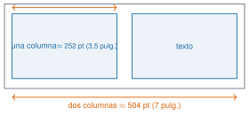

## Objetivos

- Rejillas, paneles y rotulado.
- Paleta accesible y contraste.
- Comparar grupos.
- Tamaño y exportación.
- Interactividad con OJS.

## Rejilla

```julia
fig = Figure(size=(504, 210))
ax1 = Axis(fig[1, 1]); ax2 = Axis(fig[1, 2])
ax3 = Axis(fig[2, 1:2])
linkxaxes!(ax1, ax2)
text!(ax1, 0.02, 0.97, text="(a)", space=:relative)
```

## Contraste (WCAG ≥ 3:1)

| color | contraste |
|---|---|
| azul | 5,59 |
| naranja | 3,76 |
| verde | 3,32 |

**Nunca solo color**: trazo, marcador o etiqueta.

## Tamaño

{fig-alt="Una columna de 252 pt y dos columnas de 504 pt"}

`save("fig.pdf" | "fig.svg" | "fig.png", fig; px_per_unit=4)`

## El resultado

- Tercer modo (media de 10 segmentos de 60 s): A 4,419 · B 4,375 · C 4,273 Hz.
- A y C se separan (≈ 4 desviaciones típicas); A y B quedan cerca (≈ 1,3): hace falta un contraste (J2.6).

## Interactiva (OJS)

Pico $=1/(2\zeta\sqrt{1-\zeta^2})$; ancho a −3 dB $\approx 2\zeta f_n$.

## La doy por superada si…

- Compongo una figura de varios paneles.
- Compruebo contraste y no dependo del color.
- Exporto y verifico los formatos.
