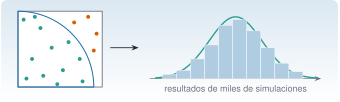
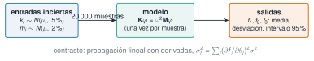

{.portada fig-alt="Un cuadrado con un cuarto de círculo y puntos aleatorios, verdes los que caen dentro y naranjas los que caen fuera; una flecha lleva a un histograma con forma de campana que representa los resultados de miles de simulaciones"}

Toda cifra que sale de un modelo hereda la incertidumbre de lo que se le dio: unas rigideces conocidas con un 5 % de error, una masa que no se ha pesado, un amortiguamiento que se supone. La pregunta práctica es: *¿cuánta incertidumbre tiene el resultado?* Cuando el modelo es complicado, la respuesta más directa es el **método de Monte Carlo**: se sortean muchos valores plausibles de las entradas, se calcula la salida con cada uno y se estudia la distribución de los resultados. Esta unidad enseña a manejar distribuciones de probabilidad con `Distributions.jl`, a hacerlo de forma reproducible (semillas) y a **propagar la incertidumbre** de las rigideces y masas de un edificio a sus frecuencias propias.

::: {.callout-note}
## Cómo se lee esta unidad
**Tiempo orientativo: 90 minutos.** Objetivos (4), teoría en cinco píldoras (18), práctica guiada (40), «Pídeselo a Claude» (12), ejercicios (14) y cierre (2). **Los resultados dependen de la semilla y de la versión de Julia** (véase la píldora 2): lo que se muestra es de Julia 1.12.3, y en otra versión saldrán valores parecidos pero no idénticos; lo reproducible son las conclusiones y los errores relativos.
:::

```{julia}
#| include: false
using Distributions, StatsBase, Random, Statistics, DataFrames, Resonancia
include("../../../recursos/r1-datos/_tema.jl")
```

## Objetivos y prerrequisitos

**Objetivos.** Al terminar esta unidad sabrás:

- crear distribuciones con `Distributions.jl`, evaluar `pdf`, `cdf` y `quantile`, muestrear y ajustar con `fit`;
- fijar y aislar semillas, y explicar qué garantiza (y qué no) una semilla;
- comprobar el error de Monte Carlo ($\propto 1/\sqrt N$) y el teorema central del límite;
- propagar la incertidumbre de los parámetros de un modelo a sus resultados y compararla con la propagación lineal;
- decir qué entradas dominan la incertidumbre del resultado.

**Prerrequisitos.** El curso no los impone en el temario; conviene J1.5 (modelo de 3 GDL), J1.8 y J2.4 (figuras).

**Reparto con otras unidades.** Aquí se estudia la incertidumbre del **modelo**. La incertidumbre de las **estimaciones a partir de datos** (intervalos de confianza, contrastes) está en [J2.6](../j2-6-inferencia/index.qmd), y las derivadas exactas para la propagación lineal (diferenciación automática), en [J3.5](../../j3-computacion/j3-5-integracion-ad/index.qmd).

## Teoría breve

::: {.callout-note .historia icon=false title="Un poco de historia: el método de Monte Carlo"}
El nombre y la idea se asocian al Laboratorio de Los Alamos de los años cuarenta: en 1949, Nicholas Metropolis y Stanislaw Ulam publicaron en el *Journal of the American Statistical Association* «The Monte Carlo Method», considerado el primer artículo no clasificado sobre el método [@metropolis1949]. La idea es tan simple como potente: **cuando una cuenta exacta es imposible, se aproxima por una muestra aleatoria**, y la precisión mejora con el número de muestras de una forma conocida, sin depender del número de dimensiones del problema. Con ordenadores baratos, es hoy una herramienta cotidiana de ingeniería.

<span class="fuentes-caja">Fuente: Metropolis y Ulam (1949) [@metropolis1949]. Datos bibliográficos comprobados en resultados de búsqueda y en un registro bibliográfico, no en el texto del artículo. Consultado el 26-10-2026.</span>
:::

### J2.5.1 Distribuciones con `Distributions.jl` {#j2-5-1}

Una distribución es un **objeto** que se construye con sus parámetros (la normal, con **media y desviación típica**, no con la varianza) y responde a las mismas funciones: `pdf` (densidad), `cdf` (probabilidad acumulada), `quantile` (la inversa de la `cdf`), `mean`, `std` y `rand` (muestreo) [@distributions-inicio]:

```{julia}
d = Normal(1.1, 0.03)                       # frecuencia incierta, en Hz
(media = mean(d), desviacion = std(d), densidad_en_la_media = round(pdf(d, 1.1), digits=2),
 prob_menor_que_1_05 = round(cdf(d, 1.05), digits=4), cuantiles_2_5_y_97_5 = round.(quantile.(d, [0.025, 0.975]), digits=4))
```

El intervalo del 95 % de una normal es la media ± 1,96 desviaciones típicas (`quantile(Normal(), 0.975)` = 1,9600). Otras familias de uso común en el curso:

| Distribución | Constructor | Cuándo |
|---|---|---|
| Normal | `Normal(μ, σ)` | errores de medida, sumas de muchos efectos pequeños |
| Log-normal | `LogNormal(μ, σ)` | magnitudes positivas con cola larga (rigideces, caudales) |
| Uniforme | `Uniform(a, b)` | solo se conocen los límites |
| Exponencial | `Exponential(θ)` | tiempos entre sucesos |
| Truncada | `truncated(Normal(μ, σ), a, b)` | para imponer límites físicos (no negativos) |

Y se **ajusta** una distribución a datos con `fit`: la estimación de máxima verosimilitud para la normal es la media y la desviación típica de la muestra.

```{julia}
Random.seed!(1)
x = rand(d, 200)
ajuste = fit(Normal, x)
(parametros_reales = (1.1, 0.03), parametros_ajustados = round.(params(ajuste), digits=4))
```

::: {.ejercicio tipo="numerico" id="j2-5-1-cuantil" respuesta="1.96" tol="0.1%"}
¿Cuánto vale `quantile(Normal(), 0.975)`, el valor que deja un 2,5 % de probabilidad por encima en una normal estándar?

::: {.solucion}
1,96 (1,95996): es el origen del «± 1,96 σ» del intervalo del 95 %.
:::
:::

### J2.5.2 Semillas y reproducibilidad {#j2-5-2}

Un generador de números pseudoaleatorios produce una secuencia determinista a partir de una **semilla**: con la misma semilla, la misma secuencia. Se fija con `Random.seed!(n)` (para el generador global) o, mejor, creando un generador **local** con `Xoshiro(n)` (el algoritmo por defecto actual) o `MersenneTwister(n)`, que se pasa a `rand` y evita que unas funciones alteren la secuencia de otras [@julia-random]:

```{julia}
a = rand(Xoshiro(1), 3)
b = rand(Xoshiro(1), 3)
c = rand(Xoshiro(2), 3)
(misma_semilla_misma_secuencia = a == b, semillas_distintas = a != c)
```

::: {.callout-warning}
## Errores frecuentes
(1) **Creer que la semilla garantiza el mismo resultado en cualquier versión de Julia.** La documentación avisa de que una versión menor puede cambiar la secuencia generada por una semilla (la distribución estadística sí se mantiene) y recomienda guardar los datos generados si hace falta una reproducción exacta [@julia-random]. Por eso este curso **anota la versión** de Julia con cada resultado y compara conclusiones, no cifras de muestras aleatorias. (2) Usar la misma semilla para todo: dos experimentos que deberían ser independientes quedan correlacionados. (3) No fijar ninguna semilla: cada ejecución da otra cosa.
:::

### J2.5.3 Monte Carlo y su error {#j2-5-3}

Estimar $\pi$ lanzando puntos al azar en un cuadrado de lado 1 y contando los que caen dentro del cuarto de círculo es el ejemplo clásico: la fracción de puntos dentro tiende a $\pi/4$. Lo importante es cómo mejora: el error típico decrece como $1/\sqrt N$, de modo que **para ganar una cifra decimal hay que multiplicar por 100 el número de muestras**. Se comprueba repitiendo 20 veces el experimento con cada $N$ y tomando la mediana del error:

```{julia}
function pi_mc(rng, N)
    dentro = 0
    for _ in 1:N
        dentro += rand(rng)^2 + rand(rng)^2 <= 1
    end
    return 4dentro / N
end
Ns = [10^k for k in 1:6]
errores = [median([abs(pi_mc(Xoshiro(100s + k), N) - π) for s in 1:20]) for (k, N) in enumerate(Ns)]
pendiente = ([log10.(Ns) ones(length(Ns))] \ log10.(errores))[1]
(N = Ns, error_mediano = round.(errores, sigdigits=3), error_por_raiz_de_N = round.(errores .* sqrt.(Ns), digits=2),
 pendiente_en_escala_log = round(pendiente, digits=2))
```

La pendiente es −0,50: el error es proporcional a $N^{-1/2}$ (el producto error·√N se mantiene en torno a 1).

### J2.5.4 Ley de los grandes números y teorema central del límite {#j2-5-4}

La **ley de los grandes números** dice que la media de una muestra se acerca a la media real al crecer $N$. El **teorema central del límite** añade que, para casi cualquier distribución, la **media** de $n$ valores independientes se reparte aproximadamente como una **normal** con desviación típica $\sigma/\sqrt n$. Se comprueba con la exponencial (que es asimétrica, con asimetría 2): la media de 30 valores tiene la asimetría casi eliminada.

```{julia}
rng = Xoshiro(2)
crudos = rand(rng, Exponential(1), 20000)
medias30 = [mean(rand(rng, Exponential(1), 30)) for _ in 1:20000]
(media_de_las_medias = round(mean(medias30), digits=4), desviacion = round(std(medias30), digits=4),
 teorica_1_sobre_raiz_30 = round(1 / sqrt(30), digits=4),
 asimetria_de_los_datos = round(skewness(crudos), digits=2), asimetria_de_las_medias = round(skewness(medias30), digits=3))
```

```{julia}
#| label: fig-monte-carlo
#| fig-cap: "Izquierda: error de la estimación de π por Monte Carlo en función del número de muestras N (mediana de 20 repeticiones, puntos azules); la línea gris discontinua es la referencia 1/√N. Derecha: histograma de 20 000 medias de 30 valores de una exponencial (asimétrica) y la normal que predice el teorema central del límite (línea naranja)."
#| fig-alt: "Dos gráficas. A la izquierda, una escala logarítmica con el error de la estimación de pi frente al número de muestras, de 10 a un millón; los puntos azules siguen una recta descendente de pendiente menos un medio, paralela a una línea gris de referencia. A la derecha, un histograma azul con forma de campana ligeramente asimétrica y una curva normal naranja que lo sigue de cerca."
let
    fig = Figure(size=(760, 320))
    ax1 = Axis(fig[1, 1], xlabel="número de muestras N", ylabel="|error| de π", xscale=log10, yscale=log10)
    lines!(ax1, Ns, 1 ./ sqrt.(Ns), color=GRIS, linestyle=:dash, label="1/√N")
    scatterlines!(ax1, Ns, errores, color=AZUL, label="Monte Carlo")
    axislegend(ax1, position=:lb)
    ax2 = Axis(fig[1, 2], xlabel="media de 30 valores", ylabel="densidad")
    hist!(ax2, medias30, bins=60, normalization=:pdf, color=(AZUL, 0.5))
    xs = range(0.4, 1.8, length=200)
    lines!(ax2, xs, pdf.(Normal(1, 1 / sqrt(30)), xs), color=NARANJA, linewidth=2)
    fig
end
```

::: {.ejercicio tipo="vf" id="j2-5-4-error" respuesta="falso"}
Para reducir a la mitad el error de una estimación por Monte Carlo basta con duplicar el número de muestras.

::: {.solucion}
Falso. El error decrece como $1/\sqrt N$: para reducirlo a la mitad hay que **cuadruplicar** $N$.
:::
:::

### J2.5.5 Propagar la incertidumbre {#j2-5-5}

Sea un modelo $y=g(\boldsymbol\theta)$ con parámetros $\boldsymbol\theta$ inciertos. El **método de Monte Carlo** (@fig-propagacion) sortea $\boldsymbol\theta^{(1)},\dots,\boldsymbol\theta^{(N)}$ de sus distribuciones, calcula $y^{(i)}=g(\boldsymbol\theta^{(i)})$ y resume los resultados: media, desviación típica y percentiles. Funciona con cualquier modelo, lineal o no, pero cuesta $N$ evaluaciones. La alternativa barata es la **propagación lineal** (de primer orden): $\sigma_y^2\approx\sum_j(\partial g/\partial\theta_j)^2\sigma_j^2$, válida si el modelo es casi lineal en el rango de incertidumbre y las entradas son independientes. Sirve además para saber **qué entrada domina**: el término $j$-ésimo es su aportación a la varianza.

{#fig-propagacion fig-alt="Tres cajas en fila unidas por flechas: entradas inciertas (rigideces con un 5 por ciento de incertidumbre y masas con un 2 por ciento), modelo de valores propios resuelto una vez por muestra con veinte mil muestras, y salidas (frecuencias, con media, desviación e intervalo del 95 por ciento). Debajo, la fórmula de la propagación lineal como contraste."}

::: {.callout-note .idea-clave}
## Idea clave
La incertidumbre del resultado no es un número sino una **distribución**; se resume con la media, la desviación típica y un intervalo (del 95 %), y se sabe cuánto de ella viene de cada entrada. Con una semilla fija y el recuento de muestras, la simulación es reproducible.
:::

### Para saber más {#j2-5-mas}

- Metropolis y Ulam, el artículo fundacional [@metropolis1949].
- Documentación de `Distributions.jl` [@distributions-inicio] y de `Random` [@julia-random].
- La propagación con derivadas exactas, con diferenciación automática, en [J3.5](../../j3-computacion/j3-5-integracion-ad/index.qmd).

## Práctica guiada

Edificio de tres plantas (J1.5): masas nominales de $2\cdot10^5$ kg y rigideces de $5\cdot10^7$, $5\cdot10^7$ y $4\cdot10^7$ N/m. Supongamos que las **rigideces se conocen con una incertidumbre del 5 %** y las **masas del 2 %** (desviaciones típicas relativas, normales e independientes). *¿Qué incertidumbre tienen las tres frecuencias propias?*

::: {.panel-tabset}
## Julia

**Paso 1. El modelo y su valor nominal.**

```{julia}
m_nom = fill(2.0e5, 3)
k_nom = [5.0e7, 5.0e7, 4.0e7]
function frecuencias(m, k)
    M, K = edificio_cortante(m, k)
    first(modos_propios(K, M))
end
f_nom = frecuencias(m_nom, k_nom)
round.(f_nom, digits=4)
```

**Paso 2. Simulación de Monte Carlo.** 20 000 muestras, con un generador local de semilla 2026.

```{julia}
N = 20_000
cv_k, cv_m = 0.05, 0.02
rng = Xoshiro(2026)
F = zeros(N, 3)
for i in 1:N
    k = k_nom .* (1 .+ cv_k .* randn(rng, 3))
    m = m_nom .* (1 .+ cv_m .* randn(rng, 3))
    F[i, :] = frecuencias(m, k)
end
resumen = DataFrame(modo=1:3, nominal_Hz=round.(f_nom, digits=4), media_Hz=round.(vec(mean(F, dims=1)), digits=4),
    desviacion_Hz=round.(vec(std(F, dims=1)), digits=4), cv_pct=round.(100 .* vec(std(F, dims=1) ./ mean(F, dims=1)), digits=2),
    p2_5_Hz=round.([quantile(F[:, j], 0.025) for j in 1:3], digits=4), p97_5_Hz=round.([quantile(F[:, j], 0.975) for j in 1:3], digits=4))
resumen
```

Una incertidumbre del 5 % en las rigideces da una incertidumbre de en torno al **1,8 % en las frecuencias** (la frecuencia varía como la raíz de la rigidez, así que el 5 % se reduce a la mitad, y se reduce más por promediar entre varias rigideces). El intervalo del 95 % del tercer modo es de 4,233 a 4,549 Hz, es decir, **±0,16 Hz**. Y la media de las muestras coincide con el valor nominal (a menos de 2,1 milésimas de hercio).

**Paso 3. ¿Cuántas muestras hacen falta?** Se estudia cómo se estabiliza la desviación típica del primer modo al añadir muestras:

```{julia}
(n = [100, 1000, 10_000, 20_000], desv_primer_modo_Hz = [round(std(F[1:n, 1]), digits=5) for n in (100, 1000, 10_000, 20_000)])
```

Con 1000 muestras la desviación típica está a un 3 % de su valor final; con 10 000, a menos de un 1 %. Con las desviaciones típicas basta con unas miles de muestras; para percentiles extremos (99,9 %) se necesitan más.

**Paso 4. Contraste con la propagación lineal.** Las derivadas $\partial f_i/\partial\theta_j$ se calculan aquí por diferencias centrales (J3.5 mostrará cómo hacerlo exactamente con diferenciación automática).

```{julia}
θ0 = vcat(m_nom, k_nom)
σθ = vcat(cv_m .* m_nom, cv_k .* k_nom)
J = zeros(3, 6)
for j in 1:6
    h = 1e-6 * θ0[j]
    tp, tm = copy(θ0), copy(θ0)
    tp[j] += h; tm[j] -= h
    J[:, j] = (frecuencias(tp[1:3], tp[4:6]) .- frecuencias(tm[1:3], tm[4:6])) ./ (2h)
end
σ_lineal = vec(sqrt.(sum((J .* σθ') .^ 2, dims=2)))
aporte = (J .* σθ') .^ 2 ./ sum((J .* σθ') .^ 2, dims=2)
(desv_monte_carlo_Hz = round.(vec(std(F, dims=1)), digits=4), desv_lineal_Hz = round.(σ_lineal, digits=4),
 diferencia_relativa_pct = round.(100 .* (vec(std(F, dims=1)) .- σ_lineal) ./ σ_lineal, digits=1))
```

Las dos coinciden hasta un 1 % o 2 %: el modelo es casi lineal en el rango del ±5 % de incertidumbre. La propagación lineal permite además **repartir la varianza** entre las seis entradas:

```{julia}
DataFrame(modo=1:3, m1=aporte[:, 1], m2=aporte[:, 2], m3=aporte[:, 3], k1=aporte[:, 4], k2=aporte[:, 5], k3=aporte[:, 6]) |>
    df -> mapcols(c -> c isa Vector{Float64} ? round.(100 .* c, digits=1) : c, df)
```

(Porcentaje de la varianza de cada frecuencia que aporta cada parámetro.) El primer modo depende sobre todo de la rigidez del primer entrepiso (57 %) y del segundo (24 %); el segundo, de la del tercero (70 %); el tercero, de la del segundo (72 %). **Las masas aportan entre el 10 % y el 15 % de la varianza** (suma de las tres: 14,8 %, 10,5 % y 13,4 % en los tres modos): menos que las rigideces, pero no es despreciable. Es información valiosa para decidir dónde medir mejor.

```{julia}
#| label: fig-propagacion-mc
#| fig-cap: "Distribución de las tres frecuencias propias con rigideces del 5 % y masas del 2 % de incertidumbre (20 000 muestras). La línea discontinua marca el valor nominal y las bandas sombreadas, el intervalo del 95 %. La incertidumbre relativa es parecida en los tres modos (1,8 %), pero la absoluta crece con la frecuencia."
#| fig-alt: "Tres histogramas con forma de campana, uno por modo, centrados en 1,10, 2,94 y 4,39 hercios. En cada uno, una línea vertical discontinua marca el valor nominal y una banda gris sombrea el intervalo del 95 por ciento. Las campanas son más anchas, en hercios, cuanto mayor es la frecuencia."
let
    fig = Figure(size=(760, 300))
    for j in 1:3
        ax = Axis(fig[1, j], xlabel="f$j (Hz)", ylabel=j == 1 ? "densidad" : "")
        lo, hi = quantile(F[:, j], [0.025, 0.975])
        vspan!(ax, lo, hi, color=(GRIS, 0.15))
        hist!(ax, F[:, j], bins=50, normalization=:pdf, color=(AZUL, 0.6))
        vlines!(ax, f_nom[j], color=NARANJA, linestyle=:dash, linewidth=2)
    end
    fig
end
```

**Paso 5. ¿Es normal el resultado?** Un modelo casi lineal con entradas normales da salidas casi normales. Se comprueba con la asimetría y se ajusta una normal:

```{julia}
(asimetria = round.([skewness(F[:, j]) for j in 1:3], digits=3), exceso_de_curtosis_modo1 = round(kurtosis(F[:, 1]), digits=3),
 normal_ajustada_modo1 = round.(params(fit(Normal, F[:, 1])), digits=4))
```

Asimetrías muy pequeñas y curtosis casi nula: la normal describe bien el resultado, y entonces «media ± 1,96 desviaciones» es una buena forma de dar el intervalo del 95 %.

**Paso 6. Para qué sirve.** En J1.7 y J2.4, un daño del 10 % en el entrepiso 2 bajaba la tercera frecuencia unos 0,14 Hz (de 4,390 a 4,254 Hz). Con las incertidumbres de este modelo, la frecuencia del tercer modo del edificio **sano** tiene un intervalo del 95 % de ±0,16 Hz: **mayor que el efecto del daño**. Por eso no se puede detectar el daño comparando una frecuencia medida con la de un modelo con parámetros inciertos; se compara **el edificio consigo mismo** en dos momentos (de ahí los contrastes de J2.6 y el seguimiento de M7).

## Python

La versión probada con `pytest` está en `python/montecarlo.py` (`frecuencias`, `propagacion`, `sigma_lineal`). Los generadores de NumPy y Julia son distintos, así que **no se comparan muestras sino estadísticos**: la prueba comprueba que la desviación de la simulación de Python coincide con la propagación lineal dentro del 5 %, y que esta coincide con la de Julia.

```python
from montecarlo import propagacion, sigma_lineal
from scipy import stats

F = propagacion(n=20000, cv_k=0.05, cv_m=0.02, semilla=2026)   # numpy.random.default_rng
print(F.mean(axis=0), F.std(axis=0, ddof=1))        # ≈ nominal, ≈ [0.019 0.055 0.080] Hz
s, J = sigma_lineal()                               # propagación lineal
print(stats.norm.ppf(0.975))                        # 1.959964
```

`scipy.stats` ofrece las distribuciones (`norm`, `lognorm`, `uniform`, `expon`) con `pdf`, `cdf`, `ppf` (el cuantil), `rvs` (muestreo) y `fit`. La semilla se pasa a `numpy.random.default_rng(semilla)`, el equivalente del generador local de Julia.
:::

::: {.callout-note}
## Qué se ha conseguido
Una distribución de las tres frecuencias propias a partir de incertidumbres de rigideces y masas, contrastada con la propagación lineal, con un reparto de la varianza por parámetro y una conclusión práctica: la incertidumbre del modelo es comparable al efecto de un daño del 10 %, así que hay que comparar el edificio consigo mismo. Con una semilla anotada y un número de muestras justificado.
:::

## «Pídeselo a Claude» {#pideselo}

::: {.callout-tip}
## Prompt
«Con Julia, `--project=.`, `Distributions.jl` y `Resonancia.jl`: para el edificio de tres plantas (masas de 2·10⁵ kg y rigideces de 5·10⁷, 5·10⁷ y 4·10⁷ N/m; modelo con `edificio_cortante` y `modos_propios`), sortea 20 000 muestras de las rigideces con incertidumbre normal del 5 % y de las masas del 2 % (independientes), con un generador local `Xoshiro(2026)`. Calcula con cada muestra las tres frecuencias propias y dame la media, la desviación típica y el intervalo del 95 % de cada una. Contrasta la desviación típica con la propagación lineal (derivadas por diferencias centrales) y dime qué parámetro aporta más varianza a cada frecuencia. No inventes cifras: si algo no sale, dilo. Indica la versión de Julia y la semilla.»

**Verifica.** (a) Que las desviaciones típicas son del orden de 0,019, 0,055 y 0,080 Hz (1,8 % de coeficiente de variación) y que la media coincide con el valor nominal (1,105, 2,939 y 4,390 Hz). (b) Que la propagación lineal da valores a menos de un 2 % de los de Monte Carlo. (c) Que el primer modo depende sobre todo de $k_1$, el segundo de $k_3$ y el tercero de $k_2$. (d) Que usa un generador local con semilla y anota la versión de Julia. (e) Que no concluye «hay daño» de una diferencia menor que el intervalo del 95 %.
:::

## Ejercicios

::: {.ejercicio tipo="numerico" id="j2-5-cv" respuesta="1.83" tol="3%" unidad="%"}
¿Qué coeficiente de variación (desviación típica entre media, en %) tiene la tercera frecuencia propia con rigideces del 5 % y masas del 2 % de incertidumbre?

::: {.solucion}
Un 1,83 % (0,0805 Hz sobre 4,392 Hz). Las otras dos, 1,75 % y 1,88 %.
:::
:::

::: {.ejercicio tipo="numerico" id="j2-5-cuadruplicar" respuesta="4" tol="0%" unidad="veces"}
Quieres que el error de una estimación por Monte Carlo sea la mitad. ¿Por cuántas veces hay que multiplicar el número de muestras?

::: {.solucion}
Por 4, porque el error decrece como $1/\sqrt N$ ($\sqrt4=2$).
:::
:::

::: {.ejercicio tipo="vf" id="j2-5-semilla" respuesta="falso"}
Con la misma semilla, el programa da exactamente la misma muestra aleatoria en cualquier versión de Julia.

::: {.solucion}
Falso. Garantiza la repetición en la misma versión; una versión menor puede cambiar la secuencia asociada a una semilla. Por eso se anota la versión y se guardan los datos generados si hace falta una reproducción exacta.
:::
:::

::: {.ejercicio tipo="abierta" id="j2-5-dominante"}
La rigidez del segundo entrepiso aporta el 72 % de la varianza de la tercera frecuencia. Si pudieras medirla con mucha más precisión, ¿qué ganarías y qué no?

::: {.criterios}
- Dice que la incertidumbre de la tercera frecuencia bajaría mucho (la mayor parte de su varianza desaparecería).
- Añade que las incertidumbres de los otros modos apenas cambiarían (dependen sobre todo de otras rigideces).
:::
:::

## La doy por superada si… {#superada}

- Creo distribuciones, evalúo `pdf`, `cdf` y `quantile`, muestreo y ajusto con `fit`.
- Fijo semillas con generadores locales y sé qué garantizan (y qué no).
- Compruebo que el error de Monte Carlo decrece como $1/\sqrt N$.
- Propago incertidumbre por Monte Carlo y la contrasto con la propagación lineal.
- Reparto la varianza entre las entradas y saco una conclusión práctica.

**Cierre.** Escribe tres líneas: qué he entendido, qué todavía no domino y cuál es mi siguiente paso pequeño. Si Claude ejecuta una simulación, pídele siempre la semilla, la versión de Julia y el número de muestras.

**Siguiente:** [J2.6 · Inferencia estadística](../j2-6-inferencia/index.qmd).
