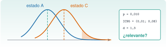

{.portada fig-alt="Dos campanas de Gauss parcialmente solapadas, una azul para el estado A y otra naranja para el estado C, con la cola de la segunda sombreada; a la derecha, un recuadro con un valor de p, un intervalo de confianza del 95 por ciento y un tamaño de efecto, y la pregunta si es relevante"}

*«La frecuencia del tercer modo ha bajado 0,04 Hz respecto del mes pasado.»* ¿Y qué? Si la frecuencia estimada fluctúa 0,03 Hz de un tramo de registro a otro, esa bajada puede ser puro ruido. La **inferencia estadística** es la forma disciplinada de contestar: ¿es esta diferencia mayor de lo que cabría esperar por azar?, ¿entre qué valores está el cambio real?, ¿es lo bastante grande como para importar?, ¿y cuántos datos habría hecho falta tener para verlo? Esta unidad responde con el caso de la vía M: *¿ha cambiado la frecuencia del edificio?*

::: {.callout-note}
## Cómo se lee esta unidad
**Tiempo orientativo: 90 minutos.** Objetivos (4), teoría en cinco píldoras (18), práctica guiada (40), «Pídeselo a Claude» (12), ejercicios (14) y cierre (2). Se usan las 10 estimaciones de frecuencia por estado (segmentos de 60 s) de [J2.4](../j2-4-makie/index.qmd). **Los resultados con simulación dependen de la semilla** (J2.5).
:::

```{julia}
#| include: false
using CSV, DataFrames, Statistics, Random, HypothesisTests, Distributions, StatsBase, Resonancia
include("../../../recursos/r1-datos/_tema.jl")
RAIZ = "../../../"
```

## Objetivos y prerrequisitos

**Objetivos.** Al terminar esta unidad sabrás:

- formular una hipótesis nula, calcular un contraste y **interpretar bien** el *p*-valor (y los errores de tipo I y II);
- comparar dos grupos con el contraste *t* de Welch y con uno no paramétrico (Mann–Whitney);
- construir un intervalo de confianza con *bootstrap* y contrastarlo con el teórico;
- distinguir **significación estadística** de **relevancia práctica** con un tamaño de efecto, y corregir comparaciones múltiples;
- calcular la potencia de un contraste y el tamaño de muestra necesario.

**Prerrequisitos.** El curso no los impone en el temario; conviene J2.4 (las estimaciones por segmentos) y J2.5 (distribuciones, simulación y semillas).

**Reparto con otras unidades.** Aquí se aprende el contraste y su interpretación. La regresión está en [J2.7](../j2-7-regresion/index.qmd) y el seguimiento continuo de frecuencias con control estadístico, en M7.

## Teoría breve

::: {.callout-note .historia icon=false title="Un poco de historia: el contraste t y la cervecería"}
El contraste *t* nació de una necesidad industrial. William Sealy Gosset trabajaba en la cervecería Guinness y necesitaba sacar conclusiones fiables de muestras pequeñas; como la empresa no permitía a su personal publicar con su nombre, firmó su artículo de 1908 en la revista *Biometrika* con el seudónimo «Student» [@student1908]. De ahí que se llame «*t* de Student»; su trabajo no fue apreciado del todo hasta que Fisher generalizó la distribución *t*. Casi todas las comparaciones entre dos grupos de esta unidad descienden de aquel artículo.

<span class="fuentes-caja">Fuente: Student (1908) [@student1908]; los hechos (seudónimo, restricción de la empresa, papel posterior de Fisher) proceden de fuentes secundarias sobre historia de la estadística; volumen y páginas del artículo sin cotejar. Consultado el 26-10-2026.</span>
:::

### J2.6.1 Hipótesis, p-valor y errores {#j2-6-1}

Un contraste empieza con una **hipótesis nula** $H_0$ («la frecuencia no ha cambiado») y un **estadístico** que mide lo lejos que están los datos de ella. El ***p*-valor** es la probabilidad de obtener un resultado **tan extremo o más** que el observado **si $H_0$ fuera cierta**. No es la probabilidad de que $H_0$ sea cierta ni de que el cambio sea real: es una medida de lo sorprendentes que serían los datos sin cambio. Se fija un nivel $\alpha$ (típicamente 0,05) y se **rechaza** $H_0$ si $p<\alpha$. Esto implica dos errores posibles: el **tipo I** (rechazar $H_0$ siendo cierta, con probabilidad $\alpha$) y el **tipo II** (no rechazarla siendo falsa, con probabilidad $\beta$; la **potencia** es $1-\beta$).

Se ve con una simulación: 10 000 comparaciones entre dos muestras de 10 valores de **la misma** normal (no hay cambio real), y se cuenta cuántas veces el contraste «detecta» un cambio:

```{julia}
rng = Xoshiro(5)
falsos_positivos = count(pvalue(UnequalVarianceTTest(randn(rng, 10), randn(rng, 10))) < 0.05 for _ in 1:10_000) / 10_000
(proporcion_de_rechazos_sin_cambio_real = falsos_positivos, nivel_alfa = 0.05)
```

Un 4,8 % de las veces se «detecta» un cambio que no existe: es el $\alpha$ del 5 % en acción. **Una de cada veinte comparaciones sin cambio real sale «significativa».**

::: {.callout-warning}
## Errores frecuentes
(1) Interpretar $p=0{,}01$ como «hay un 99 % de probabilidad de que haya cambio». (2) Decir «no hay diferencia» cuando $p>0{,}05$: significa que **no se ha podido detectar**, no que no exista (puede faltar potencia). (3) Mirar muchas comparaciones y quedarse con la que sale significativa. (4) Dar solo el *p*-valor, sin la magnitud de la diferencia ni su intervalo.
:::

::: {.ejercicio tipo="vf" id="j2-6-1-p" respuesta="falso"}
Un *p*-valor de 0,03 significa que hay un 3 % de probabilidad de que la hipótesis nula sea cierta.

::: {.solucion}
Falso. Significa que, **si $H_0$ fuera cierta**, el 3 % de las veces se obtendría un resultado igual o más extremo. No es la probabilidad de la hipótesis.
:::
:::

### J2.6.2 Comparar dos grupos: *t* de Welch y Mann–Whitney {#j2-6-2}

Para comparar la media de dos grupos independientes se usa el **contraste *t* de Welch** (`UnequalVarianceTTest`), que no supone varianzas iguales. Devuelve el estadístico, los grados de libertad, el *p*-valor y el **intervalo de confianza del 95 %** de la diferencia de medias. Como alternativa que no supone normalidad está el contraste de **Mann–Whitney** (`MannWhitneyUTest`), basado en rangos. Si los dos coinciden, la conclusión es robusta. Se aplica a las estimaciones de frecuencia por segmentos de 60 s de J2.4 (10 por estado):

```{julia}
leer(esc) = CSV.read(RAIZ * "datos/sinteticos/edificio-3-plantas/escenario_$esc.csv", DataFrame; delim=';')
datos = Dict(esc => leer(esc).a3_ms2 for esc in ("A", "B", "C"))
f3 = Dict(e => frecuencia_pico_por_segmentos(y, 100.0; seg=6000, banda=(3.8, 5.0)) for (e, y) in datos)
f1 = Dict(e => frecuencia_pico_por_segmentos(y, 100.0; seg=6000, banda=(0.8, 1.5)) for (e, y) in datos)
d_cohen(a, b) = (mean(a) - mean(b)) / sqrt((var(a) + var(b)) / 2)
function comparar(F, modo)
    filas = []
    for (u, v) in (("A", "B"), ("A", "C"), ("B", "C"))
        t = UnequalVarianceTTest(F[u], F[v]); mw = MannWhitneyUTest(F[u], F[v]); ic = confint(t)
        push!(filas, (modo = modo, comparacion = "$u − $v", dif_Hz = mean(F[u]) - mean(F[v]), t = t.t, gl = t.df, p_t = pvalue(t),
                      ic95_inf = ic[1], ic95_sup = ic[2], d = d_cohen(F[u], F[v]), p_MW = pvalue(mw)))
    end
    return DataFrame(filas)
end
tabla = vcat(comparar(f3, "f₃"), comparar(f1, "f₁"))
mapcols(c -> eltype(c) <: AbstractFloat ? [x < 1e-3 ? round(x, sigdigits=2) : round(x, digits=4) for x in c] : c, tabla)
```

Lo que dice la tabla, para el tercer modo: **A frente a C** (el daño del 10 % en un entrepiso) tiene una diferencia de 0,147 Hz con $t=8{,}6$ y $p\approx10^{-7}$: hay un cambio y es enorme. **A frente a B** (la variabilidad ambiental, −1 % de rigidez) tiene una diferencia de 0,044 Hz con $p=0{,}010$ y Mann–Whitney da 0,016: **también estadísticamente distinguible**, con un intervalo del 95 % de 0,012 a 0,076 Hz. En el primer modo, en cambio, A y B **no** se distinguen ($p=0{,}70$), mientras que A y C sí ($p=6\cdot10^{-4}$).

::: {.ejercicio tipo="numerico" id="j2-6-2-t" respuesta="8.58" tol="1%"}
¿Cuánto vale el estadístico $t$ de Welch al comparar el tercer modo de A con el de C?

::: {.solucion}
8,58 (con 17,4 grados de libertad): la diferencia de 0,147 Hz equivale a casi 9 errores típicos.
:::
:::

### J2.6.3 Intervalos con *bootstrap* {#j2-6-3}

El **bootstrap** estima la incertidumbre de un estadístico **remuestreando** los propios datos: se extraen, con reemplazo, muestras del mismo tamaño que la original, se calcula el estadístico en cada una y se toman los percentiles 2,5 % y 97,5 % de los resultados como intervalo del 95 %. No supone normalidad y sirve para estadísticos sin fórmula sencilla (medianas, cocientes). Para la diferencia de medias de las frecuencias:

```{julia}
function bootstrap(x, y; B=10_000, seed=1)
    rng = Xoshiro(seed)
    [mean(rand(rng, x, length(x))) - mean(rand(rng, y, length(y))) for _ in 1:B]
end
b_ab = bootstrap(f3["A"], f3["B"])
b_ac = bootstrap(f3["A"], f3["C"])
t_ab = confint(UnequalVarianceTTest(f3["A"], f3["B"]))
t_ac = confint(UnequalVarianceTTest(f3["A"], f3["C"]))
DataFrame(comparacion=["A − B", "A − C"], dif_media_Hz=round.([mean(f3["A"]) - mean(f3["B"]), mean(f3["A"]) - mean(f3["C"])], digits=4),
    bootstrap_ic95=[round.(quantile(b, [0.025, 0.975]), digits=4) for b in (b_ab, b_ac)],
    t_de_Welch_ic95=[round.(t, digits=4) for t in (t_ab, t_ac)])
```

Los dos intervalos son parecidos (0,015–0,068 frente a 0,012–0,076 para A − B): el bootstrap es algo más estrecho porque con solo 10 datos por grupo subestima ligeramente la variabilidad. Que coincidan en lo esencial refuerza la conclusión.

```{julia}
#| label: fig-bootstrap
#| fig-cap: "Distribución bootstrap de la diferencia de medias de la frecuencia del tercer modo (10 000 remuestreos). Izquierda: A − B; derecha: A − C. La banda sombreada es el intervalo del 95 % y la línea discontinua marca el cero («sin cambio»). En A − B el cero queda fuera del intervalo, pero cerca; en A − C, muy lejos."
#| fig-alt: "Dos histogramas de la diferencia de medias, uno centrado en torno a 0,044 hercios y otro en torno a 0,147 hercios. En cada uno, una banda gris indica el intervalo del 95 por ciento y una línea vertical discontinua naranja marca el cero. En el primero el cero queda justo a la izquierda de la banda; en el segundo, muy lejos."
let
    fig = Figure(size=(760, 300))
    for (j, (b, titulo)) in enumerate([(b_ab, "A − B (variabilidad ambiental)"), (b_ac, "A − C (daño del 10 %)")])
        ax = Axis(fig[1, j], title=titulo, xlabel="diferencia de medias de f₃ (Hz)", ylabel=j == 1 ? "frecuencia relativa" : "")
        lo, hi = quantile(b, [0.025, 0.975])
        vspan!(ax, lo, hi, color=(GRIS, 0.2))
        hist!(ax, b, bins=60, normalization=:pdf, color=(AZUL, 0.6))
        vlines!(ax, 0, color=NARANJA, linestyle=:dash, linewidth=2)
        xlims!(ax, -0.02, 0.2)
    end
    fig
end
```

### J2.6.4 Significativo no es lo mismo que relevante {#j2-6-4}

Un *p*-valor pequeño dice que **hay** una diferencia detectable, no que **importe**. Con muchos datos, cualquier diferencia minúscula sale «significativa». Para valorar su **tamaño** se usa un **tamaño de efecto**, como la ***d* de Cohen** (diferencia de medias entre la desviación típica combinada): en torno a 0,2 es pequeño, 0,5 mediano y 0,8 grande (valores orientativos habituales). Aquí, A − B tiene $d=1{,}3$ (grande en relación con el ruido de las estimaciones) y A − C, $d=3{,}8$. Pero la pregunta de ingeniería es otra: **¿cuánto cambio de frecuencia corresponde a un cambio que importe?** La diferencia A − B es un 1 % de la frecuencia (variabilidad ambiental, benigna) y A − C un 3,3 % (un daño del 10 % en un entrepiso). La estadística dice que *ambas* son detectables; solo la física distingue la inocua de la que no.

Y cuando se hacen **varios contrastes a la vez**, la probabilidad de algún falso positivo crece: con 6 comparaciones sin cambio real, es de $1-0{,}95^6=26\,\%$. La corrección más simple, la de **Bonferroni**, multiplica cada *p*-valor por el número de comparaciones:

```{julia}
comparaciones = tabla[:, [:modo, :comparacion, :p_t]]
comparaciones.p_corregido = min.(1.0, nrow(comparaciones) .* comparaciones.p_t)
comparaciones.significativo_tras_corregir = comparaciones.p_corregido .< 0.05
(probabilidad_de_algun_falso_positivo_en_6 = round(1 - 0.95^6, digits=3),
 tabla = mapcols(c -> eltype(c) <: AbstractFloat ? [x < 1e-3 ? round(x, sigdigits=2) : round(x, digits=3) for x in c] : c, comparaciones))
```

Tras corregir por 6 comparaciones, el contraste A − B del tercer modo **deja de ser significativo** ($p=0{,}062$) y el B − C del primer modo, también ($p=0{,}15$); siguen siéndolo A − C en los dos modos y B − C en el tercero. La corrección de Bonferroni es conservadora; lo importante es **declarar de antemano cuántas comparaciones se harán**.

::: {.ejercicio tipo="numerico" id="j2-6-4-bonf" respuesta="0.062" tol="2%"}
El contraste A − B del tercer modo tiene $p=0{,}0104$. ¿Cuál es el *p*-valor corregido por Bonferroni para 6 comparaciones?

::: {.solucion}
$6\cdot0{,}0104=0{,}062$: ya no es menor que 0,05.
:::
:::

### J2.6.5 Potencia y tamaño de muestra {#j2-6-5}

La **potencia** es la probabilidad de detectar un cambio que existe de verdad. Depende de tres cosas: el tamaño del cambio $\delta$, la variabilidad $\sigma$ y el número de datos por grupo $n$. Una aproximación para dos grupos y un nivel de 0,05 con potencia del 80 % es

$$
n \approx \frac{2\,(z_{1-\alpha/2}+z_{1-\beta})^2\,\sigma^2}{\delta^{2}} ,\qquad \delta_{\min}\approx(z_{1-\alpha/2}+z_{1-\beta})\,\sigma\sqrt{2/n},
$$ {#eq-potencia}

con $z_{0{,}975}+z_{0{,}8}=1{,}96+0{,}84=2{,}80$. Con la dispersión de las estimaciones del tercer modo ($\sigma\approx0{,}035$ Hz):

```{julia}
σ = 0.035
z = quantile(Normal(), 0.975) + quantile(Normal(), 0.8)
n_necesario(δ) = ceil(Int, 2 * z^2 * σ^2 / δ^2)
δ_min(n) = z * σ * sqrt(2 / n)
function potencia(δ, n; B=2000, seed=3)
    rng = Xoshiro(seed)
    count(pvalue(UnequalVarianceTTest(σ .* randn(rng, n), δ .+ σ .* randn(rng, n))) < 0.05 for _ in 1:B) / B
end
(z = round(z, digits=2), n_para_detectar_0_0221_Hz_el_efecto_modelado_de_B = n_necesario(0.0221),
 n_para_detectar_0_05_Hz = n_necesario(0.05), n_para_detectar_0_15_Hz = n_necesario(0.15),
 cambio_minimo_detectable_con_10_segmentos_Hz = round(δ_min(10), digits=4),
 potencia_simulada_con_n_40_y_δ_0_0221 = potencia(0.0221, 40))
```

Con **10 segmentos** (10 minutos de registro) el cambio mínimo detectable con un 80 % de potencia es de **0,044 Hz** (un 1 %): justo lo que se mide entre A y B, y por eso ese contraste está en el límite. Para detectar el cambio que predice el modelo para B (0,022 Hz, la mitad) harían falta **40 segmentos por estado**, es decir, 40 minutos. El daño del 10 % (0,15 Hz) se detecta sin problemas con solo 3 segmentos por estado. (La fórmula da $n=1$ para ese cambio, pero con tan pocos datos deja de valer la aproximación normal y se necesitan al menos dos por grupo; la simulación confirma una potencia superior al 80 % con 3.)

```{julia}
#| label: fig-potencia
#| fig-cap: "Potencia del contraste t de Welch (simulación, nivel 0,05) en función del número de segmentos por estado, para tres tamaños de cambio en la frecuencia del tercer modo con σ = 0,035 Hz. La línea punteada marca el 80 % de potencia. El daño del 10 % (0,15 Hz) se detecta con muy pocos segmentos; el efecto de la variabilidad ambiental (0,022 Hz) necesita unos 40."
#| fig-alt: "Tres curvas crecientes de potencia frente al número de segmentos por estado, de 3 a 100. La de 0,15 hercios sube al 100 por cien casi de inmediato; la de 0,05 hercios cruza el 80 por ciento en torno a 16 segmentos; la de 0,022 hercios lo hace en torno a 40. Una línea horizontal punteada marca el 80 por ciento."
let
    ns = [3, 5, 8, 10, 15, 20, 30, 40, 60, 80, 100]
    fig = Figure(size=(720, 320))
    ax = Axis(fig[1, 1], xlabel="segmentos por estado (n)", ylabel="potencia", limits=(nothing, (0, 1.05)))
    hlines!(ax, 0.8, color=GRIS, linestyle=:dot)
    for (δ, color, estilo, etiqueta) in [(0.15, AZUL, :solid, "0,15 Hz (daño del 10 %)"), (0.05, NARANJA, :dash, "0,05 Hz"), (0.0221, VERDE, :dashdot, "0,022 Hz (variabilidad)")]
        scatterlines!(ax, ns, [potencia(δ, n) for n in ns], color=color, linestyle=estilo, label=etiqueta)
    end
    axislegend(ax, "cambio en f₃", position=:rb)
    fig
end
```

{#fig-decision fig-alt="Cuatro cajas en fila unidas por flechas: pregunta, hipótesis, contraste con t, p e intervalo del 95 por ciento, y relevancia con tamaño de efecto. Debajo, una nota con los supuestos: independencia, normalidad aproximada y comparaciones declaradas de antemano."}

::: {.callout-note .idea-clave}
## Idea clave
Un buen informe estadístico no dice solo «*p* = 0,01»: da la **diferencia estimada**, su **intervalo de confianza**, el **tamaño de efecto**, cuántas **comparaciones** se hicieron y qué **potencia** tenía el estudio. Y deja la decisión final a la física del problema.
:::

### Para saber más {#j2-6-mas}

- Student, el artículo del contraste *t* [@student1908].
- Documentación de `HypothesisTests.jl`, con la lista de contrastes disponibles [@hypothesistests-docs].
- La propagación de incertidumbre del modelo, en [J2.5](../j2-5-montecarlo/index.qmd).

## Práctica guiada

**Pregunta:** *¿ha cambiado la frecuencia del edificio?* Se tienen tres estados (referencia A, variabilidad ambiental B y daño C) con 10 estimaciones de frecuencia por modo y estado. Se aplica un protocolo en cuatro pasos y se redacta la conclusión.

::: {.panel-tabset}
## Julia

**Paso 1. Declarar el plan antes de mirar.** Seis comparaciones (tres pares por dos modos), contraste de Welch con confirmación de Mann–Whitney, nivel 0,05 con corrección de Bonferroni. Ya está hecho en la tabla de la píldora 2 y en la de la píldora 4.

**Paso 2. Resumir las decisiones por modo.**

```{julia}
resumen = DataFrame(
    modo=comparaciones.modo, comparacion=comparaciones.comparacion,
    dif_Hz=round.(tabla.dif_Hz, digits=4), d=round.(tabla.d, digits=2),
    p_corregido=[x < 1e-3 ? round(x, sigdigits=2) : round(x, digits=3) for x in comparaciones.p_corregido],
    decision=[ifelse(p < 0.05, "cambio detectable", "no detectado") for p in comparaciones.p_corregido])
resumen
```

**Paso 3. La conclusión, con cuidado.** Frente a la referencia A:

- **Estado C (daño del 10 % en un entrepiso):** cambio detectable en **ambos** modos tras corregir, con una diferencia de 0,147 Hz (3,3 %) en el tercer modo y 0,034 Hz (3,1 %) en el primero. Detección robusta.
- **Estado B (variabilidad ambiental, −1 % de rigidez):** **no** detectable tras corregir por comparaciones múltiples (y, en el primer modo, ni siquiera sin corregir). Con 10 segmentos solo se detectan cambios de unos 0,044 Hz, y el efecto modelado de B es de 0,022 Hz.
- **B frente a C:** detectable en el tercer modo: el contraste **sí distingue la variabilidad del daño** con 10 segmentos por estado. En el primer modo no (tras corregir).

**Paso 4. ¿Cuánto registrar?** Si el objetivo fuera detectar también la variabilidad ambiental de B (0,022 Hz) con un 80 % de potencia, harían falta 40 segmentos por estado (40 minutos); para detectar el daño, bastan unos pocos.

```{julia}
(segmentos_para_B_con_80_pct = n_necesario(0.0221), minutos_de_registro_para_B = n_necesario(0.0221),
 segmentos_para_C_con_80_pct = n_necesario(0.15), tercer_modo_detecta_C_con_n_3 = potencia(0.15, 3) > 0.8)
```

## Python

La versión probada con `pytest`, contrastada con los resultados de Julia, está en `python/inferencia.py`: `welch_t`, `d_cohen`, `bootstrap_dif`, `potencia` y la estimación de frecuencias por segmentos con `scipy.signal.welch`.

```python
from inferencia import cargar, frecuencias_por_segmento, welch_t, d_cohen, bootstrap_dif
import numpy as np

base = "datos/sinteticos/edificio-3-plantas"
f3 = {e: frecuencias_por_segmento(cargar(e, base)) for e in "ABC"}
r = welch_t(f3["A"], f3["C"])
print(r["dif"], r["t"], r["p"], r["ic"])      # 0.1465  8.58  1.2e-07  (0.1105, 0.1824)
print(d_cohen(f3["A"], f3["B"]))               # 1.28
print(np.quantile(bootstrap_dif(f3["A"], f3["C"]), [0.025, 0.975]))   # ≈ [0.112, 0.176]
```

`scipy.stats` ofrece `ttest_ind(equal_var=False)` (Welch, con intervalo de confianza en el resultado), `mannwhitneyu` y `bootstrap`; `statsmodels` añade cálculos de potencia (`TTestIndPower`), aunque aquí se hace por simulación para ver qué ocurre.
:::

::: {.callout-note}
## Qué se ha conseguido
Un protocolo completo para decidir si ha cambiado una frecuencia: plan declarado, contraste de Welch confirmado con Mann–Whitney, intervalos con bootstrap, tamaño de efecto, corrección por comparaciones múltiples, y un cálculo de cuántos datos hacen falta para ver un cambio dado. La conclusión: **el daño del 10 % se detecta con claridad y la variabilidad ambiental, no, salvo que se registre unas cuatro veces más**.
:::

## «Pídeselo a Claude» {#pideselo}

::: {.callout-tip}
## Prompt
«Con Julia, `--project=.`, `HypothesisTests.jl` y `Resonancia.jl`: para los registros `escenario_A.csv`, `escenario_B.csv` y `escenario_C.csv` del edificio (separador `;`, 100 Hz, columna `a3_ms2`), estima con `frecuencia_pico_por_segmentos` (segmentos de 6000 muestras, banda 3,8–5,0 Hz) la frecuencia del tercer modo en 10 segmentos por estado. Compara A con B y A con C con el contraste t de Welch y con Mann–Whitney, y da en cada caso la diferencia de medias, el intervalo de confianza del 95 %, el *p*-valor, la *d* de Cohen y un intervalo bootstrap (10 000 remuestreos, semilla 1). Corrige los *p*-valores por Bonferroni suponiendo 6 comparaciones. Dime cuántos segmentos por estado harían falta para detectar con un 80 % de potencia un cambio de 0,022 Hz con σ = 0,035 Hz. No concluyas «daño» solo por un *p*-valor pequeño. No inventes cifras.»

**Verifica.** (a) Que A − C da $t\approx8{,}58$, $p\approx10^{-7}$ y un intervalo de 0,11 a 0,18 Hz. (b) Que A − B da $p\approx0{,}010$ (sin corregir) y 0,062 corregido, con $d\approx1{,}3$. (c) Que los intervalos bootstrap y teórico son parecidos. (d) Que el número de segmentos para 0,022 Hz es de unos 40. (e) Que la conclusión distingue lo estadísticamente detectable de lo relevante, y que B no se presenta como daño.
:::

## Ejercicios

::: {.ejercicio tipo="numerico" id="j2-6-n" respuesta="40" tol="3%" unidad="segmentos"}
¿Cuántos segmentos por estado hacen falta para detectar con un 80 % de potencia un cambio de 0,0221 Hz con $\sigma=0{,}035$ Hz?

::: {.pista}
$n\approx2\,(2{,}80)^2\,\sigma^2/\delta^2$ (@eq-potencia).
:::

::: {.solucion}
$2\cdot7{,}85\cdot0{,}001225/0{,}000488=39{,}4$, es decir, 40 segmentos.
:::
:::

::: {.ejercicio tipo="numerico" id="j2-6-dmin" respuesta="0.044" tol="2%" unidad="Hz"}
¿Cuál es el cambio mínimo de frecuencia detectable con un 80 % de potencia usando 10 segmentos por estado ($\sigma=0{,}035$ Hz)?

::: {.solucion}
$\delta_{\min}=2{,}80\cdot0{,}035\cdot\sqrt{2/10}=0{,}0438$ Hz, un 1 % del tercer modo.
:::
:::

::: {.ejercicio tipo="vf" id="j2-6-no-rechazar" respuesta="falso"}
Si $p>0{,}05$, se puede afirmar que la frecuencia no ha cambiado.

::: {.solucion}
Falso. Solo se puede decir que **no se ha detectado** un cambio con esos datos: puede haber faltado potencia (pocos segmentos o mucha dispersión). Hay que dar el intervalo de confianza para ver qué cambios no se pueden descartar.
:::
:::

::: {.ejercicio tipo="abierta" id="j2-6-informe"}
Redacta en tres frases el resultado de comparar A con B en el tercer modo para un informe técnico, sin exagerar.

::: {.criterios}
- Da la diferencia estimada y su intervalo del 95 % (unos 0,044 Hz, de 0,012 a 0,076 Hz).
- Menciona el *p*-valor sin y con corrección por comparaciones múltiples (0,010 y 0,062).
- Aclara que B es variabilidad ambiental, no un daño, y que 10 segmentos están en el límite de detección.
:::
:::

## La doy por superada si… {#superada}

- Interpreto bien el *p*-valor y conozco los errores de tipo I y II.
- Comparo dos grupos con Welch y Mann–Whitney, y doy el intervalo de confianza.
- Construyo un intervalo bootstrap y lo contrasto con el teórico.
- Distingo significación de relevancia y corrijo comparaciones múltiples.
- Calculo la potencia o el tamaño de muestra para un cambio dado.

**Cierre.** Escribe tres líneas: qué he entendido, qué todavía no domino y cuál es mi siguiente paso pequeño. Cuando Claude te dé un *p*-valor, pídele también la diferencia, su intervalo, el tamaño de efecto y cuántas comparaciones se hicieron.

**Siguiente:** [J2.7 · Regresión](../j2-7-regresion/index.qmd).
