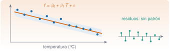

{.portada fig-alt="A la izquierda, una nube de puntos azules con una recta naranja ajustada y una banda azul clara alrededor, con la ecuación f igual a beta cero más beta uno por T más epsilon; a la derecha, barras verdes verticales que representan los residuos, alrededor de cero y sin ningún patrón"}

Las frecuencias propias de una estructura **no son constantes**: cambian con la temperatura, la humedad, la carga. Si no se tiene en cuenta, una bajada de frecuencia por un día de calor puede confundirse con un daño, y un daño real puede quedar tapado por una racha de frío. La **regresión** modela la relación entre una variable que se quiere explicar (la frecuencia) y otras que la influyen (la temperatura): permite predecir, cuantificar el efecto y, sobre todo, **compensarlo** para ver lo que queda. Esta unidad enseña a ajustar y a **diagnosticar** un modelo de regresión con `GLM.jl`, y lo usa para destapar un daño escondido bajo la temperatura.

::: {.callout-note}
## Cómo se lee esta unidad
**Tiempo orientativo: 90 minutos.** Objetivos (4), teoría en cinco píldoras (18), práctica guiada (40), «Pídeselo a Claude» (12), ejercicios (14) y cierre (2). **Los datos de la unidad son sintéticos**: se generan en la propia página con una receta física plausible (la rigidez varía con la temperatura), una semilla fija y un daño añadido a propósito; así se conoce la respuesta correcta. No son medidas de ninguna estructura real.
:::

```{julia}
#| include: false
using GLM, DataFrames, Random, Statistics, Distributions, StatsBase, LinearAlgebra, HypothesisTests
include("../../../recursos/r1-datos/_tema.jl")
```

## Objetivos y prerrequisitos

**Objetivos.** Al terminar esta unidad sabrás:

- ajustar una regresión lineal simple y múltiple con `lm` y leer su salida (coeficientes, errores típicos, intervalos, $R^2$);
- diagnosticar un modelo con gráficos de residuos, un gráfico Q–Q y medidas de influencia;
- comparar modelos (AIC, BIC, contraste F) y decidir si un término nuevo se justifica;
- predecir con intervalos de confianza y de predicción, y distinguirlos;
- compensar un efecto ambiental y comprobar que mejora la detección de un cambio.

**Prerrequisitos.** El curso no los impone en el temario; conviene J1.5 (mínimos cuadrados con `\`), J2.5 y J2.6 (distribuciones y contrastes).

**Reparto con otras unidades.** La teoría de los mínimos cuadrados (QR, condicionamiento) está en [J3.3](../../j3-computacion/j3-3-algebra-numerica/index.qmd). El seguimiento continuo de frecuencias y el control estadístico se tratan en M7.

## Teoría breve

::: {.callout-note .historia icon=false title="Un poco de historia: mínimos cuadrados y la «regresión»"}
El método de **mínimos cuadrados** se publicó por primera vez en 1805, con una exposición clara de Adrien-Marie Legendre; en 1809 Carl Friedrich Gauss lo usó para calcular órbitas y afirmó que lo conocía desde 1795, lo que originó una disputa de prioridad que Stigler cuenta en su historia de la estadística [@stigler1986]. El nombre de **regresión** es posterior y tiene otra historia: lo introdujo Francis Galton en 1886 en un estudio sobre la estatura de padres e hijos titulado «Regression Towards Mediocrity in Hereditary Stature» [@galton1886]: los hijos de padres muy altos solían ser algo menos altos que ellos, es decir, «regresaban» hacia la media. De ahí que hoy se llame regresión a un ajuste que no regresa a ninguna parte.

<span class="fuentes-caja">Fuentes: Stigler (1986) [@stigler1986] y Galton (1886) [@galton1886]. Los hechos se han comprobado en resultados de búsqueda y en fuentes secundarias, no en los originales; de Galton, la revista y las páginas están pendientes de cotejar. Consultado el 26-10-2026.</span>
:::

### J2.7.1 El modelo lineal {#j2-7-1}

La regresión lineal propone que la variable de respuesta $y$ es una combinación lineal de los predictores más un **error aleatorio**:

$$
y_i=\beta_0+\beta_1x_{i1}+\dots+\beta_px_{ip}+\varepsilon_i ,\qquad \varepsilon_i\sim N(0,\sigma^2)\ \text{independientes}.
$$ {#eq-lineal}

Los coeficientes se estiman por **mínimos cuadrados** (se minimiza la suma de los cuadrados de los residuos) y, si se cumplen los supuestos (relación lineal, errores independientes, de varianza constante y aproximadamente normales), se obtienen **errores típicos**, **intervalos de confianza** y **contrastes** para cada coeficiente. En `GLM.jl` se escribe con una fórmula: `lm(@formula(f ~ T), datos)`.

La receta de los datos de esta unidad es: durante un año (365 días), la **temperatura** sigue un ciclo estacional (media de 15 °C, amplitud de 10 °C) más una variación diaria de 3 °C; la **frecuencia** del tercer modo del edificio vale 4,39 Hz a 15 °C y baja un 0,09 % por cada grado de más (con una pequeña curvatura), con un ruido de estimación de 0,012 Hz; y la **humedad** (con 60 ± 15 %) **no influye**. Desde el día 250 se resta 0,07 Hz (un 1,6 %) a la frecuencia para simular un daño.

```{julia}
rng = Xoshiro(2026)
n = 365
dia = collect(1:n)
T = 15 .+ 10 .* sin.(2π .* (dia .- 100) ./ 365) .+ 3 .* randn(rng, n)         # temperatura, °C
H = 60 .+ 15 .* randn(rng, n)                                                # humedad, %
f_sana = 4.39 .* (1 .- 0.0009 .* (T .- 15) .+ 0.00004 .* (T .- 15) .^ 2)    # frecuencia sin daño, Hz
f = f_sana .+ 0.012 .* randn(rng, n)
f_med = copy(f); f_med[dia .>= 250] .-= 0.07                                 # lo que se mide: con daño desde el día 250
datos = DataFrame(dia=dia, T=T, H=H, f=f, f_med=f_med, T2=(T .- 15) .^ 2)
(dias = n, rango_T_C = round.(extrema(T), digits=1), rango_f_Hz = round.(extrema(f), digits=3))
```

### J2.7.2 Ajustar e interpretar {#j2-7-2}

```{julia}
m1 = lm(@formula(f ~ T), datos)
m1
```

La salida da los coeficientes, su error típico, el estadístico $t$, el *p*-valor y el intervalo del 95 %. Lo esencial: la pendiente es **−0,00386 Hz/°C** (error típico 0,0001; intervalo de −0,00406 a −0,00366). Es decir: **por cada grado más, la frecuencia baja 3,9 milihercios**, y entre los extremos del año (−1 a 32 °C) varía unos 0,13 Hz. El $R^2$ es 0,79: la temperatura explica el 79 % de la varianza de la frecuencia. La desviación residual es de 0,0151 Hz.

```{julia}
(pendiente_Hz_por_C = round(coef(m1)[2], digits=5), error_tipico = round(stderror(m1)[2], digits=5),
 ic95 = round.(confint(m1)[2, :], digits=5), R2 = round(r2(m1), digits=3), sigma_residual_Hz = round(sqrt(deviance(m1) / dof_residual(m1)), digits=4))
```

::: {.callout-warning}
## Errores frecuentes
(1) Interpretar el $R^2$ como «el modelo es bueno»: un $R^2$ alto con residuos curvados es un mal modelo (se ve en el diagnóstico). (2) Extrapolar fuera del rango de los datos: la recta ajustada entre −1 y 32 °C no dice nada de lo que pasa a −20 °C. (3) Confundir **correlación** con **causalidad**: aquí hay un mecanismo físico (la rigidez cambia con la temperatura), pero no siempre lo hay. (4) Mezclar el intervalo de **confianza** (de la media) con el de **predicción** (de una observación nueva).
:::

::: {.ejercicio tipo="numerico" id="j2-7-2-pend" respuesta="-3.86" tol="1%" unidad="mHz/°C"}
¿Cuánto vale la pendiente de la regresión lineal de la frecuencia sobre la temperatura, en milihercios por grado?

::: {.solucion}
−3,86 mHz/°C (−0,00386 Hz/°C). Un día 10 °C más cálido reduce la frecuencia del tercer modo unos 0,039 Hz.
:::
:::

### J2.7.3 Diagnosticar: ¿se cumplen los supuestos? {#j2-7-3}

Un ajuste no se da por bueno hasta ver los **residuos** ($e_i=y_i-\hat y_i$). Cuatro comprobaciones: (1) **residuos frente al predictor**: no debe haber ninguna estructura (una curva en U indica que falta un término); (2) **gráfico Q–Q** de los residuos frente a una normal: deben seguir la diagonal; (3) varianza constante (que la dispersión no crezca con el predictor); (4) **observaciones influyentes**: el **apalancamiento** $h_i$ (cuánto se aleja el predictor $i$ del centro; la media es $p/n$) y la **distancia de Cook** (cuánto cambiaría el ajuste al quitar esa observación; valores por encima de 1 son preocupantes).

```{julia}
r1 = residuals(m1)
(sesgo_de_los_residuos = round(skewness(r1), digits=3), exceso_de_curtosis = round(kurtosis(r1), digits=3),
 correlacion_residuos_con_T_cuadrada = round(cor(r1, (T .- 15) .^ 2), digits=3))
```

Los residuos del modelo lineal tienen una **asimetría de 0,48** y se **correlacionan en 0,65 con $(T-15)^2$**: hay una curvatura sin modelar. Es lo que se ve en la @fig-residuos (a). Se añade un término cuadrático y se comparan los dos modelos:

```{julia}
m2 = lm(@formula(f ~ T + T2), datos; dropcollinear=false)
m3 = lm(@formula(f ~ T + T2 + H), datos)
comparacion = DataFrame(modelo=["lineal (T)", "cuadrático (T, (T−15)²)", "cuadrático + humedad"],
    R2=round.([r2(m) for m in (m1, m2, m3)], digits=4), sigma_Hz=round.([sqrt(deviance(m) / dof_residual(m)) for m in (m1, m2, m3)], digits=4),
    AIC=round.([aic(m) for m in (m1, m2, m3)], digits=1), BIC=round.([bic(m) for m in (m1, m2, m3)], digits=1))
(comparacion = comparacion, F_lineal_vs_cuadratico = round(ftest(m1.model, m2.model).fstat[2], digits=1),
 p_F = ftest(m1.model, m2.model).pval[2], coef_humedad = round(coef(m3)[4], digits=5), p_humedad = round(coeftable(m3).cols[4][4], digits=3))
```

El término cuadrático **se justifica con claridad**: el $R^2$ pasa de 0,79 a 0,88, la desviación residual baja de 0,0151 a 0,0115 Hz, el AIC y el BIC bajan unos 200 puntos y el contraste F da $F=269$ ($p<10^{-44}$). La **humedad no aporta nada** (coeficiente de 0,00003 con $p=0{,}43$) y los criterios de información empeoran ligeramente con ella: es la que se esperaba, porque no influye. Un buen modelo es el **más sencillo que explica los datos**.

```{julia}
hat(m) = (X = modelmatrix(m); vec(sum((X / cholesky(Symmetric(X' * X)).U) .^ 2, dims=2)))
cook(m) = (e = residuals(m); h = hat(m); p = length(coef(m)); s2 = deviance(m) / dof_residual(m); @. e^2 / (p * s2) * h / (1 - h)^2)
h2, d2 = hat(m2), cook(m2)
(suma_de_apalancamientos = round(sum(h2), digits=3), apalancamiento_medio = round(mean(h2), digits=4), umbral_2p_n = round(2 * 3 / n, digits=4),
 apalancamiento_maximo = round(maximum(h2), digits=4), cook_maxima = round(maximum(d2), digits=3))
```

El apalancamiento suma exactamente el número de parámetros (3) y el máximo (0,054) supera el umbral habitual $2p/n=0{,}016$ —lo hacen los días más fríos y más cálidos, que son los extremos del predictor—, pero la distancia de Cook máxima es 0,056, **muy por debajo de 1**: ninguna observación aislada manda en el ajuste.

```{julia}
#| label: fig-residuos
#| fig-cap: "Diagnóstico de la regresión. (a) Residuos del modelo lineal frente a la temperatura: forma de U, falta un término cuadrático. (b) Residuos del modelo cuadrático: sin estructura. (c) Gráfico Q–Q de los residuos del modelo cuadrático frente a una normal: siguen la diagonal. (d) Apalancamiento frente a residuo estandarizado: ninguna observación es a la vez extrema y mal ajustada."
#| fig-alt: "Cuatro paneles. En a, una nube de residuos frente a la temperatura que dibuja una U clara. En b, la nube de residuos del modelo cuadrático, dispersa alrededor de cero sin forma. En c, puntos que siguen casi exactamente la diagonal de un gráfico cuantil-cuantil normal. En d, puntos con apalancamiento bajo en su mayoría, entre menos tres y tres desviaciones, sin ningún punto extremo a la vez en ambas medidas."
let
    r2_ = residuals(m2)
    sig = sqrt(deviance(m2) / dof_residual(m2))
    est = r2_ ./ (sig .* sqrt.(1 .- h2))
    fig = Figure(size=(760, 560))
    ax1 = Axis(fig[1, 1], title="(a) residuos, modelo lineal", xlabel="T (°C)", ylabel="residuo (Hz)")
    scatter!(ax1, T, r1, color=AZUL, markersize=5); hlines!(ax1, 0, color=GRIS)
    ax2 = Axis(fig[1, 2], title="(b) residuos, modelo cuadrático", xlabel="T (°C)", ylabel="residuo (Hz)")
    scatter!(ax2, T, r2_, color=NARANJA, markersize=5); hlines!(ax2, 0, color=GRIS)
    ax3 = Axis(fig[2, 1], title="(c) Q–Q normal", xlabel="cuantil teórico", ylabel="residuo estandarizado")
    q = quantile.(Normal(), ((1:n) .- 0.5) ./ n)
    scatter!(ax3, q, sort(est), color=VERDE, markersize=5); lines!(ax3, [-3, 3], [-3, 3], color=GRIS, linestyle=:dash)
    ax4 = Axis(fig[2, 2], title="(d) influencia", xlabel="apalancamiento", ylabel="residuo estandarizado")
    scatter!(ax4, h2, est, color=VIOLETA, markersize=5); hlines!(ax4, [-2, 2], color=GRIS, linestyle=:dot); vlines!(ax4, 2 * 3 / n, color=GRIS, linestyle=:dot)
    fig
end
```

::: {.ejercicio tipo="vf" id="j2-7-3-r2" respuesta="falso"}
Un $R^2$ de 0,79 demuestra que el modelo lineal es adecuado para estos datos.

::: {.solucion}
Falso. Con residuos en forma de U (@fig-residuos a), el modelo lineal es incompleto aunque explique el 79 % de la varianza. El diagnóstico de residuos complementa al $R^2$, no lo sustituye.
:::
:::

### J2.7.4 Predecir: confianza frente a predicción {#j2-7-4}

Con el modelo se puede **predecir** la frecuencia esperada para una temperatura. Hay dos intervalos con sentidos distintos: el de **confianza** acota la **media** de la frecuencia a esa temperatura (se estrecha al aumentar los datos), y el de **predicción** acota **una observación nueva** (siempre incluye el ruido $\sigma$, y por eso es más ancho). Para detectar un daño interesa el segundo: dice dentro de qué banda **debe** caer una medida si no ha cambiado nada.

```{julia}
nuevo = DataFrame(T=[0.0, 15.0, 30.0]); nuevo.T2 = (nuevo.T .- 15) .^ 2
pc = predict(m2, nuevo; interval=:confidence, level=0.95)
pp = predict(m2, nuevo; interval=:prediction, level=0.95)
DataFrame(T_C=nuevo.T, prediccion_Hz=round.(pc.prediction, digits=4), ancho_confianza_Hz=round.(pc.upper .- pc.lower, digits=4),
          ancho_prediccion_Hz=round.(pp.upper .- pp.lower, digits=4))
```

A 15 °C, la frecuencia media esperada es de 4,389 Hz con una incertidumbre (de confianza) de ±0,002 Hz, pero **una medida nueva** puede caer entre 4,366 y 4,411 Hz (±0,023 Hz): un intervalo unas 13 veces más ancho, por el ruido de cada estimación. En los extremos de temperatura el de confianza se ensancha (±0,004 Hz a 0 y a 30 °C): se extrapola peor lejos del centro de los datos.

```{julia}
#| label: fig-ajuste
#| fig-cap: "Frecuencia del tercer modo frente a la temperatura (365 días, sintéticos). La recta (gris discontinua) no recoge la curvatura; el ajuste cuadrático (naranja) sí, y su banda de predicción del 95 % (sombreada) contiene casi todas las medidas."
#| fig-alt: "Nube de 365 puntos azules de frecuencia, entre 4,3 y 4,5 hercios, frente a la temperatura de menos uno a treinta y dos grados, con tendencia decreciente y ligeramente curvada. Una recta gris discontinua la cruza. Una curva naranja suave sigue el centro de la nube, y una banda sombreada estrecha la rodea."
let
    Tg = collect(range(minimum(T), maximum(T), length=100))
    g = DataFrame(T=Tg, T2=(Tg .- 15) .^ 2)
    pb = predict(m2, g; interval=:prediction, level=0.95)
    pbanda = (lower=Float64.(pb.lower), upper=Float64.(pb.upper), prediction=Float64.(pb.prediction))
    fig = Figure(size=(720, 340))
    ax = Axis(fig[1, 1], xlabel="temperatura (°C)", ylabel="frecuencia f₃ (Hz)")
    band!(ax, Tg, pbanda.lower, pbanda.upper, color=(NARANJA, 0.18))
    scatter!(ax, T, f, color=(AZUL, 0.6), markersize=5)
    lines!(ax, Tg, Float64.(predict(m1, DataFrame(T=Tg))), color=GRIS, linestyle=:dash, linewidth=2, label="lineal")
    lines!(ax, Tg, pbanda.prediction, color=NARANJA, linewidth=2, label="cuadrático")
    axislegend(ax, position=:rt)
    fig
end
```

### J2.7.5 Usar la regresión: compensar el efecto de la temperatura {#j2-7-5}

Aquí está el provecho. Se **ajusta el modelo con el periodo de referencia** (los días 1 a 249, antes del daño), se **predice** la frecuencia esperada con la temperatura de cada día y se mira el **residuo**: la frecuencia medida menos la esperada. Si la estructura no ha cambiado, el residuo es ruido de media cero; si hay daño, el residuo se desplaza. La temperatura queda descontada.

```{julia}
ref = datos[datos.dia .< 250, :]
m_ref = lm(@formula(f_med ~ T + T2), ref; dropcollinear=false)
datos.residuo = Float64.(datos.f_med .- predict(m_ref, datos))
antes, despues = datos.dia .< 250, datos.dia .>= 250
contraste_bruto = UnequalVarianceTTest(datos.f_med[despues], datos.f_med[antes])
contraste_comp = UnequalVarianceTTest(datos.residuo[despues], datos.residuo[antes])
(dispersion_antes_bruta_Hz = round(std(datos.f_med[antes]), digits=4), dispersion_antes_compensada_Hz = round(std(datos.residuo[antes]), digits=4),
 cambio_medio_bruto_Hz = round(mean(datos.f_med[despues]) - mean(datos.f_med[antes]), digits=4),
 cambio_medio_compensado_Hz = round(mean(datos.residuo[despues]) - mean(datos.residuo[antes]), digits=4), cambio_inyectado_Hz = -0.07,
 t_bruto = round(contraste_bruto.t, digits=1), t_compensado = round(contraste_comp.t, digits=1))
```

La compensación hace dos cosas. Primero, **reduce la dispersión** de la serie de 0,034 Hz a 0,011 Hz (casi a la tercera parte: lo que queda es el ruido de estimación). Segundo, **recupera el cambio**: sin compensar, la media baja solo 0,055 Hz —porque al avanzar el otoño las temperaturas descienden y la frecuencia sube, **escondiendo parte del daño**—, mientras que el residuo cae 0,068 Hz, casi los 0,070 Hz inyectados. El estadístico $t$ de Welch pasa de $-16$ (serie bruta) a $-53$ (residuo): la diferencia se ve mucho más nítida. Pero lo más importante de compensar no es detectar el daño real, sino **no detectar daños que no existen**, como se comprueba en la práctica. La separación visual es esta:

```{julia}
#| label: fig-compensacion
#| fig-cap: "Frecuencia del tercer modo durante un año. Arriba, la medida bruta: la temperatura estacional la hace oscilar 0,13 Hz y tapa el daño del día 250. Abajo, el residuo tras compensar la temperatura (modelo ajustado con los 249 primeros días): antes del daño oscila en torno a cero; después, en torno a −0,068 Hz."
#| fig-alt: "Dos paneles con el día del año de 1 a 365 en el eje horizontal. Arriba, una curva ruidosa de frecuencia que sube y baja suavemente con el ciclo anual, con una línea vertical en el día 250 y sin salto visible. Abajo, el residuo, una nube de puntos que oscila alrededor de cero hasta el día 250 y alrededor de menos 0,07 hercios después, con un escalón claro."
let
    fig = Figure(size=(760, 430))
    ax1 = Axis(fig[1, 1], ylabel="f₃ medida (Hz)", xticklabelsvisible=false)
    lines!(ax1, dia, datos.f_med, color=AZUL, linewidth=1)
    vlines!(ax1, 250, color=NARANJA, linestyle=:dash)
    ax2 = Axis(fig[2, 1], xlabel="día del año", ylabel="residuo compensado (Hz)")
    scatter!(ax2, dia, datos.residuo, color=(VERDE, 0.7), markersize=4)
    hlines!(ax2, [mean(datos.residuo[antes])], xmin=0, xmax=249/365, color=GRIS, linewidth=2)
    hlines!(ax2, [mean(datos.residuo[despues])], xmin=249/365, xmax=1, color=NARANJA, linewidth=2)
    vlines!(ax2, 250, color=NARANJA, linestyle=:dash)
    linkxaxes!(ax1, ax2)
    fig
end
```

::: {.callout-note .idea-clave}
## Idea clave
**Antes de buscar daño en una frecuencia, hay que quitarle lo que explica el ambiente.** La regresión con un periodo de referencia convierte una serie con ciclo anual en un residuo de media cero donde un cambio se ve a simple vista. Y siempre con diagnóstico: un modelo que no se ha mirado puede dar una compensación equivocada.
:::

### Para saber más {#j2-7-mas}

- Stigler, la historia del método de mínimos cuadrados [@stigler1986], y Galton, el origen del término «regresión» [@galton1886].
- Documentación de [GLM.jl](https://juliastats.org/GLM.jl/stable/) (modelos lineales y lineales generalizados, entre ellos la regresión logística).
- La compensación ambiental de frecuencias se ve con más detalle en M7.

## Práctica guiada

Vamos a **verificar la compensación** con un criterio objetivo: ¿cuánto daño mínimo se detecta con y sin ella?

::: {.panel-tabset}
## Julia

**Paso 1. Cambio mínimo detectable.** Con la dispersión de la serie y el número de días de cada periodo (249 antes y 116 después del daño), se calcula el cambio mínimo detectable con un 80 % de potencia (J2.6) para la serie bruta y la compensada.

```{julia}
z = quantile(Normal(), 0.975) + quantile(Normal(), 0.8)
δ_min(σ, n1, n2) = z * σ * sqrt(1 / n1 + 1 / n2)
n1, n2 = count(antes), count(despues)
σ_bruta, σ_comp = std(datos.f_med[antes]), std(datos.residuo[antes])
(cambio_minimo_bruto_Hz = round(δ_min(σ_bruta, n1, n2), digits=4), cambio_minimo_compensado_Hz = round(δ_min(σ_comp, n1, n2), digits=4),
 mejora_veces = round(δ_min(σ_bruta, n1, n2) / δ_min(σ_comp, n1, n2), digits=1), daño_inyectado_Hz = 0.07)
```

Con la serie bruta, el cambio mínimo detectable es de 0,011 Hz; con el residuo compensado, de 0,0036 Hz: la compensación **triplica la sensibilidad**. Un daño de 0,07 Hz queda muy por encima de ambos, así que aquí se detectaría de las dos formas; la diferencia importa para daños pequeños (a partir de 0,0036 Hz, un 0,08 %) y, sobre todo, para lo que sigue.

**Paso 1 bis. La falsa alarma estacional.** Para ver el riesgo de **no** compensar, se usan los datos **sin daño** (`f`, la serie sana): se compara la frecuencia del **verano** (días 150 a 230) con la del **invierno** (días 1 a 60 y 330 a 365). La estructura **no ha cambiado**, pero la temperatura sí:

```{julia}
v_ini = (datos.dia .<= 60) .| (datos.dia .>= 330)       # invierno
v_fin = (datos.dia .>= 150) .& (datos.dia .<= 230)      # verano
res_sana = Float64.(datos.f .- predict(m_ref, datos))
bruto, comp = UnequalVarianceTTest(datos.f[v_fin], datos.f[v_ini]), UnequalVarianceTTest(res_sana[v_fin], res_sana[v_ini])
(sin_compensar = (cambio_Hz = round(mean(datos.f[v_fin]) - mean(datos.f[v_ini]), digits=4), p = pvalue(bruto)),
 compensado = (cambio_Hz = round(mean(res_sana[v_fin]) - mean(res_sana[v_ini]), digits=4), p = round(pvalue(comp), digits=3)))
```

La serie sin compensar muestra un «cambio» altamente significativo en una estructura **sana**: un descenso de **0,070 Hz** ($p\approx10^{-54}$), exactamente el tamaño del daño de la práctica, solo porque el verano es más cálido que el invierno. El residuo compensado no detecta nada (−0,001 Hz, $p=0{,}55$). **Ese es el servicio principal de la regresión: evitar las falsas alarmas.**

**Paso 2. ¿Se mantiene la compensación fuera de la muestra?** Un modelo debe validarse con datos que no ha visto. Se ajusta con los primeros 200 días y se predice el tramo sano de los días 200 a 249:

```{julia}
m_200 = lm(@formula(f_med ~ T + T2), datos[datos.dia .< 200, :]; dropcollinear=false)
prueba = datos[(datos.dia .>= 200) .& (datos.dia .< 250), :]
e_fuera = prueba.f_med .- predict(m_200, prueba)
(error_medio_Hz = round(mean(e_fuera), digits=4), error_cuadratico_medio_Hz = round(sqrt(mean(e_fuera .^ 2)), digits=4),
 sigma_dentro_de_la_muestra_Hz = round(sqrt(deviance(m_200) / dof_residual(m_200)), digits=4))
```

El error cuadrático medio fuera de la muestra (0,0107 Hz) es del mismo orden que la desviación residual dentro de ella (0,0115 Hz), y el error medio es de 0,0001 Hz, sin sesgo apreciable: el modelo **generaliza**. Si fuera muy peor, habría sobreajuste.

## Python

La versión probada con `pytest` está en `python/regresion.py`: `generar` (la misma receta, con `numpy.random.default_rng`), `ajustar` (mínimos cuadrados con QR, errores típicos y $R^2$), `apalancamiento` y `cook`. Como los generadores de Julia y Python son distintos, las pruebas comprueban la **recuperación de los parámetros** y las identidades (la traza del apalancamiento es el número de parámetros; el ajuste coincide con `scipy.stats.linregress`).

```python
import numpy as np
from regresion import generar, ajustar, apalancamiento, cook

dia, T, H, f = generar(semilla=2026)
X = np.column_stack([np.ones_like(T), T, (T - 15) ** 2])
a = ajustar(X, f)
print(a["beta"], a["se"], a["r2"])        # ≈ [4.447 -0.00389 0.000173]  R² ≈ 0.88
print(apalancamiento(X).sum())             # 3.0
print(cook(X, f).max())                    # << 1
```

`statsmodels` ofrece un resumen completo (`OLS(...).fit().summary()`), contrastes y diagnósticos; aquí se usa solo `numpy` para ver qué hay debajo.
:::

::: {.callout-note}
## Qué se ha conseguido
Un modelo de la frecuencia en función de la temperatura, ajustado, diagnosticado (curvatura detectada y corregida, humedad descartada, sin observaciones influyentes), validado fuera de la muestra y usado para **compensar** el efecto ambiental: la dispersión baja a la tercera parte, un daño del 1,6 % que la temperatura escondía se recupera casi completo y se evita una falsa alarma de 0,07 Hz entre verano e invierno.
:::

## «Pídeselo a Claude» {#pideselo}

::: {.callout-tip}
## Prompt
«Con Julia, `--project=.` y `GLM.jl`: genera 365 días de datos sintéticos con semilla `Xoshiro(2026)`: temperatura `T = 15 + 10 sin(2π(d−100)/365) + 3·randn`, y frecuencia `f = 4,39(1 − 0,0009(T−15) + 0,00004(T−15)²) + 0,012·randn`. Ajusta `f ~ T` y `f ~ T + (T−15)²`; dime la pendiente con su intervalo, el R², la desviación residual y el AIC de cada uno, y enséñame los residuos del modelo lineal frente a T. Resta 0,07 Hz a `f` desde el día 250 (daño sintético), ajusta el modelo cuadrático **solo con los 249 primeros días**, calcula el residuo de todos los días y dime cuánto cambia su media antes y después del día 250. No inventes cifras: si algo no sale, dilo. Di claramente que los datos son sintéticos.»

**Verifica.** (a) Que la pendiente lineal es −0,0039 Hz/°C (intervalo de −0,0041 a −0,0037) y el $R^2$, 0,79. (b) Que ha mirado los residuos del modelo lineal y ha visto la curvatura, y que el cuadrático mejora (R² 0,88; AIC unos 200 puntos menor). (c) Que el modelo de compensación se ajusta **solo con el periodo de referencia**. (d) Que el residuo medio cae unos 0,068 Hz tras el día 250, frente a una caída bruta de unos 0,055 Hz. (e) Que presenta los datos como sintéticos y no extrapola fuera del rango de temperaturas.
:::

## Ejercicios

::: {.ejercicio tipo="numerico" id="j2-7-r2" respuesta="0.8813" tol="0.5%"}
¿Cuánto vale el $R^2$ del modelo cuadrático de la frecuencia sobre la temperatura?

::: {.solucion}
0,8813 (frente a 0,7931 del lineal): el término cuadrático explica casi un 9 % más de la varianza.
:::
:::

::: {.ejercicio tipo="numerico" id="j2-7-comp" respuesta="-0.068" tol="3%" unidad="Hz"}
¿Cuánto cae la media del residuo compensado tras el día 250?

::: {.solucion}
−0,068 Hz, cerca de los −0,070 Hz inyectados. La serie bruta solo mostraba −0,055 Hz.
:::
:::

::: {.ejercicio tipo="vf" id="j2-7-extrap" respuesta="falso"}
Como el modelo explica bien los datos, se puede usar para predecir la frecuencia a −20 °C, aunque la temperatura mínima observada sea −1 °C.

::: {.solucion}
Falso. Fuera del rango de los datos no hay evidencia de que la relación (lineal o cuadrática) siga valiendo: es una extrapolación.
:::
:::

::: {.ejercicio tipo="abierta" id="j2-7-humedad"}
Al añadir la humedad, el AIC empeora y su coeficiente tiene $p=0{,}43$. ¿La dejarías en el modelo? ¿Y si tuvieras razones físicas para pensar que importa?

::: {.criterios}
- Dice que no se justifica estadísticamente (sin efecto detectable y empeoran los criterios de información).
- Añade que, con una razón física, se puede conservar o estudiar con más datos, pero declarándolo; «no significativo» no es «sin efecto».
:::
:::

## La doy por superada si… {#superada}

- Ajusto un modelo con `lm`, leo coeficientes, errores típicos, intervalos y $R^2$.
- Diagnostico con residuos, Q–Q e influencia, y detecto una curvatura.
- Comparo modelos con AIC, BIC y contraste F, y descarto un término sin efecto.
- Distingo el intervalo de confianza del de predicción.
- Compenso un efecto ambiental con un periodo de referencia y compruebo que mejora la detección.

**Cierre.** Escribe tres líneas: qué he entendido, qué todavía no domino y cuál es mi siguiente paso pequeño. Cuando Claude te dé un ajuste, pídele los gráficos de residuos y el rango de datos con el que se ha ajustado.

**Siguiente:** [J2.8 · Aprendizaje automático con MLJ](../j2-8-ml/index.qmd).
