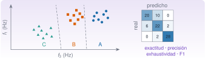

{.portada fig-alt="A la izquierda, tres nubes de puntos en un plano con la frecuencia del tercer modo en el eje horizontal: triángulos verdes a la izquierda (estado C), cuadrados naranjas en el centro (estado B) y círculos azules a la derecha (estado A), separadas por dos líneas discontinuas; a la derecha, una matriz de confusión de tres por tres con números grandes en la diagonal y pequeños fuera de ella"}

Un sistema de monitorización no se limita a medir: tiene que **decidir**. ¿Esta ventana de aceleraciones corresponde a la estructura de referencia, a una con variaciones ambientales o a una dañada? ¿Ha ocurrido un evento (un impacto, un paso de vehículo pesado) o solo ruido de fondo? Es un problema de **clasificación**: aprender, a partir de ejemplos etiquetados, una regla que asigne una etiqueta a un conjunto de características. Plantear la monitorización estructural como reconocimiento estadístico de patrones es el enfoque que desarrollan Farrar y Worden [@farrar2012; @farrar2007]. Esta unidad construye el flujo completo con el edificio de tres plantas: características espectrales, tres modelos sencillos, **validación cruzada** para evaluarlos sin engañarse, **métricas** que cuentan la verdad y la **clasificación de eventos**, donde la clase que importa es rara.

::: {.callout-note}
## Cómo se lee esta unidad
**Tiempo orientativo: 90 minutos.** Objetivos (4), teoría en cinco píldoras (18), práctica guiada (40), «Pídeselo a Claude» (12), ejercicios (14) y cierre (2). **Los datos son sintéticos**: son los registros del edificio de tres plantas de `datos/sinteticos/edificio-3-plantas` (estados A, B y C de M2) y, para los eventos, impactos añadidos a propósito con una semilla fija; así se conoce la respuesta correcta. No son medidas de ninguna estructura real.
:::

::: {.callout-note title="Sobre MLJ: por qué esta unidad no lo usa"}
El temario anuncia esta unidad «con MLJ», el entorno de aprendizaje automático de Julia, que ofrece una interfaz común (`machine`, `fit!`, `evaluate`) a decenas de modelos de otros paquetes. **No se usa aquí**, por una razón práctica de reproducibilidad: al probar la instalación de MLJ y de los paquetes de modelos que necesitaría (árboles de decisión, regresión regularizada, vecinos próximos), el gestor de paquetes degradaba `CSV` y `Parsers` a versiones anteriores, lo que afectaba a las unidades que ya leen datos con ellos. Para no romper el entorno único del curso, los modelos de esta unidad (k vecinos, discriminante lineal y regresión logística), la validación cruzada y las métricas son **implementaciones propias, breves y con pruebas**, en `Resonancia.jl`. Tienen una ventaja didáctica: se ve qué hace cada paso.

**Qué cambiaría con MLJ.** La lógica de la unidad es la misma. Con MLJ se declararía un modelo (`KNNClassifier(K=5)`), se evaluaría con `evaluate(modelo, X, y; resampling=CV(nfolds=5, shuffle=true, rng=1), measure=[accuracy, ...])` y se podrían probar con la misma interfaz árboles, bosques o máquinas de vectores soporte, además de ajustar hiperparámetros y encadenar el escalado con el modelo (*pipelines*). Una vez entendido lo que sigue, pasar a MLJ es cuestión de aprender su sintaxis y de resolver la compatibilidad del entorno. Documentación: [MLJ](https://juliaai.github.io/MLJ.jl/stable/) (consultada el 27-10-2026).
:::

```{julia}
#| include: false
using CSV, DataFrames, Statistics, StatsBase, Random, LinearAlgebra, Resonancia
include("../../../recursos/r1-datos/_tema.jl")
RAIZ = "../../../"
```

## Objetivos y prerrequisitos

**Objetivos.** Al terminar esta unidad sabrás:

- convertir ventanas de señal en una **matriz de características** y un vector de etiquetas, y explicar por qué hay que estandarizar;
- entrenar y aplicar tres clasificadores (k vecinos, análisis discriminante lineal y regresión logística) y describir sus fronteras de decisión;
- estimar con **validación cruzada** (estratificada y repetida) el rendimiento que tendrá un modelo con datos nuevos, y reconocer el sobreajuste y la fuga de información;
- leer una **matriz de confusión** y las métricas de precisión, exhaustividad, F1 y AUC, y elegir un umbral según el coste de una falsa alarma frente a un evento perdido.

**Prerrequisitos.** El curso no los impone en el temario; conviene J2.4 (frecuencia de los modos por segmentos), J2.5 y J2.6 (azar e inferencia) y J2.7 (regresión, de la que la logística es el equivalente para clases). La teoría del espectro está en M3 y la del edificio de tres plantas, en M2.

**Reparto con otras unidades.** Aquí se aprende a clasificar y a evaluar. La detección de novedad sin etiquetas de daño (PCA, distancia de Mahalanobis) se trata en M12 y en L7; el análisis de datos reales de una campaña, también en M12.

## Teoría breve

::: {.callout-note .historia icon=false title="Un poco de historia: de las medidas a la clase"}
Dos de los tres métodos de esta unidad tienen origen en la estadística clásica. En 1936, R. A. Fisher publicó en *Annals of Eugenics* «The Use of Multiple Measurements in Taxonomic Problems» (volumen 7, número 2, páginas 179–188), el trabajo con el que se asocia el **discriminante lineal**: combinar varias medidas de un individuo para decidir a qué grupo pertenece. En 1967, T. Cover y P. Hart publicaron en *IEEE Transactions on Information Theory* «Nearest neighbor pattern classification» (volumen 13, número 1, páginas 21–27), el estudio clásico de la regla de los **vecinos más próximos**.

<span class="fuentes-caja">Fuentes: Fisher (1936), [doi:10.1111/j.1469-1809.1936.tb02137.x](https://doi.org/10.1111/j.1469-1809.1936.tb02137.x), y Cover y Hart (1967), [doi:10.1109/TIT.1967.1053964](https://doi.org/10.1109/TIT.1967.1053964). Los datos bibliográficos se han comprobado en Crossref (27-10-2026); el contenido de los trabajos, no se ha leído en los originales.</span>
:::

### J2.8.1 De la señal a una etiqueta {#j2-8-1}

Un clasificador no trabaja con señales sino con **características** (*features*): números que resumen cada ventana. La **matriz de características** $\mathbf X$ tiene una fila por muestra (aquí, una ventana de señal) y una columna por característica; el **vector de etiquetas** $\mathbf y$ dice a qué clase pertenece cada fila. Aprender es encontrar una función que, dada una fila nueva, prediga su etiqueta; es **aprendizaje supervisado** porque las etiquetas de entrenamiento se conocen.

Para distinguir los estados del edificio, la característica natural es la **frecuencia de cada modo** (J2.4, J2.6): una pérdida de rigidez la baja. Cada registro de 600 s se divide en 30 ventanas de 20 s de la aceleración de la tercera planta; en cada una se estiman las tres frecuencias propias como el pico del espectro de Welch en su banda, refinado con una parábola. Salen 90 muestras con tres características $(f_1,f_2,f_3)$ y tres clases: **A** (referencia), **B** (las tres rigideces un 1 % menores, p. ej. por temperatura) y **C** (el entrepiso 2 pierde un 10 % de su rigidez).

```{julia}
leer(esc) = CSV.read(RAIZ * "datos/sinteticos/edificio-3-plantas/escenario_$esc.csv", DataFrame; delim=';')
registros = Dict(esc => leer(esc).a3_ms2 for esc in ("A", "B", "C"))
fs, bandas = 100.0, ((0.8, 1.5), (2.5, 3.4), (3.8, 5.0))        # una banda de búsqueda por modo
caract(x) = frecuencias_modales(x, fs, bandas; nseg=1024)       # f₁, f₂, f₃ de una ventana (Hz)
Fe = Dict(e => caracteristicas_por_ventanas(caract, registros[e], fs, 20) for e in ("A", "B", "C"))
X = vcat(Fe["A"], Fe["B"], Fe["C"])
y = vcat(fill("A", 30), fill("B", 30), fill("C", 30))
resumen = DataFrame(estado=["A", "B", "C"], ventanas=[size(Fe[e], 1) for e in ("A", "B", "C")],
    f1_media=[mean(Fe[e][:, 1]) for e in ("A", "B", "C")], f1_sd=[std(Fe[e][:, 1]) for e in ("A", "B", "C")],
    f2_media=[mean(Fe[e][:, 2]) for e in ("A", "B", "C")], f2_sd=[std(Fe[e][:, 2]) for e in ("A", "B", "C")],
    f3_media=[mean(Fe[e][:, 3]) for e in ("A", "B", "C")], f3_sd=[std(Fe[e][:, 3]) for e in ("A", "B", "C")])
for c in names(resumen)[3:end]
    resumen[!, c] = round.(resumen[!, c], digits=3)
end
(dimensiones_de_X = size(X), resumen = resumen)
```

La tercera frecuencia baja de 4,418 Hz (A) a 4,366 Hz (B) y a 4,251 Hz (C); pero cada estimación por ventana tiene una desviación típica de unos 0,055 Hz. La diferencia entre A y C (0,167 Hz) es unas tres veces esa dispersión: se separan bien. La diferencia entre A y B (0,052 Hz) es **menor que una desviación típica**: las nubes se solapan (@fig-caracteristicas). No es un fallo del método: el estado B solo tiene un 1 % menos de rigidez, es decir, una frecuencia un 0,5 % menor, y 20 s de señal no bastan para verlo ventana a ventana. En J2.6 se distinguía con un contraste porque comparaba **medias** de diez estimaciones; clasificar **cada** ventana es más exigente.

```{julia}
#| label: fig-caracteristicas
#| fig-cap: "Frecuencias estimadas en las 90 ventanas de 20 s del edificio (sintético). (a) f₁ frente a f₃; (b) f₂ frente a f₃. Los círculos azules son el estado A, los cuadrados naranjas el B y los triángulos verdes el C. C se separa por la izquierda; A y B se solapan."
#| fig-alt: "Dos paneles de dispersión con la frecuencia del tercer modo en el eje horizontal, entre 4,1 y 4,6 hercios. En el panel a, el eje vertical es la frecuencia del primer modo, entre 1,00 y 1,16 hercios; en el panel b, la del segundo modo, entre 2,8 y 3,15 hercios. Los triángulos verdes del estado C quedan agrupados a la izquierda, y los círculos azules del estado A y los cuadrados naranjas del B se mezclan a la derecha, con los azules algo más desplazados a la derecha."
let
    col = Dict("A" => AZUL, "B" => NARANJA, "C" => VERDE)
    mk = Dict("A" => :circle, "B" => :rect, "C" => :utriangle)
    fig = Figure(size=(720, 320))
    for (j, (cj, nom, letra)) in enumerate(((1, "f₁", "a"), (2, "f₂", "b")))
        ax = Axis(fig[1, j], title="($letra) $nom frente a f₃", xlabel="f₃ (Hz)", ylabel="$nom (Hz)")
        for e in ("A", "B", "C")
            scatter!(ax, Fe[e][:, 3], Fe[e][:, cj], color=(col[e], 0.8), marker=mk[e], markersize=9, label="estado $e")
        end
        j == 1 && axislegend(ax, position=:lt, framevisible=false)
    end
    fig
end
```

Hay dos precauciones antes de alimentar un modelo. **(1) Las características deben tener escalas comparables**: si una se mide en miles y otra en unidades, la distancia euclídea la dominaría la primera. Se **estandariza** cada columna (restar su media y dividir por su desviación típica), y con los datos de **entrenamiento** solamente (J2.8.3). **(2) La etiqueta no puede colarse en las características.** Si el estado se infiriese de algo que solo existe porque se conoce el estado (el nombre del fichero, la hora de la campaña), el modelo parecería perfecto y no serviría en campo.

::: {.ejercicio tipo="numerico" id="j2-8-1-ventanas" respuesta="180" tol="0.1%"}
Si en lugar de ventanas de 20 s se usaran ventanas de 10 s (sin solape) en los tres registros de 600 s, ¿cuántas muestras tendría la matriz $\mathbf X$?

::: {.solucion}
60 ventanas por registro y 3 registros: 180 muestras. Ventanas más cortas dan más muestras, pero cada estimación de frecuencia es más ruidosa.
:::
:::

::: {.ejercicio tipo="vf" id="j2-8-1-fuga" respuesta="falso"}
Para que el modelo distinga mejor los estados conviene incluir entre las características el nombre del fichero del que sale cada ventana.

::: {.solucion}
Falso. Es una **fuga de información**: el nombre contiene la respuesta. El modelo acertaría siempre con los datos que tiene y fallaría con ventanas de campo, que no la traen.
:::
:::

### J2.8.2 Tres clasificadores sencillos {#j2-8-2}

**k vecinos más próximos (k-NN).** No tiene fase de ajuste: guarda los datos de entrenamiento y, para una muestra nueva, busca los $k$ más cercanos (distancia euclídea sobre las características estandarizadas) y vota. Con $k=1$ copia la etiqueta del vecino más próximo, y con $k$ grande promedia sobre muchos vecinos. El valor de $k$ es un **hiperparámetro**: no se aprende, se elige.

**Análisis discriminante lineal (LDA).** Supone que cada clase es una nube gaussiana con **su propia media pero la misma covarianza** $\boldsymbol\Sigma$ en todas. Con eso, la probabilidad de cada clase para un punto $\mathbf x$ sale de unas funciones lineales en $\mathbf x$, de modo que las fronteras entre clases son **rectas** (planos en más dimensiones). Se estiman las medias, la covarianza combinada y la frecuencia de cada clase: no hay iteraciones.

**Regresión logística.** Para dos clases, modela la probabilidad de la clase 1 como
$$
P(y=1\mid\mathbf x)=\frac{1}{1+e^{-(\beta_0+\boldsymbol\beta^{\mathsf T}\mathbf x)}},
$$ {#eq-logistica}
una función que pasa de 0 a 1 de forma suave. Es la hermana de la regresión de J2.7 para etiquetas en lugar de valores continuos, y sus coeficientes se obtienen maximizando la verosimilitud por **mínimos cuadrados ponderados iterados** (el método de Newton). Se usa en J2.8.5.

Los tres se aplican con la misma interfaz: `ajustar_…` devuelve un modelo y `predecir(modelo, X)` las etiquetas (y `probabilidades`, las probabilidades por clase). `ajustar_escalado` envuelve a cualquiera de ellos para que estandarice con los datos con los que se entrena. Si se **entrena y se evalúa con los mismos datos**, el resultado es engañoso:

```{julia}
exact_ent(modelo) = exactitud(matriz_confusion(y, predecir(modelo, X))[1])
aj_knn(k) = (X, y) -> ajustar_escalado((Z, y) -> ajustar_knn(Z, y; k=k), X, y)
aj_lda = (X, y) -> ajustar_escalado(ajustar_lda, X, y)
(sobre_los_datos_de_entrenamiento = (knn_k1 = exact_ent(aj_knn(1)(X, y)), knn_k5 = round(exact_ent(aj_knn(5)(X, y)), digits=3),
    lda = round(exact_ent(aj_lda(X, y)), digits=3)),
 azar_con_tres_clases = round(1 / 3, digits=3))
```

Con $k=1$ la exactitud es 1,00 **por construcción**: el vecino más próximo de una muestra de entrenamiento es ella misma. Con $k=5$ baja a 0,86 y con LDA, a 0,79. Ninguna de estas cifras dice cómo se comportará el modelo con ventanas nuevas.

```{julia}
#| label: fig-fronteras
#| fig-cap: "Regiones de decisión con solo dos características (f₃ y f₁, estandarizadas) y las 90 ventanas. (a) k-NN con k = 5: la frontera es irregular y sigue a los puntos. (b) LDA: las fronteras son rectas. Los símbolos son los de la figura anterior."
#| fig-alt: "Dos paneles con la frecuencia del tercer modo en el eje horizontal y la del primer modo en el vertical, cubiertos por tres regiones de color suave: verde a la izquierda para el estado C, naranja en el centro para el B y azul a la derecha para el A. En el panel a, las fronteras entre regiones son quebradas y rodean los puntos; en el panel b, son dos rectas casi verticales. Sobre las regiones se dibujan las ventanas con círculos azules, cuadrados naranjas y triángulos verdes."
let
    X2 = X[:, [3, 1]]
    xs = range(minimum(X2[:, 1]) - 0.03, maximum(X2[:, 1]) + 0.03, length=120)
    ys = range(minimum(X2[:, 2]) - 0.01, maximum(X2[:, 2]) + 0.01, length=120)
    G = reduce(vcat, [xv yv] for yv in ys for xv in xs)                      # rejilla de puntos (x más rápido que y)
    clasesl = ["A", "B", "C"]
    suave(c) = Makie.Colors.weighted_color_mean(0.2, c, Makie.Colors.RGB(1, 1, 1))
    paleta = [suave(AZUL), suave(NARANJA), suave(VERDE)]
    col = Dict("A" => AZUL, "B" => NARANJA, "C" => VERDE)
    mk = Dict("A" => :circle, "B" => :rect, "C" => :utriangle)
    fig = Figure(size=(720, 330))
    for (j, (aj, titulo)) in enumerate(((aj_knn(5), "(a) k-NN, k = 5"), (aj_lda, "(b) LDA")))
        mod = aj(X2, y)
        pred = predecir(mod, G)
        Z = reshape([findfirst(==(p), clasesl) for p in pred], length(xs), length(ys))
        ax = Axis(fig[1, j], title=titulo, xlabel="f₃ (Hz)", ylabel="f₁ (Hz)")
        heatmap!(ax, collect(xs), collect(ys), Float64.(Z), colormap=paleta, colorrange=(0.5, 3.5))
        for e in clasesl
            idx = y .== e
            scatter!(ax, X2[idx, 1], X2[idx, 2], color=col[e], marker=mk[e], markersize=7)
        end
    end
    fig
end
```

::: {.callout-warning}
## Errores frecuentes
(1) **Evaluar con los datos de entrenamiento**: un modelo flexible (k-NN con $k=1$) los memoriza y la exactitud sale perfecta. (2) **No estandarizar** antes de k-NN. (3) **Creer que un modelo más complejo es siempre mejor**: LDA, con solo rectas, rinde igual o mejor que k-NN con tan pocos datos (J2.8.3). (4) **Olvidar que el resultado cambia al barajar**: con 90 muestras, la partición en pliegues influye en la exactitud.
:::

::: {.ejercicio tipo="vf" id="j2-8-2-k1" respuesta="falso"}
Un clasificador k-NN con $k=1$ tiene exactitud 1,00 sobre sus datos de entrenamiento, así que será el mejor con datos nuevos.

::: {.solucion}
Falso. Acierta en el entrenamiento porque cada muestra es su propio vecino más próximo; con datos nuevos suele rendir peor que un $k$ mayor (J2.8.3, @fig-cv).
:::
:::

::: {.ejercicio tipo="opcion" id="j2-8-2-escala" respuesta="b"}
¿Por qué se estandarizan las características antes de aplicar k-NN?

::: {.opciones}
- Para que las clases queden equilibradas.
- Para que ninguna característica domine la distancia solo por tener unidades o magnitudes mayores.
- Para que el modelo no tenga hiperparámetros.
- Para eliminar los valores atípicos.
:::

::: {.solucion}
La **b**. k-NN decide por distancias; si una característica varía en miles y otra en décimas, la primera decide sola. La estandarización no equilibra clases, no quita hiperparámetros ni atípicos.
:::
:::

### J2.8.3 Evaluar sin engañarse: validación cruzada {#j2-8-3}

Lo que interesa es el rendimiento con datos que el modelo **no ha visto**. La forma más directa es reservar una parte (el **conjunto de prueba**) y no tocarla hasta el final; pero con 90 muestras dejar fuera un tercio desperdicia datos de entrenamiento y la cifra resultante es muy incierta. La **validación cruzada de $k$ pliegues** lo aprovecha mejor: se divide el conjunto en $k$ partes; en cada ronda se entrena con $k-1$ y se prueba con la restante, de modo que **cada muestra se predice una vez con un modelo que no la vio** (@fig-pliegues). La exactitud de la validación cruzada es la de esas predicciones.

{#fig-pliegues fig-alt="Cinco filas con cinco casillas cada una, etiquetadas pliegue 1 a pliegue 5. En la fila de la ronda 1, la primera casilla es naranja y dice prueba y las otras cuatro son azules y dicen entrena; en cada ronda siguiente, la casilla naranja se desplaza un lugar a la derecha. A la derecha de cada fila, una flecha verde lleva a la exactitud de esa ronda."}

Tres detalles técnicos importan. **Estratificar**: cada pliegue conserva la proporción de clases, imprescindible si una es rara (J2.8.5). **Sin fuga de información**: la estandarización (y cualquier otra decisión que mire los datos) se calcula **dentro de cada pliegue, solo con el entrenamiento**; por eso `ajustar_escalado` forma parte del modelo que se entrena en cada ronda. **Repetir**: la partición depende de un barajado; con 90 muestras, otro barajado da otra exactitud.

```{julia}
exact_cv(aj, X, y; semilla) = exactitud(matriz_confusion(y, validacion_cruzada(aj, X, y; k=5, perm=randperm(Xoshiro(semilla), length(y))))[1])
una_vez = (knn_k5 = exact_cv(aj_knn(5), X, y; semilla=2026), lda = exact_cv(aj_lda, X, y; semilla=2026))
rep = Dict(nombre => [exact_cv(aj, X, y; semilla=s) for s in 1:20] for (nombre, aj) in ("k-NN (k=5)" => aj_knn(5), "LDA" => aj_lda))
(una_vez = map(v -> round(v, digits=3), una_vez),
 repetida_20 = Dict(n => (media = round(mean(v), digits=3), sd = round(std(v), digits=3), min = round(minimum(v), digits=3), max = round(maximum(v), digits=3)) for (n, v) in rep))
```

Con una sola partición la exactitud es 0,77 (k-NN) y 0,78 (LDA); repetida con 20 barajados, la media es 0,713 (k-NN, entre 0,667 y 0,744) y 0,743 (LDA, entre 0,700 y 0,789). Dos lecciones. Primera: la exactitud honesta (0,71–0,74) está **muy por debajo** de la del entrenamiento (0,86 y 0,79) y apenas por encima del 0,33 del azar para tres clases. Segunda: una cifra aislada tiene una incertidumbre de unos 0,02–0,03 solo por el barajado; diferencias menores no permiten declarar un ganador.

Para **elegir** el hiperparámetro $k$ se compara la exactitud de la validación cruzada con la del entrenamiento a medida que crece $k$ (@fig-cv):

```{julia}
ks = 1:20
cv_k = [[exact_cv(aj_knn(k), X, y; semilla=s) for s in 1:20] for k in ks]
ent_k = [exact_ent(aj_knn(k)(X, y)) for k in ks]
(k1 = (entrenamiento = ent_k[1], cv = round(mean(cv_k[1]), digits=3)),
 k5 = (entrenamiento = round(ent_k[5], digits=3), cv = round(mean(cv_k[5]), digits=3)),
 k20 = (entrenamiento = round(ent_k[20], digits=3), cv = round(mean(cv_k[20]), digits=3)),
 maxima_cv = round(maximum(mean.(cv_k)), digits=3), en_k = ks[argmax(mean.(cv_k))],
 dispersion_tipica_entre_barajados = round(mean(std.(cv_k)), digits=3))
```

```{julia}
#| label: fig-cv
#| fig-cap: "(a) Exactitud de k-NN en función de k: sobre los datos de entrenamiento (azul, discontinua) y en validación cruzada de cinco pliegues (naranja, media de 20 barajados y banda de ±1 desviación típica). La línea punteada es el azar con tres clases. (b) Las 20 exactitudes de la validación cruzada repetida de k-NN (k = 5) y LDA, con su media."
#| fig-alt: "Dos paneles. En el panel a, el eje horizontal es el número de vecinos, de 1 a 20, y el vertical, la exactitud entre 0,3 y 1. La curva azul discontinua, sobre el entrenamiento, parte de 1 en k igual a 1 y desciende hasta unos 0,8. La curva naranja, de validación cruzada, parte de 0,63, sube hasta unos 0,72 hacia k igual a 5 y queda casi plana, con una banda estrecha. Una línea punteada marca 0,33. En el panel b, dos columnas de puntos azules: k-NN, entre 0,67 y 0,74, y LDA, entre 0,70 y 0,79, cada una con una raya naranja en su media."
let
    mcv, scv = mean.(cv_k), std.(cv_k)
    fig = Figure(size=(760, 330))
    ax = Axis(fig[1, 1], title="(a) exactitud frente a k", xlabel="k (vecinos)", ylabel="exactitud", limits=(nothing, (0.25, 1.03)))
    band!(ax, collect(ks), mcv .- scv, mcv .+ scv, color=(NARANJA, 0.2))
    lines!(ax, ks, mcv, color=NARANJA, linewidth=2, label="validación cruzada")
    lines!(ax, ks, ent_k, color=AZUL, linestyle=:dash, linewidth=2, label="entrenamiento")
    hlines!(ax, 1 / 3, color=GRIS, linestyle=:dot)
    axislegend(ax, position=:rt, framevisible=false)
    ax2 = Axis(fig[1, 2], title="(b) 20 barajados", xticks=(1:2, ["k-NN (k = 5)", "LDA"]), ylabel="exactitud (validación cruzada)")
    for (i, nom) in enumerate(("k-NN (k=5)", "LDA"))
        v = rep[nom]
        jit = 0.18 .* (rand(Xoshiro(i), length(v)) .- 0.5)
        scatter!(ax2, i .+ jit, v, color=(AZUL, 0.7), markersize=8)
        lines!(ax2, [i - 0.3, i + 0.3], fill(mean(v), 2), color=NARANJA, linewidth=3)
    end
    xlims!(ax2, 0.4, 2.6)
    fig
end
```

Con $k=1$ el entrenamiento da 1,00 pero la validación cruzada, 0,63: es **sobreajuste** (el modelo se pega al ruido de las muestras). A partir de $k\approx5$ la curva de validación se estabiliza en torno a 0,71–0,73 y sus diferencias son menores que la dispersión entre barajados (≈0,03): declarar «el mejor $k$» por el máximo exacto sería ajustar el hiperparámetro al ruido. Como se ha usado la validación cruzada para **elegir** $k$, su cifra es algo optimista; para informar del rendimiento final hace falta reservar un conjunto de prueba aparte, que se toca una sola vez (Práctica guiada, paso 1).

::: {.ejercicio tipo="vf" id="j2-8-3-escala" respuesta="falso"}
Se puede estandarizar todo el conjunto con su media y su desviación típica antes de la validación cruzada: es solo un cambio de unidades y no afecta al resultado.

::: {.solucion}
Falso en rigor. Es una **fuga**: la media y la desviación del pliegue de prueba entran en el cálculo con el que se transforma el entrenamiento. Aquí el efecto es pequeño, pero con selección de características o con pocos datos puede ser grande; por eso se estandariza dentro de cada pliegue.
:::
:::

::: {.ejercicio tipo="numerico" id="j2-8-3-lda" respuesta="0.743" tol="1%"}
¿Cuál es la exactitud media de LDA en validación cruzada de cinco pliegues, con los 20 barajados (semillas 1 a 20) de esta página?

::: {.solucion}
0,743, con una desviación típica de 0,025 entre barajados.
:::
:::

### J2.8.4 Métricas: qué dice una matriz de confusión {#j2-8-4}

La **exactitud** (fracción de aciertos) es un resumen demasiado grueso. La **matriz de confusión** $C$ cuenta, en la fila $i$ y la columna $j$, las muestras de clase real $i$ que el modelo predijo como $j$: la diagonal son los aciertos y lo demás, los errores con su «dirección». De ella salen, para cada clase:

- **precisión** (*precision*): de lo que el modelo dice que es de esa clase, qué fracción lo es, $C_{jj}/\sum_i C_{ij}$ (suma de la columna);
- **exhaustividad** (*recall*, sensibilidad): de lo que es de esa clase, qué fracción encuentra, $C_{ii}/\sum_j C_{ij}$ (suma de la fila);
- **F1**: media armónica de las dos, $2PR/(P+R)$.

El **F1 macro** es la media de los F1 de las clases y trata a todas por igual.

```{julia}
pred_lda = validacion_cruzada(aj_lda, X, y; k=5, perm=randperm(Xoshiro(2026), length(y)))
pred_knn = validacion_cruzada(aj_knn(5), X, y; k=5, perm=randperm(Xoshiro(2026), length(y)))
C_lda, clases = matriz_confusion(y, pred_lda)
C_knn, _ = matriz_confusion(y, pred_knn)
m = metricas_por_clase(C_lda)
(clases = clases, matriz_LDA = C_lda, exactitud_LDA = round(exactitud(C_lda), digits=3),
 por_clase = DataFrame(estado=clases, precision=round.(m.precision, digits=3), exhaustividad=round.(m.exhaustividad, digits=3), F1=round.(m.f1, digits=3)),
 F1_macro = round(mean(m.f1), digits=3), matriz_kNN = C_knn)
```

```{julia}
#| label: fig-confusion
#| fig-cap: "Matrices de confusión en validación cruzada (filas: estado real; columnas: estado predicho). (a) LDA; (b) k-NN con k = 5. El color es más intenso cuanto mayor es el recuento, que también se escribe en cada casilla."
#| fig-alt: "Dos matrices de tres por tres con filas y columnas A, B y C. En la de LDA, la diagonal vale 20, 22 y 28, y los errores principales son 10 ventanas A predichas como B y 6 B predichas como A; el estado C casi nunca se confunde. La matriz de k-NN es parecida, con diagonal 22, 20 y 27 y confusión entre A y B de 8 y 8."
let
    fig = Figure(size=(700, 330))
    for (j, (C, tit)) in enumerate(((C_lda, "(a) LDA"), (C_knn, "(b) k-NN (k = 5)")))
        ax = Axis(fig[1, j], title=tit, xlabel="estado predicho", ylabel="estado real", xticks=(1:3, clases), yticks=(1:3, clases), yreversed=true, aspect=1)
        heatmap!(ax, 1:3, 1:3, Float64.(permutedims(C)), colormap=cgrad([colorant"white", AZUL]), colorrange=(0, 30))
        for i in 1:3, k in 1:3
            text!(ax, i, k, text=string(C[k, i]), align=(:center, :center), fontsize=18, color=C[k, i] > 15 ? :white : TINTA)
        end
    end
    fig
end
```

La lectura es la de un ingeniero, no la de un contable. **El estado C (daño) se reconoce bien**: precisión y exhaustividad de 0,93; solo 2 de 30 ventanas dañadas se toman por B y 2 de B se toman por C. **A y B se confunden entre sí**: 10 de las 30 ventanas A se clasifican como B (exhaustividad 0,67) y 6 de B como A. Es físicamente razonable: B es la estructura de A con un 1 % menos de rigidez, algo que está dentro del ruido de una ventana de 20 s. La exactitud global de 0,78 **oculta** esta diferencia: lo que importa en monitorización (detectar el daño sin confundirlo con la variabilidad) funciona mejor que la cifra media sugiere, y lo que no funciona (separar A de B) es un límite de los datos, no del algoritmo. k-NN confunde A con B en 8 y 8 ventanas, con una exactitud similar (0,77).

::: {.ejercicio tipo="numerico" id="j2-8-4-recall" respuesta="0.667" tol="1%"}
En la matriz de confusión de LDA, ¿cuál es la exhaustividad (*recall*) del estado A?

::: {.pista}
Fila A: 20 aciertos, 10 enviadas a B y 0 a C.
:::

::: {.solucion}
$20/(20+10+0)=0{,}667$: se encuentran dos de cada tres ventanas A; el resto se toma por B.
:::
:::

::: {.ejercicio tipo="opcion" id="j2-8-4-metrica" respuesta="c"}
Un sistema de alarma de daño debe encontrar casi todos los daños reales, aunque dé alguna falsa alarma. ¿Qué métrica priorizarías para la clase «daño»?

::: {.opciones}
- La exactitud global.
- La precisión.
- La exhaustividad.
- Ninguna: basta con el AUC.
:::

::: {.solucion}
La **c**. La exhaustividad mide qué fracción de los daños reales se detecta. La precisión mide las falsas alarmas, y habrá que vigilarla también, pero el requisito es encontrar los daños.
:::
:::

### J2.8.5 Clasificación de eventos: cuando la clase que importa es rara {#j2-8-5}

Un **evento** (un impacto, el paso de un vehículo pesado, una avería del sensor) ocurre en una pequeña fracción del tiempo. Para estudiarlo se parte de ventanas de 5 s de la aceleración de la tercera planta (360 ventanas, las de los tres estados). En el 12 % de ellas, elegidas al azar con una semilla fija, se **añade un impacto sintético**: la suma de las respuestas libres amortiguadas de los tres modos ($\zeta=1\,\%$) a partir de un instante aleatorio, con una amplitud entre 0,2 y 0,8 m/s² en el primer modo. Las características son temporales y no dependen del estado: el logaritmo del valor eficaz (RMS), el **factor de cresta** (máximo del valor absoluto entre el RMS) y la **curtosis** en exceso (cuánto pesan las colas respecto de una normal; vale 0 para ruido gaussiano).

```{julia}
function eventos_sinteticos(registros; seg_s=5, frac=0.12, amp=(0.2, 0.8), semilla=2027)
    rng = Xoshiro(semilla)
    m = round(Int, seg_s * fs)
    ventanas, etiquetas = Vector{Float64}[], Int[]
    for e in ("A", "B", "C"), i in 1:length(registros[e]) ÷ m
        w = registros[e][(i-1)*m+1:i*m]
        hay = rand(rng) < frac
        t0 = 0.5 + (seg_s - 2.0) * rand(rng)                                       # instante del impacto (s)
        A = amp[1] + (amp[2] - amp[1]) * rand(rng)                                 # amplitud del modo 1 (m/s²)
        hay && (w = w .+ respuesta_libre(m, fs, t0, [1.105, 2.939, 4.390], A .* [1.0, 0.6, 0.4], 0.01))
        push!(ventanas, w); push!(etiquetas, hay ? 1 : 0)
    end
    return ventanas, etiquetas
end
vent_ev, y_ev = eventos_sinteticos(registros)
X_ev = Matrix(reduce(hcat, caracteristicas_evento.(vent_ev))')
(ventanas = length(y_ev), con_evento = sum(y_ev), fraccion = round(mean(y_ev), digits=3),
 exactitud_de_no_detectar_nunca = round(1 - mean(y_ev), digits=3))
```

Hay 42 ventanas con evento de 360 (11,7 %). Un «detector» que **nunca avisa** acierta el 88,3 % de las veces: con clases tan desequilibradas la **exactitud no sirve**. Se entrena una regresión logística (@eq-logistica) con validación cruzada **estratificada** (así cada pliegue tiene eventos) y se miran la matriz de confusión, las métricas de la clase «evento» y el **AUC**: el área bajo la **curva ROC**, que representa la tasa de eventos detectados (exhaustividad) frente a la tasa de falsas alarmas al recorrer todos los umbrales posibles; vale 0,5 si el modelo no distingue nada y 1 si separa perfectamente. Equivale a la probabilidad de que una ventana con evento reciba una puntuación mayor que una sin él.

```{julia}
aj_log = (X, y) -> ajustar_escalado((Z, y) -> ajustar_logistica(Z, y), X, y)
P_ev = validacion_cruzada(aj_log, X_ev, y_ev; k=5, perm=randperm(Xoshiro(1), length(y_ev)), salida=probabilidades)
C_ev, _ = matriz_confusion(y_ev, Int.(P_ev[:, 2] .>= 0.5); clases=[0, 1])
m_ev = metricas_por_clase(C_ev)
(matriz = C_ev, exactitud = round(exactitud(C_ev), digits=3), precision_evento = round(m_ev.precision[2], digits=3),
 exhaustividad_evento = round(m_ev.exhaustividad[2], digits=3), F1_evento = round(m_ev.f1[2], digits=3),
 AUC = round(auc_roc(P_ev[:, 2], y_ev), digits=3),
 AUC_de_cada_caracteristica = round.([auc_roc(X_ev[:, j], y_ev) for j in 1:3], digits=3))
```

Con el umbral habitual de 0,5, el modelo comete 2 falsas alarmas y pierde 7 eventos: la exactitud es 0,975, pero la que importa es la exhaustividad del evento, 0,83 (35 de 42), con una precisión de 0,95. El AUC es 0,978. De las tres características, el RMS por sí solo ya separa bien (AUC 0,952, porque el impacto añade energía), la curtosis aporta algo (0,813) y el factor de cresta casi nada (0,625): como el impacto dura varios segundos de decaimiento y no es un pico aislado, el factor de cresta no lo distingue. El **umbral** es una decisión de ingeniería, no del modelo: bajarlo detecta más eventos a costa de más falsas alarmas.

```{julia}
filas = map([0.5, 0.3, 0.2, 0.1]) do u
    C, _ = matriz_confusion(y_ev, Int.(P_ev[:, 2] .>= u); clases=[0, 1])
    mm = metricas_por_clase(C)
    (umbral = u, falsas_alarmas = C[1, 2], eventos_perdidos = C[2, 1], precision = round(mm.precision[2], digits=3), exhaustividad = round(mm.exhaustividad[2], digits=3))
end
DataFrame(filas)
```

Rebajar el umbral de 0,5 a 0,1 recupera solo dos eventos más (de 7 perdidos a 5) a cambio de pasar de 2 a 20 falsas alarmas y de bajar la precisión a 0,65 (@fig-eventos). Qué compensa depende del coste: si cada alarma obliga a una inspección costosa, conviene un umbral alto; si perder un evento es peligroso, uno bajo. Los eventos por encima de lo que el modelo puede oír no se arreglan con el umbral: se ve en la práctica.

```{julia}
#| label: fig-eventos
#| fig-cap: "Clasificación de eventos. (a) Una ventana de 5 s con un impacto sintético sobre el ruido ambiental. (b) Las 360 ventanas en el plano del RMS y la curtosis (cuadrados naranjas: con evento; círculos azules: sin evento). (c) Curva ROC de la regresión logística en validación cruzada, con los puntos de operación de los umbrales 0,5, 0,2 y 0,1."
#| fig-alt: "Tres paneles. En el panel a, una señal ruidosa de 5 segundos con una oscilación de mayor amplitud que se atenúa a partir de un instante intermedio. En el panel b, una nube de círculos azules concentrada en RMS bajo y curtosis cercana a cero, y cuadrados naranjas dispersos hacia RMS alto y curtosis alta. En el panel c, una curva ROC que sube casi vertical desde el origen hasta una exhaustividad cercana a 0,8 y después se acerca a la esquina superior derecha, con tres puntos marcados."
let
    i_ev = findfirst(==(1), y_ev)
    t = (0:length(vent_ev[i_ev])-1) ./ fs
    fpr, tpr, _ = curva_roc(P_ev[:, 2], y_ev)
    fig = Figure(size=(780, 300))
    ax1 = Axis(fig[1, 1], title="(a) ventana con impacto", xlabel="t (s)", ylabel="a₃ (m/s²)")
    lines!(ax1, t, vent_ev[i_ev], color=AZUL, linewidth=1)
    ax2 = Axis(fig[1, 2], title="(b) características", xlabel="log₁₀ RMS", ylabel="curtosis en exceso")
    sin_ev, con_ev = y_ev .== 0, y_ev .== 1
    scatter!(ax2, X_ev[sin_ev, 1], X_ev[sin_ev, 3], color=(AZUL, 0.5), marker=:circle, markersize=6, label="sin evento")
    scatter!(ax2, X_ev[con_ev, 1], X_ev[con_ev, 3], color=(NARANJA, 0.85), marker=:rect, markersize=8, label="con evento")
    axislegend(ax2, position=:lt, framevisible=false)
    ax3 = Axis(fig[1, 3], title="(c) curva ROC", xlabel="tasa de falsas alarmas", ylabel="exhaustividad")
    lines!(ax3, [0, 1], [0, 1], color=GRIS, linestyle=:dot)
    lines!(ax3, fpr, tpr, color=NARANJA, linewidth=2)
    for u in (0.5, 0.2, 0.1)
        pu = P_ev[:, 2] .>= u
        sc = scatter!(ax3, [sum(pu .& sin_ev) / sum(sin_ev)], [sum(pu .& con_ev) / sum(con_ev)], color=VIOLETA, markersize=10)
        text!(ax3, sum(pu .& sin_ev) / sum(sin_ev) + 0.03, sum(pu .& con_ev) / sum(con_ev) - 0.07, text="u = $(coma(u, d=1))", fontsize=11, color=VIOLETA)
    end
    fig
end
```

{#fig-flujo fig-alt="Cinco cajas unidas por flechas: ventana de 5 segundos, características (RMS, cresta, curtosis), modelo logístico que da la probabilidad de evento, umbral y alarma sí o no. Una flecha discontinua vuelve de la alarma al umbral con el texto: falsas alarmas y eventos perdidos fijan el umbral."}

::: {.callout-note .idea-clave}
## Idea clave
**Un clasificador solo vale lo que valga su evaluación.** Con datos que no ha visto (validación cruzada estratificada y sin fuga), con la métrica que corresponde al problema (exhaustividad y precisión cuando la clase importante es rara, no la exactitud) y con un umbral que refleje el coste real de cada error. Y un resultado débil puede ser una limitación de los datos (A frente a B), no del algoritmo.
:::

::: {.ejercicio tipo="numerico" id="j2-8-5-auc" respuesta="0.978" tol="0.5%"}
¿Cuánto vale el AUC de la regresión logística en la validación cruzada de eventos (semilla 1 del barajado)?

::: {.solucion}
0,978. Un modelo sin capacidad de discriminar daría 0,5.
:::
:::

::: {.ejercicio tipo="vf" id="j2-8-5-exactitud" respuesta="falso"}
Un detector de eventos con exactitud del 88 % sobre un conjunto en el que el 12 % de las ventanas tiene evento es un buen detector.

::: {.solucion}
Falso: «no avisar nunca» da exactamente ese 88 %. Hay que mirar la exhaustividad y la precisión de la clase evento.
:::
:::

### Para saber más {#j2-8-mas}

- Farrar y Worden, el planteamiento de la monitorización estructural como aprendizaje automático [@farrar2012], y su introducción más breve [@farrar2007].
- La documentación de [MLJ](https://juliaai.github.io/MLJ.jl/stable/) muestra la interfaz común a decenas de modelos, y la de [GLM.jl](https://juliastats.org/GLM.jl/stable/) incluye la regresión logística (`Binomial()` con enlace logit).
- La detección de novedad sin ejemplos de daño (PCA, Mahalanobis) se ve en M12 y L7.

## Práctica guiada

Vamos a **informar del rendimiento con un conjunto de prueba reservado**, a **reformular el problema como «¿daño sí o no?»** y a ver **hasta dónde llega el detector de eventos**.

::: {.panel-tabset}
## Julia

**Paso 1. Conjunto de prueba reservado.** Se separa, con estratificación, un tercio de las ventanas (30) que no se usará hasta el final. Con las 60 restantes se elige $k$ con validación cruzada repetida (10 barajados) y se mide una sola vez en el conjunto de prueba:

```{julia}
perm = randperm(Xoshiro(7), length(y))
prueba = pliegues_estratificados(y, 3; perm=perm)[1]
entren = setdiff(1:length(y), prueba)
Xe, ye, Xp, yp = X[entren, :], y[entren], X[prueba, :], y[prueba]
ks_c = [1, 3, 5, 9, 15]
cv_e = [mean(exact_cv(aj_knn(k), Xe, ye; semilla=s) for s in 1:10) for k in ks_c]
k_elegido = ks_c[argmax(cv_e)]
pred_p = predecir(aj_knn(k_elegido)(Xe, ye), Xp)
pred_l = predecir(aj_lda(Xe, ye), Xp)
(entrenamiento = length(entren), prueba = length(prueba), cv_por_k = Dict(zip(ks_c, round.(cv_e, digits=3))), k_elegido = k_elegido,
 exactitud_en_prueba_knn = round(exactitud(matriz_confusion(yp, pred_p)[1]), digits=3), exactitud_en_prueba_lda = round(exactitud(matriz_confusion(yp, pred_l)[1]), digits=3),
 matriz_prueba_lda = matriz_confusion(yp, pred_l)[1])
```

La validación cruzada elige $k=9$ (0,708; con $k=1$ solo 0,547). En el conjunto de prueba, k-NN acierta 0,80 y LDA 0,73, pero con **solo 30 muestras** una exactitud tiene una incertidumbre típica de $\sqrt{0{,}75\cdot0{,}25/30}\approx0{,}08$: la diferencia entre ambos (0,07) **no permite** preferir uno. El conjunto de prueba sirve para dar una cifra honesta, no para volver a elegir.

**Paso 2. «¿Daño sí o no?».** Para vigilar un edificio importa menos distinguir A de B que **detectar C**. Se agrupan A y B como «sin daño» (0) y C como «daño» (1) y se ajusta una regresión logística con las tres frecuencias, y otra solo con $f_3$:

```{julia}
yd = Int.(y .== "C")
permd = randperm(Xoshiro(3), length(y))
P_d = validacion_cruzada(aj_log, X, yd; k=5, perm=permd, salida=probabilidades)
P_d3 = validacion_cruzada(aj_log, X[:, 3:3], yd; k=5, perm=permd, salida=probabilidades)
Cd, _ = matriz_confusion(yd, Int.(P_d[:, 2] .>= 0.5); clases=[0, 1])
md = metricas_por_clase(Cd)
modelo_d = aj_log(X, yd)
(AUC_tres_frecuencias = round(auc_roc(P_d[:, 2], yd), digits=3), AUC_solo_f3 = round(auc_roc(P_d3[:, 2], yd), digits=3),
 matriz = Cd, precision = round(md.precision[2], digits=3), exhaustividad = round(md.exhaustividad[2], digits=3), coef = round.(modelo_d.modelo.beta, digits=2))
```

El AUC es 0,962 con las tres frecuencias y 0,958 solo con $f_3$: la tercera frecuencia lleva casi toda la información (el daño del entrepiso 2 es el que más baja el tercer modo). El detector comete 2 falsas alarmas y 2 pérdidas en 90 ventanas (precisión y exhaustividad de 0,93). Los coeficientes están en unidades de desviación típica (estandarizados): el de $f_3$ (−4,22) es con mucho el mayor en valor absoluto, y negativo, porque **bajar** la frecuencia sube la probabilidad de daño.

**Paso 3. Coste del umbral.** Sobre las probabilidades de eventos de J2.8.5, ¿qué umbral hace falta para detectar al menos el 90 % de los eventos y cuántas falsas alarmas cuesta?

```{julia}
fpr, tpr, um = curva_roc(P_ev[:, 2], y_ev)
i90 = findfirst(>=(0.9), tpr)
(umbral = round(um[i90], digits=3), exhaustividad = round(tpr[i90], digits=3), tasa_de_falsa_alarma = round(fpr[i90], digits=3),
 falsas_alarmas_por_cada_100_ventanas_sanas = round(100 * fpr[i90], digits=1))
```

Hace falta bajar el umbral a 0,063 para llegar a una exhaustividad de 0,905, y entonces se dan unas 9 falsas alarmas por cada 100 ventanas sanas. Es el compromiso de la curva ROC.

**Paso 4. El límite de lo detectable.** Si los impactos son más débiles (amplitud entre 0,08 y 0,3 m/s², comparable al ruido de 0,2 m/s² de RMS de la señal), el modelo ya no los oye:

```{julia}
v2, y2 = eventos_sinteticos(registros; amp=(0.08, 0.3))
X2 = Matrix(reduce(hcat, caracteristicas_evento.(v2))')
P2 = validacion_cruzada(aj_log, X2, y2; k=5, perm=randperm(Xoshiro(1), length(y2)), salida=probabilidades)
C2, _ = matriz_confusion(y2, Int.(P2[:, 2] .>= 0.5); clases=[0, 1])
(eventos = sum(y2), AUC = round(auc_roc(P2[:, 2], y2), digits=3), exactitud = round(exactitud(C2), digits=3), exhaustividad = round(metricas_por_clase(C2).exhaustividad[2], digits=3), matriz = C2)
```

El AUC cae a 0,719 y la exhaustividad a 0,095 (4 eventos de 42), pero la **exactitud sube a 0,892, mejor que el 0,883 de «no avisar nunca»**. Es la trampa de la exactitud en estado puro: un modelo casi inútil parece mejorar. Para eventos tan débiles hace falta otra característica (por ejemplo, la energía en banda en torno a los modos) o un sensor más sensible.

## Python

La versión probada con `pytest` está en `python/clasificacion.py`: las mismas funciones (k-NN, LDA, regresión logística por IRLS, pliegues estratificados, matriz de confusión, métricas y ROC) con `numpy`, y `scipy.signal.welch` para el espectro. Como el espectro de `scipy` y el de `Resonancia.jl` no coinciden en el último decimal, las pruebas comprueban las **identidades** (el gradiente de la logística se anula, el AUC coincide con el estadístico $U$ de Mann–Whitney) y la **recuperación de los resultados** de la página (medias por estado, exactitud de LDA entre 0,65 y 0,85, AUC de eventos por encima de 0,9).

```python
import numpy as np, pandas as pd
import clasificacion as cl

bandas = ((0.8, 1.5), (2.5, 3.4), (3.8, 5.0))
X, y = [], []
for e in "ABC":
    a3 = pd.read_csv(f"datos/sinteticos/edificio-3-plantas/escenario_{e}.csv", sep=";")["a3_ms2"].to_numpy()
    F = cl.por_ventanas(lambda w: cl.frecuencias_modales(w, 100.0, bandas), a3, 100.0, 20)
    X.append(F); y += [e] * len(F)
X, y = np.vstack(X), np.array(y)

def lda_escalado(Xe, ye, Xp):
    mu, sg = cl.ajustar_escala(Xe)
    return cl.lda_predecir(cl.lda_ajustar((Xe - mu) / sg, ye), (Xp - mu) / sg)

pred = cl.validacion_cruzada(lda_escalado, X, y, k=5, perm=np.random.default_rng(2026).permutation(len(y)))
C, clases = cl.matriz_confusion(y, pred)
print(C, cl.exactitud(C))                 # ≈ 0.75, con A y B confundidas
```

`scikit-learn` ofrece lo mismo ya hecho (`KNeighborsClassifier`, `LinearDiscriminantAnalysis`, `LogisticRegression`, `StratifiedKFold`, `classification_report`, `roc_auc_score`); aquí se usa solo `numpy` para ver qué hay debajo.
:::

::: {.callout-note}
## Qué se ha conseguido
Un flujo completo de clasificación: características espectrales de ventanas, tres modelos sencillos, una evaluación honesta (validación cruzada estratificada, repetida y sin fuga, más un conjunto de prueba reservado), métricas que revelan lo que oculta la exactitud (el daño C se reconoce con una exhaustividad de 0,93 mientras A y B se confunden) y un detector de eventos cuyo umbral se elige según el coste de cada error y cuyo límite de sensibilidad se ha localizado.
:::

## «Pídeselo a Claude» {#pideselo}

::: {.callout-tip}
## Prompt
«Con Julia, `--project=.` y `Resonancia.jl` (sin instalar paquetes nuevos: MLJ no está en el entorno): lee `escenario_A.csv`, `escenario_B.csv` y `escenario_C.csv` de `datos/sinteticos/edificio-3-plantas` (separador `;`, 100 Hz, columna `a3_ms2`). Divide cada registro en ventanas de 20 s y calcula con `frecuencias_modales` (`nseg=1024`, bandas 0,8–1,5, 2,5–3,4 y 3,8–5,0 Hz) las tres frecuencias de cada una. Clasifica el estado A/B/C con k-NN (k = 5) y con LDA, estandarizando **dentro** de cada pliegue (`ajustar_escalado`), con validación cruzada estratificada de 5 pliegues y la permutación `randperm(Xoshiro(2026), 90)`. Dame la matriz de confusión, la exactitud y la precisión, exhaustividad y F1 de cada estado, y repite la validación con 20 barajados (semillas 1 a 20) para darme media y desviación típica. Explica qué estados se confunden y por qué. No inventes cifras: si algo no sale, dilo. Di claramente que los datos son sintéticos.»

**Verifica.** (a) Que ha estandarizado dentro de cada pliegue y no con todos los datos, y que los pliegues son estratificados. (b) Que la matriz de LDA es [20 10 0; 6 22 2; 0 2 28] (exactitud 0,778) y que la de k-NN es parecida, con A y B confundidos y C bien reconocido (exhaustividad ≈ 0,93). (c) Que la media con 20 barajados es de unos 0,74 (LDA) y 0,71 (k-NN), con desviación de unos 0,02–0,03, y que **no declara un ganador** con esa diferencia. (d) Que no informa de la exactitud sobre los datos de entrenamiento como si fuera la del modelo. (e) Que presenta los datos como sintéticos y que no ha añadido paquetes.
:::

## Ejercicios

::: {.ejercicio tipo="numerico" id="j2-8-prec" respuesta="0.933" tol="1%"}
En la matriz de confusión de LDA, ¿cuál es la precisión del estado C?

::: {.pista}
Columna C: 0 de A, 2 de B y 28 de C han sido predichas como C.
:::

::: {.solucion}
$28/(0+2+28)=0{,}933$.
:::
:::

::: {.ejercicio tipo="numerico" id="j2-8-eventos-rec" respuesta="0.833" tol="1%"}
En el detector de eventos con umbral 0,5, ¿qué exhaustividad tiene la clase «evento»?

::: {.solucion}
35 de los 42 eventos se detectan: $35/42=0{,}833$.
:::
:::

::: {.ejercicio tipo="vf" id="j2-8-estrat" respuesta="verdadero"}
En la clasificación de eventos conviene estratificar los pliegues para que cada uno contenga ventanas con evento.

::: {.solucion}
Verdadero. Con un 12 % de eventos, un pliegue sin estratificar podría quedarse casi sin ninguno y la métrica de esa ronda carecería de sentido.
:::
:::

::: {.ejercicio tipo="abierta" id="j2-8-informe"}
Un compañero dice: «Mi clasificador de estados tiene un 100 % de exactitud» y enseña los resultados de k-NN con $k=1$ sobre sus 90 ventanas. ¿Qué le preguntarías y qué le propondrías antes de fiarte?

::: {.criterios}
- Pregunta con qué datos se ha evaluado y si el modelo los había visto al entrenar (con $k=1$ el 100 % es automático).
- Propone validación cruzada estratificada, con la estandarización dentro de cada pliegue, y repetirla con varios barajados.
- Pide la matriz de confusión y la métrica adecuada a lo que importa (daño detectado frente a falsas alarmas), no solo la exactitud.
- Menciona un conjunto de prueba reservado para la cifra final, y que A y B (1 % de rigidez) probablemente se confunden.
:::
:::

## La doy por superada si… {#superada}

- Construyo una matriz de características y un vector de etiquetas a partir de ventanas de señal, y estandarizo con los datos de entrenamiento.
- Entreno k-NN, LDA y una regresión logística, y explico qué frontera da cada uno.
- Evalúo con validación cruzada estratificada, sin fuga de información, y sé por qué una exactitud sobre el entrenamiento engaña.
- Leo una matriz de confusión y calculo precisión, exhaustividad, F1 y AUC.
- Elijo el umbral de un detector de eventos según el coste de las falsas alarmas y de los eventos perdidos.

**Cierre.** Escribe tres líneas: qué he entendido, qué todavía no domino y cuál es mi siguiente paso pequeño. Cuando Claude te dé un clasificador, pídele siempre cómo lo ha evaluado, la matriz de confusión y qué pasa con la clase rara.

**Siguiente:** [J3.1 · Rendimiento](../../j3-computacion/j3-1-rendimiento/index.qmd).
