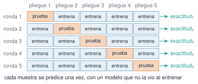
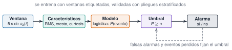

## Objetivos

- Pasar de ventanas de señal a una matriz de características.
- Clasificar con k-NN, LDA y regresión logística.
- Evaluar con validación cruzada, sin fuga de información.
- Leer matrices de confusión, F1 y AUC.
- Elegir el umbral de un detector de eventos.

## De la señal a una etiqueta

Edificio de tres plantas (datos **sintéticos**): ventanas de 20 s de $a_3(t)$.

Características: $f_1, f_2, f_3$ (pico de Welch refinado). Etiquetas: A, B (−1 % de rigidez), C (−10 % en el entrepiso 2).

$f_3$: A 4,418 · B 4,366 · C 4,251 Hz, con σ ≈ 0,055 Hz por ventana.

## Tres clasificadores

- **k-NN**: voto de los $k$ vecinos (estandarizar).
- **LDA**: nubes gaussianas con la misma covarianza, fronteras rectas.
- **Logística**: $P(y=1\mid x)=1/(1+e^{-(\beta_0+\beta^\top x)})$.

Con $k=1$, exactitud de entrenamiento **1,00** por construcción.

## Validación cruzada

{fig-alt="Cinco rondas de validación cruzada, con un pliegue de prueba por ronda"}

Estratificada · estandarizar **dentro** del pliegue · repetir con varios barajados.

## Resultado honesto

| | entrenamiento | validación cruzada |
|---|---|---|
| k-NN, $k=1$ | 1,00 | 0,63 |
| k-NN, $k=5$ | 0,86 | 0,71 |
| LDA | 0,79 | 0,74 |

Dispersión por barajado ≈ 0,03: no se declara ganador.

## Matriz de confusión (LDA)

|  | A | B | C |
|---|---|---|---|
| A | 20 | 10 | 0 |
| B | 6 | 22 | 2 |
| C | 0 | 2 | 28 |

**C**: precisión y exhaustividad 0,93. **A y B** se confunden: 1 % de rigidez está en el ruido de 20 s.

## Eventos: la clase rara

360 ventanas de 5 s, 12 % con impacto sintético.

«No avisar nunca» acierta el **88,3 %**.

{fig-alt="De la ventana a la alarma pasando por características, modelo y umbral"}

## Logística y ROC

Umbral 0,5: 2 falsas alarmas, 7 eventos perdidos.

Exhaustividad 0,83 · precisión 0,95 · **AUC 0,978**.

Umbral 0,1: exhaustividad 0,88, pero 20 falsas alarmas.

## El límite de lo detectable

Impactos débiles (0,08–0,3 m/s²): AUC 0,72, exhaustividad 0,095.

**Exactitud 0,892 > 0,883**: la trampa de la exactitud.

## Sobre MLJ

No se usa: su instalación degradaba `CSV` y `Parsers`. Implementaciones propias en `Resonancia.jl`.

Con MLJ: `machine`, `evaluate`, `CV`, pipelines y más modelos.

## Pídeselo a Claude

Pide siempre: cómo se ha evaluado, la matriz de confusión y qué pasa con la clase rara.

## La doy por superada si…

- Evalúo con validación cruzada estratificada y sin fuga.
- Leo precisión, exhaustividad, F1 y AUC.
- Elijo el umbral según el coste de cada error.
