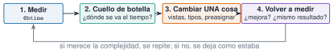

{.portada fig-alt="Un cronómetro a la izquierda y tres barras horizontales a la derecha, etiquetadas versión ingenua, con vistas y sin asignaciones, cada una más corta que la anterior"}

Julia presume de ser rápida, pero lo es **si se escribe de la forma en que el compilador sabe optimizar**. Procesar meses de registros de un puente exige que el análisis de un día no tarde minutos ni se coma la memoria. Esta unidad enseña a **medir** (qué tarda y cuánta memoria usa un código), a reconocer los tres causantes habituales de lentitud (variables globales, tipos inestables y asignaciones innecesarias) y a corregirlos de uno en uno, comprobando cada vez que el resultado sigue siendo el mismo.

::: {.callout-note}
## Cómo se lee esta unidad
**Tiempo orientativo: 90 minutos.** Objetivos (4), teoría en cuatro píldoras (18), práctica guiada (40), «Pídeselo a Claude» (12), ejercicios (14) y cierre (2). **Los tiempos que se muestran son los de la máquina en la que se compiló la página**: en la tuya saldrán otros. Lo que importa son las **razones** entre ellos y las asignaciones de memoria, que sí son reproducibles.
:::

```{julia}
#| include: false
using BenchmarkTools, Statistics, Random, Resonancia
include("../../../recursos/r1-datos/_tema.jl")
```

## Objetivos y prerrequisitos

**Objetivos.** Al terminar esta unidad sabrás:

- medir tiempo y asignaciones con `@btime` y `@belapsed`, e interpretar el resultado;
- detectar una función con tipos inestables y una variable global que ralentiza, y corregirlas;
- reducir asignaciones con vistas (`@views`), preasignación y operaciones en sitio;
- aplicar el ciclo medir → cambiar una cosa → medir y decidir si la mejora merece la complejidad;
- estimar el coste de procesar un mes de registros a partir de un día.

**Prerrequisitos.** El curso no los impone en el temario; conviene J1.3 a J1.5 (tipos, funciones y arrays).

**Reparto con otras unidades.** Aquí se mide y se corrige lo básico. El análisis de algoritmos y la complejidad están en [J3.9](../j3-9-grafos/index.qmd) y el paralelismo queda fuera de este curso.

## Teoría breve

::: {.callout-note .historia icon=false title="Un poco de historia: «la optimización prematura»"}
La frase más citada sobre rendimiento es de Donald Knuth, en un artículo de 1974 sobre el uso de `go to`: conviene olvidarse de las pequeñas eficiencias «el 97 % del tiempo», pero no dejar pasar el 3 % crítico [@knuth1974]. Citada sin el resto, se usa a veces como excusa para no medir. Lo que defiende, en realidad, es lo que hace esta unidad: **medir primero** y optimizar solo el trozo del código que de verdad pesa.

<span class="fuentes-caja">Fuente: Knuth (1974) [@knuth1974]; la frase y su contexto se han comprobado en fuentes secundarias (no en el original), consultadas el 26-10-2026.</span>
:::

### J3.1.1 Medir antes de optimizar {#j3-1-1}

El macro `@time` mide una ejecución, pero la **primera llamada incluye la compilación**, así que hay que llamar dos veces o usar `BenchmarkTools`: `@btime` repite la medida y da el mínimo, y `@belapsed` devuelve el tiempo en segundos. Un detalle importante: las variables globales se **interpolan con `$`** para que la medida no pague el coste de acceder a un global [@julia-rendimiento].

```julia
using BenchmarkTools
@btime sum(abs2, $x)         # tiempo mínimo y asignaciones
t = @belapsed sum(abs2, $x)  # tiempo en segundos (para guardarlo)
@allocated sum(abs2, x)      # bytes asignados
```

Las **asignaciones** (bytes) son tan informativas como el tiempo y no dependen del ordenador: una asignación inesperada casi siempre indica un problema [@julia-rendimiento].

::: {.ejercicio tipo="vf" id="j3-1-1-primera" respuesta="verdadero"}
La primera vez que se ejecuta una función en una sesión de Julia incluye el tiempo de compilarla, por lo que no es representativa.

::: {.solucion}
Verdadero. Por eso se mide la segunda llamada o se usa `BenchmarkTools`, que repite y descarta la compilación.
:::
:::

### J3.1.2 Estabilidad de tipos {#j3-1-2}

Una función es **estable en tipos** si el compilador puede deducir el tipo de lo que devuelve (y de sus variables internas) a partir de los tipos de los argumentos. En el caso siguiente, `s = 0` empieza siendo un `Int` y pasa a `Float64` dentro del bucle:

```{julia}
function suma_inestable(x); s = 0; for v in x; s += v; end; s; end
function suma_estable(x);   s = 0.0; for v in x; s += v; end; s; end
x = rand(MersenneTwister(1), 10^6)
(tipos_inestable = Base.return_types(suma_inestable, (Vector{Float64},)),
 tipos_estable = Base.return_types(suma_estable, (Vector{Float64},)),
 t_inestable_ms = round(1e3 * @belapsed(suma_inestable($x)), digits=3),
 t_estable_ms = round(1e3 * @belapsed(suma_estable($x)), digits=3))
```

El tipo devuelto por la primera es `Union{Float64, Int64}`: **inestable**, y aun así, **no es más lenta**. Julia sabe manejar eficientemente uniones pequeñas de tipos, así que no toda inestabilidad cuesta lo mismo. Lo que sí cuesta es perder por completo la información de tipos, por ejemplo con un contenedor `Vector{Any}`:

```{julia}
xa = Vector{Any}(x)
t_any = @belapsed(suma_estable($xa))
t_f64 = @belapsed(suma_estable($x))
(tipo_contenedor = (eltype(x), eltype(xa)), veces_mas_lento = round(t_any / t_f64), bytes_asignados_Any = @allocated(suma_estable(xa)))
```

Con `Vector{Any}` cada elemento es un objeto en memoria, hay que comprobar su tipo en cada iteración y se asigna memoria en el bucle: unas 20 veces más lento en esta medida (19). La herramienta para ver estos problemas es `@code_warntype f(x)`, que marca en rojo los tipos no concretos; `Base.return_types` da la misma información en una línea.

::: {.callout-warning}
## Errores frecuentes
Construir un vector con `[]` y añadir elementos de tipos distintos da un `Vector{Any}`. Para que sea de un tipo concreto, se declara: `Float64[]`, o `Vector{Float64}(undef, n)`. Y las comprensiones o `map` sobre colecciones heterogéneas heredan el problema.
:::

::: {.ejercicio tipo="abierta" id="j3-1-2-zero"}
La función `pos(x) = x < 0 ? 0 : x` devuelve un `Int` o el tipo de `x`. ¿Cómo la harías estable?

::: {.solucion}
Con `zero(x)`: `pos(x) = x < 0 ? zero(x) : x`, que devuelve siempre el mismo tipo que `x` [@julia-rendimiento].
:::
:::

### J3.1.3 Variables globales {#j3-1-3}

Una variable **global** no constante puede cambiar de valor y de tipo en cualquier momento, así que el compilador no puede asumir nada sobre ella y el código que la usa es lento. La solución es **pasar los datos como argumentos** a una función (o, si es de verdad una constante, declararla `const`) [@julia-rendimiento]:

```{julia}
suma_global = 0.0
function con_global(x)
    global suma_global
    for v in x; suma_global += v; end
end
t_global = @belapsed(con_global($x))
(con_global_ms = round(1e3 * t_global, digits=2), con_argumento_ms = round(1e3 * t_f64, digits=3),
 veces_mas_lento = round(t_global / t_f64))
```

Es el motivo por el que en J1.3 se recomendaba meter los cálculos en funciones: no solo evita el problema de ámbito, sino que es mucho más rápido.

::: {.ejercicio tipo="vf" id="j3-1-3-global" respuesta="falso"}
Declarar los datos como variables globales en el script es una buena práctica, porque así todas las funciones pueden usarlos sin pasarlos como argumentos.

::: {.solucion}
Falso. Las globales no constantes ralentizan el código y dificultan entenderlo y probarlo. Se pasan como argumentos.
:::
:::

### J3.1.4 Asignaciones: copias, vistas y preasignación {#j3-1-4}

Cada vez que se escribe `x[2:end]` se **copia** el trozo, y cada operación con vectores crea otro vector temporal. Con un registro largo eso son muchos megabytes y mucho tiempo en el *recolector de basura*. Tres herramientas lo reducen: las **vistas** (`@views`, que no copian), las operaciones **en sitio** (`.=`) y la **preasignación** del resultado. Veamos cuatro versiones de la misma cuenta, $\sum_i (x_i-x_{i-1})^2$:

```{julia}
d1(x) = sum(abs2, x[2:end] .- x[1:end-1])                 # copias y temporales
d2(x) = sum(abs2, @views x[2:end] .- x[1:end-1])          # vistas
function d3(x); s = 0.0; for i in 2:length(x); s += abs2(x[i] - x[i-1]); end; s; end   # bucle
function d4(x); s = 0.0; @inbounds @simd for i in 2:length(x); s += abs2(x[i] - x[i-1]); end; s; end
versiones = [("cortes con copia", d1), ("vistas", d2), ("bucle", d3), ("bucle con `@simd`", d4)]
res = [(nombre = n, bytes = @allocated(f(x)), ms = 1e3 * @belapsed($f($x))) for (n, f) in versiones]
(mismo_resultado = all(f(x) ≈ d1(x) for (_, f) in versiones),)
```

```{julia}
#| output: asis
filas = ["| $(r.nombre) | $(coma(r.bytes / 1e6, d=1)) | $(coma(r.ms, d=2)) | $(coma(res[1].ms / r.ms, d=1)) |" for r in res]
println("| versión | memoria asignada (MB) | tiempo (ms) | aceleración |\n|---|---|---|---|\n" * join(filas, "\n"))
```

: Cuatro versiones de la misma suma sobre un vector de $10^6$ elementos (máquina de compilación de la página). {#tbl-versiones}

Lo que enseña la @tbl-versiones: las vistas reducen la memoria a un tercio; el bucle simple no asigna nada **pero no es el más rápido** (la suma en serie impide que el procesador la ejecute en paralelo con instrucciones vectoriales); con `@simd` (que autoriza a reordenar las sumas) sí, y es el mejor. **No siempre gana lo que uno espera, y por eso se mide.** Además, `@simd` y `@inbounds` hacen que el código sea menos seguro: solo se usan donde se ha medido que compensan y el resultado se ha verificado.

::: {.ejercicio tipo="numerico" id="j3-1-4-mem" respuesta="0" tol="0%" unidad="bytes"}
¿Cuántos bytes asigna la versión con bucle (`d3`) sobre un vector de $10^6$ elementos?

::: {.solucion}
Cero: el bucle solo usa una variable escalar (`s`) y no crea ningún vector temporal.
:::
:::

::: {.callout-warning}
## Errores frecuentes
Optimizar sin medir (cambiar el código «porque debería ir más rápido»), optimizar varias cosas a la vez (y no saber cuál ayudó), no comprobar que el resultado sigue siendo el mismo, y dejar `@inbounds` en código que luego se llama con un índice fuera de rango (da resultados erróneos o cuelga Julia, en vez de un `BoundsError`).
:::

{#fig-ciclo fig-alt="Cuatro cajas en fila: medir, cuello de botella, cambiar una cosa y volver a medir, unidas con flechas, y una flecha de retorno desde la última a la primera con la nota: si merece la complejidad se repite; si no, se deja como estaba."}

### Para saber más {#j3-1-mas}

- Manual de Julia, *Performance Tips* [@julia-rendimiento] (en inglés): la referencia imprescindible.
- Documentación de [BenchmarkTools.jl](https://juliaci.github.io/BenchmarkTools.jl/stable/).
- Knuth, sobre cuándo optimizar [@knuth1974].

## Práctica guiada

Vamos a procesar **un día de registros** de un acelerómetro a 100 Hz (8,64 millones de muestras) y a calcular el RMS de cada tramo de 10 minutos con tres programas, y después a extrapolar al mes. Los datos son ruido gaussiano sintético con semilla fija: lo que importa es el coste, no la señal.

**Paso 1. Tres implementaciones del mismo cálculo.**

```{julia}
fs = 100
N = 24 * 3600 * fs
y = randn(MersenneTwister(1), N)
m = 600 * fs                                  # muestras por tramo de 10 min

rms_copias(y, m) = [sqrt(mean(abs2, y[(i-1)*m+1:i*m])) for i in 1:length(y)÷m]
rms_vistas(y, m) = [sqrt(mean(abs2, @view y[(i-1)*m+1:i*m])) for i in 1:length(y)÷m]
function rms_simd(y, m)
    r = Vector{Float64}(undef, length(y) ÷ m)
    for i in eachindex(r)
        s = 0.0
        @inbounds @simd for k in (i-1)*m+1:i*m
            s += abs2(y[k])
        end
        r[i] = sqrt(s / m)
    end
    return r
end
(tramos = length(y) ÷ m, mismo_resultado = rms_copias(y, m) ≈ rms_vistas(y, m) ≈ rms_simd(y, m) ≈ rms_por_ventana(y, 100.0, 600.0)[2],
 memoria_del_registro_MB = round(Base.summarysize(y) / 1e6, digits=1))
```

**Paso 2. Medir.**

```{julia}
impl = [("copias", rms_copias), ("vistas", rms_vistas), ("bucle @simd", rms_simd),
        ("rms_por_ventana (paquete)", (y, m) -> rms_por_ventana(y, 100.0, 600.0))]
med = [(nombre = n, bytes = @allocated(f(y, m)), ms = 1e3 * @belapsed($f($y, $m))) for (n, f) in impl]
(mediciones = med,)
```

```{julia}
#| label: fig-dia
#| fig-cap: "Procesar un día de registros (8,64 millones de muestras) con cuatro implementaciones. Izquierda: tiempo. Derecha: memoria asignada (escala logarítmica; las versiones sin asignaciones aparecen en 1 kB). La versión con copias asigna tanta memoria como el propio registro."
#| fig-alt: "Dos gráficas de barras horizontales con las mismas cuatro implementaciones. En la de la izquierda, el tiempo en milisegundos: la de copias es la más larga y las otras tres son similares y mucho menores. En la de la derecha, la memoria en escala logarítmica: la de copias llega a decenas de megabytes y las otras tres a unos pocos kilobytes."
let
    nombres = reverse([r.nombre for r in med])
    fig = Figure(size=(760, 300))
    ax1 = Axis(fig[1, 1], xlabel="tiempo (ms)", yticks=(1:4, nombres))
    barplot!(ax1, 1:4, reverse([r.ms for r in med]), direction=:x, color=AZUL)
    ax2 = Axis(fig[1, 2], xlabel="memoria asignada (kB, escala log.)", xscale=log10, yticks=(1:4, fill("", 4)))
    barplot!(ax2, 1:4, reverse([max(r.bytes, 1000) / 1e3 for r in med]), direction=:x, color=NARANJA, fillto=0.5)
    fig
end
```

Las tres versiones que **no copian** tardan lo mismo (alrededor de 1 ms: el límite es la velocidad de la memoria, no el cálculo) y la de copias tarda unas 2,6 veces más y asigna tanta memoria como el propio registro. En este caso, la implementación sencilla con vistas es tan buena como la optimizada con `@simd`, y mucho más fácil de leer: **la mejor optimización puede ser no hacer ninguna más**.

**Paso 3. De un día a un mes.** Una extrapolación lineal (el coste crece con el número de muestras) con los datos medidos. Lo que se vigila no es solo el tiempo: es la **memoria**.

```{julia}
dias = 30
mejor = argmin([r.ms for r in med]); peor = argmax([r.bytes for r in med])
(memoria_de_30_dias_del_registro_GB = round(dias * Base.summarysize(y) / 1e9, digits=2),
 basura_con_copias_GB = round(dias * med[peor].bytes / 1e9, digits=2),
 basura_con_vistas_kB = round(dias * med[2].bytes / 1e3, digits=1),
 tiempo_de_calculo_30_dias_s = round(dias * med[mejor].ms / 1e3, digits=2))
```

El cálculo en sí es de centésimas de segundo para un mes (0,03 s); **lo que pesa de verdad es la memoria y la lectura de los ficheros**: un mes a 100 Hz en `Float64` ocupa unos 2 GB, y la versión con copias genera, además, otros 2 GB de basura. La estrategia para registros de meses es **procesar por días (o por tramos), sin cargar todo y sin copiar**, y escribir solo los resultados (un RMS por tramo).

::: {.callout-note .idea-clave}
## Idea clave
Antes de optimizar: **¿se necesita?** Si el análisis de un mes tarda unos segundos, no hay nada que optimizar. Si hay que hacerlo, se mide la memoria además del tiempo, se cambia una sola cosa por vez y se comprueba que el resultado es el mismo (aquí, con `≈` entre las cuatro versiones).
:::

## «Pídeselo a Claude» {#pideselo}

::: {.callout-tip}
## Prompt
«Con Julia, `--project=.` y `BenchmarkTools`: escribe tres versiones de una función que calcule el RMS de tramos consecutivos de 60 000 muestras de un vector de `randn` (semilla 1, 8,64 millones de muestras): (1) con cortes que copian, (2) con `@view`, (3) con un bucle `@inbounds @simd`. Comprueba que las tres dan el mismo resultado con `≈`, mide cada una con `@belapsed` y `@allocated`, y dime cuál es más rápida y cuál usa menos memoria. Antes de proponer una optimización, enséñame la medida que la justifica. No inventes cifras: si algo no sale, dilo.»

**Verifica.** (a) Que usa `$` al interpolar variables en `@belapsed`. (b) Que las tres versiones dan el mismo resultado (`≈`). (c) Que la versión con copias asigna del orden de 70 MB y las otras del orden de un kilobyte. (d) Que no ha cambiado varias cosas a la vez ni ha dejado `@inbounds` sin comprobar los índices. (e) Que las conclusiones se basan en las medidas y no en lo que «debería» ocurrir.
:::

## Ejercicios

::: {.ejercicio tipo="numerico" id="j3-1-bytes" respuesta="69.1" tol="1%" unidad="MB"}
¿Cuántos megabytes ocupa en memoria el registro de un día (8,64 millones de `Float64`)?

::: {.pista}
`8_640_000 * 8` bytes, es decir, $69{,}12\cdot10^6$ bytes.
:::

::: {.solucion}
69,1 MB (`Base.summarysize(y) / 1e6`). Un mes ocupa unos 2,07 GB.
:::
:::

::: {.ejercicio tipo="numerico" id="j3-1-tramos" respuesta="144" tol="0%" unidad="tramos"}
¿Cuántos tramos de 10 minutos tiene un día?

::: {.solucion}
$24\cdot6=144$ tramos (`length(y) ÷ m`).
:::
:::

::: {.ejercicio tipo="vf" id="j3-1-simd" respuesta="falso"}
Un bucle `for` sin asignaciones es siempre la implementación más rápida de una suma.

::: {.solucion}
Falso. Sin `@simd`, el bucle suma en serie y puede ser más lento que `sum` sobre una vista, que sí usa instrucciones vectoriales. Por eso se mide.
:::
:::

::: {.ejercicio tipo="abierta" id="j3-1-merece"}
Una optimización reduce de 1,2 s a 0,9 s el cálculo diario y hace el código mucho más difícil de leer. ¿La aplicarías? ¿Y si el cálculo se repitiese un millón de veces?

::: {.criterios}
- Dice que depende de cuánto se ejecute y de cuánto pese esa parte en el total.
- Menciona la legibilidad y el riesgo (por ejemplo, `@inbounds`) frente al beneficio medido.
:::
:::

## La doy por superada si… {#superada}

- Mido tiempo y asignaciones con `@belapsed` y `@allocated` y sé por qué se interpola con `$`.
- Reconozco una función inestable y un contenedor `Vector{Any}`, y los corrijo.
- Evito variables globales pasando los datos como argumentos.
- Reduzco asignaciones con vistas y sé cuándo un bucle con `@simd` compensa.
- Sigo el ciclo medir → cambiar una cosa → medir, y compruebo que el resultado no cambia.

**Cierre.** Escribe tres líneas: qué he entendido, qué todavía no domino y cuál es mi siguiente paso pequeño. Si Claude propone una optimización, pídele la medida antes y después.

**Siguiente:** [J3.2 · Módulos y paquetes](../j3-2-paquetes/index.qmd).
