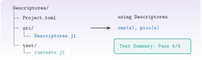

{.portada fig-alt="A la izquierda, el árbol de carpetas de un paquete llamado Descriptores con Project.toml, una carpeta src con Descriptores.jl y una carpeta test con runtests.jl; a la derecha, el uso del paquete con using Descriptores y un resultado de pruebas con cuatro aciertos de cuatro"}

Mientras una función vive en una página, solo la usa esa página. En cuanto se reutiliza, hay que subirla un escalón: a un **módulo** (un espacio de nombres propio), después a un **paquete** (con su `Project.toml`) y, si importa, con **pruebas**, **documentación** e **integración continua**. Es lo que se hizo con `Resonancia.jl`, y es la regla del curso: *toda función reutilizable va al paquete con docstring y test*. En esta unidad se crea un paquete mínimo de verdad, con sus pruebas, y se ve cómo falla cuando algo está mal declarado.

::: {.callout-note}
## Cómo se lee esta unidad
**Tiempo orientativo: 60 minutos.** Objetivos (3), teoría en cuatro píldoras (12), práctica guiada (25), «Pídeselo a Claude» (8), ejercicios (10) y cierre (2). El paquete de la práctica se crea en una carpeta temporal: **no modifica el entorno del curso ni el repositorio**.
:::

```{julia}
#| include: false
using Test, TOML, Statistics, Resonancia
include("../../../recursos/r1-datos/_tema.jl")
```

## Objetivos y prerrequisitos

**Objetivos.** Al terminar esta unidad sabrás:

- definir un módulo, exportar su API y distinguir lo público de lo interno;
- reconocer la estructura de un paquete (`Project.toml`, `src/`, `test/`) y leer su `[compat]`;
- escribir pruebas con `@testset`, `@test`, `≈`, `@test_throws` y `@inferred`;
- crear un paquete mínimo y ejecutar sus pruebas con `Pkg.test`;
- explicar qué aportan la documentación con `Documenter.jl` y la integración continua.

**Prerrequisitos.** El curso no los impone en el temario; conviene J1.2 (entorno y `Resonancia.jl`), J1.4 (funciones y docstrings) y J1.8 (tipos y métodos).

**Reparto con otras unidades.** Esta unidad explica el mecanismo. La política de qué entra en `Resonancia.jl` está en `CLAUDE.md` (función reutilizable, con docstring y test) y el control de versiones, en [C3](../../../claude/index.qmd).

## Teoría breve

::: {.callout-note .historia icon=false title="Un poco de historia: dónde se declaran las dependencias de test"}
La forma de declarar qué paquetes necesitan las pruebas ha ido cambiando. La más antigua usa las secciones `[extras]` y `[targets]` del `Project.toml` del paquete; desde Julia 1.2, Pkg admite además un `test/Project.toml` propio, y la documentación actual de Pkg recomienda, desde Julia 1.12, los *workspaces* (un `[workspace]` en el `Project.toml` principal que enlaza con `test/`) [@pkg-crear]. Los tres métodos siguen funcionando. En esta unidad se usa el más antiguo, `[extras]` y `[targets]`, porque es el que entienden todas las versiones, incluida la LTS 1.10 con la que se comprueba el curso.

<span class="fuentes-caja">Fuente: documentación de Pkg, *Creating Packages* [@pkg-crear]. Consultada el 26-10-2026.</span>
:::

### J3.2.1 Módulos y espacios de nombres {#j3-2-1}

Un **módulo** agrupa definiciones bajo un nombre: lo que se define dentro no choca con lo de fuera. Con `export` se marca la **API pública** (lo que `using` trae al espacio de trabajo); lo demás sigue accesible, pero cualificado (`Modulo.funcion`), y se entiende como interno:

```{julia}
module Estadisticos
using Statistics
export rms, pico

"""
    rms(x) -> Float64

Valor eficaz de `x`, en las unidades de `x`.
"""
rms(x::AbstractVector{<:Real}) = sqrt(mean(abs2, x))

"""
    pico(x) -> Float64

Máximo del valor absoluto de `x`.
"""
pico(x::AbstractVector{<:Real}) = maximum(abs, x)

_ayuda(x) = x .- mean(x)         # interno: no se exporta
end

using .Estadisticos              # el punto: el módulo está en este fichero, no es un paquete
interno = try _ayuda([1.0, 2.0]) catch e; sprint(showerror, e); end
(exportados = sort(names(Estadisticos)), rms_de_3_4 = rms([3.0, 4.0]),
 interno_sin_cualificar = interno, interno_cualificado = Estadisticos._ayuda([1.0, 2.0, 3.0]))
```

Dos formas de traer un módulo: `using M` trae sus nombres exportados; `import M` solo trae `M`, y entonces se escribe `M.f`. Cuando el módulo está en un fichero del propio proyecto se carga con `include("M.jl")` y se usa con un punto: `using .M`.

::: {.ejercicio tipo="vf" id="j3-2-1-export" respuesta="falso"}
Lo que no se exporta de un módulo es inaccesible desde fuera.

::: {.solucion}
Falso. Se puede acceder cualificándolo (`Modulo._ayuda(x)`). `export` solo decide qué trae `using`; la convención es que lo no exportado es interno y puede cambiar sin aviso.
:::
:::

### J3.2.2 Anatomía de un paquete {#j3-2-2}

Un paquete es un módulo con la estructura que Pkg entiende: un `Project.toml` con `name`, `uuid` y `version`, y una carpeta `src/` con un fichero `NombreDelPaquete.jl` que define el módulo; las pruebas van en `test/runtests.jl` [@pkg-crear]. Así es `Resonancia.jl`, el paquete de este curso, que se puede inspeccionar por código:

```{julia}
ruta = "../../../Resonancia.jl"
pt = TOML.parsefile(joinpath(ruta, "Project.toml"))
(carpeta = sort(readdir(ruta)), ficheros_src = sort(readdir(joinpath(ruta, "src"))),
 nombre_y_version = (pt["name"], pt["version"]), dependencias = sort(collect(keys(pt["deps"]))),
 compat = pt["compat"], testsets = count(contains("@testset"), readlines(joinpath(ruta, "test", "runtests.jl"))))
```

Tres detalles: (1) `uuid` identifica el paquete de forma única, aunque dos se llamen igual; (2) `[deps]` lista **todo** lo que el código carga con `using`, incluidas las bibliotecas estándar como `LinearAlgebra`; (3) `[compat]` indica con qué versiones de Julia y de las dependencias se garantiza que funciona (aquí, `julia = "1.10"`) [@pkg-crear].

### J3.2.3 Pruebas con `Test` {#j3-2-3}

Una **prueba** es una afirmación sobre el código que se comprueba automáticamente. `@test expr` comprueba que `expr` sea cierta; `@testset "nombre" begin … end` agrupa pruebas, las ejecuta **todas** aunque alguna falle y resume los resultados; `@test_throws` comprueba que se lance una excepción; `@inferred` comprueba que el tipo del resultado se pueda deducir (estabilidad de tipos, J3.1). Con reales se usa `≈`, que admite `atol` y `rtol` [@julia-test]:

```{julia}
@testset "Estadisticos" begin
    @test rms([3.0, 4.0]) ≈ sqrt(12.5)                        # valor calculado a mano
    @test pico([1.0, -3.0, 2.0]) == 3.0
    @test rms(fill(2.0, 100)) ≈ 2.0                          # propiedad: RMS de una constante
    @test rms(-[3.0, 4.0]) ≈ rms([3.0, 4.0])                 # propiedad: invariante al signo
    @test_throws MethodError rms("hola")                     # entrada no válida
    @test (@inferred rms([1.0, 2.0])) isa Float64            # tipo estable
end;
```

Una buena batería mezcla **valores conocidos** (calculados a mano), **propiedades** (invariancias que siempre deben cumplirse) y **casos límite o inválidos**. Escribir la prueba antes de usar la función por primera vez obliga a pensar qué debe devolver.

::: {.ejercicio tipo="abierta" id="j3-2-3-pruebas"}
Propón tres pruebas para una función `media_movil(x, k)` que calcula la media móvil de ventana `k`.

::: {.criterios}
- Un valor conocido (por ejemplo, la media móvil de `[1, 2, 3, 4]` con `k = 2` es `[1,5; 2,5; 3,5]`).
- Una propiedad (por ejemplo, para `k = 1` devuelve la propia señal; para una constante, devuelve esa constante).
- Un caso inválido (`k` mayor que la longitud, o `k ≤ 0`, debe lanzar un error).
:::
:::

### J3.2.4 Documentación e integración continua {#j3-2-4}

Una función sin documentar no es reutilizable: de ahí los **docstrings** con firma, descripción, unidades y ejemplo (J1.4). `Documenter.jl` convierte esos docstrings y unos ficheros Markdown en un sitio web, y puede **probar** como pruebas (*doctests*) los ejemplos que aparecen en la documentación, de modo que un ejemplo que se desactualiza falla [@documenter]. Una documentación mínima vive en `docs/` con un `docs/src/index.md` y un `docs/make.jl` que llama a `makedocs`.

La **integración continua** (CI) ejecuta las pruebas automáticamente en un servidor cada vez que se sube código, de modo que un cambio que rompe algo se detecta enseguida y no semanas después. En este repositorio, la publicación web es un flujo de trabajo de GitHub Actions que se lanza con cada `push` a `main` (`.github/workflows/publish.yml`). Una de sus decisiones es instructiva: **no instala Julia**, y lee los resultados de las páginas con código de la carpeta `_freeze/`, por lo que hay que renderizarlas en local y commitear `_freeze/` antes de subir.

{#fig-ciclo fig-alt="Cinco cajas en fila unidas por flechas: función en una página, módulo con module y export, paquete con Project.toml, pruebas con testset, y documentación y CI con Documenter y Actions. Debajo, una nota: cuando una función se reutiliza en varias páginas sube un escalón."}

::: {.callout-note .idea-clave}
## Idea clave
Un paquete sin pruebas es una promesa; con pruebas, es un contrato. Y una función de `Resonancia.jl` **tiene** pruebas porque otras páginas del curso se apoyan en ella: si cambia, hay que saberlo ya.
:::

::: {.callout-warning}
## Errores frecuentes
(1) **Usar un paquete sin declararlo en `[deps]`**: aunque sea de la biblioteca estándar, como `Statistics`; el paquete falla al cargarse (se muestra en la práctica). (2) Exportar demasiado: cada nombre exportado puede chocar con los del usuario; se exporta solo la API. (3) `@test a == b` con reales en vez de `≈`: falla por redondeo. (4) Pruebas que escriben ficheros dentro de la carpeta del paquete: las pruebas no deben modificarla [@pkg-crear]. (5) No declarar `[compat]`: el paquete puede romperse al actualizar una dependencia. (6) Editar `[deps]` a mano y dejar un `Manifest.toml` antiguo: Pkg falla con un mensaje confuso; se usa `Pkg.add` o se regenera el manifiesto.
:::

### Para saber más {#j3-2-mas}

- Documentación de Pkg, *Creating Packages* [@pkg-crear] y manual de Julia, *Unit Testing* [@julia-test].
- `Documenter.jl` [@documenter]; para generar la plantilla de un paquete completo (con docs y CI), la documentación de Pkg recomienda `PkgTemplates.jl`.
- Reglas del curso: `CLAUDE.md` (apartado «Código y entornos»).

## Práctica guiada

Vamos a crear un paquete `Descriptores` completo, a ejecutar sus pruebas con `Pkg.test` y a ver qué pasa si una dependencia no está declarada. Todo en una carpeta temporal.

**Paso 1. Crear la estructura y los ficheros.**

```{julia}
dir = mktempdir()
pkg = joinpath(dir, "Descriptores")
mkpath(joinpath(pkg, "src")); mkpath(joinpath(pkg, "test"))

proyecto(deps) = """
name = "Descriptores"
uuid = "5f3a1c8e-8b0e-4d5e-9d57-2d9d4a6c9a11"
version = "0.1.0"
$(deps)
[compat]
julia = "1.10"

[extras]
Test = "8dfed614-e22c-5e08-85e1-65c5234f0b40"

[targets]
test = ["Test"]
"""
declara_statistics = "\n[deps]\nStatistics = \"10745b16-79ce-11e8-11f9-7d13ad32a3b2\"\n"

write(joinpath(pkg, "src", "Descriptores.jl"), """
module Descriptores
using Statistics
export rms, pico

\"\"\"
    rms(x) -> Float64

Valor eficaz de `x`, en las unidades de `x`.
\"\"\"
rms(x::AbstractVector{<:Real}) = sqrt(mean(abs2, x))

\"\"\"
    pico(x) -> Float64

Máximo del valor absoluto de `x`.
\"\"\"
pico(x::AbstractVector{<:Real}) = maximum(abs, x)
end
""")
write(joinpath(pkg, "test", "runtests.jl"), """
using Test, Descriptores
@testset "Descriptores" begin
    @test rms([3.0, 4.0]) ≈ sqrt(12.5)
    @test pico([1.0, -3.0, 2.0]) == 3.0
    @test_throws MethodError rms("hola")
    @test (@inferred rms([1.0, 2.0])) isa Float64
end
""")
sort(relpath.(vcat([joinpath(r, f) for (r, _, fs) in walkdir(pkg) for f in fs]), pkg))
```

**Paso 2. Primer intento: sin declarar `Statistics`.** El `Project.toml` aún no tiene `[deps]`.

```{julia}
function salida(cmd)
    io = IOBuffer()
    run(pipeline(ignorestatus(cmd), stdout=io, stderr=io))
    String(take!(io))
end
probar(pkg) = salida(`$(Base.julia_cmd()) --startup-file=no --color=no --project=$pkg -e "using Pkg; Pkg.test()"`)

write(joinpath(pkg, "Project.toml"), proyecto(""))
s1 = probar(pkg)
lineas_error = filter(l -> occursin(r"does not have|ERROR: ", l), split(s1, '\n'))
(las_pruebas_pasan = occursin("tests passed", s1), mensaje = first(lineas_error, 2))
```

El paquete ni siquiera se carga: **falta declarar la dependencia**, que `Pkg` exige para todo lo que se carga con `using` (hasta para una biblioteca estándar).

**Paso 3. Declarar y volver a probar.** Editar `[deps]` a mano deja desactualizado el `Manifest.toml` que Pkg creó en el primer intento; lo normal sería `Pkg.add("Statistics")`, que lo actualiza solo. Aquí se simula la edición manual y se borra el manifiesto para que se regenere.

```{julia}
write(joinpath(pkg, "Project.toml"), proyecto(declara_statistics))
rm(joinpath(pkg, "Manifest.toml"), force=true)
s2 = probar(pkg)
lineas = split(s2, '\n')
i = findfirst(contains("Test Summary"), lineas)
(pasa = occursin("tests passed", s2), resumen = strip.(lineas[i:i+1]))
```

Cuatro pruebas, cuatro aciertos. Es el mismo mecanismo con el que se prueba `Resonancia.jl`: desde la raíz del repositorio, `julia --project=. -e 'using Pkg; Pkg.test("Resonancia")'` ejecuta sus pruebas (20 conjuntos `@testset`).

**Paso 4. Qué pasa cuando una prueba falla.** Se cambia una afirmación a una incorrecta y se comprueba que el resumen lo dice con claridad:

```{julia}
write(joinpath(pkg, "test", "runtests.jl"), replace(read(joinpath(pkg, "test", "runtests.jl"), String), "sqrt(12.5)" => "3.0"))
s3 = probar(pkg)
(pasa = occursin("tests passed", s3), falla_detectada = occursin("Test Failed", s3), linea_resumen = strip(first(filter(l -> occursin("Descriptores  |", l), split(s3, '\n')))))
```

Una prueba que falla es información valiosa: señala exactamente qué comportamiento ha cambiado. Por eso el paquete no se da por bueno hasta que todas pasan.

## «Pídeselo a Claude» {#pideselo}

::: {.callout-tip}
## Prompt
«Con Julia y sin modificar el entorno del repositorio, crea en una carpeta temporal un paquete `Descriptores` con `Project.toml` (name, uuid, version, `[deps]` con `Statistics`, `[compat] julia = "1.10"`), `src/Descriptores.jl` (funciones `rms` y `pico` con docstring y unidades) y `test/runtests.jl` con cuatro pruebas: un valor calculado a mano, una propiedad, un `@test_throws` y un `@inferred`. Ejecuta `Pkg.test()` en ese paquete y dime el resumen. No uses `Pkg.add` ni toques `Project.toml` ni `Manifest.toml` de la raíz. No inventes resultados: si algo falla, dime el mensaje.»

**Verifica.** (a) Que el paquete está **fuera** del repositorio (carpeta temporal) y que `git status` no muestra cambios en la raíz. (b) Que `Statistics` está declarada en `[deps]` con su UUID. (c) Que usa `≈` y no `==` para los reales. (d) Que el resumen dice `Pass 4 Total 4`. (e) Que los docstrings llevan firma y unidades.
:::

## Ejercicios

::: {.ejercicio tipo="numerico" id="j3-2-testsets" respuesta="20" tol="0%" unidad="conjuntos"}
¿Cuántos `@testset` tiene `Resonancia.jl/test/runtests.jl`?

::: {.solucion}
20 (el valor `testsets` del paso de anatomía; puede crecer si se añaden pruebas).
:::
:::

::: {.ejercicio tipo="vf" id="j3-2-deps" respuesta="verdadero"}
Para cargar `Statistics` con `using` dentro de un paquete hay que declararla en `[deps]`, aunque pertenezca a la biblioteca estándar.

::: {.solucion}
Verdadero. Pkg exige declarar todo lo que el código carga, y de ahí el error del paso 2 de la práctica.
:::
:::

::: {.ejercicio tipo="vf" id="j3-2-igual" respuesta="falso"}
En una prueba, `@test rms(x) == 0.7615773105863908` es preferible a `@test rms(x) ≈ 0.7615773105863908`, porque es más estricta.

::: {.solucion}
Falso. Con reales, la igualdad exacta falla por diferencias de redondeo entre máquinas y versiones; `≈` comprueba con tolerancia relativa.
:::
:::

::: {.ejercicio tipo="abierta" id="j3-2-subir"}
Tienes una función `descriptores` en la página J1.4 y la quieres usar también en dos unidades de M. ¿Qué pasos das según las reglas del curso?

::: {.criterios}
- La mueves a `Resonancia.jl` con docstring (con unidades) y un test, y no copias el código entre páginas.
- Las páginas la cargan con `using Resonancia`; si cambia la versión del paquete, se vuelve a renderizar lo que dependa de ella.
:::
:::

## La doy por superada si… {#superada}

- Defino un módulo y distingo la API exportada de lo interno.
- Reconozco la estructura de un paquete y leo su `[deps]` y su `[compat]`.
- Escribo una batería con valores conocidos, propiedades y casos inválidos.
- Creo un paquete mínimo, declaro sus dependencias y ejecuto `Pkg.test`.
- Explico qué aportan la documentación y la integración continua.

**Cierre.** Escribe tres líneas: qué he entendido, qué todavía no domino y cuál es mi siguiente paso pequeño. Una función que otras páginas usan sin pruebas es un riesgo: antes de moverla al paquete, escribe su test.

**Siguiente:** [J3.4 · Raíces e interpolación](../j3-4-raices/index.qmd).
