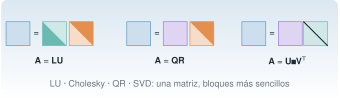
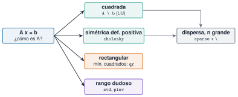

{.portada fig-alt="Cuatro factorizaciones dibujadas como productos de bloques cuadrados: una matriz igual a un triángulo inferior por uno superior; igual a una matriz ortogonal por un triángulo superior; e igual a dos matrices ortogonales con una diagonal entre ellas"}

En J1.5 se resolvió `A \ b` y se calcularon valores propios sin preguntar *cómo*. Esta unidad abre la caja: toda la álgebra lineal numérica se reduce a **factorizar** una matriz en piezas más sencillas (triangulares, ortogonales, diagonales) y trabajar con ellas. Saber qué factorización existe y cuál conviene según el problema es lo que separa un cálculo preciso y rápido de uno lento o inestable. Los ejemplos son los de la vía M: el edificio de tres plantas, las matrices de Hankel de las señales y una cadena de miles de masas.

::: {.callout-note}
## Cómo se lee esta unidad
**Tiempo orientativo: 120 minutos.** Objetivos (5), teoría en seis píldoras (25), práctica guiada (55), «Pídeselo a Claude» (15), ejercicios (15) y cierre (5). Solo se usan las bibliotecas estándar `LinearAlgebra` y `SparseArrays` y las funciones de `Resonancia.jl`.
:::

```{julia}
#| include: false
using LinearAlgebra, SparseArrays, Random, Statistics, Resonancia
include("../../../recursos/r1-datos/_tema.jl")
```

## Objetivos y prerrequisitos

**Objetivos.** Al terminar esta unidad sabrás:

- factorizar con LU (con pivoteo), Cholesky, QR y SVD, y reutilizar la factorización;
- elegir la factorización o el método según la estructura de la matriz;
- resolver mínimos cuadrados con QR y explicar por qué no conviene usar las ecuaciones normales cuando la matriz está mal condicionada;
- estimar el rango numérico con la SVD y construir aproximaciones de bajo rango;
- calcular valores propios de un problema generalizado `K φ = λ M φ` con Cholesky, y resolver con matrices dispersas.

**Prerrequisitos.** El curso no los impone en el temario; conviene J1.5 (arrays y `LinearAlgebra`) y la unidad [M2.1](../../../mse/m02-matematicas/matrices/index.qmd), que explica la teoría de normas y condicionamiento.

**Reparto con otras unidades.** La teoría (propiedades, demostraciones) está en [M2.1](../../../mse/m02-matematicas/matrices/index.qmd) y la SVD aplicada, en M2.4 y M7. Aquí se implementa y se verifica con cifras.

## Teoría breve

::: {.callout-note .historia icon=false title="Un poco de historia: de la eliminación gaussiana a la SVD"}
Muchas de las factorizaciones de hoy nacieron antes de que se hablase de matrices. G. W. Stewart cuenta que Gauss describió en 1823 su algoritmo de eliminación como una reducción de una forma cuadrática; que Jacobi (1846) dio un algoritmo para diagonalizar una matriz simétrica, y que la descomposición en valores singulares, en 1873, «se ve como una más de una larga serie de resultados sobre formas canónicas»: Beltrami, Jordan y Sylvester llegaron a ella desde el álgebra lineal, y Schmidt y Weyl, desde las ecuaciones integrales [@stewart1993]. El tratado de referencia actual para los algoritmos es el de Golub y Van Loan [@golub2013].

<span class="fuentes-caja">Fuente: Stewart (1993) [@stewart1993]; los datos son los ya recogidos y comprobados en M2.1 (consulta del 25-10-2026). Si alguna fuente discrepa de una fecha, prevalece la de la fuente enlazada.</span>
:::

### J3.3.1 LU con pivoteo {#j3-3-1}

La factorización **LU** escribe $\mathbf P\mathbf A=\mathbf L\mathbf U$, con $\mathbf L$ triangular inferior, $\mathbf U$ triangular superior y $\mathbf P$ una permutación de filas (el **pivoteo**, que evita dividir por números pequeños). Es lo que hace `A \ b` para una matriz cuadrada. Una vez factorizada, **resolver con un nuevo segundo miembro cuesta mucho menos** que factorizar de nuevo ($\mathcal O(n^2)$ frente a $\mathcal O(n^3)$), por lo que se factoriza una vez y se reutiliza:

```{julia}
Random.seed!(1)
A = randn(5, 5)
F = lu(A)                                   # F.L, F.U, F.p
bs = [randn(5) for _ in 1:3]                # tres segundos miembros
(PA_igual_LU = norm(F.L * F.U - A[F.p, :]) < 1e-13,
 residuos_menores_que_1e13 = all(norm(A * (F \ b) - b) < 1e-13 for b in bs))
```

::: {.ejercicio tipo="vf" id="j3-3-1-reuso" respuesta="verdadero"}
Para resolver el mismo sistema con muchos segundos miembros distintos conviene factorizar `A` una sola vez y reutilizar el factor.

::: {.solucion}
Verdadero: `F = lu(A)` cuesta $\mathcal O(n^3)$ una vez, y cada `F \ b` solo $\mathcal O(n^2)$.
:::
:::

### J3.3.2 Cholesky y el problema generalizado {#j3-3-2}

Las matrices de masa y rigidez de una estructura son **simétricas definidas positivas** (SPD). Para ellas existe la factorización de **Cholesky** $\mathbf M=\mathbf L\mathbf L^{\mathsf T}$, el doble de rápida que LU y que sirve además de **test de definición positiva**: `isposdef(K)`. Con ella, el problema generalizado $\mathbf K\boldsymbol\varphi=\lambda\mathbf M\boldsymbol\varphi$ se convierte en uno estándar y simétrico, $\mathbf C\mathbf y=\lambda\mathbf y$ con $\mathbf C=\mathbf L^{-1}\mathbf K\mathbf L^{-\mathsf T}$ y $\mathbf y=\mathbf L^{\mathsf T}\boldsymbol\varphi$:

```{julia}
m = 2.0e5
M = Diagonal([m, m, m])
K = [1e8 -5e7 0.0; -5e7 9e7 -4e7; 0.0 -4e7 4e7]       # edificio de 3 plantas (N/m)
L = cholesky(Symmetric(Matrix(M))).L
C = Symmetric(inv(L) * K * inv(L'))
f_chol = sqrt.(eigvals(C)) ./ 2π
f_gen = sqrt.(eigvals(Symmetric(K), Symmetric(Matrix(M)))) ./ 2π
(K_es_SPD = isposdef(K), menos_K_es_SPD = isposdef(-K), frecuencias_Hz = round.(f_chol, digits=4),
 coinciden = f_chol ≈ f_gen)
```

Son las frecuencias del edificio de J1.5 (1,1048, 2,9387 y 4,3902 Hz).

### J3.3.3 QR y mínimos cuadrados {#j3-3-3}

Con más ecuaciones que incógnitas ($\mathbf A\in\mathbb R^{m\times n}$, $m>n$) se busca el $\mathbf x$ que minimiza $\lVert\mathbf A\mathbf x-\mathbf b\rVert_2$. La factorización **QR** ($\mathbf A=\mathbf Q\mathbf R$, con $\mathbf Q$ de columnas ortonormales) lo resuelve con la estabilidad de una matriz ortogonal, y es lo que hace `A \ b` si `A` es rectangular. La alternativa, las **ecuaciones normales** $\mathbf A^{\mathsf T}\mathbf A\,\mathbf x=\mathbf A^{\mathsf T}\mathbf b$, es más corta de escribir pero **eleva al cuadrado el condicionamiento**: $\kappa(\mathbf A^{\mathsf T}\mathbf A)=\kappa(\mathbf A)^2$ (M2.1). Se ve con un ajuste polinómico de la frecuencia de un modo frente a la temperatura:

```{julia}
#| output: asis
T = collect(range(-5, 35, length=41))                  # °C
Random.seed!(2)
frec = 1.2 .- 0.002 .* T .+ 0.001 .* randn(41)         # Hz, deriva térmica lineal con ruido
filas = map([4, 8, 12, 16]) do g
    V = vandermonde(T ./ 40, g + 1)                    # columnas 1, t, …, t^g (t normalizada)
    cq = V \ frec                                      # QR
    cn = (V' * V) \ (V' * frec)                        # ecuaciones normales
    "| $g | $(coma(cond(V), d=0)) | $(replace(@sprintf("%.1e", cond(V' * V)), "." => ",")) | $(replace(@sprintf("%.6f", norm(V * cq - frec)), "." => ",")) | $(replace(@sprintf("%.6f", norm(V * cn - frec)), "." => ",")) | $(replace(@sprintf("%.1e", norm(cq - cn) / norm(cq)), "." => ",")) |"
end
println("| grado | κ(V) | κ(VᵀV) | residuo QR | residuo normales | dif. relativa de coeficientes |\n|---|---|---|---|---|---|\n" * join(filas, "\n"))
```

: Ajuste polinómico por QR y por ecuaciones normales. El residuo apenas delata el problema, pero los **coeficientes** sí: la diferencia entre los dos métodos pasa de $10^{-12}$ con grado 4 a un 0,7 % con grado 12 y a un 100 % con grado 16, cuando $\kappa(\mathbf V^{\mathsf T}\mathbf V)$ supera $1/\varepsilon\approx4{,}5\cdot10^{15}$. {#tbl-qr}

Con grado bajo no se nota, y por eso el error se cuela: con grado 12 los dos métodos dan casi el mismo residuo, pero coeficientes que difieren un 0,7 %, y con grado 16 las normales ya devuelven coeficientes sin sentido (y un residuo un 1 % mayor). Un residuo pequeño **no** garantiza que los parámetros sean correctos.

::: {.ejercicio tipo="vf" id="j3-3-3-normales" respuesta="falso"}
Las ecuaciones normales y la QR dan siempre la misma precisión, porque resuelven el mismo problema.

::: {.solucion}
Falso. Resuelven el mismo problema matemático, pero las normales elevan al cuadrado el número de condición y pierden el doble de cifras. Con $\kappa(\mathbf A)=10^8$, $\kappa(\mathbf A^{\mathsf T}\mathbf A)=10^{16}$: no queda ninguna cifra fiable en doble precisión.
:::
:::

### J3.3.4 SVD, rango y bajo rango {#j3-3-4}

La **SVD** $\mathbf A=\mathbf U\boldsymbol\Sigma\mathbf V^{\mathsf T}$ es la factorización más informativa: sus valores singulares $\sigma_1\ge\sigma_2\ge\dots$ dicen cuántas «direcciones independientes» tiene la matriz y cuánto pesa cada una. El **rango numérico** es el número de valores singulares por encima de una tolerancia (`rango_numerico` del paquete). Y el teorema de Eckart–Young dice que la mejor aproximación de rango $k$ conserva los $k$ primeros valores singulares, con error $\lVert\mathbf A-\mathbf A_k\rVert_2=\sigma_{k+1}$. Se ve con la matriz de Hankel de una señal de dos modos (la de J1.1), cuyo rango debe ser $2\times2=4$ (cada senoide aporta dos):

```{julia}
fs = 100.0
t = (0:999) ./ fs
x = sin.(2π * 2.5 .* t) .+ 0.4 .* sin.(2π * 7.0 .* t)
H = hankel_trayectoria(x, 100)                         # 100 × 901
S = svdvals(H)
U, Sv, Vt = svd(H)
H4 = U[:, 1:4] * Diagonal(Sv[1:4]) * Vt[:, 1:4]'
(forma = size(H), valores_singulares = round.(S[1:6], sigdigits=4), rango_numerico = rango_numerico(H),
 error_rango_4 = opnorm(H - H4), sigma_5 = S[5])
```

Hay cuatro valores singulares grandes (150,2; 150,1; 60,0 y 59,7) y el quinto es de $3{,}6\cdot10^{-13}$: rango 4, y el error de la aproximación de rango 4 coincide con $\sigma_5$ (la señal está exactamente en ese subespacio). Con ruido el panorama cambia:

```{julia}
#| label: fig-svd
#| fig-cap: "Valores singulares de la matriz de Hankel (ventana de 100 muestras) de una señal de dos modos, sin ruido (azul) y con ruido gaussiano de 0,2 (naranja). Sin ruido hay un salto brusco tras el cuarto valor (el rango es 4, es decir, dos modos); con ruido, los cuatro primeros siguen destacando sobre un «suelo» de unos 8, que marca el ruido."
#| fig-alt: "Gráfica semilogarítmica de valores singulares frente a su posición del 1 al 20. La serie azul baja de 150 a 60 en cuatro puntos y luego cae a casi cero. La serie naranja tiene los mismos cuatro primeros puntos y después se queda en una meseta cercana a 8."
Random.seed!(3)
xr = x .+ 0.2 .* randn(length(x))
Sr = svdvals(hankel_trayectoria(xr, 100))
let
    fig = Figure(size=(720, 320))
    ax = Axis(fig[1, 1], xlabel="posición del valor singular", ylabel="σ (adim.)", yscale=log10, xticks=[1, 4, 8, 12, 16, 20])
    scatterlines!(ax, 1:20, max.(S[1:20], 1e-14), color=AZUL, label="sin ruido")
    scatterlines!(ax, 1:20, Sr[1:20], color=NARANJA, marker=:utriangle, linestyle=:dash, label="con ruido")
    vlines!(ax, 4.5, color=GRIS, linestyle=:dot)
    axislegend(ax, position=:lb)
    fig
end
```

Este es el primer paso de los métodos de identificación de M7 (ERA, SSI): **contar los modos** mirando dónde acaba el salto entre valores singulares. Con ruido no hay un cero exacto: se busca el codo, y la decisión es del analista.

::: {.ejercicio tipo="numerico" id="j3-3-4-rango" respuesta="4" tol="0%"}
¿Cuál es el rango numérico de la matriz de Hankel de una señal que es suma de dos senoides de frecuencias distintas?

::: {.solucion}
4: cada senoide pura da rango 2 (un par de valores singulares) y las dos suman 4.
:::
:::

### J3.3.5 Valores propios {#j3-3-5}

`eigen(A)` calcula valores y vectores propios; para una matriz **simétrica** conviene envolverla con `Symmetric(A)`, que activa un algoritmo más rápido y garantiza valores propios reales y vectores ortogonales. Con una matriz no simétrica los valores propios pueden ser **complejos**. Un buen control de calidad es contrastar con una fórmula conocida: la cadena de $n$ masas iguales $m$ unidas por muelles $k$, anclada por un extremo, tiene frecuencias analíticas

$$
f_j=\frac{1}{2\pi}\,2\sqrt{\frac{k}{m}}\,\sin\!\frac{(2j-1)\pi}{2(2n+1)},\qquad j=1,\dots,n ,
$$ {#eq-cadena}

con las que se comprueba el cálculo numérico:

```{julia}
n = 10
Mc, Kc = cadena_masas_muelles(n)                       # m = k = 1
fc, _ = modos_propios(Kc, Mc)
fa = [2 * sin((2j - 1) * π / (2 * (2n + 1))) / (2π) for j in 1:n]
(numerico_Hz = round.(fc[1:3], digits=6), analitico_Hz = round.(fa[1:3], digits=6),
 error_maximo = maximum(abs.(fc .- fa)))
```

::: {.ejercicio tipo="vf" id="j3-3-5-simetrica" respuesta="verdadero"}
Los valores propios de una matriz simétrica real son reales, y por eso conviene indicarlo con `Symmetric`.

::: {.solucion}
Verdadero. Es una propiedad de las matrices simétricas reales, y `Symmetric` permite a `eigen` usar un algoritmo específico, más rápido y con garantía de resultado real.
:::
:::

### J3.3.6 Matrices dispersas {#j3-3-6}

La matriz de rigidez de una cadena, una viga o un edificio tiene casi todo ceros: es **dispersa**. `SparseArrays` guarda solo los elementos no nulos (formato CSC) y `\` elige automáticamente un solver para dispersas, con lo que se resuelven problemas de miles de grados de libertad con memoria y tiempo mínimos. Lo contrario es un error caro: convertir a densa con `Matrix(K)`.

```{julia}
n = 2000
Ms, Ks = cadena_masas_muelles(n)
Kd_bytes = n^2 * 8                                     # lo que ocuparía la densa (8 bytes por elemento)
fuerza = zeros(n); fuerza[end] = 1.0                   # fuerza unidad en el extremo libre
u = Ks \ fuerza
(nceros = nnz(Ks), de_n2 = n^2, memoria_dispersa_kB = round(Base.summarysize(Ks) / 1e3),
 memoria_densa_MB = Kd_bytes / 1e6, veces_menos = round(Kd_bytes / Base.summarysize(Ks)),
 residuo = norm(Ks * u - fuerza), desplazamiento_extremo = u[end])
```

El desplazamiento del extremo es exactamente $n=2000$ (con $k=1$, la fuerza unidad estira cada uno de los $n$ muelles una unidad), un control analítico perfecto del solver. Pero cuidado con una propiedad contraintuitiva: **la inversa de una matriz dispersa es, en general, densa** (@fig-spy), y por eso no se calcula `inv(K)`.

```{julia}
#| label: fig-spy
#| fig-cap: "Patrón de ceros de la matriz de rigidez de una cadena de 20 masas (izquierda: tridiagonal, 58 elementos no nulos de 400) y de su inversa (derecha: completamente llena, 400 no nulos). Un elemento no nulo se dibuja en azul."
#| fig-alt: "Dos cuadrículas de 20 por 20. La de la izquierda tiene celdas azules solo en la diagonal principal y en las dos adyacentes; la de la derecha tiene todas las celdas azules."
let
    n = 20
    _, K20 = cadena_masas_muelles(n)
    Ki = inv(Matrix(K20))
    fig = Figure(size=(720, 340))
    for (j, (A, titulo)) in enumerate([(Matrix(K20), "K: $(nnz(K20)) no nulos"), (Ki, "K⁻¹: $(count(!iszero, round.(Ki, digits=12))) no nulos")])
        ax = Axis(fig[1, j], title=titulo, aspect=1, yreversed=true, xlabel="columna", ylabel=j == 1 ? "fila" : "")
        heatmap!(ax, 1:n, 1:n, Float64.(abs.(A) .> 1e-12)', colormap=[:white, AZUL])
    end
    fig
end
```

{#fig-elegir fig-alt="Un diagrama de decisión: una caja A x igual a b, con flechas a cinco casos: cuadrada, que se resuelve con A barra b mediante LU; simétrica definida positiva, con Cholesky; rectangular, con mínimos cuadrados por QR; rango dudoso, con SVD o pseudoinversa; y dispersa de tamaño grande, con matrices dispersas y barra."}

::: {.callout-note .idea-clave}
## Idea clave
No se elige el método por costumbre sino por la **estructura** (@fig-elegir): cuadrada, SPD, rectangular, de rango dudoso o dispersa. Y se contrasta siempre con un resultado conocido (una fórmula analítica, un residuo, una propiedad como $\boldsymbol\Phi^{\mathsf T}\mathbf M\boldsymbol\Phi=\mathbf I$).
:::

::: {.callout-warning}
## Errores frecuentes
(1) `inv(A) * b` en lugar de `A \ b`: más lento y menos preciso. (2) Decidir si una matriz es singular con `det(A) == 0`: el determinante depende de la escala (`det(1e-3 * I(100))` es $10^{-300}$ y la matriz está perfectamente condicionada); se usa `cond(A)` o el rango numérico. (3) Resolver mínimos cuadrados con las ecuaciones normales cuando `cond(A)` es grande. (4) Llamar a `eigen(K, M)` con matrices simétricas sin `Symmetric`: no aprovecha la simetría. (5) Convertir una matriz dispersa a densa con `Matrix(K)`: para $n=100\,000$ ocuparía $10^{10}\times8$ bytes = 80 GB. (6) Calcular `inv(K)` de una matriz dispersa: la inversa es llena.
:::

### Para saber más {#j3-3-mas}

- Driscoll y Braun, *Fundamentals of Numerical Computation*, caps. 2 y 3 (factorizaciones y mínimos cuadrados), edición en línea gratuita [@driscoll2022].
- Golub y Van Loan, *Matrix Computations*: la referencia de los algoritmos [@golub2013].
- La teoría de normas, condicionamiento y SVD, en [M2.1](../../../mse/m02-matematicas/matrices/index.qmd).

## Práctica guiada

Tres tareas encadenadas sobre la cadena de masas y las señales: una respuesta estática, un contraste modal y un recuento de modos.

**Paso 1. Respuesta estática de una estructura grande.** Con la cadena de 2000 masas de arriba se ha resuelto `K u = f`. Se comprueba el resultado más allá del extremo: la solución completa es $u_i=i$ (cada masa se desplaza lo que se estiran los muelles que tiene detrás).

```{julia}
(u_es_1_2_n = u ≈ collect(1.0:n),
 con_cinco_cargas = all(norm(Ks * (lu(Ks) \ b) - b) < 1e-9 for b in eachcol(randn(MersenneTwister(5), n, 5))))
```

**Paso 2. Contraste modal.** Las diez primeras frecuencias de la cadena de $n=10$ coinciden con @eq-cadena hasta el redondeo ($10^{-16}$). Para el edificio de tres plantas, además, los modos propios cumplen la ortogonalidad respecto de la masa:

```{julia}
Mp, _, Kp = edificio_tres_plantas()
fp, Phi = modos_propios(Kp, Mp)
(frecuencias_Hz = round.(fp, digits=4), ortogonalidad = round.(Phi' * Mp * Phi, digits=10) == Matrix(I, 3, 3),
 K_Phi_igual_lambda_M_Phi = norm(Kp * Phi - Mp * Phi * Diagonal((2π .* fp) .^ 2)) / norm(Kp * Phi) < 1e-12)
```

**Paso 3. ¿Cuántos modos hay en la señal?** Con la señal con ruido de la @fig-svd, los valores singulares de la matriz de Hankel permiten contar:

```{julia}
(sigmas = round.(Sr[1:8], digits=1), cociente_4_a_5 = round(Sr[4] / Sr[5], digits=1),
 cociente_1_a_4 = round(Sr[1] / Sr[4], digits=1))
```

El cociente entre el cuarto y el quinto es 7,4 frente a 2,4 entre el primero y el cuarto: hay un salto claro, y la decisión de **dos modos** (rango 4) es defendible. Con más ruido el salto se difuminaría y habría que aceptar la incertidumbre y decirlo.

## «Pídeselo a Claude» {#pideselo}

::: {.callout-tip}
## Prompt
«Con Julia, `--project=.`, `LinearAlgebra`, `SparseArrays` y `Resonancia.jl`: (1) construye una cadena de 2000 masas con `cadena_masas_muelles(2000)`, resuelve `K u = f` con una fuerza unidad en el último grado de libertad y comprueba que `u[end]` vale 2000 y que `K` no se convierte a densa; (2) calcula las 10 primeras frecuencias de la cadena de 10 masas con `modos_propios` y compáralas con la fórmula analítica `f_j = (1/π) sin((2j-1)π/(2(2n+1)))`; (3) calcula los valores singulares de la matriz de Hankel de 10 s de `sin(2π·2,5t) + 0,4 sin(2π·7t)` a 100 Hz con ventana de 100 y dime cuántos son significativos. No uses `inv`. No inventes valores: si algo no sale, dilo.»

**Verifica.** (a) Que `u[end]` es 2000 y que el residuo `norm(K*u - f)` es del orden de $10^{-15}$. (b) Que el error máximo frente a la fórmula analítica es del orden de $10^{-16}$. (c) Que hay cuatro valores singulares significativos (150,2; 150,1; 60,0; 59,7) y el quinto es $\approx10^{-13}$. (d) Que no ha usado `inv(K)` ni `Matrix(K)` con $n=2000$. (e) Que no ha dado por «aproximadamente igual» algo que difiere en la tercera cifra.
:::

## Ejercicios

::: {.ejercicio tipo="numerico" id="j3-3-nnz" respuesta="5998" tol="0%" unidad="no nulos"}
¿Cuántos elementos no nulos tiene la matriz de rigidez `Ks` de la cadena de 2000 masas?

::: {.solucion}
5998: una diagonal de 2000 elementos y dos adyacentes de 1999 cada una ($2000+2\cdot1999=5998$), frente a los $4\cdot10^6$ de la matriz densa.
:::
:::

::: {.ejercicio tipo="numerico" id="j3-3-mem" respuesta="285" tol="1%" unidad="veces"}
¿Cuántas veces menos memoria ocupa `Ks` en formato disperso que en formato denso (aproximadamente)?

::: {.pista}
`Base.summarysize(Ks)` frente a `Base.summarysize(Matrix(Ks))`.
:::

::: {.solucion}
Unas 285 veces (112 KB frente a 32 MB). Para $n$ mayor, la diferencia crece con $n$.
:::
:::

::: {.ejercicio tipo="vf" id="j3-3-inv" respuesta="falso"}
Como $\mathbf K$ es dispersa, su inversa también lo es y se puede almacenar en formato disperso.

::: {.solucion}
Falso. La inversa de una matriz tridiagonal como la de la cadena es llena (@fig-spy). Por eso se resuelve `K \ f` y no se forma `inv(K)`.
:::
:::

::: {.ejercicio tipo="abierta" id="j3-3-elegir"}
Para cada caso, di qué factorización usarías: (a) resolver `K u = f` con `K` simétrica definida positiva y 50 cargas distintas; (b) ajustar una recta a 1000 puntos; (c) saber si una matriz de 200 × 200 tiene rango completo; (d) 50 000 masas en cadena.

::: {.criterios}
- (a) Cholesky (o LU) factorizando una vez y reutilizando.
- (b) QR con `A \ b` (mínimos cuadrados).
- (c) SVD (`rango_numerico`), no el determinante.
- (d) Matrices dispersas con `\`.
:::
:::

## La doy por superada si… {#superada}

- Factorizo con `lu`, `cholesky`, `qr` y `svd`, y sé reutilizar la factorización.
- Elijo el método según la estructura de la matriz y lo justifico.
- Sé por qué las ecuaciones normales pierden precisión y lo demuestro con un ejemplo.
- Estimo el rango numérico con la SVD y cuento modos en la matriz de Hankel de una señal.
- Resuelvo con matrices dispersas y contrasto el resultado con una fórmula conocida.

**Cierre.** Escribe tres líneas: qué he entendido, qué todavía no domino y cuál es mi siguiente paso pequeño. Antes de aceptar código de Claude que resuelva un sistema, comprueba el residuo.

**Siguiente:** [J3.1 · Rendimiento](../j3-1-rendimiento/index.qmd).
