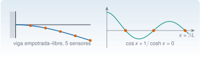

{.portada fig-alt="A la izquierda, una viga horizontal empotrada en una pared a su izquierda, con su forma deformada del primer modo en azul y cinco puntos naranjas que son sensores; a la derecha, una curva verde oscilante que cruza el eje horizontal en tres puntos naranjas, con la ecuación coseno de x más uno partido por coseno hiperbólico de x igual a cero"}

Dos preguntas aparecen una y otra vez en vibraciones. **¿Para qué valores de un parámetro se cumple una condición?** Las frecuencias propias de una viga son los valores de $\beta L$ que anulan una ecuación característica: no hay fórmula para despejarlos, hay que **encontrar raíces**. Y **¿qué vale una magnitud entre los puntos donde se midió?** Una forma modal se mide en cinco sensores y se quiere en cien posiciones; una función de respuesta en frecuencia se calcula cada 0,1 Hz y se quiere su pico: hay que **interpolar**. Esta unidad enseña a hacer las dos cosas con `Roots.jl` e `Interpolations.jl`, a saber cuánto error se comete y a combinarlas, que es lo habitual: la anchura del pico de una resonancia, y con ella el amortiguamiento, es una raíz de una función interpolada.

::: {.callout-note}
## Cómo se lee esta unidad
**Tiempo orientativo: 90 minutos.** Objetivos (4), teoría en cinco píldoras (18), práctica guiada (40), «Pídeselo a Claude» (12), ejercicios (14) y cierre (2). La viga y el edificio son los de la vía M, con datos **sintéticos**: las raíces se comparan con valores que se pueden comprobar a mano, y la resonancia que se interpola se genera con el modelo del edificio de tres plantas, de modo que se conoce la respuesta correcta.
:::

```{julia}
#| include: false
using Roots, Interpolations, LinearAlgebra, Statistics, DataFrames, Resonancia
include("../../../recursos/r1-datos/_tema.jl")
```

## Objetivos y prerrequisitos

**Objetivos.** Al terminar esta unidad sabrás:

- resolver $f(x)=0$ con `find_zero` y `find_zeros`, elegir entre bisección, Newton y secante, y explicar su velocidad de convergencia;
- obtener las frecuencias propias de una viga de Euler–Bernoulli como raíces de su ecuación característica, para distintas condiciones de contorno;
- interpolar con `linear_interpolation` y `cubic_spline_interpolation`, medir el error y reconocer cuándo no se debe extrapolar;
- combinar ambas herramientas para estimar el amortiguamiento de un modo por el método de la banda de media potencia.

**Prerrequisitos.** El curso no los impone en el temario; conviene J1.5 (funciones y arrays), J3.3 (álgebra lineal numérica, para los modos del edificio) y, para la física de la viga, M5 y M6.

**Reparto con otras unidades.** Las ecuaciones de la viga y sus condiciones de contorno se justifican en M5. Aquí se resuelven numéricamente. La derivación automática, que da la derivada que necesita Newton sin escribirla a mano, está en [J3.5](../j3-5-integracion-ad/index.qmd); el ajuste de curvas de FRF, en J3.7.

## Teoría breve

### J3.4.1 Encontrar raíces {#j3-4-1}

Una **raíz** de $f$ es un $x$ con $f(x)=0$. Los métodos se dividen en dos familias. Los de **corchete** (*bracketing*) parten de un intervalo $[a,b]$ con $f(a)f(b)<0$ (la función cambia de signo, luego hay una raíz dentro si $f$ es continua) y lo van reduciendo; son **seguros**. Los de **punto abierto** parten de una estimación y la mejoran con información local; son **rápidos pero pueden fallar**.

- **Bisección.** Se evalúa el punto medio y se conserva la mitad donde hay cambio de signo. El intervalo se reduce a la mitad en cada paso: tras $n$ pasos el error es como mucho $(b-a)/2^n$ (convergencia **lineal**: un bit por iteración).
- **Newton.** Sustituye $f$ por su recta tangente: $x_{k+1}=x_k-f(x_k)/f'(x_k)$. Cerca de una raíz simple el error se eleva al cuadrado en cada paso (convergencia **cuadrática**: las cifras correctas se duplican), pero hace falta $f'$, puede divergir si se parte lejos y falla si $f'=0$.
- **Secante.** Igual que Newton, con la pendiente de la recta por los dos últimos puntos, así que no necesita la derivada; converge con orden $\approx1{,}62$.
- **Brent** (y variantes como `A42`) combina bisección con interpolación para tener la seguridad del corchete y casi la velocidad de la secante: es la elección razonable por defecto cuando se dispone de un intervalo.

`Roots.jl` los ofrece con una interfaz común: `find_zero(f, (a, b))` con corchete, `find_zero(f, x0)` con un punto, `find_zero((f, f′), x0, Roots.Newton())` con la derivada y `find_zeros(f, a, b)` para **todas** las raíces de un intervalo. Se prueban con la ecuación del primer modo de una viga empotrada–libre, $\cos x+1/\cosh x=0$ (J3.4.2), de la que `Resonancia.jl` da la forma estable `ecuacion_viga(:voladizo, x)`:

```{julia}
f(x) = ecuacion_viga(:voladizo, x)                  # cos x + 1/cosh x
df(x) = -sin(x) - tanh(x) / cosh(x)                 # su derivada, calculada a mano
x_ref = raices_viga(:voladizo, 1)[1]                # valor de Resonancia.jl
hallazgos = (corchete = find_zero(f, (1.0, 3.0)), Brent = find_zero(f, (1.0, 3.0), Roots.Brent()),
             Newton = find_zero((f, df), 2.0, Roots.Newton()), solo_un_punto = find_zero(f, 2.0))
(primera_raiz = x_ref, coinciden_a_1e12 = all(abs(r - x_ref) < 1e-12 for r in values(hallazgos)))
```

Los cuatro métodos dan $1{,}8751$. Para **ver** la diferencia de velocidad se usan las versiones didácticas de `Resonancia.jl`, que devuelven la lista de iteradas:

```{julia}
xb, hb = raiz_biseccion(f, 1.0, 3.0)
xn, hn = raiz_newton(f, df, 2.0)
xs, hs = raiz_secante(f, 1.0, 3.0)
(iteraciones_hasta_1e14 = (biseccion = length(hb), secante = length(hs) - 2, Newton = length(hn) - 1),
 error_en_cada_paso_de_Newton = abs.(hn .- x_ref))
```

La bisección necesita 48 iteraciones para llegar a $10^{-14}$; la secante, 8; Newton, 5. Los errores de Newton son 0,125; $4{,}1\cdot10^{-3}$; $3{,}7\cdot10^{-6}$; $3{,}0\cdot10^{-12}$: cada uno es unas $0{,}2$ veces el cuadrado del anterior. Es lo que muestra la @fig-convergencia, donde la bisección es una recta (error dividido por 2 en cada paso) y Newton cae en picado.

```{julia}
#| label: fig-convergencia
#| fig-cap: "Error absoluto de cada iterada frente al número de iteraciones al calcular la primera raíz de cos x + 1/cosh x = 0, con los tres métodos de Resonancia.jl (eje vertical logarítmico). La bisección gana un bit por paso; la secante y Newton aceleran."
#| fig-alt: "Gráfica con el número de iteraciones de 0 a 48 en el eje horizontal y el error de 10 elevado a menos 16 a 1 en el vertical, en escala logarítmica. La línea azul de la bisección baja de forma regular, casi recta, durante 48 pasos. La línea naranja de la secante cae en unos 8 pasos con curvatura creciente. La línea verde de Newton cae en 5 pasos, la más empinada."
let
    piso(e) = max.(e, 1e-16)
    fig = Figure(size=(720, 320))
    ax = Axis(fig[1, 1], xlabel="iteración", ylabel="error absoluto", yscale=log10, limits=(nothing, (1e-16, 2)))
    lines!(ax, 0:length(hb)-1, piso(abs.(hb .- x_ref)), color=AZUL, label="bisección")
    scatterlines!(ax, 0:length(hs)-1, piso(abs.(hs .- x_ref)), color=NARANJA, marker=:rect, markersize=8, linestyle=:dash, label="secante")
    scatterlines!(ax, 0:length(hn)-1, piso(abs.(hn .- x_ref)), color=VERDE, marker=:utriangle, markersize=9, label="Newton")
    axislegend(ax, position=:rt, framevisible=false)
    fig
end
```

::: {.ejercicio tipo="numerico" id="j3-4-1-biseccion" respuesta="21" tol="0.1%" unidad="iteraciones"}
¿Cuántas iteraciones de bisección hacen falta, como mínimo, para garantizar un error menor que $10^{-6}$ partiendo del intervalo $[1,3]$?

::: {.pista}
Hay que cumplir $(b-a)/2^n\le10^{-6}$, es decir $n\ge\log_2(2/10^{-6})$.
:::

::: {.solucion}
$\log_2(2\cdot10^{6})=20{,}93$, luego $n=21$.
:::
:::

::: {.ejercicio tipo="vf" id="j3-4-1-doble" respuesta="falso"}
La bisección encuentra la raíz de $f(x)=(x-1)^2$ en el intervalo $[0,2]$.

::: {.solucion}
Falso. $f(0)=1$ y $f(2)=1$ tienen el mismo signo: no hay cambio de signo que atrapar (la raíz es doble y la función toca el eje sin cruzarlo). Los métodos de corchete no la ven; para estas raíces hay que trabajar con otra función (por ejemplo, $f'$) o con métodos de punto abierto.
:::
:::

### J3.4.2 La ecuación característica de una viga {#j3-4-2}

El modo de flexión de una viga uniforme de Euler–Bernoulli (rigidez a flexión $EI$, masa por unidad de longitud $\rho A$, longitud $L$) con la forma $w(x,t)=\varphi(x)e^{\mathrm i\omega t}$ cumple $\varphi''''=\beta^4\varphi$, con $\beta^4=\omega^2\rho A/(EI)$, cuya solución general es una combinación de $\cos\beta x$, $\sin\beta x$, $\cosh\beta x$ y $\sinh\beta x$ [@inman2017]. Las **condiciones de contorno** de cada extremo (desplazamiento o giro nulos si está apoyado o empotrado, momento y cortante nulos si está libre) dan un sistema homogéneo de cuatro ecuaciones con cuatro coeficientes. Solo tiene solución distinta de la trivial si su determinante vale cero, y eso es una **ecuación en $x=\beta L$**: la ecuación característica. Sus raíces $x_n$ dan las frecuencias:
$$
f_n=\frac{x_n^{2}}{2\pi L^{2}}\sqrt{\frac{EI}{\rho A}} .
$$ {#eq-viga}

{#fig-viga-cc fig-alt="Cuatro vigas horizontales azules con sus apoyos: empotrada en la izquierda y libre en la derecha, con la ecuación coseno de x más uno partido por coseno hiperbólico de x igual a cero y primera raíz 1,875; apoyada en los dos extremos, con seno de x igual a cero y primera raíz pi; empotrada a la izquierda y apoyada a la derecha, con primera raíz 3,927; y libre en los dos extremos, con primera raíz 4,730. Debajo, la fórmula de la frecuencia en función de la raíz."}

Se escriben en forma **estable** (divididas por $\cosh x$, que crece como $e^x/2$ y desbordaría la aritmética para $x\gtrsim710$) y se resuelven con `Resonancia.jl` para tener un valor de referencia. La tabla da las cuatro primeras raíces de cada caso:

```{julia}
tipos = [:voladizo, :biapoyada, :empotrada_apoyada, :libre_libre]
raices_tabla = [round.(raices_viga(t, 4), digits=4) for t in tipos]
DataFrame(condiciones=string.(tipos), x1=getindex.(raices_tabla, 1), x2=getindex.(raices_tabla, 2),
          x3=getindex.(raices_tabla, 3), x4=getindex.(raices_tabla, 4))
```

Para obtener **todas** las raíces de un intervalo sin saber dónde están, `find_zeros` rastrea los cambios de signo:

```{julia}
r6 = find_zeros(f, 0.5, 18.0)
(n_raices = length(r6), primeras = round.(r6[1:3], digits=4),
 coinciden_con_Resonancia_a_1e10 = maximum(abs.(r6 .- raices_viga(:voladizo, 6))) < 1e-10)
```

Salen las seis raíces del intervalo, que coinciden con las de `Resonancia.jl`; a partir de la tercera, $x_n\approx(n-\tfrac12)\pi$ (porque $1/\cosh x\to0$ y queda $\cos x=0$). Con la @eq-viga se calcula la viga de acero de una regla de laboratorio: sección de 40 mm × 10 mm (flexión en el sentido del espesor), $L=1$ m, $E=210$ GPa y $\rho=7850$ kg/m³.

```{julia}
E, rho, L, b, h = 210e9, 7850.0, 1.0, 0.04, 0.01
A, I = b * h, b * h^3 / 12
fr = [round.(frecuencias_viga(t; E=E, I=I, rho=rho, A=A, L=L, n=4), digits=2) for t in tipos]
DataFrame(condiciones=string.(tipos), f1_Hz=getindex.(fr, 1), f2_Hz=getindex.(fr, 2), f3_Hz=getindex.(fr, 3), f4_Hz=getindex.(fr, 4))
```

En voladizo, $f_1=8{,}36$ Hz y $f_2=52{,}36$ Hz: el segundo modo es **6,27 veces** el primero (en la viga biapoyada, solo 4). La misma viga apoyada en los dos extremos tiene $f_1=23{,}45$ Hz. Las condiciones de contorno cambian mucho las frecuencias, y por eso un apoyo que se degrada (un daño típico) las mueve.

**Una masa en el extremo.** Colocar un sensor o una masa en el extremo libre modifica la ecuación: con $\mu$ la razón entre la masa añadida y la de la viga, $1/\cosh x+\cos x+\mu x(\cos x\tanh x-\sin x)=0$. Es la versión más sencilla de un cambio en la estructura que se detecta por la frecuencia. ¿Qué masa baja un 5 % la primera frecuencia? Como $f\propto x^2$, hay que bajar $x$ hasta $x_1\sqrt{0{,}95}$. La ecuación es lineal en $\mu$, y se puede despejar; pero también se puede **resolver numéricamente** (una raíz dentro de otra) y comparar:

```{julia}
x1 = raices_viga(:voladizo, 1)[1]
x_obj = x1 * sqrt(0.95)                               # f ∝ x²
mu_cerrada = -(1 / cosh(x_obj) + cos(x_obj)) / (x_obj * (cos(x_obj) * tanh(x_obj) - sin(x_obj)))
mu_raiz = find_zero(mu -> raices_viga(:voladizo_masa, 1; mu=mu)[1] - x_obj, (0.0, 1.0))
(mu_cerrada = round(mu_cerrada, digits=6), mu_raiz = round(mu_raiz, digits=6),
 masa_añadida_g = round(1000 * mu_raiz * rho * A * L, digits=1), masa_de_la_viga_kg = rho * A * L)
```

Una masa de unos 85 g ($\mu=0{,}0269$) en una viga de 3,14 kg baja un 5 % la primera frecuencia: la sensibilidad de las frecuencias a la masa es alta, y por eso se usan masas añadidas para **simular daños** o para validar un procedimiento de detección. Las dos formas de calcular $\mu$ coinciden.

```{julia}
#| label: fig-viga
#| fig-cap: "(a) La función cos x + 1/cosh x frente a x = βL: sus raíces (puntos naranjas) son los valores de βL de los modos de la viga en voladizo. (b) Formas de los tres primeros modos, normalizadas para que valgan 1 en el extremo libre, con las frecuencias de la viga de acero de la tabla."
#| fig-alt: "Dos paneles. En el panel a, una curva verde que oscila alrededor de cero con amplitud decreciente entre x igual a 0 y 12, con cuatro puntos naranjas donde cruza el eje en 1,875, 4,694, 7,855 y 10,996. En el panel b, tres curvas sobre la longitud relativa de 0 a 1: el modo 1 sube sin cruzar el cero, el modo 2 tiene un cruce y el modo 3 tiene dos, todas valiendo cero en el extremo empotrado y uno en el libre."
let
    fig = Figure(size=(760, 320))
    ax1 = Axis(fig[1, 1], title="(a) ecuación característica", xlabel="x = βL", ylabel="cos x + 1/cosh x")
    xx = range(0, 12, length=600)
    lines!(ax1, xx, f.(xx), color=VERDE, linewidth=2)
    hlines!(ax1, 0, color=GRIS)
    rr = raices_viga(:voladizo, 4)
    scatter!(ax1, rr, zeros(4), color=NARANJA, markersize=10)
    ax2 = Axis(fig[1, 2], title="(b) formas modales", xlabel="x/L", ylabel="φ(x/L)")
    fv = frecuencias_viga(:voladizo; E=E, I=I, rho=rho, A=A, L=L, n=3)
    xi = range(0, 1, length=300)
    for (n, (col, est)) in enumerate(((AZUL, :solid), (NARANJA, :dash), (VERDE, :dot)))
        lines!(ax2, xi, forma_modal_viga.(:voladizo, raices_viga(:voladizo, 3)[n], xi), color=col, linestyle=est, linewidth=2,
               label="modo $n: $(coma(fv[n], d=1)) Hz")
    end
    hlines!(ax2, 0, color=GRIS)
    axislegend(ax2, position=:lb, framevisible=false)
    fig
end
```

::: {.ejercicio tipo="numerico" id="j3-4-2-razon" respuesta="6.267" tol="0.5%"}
¿Cuánto vale la razón $f_2/f_1$ de una viga empotrada–libre uniforme?

::: {.pista}
No depende de $E$, $I$, $\rho$, $A$ ni $L$: solo de las raíces, $(x_2/x_1)^2$.
:::

::: {.solucion}
$(4{,}6941/1{,}8751)^2=6{,}267$. Para $f_1=8{,}36$ Hz, $f_2=52{,}36$ Hz.
:::
:::

::: {.ejercicio tipo="numerico" id="j3-4-2-longitud" respuesta="13.05" tol="0.5%" unidad="Hz"}
Si la viga de acero de la tabla se acorta a $L=0{,}8$ m, ¿cuánto vale su primera frecuencia en voladizo?

::: {.pista}
Por la @eq-viga, $f\propto1/L^2$.
:::

::: {.solucion}
$8{,}355/0{,}64=13{,}05$ Hz. Un 20 % menos de longitud sube la frecuencia un 56 %.
:::
:::

### J3.4.3 Interpolar: entre puntos de medida {#j3-4-3}

**Interpolar** es construir una función $s(x)$ que pase por los puntos medidos $(x_i,y_i)$ y estimar con ella los valores intermedios. `Interpolations.jl` devuelve un objeto que se **llama como una función**, `itp(x)`. Dos opciones básicas:

- **Lineal** (`linear_interpolation(xs, ys)`): une los puntos con segmentos. Es la más robusta (no inventa oscilaciones) pero con un error que baja con el cuadrado del paso, $\mathcal O(h^2)$, y con esquinas en cada nodo.
- **Spline cúbico** (`cubic_spline_interpolation(xs, ys)`, con nodos equiespaciados): une los puntos con cúbicos y exige que la primera y la segunda derivada sean continuas. Para una función suave el error baja como $\mathcal O(h^4)$, **si las condiciones de los extremos son las adecuadas**. Por defecto, la segunda derivada se anula en los dos extremos (spline **natural**), lo que es exacto si el modo tiene momento nulo en ellos (apoyo o extremo libre) y falso en un empotramiento.

La prueba es el modo de una viga medido en $n$ sensores equiespaciados. El primer modo de la viga **biapoyada**, $\sin(\pi\xi)$, tiene curvatura nula en los apoyos. El primero de la viga **en voladizo** tiene curvatura máxima en el empotramiento ($\xi=0$). Se mide el error máximo sobre 2001 puntos:

```{julia}
phi_v(ξ) = forma_modal_viga(:voladizo, raices_viga(:voladizo, 1)[1], ξ)
phi_p(ξ) = forma_modal_viga(:biapoyada, π, ξ)                 # sin(πξ)
xf = range(0, 1, length=2001)
function error_max(phi, n, tipo)
    xs = range(0, 1, length=n)
    itp = tipo === :lineal ? linear_interpolation(xs, phi.(xs)) : cubic_spline_interpolation(xs, phi.(xs))
    return maximum(abs(itp(t) - phi(t)) for t in xf)
end
ns = [3, 5, 9, 17, 33, 65]
tabla = DataFrame(sensores=ns, h=1 ./ (ns .- 1), lineal_voladizo=[error_max(phi_v, n, :lineal) for n in ns],
                  spline_voladizo=[error_max(phi_v, n, :spline) for n in ns], spline_biapoyada=[error_max(phi_p, n, :spline) for n in ns])
orden(e) = ([log.(tabla.h[3:end]) ones(length(ns) - 2)] \ log.(e[3:end]))[1]           # pendiente log-log de los últimos puntos
(orden_lineal = round(orden(tabla.lineal_voladizo), digits=1), orden_spline_voladizo = round(orden(tabla.spline_voladizo), digits=1),
 orden_spline_biapoyada = round(orden(tabla.spline_biapoyada), digits=1), tabla = tabla)
```

El resultado, que muestra la @fig-interp, enseña tres cosas. **La interpolación lineal es de orden 2**: duplicar los sensores divide el error por unos 4 (con 5 sensores, 0,023; con 9, 0,0063; con 17, 0,0016). **El spline cúbico natural alcanza el orden 4 en la viga biapoyada** (cada duplicación divide el error por 16: $1{,}1\cdot10^{-3}$ con 5 sensores y $6{,}3\cdot10^{-5}$ con 9) **pero solo el orden 2 en el voladizo** (por el error en el empotramiento, donde la segunda derivada no es nula): con 9 sensores, $2{,}7\cdot10^{-3}$, menos que el lineal pero sin la ventaja del orden 4. Un método de orden alto no sirve si no se respetan las condiciones físicas de los extremos; otras condiciones de contorno (`Flat`, que fija la derivada, entre ellas) se indican con `bc=` en la documentación del paquete.

```{julia}
#| label: fig-interp
#| fig-cap: "(a) Primer modo de la viga en voladizo medido en 5 sensores (puntos): curva exacta (gris), interpolación lineal (azul discontinua) y spline cúbico natural (naranja). (b) Error máximo frente al paso h = 1/(n − 1) en escala logarítmica: la lineal baja con pendiente 2; el spline, con pendiente 4 en la viga biapoyada y 2 en el voladizo."
#| fig-alt: "Dos paneles. En el panel a, una curva gris suave que crece de cero a uno entre x/L igual a 0 y 1, cinco puntos naranjas sobre ella, una poligonal azul discontinua que los une y una curva naranja casi superpuesta a la exacta. En el panel b, en escalas logarítmicas, cuatro series de error frente al paso h: la lineal y el spline del voladizo bajan con la misma pendiente, y el spline de la viga biapoyada baja el doble de rápido, unas dos décadas por debajo."
let
    fig = Figure(size=(760, 330))
    ax1 = Axis(fig[1, 1], title="(a) 5 sensores", xlabel="x/L", ylabel="φ")
    xs5 = range(0, 1, length=5)
    il, isp = linear_interpolation(xs5, phi_v.(xs5)), cubic_spline_interpolation(xs5, phi_v.(xs5))
    xx = range(0, 1, length=300)
    lines!(ax1, xx, phi_v.(xx), color=GRIS, linewidth=3, label="exacta")
    lines!(ax1, xx, il.(xx), color=AZUL, linestyle=:dash, linewidth=2, label="lineal")
    lines!(ax1, xx, isp.(xx), color=NARANJA, linewidth=2, label="spline")
    scatter!(ax1, xs5, phi_v.(xs5), color=TINTA, markersize=9)
    axislegend(ax1, position=:lt, framevisible=false)
    ax2 = Axis(fig[1, 2], title="(b) error máximo", xlabel="paso h", ylabel="error", xscale=log10, yscale=log10)
    scatterlines!(ax2, tabla.h, tabla.lineal_voladizo, color=AZUL, marker=:circle, label="lineal, voladizo")
    scatterlines!(ax2, tabla.h, tabla.spline_voladizo, color=NARANJA, marker=:rect, linestyle=:dash, label="spline, voladizo")
    scatterlines!(ax2, tabla.h, tabla.spline_biapoyada, color=VERDE, marker=:utriangle, label="spline, biapoyada")
    axislegend(ax2, position=:rb, framevisible=false)
    fig
end
```

**Extrapolar no es interpolar.** Fuera del intervalo de los nodos no hay datos: el objeto de `Interpolations.jl` lanza un error si se le pide un valor ahí (se puede cambiar con `extrapolation_bc`, por ejemplo `Line()` para prolongar con la última pendiente).

```{julia}
xs9 = range(0, 0.8, length=9)                        # sensores solo hasta el 80 % de la longitud
itp = cubic_spline_interpolation(xs9, phi_v.(xs9))
al_pedir_la_punta = try itp(1.0) catch e; nameof(typeof(e)) end
itp_l = cubic_spline_interpolation(xs9, phi_v.(xs9); extrapolation_bc=Line())
(error_en_x_065 = abs(itp(0.65) - phi_v(0.65)), al_pedir_la_punta = al_pedir_la_punta,
 extrapolando_con_Line = round(itp_l(1.0), digits=4), valor_verdadero = round(phi_v(1.0), digits=4))
```

Aquí la extrapolación lineal da 0,996 frente al valor verdadero 1 (el modo es muy suave), pero es **una suerte, no una garantía**: sin datos en esa zona nada asegura que la forma siga así. El objeto lanza `BoundsError` por defecto precisamente para que no se extrapole sin querer.

::: {.ejercicio tipo="vf" id="j3-4-3-orden" respuesta="falso"}
Un spline cúbico siempre interpola con un error de orden $h^4$, sean cuales sean las condiciones de los extremos.

::: {.solucion}
Falso. Con el spline natural, el error baja como $h^4$ solo si la segunda derivada de la función es (casi) nula en los extremos; en un empotramiento solo baja como $h^2$ (@fig-interp b).
:::
:::

::: {.ejercicio tipo="numerico" id="j3-4-3-lineal" respuesta="0.0228" tol="2%"}
¿Cuánto vale el error máximo de la interpolación lineal del primer modo del voladizo con 5 sensores equiespaciados?

::: {.solucion}
0,0228 (un 2,3 % de la amplitud en la punta). Con 9 sensores baja a 0,0063.
:::
:::

### J3.4.4 Raíces e interpolación juntas: el amortiguamiento por la banda de media potencia {#j3-4-4}

Con una FRF muestreada en frecuencias discretas se quiere la frecuencia del pico y el **amortiguamiento**. En un modo poco amortiguado, la amplitud de la respuesta cae a $1/\sqrt2$ de la del pico en $f_{\pm}\approx f_n(1\pm\zeta)$, de modo que
$$
\zeta\approx\frac{f_+-f_-}{2f_n} .
$$ {#eq-mediapotencia}
Es el **método de la banda de media potencia**. Calcularlo con datos tabulados exige **interpolar** (el pico real no cae justo en una muestra) y **resolver** $s(f)=s_{\max}/\sqrt2$ a ambos lados del pico, que son dos raíces de la función interpolada.

Para conocer la respuesta correcta se usa la amplificación dinámica de un modo, $D(f)=1/\sqrt{(1-r^2)^2+(2\zeta r)^2}$ con $r=f/f_n$, con la frecuencia y el amortiguamiento del tercer modo del edificio de tres plantas: $f_3=4{,}390$ Hz y $\zeta_3=0{,}01269$ (amortiguamiento proporcional del modelo). El pico exacto vale $1/(2\zeta\sqrt{1-\zeta^2})=39{,}42$. Se muestrea entre 4,0 y 4,8 Hz con paso $\Delta f$ (la resolución de un espectro estimado) y se estima $\zeta$ con interpolación lineal y con spline:

```{julia}
M, C, K = edificio_tres_plantas()
f0, Phi = modos_propios(K, M)
fn = f0[3]; ζ3 = dot(Phi[:, 3], C * Phi[:, 3]) / (2 * 2π * fn)
D(f) = 1 / sqrt((1 - (f / fn)^2)^2 + (2ζ3 * f / fn)^2)
pico_exacto = 1 / (2ζ3 * sqrt(1 - ζ3^2))
function media_potencia(df, tipo)
    fg = 4.0:df:4.8
    itp = tipo === :lineal ? linear_interpolation(fg, D.(fg)) : cubic_spline_interpolation(fg, D.(fg))
    fino = 4.2:0.0002:4.6
    v = itp.(fino); i = argmax(v); pico, fp = v[i], fino[i]
    g(f) = itp(f) - pico / √2
    fl, fr = find_zero(g, (4.2, fp)), find_zero(g, (fp, 4.6))
    return (pico = pico, zeta = (fr - fl) / (2fp))
end
dfs = [0.2, 0.1, 0.05, 0.02]
res = DataFrame(paso_Hz=dfs, pico_lineal=[media_potencia(d, :lineal).pico for d in dfs], zeta_lineal=[media_potencia(d, :lineal).zeta for d in dfs],
                pico_spline=[media_potencia(d, :spline).pico for d in dfs], zeta_spline=[media_potencia(d, :spline).zeta for d in dfs])
(zeta_exacto = round(ζ3, digits=5), pico_exacto = round(pico_exacto, digits=2), resultados = round.(res, digits=4))
```

Las cifras son instructivas. Con un paso de 0,2 Hz (la banda de media potencia mide solo $2\zeta f_n\approx0{,}11$ Hz, es decir, menos de un paso) el spline estima $\zeta=0{,}0235$ y la lineal, $0{,}0183$: casi **el doble** del valor real (0,0127). Con 0,1 Hz, 0,0152 y 0,0134; con 0,05 Hz, 0,0132 y 0,0134; con 0,02 Hz, 0,0127 y 0,0132. El spline recupera mejor el pico (39,39 frente a 38,86 de la lineal con paso 0,02 Hz; el exacto es 39,42) pero **solo si hay varios puntos dentro del pico**. La regla es práctica: para medir un amortiguamiento hacen falta, al menos, **unos cinco puntos dentro de la banda de media potencia**; si no, el método sobreestima, y ninguna interpolación lo arregla. En un espectro estimado con ventana de Welch hay otro sesgo: el propio ancho del lóbulo de la ventana ensancha el pico, y se mide más amortiguamiento del que hay.

```{julia}
#| label: fig-mediapotencia
#| fig-cap: "(a) Pico del tercer modo muestreado cada 0,1 Hz (puntos): amplificación exacta (gris), interpolación lineal (azul discontinua) y spline (naranja); la línea horizontal es el nivel de media potencia del pico exacto. (b) Amortiguamiento estimado frente al paso de frecuencia con los dos interpoladores; la línea gris es el valor del modelo."
#| fig-alt: "Dos paneles. En el panel a, una curva gris con un pico estrecho en 4,39 hercios y altura próxima a 39, con puntos naranjas separados 0,1 hercios, una poligonal azul discontinua que recorta el pico y una curva naranja suave que lo sobrepasa algo; una línea horizontal marca el nivel de media potencia. En el panel b, en escala logarítmica horizontal, dos series de amortiguamiento que bajan hacia 0,0127 al reducir el paso, con una línea gris horizontal en ese valor."
let
    fig = Figure(size=(760, 330))
    ax1 = Axis(fig[1, 1], title="(a) muestreo cada 0,1 Hz", xlabel="f (Hz)", ylabel="amplificación D")
    fg = 4.0:0.1:4.8
    il, isp = linear_interpolation(fg, D.(fg)), cubic_spline_interpolation(fg, D.(fg))
    ff = range(4.2, 4.6, length=500)
    lines!(ax1, ff, D.(ff), color=GRIS, linewidth=3, label="exacta")
    lines!(ax1, ff, il.(ff), color=AZUL, linestyle=:dash, linewidth=2, label="lineal")
    lines!(ax1, ff, isp.(ff), color=NARANJA, linewidth=2, label="spline")
    scatter!(ax1, collect(fg)[3:7], D.(collect(fg)[3:7]), color=TINTA, markersize=9)
    hlines!(ax1, pico_exacto / √2, color=VERDE, linestyle=:dot)
    axislegend(ax1, position=:lt, framevisible=false)
    ax2 = Axis(fig[1, 2], title="(b) amortiguamiento estimado", xlabel="paso Δf (Hz)", ylabel="ζ", xscale=log10)
    scatterlines!(ax2, res.paso_Hz, res.zeta_lineal, color=AZUL, marker=:circle, linestyle=:dash, label="lineal")
    scatterlines!(ax2, res.paso_Hz, res.zeta_spline, color=NARANJA, marker=:rect, label="spline")
    hlines!(ax2, ζ3, color=GRIS, linewidth=2)
    axislegend(ax2, position=:rt, framevisible=false)
    fig
end
```

::: {.ejercicio tipo="vf" id="j3-4-4-resolucion" respuesta="falso"}
Si el espectro tiene un paso de frecuencia mayor que la anchura de la banda de media potencia, un spline permite estimar bien el amortiguamiento.

::: {.solucion}
Falso. La información sobre la anchura del pico no está en las muestras, y la interpolación no la inventa. Con 0,2 Hz de paso el spline estima $\zeta=0{,}0235$ frente a 0,0127.
:::
:::

::: {.ejercicio tipo="opcion" id="j3-4-4-puntos" respuesta="c"}
¿Qué hay que hacer para estimar bien el amortiguamiento de un modo con la banda de media potencia?

::: {.opciones}
- Usar un spline de orden alto y olvidar la resolución.
- Extrapolar la curva por los dos lados del pico.
- Tener varios puntos espectrales dentro de la banda de media potencia (resolución fina).
- Dividir entre dos el resultado.
:::

::: {.solucion}
La **c**. La resolución en frecuencia limita lo que se puede estimar; una interpolación sofisticada no la compensa.
:::
:::

### J3.4.5 Cuánta confianza dar al resultado {#j3-4-5}

Un resultado numérico sin una idea de su error vale poco. Cuatro avisos:

1. **El residuo no es el error.** Que $|f(\hat x)|$ sea minúsculo no garantiza que $\hat x$ esté cerca de la raíz si $f$ es muy plana ahí (raíz múltiple). Newton aplicado a $f(x)=(x-1)^3$ (raíz triple) converge solo linealmente y **el residuo cae mucho antes que el error**:

```{julia}
g(x) = (x - 1)^3
_, hg = raiz_newton(g, x -> 3 * (x - 1)^2, 2.0; tol=1e-14, maxiter=200)
DataFrame(iteracion=[5, 10, 20, 30, 40], error=[abs(hg[k+1] - 1) for k in (5, 10, 20, 30, 40)], residuo=[abs(g(hg[k+1])) for k in (5, 10, 20, 30, 40)])
```

Tras 30 iteraciones el residuo vale $1{,}4\cdot10^{-16}$, del orden del error de redondeo de la propia evaluación, mientras que el error es todavía de $5{,}2\cdot10^{-6}$; cada paso multiplica el error por 2/3, de modo que son 79 iteraciones, y no cinco, las que hacen falta para $10^{-14}$. Un criterio de parada por residuo habría parado mucho antes y con error mayor.

2. **Las tolerancias** de `find_zero` son absoluta y relativa (`xatol`, `xrtol`) y se pueden fijar; una raíz cercana a cero necesita tolerancia absoluta pequeña, no relativa.
3. **Interpolar no es suavizar.** Un spline pasa por **todos** los puntos, también por el ruido: con datos ruidosos introduce oscilaciones y un pico espurio. Si las muestras tienen ruido (un espectro de una sola ventana), se promedia o se ajusta un modelo (J3.7), y no se interpola.
4. **Los extremos mandan** en un spline, como se vio en J3.4.3.

::: {.callout-warning}
## Errores frecuentes
(1) Aplicar un método de corchete sin comprobar el cambio de signo, o a una raíz doble. (2) Partir de un punto cualquiera con Newton: puede saltar a otra raíz o divergir. (3) Parar por el residuo $|f|$ pequeño. (4) Buscar raíces de la ecuación sin estabilizar ($\cos x\cosh x+1$): desborda para $x$ grande. (5) Extrapolar con un objeto de interpolación, o interpolar datos ruidosos con un spline. (6) Estimar un amortiguamiento con un paso en frecuencia mayor que la banda de media potencia.
:::

::: {.callout-note}
## ¿Y en Python?
`scipy.optimize.brentq(f, 1, 3)` es el equivalente de `find_zero` con corchete y da el mismo valor, 1,8751040687119611, que `Resonancia.jl`; `scipy.optimize.newton` es Newton o secante. `scipy.interpolate.CubicSpline(x, y, bc_type="natural")` construye el spline natural (con 9 sensores el error máximo del primer modo del voladizo es el mismo, 0,0026970737, que el de esta unidad) y `numpy.interp` hace la interpolación lineal.
:::

::: {.callout-note .idea-clave}
## Idea clave
**Las raíces y las interpolaciones son dos caras de un mismo cálculo con incertidumbre.** Las frecuencias de una viga son raíces de una ecuación característica que depende de las condiciones de contorno; entre las muestras, el valor se estima con un interpolador cuyo error depende del paso y de los extremos; y cuando se combinan (la banda de media potencia), la resolución de los datos pone el límite. Hay que conocer el orden del método y comprobar siempre con un caso de respuesta conocida.
:::

### Para saber más {#j3-4-mas}

- La documentación de [Roots.jl](https://juliamath.github.io/Roots.jl/stable/) y de [Interpolations.jl](https://juliamath.github.io/Interpolations.jl/stable/) (consultadas el 27-10-2026) detalla los métodos y las condiciones de contorno.
- Un tratamiento general de raíces e interpolación con ejemplos en Julia está en Driscoll y Braun [@driscoll2022], y la teoría de vibración de vigas, en los textos de vibraciones [@inman2017].
- El ajuste de FRF completas, en lugar de la banda de media potencia, se ve en J3.7.

## Práctica guiada

Vamos a **calcular, comprobar y aplicar**: las frecuencias de una viga con su incertidumbre en $E$, los modos de la viga medidos en pocos sensores, y la detección de un cambio en la frecuencia.

**Paso 1. ¿Cuánto cambia $f_1$ si $E$ es incierto?** Con la viga de acero, $E$ puede variar un 5 % entre lotes; como $f\propto\sqrt E$, $f_1$ varía un 2,5 %. Se comprueba con la ecuación y con un barrido de $E$:

```{julia}
Es = range(0.95, 1.05, length=5) .* E
f1_barrido = [frecuencias_viga(:voladizo; E=Ei, I=I, rho=rho, A=A, L=L, n=1)[1] for Ei in Es]
(f1_Hz = round.(f1_barrido, digits=3), variacion_relativa = round.(f1_barrido ./ f1_barrido[3] .- 1, digits=4),
 raiz_del_cociente = round.(sqrt.(Es ./ E) .- 1, digits=4))
```

Un ±5 % en $E$ da un −2,5 % y un +2,5 % en $f_1$ (de 8,14 a 8,56 Hz), exactamente $\sqrt{E/E_0}-1$. Esa banda es del tamaño de un daño moderado: un cambio de frecuencia solo se interpreta frente a la incertidumbre del modelo (J2.7, M12).

**Paso 2. Mínimo número de sensores.** ¿Cuántos sensores equiespaciados hacen falta para reconstruir los tres primeros modos del voladizo con un error máximo inferior a 0,01 (un 1 % de la amplitud en la punta) con cada interpolador?

```{julia}
function sensores_minimos(tipo, n_modo; umbral=0.01)
    bL = raices_viga(:voladizo, 3)[n_modo]
    phi(ξ) = forma_modal_viga(:voladizo, bL, ξ)
    for n in 3:200
        xs = range(0, 1, length=n)
        itp = tipo === :lineal ? linear_interpolation(xs, phi.(xs)) : cubic_spline_interpolation(xs, phi.(xs))
        maximum(abs(itp(t) - phi(t)) for t in xf) < umbral && return n
    end
    return missing
end
DataFrame(modo=1:3, sensores_lineal=[sensores_minimos(:lineal, m) for m in 1:3], sensores_spline=[sensores_minimos(:spline, m) for m in 1:3])
```

El modo 1 necesita 8 sensores con interpolación lineal y 6 con spline natural; el modo 2, 17 y 12; el modo 3, cuyas oscilaciones son más rápidas, 27 y 19. Cuantos más modos se quieren reconstruir, más sensores hacen falta, y es la razón por la que la selección de sensores es un problema de diseño del ensayo (M7).

**Paso 3. Un cambio de frecuencia como raíz.** Dada la frecuencia $f_1$ medida de la viga con una masa añadida, ¿qué masa tiene? Se invierte la relación con `find_zero`, como en J3.4.2: para $f_1=7{,}9$ Hz,

```{julia}
f1_0 = frecuencias_viga(:voladizo; E=E, I=I, rho=rho, A=A, L=L, n=1)[1]
f1_med = 7.9
mu_est = find_zero(mu -> frecuencias_viga(:voladizo_masa; E=E, I=I, rho=rho, A=A, L=L, n=1, mu=mu)[1] - f1_med, (0.0, 1.0))
(f1_sin_masa_Hz = round(f1_0, digits=3), caida_relativa = round(f1_med / f1_0 - 1, digits=4), mu = round(mu_est, digits=4),
 masa_g = round(1000 * mu_est * rho * A * L, digits=1))
```

Una frecuencia de 7,9 Hz (un 5,4 % por debajo de la de la viga sin masa) corresponde a una masa de unos 93 g ($\mu=0{,}0295$), el 3,0 % de la masa de la viga.

## «Pídeselo a Claude» {#pideselo}

::: {.callout-tip}
## Prompt
«Con Julia, `--project=.`, `Roots.jl`, `Interpolations.jl` y `Resonancia.jl` (sin instalar paquetes nuevos): calcula con `find_zeros` las cuatro primeras raíces de la ecuación característica de la viga empotrada–libre `cos x + 1/cosh x = 0` (escríbela en la forma dividida por `cosh x`) y compáralas con `raices_viga(:voladizo, 4)`. Con ellas y con una viga de acero de 1 m de longitud, 40 mm × 10 mm de sección, E = 210 GPa y ρ = 7850 kg/m³, dame las cuatro primeras frecuencias propias en Hz. Después interpola el primer modo medido en 5, 9 y 17 sensores equiespaciados con `linear_interpolation` y con `cubic_spline_interpolation`, y dame el error máximo sobre 2001 puntos y la pendiente log-log del error frente al paso. Explica por qué el spline no llega al orden 4 en el voladizo. No inventes cifras: si algo no sale, dilo. Di que son cálculos sin datos medidos.»

**Verifica.** (a) Que las raíces son 1,8751, 4,6941, 7,8548 y 10,9955 y que usa la forma estable de la ecuación. (b) Que las frecuencias son 8,36; 52,36; 146,61 y 287,30 Hz. (c) Que el error de la interpolación lineal con 5 sensores es de 0,023 y baja con pendiente cercana a 2. (d) Que explica la pérdida de orden del spline por la condición natural (segunda derivada nula) en el empotramiento, y no «por un error del paquete». (e) Que no extrapola fuera del rango de los sensores ni da cifras que el código no haya calculado.
:::

## Ejercicios

::: {.ejercicio tipo="numerico" id="j3-4-x2" respuesta="4.6941" tol="0.1%"}
¿Cuánto vale la segunda raíz $x_2=\beta_2L$ de la ecuación característica de la viga empotrada–libre?

::: {.solucion}
4,6941 (1,8751 la primera; 7,8548 la tercera).
:::
:::

::: {.ejercicio tipo="numerico" id="j3-4-biapoyada" respuesta="23.45" tol="0.5%" unidad="Hz"}
¿Cuánto vale la primera frecuencia de la viga de acero de 40 mm × 10 mm y 1 m si está **apoyada en los dos extremos**?

::: {.pista}
$x_1=\pi$; usa la @eq-viga con $\sqrt{EI/(\rho A)}$ de la viga de la tabla.
:::

::: {.solucion}
23,45 Hz, 2,8 veces la del voladizo (8,36 Hz).
:::
:::

::: {.ejercicio tipo="vf" id="j3-4-newton" respuesta="falso"}
El método de Newton converge siempre a la raíz más cercana al punto de partida.

::: {.solucion}
Falso. Si se parte lejos o cerca de un punto donde $f'$ es casi cero, Newton puede saltar a otra raíz, divergir o fallar. Por eso se prefiere un método con corchete o se parte de una buena estimación (por ejemplo, la raíz aproximada $x_n\approx(n-\tfrac12)\pi$ para $n\ge3$).
:::
:::

::: {.ejercicio tipo="abierta" id="j3-4-ruido"}
Un compañero interpola con un spline cúbico un espectro de potencia estimado de una sola ventana (muy ruidoso) y usa su máximo para decir que «la frecuencia del primer modo ha subido». ¿Qué le dirías?

::: {.criterios}
- Dice que un spline pasa por todos los puntos, ruido incluido, y puede crear máximos espurios: interpolar no es suavizar.
- Propone promediar (Welch con varios segmentos) o refinar con un ajuste de modelo (parábola al pico, J3.7) y dar la incertidumbre de la frecuencia.
- Pide comparar el cambio con la resolución en frecuencia y la dispersión entre segmentos (J2.6), no con la diferencia de un único máximo.
:::
:::

## La doy por superada si… {#superada}

- Resuelvo $f(x)=0$ con `find_zero` y `find_zeros`, y explico la velocidad de bisección, secante y Newton.
- Obtengo las frecuencias de una viga a partir de su ecuación característica y compruebo el resultado con una fórmula conocida.
- Interpolo con `linear_interpolation` y `cubic_spline_interpolation`, mido el error y sé por qué no se extrapola.
- Estimo un amortiguamiento por la banda de media potencia y sé cuándo la resolución lo impide.
- No me fío de un residuo pequeño ni de un spline sobre datos ruidosos.

**Cierre.** Escribe tres líneas: qué he entendido, qué todavía no domino y cuál es mi siguiente paso pequeño. Cuando Claude te dé una raíz o una interpolación, pídele el método, la tolerancia y el error frente a un caso de respuesta conocida.

**Siguiente:** [J3.5 · Integración numérica y diferenciación automática](../j3-5-integracion-ad/index.qmd).
