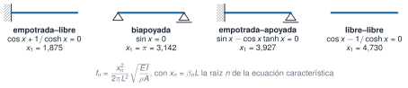

## Objetivos

- Resolver $f(x)=0$: `find_zero` y `find_zeros`.
- Frecuencias de una viga como raíces de su ecuación característica.
- Interpolar (lineal y spline) y medir el error.
- Banda de media potencia: raíces de una función interpolada.

## Métodos de raíces

| método | tipo | orden |
|---|---|---|
| bisección | corchete, seguro | lineal (1 bit/paso) |
| secante | punto abierto | ≈ 1,62 |
| Newton | punto abierto, $f'$ | 2 |
| Brent | corchete híbrido | casi superlineal |

Primera raíz de $\cos x+1/\cosh x=0$: bisección 48 pasos, secante 8, Newton 5.

## La viga

{fig-alt="Cuatro vigas con sus condiciones de contorno, ecuación característica y primera raíz"}

$$f_n=\frac{x_n^2}{2\pi L^2}\sqrt{\frac{EI}{\rho A}}$$

## Una viga de acero (1 m, 40 × 10 mm)

| condiciones | $f_1$ (Hz) | $f_2$ (Hz) |
|---|---|---|
| empotrada–libre | 8,36 | 52,36 |
| biapoyada | 23,45 | 93,81 |
| empotrada–apoyada | 36,64 | 118,73 |
| libre–libre | 53,17 | 146,55 |

Una masa de 85 g en el extremo baja $f_1$ un 5 %.

## Interpolar

- **Lineal**: orden 2, sin sobreoscilaciones.
- **Spline cúbico** (natural): orden 4 si la curvatura es nula en los extremos.
- En el voladizo (empotramiento, curvatura ≠ 0): **solo orden 2**.

Fuera de los nodos: `BoundsError`, no se extrapola.

## Error del modo del voladizo

| sensores | lineal | spline |
|---|---|---|
| 5 | 0,023 | 0,011 |
| 9 | 0,0063 | 0,0027 |
| 17 | 0,0016 | 0,00067 |

Biapoyada con 9 sensores: spline $6{,}3\cdot10^{-5}$.

## Media potencia

$$\zeta\approx\frac{f_+-f_-}{2f_n}$$

Modo 3 del edificio, $\zeta=0{,}0127$: con paso de 0,2 Hz el spline da **0,0235**; con 0,02 Hz, **0,0127**.

Hacen falta varios puntos dentro de la banda.

## Cuánta confianza

- Residuo pequeño ≠ error pequeño (raíz triple).
- Un spline pasa por el ruido: no es suavizar.
- Los extremos mandan en un spline.

## Pídeselo a Claude

Pide siempre el método, la tolerancia y el error frente a un caso de respuesta conocida.

## La doy por superada si…

- Resuelvo raíces y explico la velocidad de cada método.
- Obtengo las frecuencias de una viga y las compruebo.
- Interpolo, mido el error y no extrapolo.
