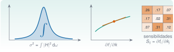

{.portada fig-alt="A la izquierda, la curva en forma de campana estrecha de la respuesta de un modo con el área bajo ella sombreada de azul y la letra integral; a la derecha, una curva con su recta tangente en un punto en naranja y una flecha que indica la derivada, con una matriz de tres por tres de sensibilidades debajo"}

Dos operaciones del cálculo aparecen en todo el análisis estructural. La **integral** da energías, valores eficaces y varianzas: la varianza de la respuesta de un modo a una excitación ambiental es el área bajo su densidad espectral. La **derivada** dice cuánto cambia un resultado cuando cambia un parámetro: cuánto baja una frecuencia si baja una rigidez. Esa es la **sensibilidad**, y es la pieza central del *model updating* (ajuste de un modelo numérico a las frecuencias medidas). Esta unidad enseña a integrar con `QuadGK.jl`, a derivar con diferencias finitas, a ver por qué fallan y a derivar «de verdad» con la diferenciación automática de `ForwardDiff.jl`, y las aplica a una viga y al edificio de tres plantas.

::: {.callout-note}
## Cómo se lee esta unidad
**Tiempo orientativo: 90 minutos.** Objetivos (4), teoría en cinco píldoras (18), práctica guiada (40), «Pídeselo a Claude» (12), ejercicios (14) y cierre (2). La viga y el edificio son los de la vía M, con datos **sintéticos**: las derivadas se contrastan con fórmulas exactas, de modo que se conoce la respuesta correcta.
:::

```{julia}
#| include: false
using QuadGK, ForwardDiff, LinearAlgebra, Statistics, DataFrames, CSV, Resonancia
include("../../../recursos/r1-datos/_tema.jl")
RAIZ = "../../../"
```

## Objetivos y prerrequisitos

**Objetivos.** Al terminar esta unidad sabrás:

- calcular integrales con `quadgk` (incluidas las de límites infinitos) y estimar su error, e integrar datos tabulados con la regla del trapecio;
- explicar por qué las diferencias finitas tienen un paso óptimo y un error mínimo que no se puede bajar;
- derivar con `ForwardDiff.derivative`, `gradient` y `jacobian`, y combinar la derivación con una integral;
- obtener la matriz de sensibilidades de las frecuencias de un edificio respecto de sus rigideces por tres vías (fórmula, diferencias finitas, diferenciación automática), y usarla para ajustar el modelo a unas frecuencias medidas.

**Prerrequisitos.** El curso no los impone en el temario; conviene J3.3 (problema de valores propios generalizado), J3.4 (viga y raíces) y, para la teoría de las frecuencias y la matriz de rigidez, M5 y M6.

**Reparto con otras unidades.** La teoría de la sensibilidad modal y del *model updating* está en M12 y en L7; el ajuste por mínimos cuadrados no lineales con `LsqFit` y `Optim`, en J3.7. Aquí se calculan las derivadas que esos métodos consumen.

## Teoría breve

::: {.callout-note .historia icon=false title="Un poco de historia: ForwardDiff"}
La diferenciación automática no es nueva, pero en Julia se popularizó con el paquete `ForwardDiff.jl`. En un artículo de 2016 (arXiv:1607.07892), Jarrett Revels, Miles Lubin y Theodore Papamarkou lo presentaron como una implementación de la diferenciación automática hacia delante en Julia que, según los autores, consigue un rendimiento comparable al de las implementaciones en C++ gracias a la compilación en tiempo de ejecución de Julia.

<span class="fuentes-caja">Fuente: Revels, Lubin y Papamarkou, «Forward-Mode Automatic Differentiation in Julia», [arXiv:1607.07892](https://arxiv.org/abs/1607.07892) (versión enviada el 26-07-2016), resumen leído el 27-10-2026. No se ha cotejado con la versión publicada.</span>
:::

### J3.5.1 Integrar con QuadGK {#j3-5-1}

`quadgk(f, a, b)` calcula $\int_a^bf(x)\,\mathrm dx$ con la **cuadratura adaptativa de Gauss–Kronrod**: aplica una regla de alto orden a un intervalo y, comparándola con otra regla de orden inferior, **estima su propio error**; si el error es grande, parte el intervalo por donde peor va y repite. Devuelve el par `(valor, error_estimado)`. Se concentra en las zonas difíciles (un pico estrecho, una singularidad) sin que haya que decírselo, y admite límites infinitos (`-Inf`, `Inf`) y puntos intermedios (`quadgk(f, a, c, b)`) que se evitan o se cuidan, como un punto donde la función no es suave.

Un ejemplo con sentido físico: un oscilador de un grado de libertad (masa 1, frecuencia $f_n=4{,}390$ Hz y $\zeta=0{,}01269$, los del tercer modo del edificio) excitado por ruido blanco de densidad espectral $S_0$ (de dos lados, en N²·s/rad) tiene un desplazamiento de varianza $\sigma_x^2=S_0\int_{-\infty}^{\infty}|H(\omega)|^2\,\mathrm d\omega$, con $|H|^2=1/[(k-\omega^2)^2+(c\omega)^2]$. La integral tiene solución exacta, $\pi/(kc)$, con $k=\omega_n^2$ y $c=2\zeta\omega_n$ (para masa unidad). Es un buen examen porque el pico es muy estrecho:

```{julia}
fn, ζ = 4.390152904211614, 0.012686319479621844
ωn = 2π * fn; k = ωn^2; c = 2ζ * ωn
H2(ω) = 1 / ((k - ω^2)^2 + (c * ω)^2)
I_exacta = π / (k * c)
llamadas = Ref(0)
contado(ω) = (llamadas[] += 1; H2(ω))
I_qgk, err_qgk = quadgk(contado, -Inf, Inf)
trapecio(N, W) = (w = range(-W, W, length=N + 1); step(w) * (sum(H2.(w)) - (H2(w[1]) + H2(w[end])) / 2))
(exacta = I_exacta, quadgk = I_qgk, error_relativo_quadgk = abs(I_qgk / I_exacta - 1), evaluaciones = llamadas[],
 error_estimado = err_qgk, trapecio_N1000 = trapecio(1000, 20ωn) / I_exacta - 1, trapecio_N10000 = trapecio(10_000, 20ωn) / I_exacta - 1)
```

`quadgk` acierta con 15 cifras con unas 1100 evaluaciones y, además, avisa de su error (≈$7\cdot10^{-11}$ en términos absolutos). El trapecio uniforme sobre $[-20\omega_n,20\omega_n]$ con 1000 puntos se equivoca un 32 %: el paso (0,04 $\omega_n$) es mayor que la anchura del pico ($2\zeta\omega_n\approx0{,}025\,\omega_n$) y se lo salta. Con 10 000 puntos el error baja a $7\cdot10^{-7}$, que ya es el de **truncar** las colas en $\pm20\omega_n$, no el del trapecio. Moraleja: con una función que se puede evaluar donde se quiera, la cuadratura adaptativa es la herramienta; con **datos tabulados** (un espectro estimado), no se elige dónde evaluar y se usa la **regla del trapecio** o la de Simpson sobre las muestras:

```{julia}
leer(esc) = CSV.read(RAIZ * "datos/sinteticos/edificio-3-plantas/escenario_$esc.csv", DataFrame; delim=';')
x = leer("A").a3_ms2
f, P = psd_welch(x, 100.0; nseg=4096)
trapz(x, y) = sum((y[1:end-1] .+ y[2:end]) .* diff(x)) / 2
banda(lo, hi) = (m = (f .>= lo) .& (f .<= hi); trapz(f[m], P[m]))
(varianza_de_la_senal = var(x), integral_del_PSD = trapz(f, P),
 fraccion_de_la_varianza_por_modo = round.([banda(0.8, 1.5), banda(2.5, 3.4), banda(3.8, 5.0)] ./ var(x), digits=3),
 rms_del_modo_3 = sqrt(banda(3.8, 5.0)))
```

El área del PSD (0,0396 m²/s⁴) coincide con la varianza de la señal (0,0393) dentro de un 1 %: es el **teorema de Parseval** (el PSD de `psd_welch` está normalizado para cumplirlo). Los tres modos reúnen un 28 %, un 37 % y un 9,5 % de la varianza de la aceleración de la tercera planta; el modo 3 aporta un valor eficaz de 0,061 m/s² de los 0,198 m/s² totales. Integrar el PSD por bandas es la forma estándar de repartir la energía entre modos.

::: {.ejercicio tipo="numerico" id="j3-5-1-exacta" respuesta="0.005899" tol="0.1%"}
¿Cuánto vale $\pi/(kc)$ con $f_n=4{,}390$ Hz y $\zeta=0{,}01269$ (masa unidad)? Es la integral de $|H|^2$ de $-\infty$ a $\infty$.

::: {.pista}
$k=\omega_n^2$, $c=2\zeta\omega_n$, luego $\pi/(kc)=\pi/(2\zeta\omega_n^3)$.
:::

::: {.solucion}
$\omega_n=27{,}59$ rad/s, $\omega_n^3=21\,000$ y $\pi/(2\cdot0{,}01269\cdot21\,000)=0{,}005899$. La cuadratura numérica da el mismo valor con 15 cifras.
:::
:::

::: {.ejercicio tipo="vf" id="j3-5-1-trapecio" respuesta="falso"}
Si una cuadratura da una integral con 1000 puntos y otra con 10 000 puntos igual hasta la cuarta cifra, el resultado ya es fiable aunque la función tenga un pico estrechísimo.

::: {.solucion}
Falso. Una malla uniforme puede saltarse el pico en las dos pruebas, o estar limitada por otro error (aquí, el truncamiento de las colas). Hay que comprobar con una integral de valor conocido o con una estimación del error, como la que da `quadgk`.
:::
:::

### J3.5.2 Derivar con diferencias finitas: el dilema del paso {#j3-5-2}

La definición de derivada sugiere aproximarla con un cociente incremental. Con un paso $h$:
$$
f'(x)\approx\frac{f(x+h)-f(x)}{h}\quad\text{(adelantada, error }\mathcal O(h)),\qquad
f'(x)\approx\frac{f(x+h)-f(x-h)}{2h}\quad\text{(centrada, error }\mathcal O(h^2)).
$$ {#eq-dfinitas}
Hay dos errores que compiten. El de **truncamiento**, que baja al reducir $h$. Y el de **redondeo**: el numerador es una resta de números casi iguales, que pierde cifras y cuyo error, de orden $\varepsilon/h$ (con $\varepsilon\approx2{,}2\cdot10^{-16}$), **crece** al reducir $h$. La suma tiene un mínimo: $h\approx\sqrt\varepsilon\approx10^{-8}$ en la adelantada y $h\approx\varepsilon^{1/3}\approx10^{-5}$ en la centrada. Se comprueba con la primera frecuencia de la viga de acero en voladizo de J3.4 (1 m, 40 mm × 10 mm), $f_1=\dfrac{x_1^2}{2\pi L^2}\sqrt{EI/(\rho A)}$, cuya derivada respecto de $E$ se conoce: $f_1'(E)=f_1/(2E)$.

```{julia}
Ea, rho, L, b, h = 210e9, 7850.0, 1.0, 0.04, 0.01
A, I = b * h, b * h^3 / 12
x1 = raices_viga(:voladizo, 1)[1]
f1(E) = x1^2 / (2π * L^2) * sqrt(E * I / (rho * A))
d_exacta = f1(Ea) / (2Ea)
paso = 10.0 .^ (-1:-1:-15)
err_adelantada = [abs((f1(Ea * (1 + p)) - f1(Ea)) / (Ea * p) - d_exacta) / d_exacta for p in paso]
err_centrada = [abs((f1(Ea * (1 + p)) - f1(Ea * (1 - p))) / (2Ea * p) - d_exacta) / d_exacta for p in paso]
err_ad = abs(ForwardDiff.derivative(f1, Ea) - d_exacta) / d_exacta
(f1_Hz = f1(Ea), derivada_exacta_Hz_por_Pa = d_exacta,
 mejor_adelantada = (paso = paso[argmin(err_adelantada)], error = minimum(err_adelantada)),
 mejor_centrada = (paso = paso[argmin(err_centrada)], error = minimum(err_centrada)),
 con_h_1e15 = (adelantada = err_adelantada[15], centrada = err_centrada[15]), error_de_ForwardDiff = err_ad)
```

La mejor diferencia adelantada se obtiene con $h=10^{-8}$ (error relativo $1{,}7\cdot10^{-8}$: se pierde la mitad de las cifras) y la mejor centrada con $h=10^{-5}$ (error $1{,}1\cdot10^{-11}$). Con un paso demasiado pequeño, $10^{-15}$, el error sube a un 15 %: el redondeo lo destruye. La última línea de la salida es el error de la derivada por diferenciación automática, que no depende de ningún paso (J3.5.3).

```{julia}
#| label: fig-pasos
#| fig-cap: "Error relativo de la derivada de la primera frecuencia de la viga respecto de E, calculada con diferencias adelantadas (azul), centradas (naranja discontinua) y diferenciación automática (línea verde, a la altura del error de redondeo), frente al paso relativo h. Escalas logarítmicas."
#| fig-alt: "Gráfica logarítmica con el paso relativo de 10 elevado a menos 15 a 10 elevado a menos 1 en el eje horizontal y el error relativo en el vertical. La curva azul de las diferencias adelantadas forma una V con mínimo cerca de 10 a la menos 8, con valor cercano a 10 a la menos 8, y sube a ambos lados. La curva naranja de las centradas forma otra V con mínimo hacia 10 a la menos 5, mucho más profundo. Una línea horizontal verde, casi en el fondo, marca el error de la diferenciación automática, independiente del paso."
let
    fig = Figure(size=(720, 330))
    ax = Axis(fig[1, 1], xlabel="paso relativo h", ylabel="error relativo de la derivada", xscale=log10, yscale=log10, xreversed=true)
    piso(e) = max.(e, 1e-17)
    scatterlines!(ax, paso, piso(err_adelantada), color=AZUL, marker=:circle, label="adelantada, O(h)")
    scatterlines!(ax, paso, piso(err_centrada), color=NARANJA, marker=:rect, linestyle=:dash, label="centrada, O(h²)")
    hlines!(ax, max(err_ad, 1e-17), color=VERDE, linewidth=3, label="ForwardDiff")
    axislegend(ax, position=:ct, framevisible=false)
    fig
end
```

::: {.ejercicio tipo="opcion" id="j3-5-2-paso" respuesta="b"}
¿Por qué no se puede reducir indefinidamente el paso $h$ en una diferencia finita?

::: {.opciones}
- Porque la derivada deja de existir para $h$ pequeño.
- Porque el error de redondeo de la resta, de orden $\varepsilon/h$, crece al reducir $h$.
- Porque el error de truncamiento aumenta al reducir $h$.
- Porque `Float64` no admite números menores que $10^{-8}$.
:::

::: {.solucion}
La **b**. El de truncamiento baja con $h$; el de redondeo, que viene de restar números casi iguales, sube. Hay un paso óptimo y un error mínimo.
:::
:::

::: {.ejercicio tipo="numerico" id="j3-5-2-ratio" respuesta="0.5" tol="0.1%"}
Para $f_1=c\sqrt{E}$, ¿cuánto vale la **sensibilidad relativa** $\dfrac{E}{f_1}\dfrac{\mathrm df_1}{\mathrm dE}$?

::: {.solucion}
$f_1'=f_1/(2E)$, luego $E f_1'/f_1=1/2$: un 1 % más de rigidez sube la frecuencia un 0,5 %.
:::
:::

### J3.5.3 Diferenciación automática con ForwardDiff {#j3-5-3}

La **diferenciación automática hacia delante** (*forward-mode AD*) calcula derivadas **exactas** (hasta el redondeo) sin pasos ni fórmulas a mano. Funciona con los **números duales**, $a+b\varepsilon$ con $\varepsilon^2=0$: se evalúa la función con un dual cuya parte «infinitesimal» es 1, y las reglas del álgebra ($(a+b\varepsilon)(c+d\varepsilon)=ac+(ad+bc)\varepsilon$, y análogas para `sin`, `exp`, `sqrt`…) hacen que el resultado lleve la derivada en esa parte, según la regla de la cadena. Como Julia compila el código de la función con el nuevo tipo de número, **sirve para casi cualquier función escrita en Julia genérico**, no para una lista de operaciones. Se usa con tres funciones:

- `ForwardDiff.derivative(f, x)`: derivada de $f:\mathbb R\to\mathbb R$;
- `ForwardDiff.gradient(f, v)`: gradiente de $f:\mathbb R^n\to\mathbb R$ (un vector);
- `ForwardDiff.jacobian(f, v)`: jacobiana de $f:\mathbb R^n\to\mathbb R^m$ (una matriz $m\times n$).

El coste del modo hacia delante crece con el número de **entradas** $n$ (una pasada por entrada), por lo que es ideal para pocos parámetros (decenas) y poco adecuado para miles (ahí se usa el modo inverso, de otros paquetes). Primer ejemplo: las **elasticidades** $\partial\ln f_1/\partial\ln p$ de la frecuencia de la viga respecto de sus cinco parámetros $(E,I,\rho,A,L)$: cuánto varía $f_1$ por cada 1 % de cambio en cada uno. De la fórmula se sabe que valen $(\tfrac12,\tfrac12,-\tfrac12,-\tfrac12,-2)$:

```{julia}
f1_viga(p) = x1^2 / (2π * p[5]^2) * sqrt(p[1] * p[2] / (p[3] * p[4]))        # p = (E, I, ρ, A, L)
p0 = [Ea, I, rho, A, L]
grad = ForwardDiff.gradient(f1_viga, p0)
(parametros = ["E", "I", "ρ", "A", "L"], elasticidades = round.(grad .* p0 ./ f1_viga(p0), digits=10))
```

Sale $(0{,}5;\ 0{,}5;\ -0{,}5;\ -0{,}5;\ -2)$ con el redondeo a diez decimales: la longitud es el parámetro más influyente (un 1 % más de longitud baja la frecuencia un 2 %), seguida a la par por la rigidez y la masa. La derivación automática también atraviesa funciones que no son una fórmula, siempre que estén escritas con operaciones genéricas. El segundo ejemplo es la **curvatura** $\varphi''$ de un modo, que se necesita para la energía de deformación (J3.5.4) y que se obtiene derivando dos veces **la propia función** `forma_modal_viga` de `Resonancia.jl`, sin calcular su segunda derivada a mano:

```{julia}
phi1(ξ) = forma_modal_viga(:voladizo, x1, ξ)
d2phi1(ξ) = ForwardDiff.derivative(t -> ForwardDiff.derivative(phi1, t), ξ)
h_fd = 1e-4
fd2(ξ) = (phi1(ξ + h_fd) - 2phi1(ξ) + phi1(ξ - h_fd)) / h_fd^2
(curvatura_en_el_empotramiento = d2phi1(0.0), curvatura_en_x_05 = d2phi1(0.5),
 diferencia_con_diferencias_finitas_en_x_05 = abs(d2phi1(0.5) - fd2(0.5)),
 condicion_de_extremo_libre_phi2_en_1_es_cero = abs(d2phi1(1.0)) < 1e-9)
```

La curvatura del modo (normalizado a 1 en la punta) vale $x_1^2=3{,}516$ en el empotramiento ($\xi=0$), donde es máxima; baja a 1,194 en la mitad y se anula en el extremo libre (momento nulo), como debe. La segunda diferencia finita concuerda con la de ForwardDiff solo hasta unas seis cifras, porque un paso de $10^{-4}$ es un compromiso peor que el de la primera derivada (el redondeo crece como $\varepsilon/h^2$).

::: {.callout-warning}
## Límites de la diferenciación automática
(1) La función tiene que aceptar números duales: no vale si fuerza `Float64` en sus argumentos o en un vector de salida predimensionado. (2) **No atraviesa LAPACK**: `eigen`, `svd` o `\` sobre matrices llenas con duales no funcionan en general (las rutinas están escritas para `Float64`); los valores propios se derivan con una fórmula o con el truco de J3.5.5. (3) Es **exacta** para el código que se ha escrito: si la función usa una aproximación (un `quadgk` con tolerancia, un bucle que converge), la derivada hereda sus errores. (4) No sustituye al análisis: una derivada es solo local.
:::

::: {.ejercicio tipo="numerico" id="j3-5-3-longitud" respuesta="-2" tol="0.1%"}
¿Cuánto vale la elasticidad $\partial\ln f_1/\partial\ln L$ de la frecuencia de una viga en voladizo respecto de su longitud?

::: {.pista}
$f_1\propto L^{-2}$.
:::

::: {.solucion}
−2: una viga un 1 % más larga tiene una frecuencia un 2 % menor.
:::
:::

::: {.ejercicio tipo="vf" id="j3-5-3-eigen" respuesta="falso"}
Se puede obtener la derivada de las frecuencias de un edificio respecto de sus rigideces aplicando directamente `ForwardDiff.jacobian` a una función que llame a `eigen`.

::: {.solucion}
Falso en general: `eigen` llama a LAPACK, que no admite números duales. Se emplea la fórmula de la sensibilidad o se deriva el cociente de Rayleigh con el modo fijo (J3.5.5).
:::
:::

### J3.5.4 Integral y derivada juntas: el cociente de Rayleigh y el daño local {#j3-5-4}

Una frecuencia de una viga también se puede calcular como un cociente de integrales, el **cociente de Rayleigh**:
$$
\omega^2=\frac{\displaystyle\int_0^L EI(x)\,\varphi''(x)^2\,\mathrm dx}{\displaystyle\int_0^L\rho A\,\varphi(x)^2\,\mathrm dx}
$$ {#eq-rayleigh}
(energía de deformación entre energía cinética). Con el modo exacto da la frecuencia exacta, y, **lo importante**, con un modo aproximado da un resultado de segundo orden en el error del modo. Por eso se puede usar el modo de la viga sana para estimar la frecuencia de la viga con un daño local sin recalcularlo. Con `quadgk` para la integral y la curvatura de la derivación automática:

```{julia}
EI0 = Ea * I
den = quadgk(ξ -> rho * A * phi1(ξ)^2, 0, 1)[1]
omega2(d, a, bb) = quadgk(ξ -> EI0 * (1 - d * (a < ξ < bb)) * d2phi1(ξ)^2 / L^4, 0, a, bb, 1)[1] / den
f_rayleigh(d, a, bb) = sqrt(omega2(d, a, bb)) / (2π)
(f1_con_Rayleigh = f_rayleigh(0.0, 0.3, 0.4), f1_de_la_formula = f1(Ea),
 con_10pc_de_dano_en_0_05_a_0_15 = f_rayleigh(0.1, 0.05, 0.15), caida_relativa = f_rayleigh(0.1, 0.05, 0.15) / f1(Ea) - 1,
 con_10pc_de_dano_en_0_45_a_0_55 = f_rayleigh(0.1, 0.45, 0.55) / f1(Ea) - 1)
```

El cociente reproduce la frecuencia de la fórmula (8,355166 Hz) con todas las cifras. Un daño que reduce un 10 % la rigidez en el tramo $0{,}05\le\xi\le0{,}15$ (junto al empotramiento) baja la frecuencia un **1,50 %**; el mismo daño en la mitad de la viga ($0{,}45\le\xi\le0{,}55$), solo un **0,23 %**. La localización importa tanto como la magnitud. Con la derivación automática a través de la integral se obtiene la **sensibilidad** respecto de la pérdida de rigidez $d$ sin calcular ninguna diferencia:

```{julia}
sens_rel(a, bb) = ForwardDiff.derivative(d -> omega2(d, a, bb), 0.0) / (2 * omega2(0.0, a, bb))   # (1/f) df/dd en d = 0
energia(a, bb) = quadgk(ξ -> d2phi1(ξ)^2, a, bb)[1] / quadgk(ξ -> d2phi1(ξ)^2, 0, 1)[1]
centros = [0.1, 0.3, 0.5, 0.7, 0.9]
DataFrame(centro_del_tramo=centros, sensibilidad_AD=[sens_rel(c - 0.05, c + 0.05) for c in centros],
          menos_la_mitad_de_la_fraccion_de_energia=[-energia(c - 0.05, c + 0.05) / 2 for c in centros])
```

Las dos columnas coinciden: se demuestra derivando (@eq-rayleigh) que $\dfrac1f\dfrac{\partial f}{\partial d}=-\dfrac12\,\dfrac{\int_{\rm tramo}\varphi''^2}{\int_0^L\varphi''^2}$, es decir, **menos la mitad de la fracción de la energía de deformación** que hay en el tramo dañado. El valor: −0,149 para un tramo centrado en $\xi=0{,}1$ y −0,0001 en $\xi=0{,}9$. Por eso un solo modo apenas «ve» un daño cerca del extremo libre: la curvatura allí es casi nula. Con varios modos se cubre más (@fig-sens): el modo 2 es sensible en el empotramiento y hacia la mitad, el 3, además, hacia dos tercios.

```{julia}
#| label: fig-sens
#| fig-cap: "Sensibilidad relativa de la frecuencia a una pérdida local de rigidez, (1/f) ∂f/∂d, para un tramo de 0,1 L centrado en la posición c, en los tres primeros modos de la viga en voladizo. Es menos la mitad de la fracción de energía de deformación del modo contenida en el tramo; cuanto más negativa, más sensible."
#| fig-alt: "Gráfica con la posición del centro del tramo dañado de 0 a 1 en el eje horizontal y la sensibilidad relativa, entre menos 0,16 y 0, en el vertical. La curva azul del modo 1 es más negativa junto al empotramiento (cerca de menos 0,15) y sube hacia cero al avanzar hacia el extremo libre. La naranja discontinua del modo 2 tiene un valle en el empotramiento y otro hacia la mitad. La verde de puntos del modo 3 tiene tres valles, el último en torno a 0,7."
let
    fig = Figure(size=(720, 320))
    ax = Axis(fig[1, 1], xlabel="posición del centro del tramo dañado, c/L", ylabel="(1/f) ∂f/∂d")
    cs = range(0.06, 0.94, length=60)
    for (n, (col, est)) in enumerate(((AZUL, :solid), (NARANJA, :dash), (VERDE, :dot)))
        xn = raices_viga(:voladizo, 3)[n]
        phin(ξ) = forma_modal_viga(:voladizo, xn, ξ)
        d2n(ξ) = ForwardDiff.derivative(t -> ForwardDiff.derivative(phin, t), ξ)
        tot = quadgk(ξ -> d2n(ξ)^2, 0, 1)[1]
        lines!(ax, cs, [-quadgk(ξ -> d2n(ξ)^2, c - 0.05, c + 0.05)[1] / (2tot) for c in cs], color=col, linestyle=est, linewidth=2, label="modo $n")
    end
    axislegend(ax, position=:rb, framevisible=false)
    fig
end
```

::: {.ejercicio tipo="numerico" id="j3-5-4-empotramiento" respuesta="0.347" tol="1%"}
¿Qué fracción de la energía de deformación del primer modo de la viga en voladizo está en el primer 10 % de la longitud (junto al empotramiento)?

::: {.pista}
$\int_0^{0{,}1}\varphi''^2\,/\int_0^1\varphi''^2$, con `quadgk`.
:::

::: {.solucion}
0,347: más de un tercio de la energía está en el 10 % del empotramiento. Una pérdida de rigidez del 10 % allí baja la frecuencia $0{,}347/2\cdot0{,}1=1{,}7\,\%$ (la cifra del texto, 1,5 %, es para un tramo centrado en 0,1, de 0,05 a 0,15).
:::
:::

### J3.5.5 Sensibilidades para el ajuste de modelos (*model updating*) {#j3-5-5}

Un modelo de elementos finitos tiene parámetros inciertos $\boldsymbol\theta$ (rigideces, masas) y se quiere ajustar a las frecuencias medidas $\hat f_i$. Se linealiza: $f_i(\boldsymbol\theta+\Delta\boldsymbol\theta)\approx f_i(\boldsymbol\theta)+\sum_jS_{ij}\Delta\theta_j$, con la **matriz de sensibilidades** $S_{ij}=\partial f_i/\partial\theta_j$. Resolver $\mathbf S\,\Delta\boldsymbol\theta=\hat{\mathbf f}-\mathbf f$ y repetir es el método de Gauss–Newton. Para el problema $\mathbf K\boldsymbol\varphi=\omega^2\mathbf M\boldsymbol\varphi$ con modos normalizados a masa unidad, la sensibilidad de una frecuencia tiene una fórmula cerrada: $\partial(\omega_i^2)/\partial\theta=\boldsymbol\varphi_i^{\mathsf T}(\partial\mathbf K/\partial\theta-\omega_i^2\,\partial\mathbf M/\partial\theta)\boldsymbol\varphi_i$ y $\partial f_i/\partial\theta=\partial(\omega_i^2)/\partial\theta\,/\,(8\pi^2f_i)$.

El edificio de tres plantas (masas de $2\cdot10^5$ kg y rigideces de entrepiso $5\cdot10^7$, $5\cdot10^7$ y $4\cdot10^7$ N/m) da, con la función `jacobiana_frecuencias_cortante` de `Resonancia.jl`, la matriz $3\times3$ de $\partial f_i/\partial k_j$. Se compara con diferencias centradas y con la diferenciación automática. Como `eigen` no admite duales, se deriva el **cociente de Rayleigh con el modo congelado**, $R(\mathbf k)=\boldsymbol\varphi_i^{\mathsf T}\mathbf K(\mathbf k)\boldsymbol\varphi_i/\boldsymbol\varphi_i^{\mathsf T}\mathbf M\boldsymbol\varphi_i$, que es estacionario en el modo propio y por eso su derivada **es** la del valor propio:

```{julia}
m = fill(2.0e5, 3); k0 = [5.0e7, 5.0e7, 4.0e7]
M, K = edificio_cortante(m, k0)
f0, Phi = modos_propios(K, M)
S = jacobiana_frecuencias_cortante(m, k0)                                      # fórmula cerrada
frecs(k) = modos_propios(edificio_cortante(m, k)[2], M)[1]
S_fd = hcat([(frecs(k0 .+ 1e3 .* (1:3 .== j)) .- frecs(k0 .- 1e3 .* (1:3 .== j))) ./ 2e3 for j in 1:3]...)
omega2_frozen(k) = [dot(Phi[:, i], edificio_cortante(m, k)[2] * Phi[:, i]) / dot(Phi[:, i], M * Phi[:, i]) for i in 1:3]
S_ad = ForwardDiff.jacobian(omega2_frozen, k0) ./ (8π^2 .* f0)
S_rel = S .* k0' ./ f0
(f0_Hz = round.(f0, digits=4), sensibilidad_relativa = round.(S_rel, digits=3), suma_de_cada_fila = round.(sum(S_rel, dims=2)[:], digits=12),
 error_relativo_max_diferencias_finitas = maximum(abs.(S_fd .- S) ./ S), error_relativo_max_diferenciacion_automatica = maximum(abs.(S_ad .- S) ./ S))
```

La matriz de **sensibilidades relativas** $\dfrac{k_j}{f_i}\dfrac{\partial f_i}{\partial k_j}$ dice, por ejemplo, que el primer modo es sobre todo sensible a la rigidez del primer entrepiso (0,26), el segundo a la del tercero (0,31) y el tercero, a la del segundo (0,31). **Cada fila suma 0,5**: si todas las rigideces suben un 1 %, todas las frecuencias suben un 0,5 %. Es una comprobación gratuita, y la cumplen las tres. Las diferencias centradas coinciden con la fórmula hasta $6\cdot10^{-10}$ y la diferenciación automática, hasta el redondeo.

Con la matriz se ajusta el modelo a unas frecuencias medidas. Se usa el estado C de M2 (un daño del 10 % en la rigidez del entrepiso 2) y las estimaciones por ventana de J2.8: media de 30 ventanas de 20 s (con errores típicos). Para no arrastrar el sesgo del estimador (que da 4,418 Hz para el estado A donde el modelo da 4,390), se ajustan las **diferencias** respecto del estado A: frecuencia objetivo = modelo de A + (media de C − media de A). `actualizar_rigideces` aplica Gauss–Newton con las sensibilidades de arriba, y la propagación de la incertidumbre usa la misma $\mathbf S$: $\operatorname{cov}(\hat{\mathbf k})=\mathbf S^{-1}\operatorname{cov}(\hat{\mathbf f})\,\mathbf S^{-\mathsf T}$.

```{julia}
bandas = ((0.8, 1.5), (2.5, 3.4), (3.8, 5.0))
F = Dict(e => caracteristicas_por_ventanas(w -> frecuencias_modales(w, 100.0, bandas; nseg=1024), leer(e).a3_ms2, 100.0, 20) for e in ("A", "C"))
media(e) = vec(mean(F[e], dims=1)); err_tipico(e) = vec(std(F[e], dims=1)) ./ sqrt(size(F[e], 1))
f_obj = f0 .+ (media("C") .- media("A"))
k_est, hist = actualizar_rigideces(m, k0, f_obj)
covf = Diagonal(err_tipico("A") .^ 2 .+ err_tipico("C") .^ 2)
Sk = jacobiana_frecuencias_cortante(m, k_est)
se_k = sqrt.(diag(inv(Sk) * covf * inv(Sk)'))
DataFrame(entrepiso=1:3, k_estimado_sobre_k0=round.(k_est ./ k0, digits=3), error_tipico=round.(se_k ./ k0, digits=3),
          k_verdadero_sobre_k0=[1.0, 0.9, 1.0], iteraciones=length(hist), residuo_final=hist[end])
```

El ajuste converge en cinco iteraciones (el residuo baja de 0,043 a $10^{-15}$) y señala al **entrepiso 2** como el dañado: su rigidez estimada es el 88,4 % de la de referencia, con un error típico de 1,2 puntos, frente al 90 % verdadero (a 1,3 errores típicos). Los otros dos entrepisos salen compatibles con cero cambio: +3,5 % ± 3,2 % y −3,5 % ± 2,1 %. Tres frecuencias y tres incógnitas dan una solución única, pero la **precisión de cada rigidez** depende de lo bien condicionada que esté $\mathbf S$ y de cuánto ruido tenga cada frecuencia; en la práctica se miden más modos de los que hay incógnitas y se resuelve por mínimos cuadrados con regularización (J3.7).

::: {.ejercicio tipo="numerico" id="j3-5-5-suma" respuesta="0.5" tol="0.1%"}
¿Cuánto suma cada fila de la matriz de sensibilidades relativas $\dfrac{k_j}{f_i}\dfrac{\partial f_i}{\partial k_j}$ del edificio?

::: {.pista}
Piensa qué pasa si todas las rigideces se multiplican por $1+\delta$.
:::

::: {.solucion}
0,5. La frecuencia es proporcional a $\sqrt{k}$ si todas las rigideces escalan a la vez, así que la suma de sensibilidades relativas es la elasticidad respecto de ese escalado: 1/2.
:::
:::

::: {.ejercicio tipo="abierta" id="j3-5-5-ajuste"}
Un ajuste de modelo con las tres primeras frecuencias del edificio devuelve una rigidez del entrepiso 1 un 3,5 % mayor que la de referencia, con un error típico de 3,2 %. ¿La darías por modificada?

::: {.criterios}
- Dice que no: el cambio es poco más de un error típico, compatible con ruido de la estimación de frecuencias.
- Menciona que el error típico sale de propagar la incertidumbre de las frecuencias con las sensibilidades, y que depende de lo bien condicionada que esté $\mathbf S$.
- Propone más modos, más ventanas o regularizar si se quiere localizar con más certeza.
:::
:::

::: {.callout-warning}
## Errores frecuentes
(1) Fiarse de una diferencia finita con un paso cualquiera: hay que elegirlo ($\sqrt\varepsilon$ o $\varepsilon^{1/3}$ en relativo) o, mejor, usar derivación automática. (2) Integrar datos tabulados con un `quadgk` sobre un interpolador sin comprobar, o aplicar el trapecio con un paso mayor que la anchura de un pico. (3) Aplicar `ForwardDiff` a una función que fuerza `Float64`. (4) Derivar los valores propios con `eigen` y duales. (5) Interpretar un cambio de rigidez estimado sin su error típico. (6) Confundir sensibilidad local con efecto de un cambio grande: la derivada es una aproximación lineal.
:::

::: {.callout-note}
## ¿Y en Python?
`scipy.integrate.quad(H2, -np.inf, np.inf)` calcula la misma integral que `quadgk` (con QUADPACK: el valor es el mismo, 0,0058993707206 a doce cifras) y devuelve también una estimación del error. Para la diferenciación automática hay bibliotecas como JAX o `autograd`, que no forman parte del entorno de este curso; con `numpy`, la derivada se aproxima con diferencias finitas y valen los mismos avisos de J3.5.2.
:::

::: {.callout-note .idea-clave}
## Idea clave
**Integrar y derivar son operaciones con error, y se ha de saber de dónde viene.** `quadgk` da el valor y una estimación de su error; una diferencia finita tiene un paso óptimo y un límite que no se baja; la diferenciación automática da derivadas exactas de cualquier código genérico. La sensibilidad de una frecuencia respecto de una rigidez, calculada así, es la pieza con la que se ajusta un modelo a las medidas y con la que se sabe cuánto se puede fiar de cada parámetro estimado.
:::

### Para saber más {#j3-5-mas}

- La documentación de [QuadGK.jl](https://juliamath.github.io/QuadGK.jl/stable/) y de [ForwardDiff.jl](https://juliadiff.org/ForwardDiff.jl/stable/) (consultadas el 27-10-2026) detalla las opciones, los límites y los tipos aceptados.
- El tratamiento general de integración, diferenciación y sus errores en Julia está en Driscoll y Braun [@driscoll2022]; el de las frecuencias propias y la sensibilidad modal, en los textos de vibraciones [@ewins2000; @inman2017].
- El ajuste de modelos con mínimos cuadrados no lineales usa estas jacobianas: J3.7.

## Práctica guiada

Vamos a **comprobar con casos de respuesta conocida** que todo lo anterior funciona, y a ver **cuánto tarda** la derivación automática frente a las diferencias finitas.

**Paso 1. La jacobiana de las frecuencias de la viga respecto de $L$ y de $E$ a la vez.** Con `ForwardDiff.jacobian` se obtienen las tres primeras frecuencias del voladizo y sus derivadas respecto de dos parámetros; se contrasta con las fórmulas $\partial f_n/\partial E=f_n/(2E)$ y $\partial f_n/\partial L=-2f_n/L$:

```{julia}
fn_viga(p) = [r^2 / (2π * p[2]^2) * sqrt(p[1] * I / (rho * A)) for r in raices_viga(:voladizo, 3)]     # p = (E, L)
p = [Ea, L]
J = ForwardDiff.jacobian(fn_viga, p)
frecs3 = fn_viga(p)
(frecuencias_Hz = round.(frecs3, digits=3), dfn_dE_relativa = round.(J[:, 1] .* Ea ./ frecs3, digits=10), dfn_dL_relativa = round.(J[:, 2] .* L ./ frecs3, digits=10))
```

Salen $0{,}5$ y $-2$ en los tres modos: las razones $f_n/f_1$ dependen solo de las raíces, no de $E$ ni de $L$, y por eso las elasticidades son las mismas en todos los modos.

**Paso 2. Una masa añadida.** Una masa $m_a$ concentrada en el extremo baja las frecuencias (J3.4). ¿Cuánto varía $f_1$ por gramo añadido, para masas pequeñas? Con $\mu=m_a/(\rho AL)$, la derivada en $\mu=0$ se obtiene con diferencias centradas (la ecuación es analítica en $\mu$, de modo que vale un paso negativo); se compara con la predicción de Rayleigh, que con el modo normalizado a 1 en la punta da $\dfrac1f\dfrac{\mathrm df}{\mathrm d\mu}=-\dfrac{1}{2\int_0^1\varphi^2\mathrm d\xi}=-2$ (porque para este modo $\int_0^1\varphi^2\,\mathrm d\xi=\tfrac14$):

```{julia}
f1_masa(mu) = frecuencias_viga(:voladizo_masa; E=Ea, I=I, rho=rho, A=A, L=L, n=1, mu=mu)[1]
dmu = 1e-5
dfdmu = (f1_masa(dmu) - f1_masa(-dmu)) / (2dmu)           # Hz por unidad de μ
masa_viga = rho * A * L
(sensibilidad_relativa_a_mu = dfdmu / f1(Ea), integral_de_phi_cuadrado = quadgk(ξ -> phi1(ξ)^2, 0, 1)[1],
 mHz_por_gramo = 1000 * dfdmu / (masa_viga * 1000), porcentaje_por_gramo = 100 * dfdmu / f1(Ea) / (masa_viga * 1000))
```

La derivada relativa vale $-2{,}000$ (coincide con Rayleigh) y la integral de $\varphi^2$, 0,25: la masa añadida baja $f_1$ unos **5,3 mHz por gramo**, un 0,064 % por gramo. Una masa de 5 g (un 0,16 % de la masa de la viga) baja $f_1$ un 0,32 %, lo que está al borde de lo que se distingue de la variabilidad por temperatura (J2.7).

**Paso 3. Tiempo.** ¿Merece la pena la derivación automática en tiempo? Se compara la jacobiana del edificio por diferencias centradas (6 evaluaciones de `eigen`) con la fórmula cerrada y con ForwardDiff sobre el cociente de Rayleigh (J3.5.5):

```{julia}
t_fd = @elapsed for _ in 1:200
    hcat([(frecs(k0 .+ 1e3 .* (1:3 .== j)) .- frecs(k0 .- 1e3 .* (1:3 .== j))) ./ 2e3 for j in 1:3]...)
end
t_formula = @elapsed for _ in 1:200
    jacobiana_frecuencias_cortante(m, k0)
end
t_ad = @elapsed for _ in 1:200
    ForwardDiff.jacobian(omega2_frozen, k0)
end
(microsegundos_por_jacobiana = round.(1e6 .* [t_fd, t_formula, t_ad] ./ 200), orden = ["diferencias centradas", "fórmula cerrada", "ForwardDiff"])
```

Los tiempos dependen del ordenador y de la compilación de la primera llamada (por eso se miden 200 repeticiones, tras una primera pasada). Lo habitual es que la fórmula cerrada sea la más rápida y que la diferenciación automática compita con las diferencias finitas, con la ventaja de ser exacta y de no necesitar elegir un paso. La conclusión es práctica: con una fórmula cerrada, úsala; si no la hay, **la diferenciación automática es exacta y cuesta lo mismo** que las diferencias finitas.

## «Pídeselo a Claude» {#pideselo}

::: {.callout-tip}
## Prompt
«Con Julia, `--project=.`, `QuadGK.jl`, `ForwardDiff.jl` y `Resonancia.jl` (sin instalar paquetes nuevos): para el edificio de tres plantas de `edificio_tres_plantas()` (masas 2·10⁵ kg y rigideces 5·10⁷, 5·10⁷ y 4·10⁷ N/m, ya cargadas en `edificio_cortante`), calcula la matriz de sensibilidades ∂fᵢ/∂kⱼ de las tres frecuencias respecto de las tres rigideces de entrepiso de tres formas: con `jacobiana_frecuencias_cortante`, con diferencias centradas (paso de 10³ N/m) y con `ForwardDiff` derivando el cociente de Rayleigh con el modo fijo, porque `eigen` no admite números duales. Dame las sensibilidades relativas (kⱼ/fᵢ)∂fᵢ/∂kⱼ, comprueba que cada fila suma 0,5 y dime el error relativo máximo entre las tres. Después, con `actualizar_rigideces`, recupera las rigideces del estado C del edificio (el entrepiso 2 con un 10 % menos) a partir de sus tres frecuencias exactas. No inventes cifras: si algo no sale, dilo. Di que son datos sintéticos.»

**Verifica.** (a) Que usa `ForwardDiff` solo sobre funciones genéricas (el cociente de Rayleigh con el modo congelado) y que explica por qué no deriva a través de `eigen`. (b) Que las sensibilidades relativas son [0,261 0,170 0,069; 0,165 0,022 0,313; 0,074 0,308 0,118] y que cada fila suma 0,5. (c) Que el error relativo máximo entre la fórmula y las diferencias centradas es del orden de $10^{-10}$ y el de ForwardDiff, del redondeo. (d) Que la actualización converge en pocas iteraciones y devuelve $k_2/k_{2,0}=0{,}9$ (con las otras dos rigideces en 1). (e) Que no presenta ningún ajuste sin su error típico ni extrapola un resultado local.
:::

## Ejercicios

::: {.ejercicio tipo="numerico" id="j3-5-s11" respuesta="0.261" tol="1%"}
¿Cuánto vale la sensibilidad relativa $\dfrac{k_1}{f_1}\dfrac{\partial f_1}{\partial k_1}$ de la primera frecuencia del edificio respecto de la rigidez del primer entrepiso?

::: {.solucion}
0,261: un 1 % más de rigidez en el primer entrepiso sube $f_1$ un 0,26 %. (Un 1 % más en las tres sube $f_1$ un 0,5 %.)
:::
:::

::: {.ejercicio tipo="numerico" id="j3-5-fd" respuesta="1e-5" tol="1%" unidad="(paso relativo)"}
¿Qué paso relativo da el error mínimo (≈$10^{-11}$) con una diferencia centrada en la derivada de $f_1$ respecto de $E$, entre las potencias de 10 de la @fig-pasos?

::: {.solucion}
$10^{-5}$ ($\approx\varepsilon^{1/3}$). Con la adelantada el óptimo es $10^{-8}$ ($\approx\sqrt\varepsilon$), con error $\approx10^{-8}$.
:::
:::

::: {.ejercicio tipo="vf" id="j3-5-ad" respuesta="verdadero"}
La derivada obtenida con diferenciación automática hacia delante no depende de un paso $h$ y es exacta, salvo redondeo, para el código que se ha escrito.

::: {.solucion}
Verdadero. Es la regla de la cadena aplicada operación a operación. Si el código usa una aproximación (una integral numérica con tolerancia, por ejemplo), la derivada hereda su error.
:::
:::

::: {.ejercicio tipo="abierta" id="j3-5-integral"}
Tienes un PSD estimado en 4096 frecuencias y quieres el valor eficaz de la aceleración en la banda del segundo modo. ¿Usarías `quadgk`? ¿Qué comprobarías?

::: {.criterios}
- Dice que no hace falta `quadgk` para datos tabulados: basta la regla del trapecio sobre las muestras de la banda (o interpolar y integrar), con el paso que ya tiene el PSD.
- Comprueba con Parseval que la integral de todo el PSD da la varianza de la señal.
- Señala que la banda debe contener todo el pico y que el valor eficaz es la raíz de la integral, con las unidades correctas (m/s²).
:::
:::

## La doy por superada si… {#superada}

- Calculo integrales con `quadgk`, también con límites infinitos, y leo su estimación de error.
- Integro datos tabulados con el trapecio y compruebo el resultado con una fórmula conocida (Parseval).
- Explico el paso óptimo de una diferencia finita y su error mínimo.
- Derivo con `ForwardDiff` y sé en qué casos no funciona.
- Obtengo y valido una matriz de sensibilidades, y la uso para ajustar un modelo con su error típico.

**Cierre.** Escribe tres líneas: qué he entendido, qué todavía no domino y cuál es mi siguiente paso pequeño. Cuando Claude te dé una derivada, pídele con qué método la ha calculado y contra qué caso conocido la ha comprobado.

**Siguiente:** [J3.6 · Ecuaciones diferenciales ordinarias](../j3-6-edos/index.qmd).
