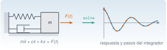
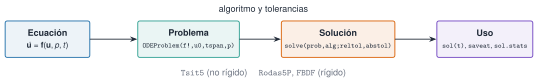

{.portada fig-alt="A la izquierda, un oscilador de un grado de libertad: una masa unida a una pared por un muelle y un amortiguador, con una flecha naranja de fuerza; una flecha verde con la palabra solve lleva a la derecha, donde una curva azul oscilante y amortiguada tiene puntos naranjas cada vez más separados que son los pasos del integrador"}

Una estructura es, ante todo, una **ecuación diferencial**: $m\ddot x+c\dot x+kx=F(t)$ dice cómo se mueve un modo bajo una fuerza. Para una fuerza armónica y un sistema lineal hay fórmulas; para un viento turbulento, un amortiguador no lineal, un impacto o un sistema con modos muy distintos, **se integra numéricamente**. Esta unidad enseña a hacerlo con `OrdinaryDiffEq.jl`: a plantear la ecuación como un problema de valores iniciales, a elegir el método y las tolerancias, a **comprobar** el resultado contra una solución conocida, a reconocer un sistema rígido y a detectar sucesos (como superar un umbral). Las aplicaciones son tres: el oscilador lineal, el oscilador no lineal de Duffing y la respuesta de un mástil al desprendimiento de vórtices del viento.

::: {.callout-note}
## Cómo se lee esta unidad
**Tiempo orientativo: 90 minutos.** Objetivos (4), teoría en cinco píldoras (18), práctica guiada (40), «Pídeselo a Claude» (12), ejercicios (14) y cierre (2). **Todos los datos se generan en la página** (parámetros declarados y, donde hay azar, semilla fija), así que se conoce la respuesta correcta. El oscilador de 1 GDL es el del edificio de la vía M (masa $2\cdot10^{5}$ kg, $f_0=2{,}94$ Hz, $\zeta=2\ \%$); el edificio es el de tres plantas de M2; **el mástil del viento es un ejemplo ilustrativo inventado**, sin relación con ninguna estructura real ni con una norma. Se usan `OrdinaryDiffEq.jl` y las funciones de `Resonancia.jl`.
:::

```{julia}
#| include: false
using OrdinaryDiffEq, LinearAlgebra, Random, Statistics, Resonancia
include("../../../recursos/r1-datos/_tema.jl")
RAIZ = "../../../"
sup(n) = join(get(Dict('-' => '⁻', '0' => '⁰', '1' => '¹', '2' => '²', '3' => '³', '4' => '⁴', '5' => '⁵', '6' => '⁶', '7' => '⁷', '8' => '⁸', '9' => '⁹'), c, c) for c in string(n))
cient(x; d=1) = (e = floor(Int, log10(abs(x))); m = x / 10.0^e; coma(m, d=d) * "·10" * sup(e))   # 2,8·10⁻³
pot10(x) = "10" * sup(round(Int, log10(x)))                                                    # 10⁻³
```

## Objetivos y prerrequisitos

**Objetivos.** Al terminar esta unidad sabrás:

- escribir una ecuación de movimiento como sistema de primer orden y resolverla con `ODEProblem` y `solve`, y leer el coste de la integración (pasos y evaluaciones);
- fijar `reltol` y `abstol` sabiendo que **no son el error de la solución**, y comprobar un resultado contra una solución exacta o una conservación;
- reconocer un sistema rígido y elegir entre `Tsit5` y un método para sistemas rígidos (`Rodas5P`, `FBDF`) con un argumento numérico;
- simular un oscilador forzado, uno no lineal (Duffing) y la respuesta de un mástil al viento, y detectar sucesos con una función de *callback*.

**Prerrequisitos.** El curso no los impone en el temario; conviene [J3.3](../j3-3-algebra-numerica/index.qmd) (valores propios y matriz exponencial), [J3.5](../j3-5-integracion-ad/index.qmd) (error y tolerancias) y, de la vía M, el oscilador de 1 GDL ([M5](../../../mse/m05-vibraciones-i/index.qmd)) y sus sistemas de varios grados de libertad ([M6](../../../mse/m06-vibraciones-ii/index.qmd)).

**Reparto con otras unidades.** La teoría de vibraciones está en M5 y M6; la respuesta en frecuencia, en M7 y J3.7. Aquí se **integra en el tiempo** y se contrasta con esas soluciones.

## Teoría breve

::: {.callout-note .historia icon=false title="Un poco de historia: los métodos de Runge y Kutta"}
Casi todos los integradores que usa hoy `OrdinaryDiffEq.jl` para problemas no rígidos descienden de una familia de métodos que desarrollaron hacia 1900 los matemáticos alemanes **Carl Runge y Wilhelm Kutta**: calcular la pendiente de la solución en varios puntos intermedios del paso y combinarlas, en lugar de usar solo la del principio. El nombre de `Tsit5`, el método recomendado por defecto para problemas no rígidos, es la abreviatura del método Runge–Kutta de orden 5(4) de Tsitouras; «5(4)» significa que lleva a la vez una solución de orden 5 y otra de orden 4, y que la diferencia entre ambas estima el error de cada paso y permite **adaptar** su longitud.

<span class="fuentes-caja">Fuentes: [Wikipedia, «Runge–Kutta methods»](https://en.wikipedia.org/wiki/Runge%E2%80%93Kutta_methods) (origen hacia 1900 y los dos nombres) y la [documentación de DiffEqDocs sobre los solucionadores de EDO](https://docs.sciml.ai/DiffEqDocs/stable/solvers/ode_solve/) (recomendación de `Tsit5` y de `Rodas5P` o `FBDF`). No se ha consultado el artículo original de Tsitouras. Consultado el 28-10-2026.</span>
:::

### J3.6.1 De la ecuación de movimiento a un `ODEProblem` {#j3-6-1}

Un **problema de valores iniciales** (PVI) es una ecuación $\dot{\mathbf u}=\mathbf f(\mathbf u,p,t)$ con $\mathbf u(0)$ dado. Las ecuaciones de segundo orden se reducen a primer orden añadiendo la velocidad como incógnita. Para el oscilador libre, con $\omega_0=2\pi f_0$,

$$
\ddot x+2\zeta\omega_0\dot x+\omega_0^2x=0\quad\Longrightarrow\quad
\begin{cases}\dot x=v\\ \dot v=-2\zeta\omega_0\,v-\omega_0^2\,x\end{cases},\qquad \mathbf u=\begin{bmatrix}x\\v\end{bmatrix}.
$$ {#eq-primer-orden}

En Julia se escribe la función $\mathbf f$ **modificando** el vector de derivadas `du` (por eso se llama `libre!`), se declara el problema con `ODEProblem(f!, u0, tspan, p)` y se resuelve con `solve(prob, algoritmo)`. Los pasos se resumen en la @fig-flujo.

{#fig-flujo fig-alt="Cuatro cajas unidas por flechas de izquierda a derecha: Ecuación, con u punto igual a f de u, p y t; Problema, con la llamada ODEProblem de f!, u0, tspan y p; Solución, con la llamada solve de prob, alg, reltol y abstol; y Uso, con sol de t, saveat y sol.stats. Sobre la flecha central, el rótulo algoritmo y tolerancias; debajo, Tsit5 para problemas no rígidos y Rodas5P y FBDF para rígidos."}

Con $f_0=2{,}94$ Hz, $\zeta=2\ \%$ y un desplazamiento inicial de 1 mm sin velocidad, la solución exacta es la de `respuesta_libre_1gdl` de `Resonancia.jl`. Se integran 10 s con `Tsit5` y tolerancia $10^{-9}$ y se compara:

```{julia}
m, f0, ζ = 2.0e5, 2.94, 0.02                       # masa (kg), frecuencia natural (Hz), amortiguamiento
ω0 = 2π * f0; k = m * ω0^2; c = 2ζ * m * ω0         # frecuencia (rad/s), rigidez (N/m), amortiguamiento (N·s/m)
function libre!(du, u, p, t)
    du[1] = u[2]                                    # x' = v
    du[2] = -2p.ζ * p.ω * u[2] - p.ω^2 * u[1]       # v' = -2ζω v - ω² x
end
prob = ODEProblem(libre!, [1.0, 0.0], (0.0, 10.0), (ω=ω0, ζ=ζ))      # x(0) = 1 mm, v(0) = 0
sol = solve(prob, Tsit5(); reltol=1e-9, abstol=1e-9)
(pasos = length(sol.t), evaluaciones_de_f = sol.stats.nf, x_en_1s = round(sol(1.0)[1], digits=6),
 exacta_en_1s = round(respuesta_libre_1gdl(1.0, f0, ζ), digits=6))
```

`sol(t)` **interpola** entre los pasos que ha dado el integrador, de modo que se puede evaluar en cualquier instante sin volver a resolver (`saveat=0.01` pide, en cambio, los valores en una rejilla fija). `sol.stats` cuenta el trabajo: el coste de una integración se mide en **evaluaciones de $\mathbf f$**, no en segundos.

::: {.ejercicio tipo="numerico" id="j3-6-1-x25" respuesta="-0.2239" tol="1%" unidad="mm"}
¿Cuánto vale el desplazamiento exacto del oscilador libre en $t=2{,}5$ s (`respuesta_libre_1gdl(2.5, 2.94, 0.02)`)?

::: {.pista}
Es negativo: en 2,5 s el oscilador ha dado ya siete ciclos y medio.
:::

::: {.solucion}
$-0{,}2239$ mm. La envolvente $e^{-\zeta\omega_0t}$ ya ha caído a $e^{-0{,}02\cdot18{,}47\cdot2{,}5}=0{,}40$, y el coseno está cerca de $-0{,}56$.
:::
:::

### J3.6.2 La tolerancia no es el error {#j3-6-2}

`solve` adapta el paso para que el **error local** de cada paso quede por debajo de $\mathrm{abstol}+\mathrm{reltol}\,\lvert u\rvert$. Por defecto, `reltol=1e-3` y `abstol=1e-6`. Pero lo que importa al final es el **error global**, que **acumula** los errores de todos los pasos y no tiene por qué ser menor que la tolerancia. Se mide con la solución exacta, bajando la tolerancia de $10^{-3}$ a $10^{-10}$:

```{julia}
#| label: fig-libre
#| fig-cap: "Error de Tsit5 en el oscilador libre frente a la solución exacta. (a) Con tolerancia 10⁻³ el error llega a 2,8·10⁻³, mayor que la tolerancia (línea discontinua). (b) Error máximo en 10 s frente a la tolerancia pedida: sigue a la tolerancia, sin igualarla."
#| fig-alt: "Dos paneles. En el panel a, el error absoluto de la solución en milímetros frente al tiempo de 0 a 10 segundos es una curva azul que oscila y crece hasta cerca de 0,003, por encima de una línea gris discontinua en 0,001 que marca la tolerancia. En el panel b, ambos ejes son logarítmicos: el error máximo frente a la tolerancia, de 10 elevado a menos 10 a 10 elevado a menos 3, forma una línea de puntos azules casi paralela a una recta gris discontinua de pendiente uno, algo por encima de ella en las tolerancias grandes y algo por debajo en las pequeñas."
let
    tt = range(0, 10, length=2001)
    exact(t) = respuesta_libre_1gdl(t, f0, ζ)
    tols = 10.0 .^ (-3:-1:-10)
    errs = [(s = solve(prob, Tsit5(); reltol=t_, abstol=t_); maximum(abs(s(t)[1] - exact(t)) for t in tt)) for t_ in tols]
    s3 = solve(prob, Tsit5(); reltol=1e-3, abstol=1e-3)
    fig = Figure(size=(720, 330))
    ax1 = Axis(fig[1, 1], xlabel="t (s)", ylabel="|error| (mm)", title="(a) tolerancia 10⁻³")
    lines!(ax1, tt, [abs(s3(t)[1] - exact(t)) for t in tt], color=AZUL)
    hlines!(ax1, [1e-3], color=GRIS, linestyle=:dash)
    ax2 = Axis(fig[1, 2], xlabel="tolerancia (reltol = abstol)", ylabel="error máximo (mm)", title="(b) error frente a tolerancia",
               xscale=log10, yscale=log10)
    lines!(ax2, tols, tols, color=GRIS, linestyle=:dash)
    scatterlines!(ax2, tols, errs, color=AZUL, markersize=7)
    fig
end
```

```{julia}
#| output: asis
filas = String[]
for tol in (1e-3, 1e-6, 1e-9)
    s = solve(prob, Tsit5(); reltol=tol, abstol=tol)
    e = maximum(abs(s(t)[1] - respuesta_libre_1gdl(t, f0, ζ)) for t in range(0, 10, length=2001))
    push!(filas, "| $(pot10(tol)) | $(length(s.t)) | $(s.stats.nf) | $(cient(e)) |")
end
println("| tolerancia | pasos | evaluaciones de f | error máximo (mm) |\n|---|---|---|---|\n" * join(filas, "\n"))
```

: Coste y error de Tsit5 en el oscilador libre (10 s) para tres tolerancias. {#tbl-tol}

Cada factor 1 000 en la tolerancia cuesta unas cuatro veces más pasos (un método de orden 5 sigue la ley $\text{pasos}\propto\mathrm{tol}^{-1/5}$), y el error global es del orden de la tolerancia, no menor que ella. Hay una comprobación todavía más exigente que la solución exacta: **una cantidad conservada**. Un oscilador **sin** amortiguamiento conserva la energía $E=\tfrac12v^2+\tfrac12\omega_0^2x^2$. Se integran 100 s y se mira cuánto vale $E$ al final respecto a la inicial:

```{julia}
#| output: asis
E(u) = 0.5 * u[2]^2 + 0.5 * ω0^2 * u[1]^2
filas = String[]
for tol in (1e-3, 1e-6, 1e-9)
    s = solve(ODEProblem(libre!, [1.0, 0.0], (0.0, 100.0), (ω=ω0, ζ=0.0)), Tsit5(); reltol=tol, abstol=tol)
    push!(filas, "| $(pot10(tol)) | $(coma(E(s.u[end]) / E(s.u[1]), d=7)) | $(length(s.t)) |")
end
println("| tolerancia | E(100 s) / E(0) | pasos |\n|---|---|---|\n" * join(filas, "\n"))
```

: Energía de un oscilador sin amortiguamiento tras 100 s (en teoría, 1). {#tbl-energia}

Con tolerancia $10^{-3}$ la energía **crece un 31 %** en 100 s (con los valores por defecto, `reltol=1e-3` y `abstol=1e-6`, un 16 %): la simulación inyectaría energía a una estructura que no se la da. La amortiguación numérica puede también quitarla, según el método. Moraleja: la tolerancia hay que **pedirla** y luego **comprobarla** con una solución exacta, una conservación o una segunda tolerancia más estricta.

::: {.ejercicio tipo="vf" id="j3-6-2-reltol" respuesta="falso"}
Con `reltol=1e-3`, el error global de la solución es siempre menor que $10^{-3}$ (relativo).

::: {.solucion}
Falso. La tolerancia controla el error local de cada paso. En el oscilador libre con $10^{-3}$ el error máximo llegó a $2{,}8\cdot10^{-3}$ mm: el error se acumula paso a paso.
:::
:::

::: {.ejercicio tipo="numerico" id="j3-6-2-picos" respuesta="0.8819" tol="0.5%" unidad="adimensional"}
En el oscilador libre, ¿cuánto vale el cociente entre dos picos consecutivos de $x(t)$, $x_{n+1}/x_n$? (Es $e^{-2\pi\zeta/\sqrt{1-\zeta^2}}$, el decremento logarítmico.)

::: {.solucion}
$e^{-0{,}12569}=0{,}8819$: cada ciclo, el pico baja un 11,8 %. Sirve para estimar $\zeta$ a partir de una simulación o de una medida.
:::
:::

### J3.6.3 Oscilador forzado: transitorio y régimen permanente {#j3-6-3}

Con una fuerza armónica $F_0\cos(2\pi f_et)$ el sistema, partiendo del reposo, tiene dos partes: un **transitorio** que decae como $e^{-\zeta\omega_0t}$ y un **régimen permanente** de amplitud $F_0\,\lvert H(f_e)\rvert$, con $H(f)=\dfrac{1/k}{1-(f/f_0)^2+2\mathrm{i}\,\zeta f/f_0}$ la receptancia de [J3.7](../j3-7-optimizacion/index.qmd) (`frf_1gdl(f, f0, ζ, 1/k)`). Si se simula a la frecuencia natural, la envolvente sube como $A_\mathrm{ss}\,(1-e^{-\zeta\omega_0t})$:

```{julia}
function forzado!(du, u, p, t)
    du[1] = u[2]
    du[2] = (p.F * cos(2π * p.fe * t) - p.c * u[2] - p.k * u[1]) / p.m
end
F0 = 1.0e4                                           # 10 kN
Ass(fe) = F0 * abs(frf_1gdl(fe, f0, ζ, 1 / k)) * 1e3  # amplitud permanente (mm)
function amplitud(fe; T=120.0)
    s = solve(ODEProblem(forzado!, [0.0, 0.0], (0.0, T), (m=m, c=c, k=k, F=F0, fe=fe)), Tsit5();
              reltol=1e-9, abstol=1e-12, saveat=(T - 20):0.002:T)
    return maximum(abs, first.(s.u)) * 1e3             # mm, en los últimos 20 s
end
fes = [2.0, 2.94, 3.5, 4.0]
(tau = round(1 / (ζ * ω0), digits=2), amplitud_simulada = round.(amplitud.(fes), digits=4), amplitud_teorica = round.(Ass.(fes), digits=4))
```

```{julia}
#| label: fig-forzado
#| fig-cap: "Oscilador forzado con F₀ = 10 kN. (a) A la frecuencia natural, el desplazamiento (azul) crece hasta el régimen permanente, siguiendo la envolvente teórica (naranja). (b) Amplitud permanente frente a la frecuencia de excitación: curva teórica |H| (gris) y simulaciones (azul)."
#| fig-alt: "Dos paneles. El panel a muestra el desplazamiento en milímetros frente al tiempo de 0 a 40 segundos, una oscilación azul rápida cuya amplitud crece desde cero hasta casi 3,7 milímetros, encerrada por dos curvas naranjas simétricas que suben y se aplanan. El panel b muestra la amplitud permanente en milímetros frente a la frecuencia de excitación de 2 a 4 hercios: una curva gris con un pico alto de 3,7 milímetros en 2,94 hercios y cuatro puntos azules sobre ella."
let
    fe = f0
    s = solve(ODEProblem(forzado!, [0.0, 0.0], (0.0, 40.0), (m=m, c=c, k=k, F=F0, fe=fe)), Tsit5(); reltol=1e-9, abstol=1e-12, saveat=0.01)
    t = s.t; env = Ass(fe) .* (1 .- exp.(-ζ * ω0 .* t))
    fig = Figure(size=(720, 330))
    ax1 = Axis(fig[1, 1], xlabel="t (s)", ylabel="x (mm)", title="(a) a la frecuencia natural")
    lines!(ax1, t, first.(s.u) .* 1e3, color=AZUL, linewidth=1)
    lines!(ax1, t, env, color=NARANJA); lines!(ax1, t, -env, color=NARANJA)
    ax2 = Axis(fig[1, 2], xlabel="f de excitación (Hz)", ylabel="amplitud permanente (mm)", title="(b) amplitud frente a frecuencia")
    ff = range(2.0, 4.0, length=400)
    lines!(ax2, ff, Ass.(ff), color=GRIS)
    scatter!(ax2, fes, amplitud.(fes), color=AZUL, markersize=9)
    fig
end
```

La simulación reproduce la receptancia con cuatro cifras. A la frecuencia natural la amplitud permanente es de 3,66 mm, es decir, $F_0/(2\zeta k)$, y se alcanza en torno a $-\ln(0{,}05)/(\zeta\omega_0)\approx8{,}1$ s para el 95 %: **un sistema poco amortiguado tarda mucho en llegar a su régimen permanente**, lo que obliga a simular el tiempo suficiente antes de medir amplitudes.

::: {.ejercicio tipo="numerico" id="j3-6-3-t95" respuesta="8.11" tol="2%" unidad="s"}
A la frecuencia natural, ¿cuánto tarda la envolvente en alcanzar el 95 % de la amplitud permanente? ($1-e^{-\zeta\omega_0t}=0{,}95$, con $\zeta\omega_0=0{,}02\cdot2\pi\cdot2{,}94$.)

::: {.solucion}
$t=-\ln(0{,}05)/(\zeta\omega_0)=2{,}9957/0{,}3694=8{,}11$ s, unos tres períodos de relajación ($\tau=1/(\zeta\omega_0)=2{,}71$ s).
:::
:::

::: {.ejercicio tipo="numerico" id="j3-6-3-amp" respuesta="0.3489" tol="1%" unidad="mm"}
¿Cuál es la amplitud permanente a $f_e=3{,}5$ Hz con $F_0=10$ kN? Calcúlala con `Ass(3.5)` y comprueba con una simulación.

::: {.solucion}
$0{,}3489$ mm (`Ass(3.5)`); la simulación da $0{,}3489$ mm con la misma cifra. Fuera de resonancia, la amplitud es unas diez veces menor.
:::
:::

### J3.6.4 Sistemas rígidos: cuando el paso lo manda el modo más rápido {#j3-6-4}

Un sistema es **rígido** (*stiff*) cuando tiene dinámicas con escalas de tiempo muy distintas: una muy rápida, que se amortigua enseguida y ya no interesa, y otra lenta, que es la que se quiere seguir. Un método explícito como `Tsit5` debe mantener el paso **estable** respecto al modo rápido aunque su efecto haya desaparecido, y el paso queda limitado por la estabilidad, no por la precisión. La medida habitual es la **razón de rigidez**: el cociente entre el mayor y el menor $\lvert\mathrm{Re}\,\lambda\rvert$ de los autovalores de la matriz del sistema.

Ejemplo: el edificio de tres plantas de M2 con un sensor ficticio (masa de 1 kg) montado en la planta 3 con una rigidez de $10^{9}$ N/m y un amortiguamiento crítico por la mitad ($\zeta_s=0{,}5$): un modo rápido de 5 kHz que se amortigua en décimas de milisegundo, junto a los modos del edificio (1,1 a 4,4 Hz). Se integran 20 s desde un desplazamiento de 1 mm en la planta 3 con tres métodos y la **misma tolerancia** ($10^{-8}$), y se compara con la solución exacta $\mathbf u(t)=e^{\mathbf At}\mathbf u_0$ (`expm`):

```{julia}
M, C, K = edificio_tres_plantas()
ms, ks = 1.0, 1.0e9; cs = 2 * 0.5 * sqrt(ks * ms)
M4 = zeros(4, 4); M4[1:3, 1:3] = M; M4[4, 4] = ms
K4 = zeros(4, 4); K4[1:3, 1:3] = K
C4 = zeros(4, 4); C4[1:3, 1:3] = C
for (Z, z) in ((K4, ks), (C4, cs)); Z[3, 3] += z; Z[4, 4] += z; Z[3, 4] -= z; Z[4, 3] -= z; end
A4, _ = espacio_estados(M4, C4, K4, zeros(4))
re = real.(eigvals(A4)); re = re[re .< -1e-6]
u04 = zeros(8); u04[3] = 1e-3                          # 1 mm en la planta 3
edif!(du, u, p, t) = (du .= p.A * u)
exacta4 = (expm(A4 * 20.0) * u04)[3]
(razon_de_rigidez = round(Int, maximum(abs, re) / minimum(abs, re)), exacta_x3_20s = exacta4)
```

```{julia}
#| output: asis
filas = String[]
res_rigido = Dict{String,Tuple{Int,Int}}()
for (nombre, alg) in (("Tsit5", Tsit5()), ("Rodas5P", Rodas5P()), ("FBDF", FBDF()))
    s = solve(ODEProblem(edif!, u04, (0.0, 20.0), (A=A4,)), alg; reltol=1e-8, abstol=1e-11)
    res_rigido[nombre] = (length(s.t), s.stats.nf)
    push!(filas, "| `$nombre` | $(length(s.t)) | $(s.stats.nf) | $(cient(abs(s.u[end][3] - exacta4))) |")
end
println("| método | pasos | evaluaciones de f | error en x₃(20 s) (m) |\n|---|---|---|---|\n" * join(filas, "\n"))
```

: Tres métodos en el edificio con el sensor rígido (tolerancia 10⁻⁸). Todos dan el mismo resultado; el trabajo es muy distinto. {#tbl-rigido}

```{julia}
#| label: fig-rigido
#| fig-cap: "Trabajo de tres métodos en el edificio con el sensor rígido: pasos (azul) y evaluaciones de la función (naranja), en escala logarítmica. Tsit5 necesita decenas de veces más pasos, porque su paso está limitado por la estabilidad del modo de 5 kHz."
#| fig-alt: "Gráfica de barras agrupadas con escala logarítmica en el eje vertical, que va de mil a dos millones. Hay tres grupos, Tsit5, Rodas5P y FBDF, cada uno con una barra azul de pasos y otra naranja de evaluaciones de la función. Tsit5 tiene unos 174 mil pasos y más de un millón de evaluaciones; Rodas5P, unos 2 700 pasos y 46 mil evaluaciones; FBDF, unos 9 500 pasos y 16 mil evaluaciones."
let
    nom = ["Tsit5", "Rodas5P", "FBDF"]
    pasos = [res_rigido[n][1] for n in nom]; nf = [res_rigido[n][2] for n in nom]
    fig = Figure(size=(720, 320))
    ax = Axis(fig[1, 1], xticks=(1:3, nom), ylabel="cantidad", yscale=log10, limits=(nothing, nothing, 1e3, 5e6))
    barplot!(ax, repeat(1:3, 2), vcat(pasos, nf), dodge=repeat([1, 2], inner=3), color=vcat(fill(AZUL, 3), fill(NARANJA, 3)),
             fillto=1e3)
    elem = [PolyElement(color=AZUL), PolyElement(color=NARANJA)]
    axislegend(ax, elem, ["pasos", "evaluaciones de f"], position=:rt)
    fig
end
```

La razón de rigidez es de 227 777 y `Tsit5` da 174 021 pasos, frente a 2 685 de `Rodas5P`: los métodos para sistemas rígidos son **implícitos** (resuelven una ecuación en cada paso, con el jacobiano), y cada paso cuesta más, pero pueden dar pasos largos. Aquí `Rodas5P` hace 22 veces menos evaluaciones de $\mathbf f$. Si el sistema **no** es rígido, un método implícito pierde: se elige `Tsit5` por defecto y se pasa a `Rodas5P` (o `FBDF` si el sistema es grande) cuando el número de pasos se dispara sin que la solución lo pida.

::: {.ejercicio tipo="opcion" id="j3-6-4-por-que" respuesta="2"}
¿Por qué `Tsit5` da 174 021 pasos en un sistema cuyos modos del edificio son de 1 a 4 Hz?

::: {.opciones}
1. Porque la tolerancia es demasiado estricta.
2. Porque el paso queda limitado por la estabilidad del modo rápido de 5 kHz, aunque ya esté amortiguado.
3. Porque `Tsit5` no sirve para sistemas lineales.
4. Porque el vector de estado tiene ocho componentes.
:::

::: {.solucion}
La 2. Un método explícito debe dar pasos del orden de $1/\lvert\lambda\rvert_\mathrm{máx}$ para ser estable, y $\lvert\lambda\rvert_\mathrm{máx}=15\,811$ s⁻¹ (frente a 0,07 s⁻¹ del modo lento): hacen falta cientos de miles de pasos para 20 s. La tolerancia (1) no es la causa, el tipo de ecuación (3) es irrelevante y el número de componentes (4) no importa.
:::
:::

::: {.ejercicio tipo="numerico" id="j3-6-4-razon" respuesta="227777" tol="1%" unidad="adimensional"}
¿Cuánto vale la razón de rigidez, $\max\lvert\mathrm{Re}\,\lambda\rvert/\min\lvert\mathrm{Re}\,\lambda\rvert$ (sin contar autovalores nulos), de este edificio con el sensor rígido?

::: {.pista}
Los autovalores salen de `eigvals(A4)`; la parte real más pequeña en módulo es la del primer modo del edificio (ζ = 1 %).
:::

::: {.solucion}
$15\,811/0{,}0694=227\,777$: el modo del sensor se amortigua $2{,}3\cdot10^{5}$ veces más deprisa que el primero del edificio.
:::
:::

### J3.6.5 Oscilador no lineal y detección de sucesos {#j3-6-5}

En las estructuras reales casi nada es perfectamente lineal: los cables y las barras de rigidez que aumenta con la deformación, los apoyos con holgura, los amortiguadores de fricción. El **oscilador de Duffing** añade a la rigidez un término cúbico:

$$
\ddot x+2\zeta\dot x+x+\varepsilon x^3=F\cos\phi(t),
$$ {#eq-duffing}

con el tiempo adimensional ($\omega_0=1$). Para $\varepsilon>0$ la rigidez **aumenta** con la amplitud (*hardening*) y la frecuencia de oscilación libre **depende de la amplitud $A$**: la teoría de perturbaciones da $\omega\approx1+\tfrac38\varepsilon A^2$, solo válida para amplitudes pequeñas. Se mide la frecuencia numéricamente con una función de *callback*: un `ContinuousCallback` llama a una función cada vez que otra, aquí $x(t)$, **cambia de signo**, y el tiempo preciso del cruce se obtiene por interpolación de la solución (no por muestreo):

```{julia}
function duffing!(du, u, p, t)
    du[1] = u[2]
    du[2] = -2p.ζ * u[2] - u[1] - p.ε * u[1]^3
end
function frecuencia_libre(ε, A)
    cruces = Float64[]
    cb = ContinuousCallback((u, t, int) -> u[1], int -> push!(cruces, int.t); affect_neg! = nothing, save_positions=(false, false))
    solve(ODEProblem(duffing!, [A, 0.0], (0.0, 80.0), (ζ=0.0, ε=ε)), Tsit5(); reltol=1e-10, abstol=1e-12, callback=cb)
    return 2π / mean(diff(cruces))                    # cruces ascendentes: uno por período
end
amplitudes = [0.1, 0.5, 1.0, 2.0]
ω_num = frecuencia_libre.(0.5, amplitudes)
(amplitud = amplitudes, ω_numérica = round.(ω_num, digits=4), ω_perturbaciones = round.(1 .+ 3 * 0.5 .* amplitudes .^ 2 ./ 8, digits=4))
```

Con $\varepsilon=0{,}5$, hasta $A=0{,}5$ la fórmula acierta a una milésima, pero para $A=2$ da 1,75 y la simulación, 1,57: **una aproximación no se usa fuera de su dominio**. Con fuerza y amortiguamiento aparece otro fenómeno, la **respuesta con salto e histéresis**: al barrer la frecuencia de excitación despacio hacia arriba y hacia abajo, la amplitud sigue caminos distintos. Con $\varepsilon=1$, $\zeta=0{,}02$ y $F=0{,}02$ se barre $\Omega$ de 0,8 a 1,4 (frecuencia lineal) y de 1,4 a 0,8, con una velocidad de barrido de $5\cdot10^{-4}$ por unidad de tiempo:

```{julia}
#| label: fig-duffing
#| fig-cap: "Oscilador de Duffing con hardening. (a) Frecuencia de la oscilación libre frente a la amplitud: simulación (azul) y aproximación por perturbaciones (naranja), que falla a amplitudes grandes. (b) Barrido de frecuencia hacia arriba (azul) y hacia abajo (naranja): la amplitud sigue caminos distintos; a Ω = 1,1 vale 0,44 al subir y 0,09 al bajar."
#| fig-alt: "Dos paneles. En el panel a, la frecuencia de oscilación libre frente a la amplitud de 0 a 2 sube en una curva azul de puntos desde 1 hasta cerca de 1,6; una curva naranja con la fórmula de perturbaciones coincide al principio y se separa por arriba, llegando a 1,75. En el panel b, la amplitud frente a la frecuencia de excitación de 0,8 a 1,4 muestra dos curvas: la azul, del barrido ascendente, crece hasta un pico de 0,44 en 1,09 y cae de golpe a casi cero; la naranja, del barrido descendente, es baja hasta 1,0 y sube hasta un pico de 0,38 cerca de 1,0, con valores distintos en la zona de 1,0 a 1,1."
let
    function duffing_barrido!(du, u, p, t)
        du[1] = u[2]
        du[2] = -2p.ζ * u[2] - u[1] - p.ε * u[1]^3 + p.F * cos(p.Ω0 * t + 0.5 * p.v * t^2)    # fase = ∫Ω dt con Ω = Ω0 + v t
    end
    function envolvente(Ω0, v; ε=1.0, ζ=0.02, F=0.02)
        T = abs(1.4 - 0.8) / abs(v)
        s = solve(ODEProblem(duffing_barrido!, [0.0, 0.0], (0.0, T), (Ω0=Ω0, v=v, ζ=ζ, ε=ε, F=F)), Tsit5();
                  reltol=1e-8, abstol=1e-10, saveat=0.25)
        Ω, a = Float64[], Float64[]
        for t0 in 0.0:2π:(T - 2π)
            idx = (s.t .>= t0) .& (s.t .< t0 + 2π)
            push!(Ω, Ω0 + v * (t0 + π)); push!(a, maximum(abs, first.(s.u[idx])))
        end
        return Ω, a
    end
    Ωu, au = envolvente(0.8, 5e-4)
    Ωd, ad = envolvente(1.4, -5e-4)
    fig = Figure(size=(720, 330))
    ax1 = Axis(fig[1, 1], xlabel="amplitud A", ylabel="frecuencia ω / ω₀", title="(a) oscilación libre")
    AA = range(0.02, 2.0, length=60)
    lines!(ax1, AA, 1 .+ 3 * 0.5 .* AA .^ 2 ./ 8, color=NARANJA, label="perturbaciones")
    scatter!(ax1, AA, frecuencia_libre.(0.5, AA), color=AZUL, markersize=5, label="simulación")
    axislegend(ax1, position=:lt)
    ax2 = Axis(fig[1, 2], xlabel="frecuencia de excitación Ω", ylabel="amplitud", title="(b) barrido hacia arriba y hacia abajo")
    lines!(ax2, Ωu, au, color=AZUL, label="hacia arriba")
    lines!(ax2, Ωd, ad, color=NARANJA, label="hacia abajo")
    axislegend(ax2, position=:rt)
    fig
end
```

Esta **histéresis** es una firma de los sistemas no lineales y se parece a lo que ocurre, por ejemplo, con estructuras de cables: la respuesta depende de **cómo se llegó** a la frecuencia. Un sistema lineal da la misma curva subiendo y bajando; si una medida no lo hace, el modelo lineal no basta.

::: {.ejercicio tipo="numerico" id="j3-6-5-omega" respuesta="1.1708" tol="0.5%" unidad="adimensional"}
Con $\varepsilon=0{,}5$ y amplitud inicial $A=1$, ¿cuánto vale la frecuencia de la oscilación libre, $\omega/\omega_0$, calculada numéricamente con `frecuencia_libre(0.5, 1.0)`?

::: {.solucion}
$1{,}1708$. La fórmula de perturbaciones da $1+\tfrac38\cdot0{,}5\cdot1=1{,}1875$, un 1,4 % por encima.
:::
:::

::: {.ejercicio tipo="vf" id="j3-6-5-lineal" respuesta="verdadero"}
En un sistema lineal, la amplitud de la respuesta a un barrido lento de frecuencia es la misma al subir y al bajar la frecuencia.

::: {.solucion}
Verdadero (con barrido suficientemente lento): la amplitud sigue la curva $\lvert H(\Omega)\rvert$ en ambos sentidos. La diferencia entre subir y bajar es un indicio de no linealidad.
:::
:::

::: {.callout-warning}
## Errores frecuentes
(1) Creer que `reltol` es el error de la solución: es la tolerancia local. (2) No comprobar el resultado con una solución exacta, una cantidad conservada o una segunda tolerancia. (3) Usar `Tsit5` en un sistema rígido y tomar el tiempo de cálculo por «lento» sin mirar `sol.stats`. (4) Medir amplitudes **antes** de que acabe el transitorio. (5) Estimar la frecuencia de un oscilador no lineal con una fórmula lineal. (6) Detectar un cruce de umbral mirando solo los pasos guardados: se puede saltar el cruce; para eso están los *callbacks*. (7) Olvidar que `du` se modifica **en su sitio**: la función no devuelve nada.
:::

::: {.callout-note}
## ¿Y en Python?
`scipy.integrate.solve_ivp(f, t_span, y0, method="RK45", rtol=1e-3, atol=1e-6)` es el análogo de `Tsit5` (Dormand–Prince de orden 5(4), con las mismas tolerancias por defecto); `method="Radau"` o `"BDF"` son los métodos para sistemas rígidos y `events=` hace el papel de los *callbacks*. Esta unidad no lleva pestañas Python ejecutables. La salida de `solve_ivp` no tiene un equivalente directo de `sol.stats`: el coste se lee en `sol.nfev`, `sol.njev` y `sol.nlu`.
:::

::: {.callout-note .idea-clave}
## Idea clave
**Integrar una EDO es un cálculo con error y con coste, y ambos se miden.** La tolerancia se pide y luego se comprueba (solución exacta, conservación, otra tolerancia); el paso lo manda la precisión o, en un sistema rígido, la estabilidad, y `sol.stats` lo dice; y los *callbacks* detectan sucesos con precisión sin necesidad de guardar todos los pasos. Una simulación sin comprobación no es un resultado: es un dibujo.
:::

## Práctica guiada

Se simula la respuesta de un **mástil** al desprendimiento de vórtices del viento, y se verifica cada paso. El mástil es un oscilador de 1 GDL de masa 5 000 kg, frecuencia natural 2 Hz y amortiguamiento 0,5 %, de diámetro $D=0{,}6$ m y longitud expuesta $L=12$ m. **Los datos son inventados, ilustrativos**. El viento, de velocidad $U$, desprende vórtices a la frecuencia $f_s=\mathrm{St}\,U/D$ (con el número de Strouhal $\mathrm{St}=0{,}2$) y ejerce una fuerza lateral $F(t)=\tfrac12\rho U^2DL\,C_L\sin(2\pi f_st)$, con $\rho=1{,}25$ kg/m³ y un coeficiente $C_L=0{,}4$. No se modela el **enganche** (*lock-in*) de la frecuencia de desprendimiento con la del mástil, que en la realidad limita la amplitud y exige modelos específicos: este ejemplo solo muestra la resonancia por coincidencia de frecuencias.

**Paso 1. El modelo.** La resonancia ocurre para la velocidad crítica $U_\mathrm{cr}=f_0D/\mathrm{St}$:

```{julia}
mm, ff0, zz = 5000.0, 2.0, 0.005                     # masa (kg), frecuencia (Hz) y amortiguamiento
kk = mm * (2π * ff0)^2; cc = 2zz * mm * 2π * ff0
D, L, ρ, St, CL = 0.6, 12.0, 1.25, 0.2, 0.4
Fv(U) = 0.5 * ρ * U^2 * D * L * CL                   # amplitud de la fuerza lateral (N)
function vortices!(du, u, p, t)
    du[1] = u[2]
    du[2] = (p.F * sin(2π * p.fs * t) - p.c * u[2] - p.k * u[1]) / p.m
end
parametros(U) = (F=Fv(U), fs=St * U / D, c=cc, k=kk, m=mm)
(rigidez_N_m = round(kk), U_critica = ff0 * D / St, fuerza_critica_N = Fv(ff0 * D / St),
 tau_s = round(1 / (zz * 2π * ff0), digits=1))
```

La constante de tiempo es $\tau=1/(\zeta\omega_0)=15{,}9$ s: el mástil tarda más de un minuto en llegar a su régimen permanente, por lo que cada simulación dura 300 s y la amplitud se mide en los últimos 50.

**Paso 2. Barrido de velocidad del viento.** Se calcula la amplitud permanente para velocidades de 3 a 9 m/s con una malla más fina cerca de la crítica y se compara con la teoría $F(U)\,\lvert H(f_s)\rvert$:

```{julia}
function amplitud_viento(U; T=300.0)
    s = solve(ODEProblem(vortices!, [0.0, 0.0], (0.0, T), parametros(U)), Tsit5();
              reltol=1e-9, abstol=1e-12, saveat=(T - 50):0.01:T)
    return maximum(abs, first.(s.u))
end
teoria_viento(U) = Fv(U) * abs(frf_1gdl(St * U / D, ff0, zz, 1 / kk))
Us = sort(unique(vcat(range(3.0, 9.0, length=25), range(5.6, 6.4, length=17))))
av = amplitud_viento.(Us)
Uv = [5.0, 5.8, 6.0, 6.2, 7.0]
(U = Uv, simulada_mm = round.(amplitud_viento.(Uv) .* 1e3, digits=3), teorica_mm = round.(teoria_viento.(Uv) .* 1e3, digits=3))
```

```{julia}
#| label: fig-viento
#| fig-cap: "Mástil bajo desprendimiento de vórtices (datos ilustrativos). (a) Amplitud permanente frente a la velocidad del viento: simulación (puntos azules) y teoría (curva gris). El pico de 8,2 mm ocurre en la velocidad crítica de 6 m/s. (b) A 6 m/s, el desplazamiento crece hasta cruzar el umbral de 5 mm (línea naranja) en 15,0 s, instante que da el callback."
#| fig-alt: "Dos paneles. En el panel a, la amplitud en milímetros frente a la velocidad del viento de 3 a 9 metros por segundo: una curva gris con un pico muy estrecho de 8,2 milímetros en 6 metros por segundo y valores bajos, menores de 1 milímetro, lejos de él; los puntos azules de la simulación están sobre la curva. En el panel b, el desplazamiento en milímetros frente al tiempo de 0 a 60 segundos es una oscilación azul rápida cuya amplitud crece hasta unos 8 milímetros; una línea horizontal naranja marca 5 milímetros y una línea vertical punteada marca el instante 15,0 segundos en que se cruza el umbral."
let
    U = 6.0
    umbral = 0.005
    t1 = Ref(NaN)
    cb = ContinuousCallback((u, t, int) -> abs(u[1]) - umbral, int -> (t1[] = int.t; terminate!(int)); save_positions=(false, false))
    solve(ODEProblem(vortices!, [0.0, 0.0], (0.0, 100.0), parametros(U)), Tsit5(); reltol=1e-9, abstol=1e-12, callback=cb)
    s = solve(ODEProblem(vortices!, [0.0, 0.0], (0.0, 60.0), parametros(U)), Tsit5(); reltol=1e-9, abstol=1e-12, saveat=0.02)
    fig = Figure(size=(720, 330))
    ax1 = Axis(fig[1, 1], xlabel="U (m/s)", ylabel="amplitud (mm)", title="(a) barrido de velocidad")
    UU = range(3, 9, length=600)
    lines!(ax1, UU, teoria_viento.(UU) .* 1e3, color=GRIS)
    scatter!(ax1, Us, av .* 1e3, color=AZUL, markersize=6)
    ax2 = Axis(fig[1, 2], xlabel="t (s)", ylabel="x (mm)", title="(b) U = 6 m/s")
    lines!(ax2, s.t, first.(s.u) .* 1e3, color=AZUL, linewidth=1)
    hlines!(ax2, [umbral * 1e3], color=NARANJA); vlines!(ax2, [t1[]], color=NARANJA, linestyle=:dot)
    fig
end
```

La amplitud, que a 5 m/s es de 0,19 mm, pasa a **8,2 mm en la velocidad crítica**, cuarenta veces más, para una velocidad un 20 % mayor: la resonancia vuelve peligrosa una franja estrecha de viento. La simulación y la teoría coinciden a tres cifras.

**Paso 3. Detectar un umbral.** Con un `ContinuousCallback` sobre $\lvert x\rvert-x_\mathrm{lím}$ se detiene la integración cuando el mástil supera 5 mm y se anota el instante, sin recorrer una malla de tiempos:

```{julia}
function tiempo_hasta(umbral; U=6.0)
    t1 = Ref(NaN)
    cb = ContinuousCallback((u, t, int) -> abs(u[1]) - umbral, int -> (t1[] = int.t; terminate!(int)); save_positions=(false, false))
    solve(ODEProblem(vortices!, [0.0, 0.0], (0.0, 200.0), parametros(U)), Tsit5(); reltol=1e-9, abstol=1e-12, callback=cb)
    return t1[]
end
Ass_v = teoria_viento(6.0); τ = 1 / (zz * 2π * ff0)
(t_5mm = round(tiempo_hasta(0.005), digits=2), t_7_5mm = round(tiempo_hasta(0.0075), digits=2),
 envolvente_5mm = round(-τ * log(1 - 0.005 / Ass_v), digits=2))
```

El cruce a 5 mm ocurre a los **15,0 s**, algo después de lo que da la envolvente ($-\tau\ln(1-0{,}005/A_\mathrm{ss})=14{,}95$ s), porque el desplazamiento oscila dentro de ella y solo la roza en un pico. Con 7,5 mm el tiempo se alarga a 39,2 s: un umbral cercano a la amplitud permanente se alcanza muy tarde, y si se pidiese superior a $A_\mathrm{ss}$, no se alcanzaría nunca.

**Paso 4. Viento de banda ancha.** El viento real es turbulento, con energía en muchas frecuencias. Se modela con una **suma de armónicos** de amplitud igual en una rejilla de frecuencias, $\Delta f=0{,}02$ Hz (de 0,5 a 4 Hz), con fases aleatorias de semilla fija; la fuerza resultante es periódica de periodo $1/\Delta f=50$ s. La respuesta estacionaria tiene un valor eficaz que se conoce sin simular: $\sigma_x^2=\sum_i\tfrac12A_i^2\lvert H(f_i)\rvert^2$ (`rms_respuesta_multiseno`). Se simulan 600 s (12 periodos) y se compara:

```{julia}
Δf = 0.02; fk = collect(0.5:Δf:4.0); N = length(fk)
φ = 2π .* rand(MersenneTwister(11), N)
Ak = fill(40.0 / sqrt(N / 2), N)                     # fuerza eficaz de 40 N
viento!(du, u, p, t) = (du[1] = u[2]; du[2] = (fuerza_multiseno(t, fk, Ak, φ) - cc * u[2] - kk * u[1]) / mm)
s_w = solve(ODEProblem(viento!, [0.0, 0.0], (0.0, 600.0)), Tsit5(); reltol=1e-8, abstol=1e-11, saveat=0.01)
x_w = first.(s_w.u[s_w.t .>= 100])                   # sin el transitorio inicial
(armonicos = N, F_eficaz_N = round(sqrt(sum(Ak .^ 2 ./ 2)), digits=2),
 rms_simulado_mm = round(1e3 * sqrt(mean(abs2, x_w .- mean(x_w))), digits=4),
 rms_teorico_mm = round(1e3 * rms_respuesta_multiseno(fk, Ak, ff0, zz, kk), digits=4), evaluaciones = s_w.stats.nf)
```

La simulación da $0{,}4993$ mm y la fórmula $0{,}4993$ mm: coinciden. Es el análogo en el tiempo de lo que J3.5 y J3.8 hacen en frecuencia (la varianza como integral del espectro): la respuesta aleatoria **sale de la receptancia**. Importa, además, qué frecuencias contienen la fuerza: el valor eficaz de 0,5 mm con una fuerza de 40 N es la contribución de **toda** la banda, no solo de la resonancia a 2 Hz.

**Paso 5. Qué cambia con el amortiguamiento.** En resonancia, la amplitud es inversamente proporcional a $\zeta$: duplicarlo la divide por dos.

```{julia}
(amplitud_resonancia_mm = round(1e3 * Fv(6.0) / kk / (2 * zz), digits=3), con_el_doble_de_zeta_mm = round(1e3 * Fv(6.0) / kk / (2 * 2zz), digits=3))
```

De 8,2 a 4,1 mm: **añadir amortiguamiento** (un amortiguador de masa sintonizada, por ejemplo) es la medida más directa frente a la resonancia por vórtices, mucho más que reforzar la rigidez.

## «Pídeselo a Claude» {#pideselo}

::: {.callout-tip}
## Prompt
«Con Julia, `--project=.`, `OrdinaryDiffEq` y `Resonancia.jl`: (1) integra con `Tsit5` el oscilador forzado `m x'' + c x' + k x = F0 cos(2π fe t)` con `m = 5000 kg`, `f0 = 2 Hz`, `ζ = 0,005`, `F0 = 64,8 N` y `fe = 2 Hz` durante 300 s desde el reposo, y dime la amplitud de los últimos 50 s; (2) compárala con `F0 * abs(frf_1gdl(fe, f0, ζ, 1/k))`; (3) repite con `reltol` de `1e-3`, `1e-6` y `1e-9` y dime el número de pasos y el error respecto a la solución teórica; (4) con un `ContinuousCallback`, dime el instante en que |x| supera 5 mm. Explica qué tolerancias has usado y por qué.»

**Verifica.** (a) Que la amplitud permanente es $8{,}207$ mm y que coincide con la fórmula en al menos cuatro cifras. (b) Que el número de pasos **aumenta** al bajar la tolerancia y el error **baja**, y que Claude ha medido el error contra una solución conocida, no solo con el número de pasos. (c) Que el instante en que se supera 5 mm es cercano a 15,0 s y que no ha sido leído de una malla de tiempos. (d) Que ha medido la amplitud **después** del transitorio (la constante de tiempo es 15,9 s). (e) Que no ha cambiado de método o de tolerancia sin decirlo ni ha elegido el mejor de varias ejecuciones. (f) Que `sol.stats` y no el reloj ha dado el coste, y que las unidades son SI.
:::

## Ejercicios

::: {.ejercicio tipo="numerico" id="j3-6-ej-ucr" respuesta="9" tol="0%" unidad="m/s"}
Un mástil de diámetro $D=0{,}9$ m, frecuencia natural $f_0=2$ Hz y $\mathrm{St}=0{,}2$. ¿A qué velocidad del viento se produce la resonancia por desprendimiento de vórtices?

::: {.solucion}
$U_\mathrm{cr}=f_0D/\mathrm{St}=2\cdot0{,}9/0{,}2=9$ m/s.
:::
:::

::: {.ejercicio tipo="numerico" id="j3-6-ej-zeta" respuesta="4.104" tol="1%" unidad="mm"}
En el mástil de la práctica a $U=6$ m/s, ¿cuál es la amplitud permanente si el amortiguamiento sube del 0,5 % al 1 %?

::: {.solucion}
$4{,}104$ mm: la amplitud en resonancia es inversamente proporcional a $\zeta$ ($8{,}207/2$).
:::
:::

::: {.ejercicio tipo="programacion" id="j3-6-ej-umbral" respuesta="39.25" tol="1%" unidad="s"}
¿En qué instante supera el mástil (a $U=6$ m/s, desde el reposo) los 7,5 mm? Usa un `ContinuousCallback` como en el paso 3.

::: {.pista}
`tiempo_hasta(0.0075)`; comprueba con la envolvente $-\tau\ln(1-0{,}0075/A_\mathrm{ss})$.
:::

::: {.solucion}
$39{,}25$ s. La envolvente da $-15{,}9\ln(1-0{,}0075/0{,}008207)=38{,}9$ s: el cruce real ocurre en el primer pico que supera el umbral, ligeramente después.
:::
:::

::: {.ejercicio tipo="abierta" id="j3-6-ej-informe"}
Un compañero te manda la respuesta de un edificio bajo un sismo, integrada con `solve(prob, Tsit5())` (tolerancias por defecto): «amplitud máxima 12,3 mm, tiempo de cálculo 0,4 s». ¿Qué le preguntas antes de creerla?

::: {.criterios}
- Pregunta qué tolerancias usó y si repitió con otra más estricta para comprobar que el resultado no cambia.
- Pregunta si comprobó contra una solución exacta, una cantidad conservada (energía, si procede) o una referencia.
- Pregunta si el sistema es rígido (razón de rigidez, número de pasos en `sol.stats`) y si el método era el adecuado.
- Pregunta cómo detectó el máximo: sobre los pasos guardados, con interpolación o con un *callback*, porque un máximo se puede saltar entre dos pasos.
:::
:::

## La doy por superada si…

- Escribo una ecuación de movimiento como sistema de primer orden y la resuelvo con `ODEProblem` y `solve`.
- Explico por qué `reltol` no es el error y lo compruebo con una solución exacta, una conservación o una segunda tolerancia.
- Reconozco un sistema rígido por su razón de rigidez y por `sol.stats`, y elijo método con un argumento.
- Simulo un oscilador forzado, mido su régimen permanente **después** del transitorio y lo contrasto con la receptancia.
- Detecto un suceso (cruce de un umbral, paso por cero) con un *callback*, y estudio una respuesta no lineal.

**Cierre.** Escribe tres líneas: qué he entendido, qué todavía no domino y cuál es mi siguiente paso pequeño. Antes de aceptar una simulación de Claude, pide las tolerancias, la comprobación contra una referencia y el coste (`sol.stats`).

### Para saber más {#j3-6-mas}

- La documentación de [DifferentialEquations.jl / OrdinaryDiffEq](https://docs.sciml.ai/DiffEqDocs/stable/) (consultada el 28-10-2026) incluye la guía para elegir solucionador, los *callbacks* y los tipos de problema.
- El tratamiento general de ecuaciones diferenciales numéricas en Julia, con sus errores, está en Driscoll y Braun [@driscoll2022]; la teoría de la respuesta de sistemas de uno y varios grados de libertad, en los textos de vibraciones [@inman2017; @ewins2000].
- La respuesta al viento de estructuras esbeltas se trata en la normativa y en la bibliografía de ingeniería del viento; esta unidad no la reproduce ni la sustituye.

**Siguiente:** [J3.7 · Optimización](../j3-7-optimizacion/index.qmd).
