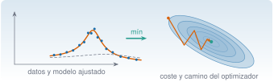
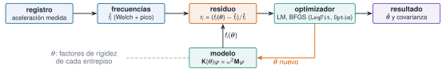

{.portada fig-alt="A la izquierda, puntos azules con ruido alrededor de un pico de resonancia y la curva naranja ajustada, junto a una curva gris discontinua del punto de partida; una flecha verde con la palabra mín lleva a la derecha, donde elipses concéntricas azules son las curvas de nivel de una función de coste y una línea naranja quebrada baja por el valle hasta un punto verde en el mínimo"}

Casi todo lo que se hace con datos de vibraciones acaba en la misma pregunta: **¿qué valores de los parámetros del modelo hacen que este se parezca más a lo medido?** El amortiguamiento de un modo, la rigidez de un entrepiso, la masa de una planta no se miden directamente: se **estiman** minimizando una función de coste que mide la distancia entre modelo y datos. Esta unidad enseña a plantear ese problema, a resolverlo con `Optim.jl` y `LsqFit.jl`, a elegir el método, a no caer en un mínimo local, y a **cuantificar la incertidumbre** del resultado, con dos aplicaciones de la vía M: el ajuste de la FRF de un oscilador de 1 GDL (M7) y la actualización de un modelo de edificio con frecuencias medidas (M6.7).

::: {.callout-note}
## Cómo se lee esta unidad
**Tiempo orientativo: 120 minutos.** Objetivos (5), teoría en cinco píldoras (35), práctica guiada (45), «Pídeselo a Claude» (15), ejercicios (15) y cierre (5). **Los datos de la FRF son sintéticos** (se generan en la página, con semilla fija y un ruido conocido, para saber la respuesta correcta); los de la actualización del modelo son los registros sintéticos del edificio de tres plantas de `datos/sinteticos/`. Ninguno es una medida de una estructura real. Se usan `Optim.jl`, `LsqFit.jl` y las funciones de `Resonancia.jl`.
:::

```{julia}
#| include: false
using Optim, LsqFit, CSV, DataFrames, LinearAlgebra, Random, Statistics, Resonancia
include("../../../recursos/r1-datos/_tema.jl")
RAIZ = "../../../"
```

## Objetivos y prerrequisitos

**Objetivos.** Al terminar esta unidad sabrás:

- plantear un ajuste como minimización de una función de coste y resolverlo con `optimize` (Optim.jl) y con `curve_fit` (LsqFit.jl);
- ajustar la FRF de un oscilador de 1 GDL por mínimos cuadrados no lineales y leer la covarianza y los intervalos de los parámetros;
- comparar Nelder–Mead, BFGS, L-BFGS y Levenberg–Marquardt por evaluaciones, precisión y robustez, y saber por qué importa **reescalar** los parámetros;
- detectar mínimos locales con una estrategia multi-start, imponer cotas y comprobar la sensibilidad a la inicialización;
- actualizar la rigidez de un modelo de edificio con frecuencias medidas y dar el resultado con su incertidumbre.

**Prerrequisitos.** El curso no los impone en el temario; conviene [J3.3](../j3-3-algebra-numerica/index.qmd) (mínimos cuadrados lineales y condicionamiento) y [J3.5](../j3-5-integracion-ad/index.qmd) (diferenciación automática), y haber visto en [M6.7](../../../mse/m06-vibraciones-ii/index.qmd) la idea de *model updating*.

**Reparto con otras unidades.** La teoría de la identificación modal está en [M7](../../../mse/m07-identificacion/index.qmd) y la del *model updating*, en M6.7. Aquí se implementa y se comprueba con cifras.

## Teoría breve

::: {.callout-note .historia icon=false title="Un poco de historia: el algoritmo de Levenberg y Marquardt"}
El método que hoy se usa por defecto para ajustar curvas por mínimos cuadrados no lineales lleva dos nombres. Kenneth Levenberg lo publicó en 1944 en el *Quarterly of Applied Mathematics*, y Donald Marquardt lo presentó de nuevo en 1963 en el *Journal of the Society for Industrial and Applied Mathematics* [con el artículo «An algorithm for least-squares estimation of nonlinear parameters»](https://doi.org/10.1137/0111030); en él reconoce, a indicación de un revisor, el trabajo anterior de Levenberg. Por eso se llama «Levenberg–Marquardt» (LM) y no «Marquardt» a secas.

<span class="fuentes-caja">Fuentes: [Wikipedia, «Levenberg–Marquardt algorithm»](https://en.wikipedia.org/wiki/Levenberg%E2%80%93Marquardt_algorithm) y el DOI del artículo de Marquardt. Los datos bibliográficos se han comprobado en fuentes secundarias, no en los originales; el título exacto varía entre fuentes. Consultado el 27-10-2026.</span>
:::

### J3.7.1 El problema: minimizar un coste {#j3-7-1}

Un **problema de optimización** busca los parámetros $\boldsymbol\theta$ que minimizan una función de coste $J(\boldsymbol\theta)$. En el ajuste de modelos, el coste es la suma de los cuadrados de los **residuos** (la diferencia entre lo medido y lo que predice el modelo):

$$
J(\boldsymbol\theta)=\sum_{i=1}^{N}r_i(\boldsymbol\theta)^2=\lVert\mathbf r(\boldsymbol\theta)\rVert_2^2,\qquad r_i=y_i-g(x_i;\boldsymbol\theta).
$$ {#eq-coste}

Si $g$ es lineal en $\boldsymbol\theta$ se resuelve con un solo paso de álgebra lineal (J3.3). Si no lo es, hay que **iterar**: partir de un valor inicial $\boldsymbol\theta_0$ y mejorarlo paso a paso. Los métodos se distinguen por la información que usan: solo valores de $J$ (**Nelder–Mead**), también el gradiente (**BFGS** y **L-BFGS**, cuasi-Newton), o la estructura de suma de cuadrados con el jacobiano de los residuos (**Levenberg–Marquardt**). Ninguno garantiza el mínimo *global*: encuentran un mínimo **local**, y cuál depende del punto de partida.

El ejemplo de la unidad es un oscilador de 1 GDL (masa $2\cdot10^{5}$ kg, $f_0=2{,}94$ Hz y $\zeta=2\ \%$, como el segundo modo del edificio), cuya **receptancia** (desplazamiento por unidad de fuerza) es

$$
H(f)=\frac{A}{1-(f/f_0)^2+2\mathrm{i}\,\zeta\,f/f_0},\qquad A=\frac1k ,
$$ {#eq-frf}

implementada en `frf_1gdl` de `Resonancia.jl`. Se simulan 201 frecuencias entre 2 y 4 Hz con ruido gaussiano de 5 µm/kN en la parte real y en la imaginaria, y se minimiza @eq-coste con Optim.jl:

```{julia}
m_osc, f0_ver, ζ_ver = 2.0e5, 2.94, 0.02
A_ver = 1e9 / (m_osc * (2π * f0_ver)^2)               # A = 1/k en µm/kN
f = collect(range(2.0, 4.0, length=201))
rng = MersenneTwister(7)
H_ver = frf_1gdl.(f, f0_ver, ζ_ver, A_ver)
y = vcat(real.(H_ver), imag.(H_ver)) .+ 5.0 .* randn(rng, 2 * length(f))   # parte real e imaginaria apiladas
coste(p) = sum(abs2, frf_1gdl_ri(f, p) .- y)           # p = [f₀, ζ, A]
p0 = [2.7, 0.05, 20.0]                                 # punto de partida
r = optimize(coste, p0, NelderMead())
(A_verdadera = round(A_ver, digits=2), coste_inicial = round(coste(p0)), minimizador = round.(Optim.minimizer(r), digits=4),
 coste_final = round(Optim.minimum(r), digits=1), converge = Optim.converged(r), iteraciones = Optim.iterations(r))
```

El coste baja de unos $2{,}7\cdot10^{6}$ a $9\,491$ y los parámetros caen cerca de los verdaderos (2,94; 0,02 y 14,65). `Optim.converged` dice que se cumplió el criterio de parada, **no** que el resultado sea el mínimo global ni que sea correcto (se verá en J3.7.3).

::: {.ejercicio tipo="vf" id="j3-7-1-converged" respuesta="falso"}
Si `Optim.converged(r)` devuelve `true`, el resultado es el mínimo global de la función de coste.

::: {.solucion}
Falso. Indica que el algoritmo se detuvo por un criterio de parada (gradiente o cambio pequeños). Puede ser un mínimo local, un punto estacionario o incluso un resultado sin sentido físico.
:::
:::

::: {.ejercicio tipo="numerico" id="j3-7-1-esperado" respuesta="9975" tol="6%" unidad="µm²/kN²"}
Los datos tienen $N=402$ valores (201 reales y 201 imaginarios) con ruido de $\sigma=5$ µm/kN, y el modelo tiene 3 parámetros. Si el modelo es correcto, el coste mínimo es, en media, $\sigma^2(N-3)$. ¿Cuánto vale?

::: {.solucion}
$25\cdot399=9975$. El valor obtenido (9 491) es un 5 % menor, dentro de la variación aleatoria (la desviación típica del coste mínimo es del orden del 7 %). Si el coste fuese mucho mayor, el modelo sería insuficiente o el optimizador se habría atascado.
:::
:::

### J3.7.2 Mínimos cuadrados no lineales con LsqFit {#j3-7-2}

`LsqFit.jl` está hecho para @eq-coste: `curve_fit(modelo, x, y, p0)` ajusta `y ≈ modelo(x, p)` con Levenberg–Marquardt, que mezcla Gauss–Newton (rápido cerca del mínimo) con descenso por gradiente (seguro lejos de él). Además de los parámetros, da su **incertidumbre**: con los residuos $\mathbf r$ y el jacobiano $\mathbf J$ del modelo en la solución, la covarianza de los parámetros es

$$
\widehat{\boldsymbol\Sigma}=\hat\sigma^2\,(\mathbf J^{\mathsf T}\mathbf J)^{-1},\qquad \hat\sigma^2=\frac{\lVert\mathbf r\rVert^2}{N-p},
$$ {#eq-covarianza}

donde $p$ es el número de parámetros. Sus raíces diagonales son los **errores típicos** (`stderror`) y se obtienen intervalos de confianza con `confint`. Con la FRF de arriba:

```{julia}
#| output: asis
fit = curve_fit(frf_1gdl_ri, f, y, p0)
ee, ic = stderror(fit), confint(fit; level=0.95)
nombres, verdad, dec = ["f₀ (Hz)", "ζ", "A (µm/kN)"], [f0_ver, ζ_ver, A_ver], [4, 5, 2]
filas = ["| $(nombres[i]) | $(coma(verdad[i], d=dec[i])) | $(coma(coef(fit)[i], d=dec[i])) | $(coma(ee[i], d=dec[i] + 1)) | [$(coma(ic[i][1], d=dec[i])); $(coma(ic[i][2], d=dec[i]))] |" for i in 1:3]
println("| parámetro | verdadero | estimado | error típico | IC 95 % |\n|---|---|---|---|---|\n" * join(filas, "\n"))
```

: Ajuste de la FRF por Levenberg–Marquardt con `curve_fit`. Los tres valores verdaderos caen dentro de su intervalo de confianza del 95 %. {#tbl-lsqfit}

```{julia}
Σ = vcov(fit)
R = Σ ./ (ee * ee')                                   # matriz de correlación de los parámetros
(sigma_residual = round(sqrt(mse(fit)), digits=3), grados_de_libertad = dof(fit),
 correlacion_f0_zeta = round(R[1, 2], digits=2), correlacion_zeta_A = round(R[2, 3], digits=2))
```

El residuo $\hat\sigma=4{,}88$ µm/kN recupera el ruido simulado (5), con $N-p=399$ grados de libertad. Y la correlación entre $\zeta$ y $A$ es de $0{,}72$: no se pueden estimar los dos con independencia, porque un pico algo más ancho y algo más alto se parece a otro más estrecho y más bajo. Mirar la **matriz de correlación**, y no solo los errores típicos, es lo que avisa de parámetros mal separados.

```{julia}
#| label: fig-frf
#| fig-cap: "Ajuste de la FRF de un oscilador de 1 GDL. (a) Módulo de los 201 datos (gris), curva del punto de partida (discontinua) y curva ajustada (naranja). (b) Los mismos datos en el plano de Argand (parte real frente a imaginaria): la FRF de 1 GDL traza una circunferencia, que es lo que ajusta el método *circle-fit* de M7.2."
#| fig-alt: "Dos paneles. El panel a muestra el módulo de la FRF en micrómetros por kilonewton frente a la frecuencia de 2 a 4 hercios: puntos grises dispersos alrededor de un pico alto en 2,94 hercios, una curva gris discontinua con un pico más bajo y desplazado, y una curva naranja que pasa por los puntos. El panel b muestra la parte real frente a la imaginaria: los puntos dibujan una circunferencia con ruido y la curva naranja es una circunferencia que los ajusta."
let
    n = length(f)
    Hd = complex.(y[1:n], y[n+1:end])
    ff = range(2.0, 4.0, length=801)                   # rejilla fina para dibujar las curvas
    Hini, Hfit = frf_1gdl.(ff, p0[1], p0[2], p0[3]), frf_1gdl.(ff, coef(fit)...)
    fig = Figure(size=(720, 330))
    ax1 = Axis(fig[1, 1], xlabel="f (Hz)", ylabel="|H| (µm/kN)", title="(a) módulo")
    scatter!(ax1, f, abs.(Hd), color=GRIS, markersize=4, label="datos")
    lines!(ax1, ff, abs.(Hini), color=GRIS, linestyle=:dash, label="punto de partida")
    lines!(ax1, ff, abs.(Hfit), color=NARANJA, label="ajuste")
    axislegend(ax1, position=:lt)
    ax2 = Axis(fig[1, 2], xlabel="Re H (µm/kN)", ylabel="Im H (µm/kN)", title="(b) plano de Argand", aspect=DataAspect())
    scatter!(ax2, real.(Hd), imag.(Hd), color=GRIS, markersize=4)
    lines!(ax2, real.(Hfit), imag.(Hfit), color=NARANJA)
    fig
end
```

Cuidado con la interpretación: el error típico de LsqFit mide solo el efecto del **ruido aleatorio** si el modelo es correcto. No incluye el error sistemático (un modelo equivocado, una mala calibración) ni garantiza que se haya llegado al mínimo global.

::: {.ejercicio tipo="numerico" id="j3-7-2-gl" respuesta="399" tol="0%" unidad="grados de libertad"}
¿Cuántos grados de libertad tiene la estimación de $\hat\sigma^2$ en el ajuste de la FRF (402 datos, 3 parámetros)?

::: {.solucion}
$N-p=402-3=399$ (`dof(fit)`).
:::
:::

::: {.ejercicio tipo="vf" id="j3-7-2-stderror" respuesta="falso"}
El error típico que da `stderror(fit)` incluye el error sistemático por usar un modelo equivocado, además del ruido.

::: {.solucion}
Falso. Se calcula a partir de la dispersión de los residuos y del jacobiano, y supone que el modelo es correcto. Un modelo equivocado puede dar errores típicos pequeños y parámetros sesgados.
:::
:::

### J3.7.3 Comparar métodos y reescalar {#j3-7-3}

Los métodos de `Optim.jl` se llaman con el mismo `optimize(f, x0, método)`. Se compara aquí el coste de cada uno (número de **evaluaciones** del coste, incluidas las que hacen las diferencias finitas o la diferenciación automática) en el mismo problema y desde el mismo punto de partida. Antes se **reescalan** los parámetros a magnitudes parecidas ($q=p/p_{\text{típico}}$): $f_0\sim3$, $\zeta\sim0{,}02$ y $A\sim15$ difieren en tres órdenes de magnitud, y los métodos con gradiente lo sufren.

```{julia}
#| output: asis
esc = [3.0, 0.02, 15.0]                                # magnitud típica de cada parámetro
q0 = p0 ./ esc
n_ev = Ref(0)
coste_q(q) = (n_ev[] += 1; sum(abs2, frf_1gdl_ri(f, q .* esc) .- y))
modelo_q(x, q) = (n_ev[] += 1; frf_1gdl_ri(x, q .* esc))
AD = Optim.ADTypes.AutoForwardDiff()                   # diferenciación automática (J3.5)
filas = String[]
for (nombre, deriv, M, kw) in [("Nelder–Mead", "ninguna", NelderMead(), NamedTuple()),
                               ("BFGS", "dif. finitas", BFGS(), NamedTuple()),
                               ("BFGS", "automática", BFGS(), (autodiff=AD,)),
                               ("L-BFGS", "automática", LBFGS(), (autodiff=AD,))]
    n_ev[] = 0
    rr = optimize(coste_q, q0, M; kw...)
    push!(filas, "| $nombre | $deriv | $(n_ev[]) | $(coma(Optim.minimizer(rr)[1] * esc[1], d=4)) | $(coma(Optim.minimum(rr), d=1)) | $(Optim.converged(rr) ? "sí" : "no") |")
end
n_ev[] = 0
ftq = curve_fit(modelo_q, f, y, q0)                    # Levenberg–Marquardt
push!(filas, "| Levenberg–Marquardt | automática | $(n_ev[]) | $(coma(coef(ftq)[1] * esc[1], d=4)) | $(coma(rss(ftq), d=1)) | $(ftq.converged ? "sí" : "no") |")
n_ev[] = 0
rb = optimize(p -> (n_ev[] += 1; coste(p)), p0, BFGS())     # sin reescalar
push!(filas, "| BFGS **sin reescalar** | dif. finitas | $(n_ev[]) | $(coma(Optim.minimizer(rb)[1], d=0)) | $(replace(@sprintf("%.2e", Optim.minimum(rb)), "." => ",")) | $(Optim.converged(rb) ? "sí" : "no") |")
println("| método | derivadas | evaluaciones | f₀ (Hz) | coste final | ¿converge? |\n|---|---|---|---|---|---|\n" * join(filas, "\n"))
```

: Cinco métodos sobre el mismo ajuste de FRF, con los parámetros reescalados, y BFGS sin reescalar. El coste mínimo es 9 491,1 en todas las filas correctas. {#tbl-metodos}

Se leen tres cosas. (1) **Levenberg–Marquardt necesita unas 30 evaluaciones**, frente a 142–270 de Nelder–Mead y de los métodos con derivadas automáticas (y 1 086 con diferencias finitas): aprovecha que el coste es una suma de cuadrados. Nelder–Mead no usa derivadas (más robusto a ruido, mucho más lento en cuanto hay más de unos pocos parámetros). (2) La diferenciación automática cuesta unas **7,6 veces menos evaluaciones** que las diferencias finitas en BFGS (142 frente a 1 086). (3) Las filas BFGS y L-BFGS dan $f_0=-2{,}9404$ Hz: la FRF solo depende de $(f_0,\zeta)$ a través de $f/f_0$ y $\zeta f/f_0$, así que $(-f_0,-\zeta)$ es **exactamente igual de bueno**; es un mínimo equivalente sin sentido físico, y se evita con cotas (J3.7.4). Y la última fila es la lección de la escala: BFGS sin reescalar «converge» a $f_0=244\,290$ Hz con un coste 230 veces mayor. El indicador de convergencia no se enteró.

```{julia}
#| label: fig-trayectorias
#| fig-cap: "Curvas de nivel del coste (en log₁₀) en el plano (f₀, ζ), con A fijo en su valor ajustado, y trayectorias de dos métodos desde el mismo punto de partida: Nelder–Mead (azul, centroide del símplex en cada iteración) y Levenberg–Marquardt (naranja, las iteraciones aceptadas). El mínimo (cruz verde) está en el fondo de un valle estrecho."
#| fig-alt: "Plano con la frecuencia natural de 2,5 a 3,3 hercios en el eje horizontal y el amortiguamiento de 0 a 0,14 en el vertical, con curvas de nivel grises estrechas alrededor de un valle vertical. Una línea azul quebrada con muchos puntos y otra naranja con triángulos parten del mismo punto abajo a la izquierda y llegan a una cruz verde en 2,94 y 0,02; la naranja llega en pocos pasos."
let
    A_aj = coef(fit)[3]
    f0s, zs = range(2.2, 3.4, length=241), range(0.002, 0.14, length=139)
    Z = [log10(coste([a, b, A_aj])) for a in f0s, b in zs]
    rt = optimize(coste_q, q0, NelderMead(), Optim.Options(store_trace=true, extended_trace=true))
    nm = [c .* esc for c in Optim.centroid_trace(rt)]
    lm = [coef(curve_fit(modelo_q, f, y, q0; maxIter=k)) .* esc for k in 0:8]
    fig = Figure(size=(720, 400))
    ax = Axis(fig[1, 1], xlabel="f₀ (Hz)", ylabel="ζ", xticks=2.2:0.2:3.4)
    contour!(ax, f0s, zs, Z, levels=range(4.0, 6.6, length=14), color=GRIS, linewidth=0.8)
    lines!(ax, first.(nm), getindex.(nm, 2), color=AZUL, linewidth=1.0, label="Nelder–Mead")
    scatterlines!(ax, first.(lm), getindex.(lm, 2), color=NARANJA, marker=:utriangle, markersize=9, label="Levenberg–Marquardt")
    scatter!(ax, [f0_ver], [ζ_ver], color=VERDE, marker=:xcross, markersize=16, label="mínimo")
    Legend(fig[1, 2], ax)
    fig
end
```

Reglas prácticas: **LM** para ajustes de curvas (suma de cuadrados) con pocos parámetros y buen punto de partida; **BFGS o L-BFGS** con diferenciación automática para costes generales y suaves (L-BFGS si hay muchísimos parámetros); **Nelder–Mead** si el coste no es derivable o es ruidoso, o como primera exploración. Y siempre: parámetros de magnitud parecida.

::: {.ejercicio tipo="numerico" id="j3-7-3-ad" respuesta="7.6" tol="5%" unidad="veces"}
En @tbl-metodos, ¿cuántas veces más evaluaciones del coste usa BFGS con diferencias finitas que con diferenciación automática (cociente aproximado)?

::: {.pista}
Divide las evaluaciones de las filas 2 y 3.
:::

::: {.solucion}
$1086/142\approx7{,}6$. Con $p$ parámetros, un gradiente por diferencias finitas cuesta del orden de $p$ evaluaciones del coste; con diferenciación automática hacia delante, una evaluación con números duales.
:::
:::

::: {.ejercicio tipo="opcion" id="j3-7-3-metodo" respuesta="b"}
Quieres ajustar los 3 parámetros de una FRF a 400 datos con ruido y tienes un buen punto de partida. ¿Qué método eliges?

::: {.opciones}
- Nelder–Mead, porque no necesita derivadas.
- Levenberg–Marquardt, porque el coste es una suma de cuadrados.
- BFGS sin reescalar, porque es cuasi-Newton.
- Descenso por gradiente con paso fijo.
:::

::: {.solucion}
(b). LM aprovecha la estructura de mínimos cuadrados y da además la covarianza. Nelder–Mead funcionaría, pero con unas ocho veces más evaluaciones; BFGS sin reescalar falló en @tbl-metodos.
:::
:::

### J3.7.4 Mínimos locales, multi-start y cotas {#j3-7-4}

Un método de descenso termina en el mínimo local que le toca según el punto de partida. La defensa estándar es la **estrategia multi-start**: lanzar el ajuste desde muchos puntos iniciales repartidos por la región admisible y quedarse con el de menor coste, comprobando **cuántos** alcanzan ese mismo valor. Si lo alcanzan casi todos, el mínimo es fiable; si solo uno, hay que desconfiar. `puntos_iniciales(lo, hi, n)` de `Resonancia.jl` los reparte con una secuencia determinista (de Halton), de modo que el resultado se repite exactamente. Con la FRF compleja, un mínimo local es raro:

```{julia}
arranques = puntos_iniciales([1.0, 0.005, 1.0], [5.0, 0.3, 100.0], 30)
ajustes = [curve_fit(frf_1gdl_ri, f, y, p) for p in arranques]
costes = [rss(a) for a in ajustes]
mala = argmax(costes)
(exitos = count(costes .< 1.001 * minimum(costes)), de = length(costes),
 arranque_fallido = round.(arranques[mala], digits=3), resultado_fallido = round.(coef(ajustes[mala]), sigdigits=3))
```

De 30 arranques, 29 llegan al mínimo común y uno **diverge** a valores absurdos ($\zeta=-960$, $A<0$): el paso de LM salió disparado a una zona donde el modelo no tiene sentido. Las **cotas** (`lower` y `upper` en `curve_fit`; `Fminbox` en Optim) impiden esos valores y fijan el signo de $f_0$ y $\zeta$, pero **no eliminan los mínimos locales**:

```{julia}
lo, hi = [1.0, 1e-4, 0.0], [5.0, 0.5, 200.0]
acot = [curve_fit(frf_1gdl_ri, f, y, p; lower=lo, upper=hi) for p in arranques]
rf = optimize(coste, lo, hi, p0, Fminbox(LBFGS()))      # lo mismo con Optim.jl
(exitos_con_cotas = count(rss(a) < 1.001 * minimum(costes) for a in acot), de = 30, A_del_fallido = round(coef(acot[mala])[3], digits=2),
 Fminbox = round.(Optim.minimizer(rf), digits=4), converge = Optim.converged(rf))
```

Con cotas, el arranque fallido se detiene ahora en la cota $A=0$ (un «modelo nulo» sin pico, con un coste de $2{,}4\cdot10^{6}$): sigue siendo uno de 30 que no llega, pero ya no da un parámetro absurdo, y su coste lo delata. Otra forma de imponer positividad es **cambiar de variables**: optimizar $u=\ln p$ y evaluar el modelo con $p=\mathrm e^{u}$ (se usa en J3.7.5).

Los mínimos locales aparecen de verdad cuando el problema es más difícil. Si solo se dispone del **módulo** de la FRF (se pierde la fase) y hay **dos modos**, el ajuste tiene seis parámetros y el coste está lleno de valles:

```{julia}
function modelo2(f, p)                                  # módulo de la suma de dos modos: [f₁, ζ₁, A₁, f₂, ζ₂, A₂]
    [abs(frf_1gdl(fi, p[1], p[2], p[3]) + frf_1gdl(fi, p[4], p[5], p[6])) for fi in f]
end
f2 = collect(range(0.5, 5.0, length=451))
p_ver2 = [1.10, 0.01, 30.0, 2.94, 0.01, 15.0]
y2 = modelo2(f2, p_ver2) .+ 1.0 .* randn(MersenneTwister(11), length(f2))
lo2, hi2 = [0.5, 1e-3, 0.0, 0.5, 1e-3, 0.0], [5.0, 0.2, 100.0, 5.0, 0.2, 100.0]
arr2 = puntos_iniciales(lo2 .+ [0, 0.005, 1, 0, 0.005, 1], hi2, 40)
aj2 = [curve_fit(modelo2, f2, y2, p; lower=lo2, upper=hi2) for p in arr2]
c2 = [rss(a) for a in aj2]
glob = c2 .< 1.001 * minimum(c2)
(globales = count(glob), de = length(c2), coste_global = round(minimum(c2), digits=1),
 costes_locales = round.(sort(c2[.!glob])[[1, end]], sigdigits=3), parametros_globales = round.(coef(aj2[argmin(c2)]), digits=3))
```

Solo **26 de 40** arranques alcanzan el mínimo global (coste 474,8, coherente con el ruido de 1 y los $N-6=445$ grados de libertad); los otros 14 se quedan en mínimos locales con un coste $10^4$ veces mayor, donde el modelo no «encuentra» los picos estrechos y ajusta una curva suave sin resonancias (@fig-multistart). Lejos de un pico estrecho el coste es casi plano y el gradiente no dice hacia dónde ir. Con un único arranque habría un 35 % de probabilidad de equivocarse (14 de 40), y solo el coste final lo delataría.

```{julia}
#| label: fig-multistart
#| fig-cap: "Ajuste del módulo de una FRF de dos modos desde 40 arranques. (a) Datos (gris), ajuste de un arranque que llega al mínimo global (naranja) y de uno que se queda en un mínimo local (azul discontinuo). (b) Coste final de cada arranque, ordenado: una meseta de 26 arranques en el mínimo global y 14 en mínimos locales, con costes más de 10 000 veces mayores (eje logarítmico)."
#| fig-alt: "Dos paneles. En el panel a, la curva del módulo de la FRF entre 0,5 y 5 hercios con dos picos, en 1,1 y 2,94 hercios; los puntos grises y una curva naranja casi coincidentes, y una curva azul discontinua que no reproduce los picos. En el panel b, 40 puntos ordenados con el coste en escala logarítmica: los primeros 26 forman una meseta baja alrededor de 475 y los otros 14 están en torno a 7 millones, con un salto vertical entre ambos grupos."
let
    mal = argmax(c2)
    fig = Figure(size=(720, 330))
    ax1 = Axis(fig[1, 1], xlabel="f (Hz)", ylabel="|H| (µm/kN)", title="(a) dos ajustes")
    scatter!(ax1, f2, y2, color=GRIS, markersize=3, label="datos")
    lines!(ax1, f2, modelo2(f2, coef(aj2[argmin(c2)])), color=NARANJA, label="mínimo global")
    lines!(ax1, f2, modelo2(f2, coef(aj2[mal])), color=AZUL, linestyle=:dash, label="mínimo local")
    axislegend(ax1, position=:rt)
    ax2 = Axis(fig[1, 2], xlabel="arranque (ordenado por coste)", ylabel="coste final", title="(b) coste de los 40 arranques", yscale=log10)
    cs = sort(c2)
    scatter!(ax2, 1:40, cs, color=[c < 1.001 * cs[1] ? NARANJA : AZUL for c in cs], marker=[c < 1.001 * cs[1] ? :circle : :utriangle for c in cs])
    fig
end
```

::: {.ejercicio tipo="numerico" id="j3-7-4-multistart" respuesta="26" tol="0%" unidad="arranques"}
En el ajuste del módulo de dos modos, ¿cuántos de los 40 arranques alcanzan el mínimo global (coste dentro del 0,1 % del mejor)?

::: {.solucion}
26 (el resultado es reproducible: la secuencia de arranques y el ruido tienen semilla fija). Los 14 restantes terminan en mínimos locales.
:::
:::

::: {.ejercicio tipo="abierta" id="j3-7-4-estrategia"}
Explica con tus palabras por qué, para fiarte de un ajuste, no basta con que un arranque converja, y cómo usarías 40 arranques para decidir si el mínimo encontrado es el global.

::: {.criterios}
- Dice que cada arranque converge a un mínimo local, que depende del punto de partida.
- Propone repartir los arranques por la región admisible y comparar los costes finales.
- Considera fiable el mínimo si lo alcanza una fracción grande y con el mismo coste, y desconfía si solo lo alcanza uno.
- Menciona las cotas o el sentido físico para descartar soluciones absurdas.
:::
:::

### J3.7.5 Model updating e incertidumbre {#j3-7-5}

El **model updating** (actualización de modelos) ajusta los parámetros de un modelo numérico para que reproduzca lo medido, normalmente las frecuencias naturales y, a veces, las formas modales. Es una de las vías para localizar y cuantificar daño a partir de cambios en las características vibratorias [@doebling1996]. Aquí el modelo es el edificio de cortante de tres plantas (`frecuencias_cortante`), con masas conocidas y tres parámetros: los **factores de rigidez** $\theta_i=k_i/k_i^{\text{nominal}}$ de cada entrepiso. Se prefieren a las rigideces en N/m porque todos valen del orden de 1 (reescalado, J3.7.3). El flujo (@fig-actualizacion) es siempre el mismo: medir, estimar las frecuencias $\hat f_i$, calcular los residuos relativos

$$
r_i(\boldsymbol\theta)=\frac{f_i(\boldsymbol\theta)-\hat f_i}{\hat f_i},\qquad \boldsymbol\theta\ \text{tal que}\ \lVert\mathbf r\rVert^2\ \text{sea mínima},
$$ {#eq-residuo-fr}

y dejar al optimizador que cambie $\boldsymbol\theta$ hasta que el modelo y la medida coincidan.

{#fig-actualizacion fig-alt="Diagrama de bloques de izquierda a derecha: registro (aceleración medida), frecuencias estimadas por Welch y ajuste de pico, residuo relativo, optimizador (Levenberg–Marquardt o BFGS con LsqFit y Optim) y resultado (estimación de theta y su covarianza). Debajo del residuo, un bloque modelo, con K de theta por phi igual a omega cuadrado M phi, envía las frecuencias del modelo al residuo y recibe de vuelta el theta nuevo del optimizador."}

Tres consideraciones: (1) **identificabilidad**: hacen falta al menos tantos datos independientes como parámetros (aquí, 3 frecuencias para 3 rigideces: el problema está *exactamente determinado*, sin margen); el jacobiano debe tener rango completo, y se comprueba con sus valores singulares. (2) **Incertidumbre**: como en @eq-covarianza, la covarianza de $\hat{\boldsymbol\theta}$ propaga la dispersión de las frecuencias estimadas; para tener grados de libertad, cada frecuencia se estima en **varios segmentos** del registro y se usan todas las estimaciones (10 por modo). (3) **Unicidad**: que existan varias soluciones con las mismas frecuencias es posible, y es lo que la estrategia multi-start permite descubrir (se verá en la práctica).

::: {.callout-note .idea-clave}
## Idea clave
Un ajuste no está terminado cuando el optimizador «converge», sino cuando se ha comprobado que: (1) el punto de partida no cambia el resultado (**multi-start**), (2) los parámetros tienen **sentido físico** (cotas), (3) los residuos no muestran estructura y (4) se da el resultado con su **incertidumbre** (covarianza, intervalos), recordando que esta solo recoge el ruido aleatorio.
:::

::: {.ejercicio tipo="vf" id="j3-7-5-ident" respuesta="falso"}
Con las frecuencias de solo dos modos se pueden identificar de forma única las rigideces de los tres entrepisos de un edificio de cortante.

::: {.solucion}
Falso. Hay tres incógnitas y solo dos ecuaciones independientes: el jacobiano tiene rango 2 y existe una familia de soluciones (una dirección de parámetros que no cambia esas dos frecuencias, en primer orden).
:::
:::

::: {.callout-warning}
## Errores frecuentes
(1) Fiarse de `converged` o del coste final sin comprobar el resultado. (2) No reescalar los parámetros: BFGS sin reescalar «convergió» a $f_0=244\,290$ Hz. (3) Un solo punto de partida, sin multi-start. (4) Dejar parámetros físicos (frecuencias, amortiguamientos, rigideces) sin cotas: aparecen soluciones con signo cambiado o negativas. (5) Interpretar el error típico de LsqFit como la incertidumbre total: no incluye el error sistemático del modelo. (6) Usar tantos parámetros como datos y dar el resultado sin covarianza. (7) Comparar métodos por tiempo en lugar de por evaluaciones y robustez. (8) Olvidar que un ajuste de pico a un espectro con poca resolución tiene un sesgo (ver la práctica).
:::

### Para saber más {#j3-7-mas}

- Driscoll y Braun, *Fundamentals of Numerical Computation*, cap. 4 (sistemas no lineales y mínimos cuadrados no lineales), edición en línea gratuita [@driscoll2022].
- Documentación de [Optim.jl](https://julianlsolvers.github.io/Optim.jl/stable/) y de [LsqFit.jl](https://github.com/JuliaNLSolvers/LsqFit.jl) (ponderaciones, cotas y covarianza).
- Para la comparación con Python: `scipy.optimize.least_squares` (método `'lm'` o `'trf'`, con cotas) cumple el papel de `curve_fit`; no se ejecuta aquí.

## Práctica guiada

Cuatro pasos sobre el edificio de tres plantas: estimar las frecuencias con ajuste de pico, actualizar el modelo en los tres escenarios, medir la incertidumbre y comprobar la unicidad.

**Paso 1. Frecuencias por ajuste de pico.** Cada registro de la aceleración de la tercera planta (`a3_ms2`, 100 Hz, 600 s) se divide en 10 segmentos de 60 s. En cada uno se calcula el espectro de Welch y se ajusta alrededor de cada pico el modelo `psd_modal_1gdl` por mínimos cuadrados no lineales (en logaritmos, con el suelo de ruido como $\mathrm e^{u}$ para obligarlo a ser positivo). A diferencia del máximo del espectro, el ajuste da la frecuencia **entre** los puntos de la rejilla (resolución de 0,049 Hz).

```{julia}
#| output: asis
fs = 100.0
bandas = [(0.8, 1.5), (2.5, 3.4), (3.8, 5.0)]
function pico_modal(x, banda; nseg=2048)
    fr, P = psd_welch(x, fs; nseg=nseg)
    sel = banda[1] .<= fr .<= banda[2]
    fb, Pb = fr[sel], P[sel] ./ maximum(P[sel])        # espectro normalizado: parámetros de magnitud ~1
    modelo(fb, p) = log.(psd_modal_1gdl(fb, [p[1], p[2], p[3], exp(p[4])]))
    k = argmax(Pb)
    ft = curve_fit(modelo, fb, log.(Pb), [fb[k], 0.02, (0.04 * fb[k]^2)^2 / fb[k]^4, log(1e-3)];
                   lower=[banda[1], 1e-4, 0.0, -Inf], upper=[banda[2], 0.5, Inf, Inf])
    return ft.converged ? coef(ft)[1] : NaN             # NaN si el ajuste no declara convergencia
end
leer(esc) = CSV.read(RAIZ * "datos/sinteticos/edificio-3-plantas/escenario_$esc.csv", DataFrame; delim=';')
medir(esc) = (x = leer(esc).a3_ms2; [pico_modal(view(x, (i-1)*6000+1:i*6000), b) for b in bandas, i in 1:10])
F = Dict(e => medir(e) for e in ["A", "B", "C"])       # frecuencias estimadas: 3 modos × 10 segmentos
media(M, j) = mean(filter(!isnan, M[j, :]))
desv(M, j) = std(filter(!isnan, M[j, :]))
fA = frecuencias_cortante([1.0, 1.0, 1.0])
filas = ["| $(m) | $(coma(fA[m], d=4)) | $(coma(media(F["A"], m), d=4)) ± $(coma(desv(F["A"], m), d=4)) | $(coma(media(F["B"], m), d=4)) | $(coma(media(F["C"], m), d=4)) |" for m in 1:3]
println("| modo | modelo nominal (Hz) | A (media ± desv.) | B | C |\n|---|---|---|---|---|\n" * join(filas, "\n"))
```

: Frecuencias de los tres modos estimadas por ajuste de pico (media de los segmentos válidos; en cada escenario, 1 de los 30 ajustes no declaró convergencia y se descartó). El escenario A coincide con el modelo nominal con un sesgo de hasta 0,3 % (resolución espectral de 0,049 Hz); B (rigideces un 1 % menores) baja las tres frecuencias entre un 0,3 y un 0,7 %, y C (daño del 10 % en el entrepiso 2) baja sobre todo el modo 3 (un 3 %). {#tbl-frec}

**Paso 2. Actualizar.** Con LsqFit se minimizan los residuos de @eq-residuo-fr sobre **todas** las estimaciones válidas (no solo sobre las medias), ponderadas con el inverso de la varianza de cada modo (`PrecisionWeights`, que declara conocida la escala del error). El modelo recibe como variable independiente el índice del modo.

```{julia}
function actualizar(F; th0=[1.0, 1.0, 1.0])
    modo = [j for j in 1:3, i in 1:size(F, 2)]
    ok = .!isnan.(F)
    sd = [desv(F, j) for j in 1:3]
    modelo(m, θ) = frecuencias_cortante(θ)[m]          # frecuencia del modo m con las rigideces θ
    wt = PrecisionWeights(1 ./ sd[modo[ok]] .^ 2)
    return curve_fit(modelo, modo[ok], F[ok], wt, th0; lower=fill(0.2, 3), upper=fill(3.0, 3), autodiff=AutoFiniteDiff())
end
act = Dict(e => actualizar(F[e]) for e in ["A", "B", "C"])
verdaderos = Dict("A" => [1.0, 1.0, 1.0], "B" => [0.99, 0.99, 0.99], "C" => [1.0, 0.9, 1.0])
(θ_C = round.(coef(act["C"]), digits=3), error_tipico_C = round.(stderror(act["C"]), digits=3),
 IC95_entrepiso_2 = round.(confint(act["C"]; level=0.95)[2], digits=3), grados_de_libertad = dof(act["C"]))
```

El escenario C da $\hat\theta_2=0{,}900\pm0{,}005$: el entrepiso 2 ha perdido un **10,0 %** de rigidez (valor verdadero, 10 %), y los otros dos quedan a menos de dos errores típicos de 1 ($1{,}021\pm0{,}012$ y $0{,}984\pm0{,}009$). El intervalo de confianza del 95 % del entrepiso 2, $[0{,}89;\,0{,}91]$, contiene el valor verdadero y excluye el 1. `autodiff=AutoFiniteDiff()` es necesario porque `eigen` no admite números duales; los 26 grados de libertad son 29 estimaciones válidas menos 3 parámetros (de las 30, una se descartó por no converger).

```{julia}
#| label: fig-actualizacion-res
#| fig-cap: "Factores de rigidez actualizados de los tres entrepisos en los tres escenarios, con intervalos de ±2 errores típicos (LsqFit), y valores verdaderos (cruces). Solo el entrepiso 2 del escenario C se aparta de 1 más allá de su incertidumbre."
#| fig-alt: "Gráfica con los tres entrepisos en el eje horizontal y el factor de rigidez de 0,85 a 1,06 en el vertical. En cada entrepiso hay tres puntos con barras de error, uno por escenario A, B y C, y una cruz del valor verdadero junto a cada uno. Todos están cerca de 1, salvo el punto del escenario C en el entrepiso 2, que está en 0,90 con su cruz."
let
    fig = Figure(size=(720, 340))
    ax = Axis(fig[1, 1], xlabel="entrepiso", ylabel="factor de rigidez θ", xticks=1:3)
    for (k, (e, col, mk)) in enumerate([("A", AZUL, :circle), ("B", VERDE, :rect), ("C", NARANJA, :utriangle)])
        x = (1:3) .+ (k - 2) * 0.22
        errorbars!(ax, x, coef(act[e]), 2 .* stderror(act[e]), color=col, whiskerwidth=8)
        scatter!(ax, x, coef(act[e]), color=col, marker=mk, markersize=10, label="escenario $e")
        scatter!(ax, x, verdaderos[e], color=TINTA, marker=:xcross, markersize=11, label=k == 1 ? "valor verdadero" : nothing)
    end
    axislegend(ax, position=:lb, nbanks=2)
    fig
end
```

**Paso 3. Comprobar la incertidumbre.** La covarianza de LsqFit es una fórmula; se contrasta con un **bootstrap** (remuestrear los 10 segmentos con reemplazo y volver a actualizar, 300 veces, semilla fija):

```{julia}
rngb = MersenneTwister(5)
boot = reduce(hcat, [coef(actualizar(F["C"][:, rand(rngb, 1:10, 10)])) for _ in 1:300])
Rc = vcov(act["C"]) ./ (stderror(act["C"]) * stderror(act["C"])')
(vcov_LsqFit = round.(stderror(act["C"]), digits=4), bootstrap = round.(vec(std(boot, dims=2)), digits=4),
 media_bootstrap = round.(vec(mean(boot, dims=2)), digits=3), correlacion_theta1_theta3 = round(Rc[1, 3], digits=2))
```

Los errores típicos del bootstrap (0,010; 0,004; 0,007) y los de la covarianza (0,012; 0,005; 0,009) coinciden en orden de magnitud: la fórmula, algo conservadora aquí, es razonable. Los $\theta_1$ y $\theta_3$ están **correlacionados** ($-0{,}72$): las frecuencias fijan combinaciones de rigideces, no cada una por separado.

**Paso 4. Unicidad y sensibilidad a la inicialización.** Con tres frecuencias y tres parámetros, el coste puede anularse en más de un punto. Se lanza Nelder–Mead sobre las frecuencias medias de C desde 30 arranques repartidos en $[0{,}4;\,1{,}6]^3$, optimizando $u=\ln\theta$ para que las rigideces sean positivas, y se comprueba qué soluciones aparecen:

```{julia}
fm = [media(F["C"], j) for j in 1:3]
sol = map(puntos_iniciales(fill(0.4, 3), fill(1.6, 3), 30)) do th0
    r = optimize(u -> coste_frecuencias(exp.(u), fm), log.(th0), NelderMead(), Optim.Options(g_tol=1e-14, iterations=5000))
    exp.(Optim.minimizer(r))
end
fisica = [s[1] < 1.3 for s in sol]                      # solución cercana a la nominal
(soluciones_cercanas_a_nominal = count(fisica), otra_solucion = round.(sol[findfirst(!, fisica)], digits=3),
 frecuencias_de_la_otra = round.(frecuencias_cortante(sol[findfirst(!, fisica)]), digits=3), frecuencias_medidas = round.(fm, digits=3))
```

Hay **dos** soluciones con coste prácticamente nulo: la buena, $\boldsymbol\theta\approx(1{,}02;\,0{,}90;\,0{,}98)$ (25 de los 30 arranques), y otra, $(1{,}97;\,0{,}62;\,0{,}74)$ (los otros 5), con las **mismas** tres frecuencias pero con un entrepiso 1 de rigidez casi doble. Solo se descarta con información adicional: un prior físico (cotas $0{,}5\le\theta\le1{,}5$), las formas modales (MAC, M6.7) o más sensores. La covarianza de LsqFit, que solo describe el entorno de **una** solución, no lo habría avisado.

::: {.callout-tip .nota-python}
## En Python
`scipy.optimize.least_squares(residuos, x0, bounds=(lo, hi), method='trf')` hace lo que `curve_fit` con cotas; la covarianza se obtiene de `res.jac` con `inv(J.T @ J) * s2`, a mano. Esta unidad no lleva pestañas Python ejecutables.
:::

## «Pídeselo a Claude» {#pideselo}

::: {.callout-tip}
## Prompt
«Con Julia, `--project=.`, `Optim`, `LsqFit` y `Resonancia.jl`: (1) genera los datos de la FRF de un oscilador de 1 GDL (`frf_1gdl`) con `f0 = 2,94 Hz`, `ζ = 0,02`, `A = 14,65 µm/kN`, 201 frecuencias entre 2 y 4 Hz y ruido gaussiano de 5 µm/kN en parte real e imaginaria con `MersenneTwister(7)`; (2) ajústala con `curve_fit` (modelo `frf_1gdl_ri`) desde `[2,7; 0,05; 20]` y dame los parámetros con su error típico y el intervalo del 95 %; (3) repite desde 30 puntos de `puntos_iniciales([1,0,005,1],[5,0,3,100],30)` con cotas y di cuántos llegan al mismo coste; (4) compara el número de evaluaciones del coste de Nelder–Mead, BFGS y Levenberg–Marquardt con los parámetros reescalados. No cambies los métodos para que salga mejor. No inventes valores: si algo no converge, dilo.»

**Verifica.** (a) Que el ajuste da $f_0\approx2{,}9404$, $\zeta\approx0{,}01994$ y $A\approx14{,}63$, con el valor verdadero dentro de cada intervalo del 95 %. (b) Que el residuo $\hat\sigma$ es $\approx4{,}9$ (cerca del ruido de 5). (c) Que los 30 arranques con cotas dan el mismo coste (9 491,1). (d) Que cuenta **evaluaciones**, no segundos, y que LM necesita bastantes menos que Nelder–Mead. (e) Que no ha escogido el mejor de varios resultados sin decirlo ni ha cambiado la semilla. (f) Que no da por buena una fila con `converged = true` y un coste mucho mayor que el mínimo.
:::

## Ejercicios

::: {.ejercicio tipo="numerico" id="j3-7-ej-theta2" respuesta="0.9" tol="1%" unidad="adimensional"}
En el escenario C, ¿cuánto vale el factor de rigidez actualizado del entrepiso 2 (`coef(act["C"])[2]`)?

::: {.solucion}
$0{,}900$ (con un error típico de 0,005): el entrepiso 2 conserva el 90 % de su rigidez, es decir, ha perdido el 10 % simulado.
:::
:::

::: {.ejercicio tipo="numerico" id="j3-7-ej-f1" respuesta="0.904" tol="1%" unidad="Hz"}
El primer modo del edificio nominal tiene $f_1=1{,}1048$ Hz. Como las frecuencias son proporcionales a $\sqrt{k}$, si **las tres** rigideces se reducen un 33 %, ¿cuánto vale aproximadamente la nueva $f_1$?

::: {.solucion}
$1{,}1048\sqrt{0{,}67}=0{,}904$ Hz: `frecuencias_cortante(fill(0.67, 3))[1]` da 0,9043.
:::
:::

::: {.ejercicio tipo="programacion" id="j3-7-ej-cotas" respuesta="29" tol="0%"}
Repite el multi-start de J3.7.4 con la FRF de 1 GDL, con las cotas `lower=[1.0, 1e-4, 0.0]` y `upper=[5.0, 0.5, 200.0]` y los 30 arranques de `puntos_iniciales([1.0, 0.005, 1.0], [5.0, 0.3, 100.0], 30)`. ¿Cuántos arranques llegan al mismo coste mínimo (dentro del 0,1 %)?

::: {.pista}
Compara `rss(ajuste)` de cada arranque con el mínimo de todos.
:::

::: {.solucion}
29. Las cotas evitan los parámetros absurdos, pero un arranque (`[2.125, 0.027, 72.28]`) acaba en la cota $A=0$, con un coste de $2{,}4\cdot10^{6}$. Se descubre comparando costes.
:::
:::

::: {.ejercicio tipo="abierta" id="j3-7-ej-informe"}
Un compañero te manda este resultado de un *model updating*: «θ = [0,93; 0,81; 1,04], coste = 1,2·10⁻⁸, converged = true». ¿Qué le preguntas antes de creerlo?

::: {.criterios}
- Pregunta desde qué punto de partida y si probó otros (multi-start), y si el resultado cambia.
- Pregunta por la incertidumbre (covarianza o bootstrap) y por cuántos datos independientes hay frente a cuántos parámetros.
- Pregunta si hay cotas o información física que descarte soluciones alternativas y si se comprobó la unicidad.
- Pregunta qué datos se ajustaron (cómo se estimaron las frecuencias, con qué resolución) y por el sesgo del modelo.
:::
:::

## La doy por superada si… {#superada}

- Planteo un ajuste como minimización de una suma de cuadrados y lo resuelvo con `optimize` y con `curve_fit`.
- Ajusto la FRF de un oscilador de 1 GDL y doy parámetros, errores típicos, intervalos y correlaciones.
- Elijo entre Nelder–Mead, BFGS y Levenberg–Marquardt con un argumento (evaluaciones, derivadas, estructura), y reescalo los parámetros.
- Uso multi-start y cotas, y cuento cuántos arranques llegan al mejor mínimo.
- Actualizo un modelo con frecuencias medidas, doy su incertidumbre y compruebo la unicidad de la solución.

**Cierre.** Escribe tres líneas: qué he entendido, qué todavía no domino y cuál es mi siguiente paso pequeño. Antes de aceptar un ajuste de Claude, pide el punto de partida, el multi-start y la covarianza.

**Siguiente:** [J3.8 · Señales](../j3-8-senales/index.qmd).
