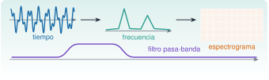

{.portada fig-alt="De izquierda a derecha: una señal en el tiempo, su espectro con dos picos, un espectrograma en forma de mosaico de celdas de intensidad variable, y debajo la respuesta de un filtro pasa-banda"}

Las unidades de procesado de señales de la vía M ([M3](../../../mse/m03-senales-i/index.qmd) y [M4](../../../mse/m04-senales-ii/index.qmd)) explican *qué* es un espectro, una ventana o un filtro. Esta unidad enseña *cómo se calculan* con los paquetes `FFTW.jl` y `DSP.jl`, comprobando cada resultado contra una cuenta a mano o contra las funciones de `Resonancia.jl`. Se recomienda haber hecho antes J1.4 a J1.7.

::: {.callout-note}
## Cómo se lee esta unidad
**Tiempo orientativo: 120 minutos.** Objetivos (5), teoría en seis píldoras (25), práctica guiada (55), «Pídeselo a Claude» (15), ejercicios (15) y cierre (5). Los ejemplos usan los registros sintéticos del edificio de tres plantas (`datos/sinteticos/edificio-3-plantas/`): 100 Hz, tres modos conocidos de 1,105, 2,939 y 4,390 Hz.
:::

```{julia}
#| include: false
using CSV, DataFrames, Statistics, Random, FFTW, DSP, Resonancia
include("../../../recursos/r1-datos/_tema.jl")
RAIZ = "../../../"
```

## Objetivos y prerrequisitos

**Objetivos.** Al terminar esta unidad sabrás:

- predecir la frecuencia aparente de una señal submuestreada (aliasing) y comprobarlo;
- calcular un espectro de amplitud con `rfft` y `rfftfreq`, con la escala correcta;
- explicar la fuga espectral y reducirla con una ventana, corrigiendo la amplitud;
- estimar una densidad espectral de potencia con `welch_pgram` y contrastarla con `psd_welch`;
- diseñar y aplicar un filtro Butterworth, causal y de fase cero, y calcular un espectrograma.

**Prerrequisitos.** El curso no impone ninguno en el temario; conviene J1.4 a J1.7 (funciones, arrays y figuras).

**Reparto con otras unidades.** La teoría (teorema de Nyquist, resolución, leakage, diseño de filtros) está en M3 y M4. Aquí se implementa y se verifica; no se repite la demostración.

## Teoría breve

### J3.8.1 Muestreo y aliasing {#j3-8-1}

Muestrear a $f_s$ solo permite ver frecuencias hasta la de **Nyquist**, $f_N=f_s/2$. Una senoide de frecuencia $f$ por encima de $f_N$ no desaparece: se **pliega** y aparece con la frecuencia aparente

$$
f_{ap}=\bigl|f-\operatorname{round}(f/f_s)\,f_s\bigr| .
$$ {#eq-alias}

Con $f=7$ Hz y $f_s=10$ Hz, $f_{ap}=|7-10|=3$ Hz. Se comprueba calculando el espectro de la señal muestreada:

```{julia}
fs_bajo = 10.0
t_bajo = (0:99) ./ fs_bajo
x_bajo = sin.(2π * 7.0 .* t_bajo)
f_bajo = rfftfreq(length(x_bajo), fs_bajo)
(frecuencia_aparente_Hz = f_bajo[argmax(abs.(rfft(x_bajo)))], prevista = abs(7.0 - round(7.0 / fs_bajo) * fs_bajo))
```

```{julia}
#| label: fig-alias
#| fig-cap: "Aliasing. Una senoide de 7 Hz (línea azul, muestreada a 100 Hz) se muestrea a 10 Hz (puntos naranjas). Los puntos coinciden con una senoide de 3 Hz (línea discontinua): con esa frecuencia de muestreo, ambas son indistinguibles."
#| fig-alt: "Gráfica entre cero y un segundo con una senoide azul de siete hercios, de siete oscilaciones por segundo, una senoide discontinua gris de tres hercios y diez puntos naranjas que caen exactamente sobre las dos curvas a la vez."
let
    tf = 0:0.001:1
    fig = Figure(size=(720, 300))
    ax = Axis(fig[1, 1], xlabel="tiempo (s)", ylabel="amplitud (adim.)")
    lines!(ax, tf, sin.(2π * 7 .* tf), color=AZUL, label="7 Hz")
    lines!(ax, tf, -sin.(2π * 3 .* tf), color=GRIS, linestyle=:dash, label="3 Hz (invertida)")
    scatter!(ax, t_bajo[1:10], x_bajo[1:10], color=NARANJA, markersize=11, label="muestras a 10 Hz")
    axislegend(ax, position=:rb)
    fig
end
```

La senoide aparente tiene la fase invertida (`-sin`), que es lo que da @eq-alias cuando $f_s/2<f<f_s$. En la práctica, el aliasing no se corrige después: se evita con un filtro antialiasing **antes** de muestrear (M3.4).

::: {.ejercicio tipo="numerico" id="j3-8-1-alias" respuesta="20" tol="0%" unidad="Hz"}
Una vibración de 80 Hz se muestrea a 100 Hz. ¿A qué frecuencia aparece en el espectro?

::: {.solucion}
$f_{ap}=|80-\operatorname{round}(0{,}8)\cdot100|=|80-100|=20$ Hz.
:::
:::

### J3.8.2 La FFT con `FFTW.jl` {#j3-8-2}

`FFTW.jl` calcula la transformada rápida de Fourier para **cualquier longitud** (la FFT propia de `Resonancia.jl` solo admite potencias de 2). Para una señal real se usa `rfft`, que devuelve solo las frecuencias de 0 a $f_N$, y `rfftfreq(N, fs)`, que da el eje en Hz. Para pasar a un espectro de **amplitud** hay que escalar: una senoide de amplitud $A$ da un módulo $A\,N/2$ en su bin, así que

$$
\text{amplitud}[k]=\frac{2\,|X[k]|}{N}\qquad(k\ne0,\ N/2).
$$ {#eq-amp}

```{julia}
fs = 100.0
N = 1000
t = (0:N-1) ./ fs
x = 1.5 .* sin.(2π * 2.5 .* t) .+ 0.5 .* sin.(2π * 7.0 .* t)
X = rfft(x)
f = rfftfreq(N, fs)
A = 2 .* abs.(X) ./ N
i = sortperm(A, rev=true)[1:2]
(frecuencias_Hz = f[i], amplitudes = round.(A[i], digits=4), resolucion_Hz = f[2])
```

Las amplitudes salen 1,5 y 0,5, las de la señal, porque 10 s a 100 Hz contienen un número entero de periodos de las dos senoides. Se comprueba además que `fft` de FFTW coincide con la FFT propia del paquete cuando la longitud es una potencia de 2:

```{julia}
x1024 = randn(MersenneTwister(1), 1024)
maximum(abs.(fft(x1024) .- fft_radix2(complex.(x1024))))
```

::: {.ejercicio tipo="numerico" id="j3-8-2-res" respuesta="0.1" tol="0%" unidad="Hz"}
¿Cuál es la resolución en frecuencia, $\Delta f=f_s/N$, de una FFT de 1000 muestras a 100 Hz?

::: {.solucion}
$100/1000=0{,}1$ Hz, que es `f[2]` en el código anterior. Para distinguir dos frecuencias separadas 0,05 Hz haría falta registrar durante al menos 20 s.
:::
:::

### J3.8.3 Fuga espectral y ventanas {#j3-8-3}

La FFT supone que el registro **se repite** indefinidamente. Si no contiene un número entero de periodos, el salto entre el final y el principio se interpreta como una discontinuidad y la energía de la senoide se reparte entre muchos bins: es la **fuga** (*leakage*). Se reduce multiplicando la señal por una **ventana** que tiende a cero en los extremos, como la de Hann (`DSP.hanning`). Como la ventana atenúa la señal, la amplitud se corrige dividiendo entre la **ganancia coherente** $\overline{w}$ (la media de la ventana).

```{julia}
x2 = sin.(2π * 2.55 .* t)                      # 25,5 periodos en 10 s: no entero
w = DSP.hanning(N)
A_rect = 2 .* abs.(rfft(x2)) ./ N
A_hann = 2 .* abs.(rfft(x2 .* w)) ./ N ./ mean(w)
(pico_sin_ventana = round(maximum(A_rect), digits=3), bins_por_encima_de_0_01 = sum(A_rect .> 0.01),
 pico_con_hann = round(maximum(A_hann), digits=3), bins_con_hann = sum(A_hann .> 0.01))
```

```{julia}
#| label: fig-fuga
#| fig-cap: "Fuga espectral de una senoide de 2,55 Hz (amplitud 1) que no ocupa un número entero de periodos. Sin ventana (azul) la energía se reparte en 48 bins y el pico ronda 0,64; con ventana de Hann (naranja, discontinua), solo seis bins superan 0,01 y el pico sube a 0,85."
#| fig-alt: "Gráfica en escala logarítmica del espectro de amplitud entre 1 y 5 hercios. La curva azul, sin ventana, tiene un pico bajo y ancho con colas largas que decaen lentamente. La curva naranja discontinua, con ventana de Hann, tiene un pico más alto y estrecho y las colas caen mucho más rápido."
let
    fig = Figure(size=(720, 320))
    ax = Axis(fig[1, 1], xlabel="frecuencia (Hz)", ylabel="amplitud (adim.)", yscale=log10, limits=((1, 5), (1e-5, 1.5)))
    lines!(ax, f, A_rect, color=AZUL, label="sin ventana")
    lines!(ax, f, A_hann, color=NARANJA, linestyle=:dash, label="ventana de Hann")
    axislegend(ax, position=:rt)
    fig
end
```

Queda un residuo: aun con ventana, el pico (0,85) no llega a 1 porque 2,55 Hz no cae justo en un bin (la rejilla es de 0,1 Hz): es la **pérdida por escalonamiento** (*scalloping*), que M4.1 cuantifica y que se corrige con la ventana *flat-top*.

::: {.ejercicio tipo="vf" id="j3-8-3-ventana" respuesta="falso"}
Una ventana de Hann elimina por completo la fuga espectral y deja el pico con su amplitud exacta.

::: {.solucion}
Falso. Reduce mucho la fuga lejos del pico, pero ensancha el lóbulo principal y no corrige el escalonamiento: la amplitud del pico sigue dependiendo de dónde caiga la frecuencia respecto de la rejilla.
:::
:::

### J3.8.4 Densidad espectral con Welch {#j3-8-4}

Para señales aleatorias (el ruido ambiental de una estructura) un solo periodograma es muy ruidoso. El **método de Welch** divide la señal en segmentos con solape, ventanea cada uno, calcula su periodograma y los **promedia**: se pierde resolución (la de un segmento) y se gana estabilidad. En `DSP.jl`:

```{julia}
a = CSV.read(RAIZ * "datos/sinteticos/edificio-3-plantas/escenario_A.csv", DataFrame; delim=';')
y = a.a3_ms2
p = welch_pgram(y, 4096, 2048; fs=100.0, window=DSP.hanning)
fw, Pw = psd_welch(y, 100.0; nseg=4096)         # versión de Resonancia.jl
m = fw .> 0.5
(bins = length(p.freq), pico_Hz = p.freq[argmax(p.power)],
 diferencia_relativa_maxima = round(maximum(abs.(p.power[m] .- Pw[m]) ./ Pw[m]), digits=5),
 parseval = (sum(p.power) * (p.freq[2] - p.freq[1]), var(y)))
```

Las dos implementaciones coinciden por encima de 0,5 Hz con una diferencia relativa inferior al 0,05 %; la pequeña discrepancia se debe a que `psd_welch` resta la media a cada segmento (*detrend*) y usa una ventana de Hann periódica, y la de `DSP.hanning` es simétrica. Cerca de 0 Hz la diferencia es grande precisamente porque `DSP` no quita la media. El teorema de Parseval comprueba la escala: la integral de la PSD ($\sum P\,\Delta f$) es la varianza de la señal.

::: {.callout-warning}
## Errores frecuentes
Comparar densidades espectrales de dos registros con **distinto** `nseg` o **distinta** ventana sin decirlo. La resolución en frecuencia es $f_s/n_{seg}$ y la escala depende de la ventana: dos PSD son comparables solo si se calcularon igual.
:::

::: {.ejercicio tipo="numerico" id="j3-8-4-res" respuesta="0.0244" tol="1%" unidad="Hz"}
¿Qué resolución tiene `welch_pgram(y, 4096, 2048; fs=100.0)`?

::: {.solucion}
$f_s/n_{seg}=100/4096\approx0{,}0244$ Hz.
:::
:::

### J3.8.5 Filtros digitales {#j3-8-5}

`DSP.jl` diseña filtros en dos pasos: un **tipo de respuesta** (`Lowpass`, `Highpass`, `Bandpass`, `Bandstop`, con sus frecuencias de corte en Hz) y un **método de diseño** (`Butterworth(n)`, `Chebyshev1(n, rp)`…). `digitalfilter(respuesta, método; fs=...)` devuelve el filtro, y se aplica de dos formas:

- `filt(filtro, x)`: **causal**. Procesa de izquierda a derecha y **retrasa** la señal (distorsión de fase).
- `filtfilt(filtro, x)`: lo aplica hacia delante y hacia atrás, y por eso tiene **fase cero** (no retrasa) y la atenuación se duplica. Solo vale para análisis diferido, no en tiempo real.

```{julia}
filtro = digitalfilter(Bandpass(0.8, 1.5), Butterworth(4); fs=100.0)
y_causal = filt(filtro, y)
y_cero = filtfilt(filtro, y)
Pc = welch_pgram(y_cero, 4096, 2048; fs=100.0, window=DSP.hanning)
(desv_original = round(std(y), digits=4), desv_filtrada = round(std(y_cero), digits=4),
 pico_tras_filtrar_Hz = Pc.freq[argmax(Pc.power)])
```

Para ver el retraso se filtra una senoide de 1,1 Hz con un pasa-bajos de 2 Hz y se busca el desfase con la correlación cruzada (en muestras, positivo si la salida va retrasada). *En el centro de una banda un pasa-banda apenas retrasa, y por eso no sirve para esta demostración.*

```{julia}
tt = (0:2999) ./ 100.0
s = sin.(2π * 1.1 .* tt)
pasabajos = digitalfilter(Lowpass(2.0), Butterworth(4); fs=100.0)
lag(u, v) = argmax(correlacion_cruzada(u, v, 100)) - 101
(retraso_filt_muestras = lag(s, filt(pasabajos, s)), retraso_filtfilt_muestras = lag(s, filtfilt(pasabajos, s)))
```

```{julia}
#| label: fig-filtro
#| fig-cap: "Filtro pasa-banda Butterworth de orden 4 entre 0,8 y 1,5 Hz aplicado a la planta 3. Arriba, la PSD original (azul) y la filtrada con fase cero (naranja): solo queda el primer modo. Abajo, una senoide de 1,1 Hz (azul) y su salida por un pasa-bajos de 2 Hz: la causal (`filt`, gris) va retrasada unos 0,22 s y la de fase cero (`filtfilt`, naranja, discontinua) coincide con la original."
#| fig-alt: "Dos paneles. Arriba, dos espectros en escala logarítmica entre cero y seis hercios: el original con tres picos y el filtrado con un solo pico cerca de 1,1 hercios. Abajo, tres señales senoidales de periodo cercano a un segundo entre cero y ocho segundos: la azul y la naranja discontinua coinciden, y la gris está desplazada hacia la derecha."
let
    P0 = welch_pgram(y, 4096, 2048; fs=100.0, window=DSP.hanning)
    fig = Figure(size=(720, 520))
    ax1 = Axis(fig[1, 1], xlabel="frecuencia (Hz)", ylabel="PSD ((m/s²)²/Hz)", yscale=log10, limits=((0, 6), (1e-8, 1)))
    lines!(ax1, P0.freq, P0.power, color=AZUL, label="original")
    lines!(ax1, Pc.freq, Pc.power, color=NARANJA, linestyle=:dash, label="pasa-banda 0,8–1,5 Hz")
    axislegend(ax1, position=:rt)
    ax2 = Axis(fig[2, 1], xlabel="tiempo (s)", ylabel="amplitud (adim.)")
    r = 1:800
    lines!(ax2, tt[r], s[r], color=AZUL, label="original (1,1 Hz)")
    lines!(ax2, tt[r], filt(pasabajos, s)[r], color=GRIS, label="filt (causal)")
    lines!(ax2, tt[r], filtfilt(pasabajos, s)[r], color=NARANJA, linestyle=:dash, label="filtfilt (fase cero)")
    axislegend(ax2, position=:rt)
    fig
end
```

::: {.ejercicio tipo="abierta" id="j3-8-5-causal"}
¿Cuándo usarías `filt` y cuándo `filtfilt`?

::: {.criterios}
- `filt` cuando el filtro debe funcionar en tiempo real (solo se dispone de muestras pasadas).
- `filtfilt` en análisis diferido de registros completos, porque no introduce retraso de fase.
:::
:::

### J3.8.6 Espectrograma {#j3-8-6}

Un espectro dice qué frecuencias hay en *todo* el registro; un **espectrograma** dice **cuándo**: calcula un espectro por cada tramo corto y los apila en una imagen tiempo–frecuencia. Con `DSP.spectrogram(x, nseg, solape; fs, window)` se obtiene una matriz de potencia con los vectores `time` y `freq`. El compromiso es el de siempre: segmentos largos dan buena resolución en frecuencia y mala en tiempo, y viceversa. Como la planta es estacionaria, se usa un barrido (*chirp*) sintético de 1 a 8 Hz en 60 s para ver una frecuencia que cambia:

```{julia}
Random.seed!(1)
tc = (0:5999) ./ 100.0
chirp = sin.(2π .* (1.0 .* tc .+ (7 / 120) .* tc .^ 2)) .+ 0.1 .* randn(length(tc))
sp = spectrogram(chirp, 512, 384; fs=100.0, window=DSP.hanning)
frec_en(k) = sp.freq[argmax(sp.power[:, k])]
ks = [1, size(sp.power, 2) ÷ 2, size(sp.power, 2)]
(forma = size(sp.power), tiempos_s = round.(sp.time[ks], digits=1), frecuencias_Hz = round.(frec_en.(ks), digits=2),
 teoricas_Hz = round.(1 .+ (7 / 60) .* sp.time[ks], digits=2))
```

```{julia}
#| label: fig-espectrograma
#| fig-cap: "Espectrograma de un barrido de 1 a 8 Hz en 60 s (ventana de 512 muestras, 5,12 s, con 75 % de solape). La línea brillante sube de forma lineal con el tiempo. La barra de color da la potencia en escala logarítmica."
#| fig-alt: "Mapa de color con el tiempo en el eje horizontal entre cero y sesenta segundos y la frecuencia en el vertical entre cero y diez hercios. Una línea brillante en diagonal parte de un hercio al principio y llega a ocho hercios al final, sobre un fondo oscuro de ruido."
let
    fig = Figure(size=(720, 380))
    ax = Axis(fig[1, 1], xlabel="tiempo (s)", ylabel="frecuencia (Hz)", limits=(nothing, (0, 12)))
    hm = heatmap!(ax, sp.time, sp.freq, log10.(sp.power' .+ 1e-12), colormap=:viridis)
    Colorbar(fig[1, 2], hm, label="log₁₀ potencia")
    fig
end
```

::: {.callout-note .idea-clave}
## Idea clave
Todo análisis espectral es una cadena (@fig-cadena): señal, ventana, FFT, potencia y promedio. Cada eslabón tiene un parámetro (`nseg`, solape, ventana, `fs`) que condiciona el resultado, y por eso **se anotan** junto con la figura.
:::

{#fig-cadena fig-alt="Cinco cajas en fila: señal, ventana (hanning), FFT (rfft), potencia y media de segmentos, unidas por flechas, con una llave inferior que abarca de la ventana a la media etiquetada método de Welch. Arriba, una caja de filtro (filtfilt) conectada con flechas a la señal y a la potencia."}

::: {.ejercicio tipo="numerico" id="j3-8-6-nt" respuesta="43" tol="0%" unidad="tramos"}
El espectrograma de 6000 muestras con segmentos de 512 y solape de 384 avanza 128 muestras por tramo. ¿Cuántos tramos produce?

::: {.pista}
$\lfloor(6000-512)/128\rfloor+1$.
:::

::: {.solucion}
$\lfloor5488/128\rfloor+1=42+1=43$ tramos (el segundo valor de `forma` en el resultado).
:::
:::

## Práctica guiada

Vamos a encadenar todo lo anterior sobre la planta 3 del edificio y a verificar cada paso: la PSD, el aislamiento del primer modo con un filtro y la comprobación cruzada con el modelo.

**Paso 1. Frecuencias de la PSD frente a las del modelo.** El modelo da las frecuencias exactas; la PSD, estimadas con la resolución de 0,0244 Hz.

```{julia}
Mp, _, Kp = edificio_tres_plantas()
f_modelo, _ = modos_propios(Kp, Mp)
ip = buscar_picos(p.freq, p.power; fmin=0.5, fmax=6.0, n=3)
(modelo_Hz = round.(f_modelo, digits=3), estimadas_Hz = round.(p.freq[ip], digits=3),
 error_relativo_pct = round.(100 .* (p.freq[ip] .- f_modelo) ./ f_modelo, digits=2))
```

**Paso 2. ¿Se queda el filtro con el primer modo?** Se comparan la energía total y la del filtrado: la varianza de la señal filtrada debe ser aproximadamente la contenida en el primer pico.

```{julia}
banda = 0.8 .<= p.freq .<= 1.5
df = p.freq[2] - p.freq[1]
(varianza_filtrada = round(var(y_cero), digits=5),
 varianza_en_banda_de_la_PSD = round(sum(p.power[banda]) * df, digits=5),
 fraccion_de_la_varianza_total = round(var(y_cero) / var(y), digits=3))
```

Las dos varianzas difieren un 4 %: el filtro no es ideal (deja pasar algo de energía fuera de banda y atenúa en los bordes), pero el orden de magnitud lo valida. El primer modo aporta el 27 % de la varianza de la planta 3.

**Paso 3. Reconstrucción por la FFT.** La FFT es invertible: `irfft` devuelve exactamente la señal, salvo redondeo.

```{julia}
yr = irfft(rfft(y), length(y))
maximum(abs.(yr .- y))
```

## «Pídeselo a Claude» {#pideselo}

::: {.callout-tip}
## Prompt
«Con Julia, `--project=.`, `FFTW` y `DSP`: lee `datos/sinteticos/edificio-3-plantas/escenario_A.csv` (separador `;`, 100 Hz). Para la columna `a3_ms2`: (1) calcula la PSD con `welch_pgram` (segmentos de 4096, solape de 2048, ventana de Hann) y dime las frecuencias de los tres picos entre 0,5 y 6 Hz; (2) diseña un filtro pasa-banda Butterworth de orden 4 entre 0,8 y 1,5 Hz y aplícalo con `filtfilt`; (3) comprueba por Parseval que la varianza de la señal es la integral de la PSD. No inventes valores. Si usas `filt` en lugar de `filtfilt`, explica la consecuencia para la fase.»

**Verifica.** (a) Que los tres picos están en 1,099, 2,930 y 4,395 Hz. (b) Que `Bandpass` se usa con `fs` en `digitalfilter` y no se pasan frecuencias normalizadas sin explicarlo (en `DSP` 0,8 las frecuencias de `Bandpass` van en Hz y `fs` se indica en `digitalfilter`). (c) Que la desviación típica baja de 0,198 a 0,103 m/s² tras filtrar. (d) Que `sum(P) * Δf` se parece a `var(y)`. (e) Que no se confunde `filt` (causal, con retraso) con `filtfilt` (fase cero).
:::

## Ejercicios

::: {.ejercicio tipo="numerico" id="j3-8-desv" respuesta="0.103" tol="1%" unidad="m/s²"}
¿Cuál es la desviación típica de la planta 3 tras el filtro pasa-banda de 0,8 a 1,5 Hz con `filtfilt`?

::: {.solucion}
0,103 m/s² (frente a 0,198 m/s² de la señal original).
:::
:::

::: {.ejercicio tipo="numerico" id="j3-8-fuga" respuesta="48" tol="0%" unidad="bins"}
En la senoide de 2,55 Hz sin ventana, ¿cuántos bins superan 0,01 de amplitud?

::: {.solucion}
48 bins, frente a 6 con la ventana de Hann.
:::
:::

::: {.ejercicio tipo="vf" id="j3-8-parseval" respuesta="verdadero"}
La integral de la densidad espectral de potencia sobre todas las frecuencias es la varianza de la señal (teorema de Parseval).

::: {.solucion}
Verdadero. Es la comprobación de que la escala de la PSD es la correcta, y se hace en el paso 1 de la práctica.
:::
:::

::: {.ejercicio tipo="abierta" id="j3-8-parametros"}
Un compañero te entrega una figura de PSD sin más datos. ¿Qué cuatro parámetros le pides para poder reproducirla?

::: {.criterios}
- La frecuencia de muestreo y la longitud del segmento (`nseg`), que fijan la resolución.
- La ventana y el solape utilizados.
:::
:::

## La doy por superada si… {#superada}

- Predigo la frecuencia aparente de una señal submuestreada.
- Calculo un espectro de amplitud con `rfft` y `rfftfreq` con la escala correcta.
- Explico la fuga y sé corregir la amplitud con la ganancia coherente de la ventana.
- Obtengo una PSD con `welch_pgram` y la contrasto con `psd_welch` y con Parseval.
- Diseño un filtro Butterworth, sé cuándo usar `filt` o `filtfilt` y calculo un espectrograma.

**Cierre.** Escribe tres líneas: qué he entendido, qué todavía no domino y cuál es mi siguiente paso pequeño. Anota siempre `fs`, `nseg`, solape y ventana junto a cada espectro.

**Siguiente:** [J3.1 · Rendimiento](../j3-1-rendimiento/index.qmd), o las unidades de [M3](../../../mse/m03-senales-i/index.qmd) y [M4](../../../mse/m04-senales-ii/index.qmd), que usan lo de aquí.
