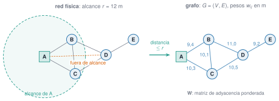

## Objetivos

- Construir grafos con `Graphs.jl` y leer grados y vecinos.
- Recorrerlos (BFS, DFS) y hallar caminos mínimos (Dijkstra).
- Analizar la **conectividad** de una red de sensores y de un reticulado.

## Del problema físico al grafo

{fig-alt="Red física de cinco nodos con el alcance de 12 metros alrededor de A, y el grafo ponderado equivalente con las distancias de los enlaces"}

`red_sensores(pos; alcance)` → `SimpleGraph(W)`

## Representación

```julia
g = SimpleGraph(5); add_edge!(g, 1, 2)
degree(g);  neighbors(g, 4);  adjacency_matrix(g)
```

- Suma de una fila de $\mathbf A$ = **grado**.
- Suma de grados $=2|E|$: 56 en la red de 16 sensores (28 enlaces).

## BFS y DFS

- **BFS**: saltos mínimos desde la pasarela: `gdistances(g, 1)`.
- Excentricidad del nodo 1: **8 saltos**.
- Profundidad del árbol: BFS 8, DFS 15.
- DFS para componentes, puentes y ciclos.

## Dijkstra

```julia
dijkstra_shortest_paths(g, 1, W .^ 2)
enumerate_paths(ruta, 16)
```

Pesos **no negativos**. Alcance de 20 m, pasarela → nodo 16:

| criterio | saltos | energía (m²) |
|---|---|---|
| mínimo de saltos | 5 | 1 195 |
| mínima energía | 8 | **747** (−37 %) |

## Conectividad

- `is_connected`, `connected_components`.
- `articulation`: nodos 12 y 14; `bridges`: enlace 12–14.
- Alcance mínimo (`kruskal_mst`): **11,35 m**.
- 13 m elimina las articulaciones, con un 36 % más de energía total.

## Reforzar la red

| alcance | enlaces | articulación | energía (m²) |
|---|---|---|---|
| 12 m | 28 | 12, 14 | 2 483 |
| 13 m | 34 | ninguna | 3 388 |

O añadir un **repetidor** en el enlace puente.

## Reticulado como grafo

- Nudos = vértices, barras = aristas.
- Maxwell: $b+r\ge2j$ (14 nudos, 3 apoyos → $b\ge25$).
- Laplaciana $\mathbf L=\mathbf D-\mathbf A$: núcleo = componentes.
- Quitar las 3 barras del módulo central → **2 subestructuras**.

## Conexo no es rígido

- Quitar una barra: sigue conexo, pero $b+r<2j$ (mecanismo).
- El patrón de ceros de $\mathbf K$ es un grafo: `grafo_de_matriz(K)`.
- Edificio de 3 plantas: camino 1–2–3.

## La doy por superada si…

- Construyo un grafo y leo grados y vecinos.
- Elijo BFS, DFS o Dijkstra con un argumento.
- Calculo puntos de articulación, puentes y alcance mínimo.
- Sé por qué la conexión no basta para la estabilidad.
