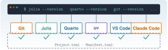

{.portada fig-alt="Una ventana de terminal con órdenes de comprobación de versión; debajo, seis cuadros con los nombres Git, Julia, Quarto, uv, VS Code y Claude Code, cada uno con una marca de verificación verde, y un recuadro discontinuo con los ficheros Project.toml y Manifest.toml"}

Las ocho prácticas del curso y el proyecto globalizador suponen un puesto de trabajo que **funciona**: una terminal, un editor, Git, Julia, Quarto, Python con `uv` y Claude Code, todo sobre una copia local del repositorio. Las vías C y J explican cada herramienta por separado. Esta unidad hace otra cosa: **las junta, las comprueba y deja constancia** de que el conjunto responde. Terminas con una lista de verificación que puedes repetir cuando algo falle, una primera sesión de Claude Code en el repositorio y un primer commit en tu propia rama.

::: {.callout-note}
## Cómo se lee esta unidad
**Tiempo orientativo: 150 minutos** (unos 55 de lectura y ejercicios y unos 95 de práctica). Objetivos y prerrequisitos (5), teoría en cuatro bloques (30), práctica guiada (75), «Pídeselo a Claude» (15), ejercicios (20) y cierre (5). Los tiempos de descarga dependen de tu conexión: la **primera** instanciación del entorno de Julia descarga y compila muchos paquetes y puede tardar bastante más que el resto de la unidad. Los bloques de código son para **tu terminal**: esta página no ejecuta Julia al compilarse.
:::

::: {.callout-note title="Cómo se han comprobado las órdenes"}
Las órdenes se han escrito para **macOS y Windows** (no Linux; WSL2 solo se nombra donde una herramienta lo exige) y llevan una marca:

- **✔ macOS**: ejecutada durante la redacción (27-10-2026) con Zsh 5.9 en macOS 27.0.1, con **Julia 1.12.3** (instalada con `juliaup`), **Quarto 1.10.19**, **Git 2.55.0**, **uv 0.12.23**, **Claude Code 2.1.304** y **VS Code 1.143.1**.
- **†** Órdenes **no ejecutadas** en la redacción: instaladores (`brew`, `winget`, scripts de instalación), `git clone`, `Pkg.instantiate()` y `uv sync` (necesitan red y modifican el equipo), y cualquier sesión interactiva de Claude Code. Proceden de [C2](../../claude/c2-terminal/index.qmd), [C4](../../claude/c4-claude-code/index.qmd), [J1](../../julia/j1-esencial/j1-1-entorno/index.qmd) o de la documentación oficial de cada herramienta, consultada el 27-10-2026 (`juliaup`, `uv` y PowerShell 7). Los identificadores de `winget` de VS Code y la extensión de Quarto son de memoria y **no se han contrastado**.

Lo que sí se ejecutó: los `--version` de las cinco herramientas; `quarto check install`; la comprobación de `Resonancia` con `julia --project=.`; la compilación de una página mínima con `engine: julia`; la secuencia de Git de L0.4 en un repositorio temporal; `quarto render` de esta misma página; y la lista de extensiones de VS Code (`code --list-extensions`) para confirmar los identificadores de Julia, Python y Claude Code.

**Windows no se ha probado.** El equipo de redacción es un Mac, sin PowerShell 7 instalado. Las pestañas de Windows son una traslación razonada de las órdenes de C2 y C4 y de la documentación oficial; si algo no responde como se describe, manda tu versión de Windows. No uses capturas de otra versión como prueba: pega siempre la salida de tu terminal.
:::

## Objetivos y prerrequisitos

**Objetivos.** Al terminar la unidad sabrás:

- instalar y **comprobar** con una sola lista de verificación la terminal, VS Code, Git, Julia (con `juliaup`), Quarto, `uv` y Claude Code;
- clonar Resonancia, instanciar su entorno de Julia con `julia --project=.` y leer la salida de `Pkg.status()`;
- abrir una primera sesión de Claude Code en el repositorio **sin saltarte la pregunta de confianza** y leer sus permisos;
- hacer un primer commit en una rama propia, sin `push`, y comprobar exactamente qué ha entrado;
- diagnosticar los fallos de instalación habituales leyendo el mensaje y no solo el final.

**Prerrequisitos.** [C2 · Terminal](../../claude/c2-terminal/index.qmd), [C3 · Git y GitHub](../../claude/c3-git/index.qmd), [C4 · Primeros pasos con Claude Code](../../claude/c4-claude-code/index.qmd), [J1.1 · Instalación y entorno](../../julia/j1-esencial/j1-1-entorno/index.qmd) y [J1.2 · Paquetes y reproducibilidad](../../julia/j1-esencial/j1-2-paquetes/index.qmd). Una cuenta de GitHub (gratuita) y una cuenta de Claude con acceso a Claude Code (C4.2).

**Reparto con otras unidades.** Aquí no se vuelve a explicar lo que ya está explicado: se enlaza y se comprueba.

| Tema | Dónde se explica | Qué hace L0 |
|---|---|---|
| Terminal, rutas, `PATH`, Homebrew y winget | [C2.1–C2.6](../../claude/c2-terminal/index.qmd#c2-6) | Usa `which -a` / `Get-Command` para diagnosticar |
| `uv` y proyectos de Julia, VS Code | [C2.7–C2.8](../../claude/c2-terminal/index.qmd#c2-7) | Los instala y los une en un solo proyecto |
| Versiones de Quarto, Git y Claude Code | [C2.9](../../claude/c2-terminal/index.qmd#c2-9) | Las reúne en una lista de verificación |
| Repositorio, commit, ramas, GitHub | [C3.2–C3.5](../../claude/c3-git/index.qmd#c3-2) | Clona y hace un primer commit |
| Instalación, permisos y primera sesión de Claude Code | [C4.2–C4.3](../../claude/c4-claude-code/index.qmd#c4-2) | Los aplica a *este* repositorio |
| `juliaup`, `--project=.` | [J1.1.1](../../julia/j1-esencial/j1-1-entorno/index.qmd#j1-1-1), [J1.1.3](../../julia/j1-esencial/j1-1-entorno/index.qmd#j1-1-3) | Las usa sin repetirlas |
| `Project.toml`, `Manifest.toml`, `instantiate` | [J1.2](../../julia/j1-esencial/j1-2-paquetes/index.qmd#j1-2-2) | Instancia el entorno del curso |

**Temas de la unidad**

- **L0.1** Instalación de Julia, VS Code, Quarto, Git y Claude Code
- **L0.2** Clonar Resonancia e instanciar el entorno
- **L0.3** Primera sesión de Claude Code sobre el repositorio
- **L0.4** Primer commit

## Teoría breve

### L0.1 Instalación de Julia, VS Code, Quarto, Git y Claude Code {#l0-1}

El entorno del curso es un **conjunto de herramientas independientes** que cooperan a través de la terminal y de los ficheros del proyecto. Ninguna depende de un programa «maestro»: cada una se instala, se actualiza y se comprueba por separado, y se encuentra por el `PATH` (C2.5). La @fig-arquitectura muestra quién habla con quién.

{#fig-arquitectura fig-alt="Arriba, dos cuadros unidos por una línea discontinua: VS Code, editor con terminal integrada, y Terminal y shell, con Zsh en macOS y PowerShell 7 en Windows. De la terminal salen flechas hacia cinco cuadros: Git, Julia con juliaup, Quarto, Python con uv y Claude Code. Debajo, dentro de un recuadro discontinuo que representa la carpeta resonancia, cada herramienta apunta a sus ficheros: Git a la carpeta .git, Julia a Project.toml y Manifest.toml, Quarto a _quarto.yml y _freeze, uv a pyproject.toml y uv.lock, y Claude Code a CLAUDE.md y la carpeta .claude. Una flecha discontinua verde va de Quarto a Julia con la etiqueta engine julia. Abajo a la izquierda, GitHub, con una flecha de doble sentido hacia el recuadro del proyecto etiquetada clone y push."}

**Tres ideas organizan la instalación.**

1. **Un gestor por sistema, y no instaladores sueltos.** En macOS, Homebrew; en Windows, `winget` (C2.6). Excepciones: Julia se instala con **`juliaup`** y Claude Code con su instalador oficial (C4.2), porque ambos se actualizan solos. Con gestor, la instalación es reproducible y sabes qué versión tienes.
2. **Un solo entorno por lenguaje, dentro del proyecto.** Julia lee `Project.toml` y `Manifest.toml`; Python (con `uv`) lee `pyproject.toml` y `uv.lock`. Nunca se instalan paquetes del curso en el Julia o el Python «del sistema». El curso usa `uv`, **no conda**: si tienes conda, no estorba, pero ningún comando de esta unidad lo necesita.
3. **Se comprueba cada paso antes de pasar al siguiente.** Tras instalar, `herramienta --version` en una terminal **nueva** (así recoge el `PATH` actualizado). Es la comprobación más barata y descarta la mitad de los fallos.

**Orden recomendado.** Terminal (y PowerShell 7 en Windows) → Git → Julia → Quarto → `uv` → VS Code → Claude Code. El orden no es técnicamente obligatorio, pero va de lo más básico a lo que más depende de lo anterior: Claude Code, al final, ya encuentra Git, Julia y Quarto cuando le pidas que ejecute algo.

| Herramienta | Para qué | Cómo se instala | Comprobación | Referencia (27-10-2026) |
|---|---|---|---|---|
| **Terminal y shell** | Dónde se escriben las órdenes | Zsh viene con macOS; PowerShell 7 es aparte en Windows | `$SHELL` / `$PSVersionTable.PSVersion` | Zsh 5.9; PowerShell 7.x |
| **Git** | Control de versiones | `brew` / `winget` | `git --version` | 2.55.0 |
| **Julia** | Lenguaje del curso | `juliaup` | `julia --version` | 1.12.3 |
| **Quarto** | Compila la web y los informes | `brew` / `winget` | `quarto --version`, `quarto check install` | 1.10.19 |
| **uv** | Python y su entorno | `brew` / `winget` | `uv --version` | 0.12.23 |
| **VS Code** | Editor con terminal integrada | `brew` / `winget` | `code --version` | 1.143.1 |
| **Claude Code** | Agente en la terminal | Instalador oficial | `claude --version` | 2.1.304 |

Las versiones de referencia son un **punto de partida, no una exigencia**: el `README` del repositorio indica Julia 1.12 y Quarto 1.10. Si tu versión es mucho más antigua o más moderna, anótalo y avisa antes de «arreglarlo» a ciegas.

::: {.callout-tip .idea-clave}
## Windows: PowerShell 7 nativo o WSL2
Este curso escribe sus órdenes para **PowerShell 7 en Windows nativo** y para Zsh en macOS. **WSL2** (Linux dentro de Windows) no es necesario para seguir el curso. Solo interesa si quieres el **sandbox** de Claude Code, que según el propio repositorio no está disponible en Windows nativo, o un entorno de herramientas Linux. Elige uno y no mezcles: una carpeta de proyecto clonada dentro de WSL2 y otra en Windows son dos copias distintas, cada una con sus herramientas.
:::

::: {.callout-note .captura-pendiente icon=false title="Captura pendiente: PowerShell 7 en Windows"}
Debe mostrar Windows Terminal con una pestaña de PowerShell 7 y el resultado de `$PSVersionTable.PSVersion` (versión mayor 7), para que quien empiece en Windows distinga PowerShell 7 de «Windows PowerShell» 5.1. Ficha en `fig/_CAPTURAS.md`.

<!-- {#fig-cap-powershell-win fig-alt="Windows Terminal con PowerShell 7 mostrando la versión de PowerShell con la versión mayor 7"} -->
:::

**Pon a prueba lo anterior.**

::: {.ejercicio tipo="opcion" id="l0-1-path" respuesta="b"}
Acabas de instalar Julia y `julia --version` responde «command not found». ¿Qué haces primero?

::: {.opciones}
- Reinstalar con `sudo` para que tenga permisos.
- Cerrar la terminal, abrir una nueva y comprobar qué ejecutable se encuentra con `which -a julia` (Zsh) o `Get-Command julia` (PowerShell).
- Instalar otra versión de Julia con otro gestor.
- Desactivar el antivirus y volver a probar.
:::

::: {.solucion}
Lo habitual es que la terminal abierta **no haya recogido el `PATH` nuevo**. Una terminal nueva y `which -a` / `Get-Command` dicen si el ejecutable existe y dónde está (C2.5, C2.6). `sudo` para «dar permisos» no es la solución y puede empeorar las cosas.
:::
:::

::: {.ejercicio tipo="vf" id="l0-1-conda" respuesta="falso"}
Como ya tienes Python con conda, el curso funciona igual sin instalar `uv`.

::: {.solucion}
**Falso.** El curso gestiona Python con `uv` (`pyproject.toml` y `uv.lock`) y no usa conda. `quarto check` puede mostrar el Python de conda de tu equipo: es información sobre tu máquina, no el entorno del curso.
:::
:::

::: {.ejercicio tipo="abierta" id="l0-1-gestor"}
Da **dos razones** por las que el curso prefiere instalar con un gestor (`brew`, `winget`, `juliaup`) en lugar de descargar instaladores sueltos de cada web.

::: {.criterios}
- Menciono que el gestor recuerda qué versión hay instalada y permite actualizar o desinstalar con una orden.
- Menciono la reproducibilidad (mismo comando en otro equipo) o la menor probabilidad de instalar software de una fuente dudosa.
:::
:::

### L0.2 Clonar Resonancia e instanciar el entorno {#l0-2}

**Clonar** es copiar el repositorio completo, con su historia, a tu equipo (`git clone`, C3.5). Tres formas de obtener el código, de más a menos recomendable:

- **Clonar** el repositorio público: obtienes historia y puedes hacer commits. Es lo que haremos.
- **Fork y clonar el fork**: necesario solo si quieres **publicar** tus propios cambios en tu cuenta de GitHub (C3.5). No hace falta para L0.
- **Descargar el ZIP**: sin historia ni Git; no sirve para este curso.

Dónde clonar importa más de lo que parece. Elige una **ruta corta, sin espacios y fuera de carpetas sincronizadas** (OneDrive, iCloud, Dropbox): la sincronización puede bloquear ficheros mientras Julia o Quarto los escriben, y en Windows las rutas largas dan problemas con árboles de carpetas profundos. Una carpeta `Proyectos` en tu carpeta personal cumple.

**Qué contiene la copia.** Los ficheros que importan para el entorno son estos (J1.2.2):

| Fichero o carpeta | Qué fija |
|---|---|
| `Project.toml` | Qué paquetes de Julia pide el proyecto |
| `Manifest.toml` | Qué versiones exactas de esos paquetes (y de sus dependencias) se usan |
| `Resonancia.jl/` | El paquete local del curso, incorporado al entorno en modo desarrollo (`path = "Resonancia.jl"` en el `Manifest.toml`) |
| `pyproject.toml`, `uv.lock` | Lo mismo para el Python del curso |
| `_quarto.yml`, `_freeze/` | La configuración de la web y los resultados de Julia ya calculados |
| `CLAUDE.md`, `.claude/` | Instrucciones y permisos del proyecto para Claude Code |

**Instanciar** es descargar y compilar exactamente lo que dice el `Manifest.toml`; es el equivalente de `uv sync` en Python (J1.2.3). Se hace **una vez por ordenador** (y de nuevo si alguien cambia el `Manifest.toml`):

```bash
julia --project=. -e 'using Pkg; Pkg.instantiate()'     # †: descarga y compila; tarda
```

Dos hechos que conviene tener claros:

- **`--project=.` significa «el proyecto de esta carpeta».** Hay que lanzar Julia **desde la raíz del repositorio**. Desde una subcarpeta, `.` no contiene `Project.toml`; en la prueba de redacción, `julia --project=. -e 'using Resonancia'` ejecutado dentro de `labs/` falló con `Package Resonancia not found in current path` ✔ macOS. Ese mensaje sugiere `Pkg.add("Resonancia")`: **no lo hagas**; el paquete ya está en el proyecto, solo que estás en la carpeta equivocada.
- **`_freeze/` evita ejecutar Julia en la publicación**, no en tu equipo: si renderizas una página con código, Quarto necesita Julia y las dependencias instaladas (por eso se instancia). Las páginas sin código, como esta, se compilan sin Julia.

::: {.callout-note .captura-pendiente icon=false title="Captura pendiente: clonar e instanciar"}
Debe mostrar, en macOS y en Windows, la secuencia `git clone`, `cd resonancia`, `git status` limpio y el final de `Pkg.instantiate()` sin errores (recortando el progreso largo). Ficha en `fig/_CAPTURAS.md`.

<!-- {#fig-cap-clonar-mac fig-alt="Terminal de macOS tras clonar el repositorio resonancia e instanciar el entorno de Julia sin errores"} -->
<!-- {#fig-cap-clonar-win fig-alt="PowerShell 7 tras clonar el repositorio resonancia e instanciar el entorno de Julia sin errores"} -->
:::

**Pon a prueba lo anterior.**

::: {.ejercicio tipo="opcion" id="l0-2-instantiate" respuesta="b"}
¿Qué hace `Pkg.instantiate()` en un repositorio recién clonado?

::: {.opciones}
- Actualiza todos los paquetes a su última versión.
- Descarga y compila las versiones que fija el `Manifest.toml`.
- Crea el fichero `Project.toml`.
- Instala Julia si falta.
:::

::: {.solucion}
Descarga y compila **exactamente** lo que recoge el `Manifest.toml`; no actualiza nada ni crea el proyecto (J1.2.3). Actualizar sería `Pkg.update()`, y en este repositorio pide confirmación.
:::
:::

::: {.ejercicio tipo="vf" id="l0-2-ruta" respuesta="falso"}
Da igual dónde se clone el repositorio: una carpeta con espacios dentro de OneDrive funciona igual de bien que una ruta corta.

::: {.solucion}
**Falso** como regla práctica. No es un error de Git, pero la sincronización puede bloquear ficheros mientras Julia o Quarto escriben, los espacios complican las órdenes (C2.3) y en Windows las rutas largas dan problemas. Se recomienda una ruta corta, sin espacios y fuera de carpetas sincronizadas.
:::
:::

::: {.ejercicio tipo="programacion" id="l0-2-status"}
Escribe la orden que muestra el estado del entorno del proyecto de Julia **sin modificar nada**, y di desde qué carpeta la ejecutas.

::: {.solucion}
`julia --project=. -e 'using Pkg; Pkg.status()'`, desde la **raíz del repositorio**. Es de solo lectura (✔ macOS, en el repositorio de redacción).
:::
:::

### L0.3 Primera sesión de Claude Code sobre el repositorio {#l0-3}

Claude Code se instala y se autentica según C4.2; aquí interesa **qué ocurre al abrirlo en este repositorio**, porque el proyecto lo configura:

- **`CLAUDE.md`**: el fichero de instrucciones del proyecto (qué es Resonancia, convenciones, qué no hacer). Claude lo carga al arrancar. Son instrucciones, **no garantías** (C4.6).
- **`.claude/settings.json`**: reglas de permisos y sandbox del proyecto. Resumen de lo que configura: sin preguntar, `julia --project=.`, `quarto render`, `git status/diff/log/show/add/commit` y `uv run`; **siempre pregunta** `git push`, `quarto publish`, el git destructivo y añadir o actualizar paquetes (`Pkg.add`, `uv add`, `uv sync`…); **bloqueado**, leer `datos/privados/`, `rm -rf` y los ficheros `.env`.
- **El hook** `bloquear-datos-privados.sh`, que refuerza el bloqueo de `datos/privados/`.

**La pregunta de confianza.** La primera vez que ejecutas `claude` en una carpeta, te pregunta si **confías** en ella. Aceptar permite que lea y aplique la configuración del proyecto: las reglas `allow` del proyecto solo se activan **después** de aceptar. Por eso se acepta solo en **tu copia** de un repositorio que conoces, y nunca en una carpeta descargada de origen dudoso. Es el mismo razonamiento de C4.2.

**Plan de la primera sesión** (todo de solo lectura):

1. Abre la terminal **en la raíz del repositorio** y comprueba que el árbol está limpio (`git status --short` sin salida).
2. Ejecuta `claude`, lee la pregunta de confianza y acéptala (es tu copia).
3. Escribe `/status` y `/permissions` y **anota** el modo de permisos y las reglas que ves; deben coincidir con el resumen de arriba.
4. Pídele que lea `CLAUDE.md` y te resuma lo que entiende, sin tocar nada (el prompt está en «Pídeselo a Claude»).
5. Sal con `/exit`.

**Qué no hacer en esta sesión.** No ejecutes `/init`: el repositorio ya tiene `CLAUDE.md` y `/init` propondría cambiarlo (C4.6). No uses `--dangerously-skip-permissions` ni modos sin comprobaciones (C4.3). No pegues claves ni tokens en la conversación. Y si Claude propone un comando que modifica algo, **léelo** antes de aprobarlo (C2.10, práctica 3).

::: {.callout-warning title="En Windows nativo, el sandbox no está disponible"}
Según el propio repositorio, el sandbox que limita lo que pueden tocar los comandos funciona en macOS y Linux/WSL2, pero **no en Windows nativo**. Las reglas de permisos siguen activas, pero la defensa de fondo es menor: en Windows nativo, lee con más cuidado cada comando antes de aprobarlo, o trabaja en WSL2 si quieres el sandbox. Las reglas de Bash comparan texto y se pueden esquivar; no son una frontera de seguridad por sí solas.
:::

::: {.callout-note .captura-pendiente icon=false title="Captura pendiente: instalación y pregunta de confianza de Claude Code"}
Dos capturas por sistema: (1) `claude --version` y `claude doctor` tras instalar; (2) la pantalla que pregunta si se confía en la carpeta, capturada **antes** de responder. Ocultar la ruta con el nombre de usuario y cualquier correo. Ficha en `fig/_CAPTURAS.md`; anotar en el pie la versión de Claude Code, porque los textos cambian entre versiones.

<!-- {#fig-cap-claude-instalar-mac fig-alt="Terminal de macOS con la versión de Claude Code y el diagnóstico de claude doctor"} -->
<!-- {#fig-cap-claude-instalar-win fig-alt="PowerShell 7 con la versión de Claude Code y el diagnóstico de claude doctor"} -->
<!-- {#fig-cap-claude-confianza-mac fig-alt="Pantalla de Claude Code que pregunta si se confía en la carpeta del proyecto, con las opciones de aceptar o salir"} -->
<!-- {#fig-cap-claude-confianza-win fig-alt="Pantalla de Claude Code en Windows que pregunta si se confía en la carpeta del proyecto"} -->
:::

**Pon a prueba lo anterior.**

::: {.ejercicio tipo="opcion" id="l0-3-confianza" respuesta="c"}
Un compañero te pasa un ZIP con un proyecto y te dice «ábrelo con `claude` y acepta lo que pregunte». ¿Qué haces?

::: {.opciones}
- Aceptas la confianza: preguntar es solo un trámite.
- Aceptas, pero con `--dangerously-skip-permissions` para no tener que confirmar nada.
- Revisas antes el contenido (en especial `CLAUDE.md` y `.claude/`) y solo aceptas si lo conoces y confías en su origen.
- Nunca usas Claude Code con proyectos de otras personas.
:::

::: {.solucion}
La confianza permite que se lea y se aplique la **configuración del proyecto** (permisos, hooks…). Se concede solo a carpetas que conoces. Saltarse los permisos es la peor combinación (C4.3).
:::
:::

::: {.ejercicio tipo="vf" id="l0-3-init" respuesta="falso"}
Conviene ejecutar `/init` en la primera sesión para que Claude «conozca» el repositorio.

::: {.solucion}
**Falso.** El repositorio ya trae `CLAUDE.md`; `/init` propondría modificarlo. Para conocer el proyecto basta pedirle que **lea** `CLAUDE.md` sin tocar nada.
:::
:::

::: {.ejercicio tipo="abierta" id="l0-3-lectura"}
Escribe un primer prompt para Claude Code que sea de **solo lectura** y explica con una frase por qué no puede dañar nada.

::: {.rubrica}
- El prompt pide leer o resumir, no crear, editar ni ejecutar nada que modifique.
- Dice explícitamente «no modifiques nada» o equivalente.
- Pido un resultado que puedo contrastar con `CLAUDE.md`.
:::
:::

### L0.4 Primer commit {#l0-4}

Un **commit** es una fotografía del proyecto con autor, fecha y mensaje (C3.2). El primero de este curso no toca el contenido: guarda en tu propia **rama** un pequeño fichero con las versiones de tu entorno. Sirve para comprobar de extremo a extremo que Git sabe quién eres y que sabes ver qué entra en un commit.

**Convenciones del repositorio** (de `CLAUDE.md`): commits pequeños, mensaje en español y en imperativo («Añade unidad M3»); **nunca `git push`** sin petición expresa. Por eso el primer commit:

- se hace en una **rama propia** (`git switch -c practica/l0-tu-usuario`), para que `main` siga idéntica a la del repositorio y `git pull` sea trivial más adelante;
- guarda un fichero cuyo nombre empieza por guion bajo (`_mi-entorno.md`): Quarto ignora los ficheros que empiezan por `_`, así que no se renderiza como página del curso;
- se queda **en tu equipo**: no se hace `push`.

**Antes de confirmar, mira qué entra.** El ciclo es siempre el mismo (C3.3): `git status --short` (qué cambió), `git add` (qué se prepara), `git diff --staged` (el **contenido** exacto de lo preparado), `git commit` y `git show --stat` (qué quedó). Si algo del `diff` no esperabas, no confirmes.

::: {.callout-note .captura-pendiente icon=false title="Captura pendiente: Git configurado"}
Terminal con `git --version` y `git config --global --get user.name` (sin mostrar el correo), en macOS y en Windows. Ficha en `fig/_CAPTURAS.md`.

<!-- {#fig-cap-git-mac fig-alt="Terminal de macOS con la versión de Git y el nombre configurado para los commits"} -->
<!-- {#fig-cap-git-win fig-alt="PowerShell 7 con la versión de Git y el nombre configurado para los commits"} -->
:::

**Pon a prueba lo anterior.**

::: {.ejercicio tipo="opcion" id="l0-4-staged" respuesta="b"}
Has hecho `git add _mi-entorno.md`. ¿Qué orden te muestra el **contenido** exacto que va a entrar en el commit?

::: {.opciones}
- `git log`
- `git diff --staged`
- `git remote -v`
- `git branch`
:::

::: {.solucion}
`git diff --staged` (también `--cached`) muestra las diferencias entre lo preparado y el último commit. `git status --short` solo diría **qué ficheros** hay preparados, no su contenido.
:::
:::

::: {.ejercicio tipo="vf" id="l0-4-push" respuesta="falso"}
Hasta que no hagas `git push`, tu commit no está guardado.

::: {.solucion}
**Falso.** El commit ya está guardado en tu repositorio local. `git push` solo lo copia a un remoto, y en este proyecto se hace únicamente a petición expresa.
:::
:::

## Práctica guiada

Vamos a montar el entorno de principio a fin y a registrar el resultado. Cada paso termina en una **comprobación**: no pases al siguiente si la salida no es la esperada. Pega tus resultados en un bloc de notas, los necesitarás en los ejercicios finales. Las órdenes de macOS están en Zsh y las de Windows en **PowerShell 7**; tras instalar algo en Windows, **abre una terminal nueva** antes de comprobar.

::: {.callout-warning title="Antes de ejecutar una línea de instalación desde internet"}
Algunas instalaciones usan `curl … | sh` (macOS) o `irm … | iex` (PowerShell): descargan y **ejecutan** un script sin que lo leas (C2.6). Las que se citan aquí vienen de la documentación oficial de cada proyecto. Si prefieres leerlas antes, descarga el script a un fichero, ábrelo y ejecútalo después, o usa el gestor alternativo que se indica.
:::

### Paso 1 · Terminal y Git (10 min)

::: {.panel-tabset}
## macOS (Zsh)

Zsh ya viene con el sistema. Con Homebrew (C2.6) ya instalado:

```zsh
echo $SHELL                                   # ✔ macOS: /bin/zsh
brew install git                              # †
git --version                                 # ✔ macOS: git version 2.55.0
git config --global user.name "Nombre Apellidos"        # †
git config --global user.email "tu-correo@ejemplo.org"  # †
git config --global init.defaultBranch main             # †
git config --global --get user.name           # comprobación
```

## Windows (PowerShell 7)

PowerShell 7 se instala aparte de «Windows PowerShell» 5.1. Instálalo desde una terminal cualquiera y ábrelo como **PowerShell 7** (órdenes de la documentación de Microsoft †):

```powershell
winget install --id Microsoft.PowerShell --source winget      # †
winget install --id Git.Git -e                                # †  (identificador de memoria)
```

Abre una pestaña nueva de PowerShell 7 y:

```powershell
$PSVersionTable.PSVersion                     # †: versión mayor 7
git --version                                 # †
git config --global user.name "Nombre Apellidos"        # †
git config --global user.email "tu-correo@ejemplo.org"  # †
git config --global init.defaultBranch main             # †
git config --global --get user.name
```

Si PowerShell se niega a ejecutar scripts `.ps1`, es la política de ejecución (C2.10): en tu usuario se ajusta con `Set-ExecutionPolicy -ExecutionPolicy RemoteSigned -Scope CurrentUser` †. Hazlo solo si lo entiendes.
:::

El nombre y el correo son los que aparecerán en tus commits. Crea además tu cuenta de GitHub en la web si aún no la tienes (C3.5); para **clonar** un repositorio público no hace falta autenticarse. **Comprobación:** `git --version` da una versión (la de referencia es 2.55.0) y `git config --global --get user.name` devuelve tu nombre.

### Paso 2 · Julia con `juliaup` (10 min)

::: {.panel-tabset}
## macOS (Zsh)

```zsh
curl -fsSL https://install.julialang.org | sh      # †  instalador oficial de juliaup
# alternativa con Homebrew:
brew install juliaup                               # †
```

Abre una terminal **nueva** y:

```zsh
juliaup status                                     # †  versiones y canal por defecto
julia --version                                    # ✔ macOS: julia version 1.12.3
```

## Windows (PowerShell 7)

```powershell
winget install --name Julia --id 9NJNWW8PVKMN -e -s msstore      # †
```

En una terminal nueva:

```powershell
juliaup status                                     # †
julia --version                                    # †
```
:::

La documentación de `juliaup` recomienda desinstalar antes cualquier Julia anterior. El curso se verificó con **Julia 1.12**: si `juliaup` te instala una versión más reciente, fíjate en la 1.12 con las órdenes de J1.1.1:

```bash
juliaup add 1.12          # †: instala 1.12 junto a la actual
juliaup default 1.12      # †: la que arranca con «julia»
```

**Comprobación:** `julia --version` da `1.12.x`. Si da otra cosa, mira `which -a julia` (Zsh) o `Get-Command julia -All` (PowerShell): puede haber otra instalación delante en el `PATH`.

::: {.callout-note .captura-pendiente icon=false title="Captura pendiente: Julia con juliaup"}
macOS: salida de `juliaup status` y `julia --version`. Windows: final de la instalación con `winget` (mensaje de éxito) y `julia --version` en una terminal nueva. Ficha en `fig/_CAPTURAS.md`.

<!-- {#fig-cap-juliaup-mac fig-alt="Terminal de macOS con la tabla de juliaup que marca la versión 1.12 como predeterminada y la versión de Julia"} -->
<!-- {#fig-cap-juliaup-win fig-alt="PowerShell 7 con el mensaje de instalación correcta de Julia y la versión instalada"} -->
:::

### Paso 3 · Quarto (5 min)

::: {.panel-tabset}
## macOS (Zsh)

```zsh
brew install --cask quarto           # †  (C2.6)
quarto --version                     # ✔ macOS: 1.10.19
quarto check install                 # ✔ macOS
```

## Windows (PowerShell 7)

```powershell
winget install --id Posit.Quarto -e  # †  (C2.6)
quarto --version                     # †
quarto check install                 # †
```
:::

`quarto check` sin argumentos revisa también R, Python y Jupyter, que **este curso no usa** (las páginas con Julia usan el motor de Julia, nunca Jupyter). Por eso aquí se pide `quarto check install`, que solo examina Quarto, sus herramientas y una compilación mínima. La salida que se obtuvo en la redacción (abreviada) fue:

```text
Quarto 1.10.19
[✓] Checking Quarto installation......OK
      Version: 1.10.19
      Path: /Applications/quarto/bin
[✓] Checking tools....................OK
[✓] Checking LaTeX....................OK
[✓] Checking Chrome Headless....................OK
[✓] Checking basic markdown render....OK
```

Las líneas de **LaTeX** y de **Chrome** dependen de lo que tengas instalado en tu equipo: para este curso no son imprescindibles (las figuras TikZ ya vienen compiladas a SVG y la publicación no necesita LaTeX). Lo que debe estar en `OK` es la **instalación de Quarto** y la **compilación mínima de Markdown**. **Comprobación:** esas dos líneas en `OK`.

::: {.callout-note .captura-pendiente icon=false title="Captura pendiente: quarto check install"}
La salida de `quarto check install` con las marcas de verificación, en macOS y en Windows. Ficha en `fig/_CAPTURAS.md`.

<!-- {#fig-cap-quarto-check-mac fig-alt="Terminal de macOS con el resultado de quarto check install: la instalación de Quarto aparece correcta"} -->
<!-- {#fig-cap-quarto-check-win fig-alt="PowerShell 7 con el resultado de quarto check install: la instalación de Quarto aparece correcta"} -->
:::

### Paso 4 · Python con `uv` (5 min)

::: {.panel-tabset}
## macOS (Zsh)

```zsh
brew install uv                      # †  (C2.6)
uv --version                         # ✔ macOS: uv 0.12.23 …
```

## Windows (PowerShell 7)

```powershell
winget install --id=astral-sh.uv -e  # †  (documentación de uv)
uv --version                         # †
```
:::

No hace falta instalar Python aparte: `uv` gestiona el intérprete y el entorno del proyecto (`uv sync`, `uv run`; C2.7). **Comprobación:** `uv --version` da una versión.

### Paso 5 · VS Code y sus extensiones (10 min)

::: {.panel-tabset}
## macOS (Zsh)

```zsh
brew install --cask visual-studio-code      # †
code --version                              # ✔ macOS: 1.143.1 (primera línea)
code --install-extension julialang.language-julia     # †  (identificador ✔: está instalada en el equipo de redacción)
code --install-extension quarto.quarto                # †  (identificador de memoria)
code --install-extension anthropic.claude-code        # †  (identificador ✔)
```

## Windows (PowerShell 7)

```powershell
winget install --id Microsoft.VisualStudioCode -e     # †  (identificador de memoria)
code --version                                        # †
code --install-extension julialang.language-julia     # †
code --install-extension quarto.quarto                # †
code --install-extension anthropic.claude-code        # †
```
:::

Si `code` no se encuentra en la terminal, en VS Code abre la paleta de órdenes y busca «Shell Command: Install 'code' command in PATH» (macOS); en Windows, abre una terminal nueva. Python, si lo quieres en el editor, es la extensión `ms-python.python` (✔ identificador). Para ver las instaladas: `code --list-extensions`. Recuerda (J1.1.4) abrir **la carpeta del repositorio**, no un fichero suelto, para que la extensión de Julia encuentre el entorno. En Windows, elige **PowerShell** como perfil de la terminal integrada. **Comprobación:** `code --list-extensions` incluye las tres extensiones.

::: {.callout-note .captura-pendiente icon=false title="Captura pendiente: VS Code con el repositorio"}
VS Code con la carpeta `resonancia` abierta, la terminal integrada y la vista de extensiones con Julia, Quarto y Claude Code instaladas, en macOS y en Windows (con PowerShell 7 en la terminal integrada). Ficha en `fig/_CAPTURAS.md`.

<!-- {#fig-cap-vscode-mac fig-alt="VS Code con el repositorio resonancia abierto, la terminal integrada abajo y las extensiones de Julia, Quarto y Claude Code en la barra lateral"} -->
<!-- {#fig-cap-vscode-win fig-alt="VS Code en Windows con el repositorio resonancia abierto y PowerShell 7 en la terminal integrada"} -->
:::

### Paso 6 · Claude Code (5 min)

La instalación y la autenticación están en [C4.2](../../claude/c4-claude-code/index.qmd#c4-2); no se repite el detalle. Resumen de las órdenes de esa unidad (†, tomadas de la documentación oficial):

::: {.panel-tabset}
## macOS (Zsh)

```zsh
curl -fsSL https://claude.ai/install.sh | bash     # †  instalador nativo (recomendado)
claude --version                                   # ✔ macOS: 2.1.304 (Claude Code)
claude doctor                                      # diagnóstico de solo lectura (✔ en C4.2)
```

## Windows (PowerShell 7)

```powershell
irm https://claude.ai/install.ps1 | iex            # †  instalador nativo
claude --version                                   # †
claude doctor                                      # †
```
:::

La alternativa con gestor es `brew install --cask claude-code` o `winget install Anthropic.ClaudeCode` (no se actualizan solas). La autenticación (`claude`, o `claude auth login`; `claude auth status` muestra el estado) la haces en el paso 9. **Comprobación:** `claude --version` da una versión y `claude doctor` no muestra problemas de instalación.

### Paso 7 · Clonar el repositorio e instanciar el entorno (15–30 min)

::: {.panel-tabset}
## macOS (Zsh)

```zsh
mkdir -p ~/Proyectos && cd ~/Proyectos
git clone https://github.com/me1catrr/resonancia.git         # †
cd resonancia
git status                                                    # debe decir: árbol de trabajo limpio
julia --project=. -e 'using Pkg; Pkg.instantiate()'           # †  descarga y compila
julia --project=. -e 'using Pkg; Pkg.status()'                # ✔ macOS
```

## Windows (PowerShell 7)

```powershell
mkdir $HOME\Proyectos; cd $HOME\Proyectos
git clone https://github.com/me1catrr/resonancia.git          # †
cd resonancia
git status
julia --project=. -e 'using Pkg; Pkg.instantiate()'           # †
julia --project=. -e 'using Pkg; Pkg.status()'                # †
```
:::

El repositorio público no incluye `datos/privados/` (nunca sale de su equipo); no lo busques. Si en la última orden ves paquetes marcados con **→** y el aviso «Packages marked with → are not downloaded, use `instantiate` to download», es que falta instanciar (en la redacción se vio justo eso en un entorno sin los paquetes descargados ✔ macOS). Tras una instanciación correcta, ningún paquete lleva la flecha, y la línea de `Resonancia` indica su carpeta local:

```text
  [ac46af11] Resonancia v0.5.0 `Resonancia.jl`      # ✔ macOS (la versión del paquete puede ser otra)
```

Para Python, `uv sync` crea `.venv` (ignorada por Git) con las dependencias de `pyproject.toml`. **No es necesario ahora**; lo exigirá la primera unidad con pruebas de Python. Si se lo pides a Claude Code, te pedirá confirmación, porque modifica el entorno.

**Comprobación:** `git status` limpio y `Pkg.status()` sin flechas.

### Paso 8 · Probar que Quarto ejecuta Julia (5 min)

Esta prueba va **fuera del repositorio**, para no ensuciarlo. Crea una carpeta temporal con una página mínima que lleve `engine: julia`:

::: {.panel-tabset}
## macOS (Zsh)

````zsh
mkdir -p ~/prueba-quarto && cd ~/prueba-quarto           # ✔ macOS
cat > prueba.qmd <<'EOF'
---
title: "Prueba"
engine: julia
---

```{julia}
VERSION
```
EOF
quarto render prueba.qmd --to html                       # ✔ macOS
grep -c "1.12" prueba.html                               # ✔ macOS: número de líneas con «1.12»
````

## Windows (PowerShell 7)

````powershell
mkdir $HOME\prueba-quarto; cd $HOME\prueba-quarto        # †
@'
---
title: "Prueba"
engine: julia
---

```{julia}
VERSION
```
'@ | Set-Content prueba.qmd -Encoding utf8
quarto render prueba.qmd --to html                       # †
Select-String -Path prueba.html -Pattern "1.12"          # †
````
:::

En la redacción, la compilación terminó en unos 15 segundos y el HTML contenía `v"1.12.3"` ✔ macOS. La **primera** vez Quarto puede tener que preparar el motor de Julia y tardar más. **Comprobación:** se crea `prueba.html` y contiene tu versión de Julia. Después, vuelve al repositorio (`cd ~/Proyectos/resonancia`) y compila una página **del curso** (esta misma, que no ejecuta Julia):

```bash
quarto render labs/l0-entorno/index.qmd        # ✔ macOS
```

La carpeta `prueba-quarto` puedes borrarla cuando quieras. La salida va a `_site/`, que Git ignora.

### Paso 9 · Lista de verificación del conjunto (5 min)

Desde la **raíz del repositorio**, esta es la lista que repetirás cada vez que dudes de tu entorno. En PowerShell 7 las órdenes son las mismas:

```bash
julia --version                                          # ✔ macOS: julia version 1.12.3
quarto --version                                         # ✔ macOS: 1.10.19
git --version                                            # ✔ macOS: git version 2.55.0
uv --version                                             # ✔ macOS: uv 0.12.23 …
claude --version                                         # ✔ macOS: 2.1.304 (Claude Code)
julia --project=. -e 'using Pkg; Pkg.status("Resonancia"); using Resonancia; println(VERSION); println(pkgversion(Resonancia)); println(pathof(Resonancia))'
quarto check install
```

La penúltima orden comprueba tres cosas a la vez: que Julia arranca **con el entorno del proyecto**, que `Resonancia` se carga y que lo hace desde la carpeta `Resonancia.jl/` del repositorio (la ruta que imprime debe acabar en `Resonancia.jl/src/Resonancia.jl`, no apuntar a una copia en `~/.julia`). La salida obtenida en la redacción fue:

```text
Status `~/Proyectos/resonancia/Project.toml`
  [ac46af11] Resonancia v0.5.0 `Resonancia.jl`
1.12.3
0.5.0
/Users/…/Proyectos/resonancia/Resonancia.jl/src/Resonancia.jl
```

Si prefieres una comprobación que **falle de forma visible** (código de salida distinto de cero cuando falta algo), este *script* recorre las herramientas del `PATH`:

::: {.panel-tabset}
## macOS (Zsh) ✔

```zsh
#!/usr/bin/env zsh
# Comprueba que las herramientas del curso están en el PATH. Código de salida 0 = todo en orden.
falta=0
for h in git julia quarto uv claude; do
  if command -v $h >/dev/null 2>&1; then
    echo "OK     $h: $($h --version 2>&1 | head -n 1)"
  else
    echo "FALTA  $h"; falta=1
  fi
done
exit $falta
```

## Windows (PowerShell 7) †

```powershell
# Guárdalo como comprobar.ps1. Código de salida 0 = todo en orden.
$falta = 0
foreach ($h in "git", "julia", "quarto", "uv", "claude") {
  if (Get-Command $h -ErrorAction SilentlyContinue) {
    "OK     $h : $(& $h --version 2>&1 | Select-Object -First 1)"
  } else {
    "FALTA  $h"; $falta = 1
  }
}
exit $falta
```
:::

Guarda el de macOS como `comprobar.zsh` y ejecútalo con `zsh comprobar.zsh; echo $?`. Se probó ✔ macOS: con todo instalado, las cinco líneas empiezan por `OK` y el código de salida es 0; con un nombre de herramienta inventado, aparece `FALTA` y el código es 1. El de PowerShell necesita que tu política de ejecución permita `.ps1` (C2.10) y **no se ha ejecutado**.

::: {.callout-note .captura-pendiente icon=false title="Captura pendiente: lista de verificación completa"}
La lista de verificación del paso 9 con todas las líneas en orden, en macOS y en Windows. Ficha en `fig/_CAPTURAS.md`.

<!-- {#fig-cap-verificacion-mac fig-alt="Terminal de macOS con las versiones de Julia, Quarto, Git, uv y Claude Code y la comprobación de Resonancia.jl"} -->
<!-- {#fig-cap-verificacion-win fig-alt="PowerShell 7 con las versiones de Julia, Quarto, Git, uv y Claude Code y la comprobación de Resonancia.jl"} -->
:::

### Paso 10 · Primera sesión de Claude Code (10 min)

Desde la raíz del repositorio y con el árbol limpio:

```bash
git status --short          # sin salida = limpio
claude auth status          # †  ¿ya estás autenticado? Si no, claude te guía al arrancar
claude                      # arranca la sesión; acepta la confianza SOLO si esta es tu copia
```

Dentro de la sesión: `/status` y `/permissions` (anota el modo y las reglas), el prompt de lectura de la sección siguiente y `/exit`. **Comprobación:** las reglas que lista `/permissions` coinciden con el resumen de L0.3 y, al salir, `git status --short` sigue sin mostrar nada.

### Paso 11 · Primer commit (10 min)

::: {.panel-tabset}
## macOS (Zsh)

```zsh
git status --short
git switch -c practica/l0-tu-usuario                     # ✔ macOS (repositorio temporal)
{ echo "# Mi entorno"; echo; julia --version; quarto --version; git --version; uv --version; claude --version; } > _mi-entorno.md   # ✔ macOS
git status --short                                       # ?? _mi-entorno.md
git add _mi-entorno.md
git diff --staged --stat                                 # 1 file changed, 7 insertions(+)
git commit -m "Registra las versiones de mi entorno (L0)"
git log --oneline -3
git show --stat HEAD
```

## Windows (PowerShell 7)

```powershell
git status --short
git switch -c practica/l0-tu-usuario                     # †
@("# Mi entorno", "", (julia --version), (quarto --version), (git --version), (uv --version), (claude --version)) | Set-Content _mi-entorno.md -Encoding utf8   # †
git status --short
git add _mi-entorno.md
git diff --staged --stat
git commit -m "Registra las versiones de mi entorno (L0)"
git log --oneline -3
git show --stat HEAD
```
:::

Esta secuencia se probó ✔ macOS en un repositorio temporal (no en el de Resonancia): el commit contiene **un solo fichero** de siete líneas. **No hagas `git push`.** Si más adelante quieres descartar la práctica, `git switch main` te devuelve a la rama principal sin perder nada; borrar la rama (`git branch -D`) es una orden destructiva que el proyecto te pedirá confirmar.

**Comprobación:** `git log --oneline -3` muestra tu commit arriba; `git show --stat HEAD` lista **solo** `_mi-entorno.md`; el autor es el nombre que configuraste.

## «Pídeselo a Claude»

::: {.callout-tip title="Prompt"}
**Prompt 1 (revisión del entorno, solo lectura).** «Estoy en la raíz del repositorio `resonancia`, sin cambios sin confirmar. Ejecuta, **sin modificar nada**, `julia --version`, `quarto --version`, `git --version`, `uv --version` y `claude --version`, y `julia --project=. -e 'using Pkg; Pkg.status()'`. Devuélveme una tabla con herramienta, versión encontrada y si es compatible con el `README` (Julia 1.12, Quarto 1.10). Si algo falta o difiere, **dime** qué comando ejecutaría yo, pero no lo ejecutes. No leas nada de `datos/privados/`. No instales ni actualices paquetes.»

**Prompt 2 (primer commit).** «Crea una rama `practica/l0-<mi-usuario>`, escribe en `_mi-entorno.md` las versiones de las cinco herramientas (cada una en una línea), muéstrame `git diff --staged` **antes** de confirmar y haz un commit con el mensaje “Registra las versiones de mi entorno (L0)”. No hagas `git push` ni toques ningún otro fichero.»

**Verifica.**

- (a) Que lo que dice Claude **coincide con tu propia salida**: ejecuta tú las cinco órdenes `--version` y compáralas. Si una versión de su tabla no está en tu terminal, la ha inventado o la ha leído de otro sitio.
- (b) Que no ha modificado nada tras el Prompt 1: `git status --short` debe seguir vacío.
- (c) Que no propone `sudo`, `curl … | sh` sin avisar del riesgo ni desactivar permisos (C2.6, C2.10).
- (d) Que cada comando que sugiere existe: pruébalo con `--help` o búscalo en la unidad correspondiente.
- (e) Tras el Prompt 2: `git show --stat HEAD` lista **solo** `_mi-entorno.md`, la rama es la que pediste y no hay `push` (tu rama no tiene rama remota asociada: `git branch -vv` no muestra `origin/…` junto a ella). Según tu configuración de Claude Code, el mensaje puede llevar una línea `Co-Authored-By`; es legítima, pero decide tú si la quieres (C4).
:::

## Ejercicios

Los ejercicios 1 a 4 piden **pegar la salida de tu propia terminal**: no valen capturas de otras personas ni salidas inventadas.

::: {.ejercicio tipo="abierta" id="l0-e1-versiones"}
**1 · Versiones.** Pega la salida de las cinco órdenes `--version` (Julia, Quarto, Git, uv y Claude Code). ¿Cuál se aleja más de la versión de referencia de la unidad y qué harías antes de actualizar?

::: {.rubrica}
- Tengo las cinco versiones anotadas, no solo «instalado».
- Sé decir cuál difiere y cuánto (por ejemplo, Julia 1.10 frente a 1.12).
- Mi plan empieza por comprobar el `PATH` y por leer el `README`, no por reinstalar a ciegas.
:::

::: {.solucion}
Una respuesta razonable compara cada salida con la tabla de L0.1, identifica la que difiere y propone: `which -a` / `Get-Command` para ver si hay varias instalaciones, `juliaup status` para Julia, y actualizar con el mismo gestor con el que se instaló. «Funciona» no es una versión.
:::
:::

::: {.ejercicio tipo="abierta" id="l0-e2-status"}
**2 · El entorno del proyecto.** Desde la raíz del repositorio, pega la salida de `julia --project=. -e 'using Pkg; Pkg.status()'`. Explica qué indica la flecha **→** si aparece, qué línea demuestra que `Resonancia` es un paquete local y qué orden ejecutarías si hubiera flechas.

::: {.rubrica}
- Explico que → significa «declarado pero no descargado».
- Identifico la línea de `Resonancia` con su carpeta entre comillas invertidas (`` `Resonancia.jl` ``).
- Propongo `julia --project=. -e 'using Pkg; Pkg.instantiate()'`, no `Pkg.update()` ni `Pkg.add`.
:::
:::

::: {.ejercicio tipo="abierta" id="l0-e3-quarto"}
**3 · Qué importa de `quarto check`.** Pega las líneas de `quarto check install`. Di cuáles son imprescindibles para este curso y cuáles dependen de tu equipo, y por qué `quarto check` sin argumentos puede mostrar cosas que el curso no usa.

::: {.rubrica}
- Señalo la instalación de Quarto y la compilación mínima de Markdown como imprescindibles.
- Explico que LaTeX, Chrome, R, Python o Jupyter no los necesita el curso (figuras TikZ precompiladas, motor de Julia en lugar de Jupyter).
- No «instalo todo lo que falta» solo porque aparezca una línea sin marca.
:::
:::

::: {.ejercicio tipo="programacion" id="l0-e4-script"}
**4 · Una comprobación que falla.** Escribe un *script* (Zsh o PowerShell) que recorra `git`, `julia`, `quarto`, `uv` y `claude`, imprima `OK` con la versión o `FALTA` y termine con código de salida 0 solo si no falta ninguna. Ejecútalo con una herramienta cuyo nombre cambies adrede y comprueba que el código de salida es 1.

::: {.pista}
`command -v herramienta` (Zsh) o `Get-Command herramienta -ErrorAction SilentlyContinue` (PowerShell) devuelven algo solo si existe. El código de salida se lee con `echo $?` (Zsh) o `$LASTEXITCODE` (PowerShell).
:::

::: {.solucion}
Es el *script* del paso 9. Probado ✔ macOS: con todo instalado salen cinco líneas `OK` y código 0; con una herramienta inventada, una línea `FALTA` y código 1. La versión de PowerShell no se ha ejecutado.
:::
:::

::: {.ejercicio tipo="investigacion" id="l0-e5-diagnostico"}
**5 · Diagnóstico.** Un compañero te envía estas dos salidas. Para cada una, di **qué ocurre**, **qué compruebas primero** y **qué orden ejecutarías**. Después, busca en la documentación oficial de Julia o de Quarto un tercer error de instalación frecuente y explícalo igual.

```text
(a) ERROR: ArgumentError: Package CairoMakie [13f3f980-…] is required but does not seem
    to be installed:
     - Run `Pkg.instantiate()` to install all recorded dependencies.

(b) $ cd labs && julia --project=. -e 'using Resonancia'
    ERROR: ArgumentError: Package Resonancia not found in current path.
    - Run `import Pkg; Pkg.add("Resonancia")` to install the Resonancia package.
```

::: {.criterios}
- En (a) explico que el entorno no está instanciado; compruebo que estoy en la raíz (`ls Project.toml`) y ejecuto `Pkg.instantiate()` (necesita red).
- En (b) explico que `--project=.` busca el proyecto en la carpeta actual, que `labs/` no tiene `Project.toml`, y que **no** hay que seguir el consejo de `Pkg.add`.
- Para el tercer error, cito la fuente (documentación y fecha de consulta) y distingo lo que he comprobado de lo que he leído.
- No propongo `sudo`, ni borrar `~/.julia`, ni reinstalar Julia como primera acción.
:::

::: {.solucion}
Los mensajes (a) y (b) son reales: se reprodujeron en la redacción ✔ macOS (en un depósito de paquetes sin CairoMakie, y ejecutando desde `labs/`). Para (a), lo seguro es `julia --project=. -e 'using Pkg; Pkg.instantiate()'` desde la raíz. Para (b), `cd` a la raíz del repositorio.
:::
:::

## La doy por superada si…

- Tengo las cinco herramientas con su versión anotada y sé decir si coincide con la de referencia.
- `julia --project=. -e 'using Pkg; Pkg.status()'` no muestra flechas y `Resonancia` apunta a la carpeta `Resonancia.jl/` del repositorio.
- `quarto check install` y la compilación de la página mínima con `engine: julia` han terminado bien.
- He arrancado Claude Code en el repositorio, he leído su pregunta de confianza **antes** de aceptarla y sé listar sus reglas con `/permissions`.
- Tengo un commit en mi rama `practica/l0-…` que contiene un solo fichero, y `git status` no muestra nada pendiente ni `push` hecho.
- Ante un fallo de instalación, empiezo por una terminal nueva, `which -a` / `Get-Command` y la lectura completa del mensaje.

**Cierre.** Responde por escrito en tres líneas: qué he entendido, qué todavía no domino y cuál es mi siguiente paso pequeño. Guarda tu lista de verificación: la usarás en L1.

::: {.ejercicio tipo="encuesta" id="l0-cierre-dificultad" texto="true"}
**Reflexión (no evaluada).** ¿Qué herramienta te ha costado más instalar o comprobar y por qué? ¿Qué mensaje de error te ha enseñado algo?
:::

::: {.callout-warning title="Errores frecuentes de instalación y su diagnóstico"}
| Síntoma | Causa probable | Cómo se diagnostica | Qué hacer |
|---|---|---|---|
| `zsh: command not found: julia` (Zsh) o «The term 'julia' is not recognized…» (PowerShell) | La terminal abierta no recogió el `PATH` nuevo, o no se instaló | Terminal nueva; `which -a julia` / `Get-Command julia -All` | Reabrir la terminal; revisar la instalación; C2.5 |
| `julia --version` da 1.10 u otra versión | Hay varias instalaciones y manda la primera del `PATH` | `which -a julia`; `juliaup status` | `juliaup default 1.12`; no mezclar Julia de Homebrew y de `juliaup` |
| `Package … is required but does not seem to be installed` | Falta instanciar el entorno ✔ macOS | `Pkg.status()` con flechas **→** | `Pkg.instantiate()` desde la raíz, con red |
| `Package Resonancia not found in current path` | Julia lanzado desde una subcarpeta sin `Project.toml` ✔ macOS | `pwd`; `ls Project.toml` | `cd` a la raíz. **No** seguir el consejo de `Pkg.add` |
| `Pkg.instantiate()` se queda esperando o falla con errores de red | Conexión lenta, proxy o cortafuegos | Leer el mensaje completo; reintentar; probar otra red | Reintentar (continúa donde lo dejó); pedir ayuda con la salida completa |
| `fatal: destination path 'resonancia' already exists and is not an empty directory` | Ya clonaste antes o hay una carpeta con ese nombre | `ls` / `Get-ChildItem` | Entrar en la carpeta existente o elegir otra ruta |
| `quarto render` falla con una página de Julia | Quarto no encuentra Julia, o el entorno no está instanciado | `quarto check install`; `julia --version` en la **misma** terminal | Arrancar desde una terminal donde `julia` funciona; instanciar |
| `claude: command not found` tras instalar | El instalador nativo deja el ejecutable en una carpeta que no está en el `PATH` | `which -a claude` / `Get-Command claude`; `claude doctor` | Añadir la carpeta al `PATH` (C2.5) o abrir una terminal nueva. Si hay **dos** instalaciones, `claude doctor` lo avisa |
| PowerShell no ejecuta un `.ps1` | Política de ejecución restrictiva (C2.10) | `Get-ExecutionPolicy` | Solo para tu usuario y entendiendo lo que haces: `RemoteSigned` con `-Scope CurrentUser` |
| `git commit` pide «Please tell me who you are» | No has configurado `user.name` y `user.email` | `git config --global --get user.name` | Paso 1 |
| Errores raros de ficheros bloqueados en Windows | Repositorio dentro de OneDrive o con una ruta muy larga | `pwd`; ¿carpeta sincronizada? | Clonar en una ruta corta fuera de la carpeta sincronizada |
| `quarto check` enseña el Python de conda y errores de Jupyter | Es información de tu equipo; el curso no usa Jupyter ni conda | Leer qué sección falla | Ignorar las secciones R, Python y Jupyter; usar `quarto check install` |

**Tres reglas de oro.** Lee el mensaje **entero**, no solo la última línea. No uses `sudo` ni «arreglos» copiados sin entender qué cambian. Y no «arregles» un fallo de instalación borrando carpetas (`~/.julia`, `.venv`): pregunta antes con la salida completa de la orden que falló. Anota en la tabla de arriba cualquier error nuevo que resuelvas: es tu mejor documentación.
:::

**Siguiente:** L1 · Selección de sensores y adquisición (primera práctica, P1).
