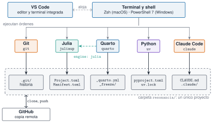

## Objetivos

- Instalar y **comprobar** terminal, Git, Julia, Quarto, `uv`, VS Code y Claude Code
- Clonar Resonancia e **instanciar** el entorno con `julia --project=.`
- Primera sesión de Claude Code **sin saltarse la confianza**
- Primer commit en una rama propia, **sin `push`**
- Diagnosticar fallos leyendo el mensaje entero

## Arquitectura del entorno

{fig-alt="La terminal lanza Git, Julia, Quarto, uv y Claude Code; cada herramienta lee sus ficheros en la carpeta del proyecto; Quarto ejecuta Julia con engine julia; GitHub es la copia remota."}

## Tres ideas para instalar

1. **Un gestor por sistema**: Homebrew (macOS), `winget` (Windows)
2. **Un entorno por lenguaje, dentro del proyecto**: `Project.toml` y `pyproject.toml`
3. **Comprobar cada paso** con `--version` en una terminal **nueva**

El curso usa `uv`, **no conda**.

## Orden y referencias

| Herramienta | Comprobación | Referencia |
|---|---|---|
| Git | `git --version` | 2.55.0 |
| Julia (`juliaup`) | `julia --version` | 1.12.3 |
| Quarto | `quarto check install` | 1.10.19 |
| `uv` | `uv --version` | 0.12.23 |
| Claude Code | `claude --version` | 2.1.304 |

Versiones de referencia: punto de partida, no exigencia.

## Windows: PowerShell 7 o WSL2

- Las órdenes del curso: **PowerShell 7 nativo** y Zsh en macOS
- **WSL2** solo si quieres el **sandbox** de Claude Code
- No mezcles: son dos copias con herramientas distintas

**Windows no se ha probado en la redacción.**

## Clonar e instanciar

```bash
git clone https://github.com/me1catrr/resonancia.git
cd resonancia
julia --project=. -e 'using Pkg; Pkg.instantiate()'
julia --project=. -e 'using Pkg; Pkg.status()'
```

- Ruta corta, sin espacios, fuera de OneDrive o iCloud
- Siempre desde la **raíz**: `--project=.` es «el proyecto de esta carpeta»
- Flechas **→** en `Pkg.status()`: falta instanciar

## Quarto ejecuta Julia

```bash
quarto check install
quarto render prueba.qmd --to html    # página mínima con engine: julia
```

`quarto check` sin argumentos revisa R, Python y Jupyter: **el curso no los usa**.

## Primera sesión de Claude Code

1. Terminal en la raíz y `git status --short` limpio
2. `claude`: lee la pregunta de **confianza** y acéptala solo en tu copia
3. `/status` y `/permissions`: anota modo y reglas
4. Prompt de **solo lectura** sobre `CLAUDE.md`
5. `/exit`

Nada de `/init`, ni de saltarse permisos.

## Qué configura el repositorio

- **Sin preguntar**: `julia --project=.`, `quarto render`, `git status/diff/log/show/add/commit`, `uv run`
- **Siempre pregunta**: `git push`, `quarto publish`, `Pkg.add`, `uv add`, `uv sync`
- **Bloqueado**: `datos/privados/`, `rm -rf`, `.env`
- **Windows nativo**: sin sandbox, más cuidado al aprobar

## Primer commit

```bash
git switch -c practica/l0-tu-usuario
git add _mi-entorno.md
git diff --staged --stat
git commit -m "Registra las versiones de mi entorno (L0)"
git show --stat HEAD
```

Rama propia, un solo fichero, **sin `push`**.

## Errores frecuentes

- `command not found`: terminal vieja o `PATH` → `which -a` / `Get-Command`
- `Package … is required but does not seem to be installed` → `Pkg.instantiate()`
- `Package Resonancia not found in current path` → carpeta equivocada; **no** `Pkg.add`
- Nunca `sudo` ni borrar `~/.julia` «para arreglarlo»

## La doy por superada si…

- Tengo las cinco versiones anotadas y la lista de verificación en verde
- `Pkg.status()` sin flechas y `Resonancia` apunta a `Resonancia.jl/`
- Conozco las reglas de `/permissions` antes de aprobar nada
- Mi commit contiene **un solo fichero** y no hay `push`
