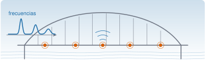
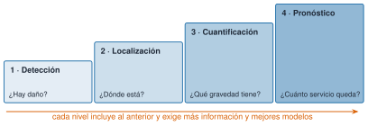
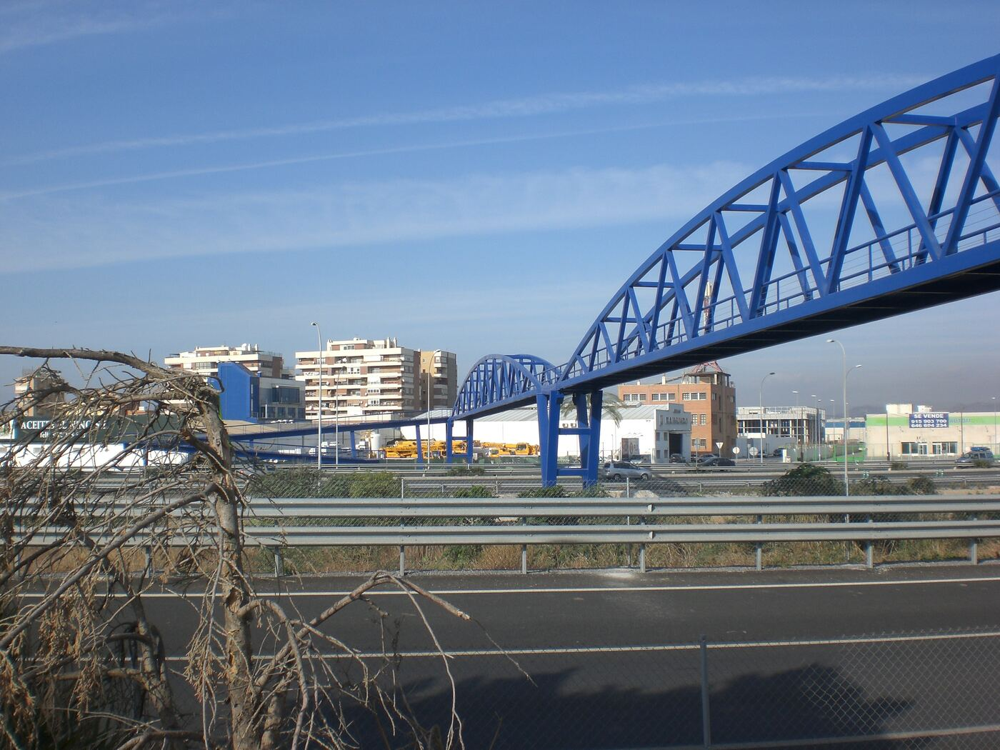
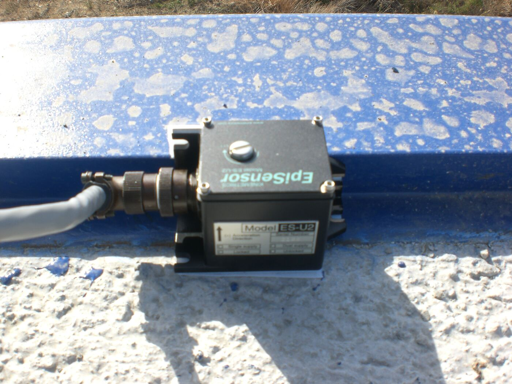
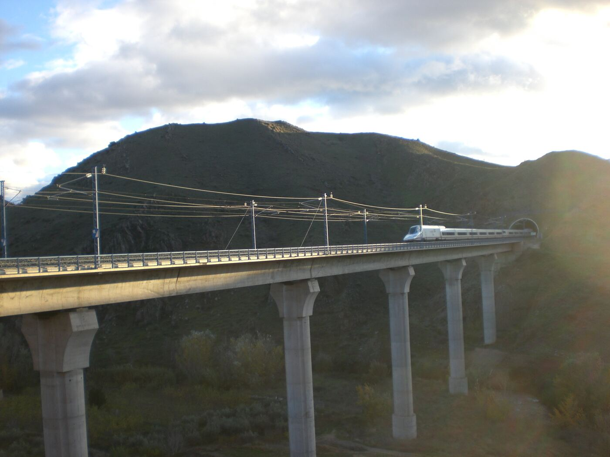
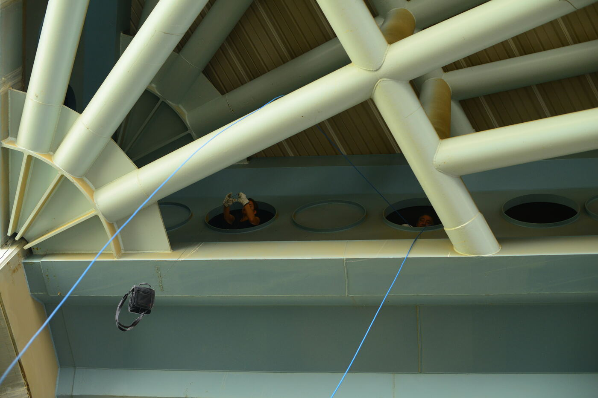
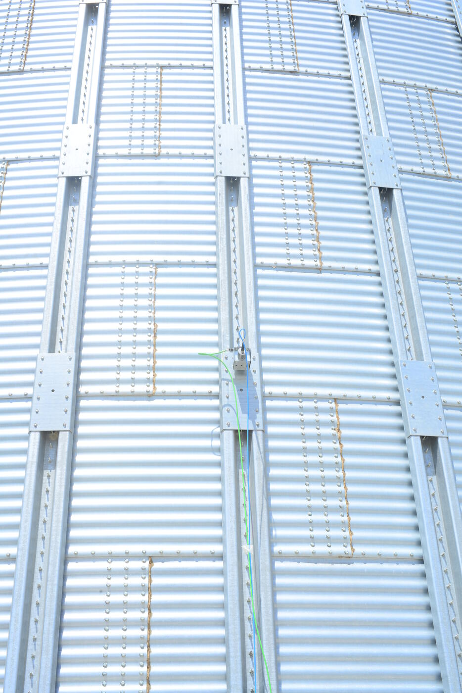

{.portada fig-alt="Ilustración de un puente en arco con cinco sensores en el tablero, una señal inalámbrica y un espectro con tres picos de frecuencia"}

## Objetivos y prerrequisitos

**Objetivos.** Al terminar la unidad sabrás:

- explicar qué es la monitorización de la salud estructural (*structural health monitoring*, SHM) y por qué compensa económicamente y en seguridad;
- distinguir los cuatro niveles de diagnóstico: detección, localización, cuantificación y pronóstico;
- describir el SHM como un proceso de reconocimiento de patrones, de la adquisición de datos a la decisión;
- elegir entre monitorización periódica o continua, y entre estática o dinámica, según el caso;
- reconocer estos conceptos en estructuras reales y rellenar una ficha de caso;
- orientarte por Resonancia: vías, itinerarios y cómo pedirle ayuda a Claude Code.

**Prerrequisitos.** [C0 · Fluidez en IA y uso responsable](../../claude/c0-fluidez/index.qmd). No se necesita programar: esta unidad es conceptual.

**Temas de la unidad**

- **M0.1** Qué es la monitorización de la salud estructural; motivación económica y de seguridad
- **M0.2** Niveles de diagnóstico: detección, localización, cuantificación y pronóstico
- **M0.3** El SHM como reconocimiento de patrones: adquisición, indicadores, modelo estadístico y decisión
- **M0.4** Monitorización periódica frente a continua, y estática frente a dinámica
- **M0.5** Casos de referencia: puentes, edificios, aerogeneradores, colectores solares
- **M0.6** Cómo usar Resonancia: vías, itinerarios y unidades con Claude Code

## Teoría breve

### M0.1 Qué es la monitorización de la salud estructural; motivación económica y de seguridad {#m0-1}

::: {#def-shm}
**Monitorización de la salud estructural (SHM).** Proceso de poner en marcha una estrategia para identificar daño en estructuras aeroespaciales, civiles o mecánicas [@farrar2007].
:::

::: {#def-dano}
**Daño.** Cualquier cambio en el material, en la geometría, en las condiciones de contorno o en la conectividad de una estructura que perjudique su comportamiento.
:::

Así, «daño» no significa solo grieta: una unión atornillada que se afloja y un apoyo que deja de deslizar son daños, aunque a simple vista no se vea nada.

Frente a la inspección visual periódica, el SHM mide la estructura mientras trabaja y compara lo
medido con un estado de referencia. Tres motivos lo justifican:

- **Seguridad.** Hay daños que no se ven desde fuera, o que aparecen entre dos inspecciones. El
  colapso del puente Morandi, en Génova (2018), y el del viaducto de la A-6 en Lugo, de unos 25 años
  de antigüedad, recuerdan que las estructuras fallan. Ninguno de estos casos prueba por sí solo
  que el SHM los hubiera evitado, pero ilustran el problema que quiere atacar.
- **Economía.** Sustituir el mantenimiento por calendario por un mantenimiento según el estado real
  (*condition-based maintenance*) evita intervenciones innecesarias y detecta a tiempo las
  necesarias.
- **Conocimiento.** Los datos medidos permiten contrastar y ajustar los modelos de cálculo con la
  estructura real, no con la de los planos.

Conviene no confundir el SHM con el ensayo no destructivo local (ultrasonidos, campos magnéticos,
inspección visual): estas técnicas necesitan saber dónde mirar, mientras que el enfoque global del
SHM, basado en la respuesta de toda la estructura, sirve para decidir dónde conviene inspeccionar
[@farrar2007; @doebling1996].

::: {.callout-note .noticia icon=false title="En las noticias: Génova, 14 de agosto de 2018"}
Un tramo del puente Morandi se derrumbó durante una tormenta y murieron 43 personas. La prensa de la época recogió que la corrosión de los tirantes había mermado su capacidad (un informe de expertos de febrero de 2018 la cifraba en torno al 20 %) y que el propio proyectista ya había advertido en 1979 de la necesidad de un mantenimiento constante por la corrosión. Las causas definitivas dependen del proceso judicial: **consulta fuentes recientes** antes de dar nada por cerrado. Es un caso que se cita al discutir qué habría aportado un sistema de monitorización.

<span class="fuentes-caja">Enlaces: [CBC News](https://amp.cbc.ca/news/world/mordani-bridge-collapse-1.4791439) · [Ponte Morandi collapse, Wikipedia](https://en.wikipedia.org/wiki/Ponte_Morandi_collapse) · [Gulf News (AP): «Experts knew Genoa bridge had weakened 20 %»](https://gulfnews.com/amp/story/world%2Feurope%2Freport-experts-knew-genoa-bridge-had-weakened-20-1.2268672). Consultado el 21-10-2026.</span>
:::

**Pon a prueba lo anterior.**

::: {.ejercicio tipo="vf" id="m0-1-visual" respuesta="falso"}
El SHM sustituye por completo a la inspección visual.

::: {.solucion}
**Falso.** Se complementan: el enfoque global del SHM no localiza por sí solo cada grieta, pero indica **dónde conviene inspeccionar**; y hay daños que la inspección visual no ve.
:::
:::

::: {.ejercicio tipo="opcion" id="m0-1-dano" respuesta="a,b" multiple="true"}
Marca **todos** los casos que se consideran «daño» en el sentido de SHM.

::: {.opciones}
- Una grieta que se abre en una unión soldada.
- Una unión atornillada que se afloja sin que se vea.
- Un descenso de 10 °C de la temperatura ambiente.
- Un camión pesado que cruza el puente.
:::

::: {.solucion}
Las **a** y **b**: cambian material, geometría o conectividad y perjudican el comportamiento. La temperatura y el tráfico son **condiciones ambientales y de operación** que también mueven los indicadores, pero no son daño (M0.3).
:::
:::

### M0.2 Niveles de diagnóstico: detección, localización, cuantificación y pronóstico {#m0-2}

La clasificación clásica de Rytter [@rytter1993], usada también en las revisiones de la literatura
[@doebling1996], ordena el diagnóstico en cuatro niveles. Cada uno **incluye** a los anteriores y
exige más información y mejores modelos:

| Nivel | Pregunta | Ejemplo en una pasarela metálica |
|---|---|---|
| 1. Detección | ¿Hay daño? | El primer modo baja de frecuencia respecto a la línea base. |
| 2. Localización | ¿Dónde está? | El cambio se concentra en un tercio del vano. |
| 3. Cuantificación | ¿Qué gravedad tiene? | Se estima una pérdida de rigidez en una unión. |
| 4. Pronóstico | ¿Cuánto tiempo de servicio queda? | Se proyecta la evolución del daño hasta un umbral de seguridad. |

{#fig-niveles fig-alt="Escalera de cuatro peldaños ascendentes: detección, localización, cuantificación y pronóstico, cada uno con su pregunta" width="100%"}

Algunos autores intercalan un nivel de *clasificación del tipo de daño* entre la localización y la
cuantificación. Lo importante es la lógica: **detectar es relativamente fácil; pronosticar exige
modelos físicos fiables y datos de la evolución del daño.** Por eso gran parte de los sistemas
reales se queda en el nivel 1 o 2, y Resonancia se centrará ahí antes de aspirar a más.

::: {.callout-note .historia icon=false title="Un poco de historia: dos referencias clásicas"}
La clasificación en cuatro niveles de la tesis de Rytter [@rytter1993] y la revisión de la bibliografía de Doebling y colaboradores, de Los Álamos [@doebling1996], son dos citas obligadas de la identificación de daño basada en vibraciones. Verás que casi todo lo posterior las toma como punto de partida.
:::

**Pon a prueba lo anterior.**

::: {.ejercicio tipo="opcion" id="m0-2-nivel" respuesta="a"}
La frecuencia del primer modo ha bajado un 4 % respecto de la línea base. ¿Qué nivel de diagnóstico se ha alcanzado **como máximo**?

::: {.opciones}
- Nivel 1: detección.
- Nivel 2: localización.
- Nivel 3: cuantificación.
- Nivel 4: pronóstico.
:::

::: {.solucion}
Nivel 1. Una única frecuencia global dice que **algo ha cambiado**, no dónde ni cuánto; para localizar hacen falta, por ejemplo, formas modales.
:::
:::

::: {.ejercicio tipo="vf" id="m0-2-incluye" respuesta="verdadero"}
Cada nivel de diagnóstico incluye a los anteriores y exige más información y mejores modelos.

::: {.solucion}
**Verdadero.** Para cuantificar hay que haber localizado, y para localizar, haber detectado; por eso la mayoría de los sistemas reales se queda en los niveles 1 o 2.
:::
:::

### M0.3 El SHM como reconocimiento de patrones: adquisición, indicadores, modelo estadístico y decisión {#m0-3}

Farrar y Worden proponen ver el SHM como un problema de **reconocimiento estadístico de patrones**
[@farrar2007; @farrar2012]. Esta visión sirve de columna vertebral a todo el curso, porque cada
unidad posterior encaja en una de sus etapas:

```{mermaid}
%%| fig-cap: "Etapas del SHM como reconocimiento de patrones y unidades de Resonancia donde se trabajan."
flowchart LR
    A["1 · Evaluación operativa<br/>(qué dañaría y qué se mide)"] --> B["2 · Adquisición,<br/>normalización y limpieza<br/>(M3, M4, M8)"]
    B --> C["3 · Extracción de indicadores<br/>(frecuencias, modos, amortiguamiento)<br/>(M5 a M7)"]
    C --> D["4 · Modelo estadístico<br/>(línea base y umbral)"]
    D --> E{"¿Se aparta de<br/>la línea base?"}
    E -- "sí" --> F["Alarma e inspección"]
    E -- "no" --> B
```

1. **Evaluación operativa.** Qué daños preocupan, qué condiciones de servicio y ambientales hay y
   qué limita la medición. Aquí se decide qué sensores hacen falta y dónde.
2. **Adquisición y limpieza.** Medir, muestrear, filtrar y descartar datos defectuosos. Una mala
   adquisición no se arregla después con un algoritmo mejor.
3. **Indicadores (*features*).** Reducir miles de muestras a pocas cifras sensibles al daño: por
   ejemplo, las frecuencias propias o los factores de amortiguamiento.
4. **Modelo estadístico.** Caracterizar cómo varía el indicador en la estructura sana y fijar
   cuándo un valor nuevo deja de ser compatible con ella.

Un detalle decisivo: la **temperatura, la carga de tráfico y otros factores ambientales también
mueven los indicadores**. Un SHM útil debe distinguir esos cambios de los causados por daño; si no,
generará falsas alarmas. Esa tarea de normalización reaparecerá en las unidades M7 y M12.

::: {.callout-tip .idea-clave title="Idea clave"}
El SHM **no mide un valor absoluto de «salud»**: compara un indicador con un estado de referencia (la línea base) y decide si la diferencia es compatible con la variabilidad normal.
:::

**Pon a prueba lo anterior.**

::: {.ejercicio tipo="numerico" id="m0-3-sigma" respuesta="3" tol="1%"}
En la estructura sana, la frecuencia del primer modo tiene media $2{,}00$ Hz y desviación típica $0{,}05$ Hz. Una medida nueva da $1{,}85$ Hz. ¿A cuántas desviaciones típicas de la media está (en valor absoluto)?

::: {.solucion}
$\lvert1{,}85-2{,}00\rvert/0{,}05=3$. Si la variabilidad sana fuera normal, solo un $0{,}3\,\%$ de las medidas sanas caería tan lejos: es un buen motivo para investigar, no una prueba de daño.
:::
:::

::: {.ejercicio tipo="vf" id="m0-3-temp" respuesta="falso"}
Una bajada de frecuencia indica siempre que hay daño.

::: {.solucion}
**Falso.** La temperatura, la carga de tráfico y otros factores ambientales **también mueven los indicadores**. Un SHM útil debe distinguir esos cambios de los causados por daño para no generar falsas alarmas.
:::
:::

::: {.ejercicio tipo="abierta" id="m0-3-etapas"}
Para una pasarela peatonal metálica, describe en una frase cada etapa del reconocimiento de patrones: evaluación operativa, adquisición y limpieza, indicadores y modelo estadístico.

::: {.rubrica}
- Indico qué daños preocupan (p. ej., uniones atornilladas) y qué se medirá.
- Cito la adquisición: sensores, muestreo y descarte de datos defectuosos.
- Propongo un indicador concreto (p. ej., frecuencia del primer modo vertical).
- Describo el modelo estadístico: variación del indicador en la estructura sana y umbral de alarma.
:::

::: {.solucion}
Evaluación: uniones atornilladas y vibraciones por peatones. Adquisición: acelerómetros en el centro de vano, con control de ruido y de huecos de registro. Indicador: frecuencia del primer modo vertical y amortiguamiento. Modelo: rango de variación de la frecuencia con la temperatura en la estructura sana y umbral de alarma.
:::
:::

### M0.4 Monitorización periódica frente a continua, y estática frente a dinámica {#m0-4}

Hay dos decisiones independientes:

| Criterio | Opción A | Opción B |
|---|---|---|
| **Frecuencia** | **Periódica**: campañas puntuales, con equipos que se instalan y se retiran. | **Continua**: sensores instalados de forma permanente, con registro y alarmas en tiempo real. |
| **Fenómeno** | **Estática**: variables que cambian despacio (flechas, inclinaciones, deformaciones, temperatura). | **Dinámica**: vibraciones, de las que se obtienen frecuencias, modos y amortiguamiento. |

Ninguna opción es «mejor» en general:

- La monitorización **periódica** es más barata y suficiente cuando el deterioro es lento o cuando
  solo se quiere una fotografía del estado y de las propiedades dinámicas.
- La **continua** compensa cuando el daño puede evolucionar rápido, cuando hay que separar el efecto
  ambiental del daño (hace falta ver ciclos diarios y estacionales) o cuando el coste de un fallo es
  muy alto.
- La monitorización **dinámica** es la que más protagonismo tiene en esta asignatura: una vibración
  medida con acelerómetros refleja la rigidez y la masa de **toda** la estructura, no de un punto.

**Pon a prueba lo anterior.**

::: {.ejercicio tipo="opcion" id="m0-4-estrategia" respuesta="b"}
Un puente ferroviario de alta velocidad con tráfico intenso y una línea base ya medida. ¿Qué estrategia es la más razonable?

::: {.opciones}
- Monitorización estática y periódica, una vez al año.
- Monitorización dinámica y continua, con alarmas.
- No monitorizar: basta con la inspección visual.
- Solo medir la temperatura.
:::

::: {.solucion}
La **b**: el coste de un fallo es alto, hay que separar el efecto del tráfico y de la temperatura (se necesitan ciclos diarios y estacionales) y la dinámica refleja la rigidez de **toda** la estructura.
:::
:::

### M0.5 Casos de referencia: puentes, edificios, aerogeneradores, colectores solares {#m0-5}

Ejemplos para tener en la cabeza durante el curso. Las fotos son de campañas del responsable
del curso y se muestran solo para ilustrar los conceptos.

**Puentes.**

{fig-alt="Pasarela peatonal metálica azul en arco sobre una autovía, con edificios al fondo"}

{fig-alt="Acelerómetro negro con conector, fijado sobre una barandilla metálica azul"}

{fig-alt="Viaducto de pilas altas en un valle montañoso, con un tren de alta velocidad sobre el tablero"}

**Edificios y estructuras de cubierta.**

{fig-alt="Nudo de barras tubulares claras bajo la cubierta de madera de un velódromo, con un cable azul"}

{fig-alt="Pared ondulada de un silo metálico, vista en vertical"}

**Aerogeneradores.** Son estructuras esbeltas con fuerzas aerodinámicas que actúan sobre palas en
rotación, justo en armónicos de la velocidad de giro. Esa excitación, imposible de aislar, impulsó
el uso de técnicas de análisis modal operacional en esta tecnología [@carne2010]; las veremos en M7.

**Colectores cilindro-parabólicos.** Es el caso real que acompañará a todo el curso. Lo abordaremos
en [M1 · Caso real I: la planta termosolar](../m01-caso-real-i/index.qmd) y lo retomaremos al final
del curso.

**Pon a prueba lo anterior.**

::: {.ejercicio tipo="investigacion" id="m0-5-caso"}
**Un caso real.** Busca una estructura (un puente, un edificio, un aerogenerador…) con un sistema de monitorización **permanente** y averigua qué magnitudes mide y para qué.

::: {.criterios}
- Localizo al menos **dos fuentes fiables** (artículo técnico, informe o web del gestor) y anoto autor, año y enlace.
- Identifico las magnitudes que se miden (aceleraciones, deformaciones, temperatura…) y cuántos sensores hay si consta.
- Explico qué decisión se toma con los datos (continuar seguimiento, inspección…).
- Compruebo cada dato en dos fuentes y descarto lo que no puedo localizar (C0.2).
:::

::: {.solucion}
No hay una única respuesta. Una buena ficha distingue lo **medido** de lo **inferido**, indica la fuente de cada dato y reconoce lo que no se ha podido comprobar.
:::
:::

### M0.6 Cómo usar Resonancia: vías, itinerarios y unidades con Claude Code {#m0-6}

Resonancia está organizada en cinco **vías**. La regla de reparto es simple: *el concepto se explica
en M, su implementación en J y su uso asistido con Claude en L*. Los contenidos no se duplican, se
enlazan.

| Vía | Qué encontrarás | Entrada |
|---|---|---|
| **M** | La ciencia: una unidad por sesión (M0 a M12) | [mse/](../index.qmd) |
| **J** | Julia para ingeniería, en tres niveles | [julia/](../../julia/index.qmd) |
| **C** | Claude y Claude Code (C0 a C9) | [claude/](../../claude/index.qmd) |
| **L** | Laboratorios y proyecto globalizador | [labs/](../../labs/index.qmd) |
| **R** | Datos, referencia del paquete, chuletas, glosario, bibliografía y mapa | [recursos/](../../recursos/index.qmd) |

**Itinerarios.** Según quién seas, no hace falta recorrerlo todo; el [mapa del curso](../../recursos/r6-mapa/index.qmd)
y el [README del repositorio](https://github.com/me1catrr/resonancia) los detallan.

**Cada unidad sigue la misma plantilla**, para que sepas dónde buscar cada cosa:

1. Objetivos y prerrequisitos.
2. Teoría breve.
3. Práctica guiada.
4. «Pídeselo a Claude»: un *prompt* y un apartado **Verifica** para comprobar lo que responde.
5. Ejercicios.
6. «La doy por superada si…»: criterios para saber que dominas la unidad.

Claude Code es un ayudante, no un oráculo: en cada unidad pedirás ayuda y aprenderás a
comprobarla. Lo viste en C0, y lo practicarás justo aquí abajo.

**Pon a prueba lo anterior.**

::: {.ejercicio tipo="encuesta" id="m0-6-estructura" texto="true"}
**Reflexión (no evaluada).** ¿Qué estructura de tu entorno te gustaría monitorizar y por qué? Escríbelo aquí; lo retomarás en la ficha de caso de la práctica guiada.
:::

## Práctica guiada

**Ficha de caso SHM.** Elige una estructura que conozcas (una pasarela de tu ciudad, el puente de
tu trayecto, una nave) o una de las fotos de M0.5 y rellena esta ficha. No hace falta saber
cálculo: se trata de aplicar M0.1–M0.5.

| Campo | Qué anotar |
|---|---|
| Estructura | Tipo, material, uso y por qué importa. |
| Daños preocupantes | Qué podría fallar o degradarse (M0.1). |
| Nivel objetivo | ¿Basta con detectar o necesitas localizar o cuantificar? (M0.2) |
| Qué medirías y dónde | Magnitud y puntos de medida (M0.3, etapa 1). |
| Indicador candidato | Una cifra que cambiaría si hay daño (M0.3, etapa 3). |
| Factores ambientales | Qué lo movería sin que haya daño (M0.3). |
| Estrategia | Periódica o continua; estática o dinámica, con justificación (M0.4). |

**Ejemplo resuelto: viaducto ferroviario (foto del Jalón).**

| Campo | Respuesta |
|---|---|
| Estructura | Viaducto de alta velocidad de hormigón, con pilas altas y tablero continuo. |
| Daños preocupantes | Pérdida de capacidad en apoyos, fisuración del tablero, asientos de pilas. |
| Nivel objetivo | Nivel 1 (detección) como mínimo; nivel 2 si se quiere dirigir la inspección. |
| Qué medirías y dónde | Aceleraciones verticales y transversales en el centro de los vanos y en cabeza de pila. |
| Indicador candidato | Frecuencia del primer modo vertical y amortiguamiento. |
| Factores ambientales | Temperatura, paso de trenes, viento. |
| Estrategia | Dinámica. Campañas periódicas para una línea base; continua si hay motivo para alarma. |

## «Pídeselo a Claude»

::: {.callout-tip title="Prompt"}
Actúa como tutor de ingeniería estructural. Explícame los cuatro niveles de identificación de daño
de Rytter (detección, localización, cuantificación y pronóstico) con un ejemplo de una pasarela
metálica para cada nivel. Después da tres referencias bibliográficas que pueda consultar, con
autores, año y revista o editorial, e indica cuáles puedes garantizar y cuáles no. No inventes
ninguna.

**Verifica.**

- Los cuatro niveles son los de M0.2 y están en el orden correcto: ¿mezcla niveles con *tipos de daño*?
- Cada referencia existe: búscala (editorial, repositorio de la universidad, Google Académico) y
  comprueba autores, año y título. Es el error típico de C0.2.
- Si cita a Rytter, comprueba que sea la tesis de Aalborg de 1993 y no una referencia de la que
  Claude tenga una versión distorsionada.
- Los ejemplos de pasarela son coherentes: ¿un cambio de frecuencia basta para localizar el daño?
:::

## Ejercicios

1. **Niveles.** Indica a qué nivel de diagnóstico (1 a 4) corresponde cada afirmación:
   a) «La frecuencia del primer modo ha bajado un 4 % respecto a la línea base.»
   b) «El cambio se concentra en el tercio central del vano.»
   c) «La pérdida de rigidez en la unión se estima en un 15 %.»
   d) «Con la evolución observada, la unión alcanzará el límite de seguridad en tres años.»

   ::: {.callout-note collapse="true" title="Solución"}
   a) Nivel 1, detección. b) Nivel 2, localización. c) Nivel 3, cuantificación. d) Nivel 4, pronóstico.
   :::

2. **Reconocimiento de patrones.** Para una pasarela peatonal metálica, describe en una frase cada
   etapa de la figura de M0.3: evaluación operativa, adquisición y limpieza, indicadores y modelo
   estadístico.

   ::: {.callout-note collapse="true" title="Solución orientativa"}
   Evaluación: preocupan las uniones atornilladas y las vibraciones por peatones. Adquisición:
   acelerómetros en el centro de vano, con control del ruido y de los huecos de registro.
   Indicadores: frecuencia del primer modo vertical y amortiguamiento. Modelo estadístico: rango
   de variación de la frecuencia con la temperatura en la estructura sana y umbral de alarma.
   :::

3. **Periódica o continua.** Justifica la opción más razonable en cada caso: (a) un puente
   ferroviario con tráfico intenso y una línea base ya medida; (b) la cubierta de un pabellón con
   uso esporádico, sin indicios de daño.

   ::: {.callout-note collapse="true" title="Solución orientativa"}
   (a) Continua o campañas muy frecuentes: el coste de un fallo es alto y hay que separar la
   influencia del tráfico y de la temperatura. (b) Periódica: bastan campañas espaciadas para
   comprobar que las propiedades dinámicas no cambian.
   :::

4. **Tu caso.** Entrega la ficha de la práctica guiada para una estructura de tu entorno.

## La doy por superada si…

- Puedo explicar con mis palabras qué es el SHM y en qué se diferencia de una inspección visual.
- Distingo los cuatro niveles y sé decir a cuál pertenece una afirmación dada.
- Dibujo las etapas del reconocimiento de patrones sin mirar y señalo qué falla si una etapa
  se hace mal.
- Justifico si un caso pide monitorización periódica o continua, estática o dinámica.
- He rellenado una ficha de caso con indicador candidato y factores ambientales.
- He comprobado las referencias que me dio Claude y descarto las que no existen.
- Sé encontrar en Resonancia mi itinerario y la plantilla de unidad.
