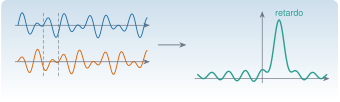

{.portada fig-alt="Dos señales idénticas desplazadas en el tiempo, una encima de otra, y a la derecha su correlación cruzada con un pico claro en el valor del retardo"}

La **correlación** mide cuánto se parecen dos señales cuando una se desplaza respecto de la otra. Con ella se estima un retardo (¿cuánto tarda la onda en llegar del sensor 1 al 2?), se mide la memoria de una señal (la autocorrelación) y —lo más importante para este módulo— **se extrae la respuesta libre de un sistema excitado con ruido**: la correlación de las respuestas de una estructura bajo excitación ambiental se comporta como una vibración libre que decae, y es el material de entrada de los métodos de identificación modal.

::: {.callout-note}
## Cómo se lee esta página
**Tiempo orientativo:** unas 3 horas. **Nivel:** intermedio. Tres capas: **intuición** (laboratorio de retardos), **fundamento** (definiciones, propiedades y estimación) y **aplicación** (identificar los modos del edificio a partir de correlaciones).
:::

```{julia}
#| include: false
using Resonancia, LinearAlgebra, Statistics, DelimitedFiles, Random, Printf, Markdown
include("../../../recursos/r1-datos/_tema.jl")
RUTA = "../../../datos/sinteticos/edificio-3-plantas/"
M3, C3, K3 = edificio_tres_plantas()
f3, _ = modos_propios(K3, M3)
```

## Objetivos y prerrequisitos

**Objetivos.** Al terminar esta página sabrás:

- definir covarianza, correlación, autocorrelación y correlación cruzada, y estimarlas con `autocorrelacion` y `correlacion_cruzada`;
- enunciar las propiedades de la autocorrelación (simetría, cota, Toeplitz semidefinida positiva) y el teorema de Wiener–Khinchin;
- estimar un retardo entre dos señales y decidir si un pico de correlación es significativo;
- explicar por qué, con excitación de ruido blanco, la correlación de las respuestas tiene la forma de una respuesta libre;
- aplicar ERA a correlaciones para estimar frecuencias y amortiguamientos de un edificio, y valorar la calidad del resultado;
- calcular la autocorrelación con la FFT.

**Prerrequisitos.** [M2.9](../estocasticos/index.qmd) (procesos estacionarios), [M2.5](../fourier/index.qmd) (DFT) y [M2.1.4–M2.1.5](../matrices/index.qmd#m2-1-4) (Toeplitz y Hankel).

## Teoría breve

### M2.10.1 Definiciones y estimación {#m2-10-1}

Para dos procesos estacionarios $x(t)$, $y(t)$ de media cero:

$$
r_{xx}(\tau)=\mathbb E[x(t)\,x(t+\tau)],\qquad r_{xy}(\tau)=\mathbb E[x(t)\,y(t+\tau)].
$$ {#eq-corr}

Con una realización de $N$ muestras se usa el estimador **sesgado** $\hat r_{xy}[k]=\frac1N\sum_{t}(x_t-\bar x)(y_{t+k}-\bar y)$ (división por $N$ y no por $N-k$: es el que garantiza que la matriz de Toeplitz resultante sea semidefinida positiva, [M2.1.4](../matrices/index.qmd#m2-1-4)). Si $y$ es una copia de $x$ retrasada $d$ muestras, $\hat r_{xy}$ tiene su máximo en $k=d$.

Propiedades:

- $r_{xx}(\tau)=r_{xx}(-\tau)$ (par) y $\lvert r_{xx}(\tau)\rvert\le r_{xx}(0)$; en cambio $r_{xy}(\tau)=r_{yx}(-\tau)$.
- **Wiener–Khinchin:** $S_{xx}(f)=\mathcal F\{r_{xx}\}$ y $S_{xy}(f)=\mathcal F\{r_{xy}\}$ (espectro cruzado). Es la relación que permite calcular la correlación con la FFT, en $O(N\log N)$: `autocorrelacion_fft` coincide con `autocorrelacion`.
- El **coeficiente de correlación** $\rho_{xy}[k]=\hat r_{xy}[k]/\sqrt{\hat r_{xx}[0]\hat r_{yy}[0]}\in[-1,1]$ no depende de la escala de las señales.
- Para **ruido blanco** de $N$ muestras, $\hat\rho[k]$ ($k\neq0$) es aproximadamente normal de media cero y desviación $1/\sqrt N$: una banda $\pm1{,}96/\sqrt N$ deja fuera del 95 % de los retardos de una señal sin estructura. Un pico dentro de esa banda **no** es significativo.

### M2.10.2 Estimar un retardo {#m2-10-2}

El retardo entre dos registros es la posición del máximo de $\hat r_{xy}$. Su **resolución** es una muestra ($1/f_{\mathrm s}$); con interpolación parabólica del máximo se puede bajar de la muestra si el pico es nítido. Pero cuidado: (1) una señal de **banda estrecha** (casi una sinusoide) tiene una correlación periódica, con muchos máximos equivalentes (ambigüedad de $T$); (2) el ruido ensancha o desplaza el máximo; (3) con tendencias o no estacionariedad aparecen correlaciones espurias.

### M2.10.3 La correlación como respuesta libre {#m2-10-3}

Sea un sistema $\mathbf x_{k+1}=\mathbf A\mathbf x_k+\mathbf w_k$, $\mathbf y_k=\mathbf C\mathbf x_k$ excitado por ruido blanco $\mathbf w_k$. Las covarianzas de la salida cumplen, para $\tau\ge1$,

$$
\boldsymbol\Lambda_\tau=\mathbb E[\mathbf y_{k+\tau}\mathbf y_k^{\mathsf T}]=\mathbf C\,\mathbf A^{\tau-1}\,\mathbf G,\qquad \mathbf G=\mathbf A\boldsymbol\Sigma\mathbf C^{\mathsf T},
$$ {#eq-lambda}

con $\boldsymbol\Sigma$ la covarianza del estado: es la misma forma que la respuesta impulsional $h_\tau=\mathbf C\mathbf A^{\tau-1}\mathbf B$ de [M2.1.5](../matrices/index.qmd#m2-1-5). Por eso **la sucesión de correlaciones decae y oscila con los mismos polos que la respuesta libre del sistema**, y se puede alimentar a ERA como si fuera una respuesta impulsional (es la idea de la técnica de excitación natural, NExT, y de SSI-COV; el desarrollo completo está en M7).

## Aplicación: los modos del edificio a partir de correlaciones

Con el escenario A del [caso transversal](../edificio/index.qmd), se calcula la correlación cruzada entre la aceleración de la cubierta y la de la planta 1 y, también, la autocorrelación de la cubierta:

```{julia}
#| label: fig-correlaciones
#| fig-cap: "Correlaciones de las aceleraciones del escenario A: autocorrelación de la cubierta (azul) y correlación cruzada cubierta → planta 1 (naranja), retardos de 0 a 8 s. Ambas son oscilaciones amortiguadas con las frecuencias del edificio; la cruzada tiene signos distintos según el modo y no es máxima en $\\tau=0$."
#| fig-alt: "Dos curvas oscilatorias que decaen en el tiempo. La azul empieza en su valor máximo; la naranja parte de un valor menor y oscila con otra fase."
D = readdlm(RUTA * "escenario_A.csv", ';', skipstart=1)
a1, a3 = D[:, 2], D[:, 4]
kmax = 800
r33 = correlacion_cruzada(a3, a3, kmax)[kmax+1:end]          # lags 0..kmax
r31 = correlacion_cruzada(a3, a1, kmax)[kmax+1:end]
τ = (0:kmax) ./ 100
fig = Figure(size=(780, 380))
ax = Axis(fig[1, 1]; xlabel="retardo τ (s)", ylabel="correlación ((m/s²)²)")
lines!(ax, τ, r33; color=AZUL, linewidth=1.6, label="r₃₃ (autocorrelación de la cubierta)")
lines!(ax, τ, r31; color=NARANJA, linewidth=1.6, label="r₃₁ (cubierta → planta 1)")
axislegend(ax; position=:rt)
fig
```

Con ellas como si fueran respuestas impulsionales, ERA ([M2.1.5](../matrices/index.qmd#m2-1-5)) estima frecuencias y amortiguamientos con orden $n=6$ (tres modos). Se compara con los valores verdaderos para los escenarios A y C:

```{julia}
#| label: tbl-era-corr
#| tbl-cap: "Frecuencias (Hz) y amortiguamientos (%) estimados aplicando ERA de orden 6 a la correlación cruzada cubierta → planta 1 (retardos 0 a 8 s), frente a los valores verdaderos de cada escenario."
function era_corr(esc)
    D = readdlm(RUTA * "escenario_$(esc).csv", ';', skipstart=1)
    c = correlacion_cruzada(D[:, 4], D[:, 2], kmax)[kmax+1:end]
    era(c, 6, 0.01)
end
filas = String[]
for e in (:A, :C)
    M, C, K = edificio_tres_plantas(escenario=e)
    fv, P = modos_propios(K, M)
    zv = diag(P' * C * P) ./ (2 .* 2π .* fv)
    fe, ze = era_corr(String(e))
    for j in 1:3
        push!(filas, "| $e | $j | $(coma(fv[j]; d=3)) | $(coma(fe[j]; d=3)) | $(coma(100 * zv[j]; d=2)) | $(coma(100 * ze[j]; d=2)) |")
    end
end
Markdown.parse("| Escenario | Modo | f verdadera | f estimada | ζ verdadero (%) | ζ estimado (%) |\n|:--:|:--:|--:|--:|--:|--:|\n" * join(filas, "\n"))
```

El resultado es notable por su sencillez: **sin conocer la fuerza**, las frecuencias salen con errores menores del $0{,}4\,\%$ (en ambos escenarios, incluido el cambio de $-1{,}85\,\%$ y $-3{,}1\,\%$ del daño), y los amortiguamientos con el orden de magnitud correcto pero con errores de hasta un $25\,\%$ (por ejemplo, $0{,}76\,\%$ frente a $1{,}00\,\%$ en el primer modo del escenario A). Es la pauta de siempre: las frecuencias son robustas; los amortiguamientos, no. Con un orden mayor, ERA incorpora **polos espurios** (en una prueba con $n=8$ aparece un cuarto polo de $2{,}9$ Hz y $\zeta$ distinto), que es lo que los diagramas de estabilización de M7 ayudan a descartar.

::: {.callout-warning}
## La correlación estima la respuesta libre solo si la excitación es blanca
La @eq-lambda exige que la fuerza sea ruido blanco (o suficientemente ancha respecto de los modos) y estacionaria. Con una excitación armónica (una máquina) la correlación contiene **su** frecuencia, que no decae, y se confunde con un modo de amortiguamiento nulo. Con una excitación no estacionaria, la correlación mezcla estados distintos ([M2.9](../estocasticos/index.qmd)).
:::

## Laboratorio: estimar un retardo {#lab-correlacion}

```{ojs}
//| echo: false
import {correlacionCruzada, rng, normal} from "../../../recursos/js/matematicas.js"
```

**Simulación 1. Retardo entre dos sensores.** La señal $x$ es ruido filtrado (un AR(1) con coeficiente $\phi$: cuanto mayor, más lenta); $y$ es $x$ retrasada $d$ muestras más ruido de medida independiente. Se muestra la correlación cruzada, la banda de significación $\pm1{,}96/\sqrt N$ y el retardo estimado (máximo).

```{ojs}
//| echo: false
viewof retardo = Inputs.range([-30, 30], {value: 12, step: 1, label: "retardo real d (muestras)"})
viewof phi_c = Inputs.range([0, 0.98], {value: 0.7, step: 0.01, label: "coeficiente φ de la señal"})
viewof ruido_c = Inputs.range([0, 4], {value: 1, step: 0.1, label: "ruido de medida (σ relativo a la señal)"})
viewof Nc = Inputs.select([128, 256, 512, 1024, 4096], {value: 512, label: "longitud N"})
```

```{ojs}
//| echo: false
cc = {
  const g = rng(21), N = Nc, m = 60, pad = 40;
  const e = Array.from({length: N + 2 * pad}, () => normal(g));
  const s = new Array(e.length); s[0] = e[0];
  for (let k = 1; k < e.length; k++) s[k] = phi_c * s[k - 1] + e[k];
  const sd = Math.sqrt(s.reduce((a, v) => a + v * v, 0) / s.length);
  const x = s.slice(pad, pad + N);
  const y = s.slice(pad - retardo, pad - retardo + N).map(v => v + ruido_c * sd * normal(g));
  const r = correlacionCruzada(x, y, m);
  const rho = r.map(v => v / Math.sqrt(correlacionCruzada(x, x, 0)[0] * correlacionCruzada(y, y, 0)[0]));
  const pts = rho.map((v, i) => ({k: i - m, v}));
  const pico = pts.reduce((a, b) => b.v > a.v ? b : a);
  return {pts, pico, banda: 1.96 / Math.sqrt(N)};
}
```

```{ojs}
//| echo: false
Plot.plot({
  width: 720, height: 300, marginLeft: 55, x: {label: "retardo k (muestras)"}, y: {label: "coeficiente de correlación ρ[k]", domain: [-1, 1]},
  marks: [
    Plot.ruleY([0]), Plot.ruleY([cc.banda, -cc.banda], {stroke: "#D95F02", strokeDasharray: "5,4"}),
    Plot.ruleX(cc.pts, {x: "k", y: "v", stroke: "#1B6CA8"}),
    Plot.dot([cc.pico], {x: "k", y: "v", fill: "#D95F02", r: 5})
  ]
})
```

```{ojs}
//| echo: false
md`**Retardo estimado:** **${cc.pico.k}** muestras (real: ${retardo}). Máximo de ρ: **${cc.pico.v.toFixed(2).replace(".", ",")}**; banda de significación: ±**${cc.banda.toFixed(3).replace(".", ",")}**. ${cc.pico.k === retardo ? "✓ Coincide." : "✗ No coincide: el máximo no es el retardo real."} ${cc.pico.v < 2 * cc.banda ? "⚠️ El pico apenas supera la banda: poco fiable." : ""}`
```

### Hipótesis y límites de la simulación 1 {#limites-sim1}

- **Señales:** un AR(1) con ruido de medida independiente y un retardo entero; semilla fija. En una estructura real, el retardo entre sensores depende de la frecuencia (dispersión) y no es entero.
- **Qué se observa:** con $\phi$ alto, el pico es ancho y la ubicación del máximo es menos precisa; con ruido grande o $N$ pequeño el pico se esconde en la banda; con $\phi$ casi 0 (ruido blanco) el pico es muy nítido.
- **Qué no se puede concluir:** que un retardo entre dos señales indique causalidad: la correlación mide parecido, no causa.

## Práctica guiada

::: {.callout-note}
## Práctica guiada

1. Calcula `autocorrelacion` y `autocorrelacion_fft` de la aceleración de la cubierta (retardos 0 a 800) y comprueba que coinciden y cuánto tarda cada una.
2. Calcula la correlación cruzada cubierta → planta 1 y aplica `era` con $n=6$ y $\Delta t=0{,}01$ s.
3. Compara con las frecuencias de `modos_propios` y repite para el escenario C.

::: {.panel-tabset}
## Julia

```julia
using Resonancia, DelimitedFiles
D = readdlm("escenario_A.csv", ';', skipstart=1)
a1, a3 = D[:, 2], D[:, 4]
r = autocorrelacion(a3, 800)
r_fft = autocorrelacion_fft(a3, 800)
maximum(abs.(r - r_fft))                     # ≈ 1e-15
c = correlacion_cruzada(a3, a1, 800)[801:end]
f, zeta = era(c, 6, 0.01)
```

## Python

```python
import numpy as np
import matrices as mx      # mse/m02-matematicas/python/matrices.py (probado con pytest)

D = np.loadtxt("escenario_A.csv", delimiter=";", skiprows=1)
a1, a3 = D[:, 1], D[:, 3]
c = mx.correlacion_cruzada(a3, a1, 800)[800:]
# ERA: matriz de Hankel de la correlación, SVD y valores propios de A (véase M2.1.5)
```
:::

El código Python **no se ejecuta en la web**: `correlacion_cruzada` está probada con `pytest` frente a Julia en [`python/matrices.py`](https://github.com/me1catrr/resonancia/blob/main/mse/m02-matematicas/python/matrices.py).
:::

## «Pídeselo a Claude» {#pideselo}

::: {.callout-tip}
## Prompt
«Con Julia y `Resonancia`: usa `escenario_A.csv`, `escenario_B.csv` y `escenario_C.csv`. Para cada uno, calcula la correlación cruzada cubierta → planta 1 hasta 8 s, aplica `era` con orden 6 y dime las tres frecuencias. Después repite con orden 8 y explica qué polos son espurios. Compara con las frecuencias de `edificio_tres_plantas` y no concluyas que hay daño sin calcular la dispersión de la estimación en varios tramos.»

**Verifica.** (a) Que usa la correlación cruzada (no la autocorrelación solamente) y el $\Delta t$ correcto (0,01 s). (b) Que solo se usan retardos positivos de la correlación como respuesta impulsional. (c) Que con orden 8 detecta un polo adicional que no coincide con ninguna frecuencia del modelo. (d) Que compara con los valores verdaderos de cada escenario. (e) Que no atribuye a daño un cambio de frecuencia menor que la dispersión entre tramos.
:::

## Ejercicios

::: {.ejercicio tipo="numerico" id="m2-10-banda" respuesta="0.062" tol="1%"}
Una señal de ruido blanco tiene $N=1000$ muestras. ¿Cuánto vale la banda de significación al 95 %, $1{,}96/\sqrt N$, de su coeficiente de correlación?

::: {.solucion}
$1{,}96/\sqrt{1000}=1{,}96/31{,}62=0{,}062$.
:::
:::

::: {.ejercicio tipo="numerico" id="m2-10-retardo" respuesta="25" tol="1%" unidad="m/s"}
Dos sensores separados $5$ m registran la misma onda; la correlación cruzada tiene su máximo en un retardo de $0{,}2$ s. ¿A qué velocidad se propaga la onda?

::: {.solucion}
$v=d/\tau=5/0{,}2=25$ m/s (suponiendo una sola onda no dispersiva).
:::
:::

::: {.ejercicio tipo="vf" id="m2-10-par" respuesta="verdadero"}
La autocorrelación de un proceso estacionario es una función par del retardo y alcanza su máximo en el retardo cero.

::: {.solucion}
**Verdadero**: $r(\tau)=r(-\tau)$ y $\lvert r(\tau)\rvert\le r(0)$ (desigualdad de Cauchy–Schwarz).
:::
:::

::: {.ejercicio tipo="abierta" id="m2-10-maquina"}
Un puente tiene una máquina cercana que vibra a 3,00 Hz de forma casi sinusoidal, y su primer modo está en 3,05 Hz. Calculas la correlación de la respuesta y le aplicas ERA. ¿Qué dificultades esperas?

::: {.rubrica}
- Digo que la excitación armónica viola la hipótesis de ruido blanco y que su correlación no decae.
- Señalo que ERA verá un polo de amortiguamiento casi nulo a 3,00 Hz que no es un modo.
- Menciono la dificultad de separar dos frecuencias tan próximas y propongo medir sin la máquina o identificar y eliminar la componente armónica.
:::

::: {.solucion}
La armónica aparece como un polo sin amortiguamiento que se puede confundir con un modo y que, además, está a solo $0{,}05$ Hz del modo real (mucha resolución necesaria). Se debe comprobar el amortiguamiento de los polos, usar mediciones con la máquina parada o métodos que identifiquen y eliminen armónicas.
:::
:::

## La doy por superada si…

- [ ] Estimo autocorrelaciones y correlaciones cruzadas y sé en qué retardos mirar.
- [ ] Decido si un pico de correlación es significativo con la banda $\pm1{,}96/\sqrt N$.
- [ ] Explico por qué la correlación de la respuesta a ruido blanco se comporta como una respuesta libre.
- [ ] Aplico ERA a correlaciones y valoro la calidad (frecuencias robustas, amortiguamientos poco fiables, polos espurios).
- [ ] Sé qué hipótesis de la excitación hacen falta y cuándo fallan.

## Qué no dice esta página

- La identificación completa (SSI-COV con múltiples referencias, diagramas de estabilización, incertidumbres) es de M7.
- Se usa una sola correlación cruzada y un orden fijo; en la práctica se utilizan matrices de correlaciones de varios sensores.
- La estimación de amortiguamientos es de un solo registro y semilla; no se ha cuantificado su dispersión con Monte Carlo.
- La técnica NExT se menciona como idea, sin citar el artículo original, que no se ha consultado.
