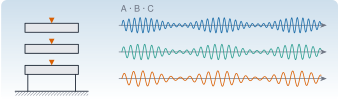
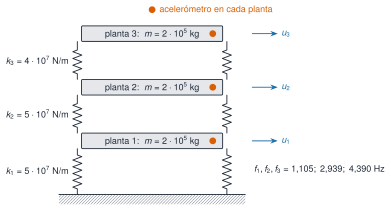

{.portada fig-alt="Un edificio de tres plantas con un acelerómetro en cada planta, junto a tres registros de aceleración de distinta frecuencia"}

Un único modelo, conocido al detalle, que se usa en todo el módulo: un **edificio de cortante de tres plantas** con tres acelerómetros. Al ser sintético, se sabe de antemano la respuesta correcta (frecuencias, amortiguamientos y formas modales), de modo que cada método de identificación y de detección de cambios se puede **validar** contra la verdad. Los datos son los de `datos/sinteticos/edificio-3-plantas/`; el código que los genera está en `scripts/m02/generar_edificio.jl`.

::: {.callout-note}
## Qué es y qué no es
Es un banco de pruebas, no un edificio real. Sirve para aprender y para comprobar que un algoritmo hace lo que dice; **no** demuestra que ese algoritmo funcione en una estructura real, con ruido coloreado, no linealidades y variaciones ambientales mucho más complejas. Para datos reales, véanse los puentes de [R1](../../../recursos/r1-datos/index.qmd).
:::

```{julia}
#| include: false
using Resonancia, LinearAlgebra, Statistics, DelimitedFiles, Printf, Markdown
include("../../../recursos/r1-datos/_tema.jl")
RUTA = "../../../datos/sinteticos/edificio-3-plantas/"
M3, C3, K3 = edificio_tres_plantas()
f3, Phi3 = modos_propios(K3, M3)
zeta3 = diag(Phi3' * C3 * Phi3) ./ (2 .* 2π .* f3)
```

## El modelo

{#fig-edificio fig-alt="Esquema de un edificio de tres plantas: tres losas rectangulares unidas al suelo y entre sí por muelles verticales a ambos lados, con las rigideces de cada entrepiso, un punto naranja que marca el acelerómetro de cada planta y flechas con los desplazamientos de cada una."}

Las ecuaciones son las de [M2.2](../valores-propios/index.qmd) y [M2.6](../espacio-estados/index.qmd): $\mathbf M\ddot{\mathbf u}+\mathbf C\dot{\mathbf u}+\mathbf K\mathbf u=\mathbf f(t)$, con $\mathbf M=m\mathbf I$, $\mathbf K$ tridiagonal (`edificio_cortante`) y amortiguamiento de Rayleigh $\mathbf C=\alpha\mathbf M+\beta\mathbf K$ elegido para que $\zeta=1\,\%$ en los dos primeros modos. Se excita con fuerzas de ruido blanco independientes en las tres plantas (desviación típica $2\cdot10^4$ N por muestra) y se mide la aceleración absoluta de cada planta a 100 Hz, con ruido de sensor de $0{,}002$ m/s².

```{julia}
#| label: tbl-modos
#| tbl-cap: "Propiedades modales verdaderas del escenario A."
filas = ["| $j | $(coma(f3[j]; d=3)) | $(coma(100 * zeta3[j]; d=2)) | $(join(coma.(Phi3[:, j] ./ Phi3[argmax(abs.(Phi3[:, j])), j]; d=3), "; ")) |" for j in 1:3]
Markdown.parse("| Modo | f (Hz) | ζ (%) | Forma (plantas 1; 2; 3) |\n|:--:|--:|--:|:--|\n" * join(filas, "\n"))
```

## Los tres escenarios

| Escenario | Qué representa | Cambio en el modelo | Archivo |
|:--|:--|:--|:--|
| **A** | Estado de referencia | ninguno | `escenario_A.csv` |
| **B** | Variabilidad ambiental (p. ej., temperatura) | las tres rigideces un $1\,\%$ menores | `escenario_B.csv` |
| **C** | Daño localizado | el entrepiso 2 pierde un $10\,\%$ de rigidez | `escenario_C.csv` |

: Escenarios del caso transversal. Cada registro dura 600 s a 100 Hz, con una semilla distinta. {#tbl-escenarios}

El **objetivo pedagógico** es la pregunta central de la monitorización: ¿un cambio de frecuencias es un daño o es variabilidad? En B todo cambia un poco y de forma coherente (las frecuencias bajan todas un $0{,}5\,\%$); en C cambia de forma desigual y las formas modales se alteran levemente.

```{julia}
#| label: tbl-cambios
#| tbl-cap: "Frecuencias verdaderas de cada escenario, variación respecto de A y MAC con las formas de A."
res = Dict{Symbol,Any}()
for e in (:A, :B, :C)
    M, _, K = edificio_tres_plantas(escenario=e)
    res[e] = modos_propios(K, M)
end
filas = String[]
for e in (:B, :C), j in 1:3
    f, P = res[e]
    push!(filas, "| $e | $j | $(coma(res[:A][1][j]; d=3)) | $(coma(f[j]; d=3)) | $(coma(100 * (f[j] / res[:A][1][j] - 1); d=2)) % | $(coma(mac(res[:A][2][:, j], P[:, j]); d=4)) |")
end
Markdown.parse("| Escenario | Modo | f en A (Hz) | f (Hz) | Δf/f | MAC |\n|:--:|:--:|--:|--:|--:|--:|\n" * join(filas, "\n"))
```

Las frecuencias del escenario C bajan $1{,}85\,\%$, $0{,}24\,\%$ y $3{,}11\,\%$ (de forma desigual, como predice la perturbación de [M2.2](../valores-propios/index.qmd)), y el MAC se mantiene por encima de $0{,}999$.

## Primer vistazo a los datos

```{julia}
#| label: fig-psd
#| fig-cap: "Densidad espectral de potencia (Welch, segmentos de 2048 muestras) de la aceleración de la cubierta en los tres escenarios. Las líneas grises son las frecuencias verdaderas del escenario A. Los tres picos están presentes en los tres registros y se desplazan poco; el desplazamiento del escenario C es visible en el primer y el tercer modo."
#| fig-alt: "Tres curvas de densidad espectral con tres picos cada una, en torno a 1,1, 2,9 y 4,4 hercios. Las curvas de los escenarios A y B casi coinciden y la del escenario C está desplazada ligeramente hacia frecuencias menores, sobre todo en el primer y el tercer pico."
datos = Dict(e => readdlm(RUTA * "escenario_$(e).csv", ';', skipstart=1) for e in ("A", "B", "C"))
fig = Figure(size=(780, 360))
ax = Axis(fig[1, 1]; xlabel="f (Hz)", ylabel="PSD (m/s²)²/Hz", yscale=log10, limits=(0.3, 6, nothing, nothing))
vlines!(ax, f3; color=GRIS, linestyle=:dash)
for (e, col) in (("A", AZUL), ("B", VERDE), ("C", NARANJA))
    x = datos[e][:, 4]
    f, P = psd_welch(x .- mean(x), 100.0; nseg=2048)
    lines!(ax, f, P; color=col, linewidth=1.5, label="escenario $e")
end
axislegend(ax; position=:rt)
fig
```

Para ver si el cambio se puede **detectar**, se estima la frecuencia de cada pico en 10 bloques de 60 s por escenario (Welch con interpolación parabólica del máximo) y se mira la media y la dispersión:

```{julia}
#| label: tbl-picos
#| tbl-cap: "Frecuencia estimada de cada pico en bloques de 60 s de la aceleración de la cubierta: media ± desviación típica entre los 10 bloques de cada escenario, frente al valor verdadero."
function pico(f, P, f0)
    idx = findall(x -> abs(x - f0) < 0.4, f)
    k = idx[argmax(P[idx])]
    a, b, c = log(P[k-1]), log(P[k]), log(P[k+1])
    return f[k] + 0.5 * (a - c) / (a - 2b + c) * (f[2] - f[1])
end
est = Dict()
for e in ("A", "B", "C")
    m = zeros(10, 3)
    for b in 1:10
        seg = datos[e][(b-1)*6000+1:b*6000, 4]
        f, P = psd_welch(seg .- mean(seg), 100.0; nseg=2048)
        for j in 1:3
            m[b, j] = pico(f, P, f3[j])
        end
    end
    est[e] = m
end
verdad = Dict(e => res[Symbol(e)][1] for e in ("A", "B", "C"))
filas = String[]
for e in ("A", "B", "C"), j in 1:3
    push!(filas, "| $e | $j | $(coma(verdad[e][j]; d=3)) | $(coma(mean(est[e][:, j]); d=3)) ± $(coma(std(est[e][:, j]); d=3)) |")
end
Markdown.parse("| Escenario | Modo | f verdadera (Hz) | f estimada (Hz) |\n|:--:|:--:|--:|:--|\n" * join(filas, "\n"))
```

Tres lecciones, con los números de la @tbl-picos:

- **La dispersión de un bloque de 60 s es de $0{,}01$–$0{,}04$ Hz**, y a veces mayor que el cambio buscado: con un solo bloque, el primer modo del escenario C ($-0{,}02$ Hz) apenas se distingue del A.
- **Con los 10 bloques sí.** El error típico de la media es unas $\sqrt{10}\approx3{,}2$ veces menor, y el cambio de C ($-1{,}9\,\%$ en el primer modo) queda claramente separado; el de B ($-0{,}5\,\%$, unos $0{,}005$ Hz) **no** se separa de la dispersión: con este método no se distingue de «no pasa nada».
- **La estimación tiene sesgo**: las medias de A no coinciden exactamente con la verdad (el tercer modo sale a unos $0{,}03$ Hz de ella, por la resolución del Welch y la cercanía del modo 2).

Es la antesala de M12: la detección útil exige **cuantificar la incertidumbre del estimador** y compararla con la variabilidad del estado sano, y no basta con ver que un número cambia.

## Cómo se usa el caso en el resto de M2

| Página | Qué se hace con el edificio |
|:--|:--|
| [M2.2](../valores-propios/index.qmd) | modos, sensibilidad y MAC |
| [M2.3](../svd/index.qmd) | POD de los tres sensores |
| [M2.4](../laplace/index.qmd) | receptancias, ceros y antirresonancias |
| [M2.6](../espacio-estados/index.qmd) | espacio de estados, observabilidad, simulación |
| [M2.7](../transformada-z/index.qmd) | polos con un modelo AR y polos espurios |

: Dónde aparece el edificio. En las fases siguientes se usará también para correlación, FDD, SSI y detección de cambios. {#tbl-usos}

## Práctica guiada

::: {.callout-note}
## Práctica guiada

1. Lee los tres registros y calcula el valor eficaz (RMS) de cada canal. ¿Se parecen entre escenarios?
2. Estima la PSD de la cubierta en A, B y C y localiza los tres picos con `buscar_picos`.
3. Compara con las frecuencias verdaderas de `modos_propios` y calcula el error relativo.
4. Divide cada registro en bloques de 60 s y mira la dispersión de la frecuencia del primer pico.

::: {.panel-tabset}
## Julia

```julia
using Resonancia, DelimitedFiles, Statistics
D = readdlm("escenario_A.csv", ';', skipstart=1)
t, a1, a2, a3 = eachcol(D)
f, P = psd_welch(a3 .- mean(a3), 100.0; nseg=2048)
picos = f[buscar_picos(f, P; fmin=0.5, fmax=6.0, n=3, separacion=0.5)]
```

## Python

```python
import numpy as np
from scipy import signal

D = np.loadtxt("escenario_A.csv", delimiter=";", skiprows=1)
f, P = signal.welch(D[:, 3] - D[:, 3].mean(), fs=100.0, nperseg=2048)
picos = f[signal.find_peaks(P, distance=20)[0]]
```
:::

El código Python **no se ejecuta en la web**; los modelos del edificio están probados con `pytest` en [`python/matrices.py`](https://github.com/me1catrr/resonancia/blob/main/mse/m02-matematicas/python/matrices.py).
:::

## «Pídeselo a Claude» {#pideselo}

::: {.callout-tip}
## Prompt
«Con Julia y `Resonancia`: lee `escenario_A.csv`, `escenario_B.csv` y `escenario_C.csv`. Para cada uno, divide la aceleración de la cubierta en bloques de 60 s, estima la frecuencia del primer pico con Welch e interpolación parabólica y dame media y desviación típica. Dime qué escenarios se distinguen del A con un criterio de dos desviaciones típicas de la media, y qué limitaciones tiene esa conclusión.»

**Verifica.** (a) Que usa `psd_welch` y `buscar_picos` del paquete. (b) Que compara contra las frecuencias verdaderas de `edificio_tres_plantas`. (c) Que usa el error típico de la media y no la desviación de un bloque al comparar medias. (d) Que dice que el sesgo del estimador existe y no lo oculta. (e) Que no llama «daño» a lo que solo es un cambio estadístico.
:::

## Ejercicios

::: {.ejercicio tipo="numerico" id="m2-edif-df-c" respuesta="-1.85" tol="2%" unidad="%"}
¿Cuánto varía, en porcentaje, la frecuencia del primer modo en el escenario C respecto del A?

::: {.solucion}
$-1{,}85\,\%$ ($1{,}105\to1{,}084$ Hz).
:::
:::

::: {.ejercicio tipo="opcion" id="m2-edif-modo-sensible" respuesta="c"}
¿Qué modo cambia más su frecuencia en el escenario C?

::: {.opciones}
- El primero.
- El segundo.
- El tercero.
- Los tres igual.
:::

::: {.solucion}
La **c**: $-3{,}11\,\%$ frente a $-1{,}85\,\%$ y $-0{,}24\,\%$; el tercer modo tiene la mayor deriva en el entrepiso 2.
:::
:::

::: {.ejercicio tipo="abierta" id="m2-edif-b-vs-c"}
¿Por qué se incluye un escenario B si el objetivo es detectar daño?

::: {.rubrica}
- Digo que en una estructura real las frecuencias cambian sin daño (temperatura, humedad, carga).
- Explico que un detector debe distinguir el cambio de C de la variabilidad de B, y no tomar todo cambio por daño.
- Menciono que sin ese contraste habría falsas alarmas.
:::

::: {.solucion}
B reproduce la variabilidad ambiental sana. Un método útil debe dar alarma en C y no en B; si no distingue ambos, tendría falsas alarmas o dejaría pasar el daño.
:::
:::

## La doy por superada si…

- [ ] Describo el modelo del edificio y sus tres escenarios.
- [ ] Obtengo las frecuencias de cada escenario a partir de los datos y las comparo con las verdaderas.
- [ ] Explico por qué hay que medir la dispersión del estimador antes de afirmar que algo cambió.
- [ ] Distingo variabilidad (B) de daño (C).

## Qué no dice esta página

- Los datos son sintéticos y lineales, con ruido blanco; no incluyen no linealidades, ruido coloreado ni efectos reales de la temperatura.
- La variabilidad ambiental se modela solo como un cambio uniforme de rigidez; en estructuras reales es más compleja.
- Los resultados de la tabla de picos son de un registro por escenario y una semilla; no se ha hecho un estudio de Monte Carlo.
- La detección con criterios estadísticos rigurosos se trata en M12.
