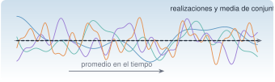

{.portada fig-alt="Cuatro realizaciones de colores distintos de un proceso aleatorio sobre un eje horizontal y una línea discontinua negra que representa su media de conjunto"}

La vibración ambiental de un puente o de un edificio (viento, tráfico, microtremores) no se repite: cada registro es **una realización** de un proceso aleatorio. No se puede predecir su valor en un instante, pero sí sus **propiedades estadísticas**: la media, la varianza, la autocorrelación, el espectro. La identificación modal con excitación ambiental se apoya en dos hipótesis sobre ese proceso, **estacionariedad** y **ergodicidad**, que casi nunca se comprueban y casi siempre se suponen. Esta página las define, muestra cómo fallan y cómo se detectan.

::: {.callout-note}
## Cómo se lee esta página
**Tiempo orientativo:** unas 3 horas. **Nivel:** intermedio. Tres capas: **intuición** (laboratorio con conjuntos de realizaciones), **fundamento** (definiciones y teoremas) y **aplicación** (registros del edificio y respuesta de un sistema lineal a ruido blanco).
:::

```{julia}
#| include: false
using Resonancia, LinearAlgebra, Statistics, DelimitedFiles, Random, Printf, Markdown
include("../../../recursos/r1-datos/_tema.jl")
```

## Objetivos y prerrequisitos

**Objetivos.** Al terminar esta página sabrás:

- calcular media, varianza y covarianza de variables aleatorias y distinguir correlación de independencia;
- definir un proceso estocástico, su media de conjunto y su autocorrelación;
- distinguir estacionariedad débil de ergodicidad y comprobar, con simulaciones, qué pasa si fallan;
- reconocer el ruido blanco y el AR(1) y calcular su autocorrelación;
- enunciar la relación entrada–salida de un sistema lineal con ruido blanco, $S_{yy}=\lvert H\rvert^2S_{ff}$, y su consecuencia para la identificación;
- evaluar la estacionariedad de un registro con estadísticas por ventanas.

**Prerrequisitos.** [J2.5 · Distribuciones y Monte Carlo](../../../julia/j2-datos/j2-5-montecarlo/index.qmd), [M2.5](../fourier/index.qmd) y [M2.1.4](../matrices/index.qmd#m2-1-4).

## Teoría breve

### M2.9.1 Variables aleatorias {#m2-9-1}

Una variable aleatoria $X$ se describe por su distribución; sus **momentos** más usados son la media $\mu=\mathbb E[X]$ y la varianza $\sigma^2=\mathbb E[(X-\mu)^2]$. Para dos variables, la **covarianza** $\operatorname{cov}(X,Y)=\mathbb E[(X-\mu_X)(Y-\mu_Y)]$ y el **coeficiente de correlación** $\rho=\operatorname{cov}/(\sigma_X\sigma_Y)\in[-1,1]$ miden la dependencia **lineal**. Independencia implica $\rho=0$, pero no a la inversa (si $X\sim\mathcal N(0,1)$ e $Y=X^2$, son dependientes y $\rho=0$). La **distribución normal** es la protagonista por el teorema central del límite: la suma de muchos efectos pequeños e independientes (el viento sobre un puente) tiende a ser gaussiana, lo que hace que el ruido ambiental sea, con frecuencia, aproximadamente gaussiano.

Un vector aleatorio $\mathbf X$ tiene **matriz de covarianza** $\boldsymbol\Sigma=\mathbb E[(\mathbf X-\boldsymbol\mu)(\mathbf X-\boldsymbol\mu)^{\mathsf T}]$, simétrica y semidefinida positiva ([M2.1.2](../matrices/index.qmd#m2-1-2)); sus vectores propios son las direcciones principales, que es lo que calcula la POD de [M2.3](../svd/index.qmd).

### M2.9.2 Procesos estocásticos {#m2-9-2}

::: {#def-proceso}
**Proceso estocástico.** Una familia de variables aleatorias $\{X(t)\}$ indexada por el tiempo. Una **realización** es una trayectoria $x(t)$ concreta: lo que medimos. La **media de conjunto** es $\mu(t)=\mathbb E[X(t)]$ (se promedia entre realizaciones, en un instante fijo) y la **autocovarianza** es $C(t_1,t_2)=\operatorname{cov}(X(t_1),X(t_2))$.
:::

::: {#def-estacionario}
**Estacionariedad débil.** $\mu(t)=\mu$ constante y $C(t_1,t_2)=r(t_2-t_1)$ depende solo del retardo. Es la que se necesita en este curso. Tiene dos consecuencias: la varianza $r(0)$ es constante, y la autocorrelación $r(\tau)$ es una función par de $\tau$ y define el espectro por el teorema de Wiener–Khinchin, $S(f)=\int r(\tau)e^{-\mathrm j2\pi f\tau}\mathrm d\tau$.
:::

::: {#def-ergodico}
**Ergodicidad.** Un proceso estacionario es **ergódico** (en media y en autocorrelación) si los promedios **en el tiempo** de **una sola realización** convergen a los promedios **de conjunto**: $\frac1T\int_0^Tx(t)\,\mathrm dt\to\mu$ y $\frac1T\int_0^Tx(t)x(t+\tau)\,\mathrm dt\to r(\tau)$ cuando $T\to\infty$.
:::

La ergodicidad es lo que justifica la práctica de **estimar el espectro de un puente con un único registro de unas horas**: se acepta que el promedio temporal representa a los infinitos registros posibles. Es una hipótesis, no un hecho, y falla de dos maneras sencillas:

- **No estacionario:** el proceso cambia con el tiempo (un paseo aleatorio, cuya varianza crece con $t$; o una excitación que varía con el tráfico).
- **Estacionario pero no ergódico:** cada realización tiene su propio nivel (una constante aleatoria $B$ más ruido: la media de conjunto es 0, pero cada registro tiene media $B$).

Dos procesos de referencia:

- **Ruido blanco** $e[k]$: variables independientes de media 0 y varianza $\sigma^2$; $r(0)=\sigma^2$ y $r(\tau)=0$ si $\tau\neq0$; espectro plano. Es una idealización (energía infinita en continuo), válida cuando es más ancho que el sistema que excita.
- **AR(1):** $x[k]=\phi\,x[k-1]+e[k]$, con $\lvert\phi\rvert<1$; es estacionario si se inicia en su distribución estacionaria, con $r(\tau)=\dfrac{\sigma^2\phi^{\lvert\tau\rvert}}{1-\phi^2}$. Es el proceso del apartado [M2.1.4](../matrices/index.qmd#m2-1-4).

### M2.9.3 Respuesta de un sistema lineal a ruido blanco {#m2-9-3}

Si un sistema lineal estable con respuesta en frecuencia $H(\mathrm j\omega)$ se excita con un proceso estacionario de espectro $S_{ff}$, la salida es estacionaria y

$$
S_{yy}(\omega)=\lvert H(\mathrm j\omega)\rvert^2\,S_{ff}(\omega).
$$ {#eq-syy}

Si $S_{ff}$ es **constante** (ruido blanco), la forma del espectro de la salida es la de $\lvert H\rvert^2$: los picos de la salida son las resonancias del sistema. **Es la hipótesis de la identificación modal ambiental** (FDD, SSI, ERA sobre covarianzas): no se mide la fuerza, y se supone que es blanca (o que su color no tiene picos que se confundan con los modos). Y si no lo es (una máquina que gira, un tren que pasa), aparecen picos que **no son modos**.

## Qué falla cuando la hipótesis no se cumple

```{julia}
#| label: ej-conjunto
Random.seed!(2026)
nreal, T = 400, 400
φ = 0.9
function ar1(φ, T)
    x = zeros(T)
    x[1] = randn() / sqrt(1 - φ^2)                 # estado estacionario
    for k in 2:T
        x[k] = φ * x[k-1] + randn()
    end
    x
end
estacionario = reduce(hcat, [ar1(φ, T) for _ in 1:nreal])          # T × nreal
paseo = cumsum(randn(T, nreal); dims=1)
constante = randn(1, nreal) .+ randn(T, nreal)                     # nivel aleatorio por realización
resumen(X) = (media_conjunto_t200 = mean(X[200, :]), var_conjunto_t100 = var(X[100, :]), var_conjunto_t400 = var(X[400, :]),
              media_temporal_real1 = mean(X[:, 1]), desv_media_temporal = std(vec(mean(X; dims=1))))
(AR1 = resumen(estacionario), paseo_aleatorio = resumen(paseo), nivel_aleatorio = resumen(constante))
```

```{julia}
#| label: tbl-ergodico
#| tbl-cap: "Estadísticas de conjunto (400 realizaciones, por instante) frente a estadísticas temporales (por realización, 400 muestras). Para el AR(1), ambas coinciden; para el paseo aleatorio, la varianza crece con $t$; para el nivel aleatorio, la media temporal de cada realización es distinta."
r = [resumen(estacionario), resumen(paseo), resumen(constante)]
nom = ["AR(1), φ = 0,9", "paseo aleatorio", "nivel aleatorio + ruido"]
filas = ["| $(nom[i]) | $(coma(r[i].var_conjunto_t100; d=2)) | $(coma(r[i].var_conjunto_t400; d=2)) | $(coma(r[i].desv_media_temporal; d=2)) |" for i in 1:3]
Markdown.parse("| Proceso | varianza de conjunto en t = 100 | en t = 400 | dispersión de la media temporal entre realizaciones |\n|:--|--:|--:|--:|\n" * join(filas, "\n"))
```

La @tbl-ergodico lo resume. El AR(1) estacionario tiene varianza $\sigma^2/(1-\phi^2)=5{,}26$ en cualquier instante, y las medias temporales de las distintas realizaciones son casi iguales (dispersión pequeña, que baja al alargar el registro): es **estacionario y ergódico**. El paseo aleatorio tiene varianza $\approx t$ (100 y 400): **no es estacionario**. Y el nivel aleatorio tiene varianza de conjunto constante (2) pero cada realización tiene una media temporal distinta (dispersión $\approx1$): **estacionario y no ergódico**. En los dos últimos, **un registro no representa al proceso**.

## Laboratorio: conjuntos de realizaciones {#lab-estocasticos}

```{ojs}
//| echo: false
import {rng, normal} from "../../../recursos/js/matematicas.js"
```

**Simulación 1. Estacionariedad y ergodicidad.** Elige un proceso y el número de realizaciones. Se dibujan las realizaciones (líneas finas), la **media de conjunto** (negra) con su banda $\pm1$ desviación, y la **media temporal** de la primera realización (naranja).

```{ojs}
//| echo: false
viewof proceso = Inputs.select(["AR(1) estacionario", "Paseo aleatorio (no estacionario)", "Nivel aleatorio + ruido (no ergódico)"], {label: "proceso"})
viewof phi_lab = Inputs.range([0, 0.98], {value: 0.9, step: 0.01, label: "φ (solo AR(1))"})
viewof nr = Inputs.range([5, 300], {value: 100, step: 5, label: "realizaciones"})
```

```{ojs}
//| echo: false
conjunto = {
  const T = 300, g = rng(7);
  const reales = Array.from({length: nr}, () => {
    const x = new Array(T);
    if (proceso.startsWith("AR")) { x[0] = normal(g) / Math.sqrt(1 - phi_lab ** 2); for (let k = 1; k < T; k++) x[k] = phi_lab * x[k - 1] + normal(g); }
    else if (proceso.startsWith("Paseo")) { x[0] = normal(g); for (let k = 1; k < T; k++) x[k] = x[k - 1] + normal(g); }
    else { const b = 2 * normal(g); for (let k = 0; k < T; k++) x[k] = b + normal(g); }
    return x;
  });
  const media = Array.from({length: T}, (_, k) => reales.reduce((s, x) => s + x[k], 0) / nr);
  const sd = Array.from({length: T}, (_, k) => Math.sqrt(reales.reduce((s, x) => s + (x[k] - media[k]) ** 2, 0) / nr));
  const mt = reales[0].reduce((a, v) => a + v, 0) / T;
  return {reales, media, sd, mt, T};
}
```

```{ojs}
//| echo: false
Plot.plot({
  width: 720, height: 360, marginLeft: 50, x: {label: "instante k"}, y: {label: "x"},
  marks: [
    ...conjunto.reales.slice(0, 15).map(x => Plot.line(x.map((v, k) => ({k, v})), {x: "k", y: "v", stroke: "#9CA3AF", strokeWidth: 0.7})),
    Plot.areaY(conjunto.media.map((m, k) => ({k, lo: m - conjunto.sd[k], hi: m + conjunto.sd[k]})), {x: "k", y1: "lo", y2: "hi", fill: "#1B6CA8", fillOpacity: 0.18}),
    Plot.line(conjunto.media.map((v, k) => ({k, v})), {x: "k", y: "v", stroke: "#1F2937", strokeWidth: 2}),
    Plot.ruleY([conjunto.mt], {stroke: "#D95F02", strokeWidth: 2, strokeDasharray: "6,4"})
  ]
})
```

```{ojs}
//| echo: false
md`**Media de conjunto** en el instante final: **${conjunto.media[conjunto.T - 1].toFixed(2).replace(".", ",")}**. **Media temporal** de la realización 1: **${conjunto.mt.toFixed(2).replace(".", ",")}**. **Desviación de conjunto** en k = 50 y k = 299: **${conjunto.sd[50].toFixed(2).replace(".", ",")}** y **${conjunto.sd[conjunto.T - 1].toFixed(2).replace(".", ",")}**. ${Math.abs(conjunto.sd[conjunto.T - 1] / conjunto.sd[50] - 1) > 0.35 ? "⚠️ La varianza **cambia con el tiempo**: no es estacionario." : Math.abs(conjunto.mt - conjunto.media[conjunto.T - 1]) > 0.6 * conjunto.sd[conjunto.T - 1] ? "⚠️ La media temporal de esta realización **no coincide** con la de conjunto: no es ergódico." : "La media temporal y la de conjunto concuerdan: compatible con estacionario y ergódico."}`
```

### Hipótesis y límites de la simulación 1 {#limites-sim1}

- **Procesos:** tres modelos mínimos con semilla fija. Los datos reales mezclan varios efectos (tráfico, viento, temperatura).
- **Criterio automático:** el aviso usa umbrales sencillos (varianza que cambia más de un 35 % entre $k=50$ y el final; media temporal alejada más de $0{,}6\sigma$) que no son un contraste estadístico: sirven de guía visual.
- **Qué se observa:** con $\phi$ alto el AR(1) tarda más en «olvidar»: las medias temporales de registros cortos se dispersan más (la ergodicidad se cumple, pero necesita **más tiempo**).
- **Qué no se puede concluir:** que un registro «parezca estacionario» demuestre que lo sea; se pueden detectar incumplimientos, no probar su ausencia.

## Aplicación: el registro del edificio

La excitación del edificio sintético es de ruido blanco estacionario, de modo que su aceleración debe ser estacionaria y ergódica. Se comprueba mirando el valor eficaz (RMS) por bloques de 60 s, y se contrasta con una versión **no estacionaria** en la que la intensidad de la excitación crece un $50\,\%$ a lo largo del registro (como si el tráfico fuera aumentando):

```{julia}
#| label: fig-rms
#| fig-cap: "Valor eficaz de la aceleración de la cubierta (escenario A) en bloques de 60 s. Azul: registro original, estacionario; naranja: el mismo registro con una ganancia que crece linealmente de 1 a 1,5. La variación entre bloques del primero es la propia del muestreo del ruido (unos $\\pm5\\,\\%$); la del segundo es sistemática y es una **tendencia**."
#| fig-alt: "Dos series de diez puntos: la azul fluctúa alrededor de un valor constante; la naranja crece de forma casi lineal."
D = readdlm("../../../datos/sinteticos/edificio-3-plantas/escenario_A.csv", ';', skipstart=1)
x = D[:, 4]
ganancia = range(1.0, 1.5; length=length(x))
xn = x .* ganancia
_, r1 = rms_por_ventana(x, 100.0, 60.0)
tt, r2 = rms_por_ventana(xn, 100.0, 60.0)
fig = Figure(size=(720, 320))
ax = Axis(fig[1, 1]; xlabel="t (s)", ylabel="RMS (m/s²)", limits=(0, 600, 0, nothing))
scatterlines!(ax, tt, r1; color=AZUL, linewidth=2, label="estacionario")
scatterlines!(ax, tt, r2; color=NARANJA, linewidth=2, label="con ganancia creciente")
axislegend(ax; position=:lt)
fig
```

Los bloques del registro estacionario varían entre $\pm$`{julia} coma(100 * (maximum(r1) - minimum(r1)) / (2 * mean(r1)); d=0)` % de la media, sin tendencia; con la ganancia creciente, el RMS pasa de `{julia} coma(r2[1]; d=3)` a `{julia} coma(r2[end]; d=3)` m/s². **Si se calcula un solo espectro de todo el registro no estacionario, se mezclan estados de excitación distintos**; la solución es trabajar con bloques cortos o normalizar.

## Práctica guiada

::: {.callout-note}
## Práctica guiada

1. Genera 400 realizaciones de un AR(1) con $\phi=0{,}9$ y compara la varianza de conjunto con la teórica $1/(1-\phi^2)$.
2. Estima la autocorrelación de una realización con `autocorrelacion` y compárala con $\phi^\tau/(1-\phi^2)$.
3. Calcula el RMS por bloques de 60 s del escenario A y comprueba que no hay tendencia.

::: {.panel-tabset}
## Julia

```julia
using Resonancia, Random, Statistics
Random.seed!(1)
phi = 0.9
x = zeros(40_000); x[1] = randn() / sqrt(1 - phi^2)
for k in 2:length(x); x[k] = phi * x[k-1] + randn(); end
r = autocorrelacion(x, 5)
teorica = [phi^k / (1 - phi^2) for k in 0:5]
```

## Python

```python
import numpy as np
import matrices as mx      # mse/m02-matematicas/python/matrices.py (probado con pytest)

rng = np.random.default_rng(1)
phi = 0.9
x = np.zeros(40_000)
x[0] = rng.standard_normal() / np.sqrt(1 - phi**2)
for k in range(1, len(x)):
    x[k] = phi * x[k - 1] + rng.standard_normal()
r = mx.autocorrelacion(x, 5)
teorica = [phi**k / (1 - phi**2) for k in range(6)]
```
:::

El código Python **no se ejecuta en la web**: `autocorrelacion` está probada con `pytest` frente a Julia en [`python/matrices.py`](https://github.com/me1catrr/resonancia/blob/main/mse/m02-matematicas/python/matrices.py).
:::

## «Pídeselo a Claude» {#pideselo}

::: {.callout-tip}
## Prompt
«Con Julia y `Resonancia`: carga `escenario_A.csv` y comprueba la estacionariedad de la aceleración de la cubierta: (1) RMS por bloques de 60 s con `rms_por_ventana`; (2) la autocorrelación en dos mitades del registro y su diferencia; (3) una regresión del RMS de los bloques sobre el tiempo con su intervalo de confianza. Después aplica una ganancia que crece de 1 a 1,5 y repítelo. Dime qué se detecta y qué no.»

**Verifica.** (a) Que usa `rms_por_ventana` y `autocorrelacion` del paquete. (b) Que cuantifica la tendencia con un intervalo de confianza en vez de decir «parece que sube». (c) Que no concluye ergodicidad de una comprobación visual. (d) Que explica por qué la dispersión de los bloques estacionarios no es una tendencia. (e) Que indica la semilla o los datos exactos.
:::

## Ejercicios

::: {.ejercicio tipo="vf" id="m2-9-correlacion-indep" respuesta="falso"}
Si dos variables aleatorias tienen coeficiente de correlación $\rho=0$, entonces son independientes.

::: {.solucion}
**Falso.** $\rho=0$ solo excluye dependencia lineal. Con $X\sim\mathcal N(0,1)$ e $Y=X^2$ se tiene $\rho=0$ y $Y$ depende totalmente de $X$.
:::
:::

::: {.ejercicio tipo="numerico" id="m2-9-var-ar1" respuesta="5.263" tol="1%"}
Un AR(1) con $\phi=0{,}9$ y ruido de varianza $\sigma^2=1$ es estacionario. ¿Cuánto vale su varianza $r(0)$?

::: {.solucion}
$r(0)=\sigma^2/(1-\phi^2)=1/0{,}19=5{,}263$.
:::
:::

::: {.ejercicio tipo="numerico" id="m2-9-r1" respuesta="4.737" tol="1%"}
Para el AR(1) anterior, ¿cuánto vale la autocovarianza en el retardo 1?

::: {.solucion}
$r(1)=\phi\,r(0)=0{,}9\cdot5{,}263=4{,}737$.
:::
:::

::: {.ejercicio tipo="opcion" id="m2-9-no-ergodico" respuesta="b"}
Una máquina mide siempre con un sensor cuyo cero (offset) es distinto cada vez que se enciende, pero constante durante cada medida. El proceso «aceleración medida»:

::: {.opciones}
- no es estacionario, porque la media cambia con el tiempo.
- puede ser estacionario y no ergódico: la media de conjunto es 0, pero cada registro tiene su propio nivel.
- es ergódico siempre que el registro sea largo.
- es ruido blanco.
:::

::: {.solucion}
La **b**. La media de conjunto es constante, pero la media temporal de cada registro es el offset de esa medida; ningún registro, por largo que sea, representa al conjunto.
:::
:::

::: {.ejercicio tipo="abierta" id="m2-9-tren"}
Mides un puente que tiene una línea de tren cercana. Aparece un pico estrecho a 4,2 Hz que no estaba en la medición del día anterior. ¿Qué hipótesis de la identificación modal ambiental pones en duda y qué comprobarías?

::: {.rubrica}
- Digo que se supone excitación de ruido blanco estacionario y que un tren no lo es (aporta energía en frecuencias concretas y es transitoria).
- Propongo comprobar si el pico aparece solo mientras pasa el tren (bloques cortos, RMS por ventana).
- Menciono que un pico de excitación no es un modo y que hay que contrastar con la forma modal o con otra medida.
:::

::: {.solucion}
Se duda de que la excitación sea blanca y estacionaria. Se miran bloques cortos y su RMS para ver si el pico es transitorio, y se comprueba con la forma modal (un modo tiene forma coherente en todos los sensores; una excitación armónica local, no necesariamente) o repitiendo la medida sin tren.
:::
:::

## La doy por superada si…

- [ ] Calculo e interpreto media, varianza, covarianza y correlación, sabiendo que $\rho=0$ no es independencia.
- [ ] Defino proceso estocástico, estacionariedad débil y ergodicidad.
- [ ] Doy ejemplos de procesos no estacionarios y no ergódicos y los reconozco en simulaciones.
- [ ] Calculo la autocorrelación de un AR(1) y del ruido blanco.
- [ ] Aplico $S_{yy}=\lvert H\rvert^2S_{ff}$ y explico por qué la identificación ambiental supone ruido blanco.
- [ ] Compruebo la estacionariedad de un registro con estadísticas por bloques.

## Qué no dice esta página

- No se desarrolla la teoría de la medida de los procesos estocásticos ni los teoremas ergódicos.
- La comprobación por bloques no es un contraste de hipótesis; los contrastes formales (de raíz unitaria, de estacionariedad) no se tratan.
- Los procesos simulados son de semilla fija y de tamaño modesto; las cifras de la @tbl-ergodico cambian con la semilla (no su orden de magnitud).
- No se estudian procesos no gaussianos ni no lineales ni la excitación armónica superpuesta, que en puentes reales es frecuente.
