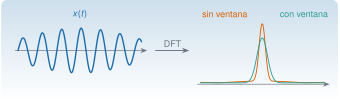

{.portada fig-alt="Una señal sinusoidal modulada a la izquierda y, a la derecha, dos espectros del mismo pico: uno con lóbulos laterales largos, sin ventana, y otro más estrecho y limpio, con ventana"}

La transformada de Fourier descompone una señal en sinusoides. En vibraciones es la herramienta que convierte un registro temporal en lo que se interpreta: **¿a qué frecuencias vibra la estructura y con cuánta energía?** Pero un registro real es finito, discreto y ruidoso, y esos tres hechos tienen consecuencias que hay que dominar: la resolución en frecuencia, la *fuga espectral* (*leakage*), las ventanas y el *aliasing*. Esta página explica la teoría y esas consecuencias; la práctica con registros reales y el método de Welch está en M3.5–M3.6.

::: {.callout-note}
## Cómo se lee esta página
**Tiempo orientativo:** unas 4 horas. **Nivel:** intermedio. Tres capas: **intuición** (laboratorio de fuga y ventanas), **fundamento** (series, transformada, DFT y sus propiedades) y **aplicación** (el edificio de tres plantas).
:::

```{julia}
#| include: false
using Resonancia, LinearAlgebra, Statistics, DelimitedFiles, Printf, Markdown
include("../../../recursos/r1-datos/_tema.jl")
```

## Objetivos y prerrequisitos

**Objetivos.** Al terminar esta página sabrás:

- escribir la serie de Fourier de una señal periódica y enunciar la relación de Parseval;
- pasar de la transformada continua a la **DFT** y calcular la resolución $\Delta f=f_{\mathrm s}/N$ y la frecuencia de Nyquist;
- explicar la **fuga espectral** y escoger una ventana comparando su ganancia coherente, su ancho de banda de ruido y sus lóbulos laterales;
- distinguir resolución (la da la duración del registro) de interpolación (la da el relleno de ceros);
- escalar correctamente un espectro de amplitud y una densidad espectral de potencia;
- relacionar la DFT con el análisis de un registro de una estructura.

**Prerrequisitos.** [M2.4](../laplace/index.qmd) (transformada de Laplace) y [M2.7](../transformada-z/index.qmd) (muestreo y aliasing). [M2.1.6](../matrices/index.qmd#m2-1-6) para la DFT como diagonalización de las circulantes.

## Teoría breve

### M2.5.1 Series de Fourier {#m2-5-1}

::: {.callout-note .historia icon=false title="Un poco de historia: de Gauss a Cooley y Tukey"}
Según el resumen histórico de la Wikipedia en inglés, Gauss usó hacia 1805, sin publicarlo, un método parecido al de la FFT para interpolar las órbitas de los asteroides Pallas y Juno a partir de observaciones, aunque no analizó su coste. Cooley y Tukey redescubrieron de forma independiente estos algoritmos y publicaron en 1965 una versión general (válida para longitudes compuestas, no solo potencias de 2) que mostraba el coste $O(N\log N)$ [@cooley1965]. Que Gauss se les había anticipado lo documentan Heideman, Johnson y Burrus en 1984 [@heideman1984]. Es una fuente enciclopédica: las atribuciones deben contrastarse con los artículos citados antes de usarlas en un trabajo formal.

<span class="fuentes-caja">Fuente: [Wikipedia, «Fast Fourier transform», sección «History»](https://en.wikipedia.org/wiki/Fast_Fourier_transform). Consultado el 25-10-2026.</span>
:::

Una señal $x(t)$ periódica de periodo $T$ se escribe como suma de armónicos de la frecuencia fundamental $f_0=1/T$:

$$
x(t)=\sum_{k=-\infty}^{\infty}c_k\,e^{\mathrm j2\pi kf_0t},\qquad c_k=\frac1T\int_0^Tx(t)\,e^{-\mathrm j2\pi kf_0t}\,\mathrm dt .
$$ {#eq-serie}

Para una señal real, $c_{-k}=\overline{c_k}$ y $x(t)=c_0+2\sum_{k\ge1}\lvert c_k\rvert\cos(2\pi kf_0t+\arg c_k)$. La energía se conserva (**relación de Parseval**): $\frac1T\int_0^T\lvert x\rvert^2\mathrm dt=\sum_k\lvert c_k\rvert^2$. Una sinusoide pura tiene un único armónico; una señal con discontinuidades, muchos.

### M2.5.2 Transformada de Fourier {#m2-5-2}

Si la señal no es periódica, el espectro pasa a ser continuo:

$$
X(f)=\int_{-\infty}^{\infty}x(t)\,e^{-\mathrm j2\pi ft}\,\mathrm dt,\qquad x(t)=\int_{-\infty}^{\infty}X(f)\,e^{\mathrm j2\pi ft}\,\mathrm df .
$$ {#eq-fourier}

Es la transformada de Laplace sobre el eje imaginario ($s=\mathrm j2\pi f$). Propiedades que se usan todo el tiempo: la **linealidad**; el **desplazamiento temporal** (multiplica por una fase, no cambia el módulo); la **convolución** $x*h\leftrightarrow XH$; y la relación **ancho–duración**: cuanto más corta es una señal, más ancho es su espectro (un impulso lo tiene plano; una sinusoide infinita, una línea). Parseval también vale aquí: $\int\lvert x\rvert^2\mathrm dt=\int\lvert X\rvert^2\mathrm df$.

### M2.5.3 La DFT {#m2-5-3}

Un sensor da $N$ muestras $x[n]=x(n/f_{\mathrm s})$. La **transformada discreta de Fourier** es

$$
X[k]=\sum_{n=0}^{N-1}x[n]\,e^{-\mathrm j2\pi kn/N},\qquad k=0,\dots,N-1,
$$ {#eq-dft}

que da el espectro en las frecuencias $f_k=kf_{\mathrm s}/N$. Se calcula con la FFT en $O(N\log N)$ (en `Resonancia`, `fft_radix2`, para $N$ potencia de 2). Tres números lo gobiernan:

| Magnitud | Fórmula | Qué significa |
|:--|:--|:--|
| Resolución | $\Delta f=f_{\mathrm s}/N=1/T$ | separación entre bins; la fija la **duración** $T$ del registro |
| Frecuencia de Nyquist | $f_{\mathrm s}/2$ | por encima, aliasing ([M2.7](../transformada-z/index.qmd#m2-7-2)) |
| Bins útiles | $0,\dots,N/2$ | para una señal real, la segunda mitad es el espejo conjugado |

: Parámetros de la DFT. {#tbl-dft}

**Escalado.** Con $X[k]$ sin normalizar, una sinusoide de amplitud $A$ centrada en un bin da $\lvert X[k]\rvert=AN/2$. Por eso el espectro de **amplitud** se escala como $2\lvert X[k]\rvert/N$ (y $\sum w[n]$ en lugar de $N$ si hay ventana), mientras que la **densidad espectral de potencia** (PSD) se escala por $2/(f_{\mathrm s}\sum w^2)$, para que la integral $\sum P[k]\Delta f$ sea la varianza (Parseval; es lo que hace `psd_welch`).

::: {.callout-warning}
## Resolución no es interpolación
**Rellenar con ceros** (*zero-padding*) un registro antes de la FFT da más puntos en el espectro, y hace que se vea más suave, pero **no separa picos** que antes no se separaban: la resolución está fijada por la duración del registro original. Dos modos separados $0{,}05$ Hz solo se distinguen con un registro de, al menos, unos $20$ s (más con una ventana, que ensancha el lóbulo principal).
:::

### M2.5.4 Fuga espectral y ventanas {#m2-5-4}

La DFT supone que el registro es **un periodo** de una señal periódica. Si contiene un número entero de ciclos de una sinusoide, ese supuesto se cumple y el espectro tiene una sola línea. Si no (lo normal), el «salto» entre el final y el principio es una discontinuidad, y la energía se **fuga** hacia los bins vecinos, con lóbulos laterales que decaen lentamente.

Se reduce multiplicando el registro por una **ventana** $w[n]$ que baja suavemente a cero en los extremos. El precio es un lóbulo principal más ancho (menos resolución). Tres números las caracterizan:

- **Ganancia coherente** $\sum w/N$: factor por el que una ventana reduce la amplitud de una sinusoide (hay que dividir por él para recuperarla).
- **Ancho de banda equivalente de ruido** (ENBW) $N\sum w^2/(\sum w)^2$, en bins: cuánto ensancha el ruido blanco.
- **Pérdida por escalonamiento** (*scalloping*): cuánto se subestima la amplitud de una sinusoide que cae entre dos bins.

```{julia}
#| label: tbl-ventanas
#| tbl-cap: "Ventanas de uso habitual: ganancia coherente, ancho de banda de ruido (en bins) y amplitud estimada de una sinusoide de amplitud 1 cuya frecuencia está en el centro de un bin y exactamente a medio camino entre dos bins ($N=256$, amplitud corregida por la ganancia coherente)."
N = 256
function amp_est(nombre, f_bins)
    w = ventana(nombre, N)
    x = cos.(2π * f_bins .* (0:N-1) ./ N)
    X = fft_radix2(x .* w)
    return maximum(abs.(X[1:N÷2])) * 2 / sum(w)
end
nombres = [(:rectangular, "rectangular"), (:hann, "Hann"), (:hamming, "Hamming"), (:blackman, "Blackman"), (:flattop, "flat-top")]
filas = ["| $n | $(coma(ganancia_coherente(ventana(s, N)); d=3)) | $(coma(ancho_banda_ruido(ventana(s, N)); d=2)) | $(coma(amp_est(s, 32.0); d=3)) | $(coma(amp_est(s, 32.5); d=3)) |" for (s, n) in nombres]
Markdown.parse("| Ventana | Ganancia coherente | ENBW (bins) | Amplitud en el bin | Amplitud entre bins |\n|:--|--:|--:|--:|--:|\n" * join(filas, "\n"))
```

La @tbl-ventanas muestra el compromiso. Sin ventana, una sinusoide entre bins se subestima un $36\,\%$ (amplitud $0{,}64$); con Hann, un $15\,\%$; con la ventana *flat-top*, un error de alrededor del $0{,}1\,\%$, a cambio del lóbulo principal más ancho (ENBW 3,8 bins). La regla práctica: **flat-top para medir amplitudes**, **Hann para uso general en vibraciones**, **rectangular solo con señales transitorias o sinusoides de ciclos enteros** (golpes, respuestas libres que decaen a cero dentro del registro).

```{julia}
#| label: fig-fuga
#| fig-cap: "Espectro de una sinusoide de 32,5 ciclos en 256 muestras con cuatro ventanas, en dB respecto de 1 (la amplitud real). Sin ventana, la fuga cubre todo el espectro; Hann y Blackman la reducen a cambio de ensanchar el pico."
#| fig-alt: "Cuatro curvas de espectro en decibelios con un pico central. La rectangular tiene lóbulos laterales que bajan muy lentamente, hasta unos menos sesenta decibelios; la de Hann cae más deprisa, la de Blackman todavía más, y la flat-top tiene un pico ancho y plano."
fig = Figure(size=(780, 380))
ax = Axis(fig[1, 1]; xlabel="bin", ylabel="amplitud (dB)", limits=(0, 100, -120, 5))
x = cos.(2π * 32.5 .* (0:N-1) ./ N)
for (s, n, c) in [(:rectangular, "rectangular", NARANJA), (:hann, "Hann", AZUL), (:blackman, "Blackman", VERDE), (:flattop, "flat-top", VIOLETA)]
    w = ventana(s, N)
    X = fft_radix2(x .* w)
    lines!(ax, 0:N÷2, 20 .* log10.(max.(abs.(X[1:N÷2+1]) .* 2 ./ sum(w), 1e-8)); color=c, linewidth=1.8, label=n)
end
axislegend(ax; position=:rt)
fig
```

## Laboratorio: fuga, ventanas y relleno de ceros {#lab-fourier}

```{ojs}
//| echo: false
import {fft, ventana, anchoBandaRuido, rng, normal} from "../../../recursos/js/matematicas.js"
```

**Simulación 1. DFT de una sinusoide.** Registro de $N=128$ muestras con una sinusoide de amplitud 1 cuya frecuencia se mide en *bins* (no entera = cae entre bins). Elige la ventana, el factor de relleno de ceros y el ruido, y compara la amplitud estimada con la real.

```{ojs}
//| echo: false
viewof fbin = Inputs.range([8, 24], {value: 12.5, step: 0.05, label: "frecuencia (bins)"})
viewof vent = Inputs.select(["rectangular", "hann", "hamming", "blackman", "flattop"], {value: "rectangular", label: "ventana"})
viewof relleno = Inputs.select([1, 2, 4, 8], {value: 1, label: "relleno de ceros (×N)"})
viewof ruidoF = Inputs.range([0, 0.5], {value: 0, step: 0.01, label: "ruido σ (amplitud 1)"})
```

```{ojs}
//| echo: false
espec = {
  const N = 128, w = ventana(vent, N), g = rng(5);
  const x = Array.from({length: N}, (_, n) => (Math.cos(2 * Math.PI * fbin * n / N) + ruidoF * normal(g)) * w[n]);
  const M = N * relleno, z = x.concat(new Array(M - N).fill(0));
  const X = fft(z), suma = w.reduce((a, v) => a + v, 0);
  const amp = Array.from({length: M / 2 + 1}, (_, k) => ({f: k / relleno, a: 2 * Math.hypot(X.re[k], X.im[k]) / suma}));
  const pico = amp.reduce((m, p) => p.a > m.a ? p : m, amp[0]);
  // anchura a −3 dB del lóbulo principal
  const umbral = pico.a / Math.SQRT2, ip = amp.indexOf(pico);
  let i0 = ip, i1 = ip;
  while (i0 > 0 && amp[i0].a > umbral) i0--;
  while (i1 < amp.length - 1 && amp[i1].a > umbral) i1++;
  return {amp, pico, ancho: amp[i1].f - amp[i0].f, enbw: anchoBandaRuido(w), w, x: x.map((v, n) => v / (w[n] || 1))};
}
```

```{ojs}
//| echo: false
Plot.plot({
  width: 720, height: 320, marginLeft: 55, x: {label: "bin de la DFT original", domain: [0, 40]},
  y: {label: "amplitud (dB, 0 dB = 1)", domain: [-100, 6], grid: true},
  marks: [
    Plot.ruleX([fbin], {stroke: "#9CA3AF", strokeDasharray: "4,4"}),
    Plot.line(espec.amp, {x: "f", y: d => 20 * Math.log10(Math.max(d.a, 1e-6)), stroke: "#1B6CA8", strokeWidth: 2}),
    Plot.dot([espec.pico], {x: "f", y: d => 20 * Math.log10(d.a), fill: "#D95F02", r: 4})
  ]
})
```

```{ojs}
//| echo: false
md`**Pico:** bin **${espec.pico.f.toFixed(2).replace(".", ",")}** (real: ${fbin.toFixed(2).replace(".", ",")}), amplitud estimada **${espec.pico.a.toFixed(3).replace(".", ",")}** (real: 1). Anchura a −3 dB: **${espec.ancho.toFixed(2).replace(".", ",")} bins**. ENBW de la ventana: **${espec.enbw.toFixed(2).replace(".", ",")} bins**.`
```

### Hipótesis y límites de la simulación 1 {#limites-sim1}

- **Señal:** una sinusoide pura (con ruido gaussiano de semilla fija opcional). Una estructura real tiene resonancias de ancho finito, con un amortiguamiento que ya ensancha el pico.
- **Escala:** la amplitud se corrige por la ganancia coherente de la ventana, de modo que 1 es el valor verdadero para una sinusoide.
- **Qué se observa:** (1) con la rectangular y 12,5 bins la amplitud se subestima, y la fuga es visible; con 12,0 bins es exacta; (2) rellenar con ceros hace el pico más suave y permite leer mejor su posición, pero **no** lo estrecha; (3) con flat-top la amplitud es casi exacta en cualquier frecuencia, pero el pico es mucho más ancho.
- **Qué no se puede concluir:** que la ventana «mejor» exista; depende del objetivo (amplitud, resolución, rechazo de fuga).

## Aplicación: la resolución en el edificio

El edificio de tres plantas del [caso transversal](../edificio/index.qmd) tiene modos de $\zeta\approx1\,\%$: el primero, a $1{,}105$ Hz, tiene un ancho a $-3$ dB de $2\zeta f\approx0{,}022$ Hz. Para **resolver** un pico así hace falta una resolución $\Delta f$ menor que su anchura, es decir, segmentos de, al menos, unos $45$ s; con segmentos más cortos, el pico se ve más ancho de lo que es.

```{julia}
#| label: fig-resolucion
#| fig-cap: "Pico del primer modo del edificio (escenario A, aceleración de la cubierta) con el método de Welch y segmentos de 256, 1024 y 4096 muestras (2,6 s, 10,2 s y 41 s). Con segmentos cortos, el pico es ancho y bajo; con segmentos largos se resuelve su anchura real, a costa de menos promedios y más variabilidad."
#| fig-alt: "Tres curvas con un pico alrededor de 1,1 hercios: la de segmentos cortos es ancha y baja; la de segmentos largos es estrecha, alta y más irregular."
D = readdlm("../../../datos/sinteticos/edificio-3-plantas/escenario_A.csv", ';', skipstart=1)
xr = D[:, 4] .- mean(D[:, 4])
fig = Figure(size=(780, 360))
ax = Axis(fig[1, 1]; xlabel="f (Hz)", ylabel="PSD (m/s²)²/Hz", yscale=log10, limits=(0.6, 1.7, nothing, nothing))
for (ns, c) in [(256, NARANJA), (1024, AZUL), (4096, VERDE)]
    f, P = psd_welch(xr, 100.0; nseg=ns)
    lines!(ax, f, P; color=c, linewidth=1.8, label="nseg = $ns (Δf = $(coma(100 / ns; d=3)) Hz)")
end
vlines!(ax, [1.1048]; color=GRIS, linestyle=:dash)
axislegend(ax; position=:lt)
fig
```

Este compromiso — más resolución frente a más promedios — es el que gobierna el análisis espectral de registros ambientales, y se retoma con el método de Welch en M3.6.

## Práctica guiada

::: {.callout-note}
## Práctica guiada

1. Genera una sinusoide de 10,5 ciclos en 256 muestras y calcula su amplitud estimada con cuatro ventanas.
2. Calcula $\Delta f$ y la anchura a $-3$ dB del primer pico del edificio (escenario A) con segmentos de 1024 y 4096 muestras.
3. Comprueba que `psd_welch` cumple Parseval: $\sum P\,\Delta f\approx\operatorname{var}(x)$.

::: {.panel-tabset}
## Julia

```julia
using Resonancia, Statistics
N = 256
x = cos.(2π * 10.5 .* (0:N-1) ./ N)
for s in (:rectangular, :hann, :flattop)
    w = ventana(s, N)
    X = fft_radix2(x .* w)
    println(s, " ", maximum(abs.(X[1:N÷2])) * 2 / sum(w))
end
f, P = psd_welch(randn(8192), 100.0; nseg=1024)
sum(P) * (f[2] - f[1])           # ≈ 1 = varianza
```

## Python

```python
import numpy as np
from scipy import signal
import matrices as mx      # mse/m02-matematicas/python/matrices.py (probado con pytest)

N = 256
x = np.cos(2 * np.pi * 10.5 * np.arange(N) / N)
for nombre in ("rectangular", "hann", "flattop"):
    w = mx.ventana(nombre, N)
    X = np.fft.rfft(x * w)
    print(nombre, np.abs(X).max() * 2 / w.sum())
f, P = signal.welch(np.random.default_rng(1).standard_normal(8192), fs=100.0, nperseg=1024)
P.sum() * (f[1] - f[0])
```
:::

El código Python **no se ejecuta en la web**: `ventana` está probada con `pytest` frente a Julia en [`python/matrices.py`](https://github.com/me1catrr/resonancia/blob/main/mse/m02-matematicas/python/matrices.py).
:::

## «Pídeselo a Claude» {#pideselo}

::: {.callout-tip}
## Prompt
«Con Julia y `Resonancia`: toma `escenario_A.csv` (aceleración de la cubierta a 100 Hz). Calcula la PSD por Welch con segmentos de 512, 2048 y 8192 muestras y ventana de Hann, y dime para cada uno la resolución, el número de promedios y la anchura a −3 dB del primer pico. Después verifica el teorema de Parseval y explica qué configuración usarías para estimar la frecuencia del primer modo.»

**Verifica.** (a) Que usa `psd_welch` y no una FFT sin ventana de todo el registro. (b) Que $\Delta f=f_{\mathrm s}/N_{\mathrm{seg}}$ y que el número de promedios cuadra con el solape del 50 %. (c) Que $\sum P\Delta f$ coincide con la varianza (error del orden del $1\,\%$). (d) Que reconoce que más resolución implica menos promedios (más ruido). (e) Que no afirma que el relleno de ceros mejore la resolución.
:::

## Ejercicios

::: {.ejercicio tipo="numerico" id="m2-5-resolucion" respuesta="0.0488" tol="1%" unidad="Hz"}
Un registro de $N=4096$ muestras a $f_{\mathrm s}=200$ Hz se transforma con la DFT. ¿Cuánto vale la resolución $\Delta f$?

::: {.solucion}
$\Delta f=f_{\mathrm s}/N=200/4096=0{,}0488$ Hz.
:::
:::

::: {.ejercicio tipo="numerico" id="m2-5-duracion" respuesta="20" tol="1%" unidad="s"}
Quieres separar dos modos que distan $0{,}05$ Hz con una ventana rectangular (que da $\Delta f=1/T$). ¿Cuánto debe durar, como mínimo, el registro?

::: {.solucion}
$T=1/\Delta f=1/0{,}05=20$ s. Con una ventana de Hann el lóbulo principal es el doble de ancho, y hacen falta unos $40$ s.
:::
:::

::: {.ejercicio tipo="vf" id="m2-5-relleno" respuesta="falso"}
Rellenar con ceros un registro antes de la FFT permite separar dos picos que antes estaban fundidos.

::: {.solucion}
**Falso.** El relleno de ceros interpola el espectro, pero la resolución está fijada por la duración del registro original.
:::
:::

::: {.ejercicio tipo="numerico" id="m2-5-enbw" respuesta="1.5" tol="1%" unidad="bins"}
¿Cuánto vale el ancho de banda equivalente de ruido de la ventana de Hann?

::: {.solucion}
$N\sum w^2/(\sum w)^2=1{,}5$ bins ($\sum w=N/2$ y $\sum w^2=3N/8$).
:::
:::

::: {.ejercicio tipo="abierta" id="m2-5-ventana-modal"}
Vas a medir con precisión la **amplitud** de una vibración armónica de un puente (una máquina que gira) y, por otro lado, a identificar las **frecuencias** de los modos en una medida ambiental. ¿Qué ventana usarías en cada caso y por qué?

::: {.rubrica}
- Digo que para amplitud de una sinusoide conviene una ventana con poca pérdida por escalonamiento (flat-top).
- Digo que para frecuencias con picos próximos conviene un lóbulo principal estrecho y fuga moderada (Hann).
- Menciono el compromiso entre resolución y rechazo de fuga.
:::

::: {.solucion}
Flat-top para amplitud (error de amplitud de alrededor del $0{,}1\,\%$ en cualquier frecuencia) y Hann para frecuencias ambientales (buen equilibrio entre fuga y resolución). La rectangular solo para señales que decaen dentro del registro.
:::
:::

## La doy por superada si…

- [ ] Escribo la serie de Fourier y la DFT y sé en qué frecuencias da el espectro.
- [ ] Calculo la resolución, la frecuencia de Nyquist y el número de bins útiles.
- [ ] Explico la fuga espectral y por qué se usan ventanas.
- [ ] Elijo una ventana según el objetivo (amplitud, resolución, fuga).
- [ ] Distingo resolución (duración) de interpolación (relleno de ceros).
- [ ] Escalo correctamente un espectro de amplitud y una PSD.

## Qué no dice esta página

- No se desarrolla el método de Welch (solape, número de promedios, intervalos de confianza) ni el análisis tiempo–frecuencia; están en M3.
- Las cifras de la @tbl-ventanas son para $N=256$ y una sinusoide pura; con ruido o con resonancias amortiguadas cambian en detalle.
- La DFT se usa como herramienta, sin demostrar la convergencia de las series de Fourier ni el teorema de muestreo.
- Los tiempos y los números de bins de «Aplicación» son los de los datos sintéticos del edificio; no sirven por sí solos para planificar una campaña real.
